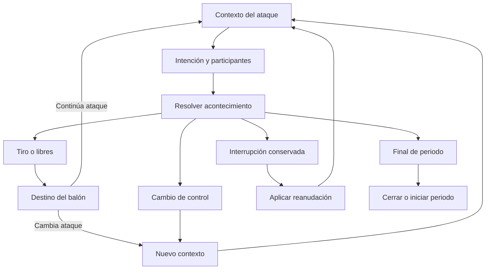

<!-- EXPORTADO GENERADO. No editar a mano: se reconstruye con scripts/docs/build_engine_docs.py -->

# beM — Diseño funcional unificado del motor de partidos

**Versión:** 1.0 de consolidación.  
**Fecha:** 15 de octubre de 2026.  
**Proyecto:** [bateman37/beM](https://github.com/bateman37/beM).  
**Corpus:** las ocho entregas funcionales definitivas indicadas por Dennis, incluida la ampliación del MD08 sobre extracción completa de partidos y lotes.  
**Naturaleza:** especificación funcional del motor y de su primer laboratorio. Las decisiones, el contenido definido, las semillas numéricas, los datos por completar y la evidencia futura tienen estados diferentes.

Este documento reúne el diseño por materias. Para utilizarlo no es necesario reconstruir el orden de las ocho conversaciones. Las ampliaciones compatibles se conservan; las formulaciones sustituidas dejan de ser instrucciones alternativas. La procedencia y la resolución de cada epígrafe se consultan en la trazabilidad final.

La experiencia buscada es un partido completo de baloncesto, con jugadores diferentes y decisiones tácticas reconocibles. El cálculo avanza por acontecimientos pertinentes dentro de posesiones, conserva un contexto activo pequeño y reutiliza operaciones compartidas. El primer resultado deportivo que debe demostrarse es el partido completo con motor, tácticas, capacidades, dirección, administración y estadísticas conectados.

> **Exportado generado: no editar a mano.** Reconstruido con `python3 scripts/docs/build_engine_docs.py` a partir de las secciones de [`docs/motor/`](../motor/README.md), en el orden de [`manifest.json`](../motor/manifest.json). La referencia congelada de la importación es [`unificado-original.md`](../historico/motor/unificado-original.md) (SHA-256 `df05edda480c7da556ba6a24009bedcd0a7f96c25e54f57c983951e63fc01fdd`). Revisión de composición: `DOC-001-r1`. Huella SHA-256 del contenido compuesto (sin esta nota): `95eed3ade98eb6c21193db862141e4004e7f2a6e3dc122f52d972492ef4ca14c`. Los índices de este archivo se generan a partir de los encabezados; el índice original se conserva solo en la copia histórica. Diseño definido no equivale a implementado, validado ni calibrado.

## Índice general

_Índice generado a partir de los encabezados de los capítulos._

1. [Identidad, alcance y decisiones de dirección](#cap-01)
2. [Datos de entrada, capas y participantes](#cap-02)
3. [Catálogo de 32 capacidades y escala](#cap-03)
4. [Cuerpo y alcance funcional](#cap-04)
5. [Tendencias individuales y decisiones](#cap-05)
6. [Experiencia, veteranos y desarrollo](#cap-06)
7. [Táctica ofensiva: estilos, disposiciones, libro y roles](#cap-07)
8. [Táctica defensiva: organización, estilos y responsabilidades](#cap-08)
9. [Repertorio declarativo: tareas, continuaciones y fichas](#cap-09)
10. [Banda, fondo y situaciones especiales](#cap-10)
11. [Flujo de partido, posesiones y contexto pequeño](#cap-11)
12. [Selección, oportunidad, ejecución y desenlace](#cap-12)
13. [Tiempo, esfuerzo y energía](#cap-13)
14. [Forma, momento, consistencia y presión](#cap-14)
15. [Órdenes, delegación y dirección en vivo](#cap-15)
16. [Entrenador: rotación, faltas, pausas y finales](#cap-16)
17. [Memoria defensiva y adaptación](#cap-17)
18. [Reglamento y administración deportiva](#cap-18)
19. [Registro, conservación y reproducción](#cap-19)
20. [Estadísticas: acta, atribución y magnitudes](#cap-20)
21. [Análisis táctico, quintetos, filtros e informes](#cap-21)
22. [Resumen final, relato y presentación](#cap-22)
23. [Visibilidad e información disponible](#cap-23)
24. [Modalidades y primer laboratorio](#cap-24)
25. [Población de referencia y generación](#cap-25)
26. [Panel, parámetros, perfiles y versiones](#cap-26)
27. [Inventario de tablas y contratos de datos](#cap-27)
28. [Auditorías y criterios de aceptación](#cap-28)
29. [Perfil inicial y semillas numéricas](#cap-29)
30. [Alcance de construcción y trabajos por completar](#cap-30)
31. [Comparativa histórica de habilidades y sistemas](#cap-31)
32. [Glosario y diccionarios](#cap-32)
33. [Fuentes y límites de la investigación](#cap-33)
34. [Trazabilidad y decisiones reconciliadas](#cap-34)

## Cómo leer y utilizar este documento

El índice general lleva a cada materia y el índice detallado a sus desarrollos. Los identificadores de capacidades, tareas, fichas, grupos, entradas, registros y casos conservan el significado de las fuentes. Los anclajes de procedencia permiten comprobar dónde quedó cada apartado original.

| Estado | Significado en la especificación consolidada |
|---|---|
| **DEC — decisión cerrada** | Comportamiento o cantidad aceptados. La implementación los respeta; no los cambia para completar un dato ausente. |
| **FUN — contenido funcional definido** | Catálogo, ficha, contrato o comportamiento descrito. Puede necesitar todavía filas y referencias cargables. |
| **SEM — semilla provisional** | Valor inicial explícito, administrable y revisable. No representa una frecuencia real demostrada ni un coeficiente calibrado. |
| **CARGA — contenido o dato por completar** | Valores, condiciones, correspondencias o perfiles concretos requeridos dentro de la estructura elegida. |
| **EVAL — evidencia de evaluación** | Comprobación asociada a una implementación, versión y muestra. La aceptación funcional o la revisión de Markdown no la sustituyen. |
| **Ilustración** | Ejemplo matemático, de interfaz o de caso. Sus cifras no se convierten automáticamente en datos deportivos del perfil. |

Estas etiquetas pueden concurrir: una regla DEC puede utilizar un coeficiente SEM y requerir otras filas CARGA. Un cero funcional cerrado —por ejemplo, la ausencia de efecto directo de T sobre la conversión del tiro— se distingue de un valor que falta.

El MD08 diferenciaba requisitos solicitados y concreciones propuestas. Se conserva esa naturaleza para los detalles que no tenían otro cierre expreso: entre ellos los accesos rápidos 10/100/1.000, las concreciones operativas de edición y lotes y el formato recomendado de intercambio. La descarga completa, doce jugadores por equipo, +1/+3/+5, las tres modalidades y la simulación masiva constan como requisitos solicitados. Esta consolidación no transforma sus números ilustrativos en valores calibrados.

### Criterio de precedencia aplicado

1. La instrucción expresa de Dennis sobre la materia.
2. El cierre o precisión específica más reciente de MD08, MD07, MD06 y MD05, en ese orden cuando existe una colisión real.
3. El contenido de MD01–04 que sigue siendo compatible y aporta detalle.
4. Las semillas y ejemplos anteriores compatibles, conservando su procedencia y estado.

Una omisión en un documento breve posterior no revoca un catálogo amplio anterior. Por eso el MD07 no reduce las estadísticas del MD04 y el MD08 no elimina el panel, las auditorías ni las decisiones deportivas ya cerradas. Los pendientes históricos resueltos se retiran de la lista de trabajo vigente y quedan relacionados con su cierre.

### Decisiones de dirección que gobiernan todo el diseño

| Materia | Decisión vigente | Procedencia principal |
|---|---|---|
| Granularidad | Acontecimientos pertinentes dentro de posesiones; los intervalos se procesan de una vez. Preparar, leer, elegir y ejecutar son funciones agrupables. | MD03 §§2–4; MD05 §3. |
| Contexto | Balón, oposición, apoyos, responsabilidades y continuidad necesarios; historial y memoria extensa quedan fuera del contexto activo. | MD05 §3; MD06 §21; MD07 §28. |
| Operaciones | Tres tablas funcionales y 17 tareas compartidas, activadas por pertinencia. | MD03 §§4–10; MD07 §17. |
| Jugadores | 32 capacidades: 18 técnicas, siete físicas y siete mentales; escala absoluta continua equivalente a 1–30 y redondeo de presentación. | MD02 §5; MD05 §15.2. |
| Preferencias | Iniciativa, Vocación de finalización y Preferencia de zona, fuera de las capacidades; orientan elección. | MD06 §§7–8. |
| Cuerpo | Alcance derivado único de altura y envergadura; combinación equilibrada normalizada como semilla. Salto permanece separado; peso sin modificador directo adicional inicial. | MD06 §6; MD07 §9. |
| Experiencia | Historial y aprendizaje reflejados en capacidades actuales; sin segunda prima de partido por edad o experiencia. | MD02 §§14–15. |
| Ataque | Siete estilos de cinco niveles, seis disposiciones, roles y libro de prioridades 1–5 compartibles. | MD01 §§4–9; MD07 §§14, 16. |
| Selección | Elegibilidad antes que preferencia; pesos normalizados; familia antes de variante; mejor prioridad elegible sin premio por duplicación. | MD05 §5; MD07 §6. |
| Libertad | Mezcla de plan y lectura, limitada por el margen concedido y orientada por Iniciativa; Visión y Decisiones mantienen su función propia. | MD05 §5; MD06 §8. |
| Juego directo | Son posibles decisiones espontáneas, recursos autónomos y oportunidades inmediatas sin iniciar una ficha. | MD05 §§6–7; MD07 §21. |
| Defensa | Seis organizaciones, tres alturas, cuatro coberturas y tres especiales; responsabilidades y concesiones reales. | MD01 §§10–14; MD07 §15. |
| Emparejamientos | Asignación de referencia y responsabilidad actual distintas; el desajuste continúa hasta una interacción o reorganización que lo modifique. | MD06 §§4–5. |
| Objetivo ausente | Alternativa individual declarada o suspensión. Box and one dispone de organización alternativa 2–3 preconfigurada; el regreso depende del plan vigente. | MD06 §5. |
| Resultado | Distribuciones entre excluyentes, logística para binarias pertinentes y relaciones condicionales para hechos compatibles. Cada causa se aplica una vez donde corresponde. | MD05 §5; MD07 §8. |
| Tiro | Técnica principal por gesto; TEC06 prepara cuando corresponde; TEC11 crea desde poste. Floater en progresión y palmeo directo pertinente usan TEC04; tiro corto controlado usa TEC03. | MD06 §12. |
| Tiempo | Distribución triangular acotada inicial por contexto y desenlace; la duración corresponde al hecho efectivamente producido. | MD07 §10. |
| Energía | Reserva 0–100; tramo 100–70 casi neutro y deterioro creciente, muy considerable bajo 10, selectivo por tarea. | MD05 §8; MD07 §10.3. |
| Forma | Estado continuo persistente recibido por el encuentro y estable durante él; no realimentado automáticamente desde puntos, VAL o victoria. | MD05 §9.2; MD07 §10.4. |
| Momento | M-TIR, M-OFE y M-DEF, más T por equipo; persistencia, retorno, variación y episodios agrupados. | MD06 §§15–17. |
| Alcance de T | Coordinación, atención compartida y elección; sin contribución directa a la conversión del tiro ni plus físico universal. | MD06 §16. |
| Consistencia y presión | Variación con control del centro de referencia después de la transformación; presión contextual sin duplicar exigencias. | MD05 §9; MD06 §15; MD07 §10.6. |
| Órdenes | Solicitud, vigencia y ejecución distintas; frontera por tipo, ámbito, consumo y caducidad. Obligación reglamentaria antes que manual válido, plan y delegación. | MD06 §§9–11. |
| Rotación | Plan con revisión contextual, estabilidad y alternativas. E = 30 puede seguir siendo la mejor opción, pagando fatiga pertinente. | MD05 §11. |
| Faltas y pausas | Librillo administrable; tiempos muertos con intención, descanso, atenuación y ajustes válidos, sin resultado garantizado. | MD05 §§11–12; MD06 §17. |
| Adaptación | Memoria colectiva pequeña, semántica y gradual; respuesta compatible y ejecutada. La cuarta repetición puede funcionar. | MD05 §13; MD07 §12. |
| Reglamento | Perfil principal FIBA 2026 v1.1 identificado; administración común y determinista, incidencias condicionadas y ventanas explícitas. | MD05 §4; MD07 §25. |
| Estadística | Catálogo máximo conservado; hechos, créditos, derivados e interpretaciones separados, con universos y permisos explícitos. | MD04; MD05 §14; MD06 §§13–14. |
| F | Acción de tiro y serie causal ligada; rebote ofensivo y nuevo tiro abren otra F. Penalización no de tiro y administración quedan fuera. | MD06 §§13–14. |
| Presencia | Minutos y más-menos por presencia efectiva; eficiencias de unidades completas y mixtas diferenciadas. | MD04 §§13, 23–24; MD05 §14.7. |
| Resumen | Tres claves principales sustentadas y ampliables, con menos cuando la evidencia válida resulte insuficiente; líderes por criterio, sin nueva fórmula integral de MVP. | MD07 §24.4; MD05 §14.9. |
| Información | Energía propia con número 0–100; Forma y momento propios cualitativos; rival observado, diagnóstico separado y conocimiento permitido común a humano y automático. | MD06 §18. |
| Modalidades | Simulado total, por cuartos y por tiempo x2/x4/x8/x16 comparten núcleo; también los partidos del mundo. Pausar la interfaz no produce descanso deportivo. | MD05 §15; MD06 §21; MD08 §4. |
| Panel | Control de todos los ajustes deportivos calibrables mediante datos administrados, vistas guiadas y tabla maestra, perfiles congelados y auditorías. | MD05 §§16–20; MD06 §20; MD07 §27. |
| Inventario | 81 grupos deportivos y de contenido y cuatro soportes. Los 23 elementos T06, las tres entradas y los ocho registros son otras clasificaciones. | MD07 §§4–13, 24–28, 30.2. |
| Precarga | 21 fichas ofensivas, seis respuestas de saque, nueve continuaciones, 20 situaciones espontáneas, tres políticas y doce equipos de doce plazas. | MD07 §§18–23 y anexo B. |
| Laboratorio | Fichas, edición masiva +1/+3/+5, preparación, las tres modalidades, lotes y comparación base/variante. | MD08 §§1–6. |
| Extracción | Paquete autocontenido del partido o lote: entradas, configuración efectiva, estadísticas, agregados, acontecimientos, decisiones, auditoría y resumen. | MD08 §7. |

### Qué entrega y qué queda por completar

La definición funcional y sus catálogos están reunidos aquí. Quedan datos concretos y trabajo de construcción: filas numéricas requeridas de los 81 grupos, correspondencias reglamentarias y estadísticas, perfiles completos de las 144 plazas, planes, rangos del generador y escenarios/tolerancias de auditoría. El primer perfil operativo se entrega completo y preconfigurado para que Dennis pueda jugar y ajustar.

Los valores y ejemplos que ya existen se conservan con sus estados. No se asignan 32 cifras nuevas a cada plaza ni se inventan probabilidades para completar huecos. Construcción, evaluación deportiva y medición del coste utilizarán partidos completos y muestras pertinentes. Las fuentes externas se conservan con el alcance de sus lecturas originales; esta consolidación no incorpora investigación nueva ni una auditoría nueva de repositorios.

La unificación solicitada queda realizada mediante este documento; deja de ser un trabajo pendiente. La implementación y la calibración conservan su propio estado y no se declaran ejecutadas por esta entrega documental.

## Índice detallado

**[1. Identidad, alcance y decisiones de dirección](#cap-01)**

- [1.1. Alcance del cierre](#grupo-01-01)
- [1.2. Recomendaciones aceptadas y cantidades](#grupo-01-02)
- [1.3. Precedencia y conservación de decisiones](#grupo-01-03)
- [1.4. Objetivo y límites](#grupo-01-04)

**[2. Datos de entrada, capas y participantes](#cap-02)**

- [2.1. Qué información pertenece a cada capa](#grupo-02-01)
- [2.2. Población, modalidades y conservación](#grupo-02-02)

**[3. Catálogo de 32 capacidades y escala](#cap-03)**

- [3.1. Escala visible 1–30](#grupo-03-01)
- [3.2. Catálogo aprobado: 32 capacidades](#grupo-03-02)
- [3.3. Qué se conserva, integra o aplaza del estudio anterior](#grupo-03-03)
- [3.4. Población, modalidades y conservación](#grupo-03-04)
- [3.5. Mapa de uso de las 32 capacidades](#grupo-03-05)
- [3.6. Mapa completo de las 32 capacidades](#grupo-03-06)
- [3.7. Relación con las 32 capacidades](#grupo-03-07)
- [3.8. Capacidades y cobertura](#grupo-03-08)
- [3.9. Energía, forma, momento y las 32 capacidades](#grupo-03-09)

**[4. Cuerpo y alcance funcional](#cap-04)**

- [4.1. Cuerpo: COR01–COR02](#grupo-04-01)
- [4.2. Diccionario y ejemplos de lectura](#grupo-04-02)
- [4.3. Cuerpo, alcance funcional y capacidades físicas](#grupo-04-03)
- [4.4. Ejemplos integrados](#grupo-04-04)

**[5. Tendencias individuales y decisiones](#cap-05)**

- [5.1. Catálogo cerrado de tendencias individuales](#grupo-05-01)
- [5.2. Integración de tendencias, roles, plan y lectura](#grupo-05-02)
- [5.3. Ejemplos integrados](#grupo-05-03)
- [5.4. Roles y tendencias](#grupo-05-04)

**[6. Experiencia, veteranos y desarrollo](#cap-06)**

- [6.1. Experiencia: historial que contribuye al aprendizaje](#grupo-06-01)
- [6.2. Veteranos y envejecimiento](#grupo-06-02)
- [6.3. Energía, forma, momento y las 32 capacidades](#grupo-06-03)
- Nota de implementación MOTOR-18 (Familiaridad, Polivalencia y aprendizaje)

**[7. Táctica ofensiva: estilos, disposiciones, libro y roles](#cap-07)**

- [7.1. Estructura de la configuración táctica](#grupo-07-01)
- [7.2. Estilos ofensivos: siete dimensiones y cinco niveles](#grupo-07-02)
- [7.3. Disposiciones ofensivas](#grupo-07-03)
- [7.4. Libro táctico ofensivo](#grupo-07-04)
- [7.5. Prioridades del libro y libertad del jugador](#grupo-07-05)
- [7.6. Roles ofensivos](#grupo-07-06)
- [7.7. Director de juego: interpretación del plan](#grupo-07-07)
- Nota de implementación MOTOR-18 (Familiaridad táctica)
- [7.8. Estilos y disposiciones de precarga](#grupo-07-08)
- [7.9. Ataque: disposiciones, familias y alternativas](#grupo-07-09)
- [7.10. Roles, dirección, experiencia y veteranos](#grupo-07-10)

**[8. Táctica defensiva: organización, estilos y responsabilidades](#cap-08)**

- [8.1. Estilos defensivos: cinco dimensiones y cinco niveles](#grupo-08-01)
- [8.2. Organización defensiva y altura de presión](#grupo-08-02)
- [8.3. Coberturas habituales del bloqueo](#grupo-08-03)
- [8.4. Instrucciones defensivas especiales](#grupo-08-04)
- [8.5. Roles defensivos](#grupo-08-05)
- [8.6. Asignación defensiva de referencia y responsabilidad actual](#grupo-08-06)
- [8.7. Objetivos, sustituciones y alternativa de box and one](#grupo-08-07)
- [8.8. Ejemplos integrados](#grupo-08-08)
- [8.9. Estilos y disposiciones de precarga](#grupo-08-09)
- [8.10. Organizaciones, coberturas y especiales](#grupo-08-10)
- [8.11. Diccionario y ejemplos de lectura](#grupo-08-11)
- [8.12. Defensa: organización y respuestas](#grupo-08-12)

**[9. Repertorio declarativo: tareas, continuaciones y fichas](#cap-09)**

- [9.1. Repertorio declarativo y decisiones sin jugada](#grupo-09-01)
- [9.2. Catálogo de decisiones espontáneas](#grupo-09-02)
- [9.3. Ejemplos funcionales integrados](#grupo-09-03)
- [9.4. Contenido y población: CON y POB](#grupo-09-04)
- [9.5. Las 17 tareas compartidas](#grupo-09-05)
- [9.6. Las nueve continuaciones](#grupo-09-06)
- [9.7. Las 15 fichas posicionales](#grupo-09-07)
- [9.8. Las 20 situaciones espontáneas](#grupo-09-08)
- [9.9. Ejemplos integrados](#grupo-09-09)

**[10. Banda, fondo y situaciones especiales](#cap-10)**

- [10.1. Jugadas de banda y fondo, ofensivas y defensivas](#grupo-10-01)
- [10.2. Banda y fondo: seis fichas y seis respuestas](#grupo-10-02)
- [10.3. Saques y finales](#grupo-10-03)

**[11. Flujo de partido, posesiones y contexto pequeño](#cap-11)**

- [11.1. Contrato de sencillez y contexto pequeño](#grupo-11-01)
- [11.2. Resolución por acontecimientos: decisión confirmada](#grupo-11-02)
- [11.3. Unidad deportiva, continuidad y contexto](#grupo-11-03)
- [11.4. Tres tablas configurables](#grupo-11-04)
- Nota de implementación MOTOR-18 (Familiaridad en el flujo (MOTOR-18))

**[12. Selección, oportunidad, ejecución y desenlace](#cap-12)**

- [12.1. Selección, oportunidades y desenlaces](#grupo-12-01)
- [12.2. Ejemplos funcionales integrados](#grupo-12-02)
- [12.3. Catálogo de finalizaciones y técnica principal](#grupo-12-03)
- [12.4. Ejemplos integrados](#grupo-12-04)
- [12.5. Tabla 1: selección de intenciones y participantes](#grupo-12-05)
- [12.6. Tabla 2: oportunidades y desenlaces](#grupo-12-06)
- [12.7. Mapa de impacto en el motor](#grupo-12-07)
- [12.8. Fórmulas: orientación elegida y límites pendientes](#grupo-12-08)

**[13. Tiempo, esfuerzo y energía](#cap-13)**

- [13.1. Tiempo y estados: ACT01–ACT12](#grupo-13-01)
- [13.2. Energía: reserva, curva y efectos](#grupo-13-02)
- [13.3. Tabla 3: tiempo, esfuerzo y estados](#grupo-13-03)
- [13.4. Energía, forma, momento y las 32 capacidades](#grupo-13-04)

**[14. Forma, momento, consistencia y presión](#cap-14)**

- [14.1. Forma, momento individual, consistencia y presión](#grupo-14-01)
- [14.2. Momento colectivo y jugadores que dan vida al equipo](#grupo-14-02)
- [14.3. Ejemplos funcionales integrados](#grupo-14-03)
- [14.4. Momento individual](#grupo-14-04)
- [14.5. Momento colectivo y su alcance restringido](#grupo-14-05)
- [14.6. Catálogo de episodios y actualización de estados](#grupo-14-06)
- [14.7. Ejemplos integrados](#grupo-14-07)
- [14.8. Tiempo y estados: ACT01–ACT12](#grupo-14-08)
- [14.9. Diccionario y ejemplos de lectura](#grupo-14-09)
- [14.10. Energía, forma, momento y las 32 capacidades](#grupo-14-10)
- [14.11. Tres estados del jugador con distintas duraciones](#grupo-14-11)

**[15. Órdenes, delegación y dirección en vivo](#cap-15)**

- [15.1. Identidad y ciclo de vida de las órdenes](#grupo-15-01)
- [15.2. Tabla de aplicación por tipo de orden](#grupo-15-02)
- [15.3. Precedencia y conflictos](#grupo-15-03)
- [15.4. Dirección desde la interfaz y relato](#grupo-15-04)
- [15.5. Ejemplos integrados](#grupo-15-05)
- [15.6. Dirección durante el partido](#grupo-15-06)
- [15.7. Entrenador: ENT01–ENT07](#grupo-15-07)

**[16. Entrenador: rotación, faltas, pausas y finales](#cap-16)**

- [16.1. Rotaciones, funciones y gestión de faltas](#grupo-16-01)
- [16.2. Tiempos muertos, ajustes y finales](#grupo-16-02)
- [16.3. Ejemplos funcionales integrados](#grupo-16-03)
- [16.4. Entrenador: ENT01–ENT07](#grupo-16-04)
- [16.5. Tres políticas iniciales de entrenador](#grupo-16-05)
- [16.6. Ejemplos integrados](#grupo-16-06)

**[17. Memoria defensiva y adaptación](#cap-17)**

- [17.1. Memoria colectiva y adaptación](#grupo-17-01)
- [17.2. Ejemplos funcionales integrados](#grupo-17-02)
- [17.3. Memoria: MEM01–MEM04](#grupo-17-03)

**[18. Reglamento y administración deportiva](#cap-18)**

- [18.1. Reglamento y administración deportiva](#grupo-18-01)
- [18.2. Reglas y acontecimientos menos frecuentes](#grupo-18-02)
- [18.3. Reglamento: REG01–REG04](#grupo-18-03)
- Nota de implementación MOTOR-15B (norma e interferencia)

**[19. Registro, conservación y reproducción](#cap-19)**

- [19.1. Entradas, registros y vistas](#grupo-19-01)
- [19.2. Registro, versiones y modalidades](#grupo-19-02)
- [19.3. Conservación, historial y partidos del mundo](#grupo-19-03)
- [19.4. Información funcional que necesita el registro](#grupo-19-04)
- [19.5. Población, modalidades y conservación](#grupo-19-05)
- Nota de implementación MOTOR-18 (Exposición y audiencias de la familiaridad (MOTOR-18))

**[20. Estadísticas: acta, atribución y magnitudes](#cap-20)**

- [20.1. Unidad de finalización de tiro](#grupo-20-01)
- [20.2. Créditos, puntos y análisis de finalizaciones](#grupo-20-02)
- [20.3. Ejemplos integrados](#grupo-20-03)
- [20.4. Qué debe poder hacer el usuario](#grupo-20-04)
- [20.5. Principios de interpretación y presentación](#grupo-20-05)
- [20.6. Identidad, reglas y estado del partido](#grupo-20-06)
- [20.7. Catálogo individual: acta completa](#grupo-20-07)
- [20.8. Catálogo colectivo y filas de equipo](#grupo-20-08)
- [20.9. Atribución: qué hecho produce cada registro](#grupo-20-09)
- [20.10. Tiros, libres y clasificación de finalizaciones](#grupo-20-10)
- [20.11. Creación, pases y asistencias](#grupo-20-11)
- [20.12. Pérdidas, recuperaciones y robos](#grupo-20-12)
- [20.13. Tapones, rebotes y balones disputados](#grupo-20-13)
- Nota de implementación MOTOR-15B (robo)
- [20.14. Faltas, sanciones, lesiones y disponibilidad](#grupo-20-14)
- [20.15. Minutos, tramos y más-menos](#grupo-20-15)
- [20.16. Posesiones, continuaciones y eficiencia](#grupo-20-16)
- [20.17. Catálogo avanzado y fórmulas](#grupo-20-17)
- [20.18. Procedencia de los puntos y producción colectiva](#grupo-20-18)
- [20.19. Evolución, parciales y momentos del encuentro](#grupo-20-19)
- [20.20. Mapa de tiros y perfiles de finalización](#grupo-20-20)
- [20.21. Ejemplos completos de conciliación y lectura](#grupo-20-21)
- [20.22. Estadística y resumen: EST01–EST08](#grupo-20-22)
- [20.23. Convenciones estadísticas y resumen](#grupo-20-23)
- [20.24. Políticas estadísticas resueltas](#grupo-20-24)

**[21. Análisis táctico, quintetos, filtros e informes](#cap-21)**

- [21.1. Lectura ofensiva, libro y dirección de juego](#grupo-21-01)
- [21.2. Lectura defensiva, presión y coberturas](#grupo-21-02)
- [21.3. Saques, finales y situaciones especiales](#grupo-21-03)
- [21.4. Aportaciones sin balón y oportunidades](#grupo-21-04)
- [21.5. Quintetos, parejas, grupos y rotaciones](#grupo-21-05)
- [21.6. Análisis on-off y comparación de contextos](#grupo-21-06)
- [21.7. Filtros, desgloses y comparaciones](#grupo-21-07)
- [21.8. Informes para entrenador, jugadores y rival](#grupo-21-08)
- [21.9. Ejemplos completos de conciliación y lectura](#grupo-21-09)
- [21.10. Convenciones estadísticas y resumen](#grupo-21-10)
- [21.11. Ejemplos integrados](#grupo-21-11)

**[22. Resumen final, relato y presentación](#cap-22)**

- [22.1. Estadística y resumen: EST01–EST08](#grupo-22-01)
- [22.2. Resumen final: contenido y comportamiento](#grupo-22-02)
- [22.3. Dirección desde la interfaz y relato](#grupo-22-03)
- [22.4. Relato, estadísticas y laboratorio](#grupo-22-04)
- [22.5. Población, modalidades y conservación](#grupo-22-05)

**[23. Visibilidad e información disponible](#cap-23)**

- [23.1. Matriz de visibilidad](#grupo-23-01)
- [23.2. Dirección desde la interfaz y relato](#grupo-23-02)
- [23.3. Ejemplos integrados](#grupo-23-03)
- [23.4. Información pública, observación y diagnóstico](#grupo-23-04)
- [23.5. Diccionario y ejemplos de lectura](#grupo-23-05)

**[24. Modalidades y primer laboratorio](#cap-24)**

- [24.1. Requisitos solicitados del primer laboratorio](#grupo-24-01)
- [24.2. Plantillas y fichas iniciales](#grupo-24-02)
- [24.3. Edición masiva](#grupo-24-03)
- [24.4. Preparación y tres modalidades](#grupo-24-04)
- [24.5. Simulación masiva](#grupo-24-05)
- [24.6. Resultados y comparación](#grupo-24-06)
- [24.7. Exportación completa del lote para análisis](#grupo-24-07)
- [24.8. Recorrido funcional y relación con el panel](#grupo-24-08)
- [24.9. Población, modalidades y conservación](#grupo-24-09)
- [24.10. Registro, versiones y modalidades](#grupo-24-10)
- [24.11. Ejemplos integrados](#grupo-24-11)
- [24.12. Modalidades, presentación y rendimiento](#grupo-24-12)
- [24.13. Configuración, exportación y correcciones](#grupo-24-13)

**[25. Población de referencia y generación](#cap-25)**

- [25.1. Contenido y población: CON y POB](#grupo-25-01)
- [25.2. Doce equipos manuales y generación](#grupo-25-02)
- [25.3. Las 144 plazas de referencia](#grupo-25-03)
- [25.4. Población, modalidades y conservación](#grupo-25-04)

**[26. Panel, parámetros, perfiles y versiones](#cap-26)**

- [26.1. Panel de administración: finalidad y organización](#grupo-26-01)
- [26.2. Diccionario y edición de parámetros](#grupo-26-02)
- [26.3. Perfiles, versiones y ciclo de mejora](#grupo-26-03)
- [26.4. Ejemplos funcionales integrados](#grupo-26-04)
- [26.5. Ampliación del panel administrable](#grupo-26-05)
- [26.6. Soportes y funcionamiento del panel](#grupo-26-06)
- [26.7. Diccionario y ejemplos de lectura](#grupo-26-07)
- [26.8. Configuración, exportación y correcciones](#grupo-26-08)

**[27. Inventario de tablas y contratos de datos](#cap-27)**

- [27.1. Organización de los datos](#grupo-27-01)
- [27.2. Contrato de una fila completa](#grupo-27-02)
- [27.3. Selección: SEL01–SEL12](#grupo-27-03)
- [27.4. Defensa: DEF01–DEF09](#grupo-27-04)
- [27.5. Resolución: RES01–RES13](#grupo-27-05)
- [27.6. Cuerpo: COR01–COR02](#grupo-27-06)
- [27.7. Tiempo y estados: ACT01–ACT12](#grupo-27-07)
- [27.8. Entrenador: ENT01–ENT07](#grupo-27-08)
- [27.9. Memoria: MEM01–MEM04](#grupo-27-09)
- [27.10. Contenido y población: CON y POB](#grupo-27-10)
- [27.11. Estadística y resumen: EST01–EST08](#grupo-27-11)
- [27.12. Reglamento: REG01–REG04](#grupo-27-12)
- [27.13. Soportes y funcionamiento del panel](#grupo-27-13)
- [27.14. Clasificación de los elementos T06](#grupo-27-14)
- [27.15. Diccionario y ejemplos de lectura](#grupo-27-15)
- [27.16. Diccionario de tablas y parámetros](#grupo-27-16)
- [27.17. Catálogo administrable del motor](#grupo-27-17)
- Nota de implementación MOTOR-18 (Filas de familiaridad y aprendizaje (MOTOR-18))

**[28. Auditorías y criterios de aceptación](#cap-28)**

- [28.1. Población, modalidades y conservación](#grupo-28-01)
- [28.2. Auditorías y comparaciones](#grupo-28-02)
- [28.3. Casos de aceptación del conjunto](#grupo-28-03)
- Nota de implementación MOTOR-15B (equivalencia)
- [28.4. Conciliaciones y aceptación del catálogo](#grupo-28-04)
- [28.5. Casos de atribución que debe cubrir el diseño](#grupo-28-05)
- [28.6. Auditorías y casos de aceptación](#grupo-28-06)
- [28.7. Referencias y auditorías: REF y LAB](#grupo-28-07)
- Nota de implementación MOTOR-15B (auditorías)
- [28.8. Criterios de aceptación documental y funcional](#grupo-28-08)
- [28.9. Modalidades, presentación y rendimiento](#grupo-28-09)
- [28.10. Comprobación sobre partidos completos](#grupo-28-10)
- [28.11. Validación funcional y laboratorio](#grupo-28-11)
- [28.12. Evidencias para comprobar la implementación](#grupo-28-12)

**[29. Perfil inicial y semillas numéricas](#cap-29)**

- [29.1. Perfil inicial, semillas y trabajo numérico](#grupo-29-01)
- [29.2. Valores y fórmulas iniciales provisionales](#grupo-29-02)
- [29.3. Filas de ejemplo para el panel](#grupo-29-03)

**[30. Alcance de construcción y trabajos por completar](#cap-30)**

- [30.1. Reglamento: REG01–REG04](#grupo-30-01)
- [30.2. Frontera de cambio, hito integrado y responsabilidades](#grupo-30-02)
- [30.3. Trabajo restante y documento unificado](#grupo-30-03)
- [30.4. Inventario de decisiones cerradas y trabajo restante](#grupo-30-04)
- [30.5. Implementación y responsabilidades](#grupo-30-05)
- [30.6. Alcance de implementación y responsabilidades](#grupo-30-06)
- [30.7. Referencias y responsabilidad de cada herramienta](#grupo-30-07)

**[31. Comparativa histórica de habilidades y sistemas](#cap-31)**

- [31.1. Qué se conserva, integra o aplaza del estudio anterior](#grupo-31-01)
- [31.2. Comparación y opinión adoptada](#grupo-31-02)
- [31.3. Mapa comparativo completo de habilidades](#grupo-31-03)
- [31.4. Inventarios originales en su orden de agrupación](#grupo-31-04)

**[32. Glosario y diccionarios](#cap-32)**

- [32.1. Glosario y reglas de lectura](#grupo-32-01)
- [32.2. Diccionario de magnitudes y denominadores](#grupo-32-02)
- [32.3. Diccionario y ejemplos de lectura](#grupo-32-03)

**[33. Fuentes y límites de la investigación](#cap-33)**

- [33.1. Fuentes y alcance de la investigación](#grupo-33-01)
- [33.2. Fuentes y trazabilidad](#grupo-33-02)
- [33.3. Fuentes, investigación y límites](#grupo-33-03)
- [33.4. Fuentes, investigación y límites](#grupo-33-04)
- [33.5. Investigación, referencias y límites](#grupo-33-05)
- [33.6. Fuentes y límites de la investigación](#grupo-33-06)
- [33.7. Procedencia y límites](#grupo-33-07)

**[34. Trazabilidad y decisiones reconciliadas](#cap-34)**

- [34.1. Corpus de origen](#traza-corpus)
- [34.2. Sustituciones y cierres aplicados](#traza-sustituciones)
- [34.3. Registro de decisiones de origen](#traza-decisiones)
- [34.4. Matriz completa de epígrafes](#traza-epigrafes)
- [34.5. Control documental de la consolidación](#traza-control)

## 1. Identidad, alcance y decisiones de dirección

### 1.1. Alcance del cierre

*Procedencia: MD07, §1.*

#### 1.1.1. Cuatro estados distintos

*Origen: MD07 §1.3.*

| Estado | Significado |
|---|---|
| **Regla cerrada** | Comportamiento aceptado que debe respetarse. |
| **Contenido funcional definido** | Ficha, catálogo o perfil descrito con función y requisitos. |
| **Precarga numérica completa** | Todas sus entradas necesarias tienen valores explícitos y válidos. |
| **Comportamiento evaluado** | La implementación y la muestra pertinente aportan evidencia. |

Una ficha descrita aquí puede estar funcionalmente definida y necesitar todavía sus datos numéricos. La aceptación de una curva inicial no demuestra que sus efectos estén calibrados.

#### 1.1.2. Límite de esta entrega

*Origen: MD07 §1.4.*

Este documento aporta el inventario completo de grupos, contratos, fichas funcionales y criterios de terminación. No incorpora una base de datos ejecutable de todos los parámetros ni 144 fichas con sus 32 cifras ya asignadas.

La obligación de entregar un perfil inicial completo al construir sigue vigente. No se traslada a Dennis la tarea de inventar cientos de valores ni se autoriza a Claude Code a rellenarlos como decisiones de juego ocultas.

### 1.2. Recomendaciones aceptadas y cantidades

*Procedencia: MD07, §2.*

| Materia | Decisión de esta entrega |
|---|---|
| Inventario | 75 grupos conservados + 2 COR + 4 REG = **81 grupos deportivos y de contenido**. |
| Administración transversal | **4 soportes**, SUP01–SUP04. |
| Operaciones del motor | Las tres tablas funcionales ya acordadas. |
| Resolución reutilizable | **17 tareas compartidas**, activadas cuando son pertinentes. |
| Parametrización | Referencia general y excepciones por causa deportiva explícita. |
| Fichas ofensivas | **15 posicionales + 3 de banda + 3 de fondo = 21**. |
| Respuestas de saque | **3 de banda + 3 de fondo = 6** plantillas defensivas. |
| Continuaciones | **9**, reutilizables entre fichas compatibles. |
| Juego espontáneo | Completar ESP01–ESP20, conservando sus opciones directas. |
| Duración | Distribuciones triangulares acotadas para intervalos de juego pertinentes. |
| Fatiga | Curva administrable de seis nodos y sensibilidad por tarea. |
| Cuerpo | Combinación equilibrada de altura y envergadura normalizadas como semilla inicial de alcance. |
| Entrenadores de referencia | **3 políticas**: cauta, equilibrada y agresiva en decisiones. |
| Población manual | **12 equipos × 12 jugadores = 144 plazas**. |
| Población adicional | Generación ficticia correlacionada. |
| Estadística | Conservar todo el alcance vigente del MD04–06. |
| Resumen inicial | **3 claves principales**, con ampliación al catálogo. |
| Auditoría | Relacionar y reutilizar casos, sin sumar colecciones solapadas como si fueran únicas. |
| Panel | Tabla maestra, vistas guiadas, detalle, comparación e historial sobre los mismos datos. |

Las cantidades de precarga hacen concreto un conjunto inicial. No son límites de fichas activas del libro, de equipos del mundo ni del crecimiento del contenido compatible.

### 1.3. Precedencia y conservación de decisiones

*Procedencia: MD07, §3.*

#### 1.3.1. Restricciones que siguen vigentes

*Origen: MD07 §3.3.*

- Las tendencias afectan elección y no añaden precisión al tiro fijado.
- El alcance no se suma otra vez como altura y envergadura.
- El peso no aporta un modificador directo adicional inicial.
- La responsabilidad defensiva actual prevalece para determinar quién interviene.
- La orden solicitada, su vigencia y la ejecución son cosas distintas.
- T colectivo no añade una prima directa de conversión de tiro.
- F agrupa tiro y serie causal ligada; la penalización no de tiro y la administración se separan.
- La IA de entrenador utiliza conocimiento permitido, sin estados rivales ocultos ni futuros.

### 1.4. Objetivo y límites

*Procedencia: MD01, §1.*

beM tendrá un motor de baloncesto por posesiones, ligero, configurable y comprensible. El sistema táctico debe ofrecer decisiones interesantes sin exigir una simulación geométrica detallada ni un editor de trayectorias.

El entrenador configura prioridades; los jugadores interpretan y ejecutan sus responsabilidades; el rival responde. De esa interacción salen las oportunidades, la calidad de ejecución y los resultados.

Se busca:

- Reconocer en el partido el estilo, la disposición, las jugadas y los roles elegidos.
- Distinguir equipos que usan el mismo plan con jugadores diferentes.
- Cambiar jugadores y órdenes durante el encuentro y observar consecuencias en su desarrollo posterior.
- Representar la aportación de los cinco jugadores de cada equipo, con y sin balón.
- Evitar que una jugada se convierta en una solución universal sin respuesta defensiva.
- Mantener un catálogo amplio mediante acciones compartidas y entregas revisables.

Elegir una táctica no concede por sí mismo una mejora general al porcentaje de tiro ni a los atributos. La táctica cambia las situaciones que se crean; los jugadores resuelven esas situaciones.

Los coeficientes que conviertan capacidades, oposición y contexto en probabilidades se acordarán al diseñar y calibrar el motor.

## 2. Datos de entrada, capas y participantes

### 2.1. Qué información pertenece a cada capa

*Procedencia: MD02, §3.*

| Capa | Qué expresa | Ejemplo | Uso |
|---|---|---|---|
| Capacidad | Lo bien que sabe realizar una tarea | Pase 24; anticipación 25 | Lectura, preparación o ejecución pertinente |
| Tendencia | Qué prefiere intentar cuando tiene margen | Iniciativa elevada | Elección de opciones |
| Orden | Qué solicita el entrenador | Priorizar bloqueo directo; pocas ayudas | Responsabilidades y preferencias |
| Estado | Cómo se encuentra ahora | Energía baja; buena forma; momento frío | Rendimiento actual, con duración propia |
| Medida corporal | Características en sus unidades | Altura, envergadura y peso | Alcance y emparejamientos pertinentes |
| Historial | Lo que ha vivido y producido | Minutos de carrera; experiencia acumulada | Desarrollo e información de carrera |
| Potencial y desarrollo | Posibilidades y evolución futura | Margen de mejora de decisiones | Sistema posterior de progresión |

#### 2.1.1. Reglas para evitar duplicaciones

*Origen: MD02 §3.1.*

Un rol de tirador cambia la utilización del jugador; no aumenta su Triple. Una orden de presión cambia el esfuerzo y las oportunidades defensivas; no aumenta su Robo.

La buena visión permite percibir un pase. La precisión para ejecutarlo pertenece a Pase. Detectar bien y ejecutar bien son dos capacidades distintas.

La fatiga se deriva de la energía disponible y sus consecuencias. No se añade una segunda reserva independiente de fatiga con el mismo efecto.

La experiencia puede haber contribuido a mejorar decisiones. No vuelve a conceder otro bonus general de experiencia sobre esas decisiones durante el partido.

El overall, si se calcula para informar al usuario, no se utiliza como causa de éxito. Tampoco entran en una acción el potencial, la reputación ni los puntos anotados en el partido anterior como sustitutos de la capacidad pertinente.

#### 2.1.2. Lo que no cuenta como una de las 32 capacidades

*Origen: MD02 §3.2.*

No cuentan la edad, las medidas corporales, las posiciones, los roles, la iniciativa, los tres estados, el historial, la experiencia o el potencial.

Su representación respeta el cuerpo derivado, los tres grupos de tendencias y los estados definidos en este diseño. Sus magnitudes por completar se identifican como datos, sin crear otra colección de capacidades ocultas.

### 2.2. Población, modalidades y conservación

*Procedencia: MD05, §15.*

#### 2.2.1. Entradas mínimas del encuentro

*Origen: MD05 §15.3.*

| Grupo | Información requerida |
|---|---|
| Identidad y disponibilidad | Equipos, convocatoria, elegibilidad y participantes disponibles. |
| Capacidad | Las 32 capacidades y datos corporales pertinentes ya admitidos. |
| Función | Posiciones posibles, roles activos, director y alternativas. |
| Tendencias | Iniciativa y preferencias declaradas, separadas de habilidad. |
| Estados | Energía, forma y momento inicial conforme a su política; contexto colectivo inicial. |
| Plan | Estilos, disposiciones, prioridades, coberturas, saques, rotación y delegación. |
| Contexto | Importancia y condiciones deportivas declaradas. |
| Perfiles | Reglamento, estadística, parámetros numéricos y contenido identificados. |
| Reproducción | Versión del núcleo, azar pertinente, entradas y órdenes necesarias. |

Un campo requerido ausente no recibe una constante invisible del código. Se resuelve mediante herencia explícita de perfil o se informa de la falta antes de iniciar el encuentro.

## 3. Catálogo de 32 capacidades y escala

El catálogo vigente contiene exactamente 32 capacidades. Los mapas siguientes cumplen funciones distintas: definición, situaciones de uso, observación estadística, diagnóstico y cobertura de tareas. Las correspondencias históricas completas están en la comparativa, sin convertirse en otras capacidades del motor.

### 3.1. Escala visible 1–30

*Procedencia: MD02, §4.*

#### 3.1.1. Significado acordado

*Origen: MD02 §4.1.*

La cifra expresa capacidad en una habilidad concreta. Un 30 representa un nivel extraordinario y alcanzable dentro del universo del juego; no significa acierto garantizado.

Un jugador puede ser excelente en una especialidad y limitado en otras. No se exige que una estrella tenga todo alto, ni que los valores de cada jugador formen un perfil uniforme.

Las capacidades mantienen su significado al cambiar de liga. Cambia la oposición y el contexto competitivo; no se transforma la ficha para que el jugador vuelva a ser relativo a la media de su nueva competición.

La población no debe generarse uniformemente entre 1 y 30. La distribución concreta dependerá de la habilidad, el perfil y la población de referencia; sus rangos, dispersión y dependencias concretos deben completarse en la precarga.

#### 3.1.2. Qué aporta y qué no aporta

*Origen: MD02 §4.3.*

La escala 1–30 permite mostrar más escalones que 1–20. Eso aporta diferenciación visible, pero no garantiza realismo.

La calidad del motor dependerá de la selección de capacidades, su intervención causal, las curvas, las oportunidades generadas y la calibración. Más decimales tampoco implican que conozcamos con precisión científica la habilidad de un jugador.

### 3.2. Catálogo aprobado: 32 capacidades

*Procedencia: MD02, §5.*

| Grupo | Cantidad |
|---|---:|
| Técnicas de lanzamiento | 6 |
| Técnicas de creación y juego ofensivo | 5 |
| Técnicas defensivas | 5 |
| Técnicas de rebote | 2 |
| Físicas | 7 |
| Mentales | 7 |
| **Total** | **32** |

Los identificadores TEC, FIS y MEN siguientes ordenan este documento. No imponen nombres de campos, esquema de base de datos ni arquitectura de implementación.

#### 3.2.1. Lanzamiento — 6 técnicas

*Origen: MD02 §5.1.*

| ID | Capacidad | Significado y efecto en el motor |
|---|---|---|
| TEC01 | Triple | Técnica del lanzamiento de tres. Interviene al resolver ese tiro y en la amenaza que debe valorar la defensa. |
| TEC02 | Tiro de media distancia | Técnica de lanzamiento de dos fuera de la finalización cercana. Permite valorar oportunidades de esa zona. |
| TEC03 | Tiro interior | Toque y ejecución de tiros cortos cerca del aro, incluidos recursos como ganchos o tiros desde posición interior. |
| TEC04 | Finalización en movimiento | Ejecución de bandejas, reversos y llegadas al aro en movimiento. Se diferencia del tiro interior desde una posición estable. |
| TEC05 | Tiro libre | Técnica de ejecución del libre. Se resuelve sin atribuirle una oposición defensiva inexistente. |
| TEC06 | Tiro en movimiento | Preparación del lanzamiento después de bote, corte, entrega o salida de bloqueo. Modifica la dificultad de preparar ese intento. |

**Frontera importante:** Tiro en movimiento no sustituye Triple o Media distancia. Ayuda a preparar un tiro de esa clase desde una situación exigente. La técnica de la distancia concreta determina después su ejecución.

Finalización en movimiento se refiere a llegar y finalizar al aro. Tiro en movimiento se refiere a preparar un lanzamiento después de desplazarse. No son dos nombres para la misma habilidad.

#### 3.2.2. Creación y juego ofensivo — 5 técnicas

*Origen: MD02 §5.2.*

| ID | Capacidad | Significado y efecto en el motor |
|---|---|---|
| TEC07 | Manejo de balón | Conservar, proteger y mover el balón ante presión. Interviene en avance, penetración y continuidad con balón. |
| TEC08 | Pase | Ejecutar el envío adecuado con precisión. La ventana debe existir y haber sido percibida; la habilidad no inventa una recepción libre. |
| TEC09 | Bloqueos | Preparar una pantalla útil y legal. Cambia la dificultad para que el defensor siga o recupere su responsabilidad. |
| TEC10 | Movimiento sin balón | Ejecutar cortes, desmarques y salidas para ofrecer una recepción o desplazar una responsabilidad defensiva. |
| TEC11 | Juego de poste | Ganar posición ofensiva y utilizar sellos, pivotes, fintas y recursos de poste para crear una opción de tiro o pase. |

Juego de poste aporta creación desde el poste. El lanzamiento resultante utiliza Tiro interior, Media distancia o la finalización correspondiente. Un gran tiro interior no garantiza saber ganar posición para recibir.

Movimiento sin balón expresa ejecución ofensiva. Anticipación y comprensión ayudan a reconocer cuándo y para qué moverse. No se añade otra capacidad de posicionamiento con el mismo ámbito.

#### 3.2.3. Defensa — 5 técnicas

*Origen: MD02 §5.3.*

| ID | Capacidad | Significado y efecto en el motor |
|---|---|---|
| TEC12 | Defensa perimetral | Contener amenazas exteriores, defender recepciones, orientar al atacante y disputar tiros exteriores cuando corresponde. |
| TEC13 | Defensa interior | Ganar y sostener posición cerca del aro o en el poste, dificultar recepciones profundas y oponerse a la finalización interior. |
| TEC14 | Robo | Técnica de tocar o interceptar un balón accesible. La orden y la oportunidad determinan si se intenta. |
| TEC15 | Tapón | Técnica de intervenir sobre un tiro susceptible de ser taponado. No representa toda la protección del aro. |
| TEC16 | Defensa de bloqueos | Técnica para navegar pantallas y recuperar la responsabilidad prevista dentro de la cobertura. |

Se conserva Defensa de bloqueos para distinguir a un buen defensor del balón de un defensor capaz de perseguir a un tirador o recuperar tras una pantalla.

La cobertura es una orden colectiva. Defensa de bloqueos es una capacidad individual para ejecutarla; no reemplaza la elección de pasar por arriba, por abajo, cambiar, contener o atrapar.

Una buena defensa puede negar un intento o empeorarlo sin producir robo ni tapón. La actuación de una ayuda debe corresponder a un defensor que se ha comprometido realmente.

#### 3.2.4. Rebote — 2 técnicas

*Origen: MD02 §5.4.*

| ID | Capacidad | Significado y efecto en el motor |
|---|---|---|
| TEC17 | Cierre de rebote | Ganar y sostener posición para limitar el acceso rival. Puede facilitar la captura de un compañero. |
| TEC18 | Captura de rebote | Asegurar o dirigir útilmente un balón disputado cuando existe oportunidad de intervenir. |

Se utilizan en rebote ofensivo y defensivo. El lado del campo, el encargo de carga o balance, la colocación y los rivales cambian las oportunidades.

No se exige que el mejor cerrador sea quien capture el balón. Tampoco se concede participación a un jugador que estaba fuera de la disputa.

#### 3.2.5. Físicos — 7 capacidades

*Origen: MD02 §5.5.*

| ID | Capacidad | Significado y efecto en el motor |
|---|---|---|
| FIS01 | Velocidad | Recorridos de mayor longitud: transición, avance, persecución y retorno. |
| FIS02 | Aceleración | Primeros pasos para atacar un espacio, recuperar, acudir a una ayuda o separarse. |
| FIS03 | Agilidad | Cambiar de dirección y ajustar desplazamientos ante movimientos del rival. |
| FIS04 | Fuerza | Aplicar y resistir contacto útil en poste, pantallas, defensa interior y cierre de rebote. |
| FIS05 | Salto | Capacidad vertical pertinente en finalización, rebote y tapón. |
| FIS06 | Resistencia | Sostener esfuerzo durante el partido y reducir el desgaste relativo bajo una carga comparable. |
| FIS07 | Equilibrio | Mantener estabilidad en contacto, cambios de dirección y preparación de una ejecución. |

Velocidad y aceleración se mantienen separadas: un jugador puede iniciar bien un movimiento y tener una velocidad sostenida más limitada.

Equilibrio no sustituye fuerza. La fuerza ayuda a disputar contacto; el equilibrio ayuda a conservar la postura útil.

Resistencia es una capacidad estable. Energía es lo disponible ahora. No son dos formas de describir el mismo número.

#### 3.2.6. Mentales — 7 capacidades

*Origen: MD02 §5.6.*

| ID | Capacidad | Significado y efecto en el motor |
|---|---|---|
| MEN01 | Comprensión táctica | Entender la función, la llamada y las responsabilidades del plan compartido. Afecta a preparación y coordinación. |
| MEN02 | Visión de juego | Percibir opciones y relaciones relevantes que existen en la situación actual. Se utiliza también en defensa. |
| MEN03 | Decisiones | Elegir entre opciones percibidas según riesgo, reloj, marcador, capacidades y órdenes. |
| MEN04 | Anticipación | Prever una acción probable y prepararse antes, sin conocer con certeza el futuro. |
| MEN05 | Concentración | Mantener atención en responsabilidad, balón y contexto; reduce despistes pertinentes. |
| MEN06 | Consistencia | Regular la amplitud de los altibajos alrededor del rendimiento esperado para su forma actual. |
| MEN07 | Rendimiento bajo presión | Regular cómo afecta la presión contextual a decisiones y ejecución. Agrupa inicialmente temple y partidos importantes. |

Estas capacidades actúan con y sin balón. No son exclusivas del base ni deben introducirse todas en cada cálculo.

Consistencia alta aporta estabilidad; no aumenta automáticamente la media del talento. Un jugador consistente puede tener una habilidad limitada y utilizarla de manera fiable.

Rendimiento bajo presión no concede un bonus permanente de estrella ni convierte cada partido en un evento decisivo. Su efecto necesita un contexto de presión.

### 3.3. Qué se conserva, integra o aplaza del estudio anterior

*Procedencia: MD02, §6.*

#### 3.3.1. Capacidades que no se independizan ahora

*Origen: MD02 §6.2.*

| Elemento estudiado | Tratamiento actual |
|---|---|
| Floater | Recurso sin capacidad independiente: TEC04 en progresión; TEC03 para un toque corto controlado desde apoyo. |
| Recursos de pase | Incluidos en la técnica general de Pase dentro de las acciones representadas. |
| Recepción | Dificultad de la situación y resultado del pase; no existe una capacidad separada de recepción. |
| Separación | Resultado de manejo, desplazamiento, elección y defensa, según la acción. |
| Contacto al aro | Contexto de finalización y capacidades pertinentes, sin otra nota técnica específica. |
| Contención independiente | Integrada en Defensa perimetral para el alcance actual. |
| Frenada y coordinación | Incluidas en la resolución de desplazamiento, estabilidad y técnica pertinente; sin variables propias. |
| Temporización y espacios | Representados en preparación, lectura y ejecución de la acción; sin otras dos capacidades. |
| Comunicación y adaptación | El equipo necesita coordinarse y responder; no se añaden estas capacidades independientes. |
| Dosificación | La carga responde a esfuerzo, órdenes, papel y decisiones; no se añade una habilidad propia. |
| Recuperación y durabilidad | Sistemas de descanso, calendario y salud pendientes; no pertenecen a las 32 capacidades. |
| Liderazgo, trabajo en equipo, profesionalidad y ambición | Posibles cuestiones del manager que requieren diseño posterior; no se incorporan automáticamente al partido. |

Integrar un concepto supone aceptar una pérdida de detalle. No se afirma que una capacidad general reproduzca exactamente todas las distinciones de un catálogo más amplio.

### 3.4. Población, modalidades y conservación

*Procedencia: MD05, §15.*

#### 3.4.1. Escala absoluta y precisión

*Origen: MD05 §15.2.*

Se adopta una representación continua equivalente a 1–30, con redondeo al presentar. La misma capacidad tiene el mismo significado en distintas ligas; cambia oposición y contexto.

Una elección técnica de almacenamiento equivalente puede realizarse sin perder precisión ni introducir otra interpretación. No se mantienen dos notas independientes, una visible y otra real. Una mejora interna pequeña puede existir antes de cambiar el entero visible.

Edad, potencial, precio y reputación no entran como bonus de acción. Los perfiles no fuerzan que un jugador de 40 años sea inútil ni que toda experiencia compense siempre sus físicas.

### 3.5. Mapa de uso de las 32 capacidades

*Procedencia: MD05, §21.*

#### 3.5.1. Regla de lectura

*Origen: MD05 §21.1.*

El catálogo se conserva exactamente. La tabla siguiente conecta cada capacidad con tareas y controles de la quinta entrega. No sustituye el mapa amplio del Documento 03 ni fija todavía todos sus pesos.

«Usar todas» significa que cada una tiene intervenciones causales pertinentes y observables. No significa incluir las 32 en cada acción ni buscar que todas produzcan la misma cantidad de puntos.

| ID | Capacidad | Intervenciones pertinentes del conjunto | Evidencia que debe poder ofrecer el panel |
|---|---|---|---|
| TEC01 | Triple | Lanzamiento exterior, amenaza y aceptación de oportunidad, también transición y decisión directa. | Conversión condicionada y selección diferenciadas. |
| TEC02 | Tiro de media distancia | Suspensión de dos, recepción en media y recursos ante espacio disponible. | Uso y ejecución de media según perfil y contexto. |
| TEC03 | Tiro interior | Tiro corto desde posición estable, gancho u otro toque interior. | Ejecución sin confundirla con creación de poste. |
| TEC04 | Finalización en movimiento | Llegadas al aro, bandejas, cortes y penetraciones. | Efecto en finalización de una llegada real. |
| TEC05 | Tiro libre | Ejecución de la serie; elección de especialista cuando sea legal. | Conversión con estado y presión pertinentes, sin defensor ficticio. |
| TEC06 | Tiro en movimiento | Preparación de suspensión tras bote, salida, corte o entrega. | Dificultad de preparación separada de técnica de distancia. |
| TEC07 | Manejo de balón | Avance, protección, primer paso, salida de presión y recurso autónomo. | Control, pérdidas y opciones de continuidad pertinentes. |
| TEC08 | Pase | Envío a receptor real, descarga, salida de ayuda y saque. | Ejecución del pase sin inventar la ventana. |
| TEC09 | Bloqueos | Pantalla útil/legal, llamada o recurso autónomo de llegada. | Responsabilidad defensiva modificada y riesgo pertinente. |
| TEC10 | Movimiento sin balón | Corte, desmarque, recepción y fijación. | Tarea útil aunque no llegue el balón. |
| TEC11 | Juego de poste | Ganar posición, sellar, pivotar y crear opción de tiro o pase. | Oportunidad creada antes de resolver la finalización. |
| TEC12 | Defensa perimetral | Contener, negar recepción, orientar y disputar exterior. | Oposición y oportunidades evitadas, sin exigir robo. |
| TEC13 | Defensa interior | Posición, recepción interior, poste y oposición cerca del aro. | Dificultad real de acceso y finalización. |
| TEC14 | Robo | Intervenir sobre balón accesible bajo un intento pertinente. | Intento, éxito, riesgo y relación con pérdida/recuperación. |
| TEC15 | Tapón | Intervenir sobre lanzamiento susceptible de bloqueo. | Intento y efecto, sin representar toda protección del aro. |
| TEC16 | Defensa de bloqueos | Navegar pantalla y recuperar la función prevista. | Diferencia entre cobertura ordenada y ejecución individual. |
| TEC17 | Cierre de rebote | Limitar acceso y sostener posición. | Facilitar captura propia o de compañero sin apropiarse del crédito. |
| TEC18 | Captura de rebote | Asegurar o dirigir útilmente balón disputado accesible. | Captura entre candidatos reales y continuación. |
| FIS01 | Velocidad | Transición, persecución, retorno y recorridos largos resumidos. | Participación y llegada pertinente sin ruta continua. |
| FIS02 | Aceleración | Primer paso, separación, ayuda y recuperación corta. | Relación concreta creada o perdida, sensible a energía. |
| FIS03 | Agilidad | Cambios de dirección y ajuste de contención/ataque. | Capacidad de seguir o atacar una relación pertinente. |
| FIS04 | Fuerza | Poste, pantalla, contacto útil y cierre. | Oposición y estabilidad de disputa, no precisión universal. |
| FIS05 | Salto | Rebote, tapón y finalización vertical pertinentes. | Acceso/intervención en tareas que lo necesitan. |
| FIS06 | Resistencia | Desgaste relativo bajo carga comparable. | Energía conservada y utilidad posterior, no bonus directo al tiro. |
| FIS07 | Equilibrio | Postura, contacto, cambios y preparación de ejecución. | Estabilidad pertinente sin sustituir fuerza ni técnica. |
| MEN01 | Comprensión táctica | Cumplir función, ficha, cobertura, ayuda y reorganización. | Coordinación del plan y posibles aportes colectivos reales. |
| MEN02 | Visión de juego | Percibir opciones ofensivas/defensivas existentes. | Opciones percibidas en diagnóstico, sin conocimiento perfecto. |
| MEN03 | Decisiones | Elegir opción, riesgo, reloj y adecuación al plan. | Conducta mejor o peor ante un conjunto percibido comparable. |
| MEN04 | Anticipación | Preparar respuesta, corte, ayuda, recuperación o disputa. | Preparación pertinente, no adivinación del sorteo. |
| MEN05 | Concentración | Sostener responsabilidad y evitar despistes pertinentes. | Errores de atención y continuidad bajo tarea real. |
| MEN06 | Consistencia | Amplitud/persistencia de altibajos alrededor de su nivel. | Variación distinta con neutralidad media de referencia. |
| MEN07 | Rendimiento bajo presión | Preservar elección/ejecución ante importancia y tensión. | Sensibilidad contextual, sin bonus universal en finales. |

#### 3.5.2. Capacidad, oportunidad y frecuencia

*Origen: MD05 §21.2.*

Una habilidad puede no intervenir en un partido si no hubo una situación pertinente. El informe de uso distingue ausencia de exposición, capacidad consultada sin efecto perceptible y capacidad sin conexión causal.

Una nota alta puede hacer que un jugador reciba más tareas o cambie cómo lo defiende el rival. Por eso se evalúan frecuencia y ejecución por separado. Si el mejor tirador tira menos por una defensa que lo niega, no se concluye que Triple esté inerte mirando solo sus puntos.

#### 3.5.3. Prueba de sensibilidad útil

*Origen: MD05 §21.3.*

Se comparan perfiles equivalentes salvo la capacidad estudiada en contextos adecuados, junto con encuentros completos que incluyan sus interacciones. No se exige mejora de todos los resultados de equipo al subir cualquier capacidad en cualquier rival.

La dirección esperada debe declararse por tarea. Aumentar Robo puede mejorar una intervención accesible; no obliga a que el entrenador ordene más riesgos si el plan no lo permite. Aumentar Resistencia debe reducir desgaste comparable; su efecto final depende de minutos, carga y sustituciones.

#### 3.5.4. Variables que no se añaden al catálogo

*Origen: MD05 §21.4.*

Energía, forma, momentos, presión, iniciativa, roles, edad, experiencia, potencial y reputación siguen fuera de las 32 capacidades. Su presencia en el panel no autoriza duplicar una capacidad bajo otro nombre.

En particular, «da vida al equipo» no crea Liderazgo; «libertad» no crea una habilidad nueva de improvisación; «veterano» no crea un bonus de experiencia dentro del cálculo. Se utilizan funciones, tendencias, estados y capacidades ya definidos.

### 3.6. Mapa completo de las 32 capacidades

*Procedencia: MD03, §11.*

El catálogo permanece en 18 técnicas, 7 físicas y 7 mentales. No se añaden capacidades para una variante táctica, una infracción o un recurso concreto.

Este mapa define intervención funcional. Tener una fila no prueba que el atributo esté implementado ni que su sensibilidad resulte adecuada. Las capacidades se activan cuando existe una tarea pertinente; no entran todas en cada posesión.

#### 3.6.1. Técnicas

*Origen: MD03 §11.1.*

| ID | Capacidad | Situaciones | Efecto requerido y frontera |
|---|---|---|---|
| TEC01 | Triple | Tiros de tres, elección de receptores y atención a amenaza exterior | Ejecutar el triple; influir en cuánto puede ayudar su defensor cuando esa opción existe |
| TEC02 | Tiro de media distancia | Lanzamiento intermedio, salida de pantalla, suspensión desde poste y respuesta a contenciones | Aprovechar oportunidades de esa distancia |
| TEC03 | Tiro interior | Gancho, tiro corto desde posición y determinadas segundas opciones | Ejecutar el tiro corto correspondiente; no duplicar Finalización |
| TEC04 | Finalización en movimiento | Entrada, reverso, corte, transición, continuación y recepción aérea | Ejecutar la llegada al aro según variante y oposición |
| TEC05 | Tiro libre | Libres por contacto o sanción y situaciones de final | Ejecutar el libre; eventual fallo deliberado válido necesita regla específica |
| TEC06 | Tiro en movimiento | Tiro tras bote, corte, entrega o salida de pantalla | Preparar un lanzamiento en esas circunstancias; no reemplazar su técnica de distancia |
| TEC07 | Manejo de balón | Avance, presión, protección, penetración, aclarado y salida con bote | Conservar y utilizar el balón bajo oposición |
| TEC08 | Pase | Apertura tras rebote, circulación, poste, corte, entrega, salida de ayuda, saque y envío largo | Ejecutar una ventana disponible; pertenece al emisor |
| TEC09 | Bloqueos | Pantalla directa, indirecta, entrega con pantalla y saque preparado | Pantalla útil y legal; no es un bonus general del tirador |
| TEC10 | Movimiento sin balón | Corte, puerta atrás, desmarque, salida, recolocación y recepción de saque | Ofrecer una opción o desplazar una responsabilidad |
| TEC11 | Juego de poste | Sello, recepción, pivote, finta, creación desde alto/bajo y salida ante ayuda | Ganar posición y crear opción; el tiro usa su técnica pertinente |
| TEC12 | Defensa perimetral | Contención, negación, seguimiento, recuperación y oposición exterior | Reducir opciones cómodas y dificultar ejecución exterior |
| TEC13 | Defensa interior | Poste, recepción profunda, ayuda interior y oposición cerca del aro | Sostener posición y limitar ventajas interiores |
| TEC14 | Robo | Intercepción, intervención en bote y desvío elegible | Ejecutar intento sobre balón accesible; no crea por sí mismo la ventana |
| TEC15 | Tapón | Intervención sobre tiro accesible | Bloquear legalmente; no resume toda protección del aro |
| TEC16 | Defensa de bloqueos | Seguimiento de pantallas y recuperación dentro de cobertura | Mantener o recuperar responsabilidad pese a la pantalla |
| TEC17 | Cierre de rebote | Posición y contacto para limitar acceso tras tiro | Facilitar rebote del equipo aunque capture otro |
| TEC18 | Captura de rebote | Rebote ofensivo/defensivo, balón largo y palmeo pertinente | Asegurar o dirigir útilmente un balón después de tiro |

#### 3.6.2. Físicas

*Origen: MD03 §11.2.*

| ID | Capacidad | Situaciones | Efecto requerido y frontera |
|---|---|---|---|
| FIS01 | Velocidad | Transición, retorno, avance, persecución y recorridos largos | Llegar antes cuando la distancia lo hace pertinente; no aumentar cualquier tiro |
| FIS02 | Aceleración | Primer paso, separación, ayuda, recuperación, corte y acceso a balón | Ventaja en arranque y desplazamiento corto |
| FIS03 | Agilidad | Cambios de dirección, contención, navegación y ajuste en disputa | Adaptar desplazamiento; no sustituir técnica defensiva |
| FIS04 | Fuerza | Poste, pantalla, defensa interior, contacto y cierre | Aplicar/resistir contacto útil; no garantiza legalidad o precisión |
| FIS05 | Salto | Salto inicial, rebote, tapón y finalización aérea | Acceso vertical cuando sea pertinente |
| FIS06 | Resistencia | Actividad con carga durante el encuentro | Reducir desgaste relativo y sostener esfuerzo |
| FIS07 | Equilibrio | Protección, recepción difícil, contacto, dirección y preparación | Mantener estabilidad donde la acción la compromete |

Altura y envergadura siguen fuera de las 32 y pueden representar alcance. Un jugador que salta poco puede llegar alto; otro puede saltar mucho y tener menos alcance total. No se suman ventajas redundantes por varias medidas del mismo tamaño.

El peso no introduce automáticamente otra fuerza oculta. Su aplicación deportiva, si se define, debe distinguirse de Fuerza. El anexo recoge como punto de partida un coeficiente directo nulo.

#### 3.6.3. Mentales

*Origen: MD03 §11.3.*

| ID | Capacidad | Situaciones | Efecto requerido y frontera |
|---|---|---|---|
| MEN01 | Comprensión táctica | Preparación, tareas sin balón, zonas, coberturas, ayudas, saques y continuidad | Entender y ejecutar la función acordada |
| MEN02 | Visión de juego | Lectura de receptores, ayudas, ventajas, cortes y redistribuciones ofensivas/defensivas | Percibir opciones o amenazas existentes |
| MEN03 | Decisiones | Tirar, pasar, continuar, atacar, ayudar, recuperar, robar, cargar rebote y gestionar reloj | Elegir entre opciones percibidas según contexto |
| MEN04 | Anticipación | Corte, recepción, seguimiento, intercepción, ayuda, rebote y repetición | Prepararse ante un acontecimiento probable, sin certeza del futuro |
| MEN05 | Concentración | Atención al balón, recepción, protección, seguimiento, ayuda, cierre e infracciones por despiste | Mantener ejecución y responsabilidad pertinentes |
| MEN06 | Consistencia | Variación temporal de rendimiento y ejecución | Regular altibajos alrededor del nivel esperado, sin talento medio automático |
| MEN07 | Rendimiento bajo presión | Libre, finalización, control y decisión en contextos exigentes/importantes | Regular la alteración por presión, manteniendo los requisitos técnicos |

#### 3.6.4. Uso mental de todos los jugadores

*Origen: MD03 §11.4.*

Las mentales no pertenecen solo al director. Un defensor percibe el corte, decide si ayuda, comprende la redistribución y mantiene atención. Un jugador sin balón reconoce cuándo cortar o recolocarse. Un interior puede leer una ayuda y elegir sacar el balón.

Las funciones conservan su distinción:

- Comprensión: qué responsabilidad corresponde.
- Visión: qué opciones o amenazas existen.
- Decisiones: cuál se elige.
- Anticipación: qué puede suceder después.
- Concentración: mantener atención y ejecución.

Se puede ver bien y elegir mal; elegir bien y ejecutar mal; entender la tarea y llegar tarde por limitación física. Una capacidad mental no se convierte en precisión de pase, fuerza o velocidad.

#### 3.6.5. Auditoría de cobertura

*Origen: MD03 §11.5.*

La cobertura conceptual contiene exactamente las 32 capacidades acordadas. Cada una tiene una tarea o estado pertinente. No se requiere que un jugador use las 32 en un partido: quien no lanza libres no necesita activar Tiro libre durante ese encuentro.

La implementación deberá comprobar efecto cuando exista oportunidad de uso. Una capacidad con peso insignificante, solo utilizada en opciones nunca seleccionadas o sin efecto observable sigue necesitando revisión.

### 3.7. Relación con las 32 capacidades

*Procedencia: MD06, anexo B.*

#### 3.7.1. Catálogo conservado

*Origen: MD06 §B.1.*

Las capacidades siguen teniendo funciones propias. Este mapa precisa su relación con los siete cierres; el repertorio completo de situaciones permanece en MD02–05.

| ID | Capacidad | Relación funcional con MD06 | Frontera que se conserva |
|---|---|---|---|
| TEC01 | Triple | Principal de ejecuciones de tres; recibe oportunidad y oposición actuales. | Preferir triples no aumenta esta capacidad ni su conversión. |
| TEC02 | Tiro de media distancia | Principal de lanzamientos de esa zona, preparados o con preparación en movimiento. | TEC06 no la sustituye. |
| TEC03 | Tiro interior | Principal de tiro corto controlado, incluido recurso estable de poste o tras captura. | No se usa automáticamente para toda finalización de dos. |
| TEC04 | Finalización en movimiento | Entradas, reversos, finalizaciones aéreas, floater en progresión y palmeo directo representado. | El gesto determina su uso; no el valor de puntos. |
| TEC05 | Tiro libre | Principal de cada libre administrado. | Serie ligada no añade oposición de campo ni Preferencia de zona. |
| TEC06 | Tiro en movimiento | Preparación pertinente tras bote o desplazamiento para lanzar. | No es una segunda puntería completa sumada a TEC01 o TEC02. |
| TEC07 | Manejo de balón | Sostener control ante presión y ejecutar avance o creación con balón. | Iniciativa y Vocación no mejoran el manejo. |
| TEC08 | Pase | Ejecutar el envío elegido con dificultad pertinente. | Ver la opción y decidirla no garantizan ejecutar el pase. |
| TEC09 | Bloqueos | Ejecutar una pantalla útil y legal dentro de una ficha o continuidad. | No otorga una canasta ni varios impulsos por la misma cadena. |
| TEC10 | Movimiento sin balón | Cumplir cortes, recepciones y salidas compatibles. | Una disposición dibujada no concede ejecución correcta. |
| TEC11 | Juego de poste | Crear posición, recurso o salida desde el poste. | La principal del tiro resultante se decide por su ejecución. |
| TEC12 | Defensa perimetral | Contener o disputar amenazas exteriores desde la responsabilidad actual. | Una marca de referencia no concede llegar. |
| TEC13 | Defensa interior | Sostener posición, negar recepción y oponerse en el interior. | Tamaño no sustituye técnica ni técnica concede altura. |
| TEC14 | Robo | Ejecutar una intervención sobre balón accesible. | La tendencia táctica a arriesgar no garantiza oportunidad ni éxito. |
| TEC15 | Tapón | Técnica de intervención sobre tiro susceptible de bloqueo. | Alcance y Salto aportan acceso, sin tres bonus corporales repetidos. |
| TEC16 | Defensa de bloqueos | Ejecutar seguimiento, navegación y recuperación en la cobertura. | No decide por sí sola qué cobertura ordenó el entrenador. |
| TEC17 | Cierre de rebote | Limitar acceso rival y sostener posición útil. | Puede beneficiar la captura de otro sin recibir su rebote. |
| TEC18 | Captura de rebote | Asegurar o dirigir útilmente balón cuando existe acceso pertinente. | No se concede una captura por cualquier toque o por aparecer «palmeo» en el relato. |
| FIS01 | Velocidad | Recorridos funcionales de transición, retorno y persecución pertinentes. | El motor no necesita integrar cada metro ni dar velocidad por T. |
| FIS02 | Aceleración | Primer paso, separación, llegada o recuperación pertinente. | Altura o experiencia no la reponen al veterano. |
| FIS03 | Agilidad | Ajuste de dirección y respuesta de desplazamiento. | No se sustituye por la posición nominal del jugador. |
| FIS04 | Fuerza | Aplicar o resistir contacto en tareas representadas. | El peso no añade otra prima directa inicial por la misma capacidad. |
| FIS05 | Salto | Acceso vertical dinámico en tareas pertinentes. | Permanece separado del alcance estático. |
| FIS06 | Resistencia | Coste relativo y sostenimiento del esfuerzo en condiciones comparables. | No es la energía actual ni una cura del momento frío. |
| FIS07 | Equilibrio | Mantener estabilidad en preparación, contacto y ejecución pertinente. | No se aplica como bonus universal a todo resultado. |
| MEN01 | Comprensión táctica | Aplicar funciones, instrucciones y reorganización compatibles. | No convierte una orden vigente en cumplimiento garantizado. |
| MEN02 | Visión de juego | Percibir opciones y relaciones disponibles. | No aumenta la técnica de Pase ni revela futuros. |
| MEN03 | Decisiones | Elegir entre opciones percibidas en contexto. | Iniciativa alta no equivale a decisiones altas. |
| MEN04 | Anticipación | Leer a tiempo una acción o disputa y situar la respuesta pertinente. | No teletransporta ni concede una intervención imposible. |
| MEN05 | Concentración | Mantener atención y evitar errores pertinentes. | Un fallo de tiro no es por defecto un fallo de concentración. |
| MEN06 | Consistencia | Regular amplitud de variación individual alrededor del centro de referencia. | No añade por sí sola talento medio. |
| MEN07 | Rendimiento bajo presión | Preservar respuesta pertinente bajo exigencia contextual. | No da un bonus universal por jugar una final. |

#### 3.7.2. Qué no es una capacidad adicional

*Origen: MD06 §B.2.*

| Elemento | Categoría correcta |
|---|---|
| Altura, envergadura y peso | Medidas corporales. |
| Alcance funcional | Derivación corporal interna. |
| Iniciativa | Tendencia individual. |
| Vocación de finalización | Tendencia individual. |
| Preferencia de zona | Grupo de pesos de preferencia individual. |
| Energía | Estado de esfuerzo. |
| Forma | Estado persistente recibido por el encuentro. |
| M-TIR, M-OFE y M-DEF | Estados breves individuales. |
| T | Estado breve colectivo. |
| Presión | Contexto de exigencia. |
| Experiencia | Aprendizaje, historial y evolución reflejados en los ámbitos existentes. |
| Rol | Encargo funcional. |
| Asignación o marca | Responsabilidad de referencia o instrucción. |
| Cobertura | Instrucción colectiva para una interacción. |
| Calidad de oportunidad | Condición deportiva previa al desenlace. |

#### 3.7.3. Cobertura frente a uso indiscriminado

*Origen: MD06 §B.3.*

Usar las 32 capacidades significa que cada una tiene situaciones relevantes y efectos comprobables. No significa que todas deban intervenir en cada posesión o que un jugador necesite puntuar alto en todas para ser útil.

Un especialista puede destacar con limitaciones en otras áreas. Los roles y decisiones del entrenador deben hacer visibles tanto sus ventajas como los costes de exponerlo a tareas que resuelve peor.

Las tablas de tareas solo consultan capacidades pertinentes, con pesos y límites explícitos. Las mentales no se añaden como un promedio genérico a todas las fórmulas.

### 3.8. Capacidades y cobertura

*Procedencia: MD07, anexo A.*

#### 3.8.1. Las 32 capacidades conservadas

*Origen: MD07 §A.1.*

Este mapa conecta el inventario con las tareas. Describe pertinencia, no obligación de usar cada capacidad en todas las tareas indicadas ni una matriz de pesos ya rellenada.

| ID | Capacidad | Tareas o funciones pertinentes | Frontera principal |
|---|---|---|---|
| TEC01 | Triple | TAR14 en ejecuciones de tres. | Preferencia exterior no añade precisión. |
| TEC02 | Tiro de media distancia | TAR14 en tiros de esa zona/gesto. | Dos puntos no equivale automáticamente a tiro interior. |
| TEC03 | Tiro interior | TAR14 en tiro corto controlado. | No sustituye TEC04 en progresión. |
| TEC04 | Finalización en movimiento | TAR14 en entradas, recursos en progresión, aéreos y palmeo directo pertinente. | Gesto, zona y valor estadístico son ejes distintos. |
| TEC05 | Tiro libre | TAR15. | Sin oposición de campo ficticia. |
| TEC06 | Tiro en movimiento | TAR11 cuando la preparación lo exige. | No es otra puntería completa añadida a TEC01/TEC02. |
| TEC07 | Manejo de balón | TAR02, TAR06 y control pertinente tras recepción/recuperación. | Iniciativa no mejora técnica. |
| TEC08 | Pase | TAR07 y envío pertinente de continuaciones/saques. | Percibir y elegir no garantiza completar. |
| TEC09 | Bloqueos | TAR04. | La pantalla puede ayudar sin recibir asistencia oficial. |
| TEC10 | Movimiento sin balón | TAR03 y cortes/salidas pertinentes. | La disposición no garantiza desmarque. |
| TEC11 | Juego de poste | TAR05 y creación pertinente desde recepción. | El tiro posterior usa su técnica principal. |
| TEC12 | Defensa perimetral | TAR02/TAR03 como oposición y TAR12 exterior. | Referencia de marca no concede llegada real. |
| TEC13 | Defensa interior | TAR05 como oposición y TAR12 interior. | Tamaño y técnica conservan causas distintas. |
| TEC14 | Robo | TAR08 sobre balón accesible. | Riesgo táctico no garantiza acceso ni recuperación. |
| TEC15 | Tapón | TAR13. | El tamaño no reemplaza técnica ni una buena oposición exige tapón. |
| TEC16 | Defensa de bloqueos | TAR04 y recuperación pertinente. | La capacidad ejecuta la cobertura elegida. |
| TEC17 | Cierre de rebote | Tarea de posición/acceso de TAR16. | Puede facilitar captura de otro. |
| TEC18 | Captura de rebote | Tarea de captura de TAR16. | No se usa automáticamente en todo balón suelto. |
| FIS01 | Velocidad | Transición, avance, retorno y persecución pertinentes. | Se representa acceso/tiempo funcional, sin recorridos por ticks. |
| FIS02 | Aceleración | TAR02, TAR03, TAR09 y primeros pasos pertinentes. | Experiencia no devuelve físicas perdidas. |
| FIS03 | Agilidad | Separación, contención y ajustes de dirección pertinentes. | Posición nominal no sustituye esta capacidad. |
| FIS04 | Fuerza | Contacto de TAR04/TAR05/TAR10/TAR16 cuando corresponde. | Peso sin otro modificador directo adicional inicial. |
| FIS05 | Salto | Acceso vertical en TAR13/TAR14/TAR16 pertinentes. | Separado de alcance estático y sin doble aplicación equivalente. |
| FIS06 | Resistencia | ACT03: desgaste a carga comparable. | No es la energía actual ni una prima general de ejecución. |
| FIS07 | Equilibrio | Control, preparación y ejecución con estabilidad/contacto pertinente. | No se añade a cualquier resultado sin causa. |
| MEN01 | Comprensión táctica | TAR01, responsabilidades y aplicación del plan. | La orden vigente no garantiza cumplimiento. |
| MEN02 | Visión de juego | SEL06, percepción y lectura de opciones de participantes pertinentes. | No presta visión a todo receptor ni ve futuros. |
| MEN03 | Decisiones | SEL06, elección y continuaciones pertinentes. | Iniciativa es disposición, no calidad. |
| MEN04 | Anticipación | Acceso, respuesta y disputa pertinentes en desmarque/defensa/rebote. | No crea presencia imposible. |
| MEN05 | Concentración | Atención de una tarea relevante y error cuando existe causa. | No cinco despistes independientes más otro por cada pase. |
| MEN06 | Consistencia | ACT08 y dinámica individual. | Variación sin mejora accidental del centro de referencia. |
| MEN07 | Rendimiento bajo presión | ACT09 en tareas bajo exigencia. | No bonus universal por nombre de competición. |

#### 3.8.2. Cómo se completa la matriz de pesos

*Origen: MD07 §A.2.*

Cada tarea tiene filas por actor y contraparte, con principal y apoyos pertinentes. El perfil distingue no aplicable de peso cero y de valor requerido ausente.

La técnica dominante mantiene su limitación. Una mezcla de físicos y mentales no debe producir un gran tirador a partir de una técnica de tiro mínima. Las excepciones necesitan una causa deportiva explícita.

Una misma capacidad puede intervenir en tareas realmente diferentes. El diagnóstico debe identificar si se está aplicando dos veces la misma ventaja bajo nombres distintos. La regla no prohíbe que un jugador tenga Fuerza útil tanto para ganar posición como para sostener después otro contacto distinto.

#### 3.8.3. Elementos fuera de las 32

*Origen: MD07 §A.3.*

Altura, envergadura y peso son medidas; alcance es derivación; las tres tendencias son preferencias; los roles son encargos; las asignaciones son responsabilidades; la presión es exigencia; Energía, Forma y momento son estados.

La experiencia se refleja en capacidades actuales y aprendizaje en sus sistemas. No se incorpora una capacidad 33, Liderazgo, química de temporada o reputación para corregir resultados del partido.

#### 3.8.4. Uso suficiente

*Origen: MD07 §A.4.*

Una capacidad está cubierta si existen situaciones pertinentes en las que su variación tiene una consecuencia deportiva identificable. No se exige que todos los jugadores la usen cada partido.

El mapa de cobertura incluye exposición y sensibilidad. Una capacidad puede parecer poco influyente porque su tarea no apareció; otra puede aparecer mucho y tener un peso accidentalmente nulo. Son problemas distintos.

### 3.9. Energía, forma, momento y las 32 capacidades

*Procedencia: MD04, §28.*

#### 3.9.1. Mapa de las 32 capacidades hacia observaciones

*Origen: MD04 §28.5.*

El mapa siguiente no introduce 32 estadísticas nuevas ni promete identificar cada atributo desde un solo partido. Registra qué situaciones pueden aportar evidencia descriptiva y qué conclusión no debe sacarse automáticamente.

| ID | Capacidad aprobada | Observaciones relacionadas | Límite de lectura |
|---|---|---|---|
| TEC01 | Triple | Intentos/aciertos de tres, sector, preparación y oposición | El porcentaje aislado no mide capacidad permanente. |
| TEC02 | Tiro de media distancia | Finalizaciones intermedias y contexto | Pocos tiros no permiten una nota estable. |
| TEC03 | Tiro interior | Tiros cortos desde posición, gancho y segundas opciones pertinentes | No atribuir todas las entradas a esta capacidad. |
| TEC04 | Finalización en movimiento | Entradas, cortes, continuaciones, transición y recepción aérea | Distinguir llegada al aro de tiro preparado en movimiento. |
| TEC05 | Tiro libre | Intentos válidos, causas y contextos de presión | Un 0/2 no demuestra caída permanente de capacidad. |
| TEC06 | Tiro en movimiento | Preparación tras bote, salida, corte o entrega | La técnica de distancia también interviene; no una nota única de movimiento. |
| TEC07 | Manejo de balón | Avances, pérdidas en bote, presión superada y protección registrada | No todas las pérdidas son de manejo. |
| TEC08 | Pase | Pases creadores, asistencias, pérdidas de envío y dificultad | AS depende también de recepción y conversión. |
| TEC09 | Bloqueos | Pantallas legales/útiles y oportunidades asociadas | No dar al bloqueador todos los puntos posteriores. |
| TEC10 | Movimiento sin balón | Cortes, desmarques y recepciones resueltas | No medir todas las rutas ni culpar por una opción no vista. |
| TEC11 | Juego de poste | Recepciones, creación, salida ante ayuda y alternativas | Canasta final usa la técnica pertinente, no solo poste. |
| TEC12 | Defensa perimetral | Contención, seguimiento, recuperación y oposición final | Fallo exterior rival no prueba buena defensa. |
| TEC13 | Defensa interior | Posición, ayuda, recepción concedida y oposición interior | TAP no resume toda defensa interior. |
| TEC14 | Robo | Intervenciones acreditadas y riesgo contextual | Alto REC puede coexistir con opciones concedidas. |
| TEC15 | Tapón | Intentos bloqueados y contexto elegible | No contar faltas o disuasión como tapones. |
| TEC16 | Defensa de bloqueos | Coberturas ejecutadas, seguimiento y responsabilidad recuperada | La respuesta depende de organización y compañeros. |
| TEC17 | Cierre de rebote | Cierres registrados y capturas posteriores del equipo | Capturar poco puede coexistir con buen cierre. |
| TEC18 | Captura de rebote | RO/RD, disputa y oportunidades elegibles | Volumen depende de fallos y tarea. |
| FIS01 | Velocidad | Llegadas/transiciones/retornos representados | No inventar km/h ni distancias recorridas. |
| FIS02 | Aceleración | Separación inicial, corte, ayuda y recuperación resueltas | No confundir con velocidad punta. |
| FIS03 | Agilidad | Cambios funcionales de dirección, contención y navegación | No deducir una cifra física desde robos. |
| FIS04 | Fuerza | Contacto de poste, pantalla, defensa y cierre | No atribuir legalidad o precisión solo a fuerza. |
| FIS05 | Salto | Rebote, tapón y finalización aérea pertinente | Altura y alcance también contextualizan. |
| FIS06 | Resistencia | Energía bajo tiempo/carga comparables | Minutos por sí solos no estiman resistencia. |
| FIS07 | Equilibrio | Recepción/protección/preparación con contacto resueltas | No asignar cada error de tiro a desequilibrio. |
| MEN01 | Comprensión táctica | Responsabilidades, ejecución del plan y continuidad | Prioridad baja no equivale a incomprensión. |
| MEN02 | Visión de juego | Opciones percibidas/creadas, receptores y amenazas registradas | No juzgar por alternativas que el jugador no pudo percibir. |
| MEN03 | Decisiones | Elecciones entre opciones disponibles y gestión de reloj | Resultado favorable no demuestra elección correcta. |
| MEN04 | Anticipación | Intercepciones, cortes, ayudas, cierre y respuesta a patrón | No implica conocer el futuro. |
| MEN05 | Concentración | Recepciones, control, seguimiento y errores pertinentes | No diagnosticar concentración baja por cualquier fallo. |
| MEN06 | Consistencia | Variación de rendimiento a través de contextos y muestras | Variación estadística mezcla azar, rol y rivales. |
| MEN07 | Rendimiento bajo presión | Libres, control, decisiones y finalizaciones en contexto exigente | Una ventana final ajustada no cubre toda la presión del motor. |

## 4. Cuerpo y alcance funcional

El cuerpo, las capacidades físicas y la técnica tienen causas separadas. La derivación inicial equilibrada procede de MD07; el detalle funcional de pertinencia y ausencia de doble conteo procede de MD06.

### 4.1. Cuerpo: COR01–COR02

*Procedencia: MD07, §9.*

#### 4.1.1. Semilla elegida

*Origen: MD07 §9.1.*

Se acepta una combinación equilibrada de ambas medidas normalizadas como punto de partida:

\[
R=\operatorname{acotar}\left(0{,}5N_H(H)+0{,}5N_W(W)\right)
\]

Las funciones de normalización, sus referencias y los límites pertenecen al perfil. Deben quedar cargados y permanecer estables entre ligas. La proporción equilibrada es una semilla de diseño; no un coeficiente antropométrico causal demostrado.

#### 4.1.2. Uso

*Origen: MD07 §9.2.*

Alcance interviene en acceso u oposición cuando corresponde. Salto sigue siendo capacidad dinámica independiente. Fuerza resuelve contacto pertinente. El peso se registra sin otro modificador directo inicial.

Un veterano conserva longitud corporal aunque pierda salto o aceleración. La fatiga modifica el desempeño efectivo de tareas pertinentes, no su altura ni su envergadura.

#### 4.1.3. Validación

*Origen: MD07 §9.3.*

Se comprueba procedencia de medidas, unidades y datos ausentes; ausencia de doble conteo; acceso real a intervención; y efecto situado. Una mayor longitud no debe mejorar directamente tiro libre, comprensión o desplazamiento lateral.

### 4.2. Diccionario y ejemplos de lectura

*Procedencia: MD07, anexo C.*

#### 4.2.1. Ejemplo de derivación corporal

*Origen: MD07 §C.5.*

Si unas normalizaciones declaradas producen 0,7 para altura y 0,9 para envergadura, la combinación equilibrada anterior produce 0,8 antes de cualquier límite adicional pertinente.

Es un ejemplo matemático de la derivación, no una ficha corporal real ni una probabilidad de tapón. Salto, técnica, posición y posibilidad de intervenir siguen separados.

### 4.3. Cuerpo, alcance funcional y capacidades físicas

*Procedencia: MD06, §6.*

#### 4.3.1. Decisión y separación de datos

*Origen: MD06 §6.1.*

El cuerpo interviene cuando explica una ventaja deportiva concreta. No se convierte en otro conjunto de habilidades entrenables ni en una penalización general por posición.

| Dato o capacidad | Naturaleza | Uso funcional |
|---|---|---|
| Altura | Medida corporal. | Entrada para el alcance funcional y descripción del jugador. |
| Envergadura | Medida corporal. | Entrada para el alcance funcional y descripción del jugador. |
| Alcance funcional | Magnitud derivada interna. | Representar acceso y oposición por longitud corporal en tareas pertinentes. |
| Peso | Medida corporal registrada. | Sin modificador directo adicional de rendimiento en el perfil inicial. |
| FIS04 Fuerza | Capacidad. | Contacto, desplazamiento, protección y resistencia al contacto cuando corresponda. |
| FIS05 Salto | Capacidad. | Componente vertical dinámico de la tarea que lo requiere. |
| TEC15 Tapón | Capacidad técnica. | Ejecutar legalmente la intervención de tapón, si hay posibilidad de intervenir. |
| TEC18 Captura de rebote | Capacidad técnica. | Asegurar el balón después de obtener acceso a la disputa. |

Se mantienen **32 capacidades**. No aparece una capacidad 33 llamada Alcance, Tamaño, Altura efectiva o Presencia física.

#### 4.3.2. Qué significa alcance funcional

*Origen: MD06 §6.2.*

Es una derivación sencilla de altura y envergadura, con normalización, sensibilidad y límites administrados. Resume longitud corporal útil para las tareas representadas. No afirma reproducir en centímetros el alcance de pie medido de una persona.

El perfil define sus referencias de medida y el tratamiento de datos ausentes o atípicos. Los límites de normalización se mantienen estables entre competiciones: entrar en una liga de jugadores más pequeños no hace crecer físicamente al mismo jugador.

Una expresión funcional orientativa sería:

\[
R = g(H, W;\ \theta_R)
\]

Aquí, \(H\) es altura, \(W\) envergadura y \(\theta_R\) contiene la combinación, normalización y límites del perfil. Esta expresión identifica dependencias. MD07 concreta como semilla una combinación equilibrada de altura y envergadura normalizadas: 0,5 de cada componente, con referencias y límites por completar. Es una derivación de diseño, no una fórmula antropométrica causal demostrada.

Una combinación acotada y sencilla es suficiente para este diseño. No se necesita reconstruir longitud de cada segmento corporal ni añadir biomecánica de brazos y hombros.

#### 4.3.3. Tabla de pertinencia

*Origen: MD06 §6.3.*

| Situación | Alcance funcional | Salto | Qué evita el diseño |
|---|---|---|---|
| Oposición a tiro exterior | Si el defensor llega y puede contestar. | Solo si la intervención representada lo requiere. | Que un defensor lejano rebaje el tiro por medir mucho. |
| Finalización cerca del aro | En la relación finalizador–opositor pertinente. | Según el gesto y la tarea, no en todo lanzamiento corto. | Que tamaño o salto garanticen la canasta. |
| Tapón | Acceso a una intervención posible. | Cuando aporta acceso vertical a esa intervención. | Aplicar altura, envergadura y alcance como tres ventajas diferentes. |
| Rebote disputado | Acceso al balón frente a los participantes de la disputa. | Cuando existe disputa vertical. | Sustituir el cierre y la captura por un único tamaño. |
| Interceptación o pase sobre una referencia | Si la relación espacial funcional hace pertinente la longitud. | Solo en una intervención aérea representada. | Convertir cualquier pase en una suma de envergaduras de cinco defensores. |
| Contención en drible | No como bonificación universal. | No por defecto. | Hacer que ser alto mejore automáticamente el desplazamiento lateral. |
| Contacto y protección | No como sustituto de Fuerza. | Según la tarea. | Añadir otra vez el peso a una fuerza que ya representa esa capacidad. |
| Tiro libre | No como modificador genérico. | No. | Penalizar a un jugador por su cuerpo en una ejecución que no lo necesita. |

Las relaciones usan participantes actuales del acontecimiento. El motor no consulta a todos los jugadores porque cualquiera pudiera llegar en una simulación física continua.

#### 4.3.4. Una causa corporal, una aplicación pertinente

*Origen: MD06 §6.4.*

Si alcance ya resume altura y envergadura para una oposición, esas dos entradas no reaparecen como otros dos bonus en la misma oposición. El registro de contribuciones identifica la causa corporal utilizada.

Puede haber tareas diferentes dentro de una continuación. Obtener acceso a un rebote y ejecutar después una finalización son tareas diferentes. Eso permite que el cuerpo sea pertinente en ambas sin repetir tres modificadores de tamaño dentro de cada una.

También debe evitarse contar dos veces la misma mejora de oportunidad. Si una superioridad corporal ya se ha traducido en una categoría o valor de oposición más favorable, la conversión no recibe otra prima idéntica por ese mismo motivo.

#### 4.3.5. Peso: decisión inicial expresa

*Origen: MD06 §6.5.*

El peso se conserva como dato del jugador, pero **no añade una corrección directa independiente en el perfil inicial**. Fuerza representa la capacidad relevante para muchos contactos, y el alcance representa la longitud pertinente.

Esta decisión evita que dos jugadores con la misma Fuerza reciban diferencias ocultas y no justificadas de contacto por una segunda vía. No afirma que el peso carezca de importancia en el baloncesto real.

Incorporar en el futuro un efecto nuevo del peso exige definir qué tarea explica, cómo se separa de Fuerza y cómo se audita. No basta con activar un coeficiente sin una regla funcional aprobada.

#### 4.3.6. Energía, envejecimiento y veteranos

*Origen: MD06 §6.6.*

La energía no reduce la altura ni la envergadura. La fatiga puede reducir la capacidad efectiva para llegar, saltar, sostener un contacto o ejecutar una tarea. Estas son causas distintas del tamaño corporal.

Un veterano mantiene su alcance aunque haya perdido aceleración o salto. Puede conservar técnica, comprensión y decisiones que le permitan elegir mejor una intervención. El modelo no le devuelve las físicas que ya no tiene mediante un bonus general de experiencia.

La experiencia continúa como aprendizaje y evolución de capacidades y conocimiento en los ámbitos ya acordados. No aparece una reserva invisible que arregle cualquier resultado adverso por edad.

#### 4.3.7. Generación y calidad del dato

*Origen: MD06 §6.7.*

Altura y envergadura se generan o importan con coherencia razonable, permitiendo variación individual. Una anomalía se detecta en validación de datos; no se repara modificando silenciosamente la capacidad técnica.

El panel diferencia dato medido o importado, dato generado y valor ausente. Si el perfil admite una estimación para datos ausentes, esta debe estar identificada y usar una política versionada. Una estimación no pasa a presentarse como medida real.

#### 4.3.8. Apoyo y límite de la investigación

*Origen: MD06 §6.8.*

La literatura consultada distingue medidas corporales y rendimiento en pruebas físicas. Eso respalda conservar conceptos separados. No proporciona los coeficientes de oposición, tapón o rebote de beM. La derivación funcional y sus límites son una decisión de producto que necesita calibración [MD06-S05](#ref-md06-s05).

### 4.4. Ejemplos integrados

*Procedencia: MD06, §22.*

#### 4.4.1. Altura y salto con efectos distintos

*Origen: MD06 §22.5.*

**Caso funcional ilustrativo; no es un resultado de ejecución.**

**Situación:** un interior veterano conserva gran alcance pero tiene salto y aceleración modestos. Un compañero más bajo salta mejor.

**Resolución vigente:** el veterano puede oponer longitud si está en posición. Puede sufrir para llegar desde una ayuda lejana. El compañero puede tener mejor acceso dinámico a una disputa. La captura utiliza técnica y contexto, no una comparación de altura aislada.

**Límite:** el momento positivo no hace crecer al veterano ni le devuelve el salto. La energía baja no le reduce los centímetros.

## 5. Tendencias individuales y decisiones

### 5.1. Catálogo cerrado de tendencias individuales

*Procedencia: MD06, §7.*

#### 5.1.1. Tres grupos, fuera de las capacidades

*Origen: MD06 §7.1.*

| Grupo | Pregunta que representa | No representa |
|---|---|---|
| **Iniciativa** | ¿Con qué disposición utiliza la libertad para apartarse de la preferencia establecida? | Inteligencia, visión, calidad de decisión ni desobediencia inevitable. |
| **Vocación de finalización** | ¿Cuánto tiende a asumir una finalización frente a continuar o distribuir? | Porcentaje de acierto ni derecho automático a tirar. |
| **Preferencia de zona** | ¿Qué peso relativo da a finalizar en aro/interior, media distancia o triple? | Cuotas de tiros, capacidades de tiro ni prohibiciones absolutas. |

El catálogo inicial tiene estos tres grupos. La Preferencia de zona se representa con varios pesos porque describe una distribución; sigue siendo un único grupo funcional.

No se abre una tendencia independiente para cada variante de bloqueo, pase, entrada, bote, gancho o defensa. El repertorio disponible, las capacidades, el rol y el contexto ya distinguen esas conductas.

#### 5.1.2. Iniciativa

*Origen: MD06 §7.2.*

Una iniciativa alta aumenta la disposición a utilizar alternativas permitidas por el margen de libertad. Una iniciativa baja favorece mantenerse en la preferencia establecida, si sigue siendo practicable.

El estilo de libertad sigue limitando el margen. Una personalidad con iniciativa alta no elimina el plan rígido. Un jugador con iniciativa baja no queda incapacitado para resolver una emergencia o una opción evidente.

Comprensión táctica, Visión de juego y Decisiones determinan reconocer y valorar alternativas. **Iniciativa determina disposición a utilizarlas; no garantiza que sean buenas.**

Un conductor imaginativo y capaz puede aprovechar una lectura. Otro con la misma iniciativa y peor decisión puede precipitarse o escoger mal entre lo que cree disponible. Eso no se representa reduciendo artificialmente su habilidad de pase.

#### 5.1.3. Vocación de finalización

*Origen: MD06 §7.3.*

Modula la preferencia individual por asumir una oportunidad de tiro respecto a opciones de continuación, distribución o creación, cuando estas compiten realmente.

La vocación alta puede generar más intentos en condiciones comparables y también una mayor disposición a aceptar una oportunidad menos favorable. No obliga a tirar ante una doble bien leída ni sustituye las restricciones de la acción.

La vocación baja puede favorecer otra ventaja para un compañero. No impide un tiro abierto necesario ni obliga a consumir el reloj pasando sin sentido.

No se aplica un multiplicador a la probabilidad de acierto. Si dos jugadores llegan a la misma ejecución con idénticas capacidades, estados y oposición, cambiar solo esta tendencia no mejora la conversión de ese tiro ya elegido.

#### 5.1.4. Preferencia de zona

*Origen: MD06 §7.4.*

El perfil individual contiene pesos relativos para tres zonas de decisión:

| Zona de preferencia | Incluye | Precisión necesaria |
|---|---|---|
| Aro/interior | Finalizaciones próximas, entradas, continuaciones y recursos interiores. | El catálogo técnico distingue cómo se ejecuta cada una. |
| Media distancia | Lanzamientos de dos fuera del entorno interior definido por la política. | No engloba automáticamente cualquier tiro de dos. |
| Triple | Intentos de tres puntos. | La técnica distingue preparación y ejecución. |

Las fronteras de clasificación pertenecen al catálogo declarado y son comunes a la estadística. El estilo colectivo de selección de tiro sigue orientando al equipo. La preferencia individual explica por qué dos jugadores bajo el mismo plan no toman exactamente las mismas decisiones.

Una preferencia baja no equivale a imposibilidad. Entre opciones elegibles, la contribución de la preferencia debe ser acotada y permitir que una necesidad o ventaja clara tenga peso. La elegibilidad técnica y reglamentaria se evalúa por separado.

#### 5.1.5. Representación y administración

*Origen: MD06 §7.5.*

Los tres grupos usan escalas o pesos propios, documentados en el panel. No se presentan como nuevas capacidades 1–30. La escala de tendencia describe intensidad de preferencia, no nivel de talento.

Cada definición contiene neutralidad, rango, significado de extremos y límite de influencia sobre la elección. La normalización de los pesos zonales debe estar declarada. Los valores exactos siguen siendo parte del perfil inicial pendiente de calibración.

El entrenador puede cambiar el rol y las instrucciones. No modifica en directo la personalidad de un jugador con un control de partido. Las ediciones de perfiles para investigación pertenecen al laboratorio y producen nuevas entradas de comparación, no una alteración oculta del encuentro en curso.

#### 5.1.6. Relación con generación y desarrollo

*Origen: MD06 §7.6.*

La generación de jugadores debe producir perfiles coherentes sin obligar a que preferencia y capacidad sean idénticas. Puede existir un gran pasador con vocación anotadora o un tirador competente poco inclinado a lanzar.

Las correlaciones de población son suaves y administrables. No convierten cada buena capacidad en una preferencia máxima ni excluyen perfiles reconocibles por sus contradicciones.

Su evolución pertenece al desarrollo de jugadores, fuera del cálculo de una posesión. Si se incorpora, tendrá una política explícita; el resultado de un solo tiro no reescribe la Preferencia de zona ni la Iniciativa permanente.

#### 5.1.7. Qué se podrá observar

*Origen: MD06 §7.7.*

En el equipo propio se puede consultar el perfil individual conforme a la política de conocimiento de jugadores. Durante el partido, su efecto se ve en elecciones y participación. La comparación estadística utiliza oportunidades, contexto y muestra; no concluye que un perfil «no funciona» por dos posesiones.

El rival puede inferir tendencias a partir de acciones visibles y datos accesibles. La interfaz y el entrenador automático no consultan por esa vía un libro táctico privado.

La investigación sobre selección de tiro respalda distinguir oportunidad, preferencia y elección, pero no fija estas tres escalas ni sus pesos. Son la simplificación funcional elegida para beM [S06, S07].

### 5.2. Integración de tendencias, roles, plan y lectura

*Procedencia: MD06, §8.*

#### 5.2.1. Orden lógico de una decisión

*Origen: MD06 §8.1.*

1. Determinar la situación actual y los participantes elegibles.
2. Aplicar obligaciones, restricciones válidas y órdenes vigentes.
3. Construir pocas alternativas compatibles con la disposición, las fichas y las oportunidades directas.
4. Incorporar prioridad del plan, rol, libertad y preferencias pertinentes.
5. Resolver la lectura y elección con las capacidades correspondientes y la información permitida.
6. Ejecutar la acción elegida con sus capacidades técnicas, físicas y estados pertinentes.

Son responsabilidades funcionales. No obligan a seis sorteos separados ni a seis acontecimientos distintos. Una resolución conjunta puede cumplirlas sin multiplicar cálculos.

#### 5.2.2. Un lugar para cada influencia

*Origen: MD06 §8.2.*

| Elemento | Aporta | No concede |
|---|---|---|
| Prioridad 1–5 del libro | Preferencia relativa del entrenador entre fichas compatibles. | Selección exclusiva y repetición inevitable de prioridad 1. |
| Disposición | Relaciones y requisitos de inicio. | Éxito de una jugada por estar colocados de una forma. |
| Rol ofensivo | Función y participación esperada. | Capacidad técnica extra. |
| Libertad | Margen para apartarse de preferencias generales. | Acceso a opciones imposibles o a información futura. |
| Iniciativa | Disposición individual a usar ese margen. | Mejor evaluación de las opciones. |
| Vocación de finalización | Preferencia por asumir el desenlace de tiro. | Acierto añadido. |
| Preferencia de zona | Sesgo relativo entre zonas disponibles. | Una cuota obligatoria ni creación de espacio. |
| Comprensión, Visión y Decisiones | Interpretación, percepción y elección. | Ejecución técnica garantizada. |
| Contexto y memoria defensiva | Disponibilidad y dificultad actuales. | Una prohibición artificial de la cuarta repetición. |

#### 5.2.3. Directo, transición e improvisación

*Origen: MD06 §8.3.*

Un triple temprano en transición, una penetración inmediata o un anotador que explota un primer espacio siguen siendo salidas válidas. Se registran como decisiones directas cuando no se ha iniciado una ficha.

No se les añade una familia ficticia para que toda posesión parezca una jugada de pizarra. Tampoco se les exime de lectura, oposición, reloj, energía o consecuencias.

Un plan puede favorecer o contener esas decisiones dentro de sus estilos y libertad. La combinación no necesita otro control permanente de «modo NBA». El catálogo de situaciones directas y sus pesos ya acordado en MD05 sigue siendo el lugar de contenido para representarlas.

#### 5.2.4. Evitar la multiplicación del mismo sesgo

*Origen: MD06 §8.4.*

Si la Vocación de finalización ya ha influido en escoger entre finalizar y distribuir, no se vuelve a aplicar otra vez para la misma elección bajo otro nombre. Si hay después una nueva decisión auténtica, puede volver a ser pertinente.

Lo mismo se aplica a la Preferencia de zona, al rol y a una prioridad de ficha. El diagnóstico debe permitir saber en qué decisión influyó cada uno.

No se exige un procedimiento matemático concreto: puede haber una elección conjunta o decisiones condicionales. Sí se exige que sus probabilidades representen un universo coherente y que una misma causa no se duplique accidentalmente.

#### 5.2.5. Reloj y necesidad

*Origen: MD06 §8.5.*

La proximidad del final de posesión modifica la posibilidad de esperar una alternativa mejor. Una oportunidad normal puede ser razonable con poco reloj y prematura con una continuación favorable disponible.

El jugador no conoce el desenlace futuro de las alternativas. El motor utiliza valoraciones contextuales y lectura, sin explorar el futuro real del partido para decidir.

Una preferencia zonal o de continuidad no debe producir inmovilidad absurda ante una obligación temporal. Las soluciones de emergencia y de final de cuarto pertenecen a las situaciones ya previstas en el catálogo.

#### 5.2.6. Ejemplos de identidad sin aumentar el catálogo

*Origen: MD06 §8.6.*

| Perfil | Conducta esperable en igualdad de contexto | Condición que limita esa expectativa |
|---|---|---|
| Conductor con visión y decisiones altas, iniciativa alta | Utiliza salidas pertinentes cuando dispone de libertad. | No necesariamente finaliza más si su vocación es baja. |
| Base anotador con alta vocación y preferencia exterior | Asume más oportunidades exteriores que otro conductor comparable. | No gana precisión por desear el tiro. |
| Director disciplinado con iniciativa baja | Sostiene la preferencia del entrenador con más frecuencia. | Puede resolver fuera del libro ante una situación clara o forzada. |
| Interior veterano con buen poste y alcance, físicas bajas | Busca ventajas compatibles con su cuerpo y técnica. | No corre ni salta como antes por su experiencia. |
| Exterior de alta iniciativa y decisiones bajas | Se aparta con mayor disposición dentro del margen disponible. | Algunas decisiones pueden ser poco convenientes. |

Estas son expectativas de población y conducta, no garantías para cada posesión.

### 5.3. Ejemplos integrados

*Procedencia: MD06, §22.*

#### 5.3.1. Dos conductores bajo el mismo plan

*Origen: MD06 §22.6.*

**Caso funcional ilustrativo; no es un resultado de ejecución.**

**Situación:** ambos conocen las mismas fichas y tienen libertad comparable. Uno tiene alta Iniciativa; el otro, baja.

**Resolución vigente:** el primero tiene mayor disposición a salir de la preferencia establecida. Que lo haga mejor depende de lectura y decisión. El segundo sigue más el plan, sin quedar impedido para resolver una salida necesaria.

**Auditoría:** la diferencia esperable está en selección y uso del margen. No se añade un bonus de Pase o Triple al conductor más atrevido.

#### 5.3.2. Anotador con tiro abierto y poca preferencia exterior

*Origen: MD06 §22.7.*

**Caso funcional ilustrativo; no es un resultado de ejecución.**

**Situación:** queda un triple claramente disponible con poco reloj; el jugador tiene baja preferencia por esa zona, pero capacidad y opción reales.

**Resolución vigente:** puede lanzar. La preferencia baja reduce inclinación relativa, no prohíbe un recurso necesario. El reloj y la oportunidad pesan en la elección.

**Límite:** no debe existir una cuota que le obligue a penetrar a pesar de no haber tiempo ni espacio para ello.

### 5.4. Roles y tendencias

*Procedencia: MD07, §16.*

#### 5.4.1. Tres grupos de tendencias

*Origen: MD07 §16.3.*

| Grupo | Representación funcional | Influencia |
|---|---|---|
| Iniciativa | Intensidad normalizada y etiqueta legible. | Disposición a utilizar libertad. |
| Vocación de finalización | Intensidad normalizada y etiqueta legible. | Asumir tiro frente a continuar/distribuir. |
| Preferencia de zona | Pesos de aro/interior, media y triple. | Preferencia relativa entre opciones elegibles. |

Las etiquetas y fronteras de presentación son datos declarados. No se crea otra escala de habilidad independiente ni se cambia personalidad desde el panel de dirección del partido.

La preferencia baja no prohíbe un recurso necesario. La mezcla de preferencias es acotada y se aplica una vez por elección real. Un perfil generado puede ser bueno en algo que no prioriza o priorizar algo que ejecuta peor.

## 6. Experiencia, veteranos y desarrollo

### 6.1. Experiencia: historial que contribuye al aprendizaje

*Procedencia: MD02, §14.*

#### 6.1.1. Decisión adoptada

*Origen: MD02 §14.1.*

La experiencia se mantiene fuera de las 32 capacidades.

Se acumula mediante participación real, principalmente minutos de competición. La edad no es una medida suficiente: cumplir años con poca participación no produce la misma oportunidad de aprendizaje.

Su efecto principal pertenece al desarrollo de capacidades actuales. El partido utiliza después esas capacidades.

#### 6.1.2. Dónde puede contribuir

*Origen: MD02 §14.2.*

| Capacidad | Contribución posible del aprendizaje |
|---|---|
| Comprensión táctica | Aprender responsabilidades, entradas y respuestas dentro del juego |
| Anticipación | Reconocer patrones y prever acciones probables |
| Decisiones | Elegir con mejor criterio tras situaciones vividas |
| Visión de juego | Aprender qué relaciones y opciones merecen atención |
| Rendimiento bajo presión | Desenvolverse mejor ante contextos exigentes, con diferencias individuales |

Estas son vías de desarrollo, no incrementos automáticos por alcanzar una edad o un contador.

La experiencia no eleva por defecto concentración, consistencia o serenidad. Haber jugado mucho no garantiza haber aprendido bien ni tener un techo alto.

#### 6.1.3. Límites

*Origen: MD02 §14.3.*

- Mejoras con rendimientos decrecientes.
- Límites y posibilidades individuales.
- Participación como oportunidad de aprendizaje, no como garantía de puntos.
- Historial acumulado distinto de capacidad actual.
- Posibilidad de jóvenes con grandes mentales desde pronto.
- Posibilidad de veteranos que no han desarrollado recursos suficientes.
- Ausencia de bonus general adicional durante el encuentro.

La experiencia histórica puede seguir aumentando mientras una capacidad actual se mantiene o incluso disminuye. Son datos distintos.

#### 6.1.4. Diferencia respecto a Basket Manager

*Origen: MD02 §14.4.*

El diseño anterior otorgaba un bonus acotado a mentales bajo presión. No se traslada a beM.

Si experiencia ya ha contribuido a Decisiones o Rendimiento bajo presión, sumar otro bonus general contaría dos veces parte de la ventaja.

Dos jugadores con las mismas capacidades, estados, cuerpo y contexto no obtienen una diferencia directa por el número histórico de experiencia.

#### 6.1.5. Lo que sigue pendiente

*Origen: MD02 §14.5.*

Escala de experiencia, forma de mostrarla, ponderación de minutos y competiciones, relación con entrenamiento, márgenes de desarrollo y fórmulas de progreso.

No se aprueba un contador de situaciones especiales por rival, una capacidad para cada contexto vivido ni otro sistema complejo de aprendizaje dentro del partido.

En el laboratorio se podrán construir perfiles veteranos directamente mediante sus capacidades y estados. No hará falta simular veinte temporadas para probar su comportamiento deportivo.

### 6.2. Veteranos y envejecimiento

*Procedencia: MD02, §15.*

#### 6.2.1. Comportamiento que el sistema debe permitir

*Origen: MD02 §15.1.*

Un jugador de 40 años con menor explosividad puede seguir siendo útil por anticipación, lectura, decisiones, técnica y adaptación del rol.

La compensación debe verse en preparación y elección. No se convierte una gran anticipación en velocidad o salto ficticios.

Los siete mentales aprobados son suficientes para este objetivo si tienen los efectos descritos. No se añaden posicionamiento, experiencia o inteligencia como nuevas capacidades que repitan su función.

#### 6.2.2. Ejemplos funcionales

*Origen: MD02 §15.2.*

| Perfil | Ventaja que puede conservar | Límite que debe mantenerse |
|---|---|---|
| Base veterano | Reconoce presión y suelta el pase antes de quedar atrapado | Si retiene el balón y necesita escapar por aceleración, queda expuesto |
| Pívot veterano | Prevé la disputa, gana posición y cierra el rebote | Si llega tarde a un balón alto, su menor salto importa |
| Interior pasador | Utiliza recepciones para activar cortes y compañeros | Su buena lectura no garantiza ejecutar un pase difícil |
| Tirador veterano | Selecciona y prepara oportunidades compatibles con su técnica | Puede sufrir persiguiendo a un rival rápido o corriendo continuamente |

La colocación anticipada puede reducir la necesidad de un esfuerzo de emergencia. No elimina la ejecución posterior ni las ventajas físicas del rival.

#### 6.2.3. Evolución por capacidades

*Origen: MD02 §15.3.*

La velocidad, aceleración, salto, fuerza, resistencia, técnica y lectura pueden tener evoluciones diferentes. No se reduce todo mediante un único factor por cumpleaños.

Cada jugador debe poder tener una trayectoria distinta. No se presupone que todos lleguen a 40 con mentales altos ni que todos mantengan igual la fuerza o la técnica.

Los estudios de carreras NBA muestran diferencias de trayectoria entre jugadores y grupos [MD02-S7](#ref-md02-s7). No justifican imponer una edad única de declive o una mejora mental automática.

#### 6.2.4. Edad y resolución del partido

*Origen: MD02 §15.4.*

La edad interviene en el sistema de evolución cuando se diseñe. El encuentro utiliza las capacidades y estados actuales.

No se añade una penalización adicional por tener 40 años después de haber reducido sus físicas. Tampoco una bonificación por veterano después de haber representado su buena lectura.

No se trasladan las edades, escalas de potencial ni reglas de decadencia de LIFE del proyecto anterior.

#### 6.2.5. Encaje táctico y rotaciones

*Origen: MD02 §15.5.*

El entrenador puede aprovechar al veterano mediante un rol y una carga adecuados. Pedirle presión continua o persecución exterior puede revelar sus limitaciones.

La energía, el estado de forma y el momento también se aplican al veterano. Tener experiencia no lo protege automáticamente de cansancio, malas etapas o fallos.

Un joven con atributos físicos altos puede aprovechar espacios y ritmos que el veterano no sostiene. El motor debe permitir ventajas diferentes, sin declarar superior a un perfil por su edad.

### 6.3. Energía, forma, momento y las 32 capacidades

*Procedencia: MD04, §28.*

#### 6.3.1. Experiencia, edad y veteranos

*Origen: MD04 §28.6.*

La experiencia se expresa mediante capacidades reales y decisiones del jugador, según los documentos anteriores. No se añade una bonificación invisible al acta ni una estadística de «puntos por experiencia».

El informe puede mostrar a un veterano con menos llegada física y buena lectura, pase, organización, colocación o cierre registrados. Su edad no modifica retrospectivamente los créditos; tampoco permite al resumen elogiar funciones que no desempeñó.

Una comparación por edad/etapa puede ser útil para historia y ojeo. El grupo de edad es un filtro descriptivo; la ejecución usa las capacidades y estados actuales ya definidos.

### Nota de implementación MOTOR-18 (Familiaridad, Polivalencia y aprendizaje)

Se amplía el funcional con conocimiento persistente de posiciones, roles y sistemas (62 niveles con `level`, `peak` y `lastPracticeDay`) y con el rasgo de desarrollo **«Polivalencia · aprendizaje táctico»** (1–30, semilla 16), separado de las 32 capacidades. La Polivalencia y la enseñanza del entrenador actúan **entre partidos**; no hay bono automático de veterano ni penalización por juventud, y el desuso y el reaprendizaje son reglas de producto SEM18 (posición 30 sin práctica durante 3650 días → 26,4), no medición científica. Detalle: `docs/tecnico/motor18.md`.

## 7. Táctica ofensiva: estilos, disposiciones, libro y roles

### 7.1. Estructura de la configuración táctica

*Procedencia: MD01, §3.*

| Capa | Ataque | Defensa |
|---|---|---|
| Estilo | Preferencias graduadas de ritmo, transición, elaboración, finalización, libertad, riesgo y rebote/balance | Preferencias graduadas de ayudas, presión, receptores, riesgo de robo y protección del tiro |
| Organización | Disposición inicial del quinteto | Individual, zonas o defensa mixta, más altura de presión |
| Roles | Función ofensiva de cada jugador | Función defensiva de cada jugador |
| Acciones | Libro con jugadas y alternativas | Coberturas habituales y pocas instrucciones especiales |
| Situaciones | Organizado, temprano, banda, fondo y finales | Respuestas durante juego normal y saques |
| Dirección en vivo | Sustituciones, cambios de estilo, disposición, roles y llamadas | Cambios de organización, presión, coberturas, marcas y excepciones |

La interfaz debe permitir comprender estas capas sin mostrar fórmulas internas. Una opción debe tener explicación, consecuencias y requisitos observables.

La disposición, el rol y la jugada no son equivalentes:

- La **disposición** describe la organización inicial.
- El **rol** orienta cómo utilizar a un jugador.
- La **jugada** organiza una intención y sus posibles continuaciones.
- El **estilo** orienta las decisiones habituales.

### 7.2. Estilos ofensivos: siete dimensiones y cinco niveles

*Procedencia: MD01, §4.*

Cada dimensión tiene cinco niveles. El nivel 3 se denomina **Equilibrado**.

| Dimensión | 1 | 2 | 3 | 4 | 5 |
|---|---|---|---|---|---|
| Ritmo del ataque organizado | Muy lento | Lento | Equilibrado | Rápido | Muy rápido |
| Transición | Muy conservadora | Conservadora | Equilibrado | Agresiva | Muy agresiva |
| Elaboración | Pocas acciones | Directo | Equilibrado | Elaborado | Muchas acciones |
| Prioridad de finalización | Interior | Preferencia interior | Equilibrado | Preferencia exterior | Exterior |
| Libertad | Muy rígido | Pautado | Equilibrado | Flexible | Mucha libertad |
| Riesgo ofensivo | Poco riesgo | Prudente | Equilibrado | Arriesgado | Mucho riesgo |
| Después del tiro | Balance total | Priorizar balance | Equilibrado | Priorizar rebote | Carga total |

En transición se utilizan nombres de preferencia conservadora/agresiva en lugar de lento/rápido: este control expresa cuánto se busca correr, no la velocidad física de los jugadores.

#### 7.2.1. Función y coste de cada dimensión

*Origen: MD01 §4.1.*

| Dimensión | Qué debe cambiar | Coste o límite |
|---|---|---|
| Ritmo organizado | Cuándo preparar e iniciar la primera acción y qué oportunidades aceptar antes de seguir buscando | Organizar demasiado puede dejar poco reloj; precipitarse puede reducir la preparación |
| Transición | Cuánto intentar aprovechar un robo, recuperación o rebote antes de que el rival se organice | Forzar sin ventaja puede provocar pérdidas y mala selección |
| Elaboración | Insistir en la primera oportunidad o continuar mediante pases, inversión y otra acción | Cada continuación consume tiempo y necesita ejecución |
| Finalización | Intentar crear y preferir oportunidades interiores o exteriores | La defensa y las capacidades pueden impedir la oportunidad buscada |
| Libertad | Cuánto seguir las opciones preparadas o improvisar dentro de las acciones conocidas | La iniciativa sin lectura puede generar decisiones incompatibles o arriesgadas |
| Riesgo | Disposición a intentar ventajas mediante pases y penetraciones difíciles | Más exposición a pérdidas, sin garantizar mejores oportunidades |
| Después del tiro | Qué jugadores cargan el rebote y cuáles protegen la transición rival | Más carga puede dejar peor balance; más balance reduce participantes en rebote ofensivo |

**Ritmo y elaboración son distintos.** Se puede circular rápidamente con varios pases o preparar durante más tiempo un ataque que después se resuelve con pocas acciones.

**Transición y control pueden convivir.** Un equipo puede correr ante ventaja clara y organizar un ataque pausado si esa ventaja no existe.

**Interior y exterior expresan una prioridad, no una prohibición.** Una entrada al poste puede generar un triple por ayuda defensiva. Priorizar exterior no obliga a rechazar una canasta clara al aro.

Los extremos de rebote/balance expresan el reparto de encargos. No garantizan que un jugador lejano llegue al rebote ni que todos recuperen una defensa perfectamente colocada.

#### 7.2.2. Instrucción secundaria de media distancia

*Origen: MD01 §4.2.*

La media distancia tendrá como opciones funcionales:

- Evitar.
- Aceptar si está liberada.
- Buscar con jugadores adecuados.

Se mantiene como instrucción secundaria, separada del eje principal interior/exterior.

#### 7.2.3. No duplicar las preferencias del libro

*Origen: MD01 §4.3.*

La frecuencia de bloqueo directo, poste, mano a mano u otras jugadas se organiza mediante el libro y sus prioridades. No se añade otro conjunto de controles de estilo que repita exactamente esa función.

### 7.3. Disposiciones ofensivas

*Procedencia: MD01, §5.*

Se incluyen seis disposiciones en el selector general:

| Disposición | Organización inicial | Utilidad que debe representar |
|---|---|---|
| 5 abiertos / 5-out | Cinco referencias exteriores | Espacio para penetraciones, cortes, bloqueos y entregas |
| 4 abiertos y 1 interior / 4-out-1-in | Cuatro exteriores y una referencia interior | Amplitud con poste, continuación o finalización interior |
| 3 abiertos y 2 interiores / 3-out-2-in | Tres exteriores y dos referencias interiores | Juego entre interiores, alto-bajo y presencia interior |
| Horns | Director arriba, dos apoyos en los codos y dos jugadores en esquinas | Entrada con opciones a ambos lados, bloqueos, recepciones y cortes |
| 1-4 alto | Director arriba y cuatro jugadores distribuidos a la altura de la prolongación de tiros libres | Abrir entradas y cortes desde una línea alta |
| 1-4 bajo | Director arriba y cuatro jugadores distribuidos cerca de la línea de fondo | Liberar espacio superior y preparar cortes o salidas desde abajo |

Horns y los 1-4 aparecen en el mismo selector por decisión funcional, aunque su significado principal sea de **formación de entrada**.

#### 7.3.1. La disposición cambia durante la secuencia

*Origen: MD01 §5.1.*

Los jugadores no permanecen inmóviles en la formación elegida. En 5-out alguien puede cortar o continuar al aro; una entrada Horns puede desembocar en otra organización.

La jugada del libro debe indicar desde qué disposición o entrada puede comenzar. No se crea una rutina independiente para cada combinación imaginable: las fichas reutilizan acciones y funciones.

#### 7.3.2. El espacio depende de los jugadores

*Origen: MD01 §5.2.*

Colocar a un jugador fuera no garantiza que su defensor lo respete como tirador.

- Un no tirador exterior puede facilitar ayudas.
- Un interior con tiro cambia las opciones de apertura después del bloqueo.
- Dos interiores pueden congestionar una penetración o generar ventajas mediante juego alto-bajo.
- Un no tirador puede aportar como bloqueador, cortador o pasador.

La disposición configura posibilidades; las capacidades y responsabilidades concretas determinan cuáles se aprovechan.

#### 7.3.3. Separación de banda y fondo

*Origen: MD01 §5.3.*

Las colocaciones específicas de saques, como box, stack o diamond, pertenecen a las fichas de banda y fondo. No se mezclan con el selector de disposición general para el ataque organizado.

### 7.4. Libro táctico ofensivo

*Procedencia: MD01, §6.*

El entrenador construye un libro mediante fichas seleccionables y ajustables. Una ficha contiene una intención, participantes y alternativas; no un resultado predeterminado.

#### 7.4.1. Familias iniciales

*Origen: MD01 §6.1.*

| Familia | Fichas o variantes previstas | Opciones y continuaciones |
|---|---|---|
| Bloqueo directo | Central o lateral; continuación al aro o apertura exterior | Tiro o penetración del manejador, pase al bloqueador, recepción corta para decidir o pase al compañero liberado |
| Mano a mano | Entrega a un exterior desde cabecera o ala | Tiro, penetración, devolución o conservación del balón si la defensa anticipa la entrega |
| Bloqueo indirecto | Liberación mediante bloqueo descendente o hacia el exterior | Recepción para tiro, continuación o corte al aro según defensa |
| Pase y corte | Pasar y cortar; puerta atrás ante recepción negada | Finalización, devolución, continuidad o liberación de espacio |
| Juego al poste | Poste bajo, recepción alta para distribuir y alto-bajo | Finalización, pase ante ayuda, corte de compañero o reorganización |
| Aclarado | Dar espacio a un atacante seleccionado | Atacar al defensor, aprovechar la ayuda o devolver el balón |

Penetrar y pasar al exterior es una continuación compartida entre distintas familias. Roll, pop, short roll, rechazo del bloqueo y pase adicional reutilizan acciones comunes.

El catálogo permite distintas formas de crear ventajas, sin convertir cada nombre táctico en un motor separado.

#### 7.4.2. Organización del libro por situación

*Origen: MD01 §6.2.*

| Apartado | Uso |
|---|---|
| Ataque organizado | Defensa aproximadamente colocada |
| Ataque temprano | Primera acción antes de que se asiente el rival |
| Saque de banda | Balón puesto en juego desde lateral |
| Saque de fondo | Balón puesto en juego desde fondo |
| Situaciones especiales | Último tiro, necesidad de lanzamiento concreto o poco tiempo disponible |

Una transición con una oportunidad inmediata no tiene que detenerse para preparar una formación compleja.

#### 7.4.3. Contenido funcional de una ficha

*Origen: MD01 §6.3.*

Cada ficha mostrará:

1. Nombre y familia.
2. Situación de uso.
3. Disposición o entrada compatible.
4. Quién inicia y quiénes participan.
5. Primera intención.
6. Alternativas permitidas si el rival concede o niega esa intención.
7. Salida segura o posibilidad de reorganizar.
8. Prioridad del 1 al 5.

Las sustituciones deben permitir identificar si siguen disponibles los participantes y capacidades necesarios. Se utilizan participantes sustituibles por función y alternativas elegibles. Las compatibilidades y sus motivos se muestran en la preparación y el diagnóstico, conforme a las reglas vigentes de asignación y órdenes.

No se fija un número profesional supuesto de jugadas ni un límite deportivo arbitrario de fichas activas.

#### 7.4.4. Ampliaciones reservadas

*Origen: MD01 §6.4.*

Spain, doble bloqueo en llegada / double drag, Chicago, stagger, elevator, hammer y otras variantes del estudio previo son material para ampliar el repertorio.

No son exigencias de la primera entrega. Cada incorporación debe aportar una interacción distinguible, reutilizando las acciones comunes.

### 7.5. Prioridades del libro y libertad del jugador

*Procedencia: MD01, §7.*

#### 7.5.1. Escala de prioridad

*Origen: MD01 §7.1.*

| Prioridad | Significado |
|---|---|
| 1 | Primera preferencia |
| 2 | Preferente |
| 3 | Habitual |
| 4 | Secundaria |
| 5 | Ocasional |

**Varias jugadas pueden compartir prioridad**, incluida la prioridad 1.

La prioridad es una preferencia del entrenador, no un turno de ejecución, un nivel de calidad ni una cuota fija de posesiones.

Entre opciones comparables y viables, una prioridad alta debe pesar más. Una ficha de prioridad 5 no queda excluida: puede ser adecuada por quinteto, rival, reloj o ventaja reconocida.

La semilla vigente de pesos relativos es 8, 5, 3, 2 y 1 para prioridades 1–5. La familia utiliza la mejor prioridad elegible y después selecciona variante, sin multiplicar masa por duplicados; no son cuotas de uso.

#### 7.5.2. Elección entre jugadas de igual prioridad

*Origen: MD01 §7.2.*

La elección depende de:

- Participantes disponibles y sus roles.
- Capacidades y estado de los jugadores.
- Organización y respuesta del rival.
- Tiempo disponible y marcador.
- Oportunidades que reconoce el director.
- Patrones recientes y preparación defensiva.

Tener la misma prioridad no exige acabar con exactamente la misma frecuencia de uso.

#### 7.5.3. Relación con la libertad

*Origen: MD01 §7.3.*

| Plan | Comportamiento esperado |
|---|---|
| Muy pautado | Predominan las preferencias del entrenador y las alternativas preparadas |
| Equilibrado | El libro orienta, pero una oportunidad reconocida puede modificar la elección |
| Muy libre | Pesa más la lectura del jugador; el libro sigue siendo un repertorio preparado útil |

Una orden rígida no vuelve posible una jugada que no puede ejecutarse ni elimina las salidas ante negación o emergencia de reloj.

#### 7.5.4. Juego sin llamada de una ficha

*Origen: MD01 §7.4.*

Con libertad, los jugadores pueden combinar acciones conocidas sin llamar una jugada concreta: penetrar, pasar, cortar, pedir un bloqueo, realizar una entrega o jugar al poste.

Esto no concede coordinación perfecta para una combinación compleja no preparada. La improvisación usa las capacidades y responsabilidades reales.

Una llamada concreta del entrenador debe quedar identificada en el partido; su selección y aplicación temporal siguen las reglas de elegibilidad, fronteras, consumo y caducidad de las órdenes.

### 7.6. Roles ofensivos

*Procedencia: MD01, §8.*

Cada jugador recibe un rol ofensivo principal dentro de la táctica. El rol orienta su utilización, sin añadir talento ni sustituir sus atributos.

Las posiciones sirven para ordenar y recomendar roles; no constituyen una prohibición automática para otras funciones.

| Posición habitual | Roles ofensivos |
|---|---|
| Base | Organizador; creador con balón; anotador; apoyo exterior |
| Escolta | Tirador de recepción; tirador en movimiento; penetrador; creador secundario |
| Alero | Finalizador exterior; penetrador; cortador; alero organizador |
| Ala-pívot | Interior abierto; bloqueador y continuador; anotador al poste; interior pasador |
| Pívot | Anotador al poste; bloqueador y continuador; interior pasador; interior abierto |

#### 7.6.1. Responsabilidad que representa cada rol

*Origen: MD01 §8.1.*

| Rol | Utilización principal |
|---|---|
| Organizador | Dirigir, distribuir y preparar la acción del equipo |
| Creador con balón | Generar ventajas mediante manejo, bloqueo y amenaza propia |
| Anotador | Buscar finalizaciones con balón |
| Apoyo exterior | Compartir dirección y participar más sin balón |
| Tirador de recepción | Ofrecer salida exterior y aprovechar recepciones para tirar |
| Tirador en movimiento | Buscar recepciones después de cortes, entregas o bloqueos indirectos |
| Penetrador | Atacar al defensor, el carril disponible o una recuperación |
| Creador secundario | Dirigir otra parte del ataque y resolver la siguiente ventaja |
| Finalizador exterior | Aprovechar oportunidades exteriores creadas por el equipo |
| Cortador | Atacar espacios y espalda de defensores sin necesitar iniciar con balón |
| Alero organizador | Asumir funciones de dirección desde una posición de alero |
| Interior abierto | Amenazar desde el exterior y ofrecer apertura después de bloquear |
| Bloqueador y continuador | Preparar bloqueos y ofrecer recepción hacia el aro |
| Anotador al poste | Buscar posición, recibir y finalizar desde el poste |
| Interior pasador | Recibir interior o arriba para distribuir y activar compañeros |

Los roles compartidos entre posiciones reutilizan el mismo significado.

#### 7.6.2. Rol general y tarea dentro de una jugada

*Origen: MD01 §8.2.*

Un rol no impide realizar otra tarea necesaria en una ficha. Un interior pasador también puede bloquear; un anotador también puede dar el pase de salida.

La ficha identifica tareas concretas: iniciador, bloqueador, receptor, tirador, cortador o apoyo. Deben ser compatibles con las capacidades y con las demás responsabilidades simultáneas.

La carga de rebote y el balance se asignan como responsabilidades coordinadas con el estilo del equipo.

### 7.7. Director de juego: interpretación del plan

*Procedencia: MD01, §9.*

Se designará un director principal y una alternativa. Habitualmente será el base, pero otro jugador puede asumir la dirección si tiene las capacidades necesarias.

#### 7.7.1. Preferencia y capacidad son distintas

*Origen: MD01 §9.1.*

| Elemento | Naturaleza | Función |
|---|---|---|
| Iniciativa | Tendencia | Preferencia por improvisar o apartarse de la primera opción |
| Comprensión táctica | Capacidad | Entender la orden, preparar la entrada y organizar a los participantes |
| Visión | Capacidad | Reconocer oportunidades y respuestas defensivas |
| Decisiones | Capacidad | Elegir entre las opciones percibidas según tiempo, riesgo y plan |

**Iniciativa** es el nombre adoptado para la idea inicialmente expresada como base excéntrico. Una iniciativa alta no implica mejor lectura ni mayor calidad de ejecución.

La libertad del entrenador establece el margen permitido; la iniciativa influye en cuánto lo utiliza el jugador. La comprensión, visión y decisiones determinan cómo interpreta y resuelve.

#### 7.7.2. Perfiles distintos que debe poder representar

*Origen: MD01 §9.2.*

- Organizador que respeta el plan y lee bien la defensa.
- Creador con iniciativa alta y buena capacidad para improvisar.
- Jugador atrevido que interpreta mal una oportunidad.
- Buen ejecutor técnico con dificultades para organizar una jugada.
- Jugador que entiende el plan, pero no tiene el pase o manejo necesarios para completar su decisión.

No se obliga a generar estos perfiles como clases cerradas: son combinaciones posibles de capacidades y tendencias.

#### 7.7.3. Efecto concreto en la secuencia

*Origen: MD01 §9.3.*

Ante un bloqueo lateral con continuación:

1. La comprensión influye en preparar la acción y utilizar los participantes previstos.
2. La visión influye en detectar si una ayuda libera otra salida.
3. Las decisiones influyen en aprovechar esa salida, insistir o reorganizar.
4. El manejo y el pase intervienen después en la ejecución.

Un buen director debe aplicar mejor lo establecido y reconocer cuándo necesita adaptación. Seguir ciegamente una opción neutralizada no equivale a dirigir bien.

La presión rival puede dificultar la organización. Sustituir o cambiar al director debe modificar las decisiones y la ejecución posteriores.

#### 7.7.4. El director no concede una mejora general al quinteto

*Origen: MD01 §9.4.*

Cuando el balón pasa a otro jugador, ese jugador realiza su siguiente lectura con sus propias capacidades.

Los receptores, bloqueadores y compañeros necesitan ejecutar sus tareas. La dirección no sustituye la capacidad colectiva ni garantiza el acierto final.

### Nota de implementación MOTOR-18 (Familiaridad táctica)

La ejecución de roles y tácticas incorpora preparación aprendida (30 módulos: ORG, COB, DIS, familias, transición, continuidad, salida de presión, PRESS y saques) mediante un único ajuste logit limitado por operación en la calidad de la oportunidad y en el avance ante presión adelantada. Las prioridades, estilos y reglas actuales no cambian; la posición nominal sigue sin filtrar elegibilidad, pero la posición realmente asignada puede tener otra familiaridad. Detalle: `docs/tecnico/motor18.md`.

### 7.8. Estilos y disposiciones de precarga

*Procedencia: MD07, §14.*

#### 7.8.1. Seis disposiciones

*Origen: MD07 §14.4.*

| ID de contenido | Disposición | Requisitos funcionales y uso |
|---|---|---|
| DIS01 | 5 abiertos | Cinco referencias exteriores disponibles; posibilidad de cortes y llegada sin ocupación interior fija obligatoria. |
| DIS02 | 4 abiertos y 1 interior | Amplitud exterior y una referencia interior para recepción, continuación o finalización. |
| DIS03 | 3 abiertos y 2 interiores | Dos funciones interiores compatibles y salidas de alto-bajo, poste o circulación. |
| DIS04 | Horns | Director superior, dos apoyos altos y referencias exteriores de esquina. |
| DIS05 | 1–4 alto | Director y cuatro referencias de entrada alta con opciones de corte, pantalla y apertura. |
| DIS06 | 1–4 bajo | Director y referencias bajas que permiten liberar espacio superior y generar salidas. |

La disposición define una entrada, no una inmovilidad posterior. Un 5 abiertos puede terminar con corte interior; Horns puede derivar a otra relación.

#### 7.8.2. Compatibilidad

*Origen: MD07 §14.5.*

Se distinguen requisito obligatorio y afinidad de preferencia. Una ficha exige las funciones necesarias; una afinidad solo orienta entre entradas realizables.

Un jugador situado fuera no recibe amenaza de tiro por la disposición. El rival valora su amenaza permitida y puede ayudar. Los no tiradores conservan utilidad como bloqueadores, cortadores y pasadores.

### 7.9. Ataque: disposiciones, familias y alternativas

*Procedencia: MD03, §6.*

#### 7.9.1. Estilos vigentes

*Origen: MD03 §6.1.*

Se conservan las siete dimensiones ofensivas del Documento 01: ritmo organizado, transición, elaboración, prioridad interior/exterior, libertad, riesgo y rebote/balance. Cada una tiene cinco niveles con Equilibrado en el centro.

La instrucción secundaria de media distancia sigue siendo Evitar, Aceptar si está liberada y Buscar con jugadores adecuados. Los estilos no duplican la prioridad de familias del libro.

#### 7.9.2. Disposiciones

*Origen: MD03 §6.2.*

| Disposición | Qué aporta al cálculo | Condición de rendimiento |
|---|---|---|
| 5 abiertos | Recepciones exteriores, penetraciones, cortes y pantallas con amplitud inicial | Amenaza real de los cinco jugadores que ocupan esas referencias |
| 4 abiertos y 1 interior | Referencia interior para recibir, bloquear, continuar o atraer ayuda | Encaje entre esa referencia y los exteriores |
| 3 abiertos y 2 interiores | Sellos, conexiones interiores y pantallas próximas | Ocupación y capacidad de mover a la defensa |
| Horns | Dos apoyos altos para pantallas, entregas, pases y cortes | Director y capacidades de ambos participantes altos |
| 1–4 alto | Recepciones y pantallas altas con cortes y acceso hacia fondo | Desmarque, pase y respuesta a la negación |
| 1–4 bajo | Salidas bajas, pantallas y opciones cercanas o hacia esquinas | Preparación de recepciones y espacio interior disponible |

La disposición cambia durante la acción mediante etiquetas funcionales. No fija a cada jugador durante toda la posesión.

#### 7.9.3. Amenaza de los cinco atacantes

*Origen: MD03 §6.3.*

Colocar fuera a un jugador no hace que el rival lo trate como un buen tirador. La capacidad pertinente y su utilización deben cambiar cuánto puede separarse su defensor para ayudar.

Triple interviene en la ejecución del lanzamiento y en la amenaza de una opción exterior. Poste, finalización, cortes y creación pueden producir otras amenazas. Esas funciones deben distinguirse de una bonificación directa repetida al mismo tiro.

Un especialista puede influir sin recibir. Un no tirador puede contribuir bloqueando, cortando, pasando o asegurando el balance. Los cinco participan mediante tareas relevantes; no es necesario hacer una tirada de éxito por cada uno en cada posesión.

#### 7.9.4. Familias y variantes

*Origen: MD03 §6.4.*

| Familia | Variantes o salidas que debe expresar | Operaciones compartidas |
|---|---|---|
| Bloqueo directo | Continuación, apertura, salida anticipada del bloqueador, rechazo, recepción corta y pase al lado débil | Pantalla, separación, lectura, pase y finalización |
| Mano a mano | Entrega, continuación del entregador, conservación, rechazo y salida hacia otro receptor | Entrega, pantalla, movimiento, lectura y control |
| Bloqueo indirecto | Recepción, rizo hacia dentro, apertura hacia fuera, rechazo y pantallas encadenadas | Pantalla, desmarque, seguimiento y preparación del tiro |
| Pase y corte | Corte al aro, puerta atrás, intercambio, lado débil y recolocación tras pase | Movimiento, anticipación, pase y recepción |
| Poste | Sello, recepción profunda, poste alto, ataque, pase fuera y conexión entre interiores | Posición, recepción, creación, lectura de ayudas y salida |
| Aclarado | Penetración, tiro tras bote, emparejamiento favorable y penetración con pase | Manejo, separación, contención, lectura y finalización |

Las variantes precisan fichas y compatibilidades. No autorizan una fórmula distinta para cada nombre. Una acción compuesta puede resumirse mediante participantes, preparación, primera salida y alternativa.

#### 7.9.5. Continuaciones comunes

*Origen: MD03 §6.5.*

Penetrar y pasar, invertir el balón, utilizar una recepción intermedia, cortar tras una ayuda o recolocarse son continuaciones compartidas. Cambian el candidato disponible y el contexto defensivo sin necesitar un motor independiente.

La elaboración puede aumentar la búsqueda, la circulación y la duración. Su coste depende de exposición y ejecución, no de cobrar la misma pérdida completa por cada pase.

### 7.10. Roles, dirección, experiencia y veteranos

*Procedencia: MD03, §13.*

#### 7.10.1. Roles

*Origen: MD03 §13.1.*

El catálogo por posiciones del Documento 01 sigue vigente. Estos son ejemplos de participación para explicar su conexión con el motor, no otra lista de atributos ni un reemplazo de aquel catálogo.

| Perfil | Utilización orientada | Capacidades que lo sostienen |
|---|---|---|
| Director creador | Inicio y búsqueda de compañeros | Visión, decisiones, pase, manejo y comprensión |
| Director anotador | Creación de finalización propia cuando procede | Manejo, separación y técnicas pertinentes |
| Tirador sin balón | Ocupación exterior, desmarque y salidas | Triple, movimiento y preparación |
| Exterior que penetra | Ataque con balón y a recuperación | Manejo, aceleración, finalización y lectura |
| Interior finalizador | Continuación, corte, sello y recepción cercana | Finalización/interior y acceso |
| Interior creador | Recepción para leer, pasar o atacar | Poste, pase, visión y decisiones |
| Bloqueador/reboteador | Pantalla, cierre y disputa | Bloqueos, fuerza, cierre y captura |
| Defensor de contención | Sostener oposición y orientar | Defensa pertinente, agilidad, anticipación y atención |
| Defensor que interviene | Buscar ventanas de robo o ayuda | Lectura y técnica del intento |
| Protector interior | Ayuda y oposición cercana | Defensa interior, anticipación, alcance y tapón elegible |

Un jugador puede combinar funciones ofensivas y defensivas. El rol no sube Triple, Robo o Pase; cambia preferencias, tareas y protagonismo.

## 8. Táctica defensiva: organización, estilos y responsabilidades

Organización, estilos, altura, cobertura, rol y responsabilidad son capas distintas. Las asignaciones actuales y las reglas de objetivo ausente concretadas en MD06 prevalecen sobre las primeras descripciones generales.

### 8.1. Estilos defensivos: cinco dimensiones y cinco niveles

*Procedencia: MD01, §10.*

El nivel 3 se denomina **Equilibrado**, igual que en ataque.

| Dimensión | 1 | 2 | 3 | 4 | 5 |
|---|---|---|---|---|---|
| Ayudas | Solo emergencia | Pocas ayudas | Equilibrado | Ayudas frecuentes | Muchas ayudas |
| Presión al balón | Dar distancia | Contener | Equilibrado | Presión cercana | Presión máxima |
| Defensa de receptores | Priorizar ayuda | Facilitar ayuda | Equilibrado | Negar recepciones | Negación máxima |
| Riesgo de robo | Muy prudente | Prudente | Equilibrado | Agresivo | Muy agresivo |
| Protección del tiro | Interior | Preferencia interior | Equilibrado | Preferencia exterior | Exterior |

#### 8.1.1. Efectos y concesiones

*Origen: MD01 §10.1.*

| Dimensión | Qué debe cambiar | Qué puede conceder |
|---|---|---|
| Ayudas | Cuándo abandonar temporalmente una marca o sector para frenar otra amenaza | Recepción, corte o tiro de quien deja de estar cubierto |
| Presión al balón | Distancia e incomodidad para manejar, pasar y organizar | Más riesgo de ser superado, faltas y gasto de esfuerzo |
| Receptores | Cuánto negar la recepción o conservar disponibilidad para ayudar | Negar puede abrir puerta atrás; ayudar puede conceder recepción |
| Riesgo de robo | Cuánto intentar tocar o interceptar balón | Faltas, pérdida de posición o salida liberada |
| Protección del tiro | Qué amenaza priorizar cuando no se pueden cubrir todas | Espacios y oportunidades del tipo menos protegido |

Presionar y buscar robos son decisiones distintas. Se puede incomodar para consumir tiempo sin intentar recuperar el balón continuamente.

El extremo de ayudas restringe las **ayudas adicionales**. No elimina las responsabilidades propias de una zona ni la actuación de los dos defensores en una cobertura de bloqueo.

Ninguna opción funciona como mejora universal de defensa.

### 8.2. Organización defensiva y altura de presión

*Procedencia: MD01, §11.*

#### 8.2.1. Seis organizaciones incluidas

*Origen: MD01 §11.1.*

| Organización | Responsabilidades principales | Interacciones que deben distinguirla |
|---|---|---|
| Individual | Referencias iniciales sobre jugadores concretos | Emparejamientos, seguimiento, ayudas y cambios |
| Zona 2-3 | Dos referencias en primera línea y tres detrás | Cobertura interior, poste alto, inversión y recepciones entre sectores |
| Zona 3-2 | Tres referencias en primera línea y dos detrás | Recepciones exteriores altas y cobertura de fondo/esquinas |
| Zona 1-3-1 | Una referencia arriba, tres intermedias y una de fondo | Responsabilidades laterales, circulación y cobertura de esquinas/fondo |
| Zona 1-2-2 | Una referencia adelantada, dos intermedias y dos detrás | Orientación del avance, intervalos y cobertura entre líneas |
| Box-and-one | Cuatro en zona de caja y un perseguidor individual | Negación del objetivo y oportunidades para los otros cuatro atacantes |

Las zonas no son una variación de nombre o un multiplicador interior/exterior. Cada una debe asignar responsabilidades y producir opciones distinguibles.

Box-and-one exige un objetivo. Su ausencia activa la alternativa individual declarada o la organización alternativa compatible; la organización preconfigurada es 2–3. El retorno solo recupera el plan si sigue vigente, en una reorganización pertinente.

#### 8.2.2. Altura de presión independiente

*Origen: MD01 §11.2.*

| Opción | Significado |
|---|---|
| Media pista / normal | La presión principal comienza en media pista |
| Tres cuartos | Se empieza a incomodar antes de media pista |
| Toda pista / total | Se presiona desde el inicio del avance rival |

La altura indica dónde empieza la presión; el estilo indica cómo se ejerce.

Puede existir individual a toda pista o presión adelantada que termina en una zona asentada. Al superarse la presión debe representarse qué organización y ventajas quedan después.

Las presiones zonales específicas, como 2-2-1 y 1-2-1-1, son ampliaciones: no se incorporan automáticamente por seleccionar toda pista.

### 8.3. Coberturas habituales del bloqueo

*Procedencia: MD01, §12.*

Se conservan cuatro respuestas porque organización, presión y ayudas no definen por sí solas cómo defender un bloqueo directo.

| Cobertura | Encargo principal | Coste o concesión posible |
|---|---|---|
| Contener / drop | El defensor del bloqueador protege por detrás mientras el defensor del balón recupera | Espacio para lanzamiento o decisión del manejador |
| Cambiar | Intercambiar las responsabilidades de los dos defensores | Emparejamiento desfavorable, sello o problema de rebote |
| Salir y recuperar / show-hedge | Incomodar temporalmente al manejador y volver con el bloqueador | Recepción del continuador mientras se recupera |
| Atrapar / 2×1 | Dos defensores comprometen el balón | Superioridad detrás de la trampa si sale el pase |

Pasar por encima o por debajo describe la ruta del defensor del balón dentro de una cobertura. Se utilizarán configuraciones preparadas y compatibles; la configuración preparada y sus requisitos se consultan en el plan y en DEF04.

Las coberturas utilizan responsabilidades reales del quinteto. En zona deben respetar su organización, sin copiar de forma ciega las asignaciones de individual.

No existe una respuesta que neutralice automáticamente cualquier bloqueo. La amenaza del manejador, el bloqueador y los compañeros modifica lo que puede concederse.

### 8.4. Instrucciones defensivas especiales

*Procedencia: MD01, §13.*

Se mantiene un conjunto reducido:

| Instrucción | Qué necesita configurar |
|---|---|
| Falta táctica | Condición de marcador/reloj y ejecución legal según reglas del partido |
| 2×1 a un jugador | Objetivo y momento de activación, por ejemplo recepción o primer bote |
| No abandonar a un tirador | Objetivo protegido frente a las ayudas habituales |

El 2×1 sobre un bloqueo reutiliza la cobertura de atrapar. No se implementa como otro mecanismo independiente.

Las instrucciones son excepciones al plan habitual. Una regla específica debe poder limitar una preferencia general, y los conflictos deben mostrarse o resolverse expresamente. La precedencia vigente es obligación reglamentaria, orden manual válida y específica, plan, delegación y preferencias dentro del margen disponible; las incompatibilidades conservan la última configuración válida.

Otras opciones comentadas durante el diseño —trampas por lugar, orientar a una mano o cambios condicionados por reloj— quedan para ampliaciones, salvo decisión posterior expresa.

### 8.5. Roles defensivos

*Procedencia: MD01, §14.*

Cada jugador recibe un rol defensivo principal, independiente del ofensivo.

| Posición habitual | Roles defensivos |
|---|---|
| Base | Presionador del balón; contenedor; perseguidor |
| Escolta | Perseguidor de tiradores; marcador de una amenaza principal; ayudador perimetral |
| Alero | Defensor versátil para cambios; marcador de una amenaza principal; ayudador de equipo |
| Ala-pívot | Interior móvil; ayudador del aro; defensor del poste |
| Pívot | Protector del aro; defensor del poste; interior móvil |

| Rol | Responsabilidad principal |
|---|---|
| Presionador del balón | Incomodar al manejador dentro del plan de presión |
| Contenedor | Priorizar sostener la defensa de la penetración |
| Perseguidor | Dificultar la recepción o continuidad de un objetivo |
| Perseguidor de tiradores | Seguir salidas, cortes y bloqueos de un tirador |
| Marcador de una amenaza principal | Asumir el emparejamiento prioritario indicado |
| Ayudador perimetral | Apoyar desde el perímetro y recuperar su responsabilidad |
| Defensor versátil para cambios | Participar en cambios con emparejamientos diferentes |
| Ayudador de equipo | Apoyar y cubrir responsabilidades desplazadas |
| Interior móvil | Defender interacciones alejadas del aro y recuperar |
| Ayudador del aro | Acudir a la protección interior cuando el plan lo exige |
| Defensor del poste | Defender recepción, posición y acción de poste |
| Protector del aro | Priorizar presencia y oposición cerca del aro |

El rol orienta las responsabilidades y la utilización. No mejora los atributos por seleccionarlo.

En zona se adapta al sector asignado. Las marcas y roles deben actualizarse cuando una cobertura, ayuda o sustitución cambia quién tiene cada responsabilidad.

El encaje entre rol, capacidades y organización debe ser comprensible. No se establece aquí una valoración por estrellas ni una fórmula de encaje.

### 8.6. Asignación defensiva de referencia y responsabilidad actual

*Procedencia: MD06, §4.*

#### 8.6.1. Dos conceptos necesarios

*Origen: MD06 §4.1.*

| Concepto | Pregunta | Persistencia |
|---|---|---|
| **Asignación de referencia** | ¿Qué atacante o función corresponde defender al organizarse? | Se mantiene mientras el plan y los participantes sigan siendo aplicables. |
| **Responsabilidad actual** | ¿Quién está interviniendo realmente ahora? | Refleja cambios, ayudas, transiciones y recuperaciones efectivamente resueltos. |

Una asignación no garantiza que su defensor llegue a cada lanzamiento. La oposición de una finalización se determina con los participantes actuales, su capacidad de intervenir y la continuidad de la acción.

La distinción sirve para explicar que un pequeño termine sobre un interior, un perseguidor quede retrasado o una ayuda cambie quién debe recuperar. Se representa mediante pocas asignaciones y modificaciones pertinentes, no mediante una red continua de distancias.

#### 8.6.2. Cuándo se prepara o revisa la asignación de referencia

*Origen: MD06 §4.2.*

Se prepara al inicio y se revisa por cambios de quinteto, cambios válidos del plan, indisponibilidad o una reorganización pertinente que requiera reasignar funciones.

Una revisión conserva lo que sigue siendo válido. No vuelve a escoger todas las marcas después de cada pase o de cada frase. Una sustitución de un jugador no obliga a cambiar las otras cuatro referencias si no existe motivo.

La corrección de un desajuste durante juego vivo necesita una interacción o reorganización representada. No desaparece porque la asignación de referencia fuera distinta.

#### 8.6.3. Jerarquía de asignación

*Origen: MD06 §4.3.*

1. Comprobar elegibilidad y disponibilidad.
2. Respetar las marcas manuales válidas aplicables a la situación.
3. Cubrir funciones específicas del sistema, como perseguidor o referencia interior.
4. Completar las asignaciones mediante criterios funcionales administrados.
5. Conservar asignaciones previas compatibles cuando la diferencia no justifique otro cambio.

Las obligaciones y las restricciones no son preferencias numéricas. Un defensor ausente no es candidato. Dos asignaciones manuales incompatibles requieren la resolución de conflictos del apartado 11.

#### 8.6.4. Criterios automáticos admitidos

*Origen: MD06 §4.4.*

| Criterio | Uso pertinente | Límite |
|---|---|---|
| Función ofensiva observada o conocida | Diferenciar conductor, receptor exterior y referencia interior. | No leer prioridades privadas del rival. |
| Capacidad defensiva | Adecuación a contención, persecución o defensa interior. | No resumir todo con un overall. |
| Compatibilidad corporal | Considerar alcance y tareas del emparejamiento. | No convertir altura en victoria automática. |
| Responsabilidad del sistema | Mantener funciones que necesita la organización. | No resolver todos los sistemas como individual. |
| Estabilidad | Conservar una asignación útil. | No impedir una obligación o un cambio manual válido. |

La forma técnica de escoger entre las pocas asignaciones posibles queda a implementación. Debe ser estable, explicable y proporcional a esa tarea. No se necesita una búsqueda de futuros de partido ni rehacer el problema continuamente.

#### 8.6.5. Posición nominal y funciones

*Origen: MD06 §4.5.*

Las posiciones guían la recomendación. No prohíben que un alero defienda al conductor o un interior móvil asuma otra responsabilidad. Las capacidades y el contexto determinan la ejecución.

No aparece una penalización genérica oculta por «fuera de posición». Un problema puede surgir por falta de agilidad, contención, alcance o capacidad para cumplir el encargo. Esa causa se representa directamente donde corresponde.

Los roles ofensivo y defensivo principales siguen siendo independientes. Una marca concreta puede modificar una responsabilidad sin otorgar otra capacidad ni exigir cambiar el rol ofensivo.

#### 8.6.6. Cambios defensivos y ayudas

*Origen: MD06 §4.6.*

Un cambio intercambia responsabilidades cuando la cobertura se ejecuta. Queda registrado quién defiende después a cada participante relevante. El nuevo emparejamiento se conserva hasta que un hecho deportivo lo modifique.

La distinción de responsabilidades es coherente con los materiales de formación consultados sobre cambios defensivos [MD06-S01](#ref-md06-s01).

Una ayuda compromete al defensor correspondiente y deja una responsabilidad que otro debe cubrir, recuperar o conceder. El efecto se conserva con los límites del contexto pequeño del MD05.

No se aplica a la vez oposición del defensor original y oposición completa del nuevo por la misma tarea. Si ambos intervienen realmente, su contribución debe corresponder a tareas compatibles, como contención y ayuda.

La referencia ideal no concede presencia a un defensor que quedó fuera. Tampoco se borra su influencia previa en la creación de la oportunidad.

#### 8.6.7. Transición y presión superada

*Origen: MD06 §4.7.*

Durante una transición puede defender quien tiene posibilidad real de hacerlo, aunque no sea la marca de referencia. Superar presión puede dejar responsabilidades desplazadas y una defensa en recuperación.

El motor resuelve esa situación con participantes pertinentes y sectores funcionales. No realiza una recolocación gratuita de cinco defensores antes de permitir al ataque decidir.

Al recuperar organización se puede volver a las referencias previstas si es viable y pertinente. El tiempo y esfuerzo necesarios se integran en la resolución correspondiente.

#### 8.6.8. Organizaciones zonales

*Origen: MD06 §4.8.*

En una zona las referencias son funciones y sectores propios del sistema. La responsabilidad actual se asigna al defensor que debe intervenir sobre la amenaza representada.

No se guardan cinco marcas personales rígidas como sustituto de toda defensa zonal. Las recepciones, ayudas y recuperaciones deben responder a las funciones de 2–3, 3–2, 1–3–1 o 1–2–2 ya incluidas.

Se reutilizan contención, negación, ayuda, recuperación y oposición. El contenido de cada organización declara quién cubre las referencias necesarias; no necesita una fórmula particular para cada cruce con cada ficha ofensiva.

#### 8.6.9. Registro mínimo y explicación

*Origen: MD06 §4.9.*

Para un cambio relevante se conserva plan vigente, asignación de referencia pertinente, responsabilidad anterior, interacción que la modificó, responsabilidad resultante y situación de recuperación cuando corresponda.

La explicación puede ser breve: «El cambio deja al exterior sobre el interior» o «La ayuda libera al receptor lateral». El diagnóstico permite consultar los participantes y las reglas efectivas. No es necesario narrar todas las asignaciones en cada ataque.

### 8.7. Objetivos, sustituciones y alternativa de box and one

*Procedencia: MD06, §5.*

#### 8.7.1. Configuración de instrucciones sobre un objetivo

*Origen: MD06 §5.1.*

Una marca específica, doble o instrucción de no abandonar identifica el objetivo y su ámbito. La política puede declarar una alternativa válida y cuándo se revisa su aplicación.

No se mantiene como objetivo activo a quien no está en pista. Tampoco se elige silenciosamente otro por reputación o por consultar una nota oculta del rival.

| Campo | Contenido funcional |
|---|---|
| Objetivo principal | Jugador o referencia individual indicada. |
| Alternativa | Objetivo secundario designado, si existe. |
| Ejecutores | Defensor preferido o función elegible. |
| Activación | Situación pertinente, como recepción o primer bote. |
| Alcance | Persistente, de situación o de llamada puntual. |
| Sustitución de organización | Organización alternativa cuando el sistema depende del objetivo. |
| Retorno | Recuperación del plan vigente en la siguiente reorganización pertinente. |

#### 8.7.2. Política ante ausencia

*Origen: MD06 §5.2.*

| Estado de participantes | Respuesta vigente |
|---|---|
| Principal disponible y encargo viable | Mantener principal. |
| Principal ausente; alternativa designada disponible | Aplicar alternativa si es compatible. |
| Ningún objetivo designado disponible | Suspender la instrucción específica por ausencia. |
| Objetivo disponible pero ejecutor previsto ausente | Utilizar ejecutor alternativo elegible o declarar la limitación. |
| Vuelve principal y el plan sigue vigente | Recuperar principal en la siguiente reorganización pertinente. |
| El usuario reemplazó el plan | Aplicar el nuevo plan; no restaurar una orden retirada. |

Una instrucción suspendida puede seguir existiendo como intención. No produce una ejecución ni consume repetidamente la misma llamada. Se informa de por qué no actúa.

#### 8.7.3. Box and one

*Origen: MD06 §5.3.*

La organización conserva un perseguidor dedicado y cuatro funciones zonales. El perseguidor no se convierte en ayudante ordinario si eso contradice su encargo de negar al objetivo. Las ayudas generales actúan dentro de las responsabilidades compatibles.

La referencia de formación consultada sirve de contraste para esa división de funciones, no para escoger la alternativa de beM [MD06-S02](#ref-md06-s02).

Cuando no hay objetivo disponible se utiliza la organización alternativa declarada. **La alternativa preconfigurada aceptada es zona 2–3.** El entrenador puede declarar otra organización admitida y compatible en su plan.

No se exige que todos los equipos cambien siempre a 2–3. Se exige que la alternativa esté definida y se vea. El valor preconfigurado hace que el plan esté completo sin depender de una elección accidental del código.

#### 8.7.4. Qué ocurre al pasar a la alternativa

*Origen: MD06 §5.4.*

La organización efectiva cambia en la frontera pertinente y se reasignan las funciones necesarias. Se conserva la continuidad de la posesión, las consecuencias ya producidas y la memoria deportiva aplicable.

No se inicia una posesión nueva porque cambie la defensa. Si un ataque cruza ese cambio, su análisis por planes estables respeta las categorías mixtas ya acordadas.

La alternativa debe validarse con el plan y los participantes elegibles. Una combinación incompatible no se acepta como nueva configuración. Si una indisponibilidad sobrevenida exige adaptar funciones, la administración del perfil resuelve la elegibilidad y conserva responsabilidades válidas, informando de la causa. No se necesita una cadena de sistemas alternativos sucesivos.

#### 8.7.5. Regreso del objetivo

*Origen: MD06 §5.5.*

Al volver el objetivo principal se revisa la aplicabilidad del plan. Si box and one sigue siendo la intención vigente, se recupera en una reorganización pertinente. La reentrada no teletransporta al perseguidor ni invalida una interacción ya resuelta.

Una orden manual posterior puede mantener la alternativa o seleccionar otro sistema. Ese cambio prevalece conforme al apartado 11. No hay un automatismo que deshaga continuamente decisiones manuales válidas.

#### 8.7.6. Información y estadística

*Origen: MD06 §5.6.*

El equipo propio ve intención, objetivo, alternativa y organización efectiva. Un mensaje suficiente es «2–3 activa como alternativa: objetivo en banquillo».

El rival observa lo que se ejecuta. El diagnóstico conserva la causa del cambio y la regla aplicada. Los informes pueden estudiar producción del objetivo y concesiones a sus compañeros sin revelar el plan privado al rival.

Los datos de uso de box and one corresponden a su organización efectiva. Los tramos en alternativa no se cuentan como si el perseguidor hubiera seguido actuando sobre un objetivo ausente.

### 8.8. Ejemplos integrados

*Procedencia: MD06, §22.*

#### 8.8.1. Desajuste que continúa

*Origen: MD06 §22.1.*

**Caso funcional ilustrativo; no es un resultado de ejecución.**

**Situación:** una cobertura ha intercambiado responsabilidades y deja a un exterior sobre un interior.

**Resolución vigente:** el interior puede intentar aprovecharlo o distribuir si llega ayuda. La oposición usa al defensor actual, no al defensor grande que figuraba en la referencia inicial. Si la defensa recupera referencias, debe existir una interacción que lo permita y asumir su consecuencia.

**Registro:** asignación de referencia, cambio real, responsabilidad resultante, opción elegida y eventual corrección. El mero inicio de otra frase del relato no borra el desajuste.

#### 8.8.2. Sale el objetivo de box and one

*Origen: MD06 §22.3.*

**Caso funcional ilustrativo; no es un resultado de ejecución.**

**Situación:** el objetivo principal va al banquillo y no hay alternativa individual elegible declarada.

**Resolución vigente:** se suspende la persecución sobre ese objetivo y entra la organización alternativa declarada en la siguiente reorganización pertinente. En el perfil preconfigurado es 2–3.

**Información:** el entrenador propio ve por qué está activa la alternativa. La estadística no registra esos tramos como box and one efectiva.

#### 8.8.3. Vuelve el objetivo, pero hubo cambio manual

*Origen: MD06 §22.4.*

**Caso funcional ilustrativo; no es un resultado de ejecución.**

**Situación:** durante su ausencia el entrenador ha cambiado expresamente a individual. El objetivo vuelve a pista.

**Resolución vigente:** el regreso no restablece automáticamente box and one. La intención anterior fue sustituida por una instrucción manual válida. La individual sigue su vigencia hasta otro cambio.

**Diferencia importante:** si el entrenador no hubiera sustituido el plan, el regreso permitiría recuperar box and one en una reorganización pertinente. Se consulta la intención vigente, no solo la presencia del jugador.

### 8.9. Estilos y disposiciones de precarga

*Procedencia: MD07, §14.*

#### 8.9.1. Cinco estilos defensivos

*Origen: MD07 §14.3.*

| Dimensión | Nivel 1 | Nivel 2 | Nivel 3 | Nivel 4 | Nivel 5 |
|---|---|---|---|---|---|
| Ayudas | Solo emergencia | Pocas ayudas | Equilibrado | Ayudas frecuentes | Muchas ayudas |
| Presión al balón | Dar distancia | Contener | Equilibrado | Presión cercana | Presión máxima |
| Receptores | Priorizar ayuda | Facilitar ayuda | Equilibrado | Negar recepciones | Negación máxima |
| Riesgo de robo | Muy prudente | Prudente | Equilibrado | Agresivo | Muy agresivo |
| Protección del tiro | Interior | Preferencia interior | Equilibrado | Preferencia exterior | Exterior |

Los extremos de ayudas se refieren a ayuda adicional. No suprimen funciones propias de zona o de los defensores que ejecutan una cobertura.

Los 12 estilos contienen 60 definiciones de nivel. El número de filas de efectos puede ser mayor si un nivel orienta varias causas distintas; cada una debe quedar identificada.

### 8.10. Organizaciones, coberturas y especiales

*Procedencia: MD07, §15.*

#### 8.10.1. Seis organizaciones

*Origen: MD07 §15.1.*

| ID de contenido | Organización | Funciones que debe declarar |
|---|---|---|
| ORG01 | Individual | Referencias personales, seguimiento y respuesta a cambios/ayudas. |
| ORG02 | Zona 2–3 | Dos referencias adelantadas, tres posteriores y coberturas pertinentes de intervalos. |
| ORG03 | Zona 3–2 | Tres referencias altas, dos posteriores y recuperación a fondo/esquinas. |
| ORG04 | Zona 1–3–1 | Referencia superior, línea intermedia y función de fondo, con relevos pertinentes. |
| ORG05 | Zona 1–2–2 | Referencia adelantada, línea intermedia y referencias posteriores. |
| ORG06 | Box and one | Perseguidor dedicado y cuatro funciones zonales de caja, con objetivo y alternativa. |

La función de cada sistema se concreta mediante participantes y responsabilidades. El alcance del contexto no exige simular desplazamientos continuos de las cinco referencias.

#### 8.10.2. Alturas

*Origen: MD07 §15.2.*

Normal/media pista, tres cuartos y total/toda pista. La altura decide dónde empieza la presión; su estilo decide cómo se ejerce. Una presión superada conserva la situación real de recuperación.

#### 8.10.3. Cuatro coberturas

*Origen: MD07 §15.3.*

| ID de contenido | Cobertura | Compromiso y concesión |
|---|---|---|
| COB01 | Contener/drop | Protección retrasada y recuperación del perseguidor; puede conceder espacio al manejador. |
| COB02 | Cambiar | Intercambio de responsabilidades; puede producir desajuste o coste de rebote. |
| COB03 | Salir y recuperar/show | Compromiso temporal sobre balón y vuelta; puede liberar recepción durante recuperación. |
| COB04 | Atrapar/2×1 | Dos defensores comprometen balón; se concede superioridad potencial detrás. |

Pasar por arriba o por debajo es navegación compatible dentro del encargo. No se presupone que cualquier combinación tiene sentido. Su disponibilidad y configuración preparada pertenecen a DEF04.

#### 8.10.4. Tres especiales

*Origen: MD07 §15.4.*

| ID de contenido | Instrucción | Datos requeridos |
|---|---|---|
| ESPD01 | Falta táctica | Objetivo contextual, oportunidad pertinente y clasificación real del hecho. |
| ESPD02 | Doble a jugador | Principal, alternativa, activación y ayudante compatible. |
| ESPD03 | No abandonar tirador | Objetivo protegido y ámbito de restricción. |

El 2×1 en una cobertura reutiliza atrapar. Una orden de falta no impone una clasificación favorable; la administración interpreta el contacto efectivo conforme al perfil.

### 8.11. Diccionario y ejemplos de lectura

*Procedencia: MD07, anexo C.*

#### 8.11.1. Ejemplo de orden y alternativa defensiva

*Origen: MD07 §C.7.*

El objetivo de box and one sale de pista. La instrucción aplica su alternativa conforme al MD06 y pasa a organización efectiva 2–3 preconfigurada cuando corresponde. El registro conserva la causa.

Si Dennis cambia después a individual, el retorno del objetivo no restaura el plan sustituido. Si no hubo sustitución de intención, puede recuperar box and one en la reorganización pertinente.

La estadística atribuye tramos a la organización efectivamente usada. No se cuenta la alternativa como si el perseguidor hubiera seguido actuando sobre un ausente.

### 8.12. Defensa: organización y respuestas

*Procedencia: MD03, §7.*

#### 8.12.1. Estilos vigentes

*Origen: MD03 §7.1.*

Se conservan las cinco dimensiones defensivas: ayudas, presión sobre balón, negación de receptores, riesgo de robo y prioridad de protección interior/exterior. Tienen cinco niveles con Equilibrado en el centro.

La altura de presión —normal, tres cuartos o total— es independiente de la intensidad. Las instrucciones especiales se mantienen limitadas: falta táctica, doble a un objetivo y no abandonar determinados tiradores, con los detalles del Documento 01.

#### 8.12.2. Coberturas

*Origen: MD03 §7.3.*

| Cobertura | Objetivo | Contexto que deja |
|---|---|---|
| Contener atrás —drop— | Proteger el acceso interior con una referencia retrasada | Espacio disponible para conductor y respuesta a la continuación |
| Cambio | Mantener oposición mediante intercambio | Nuevo emparejamiento hasta corrección o fin de situación |
| Mostrar y recuperar | Frenar al conductor y volver a la responsabilidad | Tiempo ganado, separación del continuador y dificultad de recuperación |
| 2 contra 1 | Reducir las salidas del poseedor | Participante liberado y necesidad de redistribuir el resto |

Pasar por encima o por debajo precisa el seguimiento. Dentro de una zona, una cobertura respeta responsabilidades locales; no se aplican automáticamente todos los comportamientos de individual.

#### 8.12.3. Ayudas y presupuesto de responsabilidades

*Origen: MD03 §7.4.*

Si un defensor ayuda, su tarea anterior queda menos protegida o debe asumirla otro. La defensa dispone de los jugadores presentes, con sus capacidades y ubicaciones funcionales.

La misma participación no puede conceder a la vez máxima protección del aro, persecución exterior y negación. Los apoyos adicionales deben tener rendimientos y oportunidades coherentes con la situación, sin sumar la calidad completa de los cinco defensores a todos los duelos.

El tiro se enfrenta a quien realmente puede oponerse. Después de un cambio, se conserva ese defensor. Después de una ayuda, se conserva lo que ha dejado disponible.

#### 8.12.4. Presión

*Origen: MD03 §7.5.*

La altura y la intensidad alteran avance, tiempo, apoyos, exposición a pérdidas, contacto y esfuerzo. Si la presión se supera, el ataque puede encontrarse con una defensa recuperando y opciones de ventaja.

Una presión alta no añade solo pérdidas favorables a la defensa: necesita participantes, sostenibilidad y consecuencias cuando falla. El coste y la magnitud se calibrarán.

#### 8.12.5. Aportación defensiva sin robo ni tapón

*Origen: MD03 §7.6.*

Una buena defensa puede impedir una recepción, contener, disuadir un tiro cómodo, orientar a una opción peor o cerrar el rebote. Debe influir aunque el jugador no acumule robos o tapones.

La defensa modifica tanto qué oportunidades aparecen como la dificultad de ejecutarlas. Se evita cobrar dos veces una misma reducción si ya está representada en preparación u oposición.

## 9. Repertorio declarativo: tareas, continuaciones y fichas

Las fichas son contenido declarativo sobre tareas comunes. Las 21 fichas ofensivas de precarga, las nueve continuaciones y las 20 situaciones espontáneas conservan requisitos y salidas; las cantidades no limitan el libro ni fuerzan su frecuencia.

### 9.1. Repertorio declarativo y decisiones sin jugada

*Procedencia: MD05, §6.*

#### 9.1.1. Qué queda cerrado sobre el libro

*Origen: MD05 §6.1.*

El libro se construye mediante fichas declarativas. Una ficha indica la oportunidad buscada, sus requisitos, funciones de los participantes, respuestas pertinentes, alternativas y salida segura. No describe cada pase rutinario ni una ruta física obligatoria.

| Campo de ficha | Contenido funcional |
|---|---|
| Identidad | Familia, variante e identidad deportiva reconocible, independiente del nombre editable. |
| Situación | Organizado, temprano, banda, fondo, poco reloj u otra situación declarada. |
| Compatibilidad | Requisitos de disposición, referencias y disponibilidad. |
| Participantes | Funciones necesarias, ejecutor preferido y alternativas elegibles. |
| Primera intención | Qué recepción, relación o finalización pretende producir. |
| Respuesta rival | Negación, ayuda, cambio, recuperación o presión que modifica las opciones. |
| Alternativa | Continuación compartida coherente con lo que realmente hace la defensa. |
| Salida segura | Conservar, devolver, reorganizar o finalizar de manera viable para el reloj. |
| Tiempo y carga | Consultas a los perfiles comunes; no constantes particulares escondidas. |
| Registro | Tareas, origen, ejecución y relaciones necesarias para estadística y explicación. |

Primera intención, alternativa y salida segura no son tres pasos obligatorios. Una oportunidad puede aprovecharse inmediatamente. Una alternativa no se calcula si no es pertinente.

#### 9.1.2. Disposiciones y familias conservadas

*Origen: MD05 §6.2.*

Las disposiciones son **cinco abiertos, cuatro y uno, tres y dos, Horns, 1–4 alto y 1–4 bajo**. Las familias son **bloqueo directo, entrega, bloqueo indirecto, pase y corte, poste y aclarado**.

La compatibilidad se declara mediante requisitos funcionales y afinidades limitadas. No se crea una matriz de porcentajes de acierto para cada cruce de disposición, jugada y defensa. Una entrada compatible puede adaptarse si el tiempo y las tareas lo permiten.

Las fichas sustituyen participantes por función: si sale el director, receptor o bloqueador previsto, se utiliza la alternativa válida; si no la hay, se pierde elegibilidad. El jugador que entra aporta sus capacidades actuales. El rol no le presta las del sustituido.

#### 9.1.3. Tres procedencias de la decisión

*Origen: MD05 §6.3.*

Para explicar la conducta se distinguen tres procedencias. Son etiquetas funcionales, no tres motores ni tres modos tácticos nuevos.

| Procedencia | Qué sucede | Relación con el libro |
|---|---|---|
| **Llamada del plan** | Se inicia una ficha elegible conforme a prioridades u orden específica. | Usa el libro y sus alternativas. |
| **Recurso autónomo** | Un jugador reconoce que conviene usar una familia o continuación sencilla sin la llamada concreta. | Puede coincidir con una ficha conocida; no se finge obediencia a una llamada inexistente. |
| **Decisión directa de oportunidad** | Tira, penetra, pasa o finaliza porque la situación presente lo permite o exige. | No necesita iniciar una ficha ni pertenecer artificialmente a una familia. |

Una posesión puede empezar con una llamada y terminar con una decisión directa del receptor. El origen y la decisión final conservan sus relaciones. No se vuelve a clasificar toda la posesión como improvisación porque un jugador aprovechó una alternativa.

#### 9.1.4. No todo es ejecutar una jugada

*Origen: MD05 §6.4.*

Quedan incluidas conductas como llegar y lanzar porque existe espacio; lanzar tras bote cuando el anotador reconoce una pequeña separación; atacar de primeras una recuperación tardía; tirar de tres en transición; finalizar sin esperar al director; y pasar o penetrar al detectar una opción mejor.

También puede haber malas decisiones verosímiles: un anotador fuerza un lanzamiento temprano, un jugador con iniciativa interpreta mal el espacio o un tirador rechaza un tiro que debía tomar. Su frecuencia y contexto deben ser administrables y evaluables, sin hacer que la libertad sea sinónimo de acierto.

«No todo son jugadas» no elimina a la defensa. Sigue habiendo oposición real, ayudas y responsabilidades. Una suspensión temprana puede estar cómoda, normal o forzada. Una acción directa puede acabar en falta, pérdida, tiro fallado o pase de salida.

#### 9.1.5. Controles del usuario y del administrador

*Origen: MD05 §6.5.*

**Se reutilizan los controles existentes:** libertad, ritmo organizado, transición, elaboración, distribución interior/exterior, riesgo, roles e iniciativa. No se añade automáticamente un octavo estilo o un segundo control de libertad para representar estas decisiones.

El administrador sí puede ajustar, en las tablas, la frecuencia base de oportunidades, el umbral de aceptación percibida, las preferencias por tipo de finalización, la respuesta a reloj y las sensibilidades a libertad/iniciativa. Esos datos explican cómo funcionan los controles existentes.

Si más adelante el producto necesitara un control adicional visible para el entrenador, se tendría que justificar qué elección no expresan ya los actuales. La presente entrega no lo exige.

#### 9.1.6. Prioridad entre oportunidad y llamada

*Origen: MD05 §6.6.*

Una oportunidad clara puede aprovecharse aun con plan estructurado, según el permiso del plan y la lectura. Una oportunidad dudosa debe competir con la posibilidad de continuar. Con poco reloj aumenta la necesidad de aceptar una opción imperfecta; eso no transforma su calidad en cómoda.

La comparación utiliza lo que percibe el actor y el coste/riesgo de esperar. No calcula todos los futuros posibles ni busca el máximo exacto de una posesión imaginaria.

El entrenador puede orientar esa conducta mediante los estilos y una llamada de situación. La obediencia depende de la mezcla de plan/lectura y de las capacidades pertinentes; no se aplica una desobediencia aleatoria universal independiente de la situación.

#### 9.1.7. Saques de banda y fondo

*Origen: MD05 §6.7.*

Se mantienen libros ofensivos separados por origen y organización defensiva específica. Utilizan recepción, desmarque, pantalla, pase, negación, finalización y reanudación comunes.

La producción directa del saque corresponde a su secuencia inicial antes de una nueva organización. No depende de que todo suceda dentro de un número arbitrario de segundos. La producción posterior de la posesión se conserva, con su relación, sin atribuirla otra vez como resultado directo del saque.

La defensa del saque puede priorizar impedir recepción principal, proteger aro, vigilar exterior o cambiar funciones compatibles. Un fallo de la primera opción permite alternativa o recepción segura; no hay una canasta automática por utilizar una ficha especial.

### 9.2. Catálogo de decisiones espontáneas

*Procedencia: MD05, §7.*

#### 9.2.1. Situaciones que deben ser posibles

*Origen: MD05 §7.1.*

La siguiente tabla es cobertura funcional. No impone una probabilidad igual por fila ni una nueva fórmula particular por situación.

| ID | Situación reconocible | Opciones que deben poder existir | Qué la limita o condiciona |
|---|---|---|---|
| ESP01 | Recuperación con camino al aro | Finalizar, avanzar, pasar al compañero mejor situado. | Balance rival, control, velocidad, lectura y reloj. |
| ESP02 | Triple en transición | Lanzar de primeras, conducir o dar pase extra. | Espacio percibido, técnica, oposición que llega y estilo. |
| ESP03 | Llegada temprana con espacio exterior | Triple o media de primeras sin desplegar ficha. | Zona, preparación, riesgo de esperar y perfil del actor. |
| ESP04 | Anotador obtiene pequeña separación tras bote | Suspensión de dos/tres, nuevo bote o pase. | Tiro en movimiento, distancia, contención y decisión. |
| ESP05 | Primer paso disponible | Penetrar, parar y tirar, dividir y descargar. | Aceleración/manejo, defensor, ayuda y capacidades de finalización. |
| ESP06 | Recepción liberada sin llamada | Recibir y tirar o atacar la recuperación. | Preparación, cierre defensivo, lectura y tendencia. |
| ESP07 | Recuperación defensiva tardía | Atacar el pie o espacio disponible; pasar a la ayuda abandonada. | Agilidad, equilibrio, manejo, pase y oposición real. |
| ESP08 | Corte espontáneo a espacio libre | Cortar y recibir, o fijar sin recibir. | Movimiento sin balón, anticipación, visión del pasador y responsabilidad rival. |
| ESP09 | Desajuste reconocido sin aclarado llamado | Atacar inmediatamente, buscar posición o continuar el plan. | Desajuste pertinente, tiempo, función y posibles ayudas. |
| ESP10 | Poste disponible tras transición o cambio | Sellar y recibir; finalizar o sacar balón. | Juego de poste, pase, defensa interior y organización. |
| ESP11 | Presión superada | Finalizar ventaja, pasar al liberado o asegurar control. | Defensores recuperando, funciones, control y lectura. |
| ESP12 | Rebote ofensivo cerca del aro | Palmar o finalizar rápido, asegurar, pasar fuera. | Control del rebote, oposición, equilibrio y reloj. |
| ESP13 | Rebote ofensivo con exterior disponible | Pase fuera y triple, circulación o reorganización. | Captura, pase, recepción y recuperación rival. |
| ESP14 | Balón suelto o desvío recuperado | Finalizar si procede, proteger y pasar, reorganizar. | Qué control se obtuvo y qué defensa sigue presente. |
| ESP15 | Sistema negado o roto | Recurso sencillo, penetración, pase seguro o tiro de emergencia. | Tiempo disponible, capacidades y presión. |
| ESP16 | Final de posesión | Lanzamiento viable, penetración corta, pase realizable o agotamiento. | Reloj real; no cabe una acción larga comprimida. |
| ESP17 | Última acción de periodo | Consumo de tiempo pertinente, tiro anticipado o pase de situación. | Dos relojes, margen, control y órdenes. |
| ESP18 | Oportunidad muy clara antes de la colocación | Aprovechar aro o recepción inmediata. | Permiso del plan, percepción, seguridad y defensor pertinente. |
| ESP19 | Ataque precipitado sin buena ventaja | Tiro temprano forzado o penetración mal seleccionada. | Decisiones, iniciativa, rol, presión y límites de preferencia. |
| ESP20 | Recurso autónomo colectivo sencillo | Entrega, pantalla de llegada o pase y corte no llamados. | Responsabilidades comprensibles y capacidades de quienes participan. |

Una situación puede admitir varias opciones. La selección no tiene que insertar un lanzamiento por cuota para demostrar que ESP02 existe. Si nunca aparece en un conjunto compatible de partidos, la auditoría debe distinguir falta de oportunidades de un error de elegibilidad o de pesos.

#### 9.2.2. Separar ejes para no confundir frecuencias

*Origen: MD05 §7.2.*

| Eje | Categorías funcionales | Pregunta que responde |
|---|---|---|
| Contexto de entrada | Transición, temprano, organizado, continuación tras rebote u otra entrada declarada. | ¿En qué situación nace esta decisión? |
| Procedencia | Llamada, recurso autónomo, decisión directa. | ¿Por qué vía se eligió? |
| Preparación | Recepción y tiro, tras bote, llegada al aro, posición interior u otra preparación registrada. | ¿Cómo se preparó la ejecución? |
| Distancia/sector | Dos/tres y sector conocido. | ¿Desde dónde? |
| Oposición/calidad | Cómoda, normal o forzada, con contexto registrado. | ¿Qué oportunidad existía antes de resolver? |
| Resultado | Acierto, fallo, falta, pérdida, continuación, etc., según hecho. | ¿Qué pasó? |

Transición no significa ausencia de organización. Un tiro temprano puede proceder de una llamada. Una canasta sin asistencia no demuestra que fuera espontánea. Un triple en transición es un cruce de categorías; no una categoría que deba sumar aparte de todos los triples y de todas las transiciones.

#### 9.2.3. Métricas necesarias

*Origen: MD05 §7.3.*

| Indicador | Numerador | Denominador declarado |
|---|---|---|
| Uso de decisión directa al inicio | Ataques iniciados realmente por esa vía. | Ataques elegibles del contexto seleccionado. |
| Triple de transición | Intentos de tres etiquetados en transición. | Tiros de transición; opcionalmente posesiones de transición, con otro nombre. |
| Aceptación de oportunidad inmediata | Oportunidades percibidas aceptadas de la clase estudiada. | Oportunidades percibidas elegibles de esa clase. |
| Recurso autónomo de familia | Ejecuciones de familia sin llamada específica. | Ejecuciones de familia del universo comparable. |
| Tiro temprano forzado | Tiros tempranos clasificados forzados antes del resultado. | Tiros tempranos. |
| Producción y coste | Puntos vinculados, pérdidas y continuaciones de decisiones de una clase. | Ejecuciones o ataques correspondientes; nunca mezcla silenciosa. |

El denominador de oportunidades percibidas pertenece al diagnóstico. El informe público puede ofrecer uso observado sin revelar alternativas internas. Las vistas del panel identifican ambas cosas.

#### 9.2.4. Qué sabemos de sus porcentajes reales

*Origen: MD05 §7.4.*

No se cierra una frecuencia universal de «jugar sin jugada», porque esa categoría no tiene una definición única en los datos consultados. Los cuadros de tiro temprano, transición o preparación permiten comparaciones parciales; no miden por sí solos obediencia a un libro.

Como referencia limitada, un estudio primario de seis partidos de una selección brasileña masculina U16 informó ataque organizado en el 70–80 % de las posesiones de cada partido y distinguió jugadas colectivas de ataques basados en dinámicas de creación de espacio. Es una muestra juvenil y de un equipo; no fija ratios profesionales FIBA ni porcentajes de improvisación para beM. [MD05-S03](#ref-md05-s03)

La conclusión funcional es admitir y registrar ambas vías, y medirlas con definiciones propias. No trasladar automáticamente un volumen NBA al perfil FIBA ni convertir el complemento del ataque organizado en «sin jugada».

#### 9.2.5. Plan de recogida de referencias

*Origen: MD05 §7.5.*

El panel incorporará una tabla de referencias con competición, temporada, muestra, definición, numerador, denominador, fuente, cobertura y grado de comparabilidad. La frecuencia objetivo puede figurar como «sin referencia suficiente» sin bloquear la posibilidad funcional.

Para estudiar decisiones sin llamada hace falta una muestra de observación con criterios explícitos. El registro público ordinario puede no revelar si una acción estaba llamada; se conservará «no determinable» cuando corresponda.

La muestra debe distinguir transición, temprano y organizado; recepción y tiro, tras bote y penetración; final de reloj; y calidad previa. Si dos observadores no pueden distinguir llamada y autonomía con fiabilidad, esa comparación no se usa como objetivo de calibración.

Los valores iniciales serán de diseño y quedarán marcados como provisionales. Un intervalo observado en otra competición sirve de contraste contextual, no de obligación para que todos los equipos tengan la misma mezcla.

### 9.3. Ejemplos funcionales integrados

*Procedencia: MD05, §22.*

#### 9.3.1. Llegar y tirar de tres

*Origen: MD05 §22.1.*

**Caso funcional ilustrativo; no es un resultado de ejecución.**

Un exterior recibe en llegada y percibe espacio antes de que su defensa se organice. El plan favorece transición y su rol admite lanzamiento. Puede tirar de primeras aunque el libro priorice otra familia.

Se registra contexto temprano o de transición según el hecho, procedencia directa, recepción y tiro, sector conocido y calidad previa. Se utiliza Triple y la preparación pertinente frente al defensor que realmente llega. No se llama «aclarado» por defecto ni se aplica una penalización por no haber empezado una ficha.

Si falla, eso no demuestra que la decisión fuera mala. Si encesta con oposición exigente, el tiro no se reclasifica como cómodo. Su efecto de momento, si lo hay, respeta los límites y no activa una mejora automática de todo el equipo.

### 9.4. Contenido y población: CON y POB

*Procedencia: MD07, §13.*

#### 9.4.1. Reutilización

*Origen: MD07 §13.1.*

Una ficha declara qué operaciones necesita. No contiene otra implementación de pase, tiro, contacto o rebote. Puede compartir continuación con una familia distinta.

La misma ficha puede ser elegible en más de una disposición o contexto. La compatibilidad se expresa por requisitos y funciones; no se duplican todas las combinaciones para llenar el catálogo.

#### 9.4.2. Catálogo y libro activo

*Origen: MD07 §13.2.*

El catálogo de precarga es contenido disponible. El libro del equipo selecciona fichas y prioridades. La cantidad de fichas del catálogo no impone cantidad de usos ni una rotación entre ellas.

Los nombres avanzados reservados en MD01 siguen siendo ampliaciones compatibles futuras. No se convierten en otra obligación de precarga por aparecer en la bibliografía histórica.

### 9.5. Las 17 tareas compartidas

*Procedencia: MD07, §17.*

| ID de tarea | Tarea | Participantes y causas principales | Resultado funcional |
|---|---|---|---|
| TAR01 | Preparación colectiva | Participantes relevantes, Comprensión y atención. | Coordinación y opciones disponibles. |
| TAR02 | Separación con balón | Manejador frente a contención; manejo y desplazamiento pertinente. | Ventaja, contención o demora. |
| TAR03 | Desmarque | Receptor frente a negación/seguimiento. | Recepción disponible, negada o tardía. |
| TAR04 | Pantalla | Bloqueador y defensor que navega, con cobertura. | Separación, cambio, recuperación o contacto. |
| TAR05 | Posición de poste | Interior y defensor; técnica, contacto y posición. | Recepción y oposición resultante. |
| TAR06 | Protección del balón | Poseedor y presión/intervención elegible. | Conservación, dificultad, pérdida o contacto. |
| TAR07 | Pase y recepción | Emisor, receptor y línea defensiva pertinente. | Recepción útil/difícil, desvío, fuera o pérdida. |
| TAR08 | Intercepción/robo | Interviniente con acceso frente a protección/envío. | Recuperación, desvío, fallo o contacto. |
| TAR09 | Ayuda y recuperación | Defensor comprometido y funciones desplazadas. | Oposición real y opción concedida. |
| TAR10 | Contacto | Sujetos, posición y ejecución pertinentes. | Continuidad o hecho sancionable clasificado. |
| TAR11 | Preparación del tiro | Tirador y preparación correspondiente. | Condiciones de ejecución del lanzamiento. |
| TAR12 | Oposición al tiro | Defensor actual con posibilidad real de intervenir. | Oposición efectiva. |
| TAR13 | Tapón | Interviniente y tiro susceptible. | Bloqueo o intento, con destino de balón. |
| TAR14 | Tiro de campo | Finalizador, técnica principal, oportunidad y estados. | Canasta/fallo y consecuencias compatibles. |
| TAR15 | Tiro libre | Lanzador efectivo y condiciones de libre. | Acierto/fallo administrados. |
| TAR16 | Rebote | Participantes con acceso, cierre y captura. | Control, palmeo, disputa o causa de administración. |
| TAR17 | Balón dividido | Sujetos pertinentes, reacción, acceso y control. | Control, fuera, lucha o contacto. |

#### 9.5.1. Activación

*Origen: MD07 §17.1.*

Las tareas describen funciones. Una resolución puede combinar varias y no consulta las demás. No se exigen 17 acontecimientos ni 17 sorteos por posesión.

La comparación de capacidad ocurre entre ejecutante y oposición pertinentes. El buen pase pertenece al emisor; el desmarque al receptor; la pantalla al bloqueador. No se presta una capacidad alta de otro compañero para arreglar toda la tarea.

#### 9.5.2. Lectura, elección y ejecución

*Origen: MD07 §17.2.*

Las fichas seleccionan intención y participantes; la percepción reconoce opciones; la elección compara lo percibido; las tareas ejecutan. Pueden resolverse conjuntamente cuando sea adecuado.

Los pesos de tarea y los estados no tienen que intervenir en todas esas funciones a la vez. Se identifica dónde explica cada causa su efecto.

#### 9.5.3. Rebote y balón suelto

*Origen: MD07 §17.3.*

Captura de rebote mantiene su ámbito después de tiro. Un balón suelto sin tiro utiliza reacción, acceso y control pertinentes. Una mano que toca el balón no recibe automáticamente captura o robo.

Un cierre útil puede facilitar que capture otro. El crédito del captor y la utilidad del cerrador se conservan sin repartir mérito causal inventado.

### 9.6. Las nueve continuaciones

*Procedencia: MD07, §18.*

| ID | Continuación | Requisitos | Salidas compatibles |
|---|---|---|---|
| CONT01 | Continuación al aro | Participante y recepción hacia aro viables. | Finalización, recepción controlada o pase si llega ayuda. |
| CONT02 | Apertura exterior | Apoyo que puede abrir y línea compatible. | Tiro, ataque a recuperación o pase adicional. |
| CONT03 | Recepción corta con lectura | Ventana intermedia y receptor que debe decidir. | Tiro, progresión, pase a aro o exterior. |
| CONT04 | Penetración y descarga | División pertinente y defensor comprometido. | Envío al liberado o conservación si se cierra la línea. |
| CONT05 | Pase adicional o inversión | Otra referencia disponible con tiempo. | Nueva recepción, ataque a recuperación o continuidad. |
| CONT06 | Corte ante ayuda o negación | Espacio y función compatibles con la responsabilidad desplazada. | Recepción al aro, fijación útil o continuidad sin recepción. |
| CONT07 | Rechazo de primera opción | Alternativa permitida y vía real. | Atacar espacio, otra recepción o recurso sencillo. |
| CONT08 | Salida segura | Receptor o protección disponibles. | Conservar, distribuir y continuar. |
| CONT09 | Reorganización | Control y tiempo suficientes. | Nueva selección compatible con contexto conservado. |

#### 9.6.1. Conservación de contexto

*Origen: MD07 §18.1.*

Una continuación conserva reloj, participantes, responsabilidades y ventajas pertinentes. Reorganizar no borra gratuitamente una defensa desplazada ni garantiza corregirla.

La continuidad puede terminar en una decisión directa y no necesita mantener una ficha nominal hasta el tiro final. El registro conserva origen, ejecución y derivación para que el análisis no atribuya todo a la última etiqueta.

#### 9.6.2. Uso entre fichas

*Origen: MD07 §18.2.*

Cada ficha enumera continuaciones compatibles; no habilita automáticamente las nueve. La salida segura puede no existir si la defensa la niega. La reorganización puede no caber si queda poco reloj.

No se fuerza un pase por tener una continuación escrita. La lectura y la elección pueden aceptar una oportunidad inmediata válida.

### 9.7. Las 15 fichas posicionales

*Procedencia: MD07, §19.*

#### 9.7.1. Contrato común de las fichas POS

*Origen: MD07 §19.1.*

Los identificadores POS01–POS15 fijan el contenido inicial. Cada ficha admite prioridad 1–5 del plan y participantes sustituibles por función. La prioridad no forma parte de su calidad intrínseca.

Las disposiciones indicadas son entradas naturales. La compatibilidad efectiva se decide por las funciones necesarias y la reorganización realmente disponible; una lista de ejemplos no debe convertirse en una matriz arbitraria de victorias entre disposiciones.

Una llamada se consume al inicio efectivo. Evaluar la ficha o pedirla no cuenta como inicio. Tras comenzar, una negación puede derivar a otra opción o seguridad. El registro distingue esas situaciones de una llamada que nunca llegó a iniciar.

Las fichas permiten finalización, contacto, pérdida, desvío o continuación según los hechos pertinentes. Ninguna concede un tiro garantizado. Los pesos, duraciones y costes se consultan en sus grupos comunes; no se copian dentro de cada ficha.

#### 9.7.2. POS01 — Bloqueo directo central con continuación

*Origen: MD07 §19.2.*

| Campo | Desarrollo funcional |
|---|---|
| Familia y entrada | Bloqueo directo; director superior, bloqueador disponible y apoyos que no ocupen de forma incompatible la continuación. Entradas naturales DIS01, DIS02 y DIS04. |
| Participantes | Manejador, bloqueador, posibles receptores y defensores que intervienen. |
| Intención | Crear separación central y amenaza del continuador hacia aro. |
| Requisitos | Balón controlado, posibilidad de iniciar pantalla y referencia de recepción o avance. La técnica baja dificulta ejecución; no invalida por sí sola la existencia de la función. |
| Lecturas | Espacio del manejador, oposición al continuador, ayuda comprometida y receptor que deja de estar protegido. |
| Opciones | Tiro/penetración del manejador; CONT01 hacia aro; CONT03 si se dispone de recepción corta; CONT04/CONT05 ante ayuda. |
| Seguridad | CONT08 o CONT09 si existen control y tiempo; CONT07 si se reconoce otra vía compatible. |
| Registro | Inicio de familia, cobertura ejecutada, responsables actuales, receptor, continuidad y oportunidad final. |

El cambio defensivo conserva el emparejamiento resultante. Una contención que concede tiro no garantiza que el manejador lo acepte o convierta. La defensa puede recuperar si resuelve una interacción pertinente.

#### 9.7.3. POS02 — Bloqueo directo lateral con continuación

*Origen: MD07 §19.3.*

| Campo | Desarrollo funcional |
|---|---|
| Familia y entrada | Bloqueo directo desde referencia lateral; amplitud y apoyo de salida compatibles. |
| Participantes | Manejador lateral, bloqueador, referencia de seguridad y receptores pertinentes. |
| Intención | Atacar la relación lateral y generar continuación o ayuda desde ese lado. |
| Requisitos | Línea funcional de inicio y espacio no ocupado de forma incompatible. El lado se representa por sector, sin trayectoria continua. |
| Lecturas | Orientación de la contención, espacio de avance, continuador y defensa que puede comprometer ayuda. |
| Opciones | Ataque del manejador; CONT01; CONT03 cuando existe recepción intermedia; CONT04 hacia receptor liberado. |
| Seguridad | Rechazo compatible CONT07, salida CONT08 o inversión/reorganización con tiempo. |
| Registro | Lado conocido, cobertura, ayudante real, responsabilidad abandonada y origen de la oportunidad. |

La diferencia respecto a POS01 reside en las relaciones y apoyos disponibles. No recibe otra probabilidad general de tiro simplemente por llamarse lateral.

#### 9.7.4. POS03 — Bloqueo directo central con apertura

*Origen: MD07 §19.4.*

| Campo | Desarrollo funcional |
|---|---|
| Familia y entrada | Bloqueo directo central con función de apertura exterior del bloqueador. DIS01, DIS02 o entrada alta compatible. |
| Participantes | Manejador, bloqueador que abre y apoyos. |
| Intención | Combinar ataque del balón y recepción exterior tras la pantalla. |
| Requisitos | Referencia exterior disponible para abrir y línea de envío pertinente. La amenaza depende de las capacidades reales. |
| Lecturas | Compromiso sobre manejador, defensor que recupera y ayuda que puede negar la apertura. |
| Opciones | Ataque propio; CONT02 al abierto; ataque a recuperación o CONT05 desde su recepción. |
| Seguridad | Conservar y distribuir si la defensa no concede ventaja; CONT09 cuando es viable. |
| Registro | Apertura ofrecida, recepción intentada/obtenida, oposición y decisión posterior. |

Que el bloqueador abra no convierte a un no tirador en amenaza competente. Puede recibir y distribuir; el motor debe permitir que la defensa lo respete menos si su información deportiva lo justifica.

#### 9.7.5. POS04 — Bloqueo directo lateral con recepción corta

*Origen: MD07 §19.5.*

| Campo | Desarrollo funcional |
|---|---|
| Familia y entrada | Bloqueo lateral con salida intermedia para recibir y decidir. |
| Participantes | Manejador, receptor corto y referencias de aro/exterior compatibles. |
| Intención | Utilizar el compromiso defensivo sobre balón para crear una decisión intermedia. |
| Requisitos | Ventana de recepción y funciones que permitan otra opción después. La lectura del receptor se evalúa al recibir. |
| Lecturas | Si hay espacio para avanzar o tirar, ayuda interior y receptor exterior liberado. |
| Opciones | CONT03; desde ella finalización, pase a aro, CONT04 o CONT05. El manejador conserva opción propia si se la conceden. |
| Seguridad | No forzar el envío si la línea no está disponible; CONT08/CONT09 compatibles. |
| Registro | Compromiso de dos defensores cuando existe, pase, recepción y decisión del receptor corto. |

La calidad del director inicial no sustituye Visión, Decisiones o Pase del receptor que toma la siguiente decisión. No se representa automáticamente una superioridad perfecta después del envío.

#### 9.7.6. POS05 — Mano a mano desde cabecera

*Origen: MD07 §19.6.*

| Campo | Desarrollo funcional |
|---|---|
| Familia y entrada | Mano a mano; poseedor alto y exterior que puede acercarse a una entrega. |
| Participantes | Poseedor, receptor y apoyos compatibles. |
| Intención | Crear recepción con continuidad de tiro o ataque desde la relación de entrega. |
| Requisitos | Control, proximidad funcional representada y entrega posible. No hace falta una trayectoria de encuentro calculada por segundos. |
| Lecturas | Seguimiento, negación de la entrega, cambio y apoyo menos protegido. |
| Opciones | Recibir y tirar; atacar con balón; devolver; conservar el poseedor si la defensa anticipa; CONT04/CONT05. |
| Seguridad | Mantener control con el poseedor o salida CONT08. |
| Registro | Entrega intentada/negada, conservación, receptor y preparación del tiro si aparece. |

La conservación por el poseedor es una alternativa del contenido ya previsto, no otra familia. La principal del tiro y la preparación se deciden por el gesto final.

**Cambio aceptado (prompt MOTOR-06, §2.2).** El poseedor de la entrega es el futuro hub: si todavía no tiene el balón, **debe existir el envío previo** del que realmente lo tiene (habitualmente el director) al hub, con emisor y receptor reales, duración y exposición sin duplicaciones (no hay una segunda probabilidad completa de pérdida ni asistencia automática). Si el balón ya está en el hub no se añade otro pase ficticio. Lo mismo vale para POS06.

#### 9.7.7. POS06 — Mano a mano desde ala

*Origen: MD07 §19.7.*

| Campo | Desarrollo funcional |
|---|---|
| Familia y entrada | Mano a mano desde referencia lateral con apoyos de ese lado y salida alternativa. |
| Participantes | Poseedor lateral, receptor y ayuda de seguridad. |
| Intención | Crear una recepción o avance desde ala que comprometa seguimiento y ayudas pertinentes. |
| Requisitos | Entrega realizable y ocupación compatible del espacio de avance. |
| Lecturas | Persecución, cambio, negación y recuperación defensiva posterior. |
| Opciones | Tiro tras recepción; penetración; devolución o conservación; CONT04/CONT05. |
| Seguridad | Pase a referencia disponible o reorganización, sin regalar una salida si está negada. |
| Registro | Sector lateral, intervención defensiva y continuidad real. |

La variante reutiliza entrega, desmarque y control. El contexto lateral puede cambiar qué receptores se ofrecen; no añade un multiplicador independiente de eficacia.

#### 9.7.8. POS07 — Indirecto descendente para recepción

*Origen: MD07 §19.8.*

| Campo | Desarrollo funcional |
|---|---|
| Familia y entrada | Bloqueo indirecto descendente que ofrece salida de receptor. |
| Participantes | Pasador, bloqueador, receptor y apoyos. |
| Intención | Obtener recepción preparada del jugador liberado. |
| Requisitos | Funciones de pantalla, salida y envío compatibles. El pasador debe tener una línea real. |
| Lecturas | Seguimiento por pantalla, negación, cambio y alternativa del cortador. |
| Opciones | Recepción para tiro o avance; CONT06 ante negación; salida del bloqueador si el contexto la ofrece. |
| Seguridad | Mantener balón en pasador y utilizar otra referencia disponible. |
| Registro | Pantalla útil o negada, desmarque, recepción, preparación y responsabilidad final. |

La utilidad del bloqueador puede registrarse aunque otro dé la asistencia. No se conceden dos asistencias oficiales ni una canasta por haber elegido un tirador en movimiento.

#### 9.7.9. POS08 — Indirecto hacia el exterior

*Origen: MD07 §19.9.*

| Campo | Desarrollo funcional |
|---|---|
| Familia y entrada | Bloqueo indirecto que busca separación y recepción exterior. |
| Participantes | Pasador, bloqueador, receptor exterior y referencias restantes. |
| Intención | Separar seguimiento y ofrecer envío a una referencia de tiro. |
| Requisitos | Espacio exterior compatible y línea de pase posible. |
| Lecturas | Persecución, cambio, negación exterior y corte disponible. |
| Opciones | Tiro tras recepción; atacar recuperación; CONT06 si niegan la salida; CONT05 para otra ventaja. |
| Seguridad | Conservar o invertir si la salida no existe. |
| Registro | Opción ofrecida, recepción obtenida/negada, preparación y oposición real. |

La calidad de la oportunidad se decide antes del acierto. Un tiro convertido no vuelve exitosa retrospectivamente una pantalla que no produjo separación.

#### 9.7.10. POS09 — Pase y corte

*Origen: MD07 §19.10.*

| Campo | Desarrollo funcional |
|---|---|
| Familia y entrada | Pase a apoyo y corte del emisor hacia espacio disponible. |
| Participantes | Emisor/cortador, receptor que decide y referencias de seguridad. |
| Intención | Crear devolución o desplazar responsabilidad mediante el corte. |
| Requisitos | Pase inicial y corte compatibles con ocupación y reloj. |
| Lecturas | Seguimiento del cortador, ayuda interior y opciones que abre su movimiento. |
| Opciones | Devolución para finalizar; CONT05 al liberado; mantener ataque si el corte solo fija. |
| Seguridad | No forzar devolución; conservar con receptor y continuar. |
| Registro | Pase inicial, corte útil, envío posterior y resultado, distinguiendo fijación de recepción. |

No todo corte útil recibe balón. El análisis puede registrar utilidad resuelta sin inventar una recepción ni un pase que no se produjo.

#### 9.7.11. POS10 — Puerta atrás ante negación

*Origen: MD07 §19.11.*

| Campo | Desarrollo funcional |
|---|---|
| Familia y entrada | Pase y corte; alternativa a una recepción negada. |
| Participantes | Pasador, receptor negado que corta y apoyos. |
| Intención | Aprovechar la responsabilidad adelantada del defensor. |
| Requisitos | Negación pertinente y espacio de corte/enlace posible. No se activa contra cualquier defensa por nombre. |
| Lecturas | Acceso al corte, ayuda interior y seguridad del envío. |
| Opciones | Recepción hacia aro; pase a otra referencia si la ayuda responde; continuidad si la línea se cierra. |
| Seguridad | Conservar sin envío forzado y reorganizar cuando proceda. |
| Registro | Negación observada, corte, ventana, intento de pase y respuesta real. |

La negación puede crear riesgo de puerta atrás, pero no garantiza que pasador y cortador lo perciban ni que completen el envío.

#### 9.7.12. POS11 — Poste bajo

*Origen: MD07 §19.12.*

| Campo | Desarrollo funcional |
|---|---|
| Familia y entrada | Juego al poste con referencia baja y apoyos de pase/salida. |
| Participantes | Receptor de poste, pasador, posibles cortadores y tiradores. |
| Intención | Ganar recepción y crear finalización o ventaja ante ayuda. |
| Requisitos | Posición/recepción posible; ocupación compatible y tiempo de creación. |
| Lecturas | Defensa de recepción, oposición actual, doble/ayuda y compañero liberado. |
| Opciones | Recurso de poste; tiro según gesto; CONT04/CONT05 al liberado; CONT06 de compañero. |
| Seguridad | Devolver, invertir o reorganizar sin asumir recepción profunda automática. |
| Registro | Recepción solicitada y obtenida, creación de poste, ayuda y principal de tiro real. |

TEC11 crea la opción. TEC03, TEC04 o la técnica exterior correspondiente resuelve el tiro. La existencia de un desajuste ayuda solo en sus tareas pertinentes y puede provocar respuesta defensiva.

#### 9.7.13. POS12 — Recepción alta para distribuir

*Origen: MD07 §19.13.*

| Campo | Desarrollo funcional |
|---|---|
| Familia y entrada | Juego al poste con receptor alto que organiza desde recepción. |
| Participantes | Receptor alto, pasador de entrada y referencias de corte/tiro. |
| Intención | Crear otra opción desde una recepción que concentra atención defensiva. |
| Requisitos | Recepción alta y funciones de salida compatibles. |
| Lecturas | Cortes, receptor liberado, oposición propia y posibilidad de conservar. |
| Opciones | Pase al corte; CONT05 exterior; tiro viable del receptor; entrega o continuidad conocida compatible. |
| Seguridad | Devolución al apoyo y CONT09 si no aparece ventaja. |
| Registro | Entrada, opciones representadas, decisión del receptor y resultado del envío/tiro. |

Interior pasador es un rol de uso. No regala Visión ni Pase. Un jugador competente puede ordenar la continuidad sin que todas sus intervenciones activen momento colectivo.

#### 9.7.14. POS13 — Alto-bajo

*Origen: MD07 §19.14.*

| Campo | Desarrollo funcional |
|---|---|
| Familia y entrada | Juego al poste con dos referencias interiores compatibles, una alta y otra baja. |
| Participantes | Receptor alto, referencia baja, pasador de entrada y salidas exteriores. |
| Intención | Utilizar relación entre interiores para obtener recepción favorable o desplazar ayuda. |
| Requisitos | Dos funciones interiores realizables y línea de enlace que la defensa puede negar. DIS03 y entradas equivalentes son naturales. |
| Lecturas | Sello/negación de la referencia baja, ayuda y salida exterior. |
| Opciones | Pase alto-bajo; tiro del receptor alto; CONT05; corte o continuación si la ayuda desplaza responsabilidades. |
| Seguridad | Devolver o reorganizar conservando el contexto. |
| Registro | Posiciones funcionales, recepción alta, intento al bajo y oposición final. |

Dos interiores también pueden congestionar opciones. La ficha no concede simultáneamente todo el beneficio interior y amplitud perfecta del exterior.

#### 9.7.15. POS14 — Aclarado desde cabecera

*Origen: MD07 §19.15.*

| Campo | Desarrollo funcional |
|---|---|
| Familia y entrada | Aclarado con atacante superior y apoyos que permiten su intención. |
| Participantes | Atacante principal, defensor actual y receptores de salida. |
| Intención | Crear desde el duelo y aprovechar la respuesta de ayudas. |
| Requisitos | Control del atacante y organización compatible para iniciar esa intención. |
| Lecturas | Separación, vía de penetración, tiro, ayuda y compañero liberado. |
| Opciones | Tiro tras creación; penetración; CONT04/CONT05; conservación. |
| Seguridad | Salida disponible o continuidad cuando el duelo no ofrece ventaja. |
| Registro | Inicio deliberado, oposición, creación y salida. |

Una acción directa sin ficha no se etiqueta automáticamente como POS14. Esta ficha exige que la intención organizada de aclarado haya comenzado realmente.

**Cambio aceptado (prompt MOTOR-06, §2.2).** El director es candidato válido a aislador, igual que otro jugador que cumpla la función, sin prioridad por identidad ni obligación de aislarse. Si aísla el poseedor/director no se pasa el balón a sí mismo; si aísla otro, el director le envía el balón.

#### 9.7.16. POS15 — Aclarado lateral

*Origen: MD07 §19.16.*

| Campo | Desarrollo funcional |
|---|---|
| Familia y entrada | Aclarado desde ala o referencia lateral. |
| Participantes | Atacante lateral, defensor actual y apoyos compatibles. |
| Intención | Atacar desde esa relación lateral y sus vías reales. |
| Requisitos | Espacio y salida compatibles con ocupación y reloj. |
| Lecturas | Dirección de contención, ayuda de fondo/interior, tiro y pase de salida. |
| Opciones | Penetración, suspensión, CONT04/CONT05 o CONT07. |
| Seguridad | Devolver o reorganizar si existe tiempo. |
| Registro | Sector conocido, duelo, ayuda y resolución pertinente. |

La línea lateral puede limitar alternativas en el contexto representado. No se simulan coordenadas para expresar esa limitación ni se atribuye ventaja universal a esta variante.

#### 9.7.17. Terminación de la colección POS

*Origen: MD07 §19.17.*

La colección contiene cuatro fichas de bloqueo directo, dos de mano a mano, dos de indirecto, dos de pase y corte, tres de poste y dos de aclarado. Total: 15.

Antes de cargarla como contenido utilizable deben estar resueltas referencias de tareas, participantes, compatibilidad, continuaciones y perfiles de tiempo/riesgo. La descripción funcional anterior no sustituye esa validación de datos.

### 9.8. Las 20 situaciones espontáneas

*Procedencia: MD07, §21.*

#### 9.8.1. Catálogo conservado

*Origen: MD07 §21.1.*

| ID | Situación | Opciones que deben poder elegirse | Condición pertinente |
|---|---|---|---|
| ESP01 | Recuperación con camino al aro. | Finalizar, avanzar o pasar al mejor situado. | Control, balance rival, velocidad y reloj. |
| ESP02 | Triple en transición. | Tirar, conducir o dar pase adicional. | Espacio percibido, técnica y oposición que llega. |
| ESP03 | Llegada temprana con espacio exterior. | Triple o media inmediata, o continuidad. | Preparación, riesgo de esperar y perfil. |
| ESP04 | Pequeña separación tras bote. | Suspensión de dos/tres, nuevo bote o pase. | Preparación en movimiento, distancia y contención. |
| ESP05 | Primer paso disponible. | Penetrar, parar y tirar o dividir/descargar. | Manejo, aceleración, defensor y ayuda. |
| ESP06 | Recepción liberada sin llamada. | Tirar o atacar recuperación. | Preparación, cierre defensivo y decisión. |
| ESP07 | Recuperación defensiva tardía. | Atacar espacio o pasar hacia la ayuda abandonada. | Relación actual y ejecución pertinente. |
| ESP08 | Corte espontáneo. | Cortar/recibir o fijar sin recibir. | Movimiento, lectura y responsabilidad rival. |
| ESP09 | Desajuste reconocido sin aclarado llamado. | Atacar, buscar posición o continuar el plan. | Desajuste pertinente y ayuda disponible. |
| ESP10 | Poste disponible tras transición o cambio. | Sellar/recibir, finalizar o sacar balón. | Posición, pase y defensa actual. |
| ESP11 | Presión superada. | Finalizar ventaja, pasar o asegurar. | Control y defensores recuperando. |
| ESP12 | Rebote ofensivo próximo. | Palmar/finalizar, asegurar o pasar fuera. | Control, oposición y reloj. |
| ESP13 | Rebote ofensivo con exterior disponible. | Pase fuera y tiro, circulación o reorganización. | Captura, envío, recepción y recuperación rival. |
| ESP14 | Balón suelto o desvío recuperado. | Finalizar si procede, proteger/pasar o reorganizar. | Control realmente obtenido. |
| ESP15 | Sistema negado o roto. | Recurso sencillo, penetración, seguridad o emergencia. | Tiempo, capacidades y presión. |
| ESP16 | Final de posesión. | Tiro viable, penetración corta, pase realizable o agotamiento. | Reloj real. |
| ESP17 | Última acción de periodo. | Consumir tiempo pertinente, anticipar o pasar. | Ambos relojes, margen y órdenes. |
| ESP18 | Oportunidad muy clara antes de colocación. | Aprovechar aro o recepción inmediata. | Permiso, percepción y seguridad. |
| ESP19 | Precipitación sin buena ventaja. | Tiro temprano forzado o penetración mal escogida. | Decisiones, iniciativa, presión y límites. |
| ESP20 | Recurso autónomo colectivo sencillo. | Entrega, pantalla de llegada o pase y corte conocidos. | Funciones comprensibles y capacidades reales. |

#### 9.8.2. Uso y solapamiento

*Origen: MD07 §21.2.*

Las situaciones describen disponibilidad y contexto. Una recepción puede pertenecer a varias descripciones; eso no le concede varios pesos completos por la misma causa ni varias tiradas de aceptación.

Los candidatos mantienen origen de decisión y preparación. Transición, temprano, llamada, autonomía, directo y calidad son ejes distintos. Un tiro temprano puede venir de ficha; un tiro sin asistencia puede estar llamado.

#### 9.8.3. Frecuencias

*Origen: MD07 §21.3.*

Cada situación tiene preferencias y condiciones explícitas en SEL/RES. No se fuerza un porcentaje por fila para demostrar su existencia. Se mide oportunidad, percepción, elección y resultado con denominadores compatibles.

Si una situación nunca aparece donde debería ser posible, se revisa primero su elegibilidad y exposición. No se aumenta directamente acierto para hacerla visible en el marcador.

Las frecuencias externas solo se usan con definiciones comparables. No se deduce «sin jugada» como complemento automático del ataque organizado ni se copia un reparto NBA como obligación del perfil FIBA.

### 9.9. Ejemplos integrados

*Procedencia: MD06, §22.*

#### 9.9.1. Transición con defensa incompleta

*Origen: MD06 §22.2.*

**Caso funcional ilustrativo; no es un resultado de ejecución.**

**Situación:** el ataque avanza antes de que el rival recupere su organización. Un anotador tiene una oportunidad exterior temprana.

**Resolución vigente:** puede lanzar directamente si la elección y contexto lo permiten. No necesita iniciar una ficha. Los defensores que han quedado atrás no aparecen como oposición completa. La decisión usa libertad, rol, tendencias, capacidades y reloj pertinentes.

**Resultado posible:** un triple temprano puede entrar o fallar. El sistema registra decisión directa en transición y su calidad previa. No juzga la decisión únicamente por el acierto.

## 10. Banda, fondo y situaciones especiales

### 10.1. Jugadas de banda y fondo, ofensivas y defensivas

*Procedencia: MD01, §15.*

Se incluyen desde el diseño inicial del sistema, en apartados separados del libro.

| Situación | Opciones ofensivas iniciales | Respuestas defensivas |
|---|---|---|
| Saque de banda | Recepción segura; liberación de tirador; corte al aro | Negar primera recepción; perseguir o cambiar bloqueos; presión al sacador |
| Saque de fondo | Corte al aro; salida de tirador; pase de seguridad para organizar | Proteger aro; negar objetivo principal; perseguir o cambiar bloqueos |

Cada ficha ofensiva tiene primera opción, alternativa y salida segura. El saque no predetermina una canasta ni una recepción libre.

Las respuestas defensivas reutilizan marcas, bloqueos, ayudas y coberturas existentes. No se construye un segundo motor para los saques.

El sacador y su defensor forman parte de la interacción. Tras poner el balón en juego se conserva la situación creada y se continúa con el ataque y la defensa correspondientes.

Los últimos segundos pueden limitar las opciones ejecutables. Los tiempos y ventanas legales pertenecen al perfil FIBA 2026 identificado; las correspondencias exhaustivas de casos se completan como contenido reglamentario.

### 10.2. Banda y fondo: seis fichas y seis respuestas

*Procedencia: MD07, §20.*

#### 10.2.1. Contrato común

*Origen: MD07 §20.1.*

SaqB01–SaqB03 corresponden a banda y SaqF01–SaqF03 a fondo. El sacador, su oposición, los receptores y el plazo reglamentario pertenecen al contexto.

Cada ficha tiene primera opción, alternativa y seguridad. El inicio y consumo de la llamada siguen el MD06. La secuencia directa de saque termina cuando corresponde por resultado o nueva organización, no necesariamente al primer pase.

La administración decide cuándo marcha el reloj y qué ventana existe. El tiempo muerto o el cambio no conceden una nueva recepción libre por sí mismos.

#### 10.2.2. SaqB01 — Recepción segura de banda

*Origen: MD07 §20.2.*

| Campo | Desarrollo |
|---|---|
| Intención | Poner balón en control de un receptor compatible y continuar. |
| Funciones | Sacador, receptor principal, receptor alternativo y apoyos que no ocupen la misma tarea incompatible. |
| Primera opción | Desmarque y envío a receptor de seguridad. |
| Alternativa | Otra referencia elegible si la primera está negada. |
| Continuidad | Ataque temprano u organización según situación creada; posibilidad de ventaja inmediata si la defensa se desplaza. |
| Seguridad y límite | No inventar una recepción si se niegan ambas; presión y plazo pueden provocar error o infracción. |
| Registro | Objetivo previsto, recepción real, negación y control posterior. |

#### 10.2.3. SaqB02 — Liberación de tirador desde banda

*Origen: MD07 §20.3.*

| Campo | Desarrollo |
|---|---|
| Intención | Obtener recepción preparada para un finalizador exterior. |
| Funciones | Sacador, receptor, bloqueador cuando lo requiera la variante y seguridad. |
| Primera opción | Recepción tras desmarque/pantalla compatible. |
| Alternativa | Corte ante negación, otra recepción o ventaja del apoyo. |
| Continuidad | Tiro si se acepta la oportunidad, ataque a recuperación o pase adicional. |
| Seguridad y límite | El tirador puede no liberarse; enviar a seguridad dentro del plazo si existe. |
| Registro | Pantalla, salida, recepción, preparación y producción directa de saque. |

#### 10.2.4. SaqB03 — Corte al aro desde banda

*Origen: MD07 §20.4.*

| Campo | Desarrollo |
|---|---|
| Intención | Aprovechar corte y relación de pase hacia aro. |
| Funciones | Sacador, cortador, posible pantalla y receptor seguro. |
| Primera opción | Envío al corte compatible. |
| Alternativa | Receptor liberado por la ayuda o seguridad. |
| Continuidad | Finalización real o recepción con decisión posterior. |
| Seguridad y límite | La protección interior puede negar el corte; no se fuerza el pase automáticamente. |
| Registro | Corte ofrecido/negado, ayudante y receptor real. |

#### 10.2.5. SaqF01 — Corte al aro desde fondo

*Origen: MD07 §20.5.*

| Campo | Desarrollo |
|---|---|
| Intención | Crear recepción próxima desde la relación de fondo. |
| Funciones | Sacador, cortador, apoyos y posible bloqueador. |
| Primera opción | Corte al aro con oposición real. |
| Alternativa | Salida exterior o referencia segura si la protección cierra. |
| Continuidad | Finalización o distribución desde recepción según contexto. |
| Seguridad y límite | La proximidad no garantiza entrada; pueden intervenir negación, contacto, desvío o plazo. |
| Registro | Primera opción, respuesta interior y continuidad del ataque. |

#### 10.2.6. SaqF02 — Salida de tirador desde fondo

*Origen: MD07 §20.6.*

| Campo | Desarrollo |
|---|---|
| Intención | Liberar recepción exterior mediante funciones compatibles de salida. |
| Funciones | Sacador, receptor de tiro, bloqueador si procede y seguridad. |
| Primera opción | Recepción preparada para tiro. |
| Alternativa | Corte o recepción del apoyo ante negación/cambio. |
| Continuidad | Tiro, ataque a recuperación o CONT05. |
| Seguridad y límite | No se concede oposición ficticia ni liberación automática. |
| Registro | Seguimiento/cambio ejecutado, receptor y preparación final. |

#### 10.2.7. SaqF03 — Seguridad para organizar desde fondo

*Origen: MD07 §20.7.*

| Campo | Desarrollo |
|---|---|
| Intención | Obtener control y entrada viable al ataque. |
| Funciones | Sacador, receptor seguro y alternativa. |
| Primera opción | Envío a referencia de control. |
| Alternativa | Otra recepción compatible dentro del plazo. |
| Continuidad | Organizar, avanzar o aprovechar ventaja si realmente existe. |
| Seguridad y límite | La seguridad es intención; una presión bien ejecutada puede dificultarla. |
| Registro | Recepción, avance posterior y frontera de nueva organización. |

#### 10.2.8. Seis plantillas defensivas

*Origen: MD07 §20.8.*

| ID | Situación y prioridad | Ejecución y concesión |
|---|---|---|
| DSaqB01 | Banda: negar primera recepción. | Asignar negación compatible, mantener alternativa y asumir riesgo de corte o segunda recepción. |
| DSaqB02 | Banda: perseguir o cambiar bloqueos. | Resolver navegación/cambio según cobertura declarada y conservar responsabilidad resultante. |
| DSaqB03 | Banda: presión al sacador. | Comprometer defensor del sacador e incomodar envío sin regalar al mismo tiempo su ayuda en otra tarea. |
| DSaqF01 | Fondo: proteger aro. | Priorizar acceso interior compatible y asumir recepción exterior que se concede. |
| DSaqF02 | Fondo: negar objetivo principal. | Perseguir/limitar receptor identificado; conservar objetivo, alternativa y restricciones vigentes. |
| DSaqF03 | Fondo: perseguir o cambiar bloqueos. | Ejecutar respuesta declarada, con desajustes y recuperación reales. |

Estas plantillas reutilizan el sistema, las marcas y las tareas. La prioridad principal no prohíbe cumplir otras obligaciones compatibles, pero tampoco permite sumar simultáneamente todas las ventajas de las seis respuestas.

#### 10.2.9. Conflictos y oportunidad

*Origen: MD07 §20.9.*

Una protección de no abandonar puede limitar la ayuda disponible. El perseguidor de box and one no se usa como ayudante ordinario si contradice su encargo. Un objetivo fuera de pista activa alternativa o suspensión.

Las sustituciones solo se aplican en ventana legal. Si un cambio invalida una función, se revisa la elegibilidad de la ficha; no se usa al jugador retirado.

#### 10.2.10. Contenido de preparación

*Origen: MD07 §20.10.*

Box, stack o diamond pueden describir colocaciones de entrada de estas fichas. No se añaden al selector general de seis disposiciones por incluirse en un saque.

La colocación se representa mediante funciones y relaciones necesarias. Su incorporación no exige un recorrido continuo ni un subsistema físico de saques.

### 10.3. Saques y finales

*Procedencia: MD03, §15.*

| Situación | Decisión deportiva | Resolución compartida |
|---|---|---|
| Banda ofensiva | Primera recepción, alternativa y seguridad | Desmarque, pantalla, pase y lectura |
| Fondo ofensivo | Opción cercana, exterior o continuidad | Mismas operaciones con contexto inicial propio |
| Defensa de saque | Negar, perseguir, cambiar, proteger o presionar sacador | Responsabilidades, técnica y desplazamiento |
| Primera opción negada | Alternativa o entrada segura | Visión, decisiones, pase y reloj |
| Saque con poco tiempo | Ejecución compatible | Recepción/finalización y restricciones reglamentarias |
| Después de tiempo muerto | Llamada específica y salidas | Libro y coordinación frente a oposición |
| Último lanzamiento | Consumir tiempo sin perder opción razonable | Reloj, control y selección |
| Dos ataques antes del cierre | Intento temprano si hay tiempo y valor | Selección temporal y riesgo, sin garantizar segundo ataque |
| Necesidad de triple | Mayor prioridad contextual exterior | Desmarque, pantallas, negación y técnica |
| Anotar rápido | Menos elaboración y riesgo pertinente | Selección, duración y dificultad |
| Conservar ventaja | Control y consumo razonable | Relojes, marcador y decisiones |
| Detener mediante falta | Cuándo y cómo intentar contacto | Ejecución y clasificación de la acción |
| Evitar falta | Reducir ciertas intervenciones | Cambia selección y oposición ofrecida |
| Último libre fallado deliberadamente | Ejecución válida que permita disputa | Técnica de libre, regla y rebote posterior |
| Prórroga | Continuar con estado acumulado | Mismo núcleo y administración del periodo |

Las órdenes especiales no garantizan resultados ni eximen de sanciones. Necesitar un triple cambia preferencias; no convierte una recepción negada en liberada. Hacer falta para detener necesita una ejecución que pueda clasificarse según sus circunstancias.

No se concede un bonus de canasta por salir de tiempo muerto. La llamada puede mejorar la preparación o escoger una oportunidad adecuada si los participantes la ejecutan.

El automático debe poder gestionar estas situaciones mediante información disponible y criterios expresos. Las políticas de finales, aplicación de órdenes y ventanas reglamentarias siguen las decisiones vigentes; sus filas y magnitudes requeridas se completan en el perfil.

## 11. Flujo de partido, posesiones y contexto pequeño

### 11.1. Contrato de sencillez y contexto pequeño

*Procedencia: MD05, §3.*

#### 11.1.1. Qué guarda el contexto

*Origen: MD05 §3.1.*

El estado general ya contiene reloj, periodo, marcador, faltas, derecho/control, quintetos, órdenes y estados. El contexto de la acción añade solamente relaciones necesarias para resolver la siguiente decisión.

| Información activa | Representación funcional suficiente | Momento de utilización |
|---|---|---|
| Balón y función | Jugador con balón, director cuando sea pertinente y sector funcional conocido. | Avance, recepción, elección o finalización. |
| Responsabilidad defensiva | Defensor principal y cambio de asignación si se ha producido. | Oposición y respuesta siguiente. |
| Intervención adicional | Ayudante o segundo defensor realmente comprometido y la responsabilidad que deja. | Pase de salida, recuperación, disputa o recepción. |
| Opción concreta | Receptor accesible, camino interior, defensor retrasado o desajuste identificable. | Aprovechar o recuperar esa relación. |
| Continuidad | Origen del ataque, última interacción pertinente, posible asistencia y reanudación pendiente. | Estadística y continuación. |
| Funciones de otros jugadores | Abrir, fijar, cortar, apoyar, cerrar o balancear, cuando afectan a la situación. | Elegibilidad y tareas relevantes. |

No se guarda un árbol de todas las opciones imaginables ni una lista nueva de estados psicológicos por relación. El contexto activo no replica la plantilla, el libro completo, el registro histórico ni la memoria defensiva.

#### 11.1.2. Límite funcional de complejidad

*Origen: MD05 §3.2.*

Una interacción ordinaria se describe por balón, oposición principal y las intervenciones adicionales que realmente cambian el problema. Los otros jugadores mantienen sus encargos; no se recalculan individualmente sin motivo.

Para ayudar, cambiar, atrapar o defender una zona puede ser necesario identificar más participantes. Se registran sus tareas pertinentes dentro de la misma resolución. No aparece por ello una simulación paralela de los diez jugadores.

**Condición de aceptación:** debe poder explicarse el contexto activo en una ficha breve. Si para entender por qué un receptor queda abierto se necesita revisar decenas de etiquetas, el diseño se ha desviado. Los acontecimientos complejos pueden dejar un registro más amplio; eso no obliga a mantener toda su historia como estado activo.

El número máximo técnico de entradas se fijará al construir y estará documentado. Su elección no puede utilizarse para introducir un modelo espacial más grande sin una necesidad deportiva concreta.

#### 11.1.3. Sectores y disposición

*Origen: MD05 §3.3.*

Se aceptan los diez sectores de tiro de la cuarta entrega: aro, resto de pintura, tres de media y cinco exteriores. Son categorías funcionales para ubicación de tiro y amenazas pertinentes. No son diez celdas que deban actualizarse siempre ni una malla de movimiento.

La disposición describe funciones de salida: cinco abiertos, cuatro y uno, tres y dos, dos altos, línea alta o línea baja. Cuando una acción cambia una función, se actualiza lo necesario. Un jugador no queda congelado en un sector para toda la posesión.

Si solo se conoce «exterior» o «interior», se conserva esa precisión. No se sortea izquierda, derecha o distancia exacta después para completar un gráfico. La agregación estadística admite una categoría de detalle no registrado.

#### 11.1.4. Continuidad y caducidad

*Origen: MD05 §3.4.*

Una ayuda efectiva deja una responsabilidad comprometida hasta que una recuperación, nueva recepción, reorganización u otro hecho pertinente la modifica. Un defensor retrasado no reaparece por haber cambiado de frase. Tampoco permanece retrasado indefinidamente porque la etiqueta no tenga actualización.

La siguiente resolución pertinente incorpora el tiempo transcurrido y las capacidades de los implicados para determinar si se mantiene, aprovecha o recupera la relación. No se necesita un evento vacío de recuperación cada segundo.

Se conserva aquello que cambia las posibilidades. Una vez resuelta la causa, se retira del contexto activo y permanece, si corresponde, en el registro del partido.

#### 11.1.5. Cuándo se vuelve a calcular

*Origen: MD05 §3.5.*

Se calcula cuando hay algo deportivo que resolver: una elección nueva con consecuencias, pérdida, contacto sancionable, recepción relevante, tiro, rebote, cambio efectivo de responsabilidad, reanudación o cierre.

Un pase rutinario puede formar parte del mismo acontecimiento resumido. Preparación, lectura, elección y ejecución son funciones del cálculo; no son cuatro pasos temporales obligatorios ni cuatro tiradas universales.

Una posesión puede resolverse de forma breve. Otra puede necesitar rebote ofensivo, salida de balón, falta y reanudación. El reloj limita lo posible; no determina cuántas iteraciones tiene que ejecutar el motor.

### 11.2. Resolución por acontecimientos: decisión confirmada

*Procedencia: MD03, §2.*

Dennis confirma que quiere resolver qué sucede en el partido, manteniendo su realismo y profundidad, sin reconstruir cada instante ni los movimientos continuos de los diez jugadores.

**Un ataque que consume 14 segundos puede resolverse en un único paso de cálculo.** Es un ejemplo de granularidad, no una duración fija aprobada. Si termina en fallo y rebote ofensivo, se resuelve la continuación. Si termina en falta, se aplica la reanudación correspondiente. Si se pierde antes de la finalización prevista, se consume el tiempo hasta esa pérdida.

#### 11.2.1. Qué calcula un paso

*Origen: MD03 §2.1.*

Un paso de resolución debe producir:

- El acontecimiento que efectivamente sucedió.
- Los participantes y responsabilidades pertinentes.
- El tiempo de juego transcurrido hasta ese acontecimiento.
- Los efectos deportivos y reglamentarios.
- El contexto necesario para continuar.
- El registro suficiente para relato, diagnóstico y futura estadística.

El reloj salta al siguiente acontecimiento. El coste de cálculo depende de las decisiones y sucesos relevantes, no de cuántos milisegundos duró la acción.

#### 11.2.2. Qué se representa de forma resumida

*Origen: MD03 §2.2.*

Una ayuda puede dejar disponible otra opción sin calcular su trayectoria. Una pantalla puede producir separación o cambio de responsabilidad sin medir cada desplazamiento. Una presión superada puede dejar a la defensa recuperando sin simular todos los pasos del retorno.

Las disposiciones indican ocupación funcional, posibilidades y responsabilidades. Las capacidades determinan si los participantes pueden crear y aprovechar las situaciones. La presentación puede explicar o ilustrar lo sucedido a partir del resultado resuelto.

No se requiere una posición continua por jugador, una velocidad física por fotograma, colisiones, rutas de movimiento, ni comprobaciones deportivas en cada unidad de tiempo.

#### 11.2.3. Funciones lógicas y pasos de simulación

*Origen: MD03 §2.3.*

| Función | Trabajo lógico | ¿Obliga a un paso temporal propio? |
|---|---|---|
| Preparación | Resolver coordinación y disponibilidad inicial | No |
| Lectura | Determinar qué percibe quien debe decidir | No |
| Elección | Seleccionar una opción viable y un participante | No |
| Ejecución | Resolver dificultad, oposición y capacidad | No |
| Continuación | Determinar si mantiene el ataque y con qué contexto | Solo si existe una continuación deportiva que deba resolverse |
| Actualización | Aplicar tiempo, carga, estados y reglas | No; se aplica al acontecimiento resuelto |

Una posesión puede tener varios acontecimientos, pero no debe contener pasos vacíos destinados únicamente a consumir tiempo.

### 11.3. Unidad deportiva, continuidad y contexto

*Procedencia: MD03, §3.*

#### 11.3.1. Posesión y resolución

*Origen: MD03 §3.1.*

La posesión es la unidad deportiva que conecta el ataque y sus continuaciones. Una resolución es el cálculo resumido hasta un acontecimiento. Ambas unidades no son necesariamente idénticas.

Pueden ocurrir un tiro fallado, un rebote ofensivo y una nueva finalización dentro de la misma posesión. También puede haber una interrupción en la que el ataque conserva el balón.

La posesión beM registrada conserva rebote ofensivo y reanudación del mismo ataque; inicio y cierre son explícitos. F, ejecución y tramo tienen universos propios y mantienen sus relaciones con la posesión.

#### 11.3.2. Orígenes distintos del ataque

*Origen: MD03 §3.2.*

| Origen | Contexto que importa |
|---|---|
| Recuperación en juego | Balón vivo, posible ventaja, jugadores en retorno y ubicación funcional de la recuperación |
| Rebote defensivo | Control asegurado, primer pase, jugadores disponibles para correr y balance rival |
| Canasta rival | Reanudación tras canasta y grado de organización de ambos equipos |
| Saque por pérdida o infracción | Lugar funcional, reloj, presión y entrada del balón |
| Inicio de periodo | Administración del periodo y plan inicial |
| Rebote ofensivo | Continuidad, defensores y atacantes implicados, oposición disponible y reloj |
| Interrupción conservando ataque | Causa, reanudación y posibilidad de reorganizarse |

No todas las recuperaciones producen contraataque. No todo saque es una jugada preparada cerca de la canasta atacada. La situación inicial debe ser correcta antes de aplicar preferencias.

#### 11.3.3. Contexto mínimo funcional

*Origen: MD03 §3.3.*

Se necesita información suficiente para que una decisión tenga significado, sin reconstrucción geométrica:

| Contexto | Función |
|---|---|
| Periodo, reloj de partido y reloj de posesión | Elegibilidad temporal y administración |
| Marcador e importancia del encuentro | Objetivos de final y presión |
| Quintetos, disponibilidad y faltas | Participantes reales y decisiones de rotación |
| Órdenes, libro y roles vigentes | Preferencias y responsabilidades |
| Director principal o alternativo | Quién interpreta y organiza la intención |
| Zona funcional del balón y ocupaciones relevantes | Opciones compatibles de pase, recepción y finalización |
| Defensor principal, ayudas y responsabilidades | Oposición real y consecuencias de abandonos o cambios |
| Defensa organizada, desplazada o recuperando | Calidad de oportunidades y posibilidad de correr |
| Ventaja y opciones resultantes | Continuidad coherente tras una respuesta |
| Energía, forma y momento | Rendimiento actual |
| Patrones recientes | Respuesta limitada a la repetición |

Se utilizan los diez sectores funcionales de tiro cuando se conocen, junto con las relaciones y funciones pertinentes de la acción y la distinción de campo necesaria para las reglas. Interior, poste alto, frente, laterales y esquinas describen referencias funcionales, sin coordenadas continuas ni detalle inventado.

#### 11.3.4. Flujo de resolución

*Origen: MD03 §3.4.*

El diagrama resume continuidad. La clasificación reglamentaria y las sanciones pueden precisar la reanudación; no todos los libres ni todas las faltas producen el mismo cambio de ataque.

### 11.4. Tres tablas configurables

*Procedencia: MD03, §4.*

Las tres tablas son grupos de datos y reglas legibles. No obligan a una base de datos relacional ni a un diseño técnico concreto.

| Tabla | Pregunta principal | Entradas principales | Salida |
|---|---|---|---|
| 1. Selección | ¿Qué se intenta y quién participa? | Órdenes, libro, roles, capacidades de lectura, contexto y reloj | Intención, participantes y alternativas pertinentes |
| 2. Oportunidades y desenlaces | ¿Qué opción aparece y qué sucede al aprovecharla? | Capacidades de los ejecutantes, oposición, preparación, dificultad y estados | Acontecimiento y consecuencias inmediatas |
| 3. Tiempo, esfuerzo y estados | ¿Cuánto transcurre y cómo queda el partido? | Acontecimiento, duración, tareas, reglas y estado previo | Relojes, energía, estados, reanudación y contexto siguiente |

Una opción táctica debe tener una conexión reconocible con una o varias tablas. Su nombre no concede una mejora universal de acierto ni de capacidades.

### Nota de implementación MOTOR-18 (Familiaridad en el flujo (MOTOR-18))

Durante el partido solo se consulta la instantánea congelada de conocimiento y se acumula exposición; no se aprende ni se olvida. El ajuste se cobra una vez por operación y no se repite en una calidad heredada ni en la conversión del tiro. Detalle: `docs/tecnico/motor18.md`.

## 12. Selección, oportunidad, ejecución y desenlace

La selección de una intención, la oportunidad, la lectura y la ejecución se distinguen sin imponer tiradas separadas. El resultado utiliza distribución excluyente, logística binaria o relación condicional según la tarea.

### 12.1. Selección, oportunidades y desenlaces

*Procedencia: MD05, §5.*

#### 12.1.1. Las tres tablas siguen siendo los tres grupos funcionales

*Origen: MD05 §5.1.*

| Grupo del Documento 03 | Decide | Datos administrables principales |
|---|---|---|
| Tabla 1: selección | Intención, opción y participantes pertinentes. | Elegibilidad, prioridades, pesos, roles, tendencias, libertad, lectura, urgencia y compatibilidad. |
| Tabla 2: oportunidades y desenlaces | Qué se logra, qué oposición existe, resultado y continuación. | Capacidades por tarea, referencias, sensibilidades, oposición, distribuciones y relaciones condicionales. |
| Tabla 3: tiempo, esfuerzo y estados | Tiempo consumido y actualización pertinente. | Duraciones, exposición, carga, recuperación, curvas de energía, forma, momento, presión y memoria. |

El panel puede ofrecer muchas hojas y vistas sobre estos grupos. No se obliga a meter toda la información en una única hoja imposible de usar ni a convertir cada fila en otro mecanismo deportivo.

#### 12.1.2. Elegibilidad antes que preferencia

*Origen: MD05 §5.2.*

Primero se descartan opciones imposibles por disponibilidad, reloj, regla o requisitos funcionales. Después se ponderan las viables.

Una preferencia alta no crea espacio que la defensa no ha concedido, un jugador ausente, un pase imposible ni tiempo suficiente para una acción larga. Una opción poco preferida puede seguir siendo elegible y utilizarse.

La salida válida debe quedar definida. Si no hay ninguna ficha del libro utilizable, se puede conservar, reorganizar o decidir de manera directa según contexto y reloj. No se fuerza una ficha incompatible para evitar una lista vacía.

#### 12.1.3. Pesos de selección

*Origen: MD05 §5.3.*

Se adopta la normalización de pesos no negativos entre opciones elegibles:

$$P(i)=\frac{w_i}{\sum_{j\in E}w_j}.$$

Cada peso tiene una procedencia identificada: plan, prioridad, compatibilidad preferente, función, tendencia, lectura y contexto. Los modificadores tienen límites y sentido explícitos.

Los pesos **8, 5, 3, 2, 1** para prioridades **1–5** se conservan como semilla provisional. No son porcentajes. Si dos únicas familias elegibles tienen peso 8 y 8, su reparto inicial es 50/50 antes de otros factores; no «80 % cada una».

Se selecciona familia antes de variante cuando se utiliza una familia. La masa inicial de una familia se basa en su mejor prioridad elegible; añadir varias fichas equivalentes no multiplica su presencia. Dentro de la familia se elige variante con las preferencias y requisitos correspondientes.

El mecanismo admite decisiones directas sin familia. En ese caso no se crea una familia ficticia para poder utilizar la fórmula.

#### 12.1.4. Plan, libertad e iniciativa

*Origen: MD05 §5.4.*

La selección combina intención del entrenador y lectura del actor pertinente:

$$P_{\mathrm{elección}}=(1-L)P_{\mathrm{plan}}+LP_{\mathrm{lectura}}.$$

`L` es una mezcla acotada del perfil; aumenta con la libertad concedida y la iniciativa personal. La expresión anterior del Documento 03 `L = F × (0,25 + 0,75 × I)` queda como semilla editable, no como porcentaje de decisiones correctas ni como regla definitiva validada.

El plan también puede autorizar aprovechar una oportunidad inmediata. Por ello libertad baja no significa ignorar obligatoriamente un aro libre. La lectura no conoce las opciones ocultas ni la futura realización del azar. Visión determina lo que puede detectar; Decisiones orienta lo que elige; Comprensión afecta a responsabilidades compartidas.

El actor puede ser el director o un receptor, anotador o recuperador que debe decidir ahora. El director no reclama el balón en todas las situaciones para aplicar el libro. Su influencia es mayor cuando existe una tarea real de organizar o leer el conjunto.

#### 12.1.5. Capacidades por tarea

*Origen: MD05 §5.5.*

Cada tarea utiliza capacidades del participante que la ejecuta, con técnica principal dominante y apoyos pertinentes normalizados. Los requisitos imprescindibles pueden limitar elegibilidad o ejecución; no se adopta el mínimo de todas las notas como fórmula universal.

No se promedian cinco jugadores para ejecutar el triple de uno. El bloqueador utiliza Bloqueos; el defensor, navegación o contención según responsabilidad; el tirador, su técnica de distancia y preparación. Una cadena puede incorporar varias tareas sin necesitar una tirada separada por cada nombre lógico.

La función o el rol modifica participación. No añade habilidad por etiqueta. La edad y la reputación no corrigen el resultado después.

#### 12.1.6. Tres tratamientos compatibles del resultado

*Origen: MD05 §5.6.*

| Situación | Tratamiento cerrado | Ejemplo de interpretación |
|---|---|---|
| Salidas incompatibles | Distribución conjunta entre resultados excluyentes. | Una interacción termina en conservación, pérdida o contacto de una clase elegible. |
| Éxito/fracaso pertinente | Probabilidad binaria calibrable mediante logística. | Convertir un tiro válido bajo una oposición ya determinada. |
| Hechos que pueden coexistir | Relación condicional declarada. | Canasta con falta; robo asociado a una pérdida elegible. |

No se sortean por separado hechos incompatibles y después se escoge arbitrariamente cuál conservar. La disposición técnica del cálculo puede agrupar operaciones; debe respetar estas relaciones.

La referencia logística es:

$$p=\operatorname{sigmoid}\left(\operatorname{logit}(p_0)+\Delta C-\Delta D+\Delta X\right).$$

`p0` declara población y situación de referencia. `ΔC`, `ΔD` y `ΔX` usan sensibilidades administradas y unidades compatibles. El panel debe mostrar la traducción a porcentaje sobre casos de referencia. No se mezclan notas 1–30, puntos porcentuales y unidades logit sin conversión declarada.

La función es compartida; los datos por tarea cambian. La calibración debe evitar saturaciones absurdas y preservar que un gran especialista pueda fallar y un jugador limitado pueda acertar.

#### 12.1.7. Un efecto deportivo se aplica en un lugar identificable

*Origen: MD05 §5.7.*

| Hecho | Lugar de aplicación | Duplicación que se debe impedir |
|---|---|---|
| Defensor retrasado | Oposición o disponibilidad concreta. | Bonificación adicional por la misma pantalla perdida. |
| Ayuda comprometida | Responsabilidad que abandona y recepción correspondiente. | Mejora general de todos los tiros del equipo. |
| Director ve una salida | Opción percibida y elección. | Acierto extra universal del receptor. |
| Fatiga limita primer paso | Capacidad efectiva de esa tarea. | Segunda resta equivalente por energía en el mismo primer paso. |
| Forma altera ejecución | Efecto temporal pertinente una vez. | Multiplicar otra vez todas las notas. |
| Cierre reduce acceso al rebote | Participación y oposición de los candidatos. | Repetir el mismo cierre como otro bonus de captura. |
| Momento individual y colectivo | Presupuesto conjunto acotado de influencia. | Sumar también una tercera bonificación por racha. |

La trazabilidad del panel debe permitir detectar dónde entra cada causa. Dos tareas diferentes del mismo jugador pueden recibir efectos distintos si representan consecuencias deportivas distintas.

#### 12.1.8. Ejecución y exposición

*Origen: MD05 §5.8.*

Cada riesgo declara su unidad. Un pase difícil se puede referir a una ejecución; el control prolongado bajo presión, a una exposición. Dividir el relato o el cálculo no debe multiplicar el riesgo.

Para una exposición homogénea es válida la referencia administrable:

$$p(t)=1-(1-p_{\mathrm{ref}})^{t/t_{\mathrm{ref}}}.$$

Es una construcción de tasa constante bajo esas condiciones, no una ley universal del baloncesto. Si el contexto cambia, se actualiza la exposición pertinente. Los riesgos incompatibles se resuelven conjuntamente, conservando la posibilidad de que el primer suceso termine la interacción.

Ejemplo matemático: una referencia del 10 % en ocho segundos corresponde al 19 % en dieciséis bajo la misma tasa. No corresponde al 20 % ni a cuatro sorteos del 10 % porque se hayan narrado cuatro frases.

#### 12.1.9. Tiempo y rebote

*Origen: MD05 §5.9.*

Las duraciones se obtienen de distribuciones acotadas por situación y desenlace, con centro, dispersión y límites administrados. El reloj insuficiente cambia opciones; no comprime una jugada larga hasta hacerla instantánea.

Si la pérdida sucede antes del tiro esperado, se consume el intervalo hasta la pérdida. El resultado y su duración deben ser compatibles. No se camina segundo a segundo para encontrarla.

El rebote utiliza disputa colectiva pertinente y atribución posterior entre candidatos disponibles, como referencia del Documento 03. Cerrar puede ayudar a capturar a otro. Los jugadores que balancearon o quedaron fuera de la disputa no participan automáticamente por tener buen Rebote.

### 12.2. Ejemplos funcionales integrados

*Procedencia: MD05, §22.*

#### 12.2.1. Anotador tras primer paso

*Origen: MD05 §22.2.*

**Caso funcional ilustrativo; no es un resultado de ejecución.**

El anotador recibe con una pequeña ventaja. Puede lanzar tras bote, penetrar o pasar. Iniciativa y libertad influyen en la preferencia; Visión y Decisiones actúan sobre lo que ve y elige. El defensor y la ayuda siguen presentes.

Si elige suspensión de tres, TEC06 contribuye a preparar y TEC01 a ejecutar. Si ataca aro, TEC07, físicas pertinentes y TEC04 participan en las tareas correspondientes. No se suman TEC06 y TEC04 como dos técnicas universales del mismo final.

Un jugador con iniciativa alta y malas decisiones puede abusar de una separación insuficiente. Un gran lector puede utilizar mejor la libertad, sin disponer de información perfecta.

### 12.3. Catálogo de finalizaciones y técnica principal

*Procedencia: MD06, §12.*

#### 12.3.1. Cinco clasificaciones que no deben confundirse

*Origen: MD06 §12.1.*

| Eje | Describe | Ejemplos |
|---|---|---|
| Clase estadística de lanzamiento | Valor y tratamiento reglamentario del intento. | Dos puntos, triple, tiro libre. |
| Técnica principal | Capacidad técnica que resuelve la ejecución dominante. | TEC01, TEC02, TEC03, TEC04 o TEC05. |
| Preparación | Cómo se obtuvo o preparó el gesto. | Recepción, bote, salida de bloqueo, giro de poste. |
| Origen y fase | De dónde viene la oportunidad. | Ficha, decisión directa, transición, segunda oportunidad, saque. |
| Calidad de oportunidad | Condición previa al desenlace. | Cómoda, normal o forzada, según la política declarada. |

Un triple tras bote sigue siendo un triple estadístico. Que requiera preparación en movimiento no lo convierte en una finalización interior. Una canasta difícil sigue siendo forzada aunque entre.

Zona y gesto también son independientes: un floater en progresión conserva TEC04 aunque su localización corresponda a otra zona de análisis. La frontera espacial del mapa no convierte por sí sola el gesto en un tiro desde apoyo.

El catálogo permite recursos reconocibles sin añadir otra capacidad por cada nombre de tiro. La técnica principal se decide por el gesto representado, no por una etiqueta narrativa aislada.

#### 12.3.2. Tabla principal de ejecución

*Origen: MD06 §12.2.*

| Ejecución representada | Técnica principal | Apoyos pertinentes | Frontera que debe conservarse |
|---|---|---|---|
| Triple preparado tras recepción | TEC01 Triple. | Preparación de recepción y equilibrio cuando correspondan. | Recibir no añade TEC06 automáticamente a todo triple. |
| Triple tras bote o salida que exige preparar el tiro en movimiento | TEC01 Triple. | TEC06 Tiro en movimiento para la preparación; manejo y equilibrio si explican tareas distintas. | TEC06 no se suma como una segunda capacidad general de puntería. |
| Tiro de media distancia preparado | TEC02 Tiro de media distancia. | Equilibrio o preparación pertinente. | No usa TEC03 por valer dos puntos. |
| Tiro de media tras bote o salida en movimiento | TEC02 Tiro de media distancia. | TEC06 para la preparación y apoyos específicos. | La zona y el gesto de lanzamiento siguen determinando la principal. |
| Tiro corto controlado, desde apoyo estable, incluido gancho de esa naturaleza | TEC03 Tiro interior. | Equilibrio y contexto de oposición o contacto. | El hecho de venir de poste no hace de TEC11 la capacidad de acierto. |
| Entrada, bandeja, reverso o finalización en progresión | TEC04 Finalización en movimiento. | Manejo previo, equilibrio, contacto o salto según el caso. | La preparación con bote puede terminar antes de la ejecución de tiro. |
| Mate o finalización aérea | TEC04 Finalización en movimiento. | Salto, fuerza y alcance cuando son pertinentes. | No se crea una capacidad de mate ni se garantiza terminar por poder saltar. |
| Floater o runner en progresión | TEC04 Finalización en movimiento. | Equilibrio y preparación del recurso. | Se clasifica por continuar el movimiento, no por el nombre del relato. |
| Toque corto tras detenerse y controlar el apoyo | TEC03 Tiro interior. | Preparación y equilibrio pertinentes. | Llamarlo floater en un texto no cambia el gesto representado. |
| Palmeo directo de finalización | TEC04 Finalización en movimiento. | Acceso al rebote y salto en su tarea, según la secuencia. | Captura estadística y finalización se acreditan por sus reglas, no por el nombre. |
| Rebote asegurado y tiro corto posterior desde situación controlada | TEC03 Tiro interior. | Técnica y cuerpo de la captura anterior, después preparación del tiro. | El rebote no convierte el tiro posterior en palmeo directo. |
| Tiro libre | TEC05 Tiro libre. | Estado pertinente y presión conforme al modelo. | No usa la oposición de campo ni la Preferencia de zona. |

La fila del palmeo se refiere a un intento directo de anotar tras el balón de rebote. Un toque sin intento de anotación ni control suficiente no se convierte por defecto en tiro o captura.

#### 12.3.3. Preparar y ejecutar son tareas diferentes

*Origen: MD06 §12.3.*

TEC06 conserva una función real: preparar el lanzamiento cuando el movimiento lo exige. Puede influir en la calidad alcanzada o en la dificultad de ejecutar desde esa preparación.

TEC01 o TEC02 resuelven el lanzamiento exterior correspondiente. No se aplica primero una ventaja completa de TEC06 a la calidad y después otra ventaja idéntica a la conversión.

TEC11 Juego de poste puede crear posición, giro o ventaja. La ejecución termina con TEC03, TEC04 o el tiro exterior correspondiente. Un jugador puede crear muy bien en poste y finalizar peor, o finalizar bien ventajas que otros le crean.

La misma distinción mantiene el papel de TEC08 Pase, TEC09 Bloqueos y TEC10 Movimiento sin balón. Crear una buena oportunidad no obliga a ser el mejor lanzador.

#### 12.3.4. Defensores y oposición

*Origen: MD06 §12.4.*

La oposición utiliza las responsabilidades actuales del apartado 4. Contención, ayuda y tapón son intervenciones distintas cuando realmente existen. No se aplican varias penalizaciones completas por el mismo obstáculo.

Un defensor puede dificultar la llegada sin ser quien contesta el tiro final. El análisis conserva ambas intervenciones, con universos y nombres distintos.

La clasificación de cómoda, normal o forzada se fija con el contexto previo al desenlace. El resultado no reescribe quién llegó ni la calidad de oposición.

#### 12.3.5. Rebote y segundo intento

*Origen: MD06 §12.5.*

Tras un fallo, el balón puede salir, quedar muerto, ser capturado o dar una continuación válida. La captura y el intento posterior tienen créditos propios. El reloj y la posesión se actualizan conforme al perfil reglamentario.

Un palmeo o mate directo puede satisfacer condiciones de intento y de crédito de rebote según la política FIBA. No es necesario representar una captura manual anterior inexistente, pero sí cumplir los criterios estadísticos pertinentes [MD06-S04](#ref-md06-s04).

Una captura ofensiva con salida al exterior puede dar una finalización de otra zona varios acontecimientos después. Sigue siendo segunda oportunidad si cumple esa definición, sin tener que terminar inmediatamente el capturador.

#### 12.3.6. Acciones sin tiro final

*Origen: MD06 §12.6.*

Una penetración puede terminar en pase, falta no de tiro, pérdida, balón fuera o continuación. No se genera una finalización de tiro únicamente porque el jugador quisiera anotar al iniciar la acción.

Un tiro negado que no llega a intentarse puede constar en el análisis de acciones y oportunidades si se ha representado esa interacción. No incrementa FGA ni la unidad de finalización de tiro sin cumplir su frontera.

#### 12.3.7. Límites del catálogo

*Origen: MD06 §12.7.*

La técnica principal no resuelve por sí sola el desenlace. Intervienen oportunidad, oposición, estados y apoyos pertinentes conforme a las tablas del motor.

Las variaciones narrativas pueden enriquecer el relato siempre que describan los hechos. No inventan gestos, distancias o defensores que el motor no haya representado.

### 12.4. Ejemplos integrados

*Procedencia: MD06, §22.*

#### 12.4.1. Floater frente a tiro corto controlado

*Origen: MD06 §22.11.*

**Caso funcional ilustrativo; no es un resultado de ejecución.**

**Situación A:** el conductor continúa su avance y suelta un floater antes de detenerse. La principal es TEC04.

**Situación B:** el jugador controla una recepción corta, se estabiliza y ejecuta un toque desde apoyo. La principal es TEC03.

**Registro:** el gesto distingue la técnica. Los nombres literarios pueden variar sin cambiar la clasificación acordada.

#### 12.4.2. Palmeo y posterior tiro interior

*Origen: MD06 §22.12.*

**Caso funcional ilustrativo; no es un resultado de ejecución.**

**Situación A:** un jugador dirige el balón directamente al aro en una intervención de rebote que cumple condiciones de intento. La ejecución utiliza TEC04; los créditos de rebote y tiro siguen la política.

**Situación B:** asegura el rebote, controla el balón y tira desde apoyo. La captura es una tarea anterior y la principal del tiro es TEC03.

**Límite:** decir «segunda oportunidad» no obliga a que ambos casos tengan la misma preparación o técnica.

### 12.5. Tabla 1: selección de intenciones y participantes

*Procedencia: MD03, §5.*

#### 12.5.1. Cobertura funcional

*Origen: MD03 §5.1.*

| Situación o decisión | Selección propuesta | Factores pertinentes | Resultado de la selección |
|---|---|---|---|
| Avanzar el balón | Escoger conductor y apoyos frente a la presión disponible | Manejo, pase, lectura, desplazamiento, roles y presión | Conductor, apoyos y modo de avance |
| Correr tras recuperar | Intentar transición cuando haya una posibilidad deportiva razonable | Origen, ventaja, balance rival, velocidad y estilo | Transición o entrada organizada |
| Ataque temprano | Buscar antes de que el rival complete su organización | Recuperación defensiva, emparejamientos, reloj y disposición | Opción temprana y alternativa |
| Ataque organizado | Entrar mediante disposición y libro | Quinteto, plan y defensa | Familia y preparación |
| Familia del libro | Combinar prioridad con adaptación permitida | Prioridades, libertad, iniciativa, visión y decisiones | Familia seleccionada |
| Variante | Elegir una salida compatible con jugadores y oposición | Técnicas, cobertura, ayudas y receptores | Salida principal y alternativa |
| Participantes | Asignar tareas concretas | Rol, capacidad para la tarea, disponibilidad y ocupación | Director, bloqueador, cortador, receptor y apoyos |
| Destinatario y finalización | Considerar conjuntamente jugador, zona, preparación y oposición | Capacidad de aprovechar la oportunidad y objetivos del plan | Candidato de tiro o recepción |
| Continuación mediante pase | Comparar opción actual y continuación plausible | Lectura, pase, riesgo y tiempo | Pasar, finalizar o continuar |
| Ataque a una recuperación | Aprovechar una llegada defensiva tardía o desequilibrada | Manejo, aceleración, desmarque y defensa | Penetración, tiro o pase |
| Ataque ante zona | Buscar recepciones, cortes y circulación pertinentes | Disposición, ocupación, pase y lectura | Opción frente a responsabilidades zonales |
| Salida de presión o 2 contra 1 | Proteger, pasar, salir con bote o utilizar apoyo | Manejo, pase, equilibrio, lectura y apoyos | Salida intentada |
| Reconsideración | Continuar de forma resumida cuando haya tiempo y motivo | Elaboración, decisión, oportunidad y reloj | Continuación o aceptación de la opción actual |
| Rebote y retorno | Asignar encargos antes de conocer acierto o fallo | Orden de balance, roles, ocupación y amenaza rival | Participantes del rebote y protección del retorno |
| Saque | Aplicar primera opción, alternativa y seguridad | Tipo, reloj, sacador, negación y libro | Recepción buscada y salida alternativa |
| Final de posesión o partido | Ajustar objetivo, urgencia y riesgo | Ambos relojes, marcador y órdenes | Preferencia contextual |

#### 12.5.2. Libertad, iniciativa y lectura

*Origen: MD03 §5.3.*

La libertad concede margen para apartarse de la llamada. La iniciativa expresa cuánto tiende el director a utilizar ese margen. Visión y Decisiones determinan qué opciones percibe y cómo elige.

Una iniciativa alta con lectura limitada puede producir malas elecciones. Un jugador inteligente con poca iniciativa puede seguir mayoritariamente un plan rígido. Comprensión táctica conserva su función de ejecutar y coordinar la tarea correspondiente.

El director utiliza información disponible. No consulta el siguiente resultado aleatorio ni evalúa el futuro del partido con conocimiento perfecto.

Cuando otro jugador recibe y debe decidir, se utilizan sus propias capacidades. La calidad del director no se convierte en una mejora general del quinteto.

#### 12.5.3. Participantes y candidatos conjuntos

*Origen: MD03 §5.4.*

Se seleccionan candidatos compatibles de **jugador, tipo de oportunidad, preparación y oposición**. No se elige primero un tirador de forma independiente y después un tiro incompatible con ese jugador o con la situación.

Las posiciones guían; no prohíben que un alero dirija o un interior cree desde una recepción. Los roles orientan utilización y responsabilidades. Su efectividad depende de las capacidades reales.

#### 12.5.4. Decisiones con reloj

*Origen: MD03 §5.5.*

El valor de seguir buscando depende de lo disponible, el tiempo y la exposición a una pérdida. La posibilidad de continuar no debe forzar varias acciones en todos los ataques.

Se puede resumir la preparación y circulación de una opción en una resolución. El número de pases representados no implica repetir la probabilidad completa de pérdida por posesión en cada envío.

### 12.6. Tabla 2: oportunidades y desenlaces

*Procedencia: MD03, §8.*

#### 12.6.1. Mecanismos compartidos

*Origen: MD03 §8.1.*

| Mecanismo | Capacidades y contexto pertinentes | Resultado |
|---|---|---|
| Preparación colectiva | Comprensión y concentración de participantes relevantes | Coordinación y disponibilidad de opciones |
| Separación con balón | Manejo, aceleración y agilidad frente a contención, agilidad y anticipación | Ventaja, contención o tiempo perdido |
| Desmarque | Movimiento sin balón y desplazamiento frente a negación y seguimiento | Recepción disponible, negada o tardía |
| Pantalla | Bloqueos, colocación y contacto útil frente a navegación y cobertura | Separación, cambio, recuperación o contacto ilegal |
| Posición de poste | Poste, fuerza y equilibrio frente a defensa interior y anticipación | Recepción y oposición resultantes |
| Protección | Manejo, equilibrio y atención frente a presión e intervención elegible | Conservación, dificultad, pérdida o contacto |
| Pase y recepción | Pase del emisor, ventana, atención/estabilidad del receptor y línea defensiva | Recepción útil o difícil, desvío, fuera o pérdida |
| Intercepción/robo | Técnica de robo, anticipación y posibilidad de acceder al balón | Recuperación, desvío, fallo del intento o falta |
| Ayuda/recuperación | Comprensión, visión, decisión, anticipación y desplazamiento | Oposición añadida y opciones menos protegidas |
| Contacto | Técnica pertinente, posición, equilibrio, lectura y circunstancias | Continuidad o falta clasificada |
| Preparación del tiro | Técnica específica, preparación en movimiento cuando proceda y equilibrio | Dificultad final |
| Oposición al tiro | Defensor elegible, técnica exterior/interior, recuperación, alcance y ayudas | Oposición efectiva |
| Tapón | Tapón, salto, anticipación y alcance frente a ejecución | Tiro bloqueado y destino del balón |
| Tiro de campo | Técnica del intento, dificultad y estados aplicables | Canasta o fallo |
| Tiro libre | Técnica de libre, concentración y estados pertinentes | Acierto o fallo |
| Rebote | Participación, cierre, captura, salto, fuerza, anticipación y alcance | Equipo/jugador con control, palmeo o disputa |
| Balón dividido | Reacción, desplazamiento pertinente, atención y aseguramiento | Control, fuera, lucha o contacto |

Esta tabla enumera tareas; no prescribe un sorteo independiente para cada fila en todas las posesiones. Se activan solo las pertinentes y se pueden resolver conjuntamente.

#### 12.6.2. Autor de cada capacidad

*Origen: MD03 §8.2.*

La capacidad pertenece a quien ejecuta la tarea. En un corte, Movimiento sin balón corresponde al cortador y Pase al emisor. Bloqueos pertenece al bloqueador; defensa de bloqueos a quien navega o recupera su responsabilidad.

La fuerza o la lectura de un compañero no sustituye automáticamente la técnica del ejecutante. El motor no utiliza un promedio general del quinteto para todos los desenlaces.

#### 12.6.3. Recepción y balón dividido

*Origen: MD03 §8.3.*

No se añade Recepción al catálogo. La calidad del envío utiliza Pase del emisor; la dificultad de recibir puede utilizar atención, equilibrio, movimiento, presión y características de la entrega. Manejo interviene cuando asegurar y proteger el balón forme parte de esa ejecución.

Captura de rebote conserva su ámbito después de un tiro. No se traslada automáticamente a cualquier balón suelto. La disputa sin tiro usa un perfil de reacción, acceso y control pertinente.

#### 12.6.4. Salidas necesarias de una resolución

*Origen: MD03 §8.4.*

| Salida deportiva | Continuación posible |
|---|---|
| Tiro | Canasta, fallo, tapón o intento con contacto; destino del balón o administración posterior |
| Pérdida | Recuperación en juego o derecho rival a saque |
| Falta | Saque, libres, canasta válida adicional o sanción especial |
| Desvío/fuera conservando ataque | Interrupción y reanudación del mismo ataque |
| Balón disputado | Control, nueva disputa, lucha o fuera |
| Interrupción administrativa | Tiempo muerto, sustitución u otra detención autorizada |
| Agotamiento de reloj | Infracción o cierre, considerando hechos válidos anteriores |

Es una clasificación funcional. La estructura técnica queda a implementación, conservando los contratos IN01–IN03 y R01–R08 y las relaciones de causa y administración declaradas. No debe permitir resultados incompatibles sobre una misma acción. Una canasta con falta es un acontecimiento compuesto coherente, no dos sorteos inconexos.

#### 12.6.5. Probabilidades y exposición

*Origen: MD03 §8.5.*

Un valor por posesión no se aplica completo a cada pase o continuación. El riesgo debe definir su unidad: por intento pertinente, secuencia resumida o exposición temporal.

La interrupción conservando ataque no reinicia un paquete completo de riesgos como si hubiera empezado una posesión nueva. Se utiliza el tiempo, la situación y la exposición restantes.

Las cuatro probabilidades principales de referencia numérica son una semilla parcial del núcleo inicial. No cubren todavía todas las interrupciones y causas de este apartado; no deben normalizarse como si fueran el contrato completo aprobado.

#### 12.6.6. Concentración y coordinación

*Origen: MD03 §8.6.*

La concentración se evalúa en responsabilidades relevantes. Sortear cinco despistes por posesión, más uno por pase y otro por ayuda, inflaría el error por acumulación.

La coordinación puede resumir el cumplimiento de tareas implicadas. No requiere una tirada adicional para cada jugador que permanezca en pista.

### 12.7. Mapa de impacto en el motor

*Procedencia: MD02, §7.*

La tabla establece usos funcionales; no fija pesos, fórmulas ni un número obligatorio de tiradas.

| Interacción | Qué cambia la táctica | Capacidades principales pertinentes | Resultado observable |
|---|---|---|---|
| Avance y salida de presión | Altura de presión, apoyos y riesgo | Manejo, Pase, Visión, Decisiones, Velocidad, Aceleración | Tiempo consumido, pérdida o llegada con ventaja |
| Preparar una entrada | Disposición, ficha y participantes | Comprensión táctica, Movimiento sin balón, Bloqueos | Entrada coordinada, demora o primera opción limitada |
| Superar al defensor | Espacio, ayuda y emparejamiento | Manejo, Aceleración, Agilidad frente a Defensa perimetral | Ventaja, contención, pase necesario o contacto |
| Bloqueo directo | Cobertura y salidas preparadas | Bloqueos, Defensa de bloqueos, Manejo, lectura de los participantes | Defensor retrasado, cambio, contención o trampa |
| Bloqueo indirecto y corte | Negación, seguimiento y ayudas | Movimiento sin balón, Bloqueos, Defensa de bloqueos, Anticipación | Recepción, corte disponible o negación |
| Lectura de una ayuda | Quién ayuda y quién queda disponible | Visión, Decisiones, Anticipación, Comprensión táctica | Pase extra, insistencia, reorganización o error de lectura |
| Pase | Riesgo permitido y receptor buscado | Pase frente a oposición pertinente; lectura previa | Recepción útil, demora, interceptación o balón fuera |
| Poste | Entrada, espacio y momento de ayuda | Juego de poste, Fuerza, Equilibrio frente a Defensa interior | Recepción más o menos profunda, tiro, pase o negación |
| Preparación de tiro tras movimiento | Liberación del receptor y persecución | Tiro en movimiento, Equilibrio y estado pertinente | Intento mejor o peor preparado |
| Ejecución de tiro | Oportunidad creada y oposición real | Técnica de la clase de tiro y defensor involucrado | Acierto, fallo o intervención sobre ese intento |
| Robo | Riesgo de intervención y presión | Robo, Anticipación, Agilidad frente a Manejo o Pase | Recuperación, toque, falta o responsabilidad abandonada |
| Tapón | Presencia y ayuda interior | Tapón, Salto y alcance corporal pertinente | Tapón posible o tiro disputado sin tapón |
| Rebote | Carga o balance y responsabilidades | Cierre, Captura, Anticipación, Fuerza, Salto y alcance | Ganador, disputa o rebote facilitado a otro |
| Continuación tras rebote ofensivo | Finalizar o reorganizar | Decisiones, Pase o técnica de finalización pertinente | Segundo intento o ataque que conserva el contexto |
| Balance y transición siguiente | Quién carga y quién retorna | Velocidad, Aceleración, Comprensión y energía | Rival con ventaja o defensa preparada |
| Situación de presión | Urgencia, marcador y orden | Rendimiento bajo presión en lectura o ejecución afectada | Mayor o menor deterioro contextual |
| Esfuerzo acumulado | Intensidad, función y minutos | Resistencia, con energía actual | Desgaste diferente bajo cargas comparables |

#### 12.7.1. Reglas de aplicación

*Origen: MD02 §7.1.*

No se suman todos los atributos de una fila de forma automática. Primero se identifica el papel causal de cada uno.

Un defensor que no participa en la jugada no aporta su nota como oposición abstracta. Una ayuda cambia a quién se protege y a quién se concede espacio; no añade protección completa sin coste.

El atributo puede actuar en la elección, la preparación o la ejecución. Si su efecto ya aparece en el estado creado, no se vuelve a aplicar como otro bonus idéntico al desenlace.

#### 12.7.2. Condiciones que limitan la capacidad

*Origen: MD02 §7.2.*

Antes de calcular la calidad se determina si existe la oportunidad: una recepción, una ruta de penetración, un tiro, una intervención sobre el balón o una disputa de rebote.

Una gran capacidad no permite taponar cualquier lanzamiento ni capturar cualquier rebote. La logística no sustituye esas condiciones.

### 12.8. Fórmulas: orientación elegida y límites pendientes

*Procedencia: MD02, §11.*

#### 12.8.1. Logística como referencia

*Origen: MD02 §11.1.*

La fórmula aportada:

$$
p=\frac{1}{1+e^{-(C-D)/S}}
$$

es una base útil para convertir una diferencia de capacidad y dificultad en una probabilidad suave. S debe ser positivo y controlar la sensibilidad.

Su límite principal es que da 50 % cuando C = D. Eso no define una tasa adecuada para todos los tiros o sucesos de baloncesto.

La orientación elegida es una **logística calibrada mediante probabilidades de referencia por evento y situación**.

#### 12.8.2. Ejemplo didáctico, sin valor de calibración

*Origen: MD02 §11.3.*

Supongamos una referencia de 35 %, una ventaja de capacidad +0,70, una oposición +0,30 y un efecto contextual −0,10, todos los modificadores ya expresados en unidades logit.

$$
P=\sigma\left(\operatorname{logit}(0{,}35)+0{,}70-0{,}30-0{,}10\right)
\approx 42{,}1\%.
$$

Este ejemplo explica cómo se combinan factores. Ninguno de esos números se convierte en un parámetro de beM.

#### 12.8.3. Duelo individual y acción colectiva

*Origen: MD02 §11.5.*

- Un tiro enfrentará al lanzador con la oposición que realmente exista.
- Un pase depende del pasador, la ventana, el receptor y los defensores pertinentes.
- Un bloqueo implica al bloqueador, al usuario del bloqueo y a su cobertura.
- Un rebote tiene varios posibles participantes y debe producir un desenlace compatible entre ellos.

El rebote no se resuelve mediante victorias independientes de cada jugador. Tampoco se suman los cinco atributos defensivos del equipo contra cualquier atacante.

No se hacen dos tiradas independientes para que ataque y defensa puedan ganar el mismo duelo. Puede haber etapas distintas si representan sucesos diferentes y conservan sus consecuencias.

#### 12.8.4. Alternativas estudiadas

*Origen: MD02 §11.6.*

Una curva lineal con límites resulta fácil de entender, pero puede saturarse o producir saltos al alcanzar esos límites. Una función probit también permite una probabilidad suave; no aporta por sí misma un partido más realista.

Se mantiene la logística calibrada como punto de partida por claridad y ajuste. Los parámetros mantienen su estado provisional. Se utiliza distribución entre excluyentes y relación condicional cuando corresponde, además de logística para binarias pertinentes.

#### 12.8.5. Un único lugar para cada efecto

*Origen: MD02 §11.7.*

Si navegar mal una pantalla deja al defensor retrasado, la oposición posterior utiliza ese estado. No se añade otra penalización idéntica por haber perdido la pantalla.

Si fatiga ya ha modificado la capacidad física efectiva para una acción, no se repite el mismo desgaste en otros términos.

La presión psicológica no debe retirar peso a la técnica hasta permitir que serenidad alta sustituya una mala capacidad de tiro. Lectura, preparación y ejecución conservan sus límites propios.

## 13. Tiempo, esfuerzo y energía

La duración triangular y los seis nodos energéticos de MD07 son la referencia inicial vigente. Los tiempos orientativos y coeficientes compatibles se conservan como semillas; los máximos por tarea y su evaluación siguen identificados.

### 13.1. Tiempo y estados: ACT01–ACT12

*Procedencia: MD07, §10.*

#### 13.1.1. Duración triangular

*Origen: MD07 §10.1.*

La duración de un intervalo deportivo pertinente se describe mediante mínimo, valor habitual y máximo. La distribución triangular es la forma inicial elegida para esas referencias acotadas.

La configuración distingue contexto y desenlace: una pérdida temprana no descuenta el tiempo de un tiro previsto que no se produjo. Si una resolución resume preparación y acción, su duración ya incluye ese intervalo; no se añade otra vez la duración completa de cada tarea lógica.

El reloj disponible condiciona elegibilidad. No se comprime una acción larga a una fracción de segundo para que siempre quepa. Puede haber solución apresurada, otra alternativa o agotamiento del tiempo.

#### 13.1.2. Tiempo detenido

*Origen: MD07 §10.2.*

Administración de libres, pausas e intervalos distinguen reloj de juego, secuencia administrativa y efectos de descanso. No reciben una duración aleatoria positiva de juego por usar una plantilla triangular.

Pausar la interfaz no es una pausa deportiva. El tiempo real que Dennis tarda en abrir un panel no recupera energía ni atenúa estados.

#### 13.1.3. Curva inicial aceptada como semilla

*Origen: MD07 §10.3.*

| Energía | Severidad |
|---:|---:|
| 100 | 0,00 |
| 70 | 0,01 |
| 50 | 0,10 |
| 30 | 0,30 |
| 10 | 0,65 |
| 0 | 1,00 |

Se conserva la interpolación por tramos del ejemplo de MD05 como forma inicial legible. La severidad aplica una fracción del efecto máximo de cada tarea. No representa una resta igual de puntos 1–30 ni un porcentaje universal de talento.

La forma de la curva queda concretada como precarga provisional. Los máximos por tarea y la carga deben completarse y evaluarse conjuntamente. Con energía 30 un titular puede seguir siendo la mejor alternativa; el deterioro pertinente no desaparece por mantenerlo.

### 13.2. Energía: reserva, curva y efectos

*Procedencia: MD05, §8.*

#### 13.2.1. Concepto cerrado

*Origen: MD05 §8.1.*

Energía es la batería actual del jugador, de 0 a 100. Resistencia es su capacidad estable para sostener carga comparable. Forma es otro estado. Un jugador puede llegar con energía alta y mala forma, o buena forma y batería reducida.

No todos deben empezar en 100. El motor recibe el valor inicial y aplica gasto y recuperación. La procedencia de esa disponibilidad entre encuentros se integrará con el manager sin duplicarla dentro del partido.

#### 13.2.2. Curva exigida por Dennis

*Origen: MD05 §8.2.*

- **Entre 100 y 70:** efecto casi imperceptible en rendimiento.
- **Por debajo de ese tramo:** deterioro creciente, continuo y selectivo.
- **En reservas muy bajas:** el coste se vuelve mucho mayor.
- **Por debajo de 10:** deterioro muy considerable en las tareas sensibles.

No existe un salto que convierta E = 69 en un jugador distinto de E = 70. Tampoco se aplica una resta lineal desde 100. La forma de la curva debe poder verse y modificarse en el panel.

#### 13.2.3. Representación administrable recomendada

*Origen: MD05 §8.3.*

Se define una curva monótona de severidad `g(E)`, entre 0 y 1, mediante nodos editables e interpolación continua. La tabla siguiente es **un perfil inicial provisional aceptado como semilla de precarga en MD07**, no una escala fisiológica ni una pérdida porcentual universal de habilidad.

| Energía E | Severidad g(E), semilla provisional | Lectura funcional |
|---:|---:|---|
| 100 | 0,00 | Sin deterioro por reserva. |
| 70 | 0,01 | Tramo prácticamente neutro. |
| 50 | 0,10 | El desgaste empieza a tener efecto más reconocible. |
| 30 | 0,30 | Coste importante que depende de la tarea. |
| 10 | 0,65 | Reserva crítica. |
| 0 | 1,00 | Máxima severidad del perfil en tareas sensibles. |

La pendiente se intensifica hacia reserva muy baja. Los nodos pueden refinarse sin crear nuevos estados ni un ciclo por segundos. Una interpolación lineal por tramos continua es suficiente como representación inicial; una suavización técnica no debe alterar inadvertidamente sus valores ni producir sobreoscilaciones.

Los límites 0 y 100 pertenecen al concepto de reserva. Los valores interiores de severidad y los máximos por tarea son administrables. Las restricciones de monotonía y continuidad se validan.

#### 13.2.4. Severidad no equivale a restar igual a las 32 capacidades

*Origen: MD05 §8.4.*

La curva alimenta el efecto máximo declarado de cada tarea o componente sensible. Por ejemplo, una severidad de 0,30 aplica el 30 % del deterioro máximo configurado para esa intervención; no reduce todas las notas del jugador un 30 %.

| Ámbito | Orientación funcional |
|---|---|
| Primer paso y esfuerzos repetidos | Sensibilidad alta a reserva baja. |
| Retorno, persecución y recuperación | Sensibilidad pertinente al esfuerzo requerido. |
| Contacto, equilibrio y disputa sostenida | Sensibilidad según tarea y oposición. |
| Preparación exigente del tiro | Puede deteriorarse con fatiga de manera contextual. |
| Precisión técnica | Efecto selectivo; no se convierte automáticamente en el mismo castigo que explosividad. |
| Visión y conocimiento táctico | No se borran por cansancio. Si una tarea falla por llegar tarde, se representa ese límite físico. |
| Decisiones/concentración | Solo efectos declarados y pertinentes; no una segunda penalización global oculta. |

En reservas inferiores a 10, la suma de consecuencias pertinentes debe ser claramente apreciable. No basta con aplicar una décima decorativa. Aun así, no se convierte todo intento en fallo ni se decreta una lesión por alcanzar una cifra.

Los antiguos máximos provisionales de resta del Documento 03 no quedan blindados. Deben revisarse junto a la nueva curva para cumplir esta exigencia; cambiar solo el umbral y dejar un deterioro máximo insignificante no cumpliría la decisión.

#### 13.2.5. Gasto y recuperación

*Origen: MD05 §8.5.*

El gasto se calcula sobre tiempo de juego realmente transcurrido y carga pertinente. Las tareas sin balón también pueden consumir. La intensidad y la presión defensiva tienen un coste que debe aparecer en sus perfiles de carga, sin volver a cobrar el mismo esfuerzo por cada fase lógica.

Resistencia modifica el gasto relativo bajo carga comparable. No añade batería extra por encima de 100 ni se convierte en un bonus directo de anotación.

Se conservan como semillas revisables del Documento 03: gasto neutral 2 unidades/minuto, factor de carga 0,85–1,35, recuperación de banquillo 1,5/minuto de juego, +2 por tiempo muerto, +4 por intervalo corto y +10 por descanso largo. El descanso largo sustituye el incremento corto correspondiente; no se suman ambos por el mismo descanso.

Son aproximaciones de diseño. La configuración debe declarar sus unidades, máximos y si una recuperación depende de duración, tipo de pausa o límite. No se aplican de nuevo por detener o reabrir la interfaz.

#### 13.2.6. Ejemplos de interpretación

*Origen: MD05 §8.6.*

Un jugador con E = 85 y otro equivalente con E = 75 deben comportarse de manera muy parecida por reserva. Las diferencias de oposición o azar pueden dominar ese pequeño efecto.

Un jugador con E = 30 paga un deterioro real, pero puede mantener mejor pase, lectura, amenaza o defensa útil que su sustituto. El criterio de rotación compara contribución actual, no barras de energía.

Un jugador con E = 7 debe tener dificultades muy visibles para las tareas sensibles que le exige el plan. Mantenerlo puede seguir siendo una decisión del entrenador si es elegible, pero el motor no le perdona el coste porque sea importante ni fuerza automáticamente todas sus acciones al fracaso.

#### 13.2.7. Comprobaciones del panel

*Origen: MD05 §8.7.*

La auditoría debe mostrar curvas por tarea y casos de referencia en E = 100, 85, 70, 50, 30, 10 y 5. Debe comparar ejecución y participación, no solo puntos finales.

Se comprueba que el desgaste no depende de cuántas frases se generaron; que no se cobra dos veces el mismo intervalo; que un cambio de intensidad altera carga pertinente; y que el sistema de rotación puede mantener justificadamente al jugador con 30.

### 13.3. Tabla 3: tiempo, esfuerzo y estados

*Procedencia: MD03, §10.*

| Elemento | Actualización requerida | Coherencia que preserva |
|---|---|---|
| Tiempo de juego | Consumir hasta el hecho real | Pérdida temprana y tiro previsto no tienen igual duración |
| Reloj de posesión | Consumir, mantener o reajustar por causa | Recuperación, falta, fuera y rebote no se confunden |
| Saque | Administrar preparación, ejecución y puesta en marcha | Tiempo de balón muerto y de juego distinguibles |
| Libres | Resolver serie y reanudación | Intermedios y último libre con continuidad distinguibles |
| Final de periodo | Completar hechos válidos pendientes | El cierre no elimina automáticamente un lanzamiento ya efectuado |
| Continuidad ofensiva | Mantener o reorganizar cuando corresponda | Ventaja, reloj, participantes y oposición actual |
| Cambio de ataque | Crear contexto desde origen real | Transición posible y defensa organizada distinguibles |
| Energía | Carga por tiempo, intensidad y tarea | Esfuerzo con y sin balón |
| Resistencia | Modificar desgaste a carga comparable | Una función de sostenibilidad, sin segundo bonus general |
| Descanso | Recuperación prevista en banquillo e intervalos | Evolución gradual |
| Forma | Estado persistente entre partidos y etapas | Capacidad permanente separada de rendimiento actual |
| Momento | Variación breve, limitada y contextual | Rachas sin cadena automática por canasta |
| Consistencia | Amplitud de altibajos temporales | No confundir estabilidad con talento |
| Presión | Importancia y tensión contextual | Partido importante y final apretado no son idénticos |
| Memoria | Patrones recientes con pérdida de relevancia | Respuesta limitada y reconocible |
| Rotación | Cambios legales de participantes y funciones | Quinteto, director y responsabilidades reales |
| Faltas/disponibilidad | Faltas, sanciones y posibles salidas | Elegibilidad y reorganización |
| Entrenador automático | Ajustes con información disponible | Coherencia y adaptación sin conocimiento del futuro |
| Registro | Hechos y contribuciones resueltas | Una fuente para relato, diagnóstico y futura estadística |
| Periodos/prórrogas | Administrar comienzo y cierre | Continuidad reglamentaria del partido |

#### 13.3.1. Momento real del acontecimiento

*Origen: MD03 §10.1.*

La duración prevista de una intención no se descuenta si el acontecimiento ocurre antes. Tiempo, minuto individual y esfuerzo deben usar la duración efectiva pertinente.

La gestión del reloj puede forzar una ejecución apresurada. Si su dificultad ya está representada en la calidad final, no se añade otra penalización idéntica por urgencia.

#### 13.3.2. Rebote y continuidad

*Origen: MD03 §10.2.*

Tras una captura ofensiva puede existir una finalización rápida o una reorganización. El contexto decide si hay tiempo y oposición. Se conservan los participantes y consecuencias pertinentes; no se vuelve por defecto a un tiro genérico.

El cierre puede facilitar que capture un compañero. Por eso deben existir un efecto colectivo de posición y una atribución de la captura compatibles, sin premiar dos veces la misma posición.

### 13.4. Energía, forma, momento y las 32 capacidades

*Procedencia: MD04, §28.*

#### 13.4.1. Lectura funcional de la fatiga

*Origen: MD04 §28.2.*

El análisis puede cruzar tiempo acumulado, descansos, intensidad, tareas y oportunidades con la energía conocida. No afirma que cada fallo final sea cansancio ni que el jugador con más minutos sea quien más energía gastó.

Se desea distinguir carga resuelta y producción observada. La fórmula de desgaste pertenece al motor; la estadística puede conservar sus resultados para análisis autorizado. No se recalcula fatiga desde puntos o tiros como un modelo paralelo.

## 14. Forma, momento, consistencia y presión

Rigen M-TIR, M-OFE y M-DEF y un T por equipo. T se limita a coordinación, atención compartida y elección, sin contribución directa a conversión de tiro. La Forma permanece estable dentro del encuentro; Consistencia no añade talento medio por sí sola.

### 14.1. Forma, momento individual, consistencia y presión

*Procedencia: MD05, §9.*

#### 14.1.1. Separación de los estados

*Origen: MD05 §9.1.*

| Elemento | Qué representa | Horizonte | Qué no debe sustituir |
|---|---|---|---|
| Energía | Reserva de esfuerzo actual. | Dentro del partido y recuperación entre encuentros. | Talento, forma o experiencia. |
| Forma | Rendimiento temporal persistente alrededor de la capacidad. | Semanas o etapas, incluso prolongadas. | Nota permanente o premio automático a una buena acta. |
| Momento individual | Altibajo breve y pertinente por ámbito. | Tramos del encuentro. | Batería o mejora de las 32 capacidades. |
| Momento colectivo | Estado breve de respuesta y coordinación del equipo. | Tramos del encuentro. | Racha de marcador, química de temporada o talento compartido. |
| Presión | Exigencia del contexto. | Importancia del partido y situación actual. | Otro estado de habilidad acumulable. |
| Consistencia | Capacidad que regula variación. | Perfil estable del jugador. | Bonificación a la media de talento. |

La separación es funcional; no obliga a una pantalla llena de medidores exactos. La información visible respeta los niveles de conocimiento del apartado 14.

#### 14.1.2. Forma cerrada como estado persistente

*Origen: MD05 §9.2.*

La forma es continua, acotada y persistente entre partidos. El motor la recibe al inicio y la mantiene estable durante ese encuentro. El cansancio y el momento explican variación intrapartido sin modificar la forma sobre la marcha.

Puede permitir una etapa muy buena o mala, incluso una temporada por encima de lo habitual. No se reinicia al cambiar de año deportivo. No todo rendimiento extraordinario tiene que venir de forma: pueden haber cambiado rol, oportunidades, compañeros u oposición.

La evolución entre encuentros utiliza tiempo de calendario e inputs declarados del manager. No se actualiza mediante «anotó mucho, por tanto sube forma» ni «perdió, por tanto baja». Eso crearía una retroalimentación que convierte el resultado en causa automática del siguiente.

La sensibilidad ofensiva anterior de hasta ±0,35 logit se conserva solamente como semilla. Cada ámbito debe declarar su efecto. Una buena forma no transforma una incapacidad técnica en especialidad ni garantiza que un 12 supere a un 18 en cualquier contexto; permite variación de rendimiento compatible con sus diferencias y oportunidades.

#### 14.1.3. Consistencia, neutralidad e ilustración matemática

*Origen: MD05 §9.5.*

Mayor Consistencia reduce variaciones injustificadas alrededor del nivel esperado; no añade una segunda mejora permanente a la habilidad. Menor Consistencia permite tramos más extremos, sin conceder por diseño un promedio mayor.

La neutralidad media se verifica en contextos controlados. Un ruido centrado antes de una logística no garantiza por sí solo una probabilidad media igual, porque la transformación es no lineal. La parametrización debe corregir ese efecto o utilizar una construcción que conserve el centro de referencia.

Una vía posible para una tarea binaria fija es un ajuste acotado directamente en probabilidad: `p' = p + a × M × min(p, 1 − p)`, con `M` centrado y acotado y `a < 1`. Es una ilustración matemática, no una fórmula cerrada para todos los desenlaces. Las distribuciones conjuntas deben seguir siendo coherentes.

En partidos reales del juego puede haber efectos indirectos: más riesgo, selección diferente o respuesta defensiva. La auditoría distingue esos efectos de una bonificación involuntaria a la media de conversión bajo contexto fijo.

#### 14.1.4. Presión

*Origen: MD05 §9.6.*

La presión combina importancia del partido y tensión de la situación. Se adopta inicialmente el máximo de ambas señales, acotado, para evitar sumarlas dos veces como exigencias completas equivalentes.

Las categorías de competición son entradas comprensibles; la intensidad puede ser continua. La tensión considera reloj, margen y tarea pertinente. La ventana estadística «final ajustado» no delimita toda la presión: una acción importante puede ocurrir antes.

Rendimiento bajo presión ayuda a preservar decisión y ejecución bajo exigencia. No añade talento universal ni una bonificación por jugar una final. La capacidad técnica y la oposición siguen siendo necesarias.

La magnitud por tarea y la curva de resistencia a presión son parámetros del panel. La exigencia se aplica donde corresponde una vez, sin repetirla en cada fase lógica de la misma ejecución.

### 14.2. Momento colectivo y jugadores que dan vida al equipo

*Procedencia: MD05, §10.*

#### 14.2.1. Jugadores que dan vida al equipo

*Origen: MD05 §10.4.*

Debe poder ocurrir que un jugador mejore la respuesta colectiva estando en pista: un director que ordena, un defensor que organiza una ayuda o un participante que encadena acciones útiles y facilita la respuesta de los demás.

Se expresa mediante **funciones y acontecimientos reales**, utilizando las capacidades existentes, especialmente Comprensión táctica, Decisiones, Anticipación, Concentración y las técnicas pertinentes; Visión cuando debe percibir opciones; Consistencia y Rendimiento bajo presión según el ámbito.

| Manifestación | Mecanismo funcional | Qué no se añade |
|---|---|---|
| Director reorganiza tras pérdidas | Tarea pertinente de lectura/organización y órdenes compartidas. | Bonus por ser nominalmente base. |
| Referencia defensiva facilita respuesta | Responsabilidad, ayuda o comunicación funcional representada al resolver. | Aumento general de Defensa de los compañeros. |
| Jugador activa al grupo con esfuerzo útil | Hecho significativo e impulso colectivo acotado. | Carisma oculto o premio por cualquier rebote. |
| Especialista estabiliza una tarea | Mejor ejecución real reduce desorden y conserva opciones. | Talento prestado al resto de la plantilla. |

No se incorpora una nueva capacidad de liderazgo ni se asigna una aura automática por nombre, edad, reputación o estar sobre el parqué. La influencia puede mantenerse durante un tramo porque sus intervenciones estabilizan al equipo, no porque el quinteto tenga un multiplicador permanente por su presencia.

Salir del campo no borra de inmediato lo que dejó. Entrar no fija automáticamente un momento positivo. El sustituto puede sostenerlo, alterarlo o no influir todavía.

### 14.3. Ejemplos funcionales integrados

*Procedencia: MD05, §22.*

#### 14.3.1. Jugador que estabiliza sin anotar

*Origen: MD05 §22.6.*

**Caso funcional ilustrativo; no es un resultado de ejecución.**

Entra un director que entiende mejor las funciones y conserva el balón. En interacciones pertinentes ayuda a reorganizar, elige salidas seguras y permite ejecutar responsabilidades. El equipo puede recuperar un momento colectivo más favorable con impulsos moderados.

No obtiene puntos ficticios ni mejora las notas de sus compañeros. Su influencia se sostiene en tareas y hechos. Si sale, el estado colectivo no desaparece inmediatamente; los nuevos ejecutores tienen que sostener la organización.

### 14.4. Momento individual

*Procedencia: MD06, §15.*

#### 14.4.1. Los tres ámbitos vigentes

*Origen: MD06 §15.1.*

| Ámbito | Nombre funcional | Aplicación pertinente | Exclusiones principales |
|---|---|---|---|
| M-TIR | Tiro. | Variación temporal limitada de ejecución de lanzamientos pertinentes. | No mejora manejo, visión, velocidad ni defensa. |
| M-OFE | Control y ejecución ofensiva no de tiro. | Manejo, pase, continuidad y atención ofensiva pertinentes. | No añade directamente precisión al triple o al tiro libre. |
| M-DEF | Defensa y disputa. | Atención, seguimiento, respuesta y disputa pertinentes, incluido rebote. | No presta capacidad ofensiva ni altera tamaño corporal. |

Se conservan los tres ámbitos del MD05, con el mismo mecanismo de actualización. No se mantiene un estado diferente para cada una de las 32 capacidades.

#### 14.4.2. Estado, resultado y evidencia

*Origen: MD06 §15.2.*

El momento representa un altibajo breve del rendimiento pertinente. El estado no es una copia de la secuencia de canastas o fallos.

Un buen tirador puede fallar con momento favorable. Un jugador frío puede anotar. Dos triples consecutivos pueden explicarse por calidad de las oportunidades y azar, sin exigir que el motor haya encendido un estado positivo.

El relato debe respetar esta distinción. Una racha visible puede describirse como tal. Para afirmar un estado propio se utiliza la información propia prevista, sin convertir cualquier parcial rival en conocimiento de su número interno.

#### 14.4.3. Evolución compartida

*Origen: MD06 §15.3.*

La evolución contiene persistencia limitada, retorno gradual hacia neutral, variación acotada relacionada con Consistencia e impulsos de episodios elegibles.

Una expresión de responsabilidades es:

\[
M_{nuevo}=\operatorname{acotar}\left(\mathcal{P}(M_{previo},\Delta,\text{situación})+\varepsilon_{ámbito}+I_{episodio}\right)
\]

\(\mathcal{P}\) conserva y atenúa el estado según el intervalo y la situación; \(\varepsilon\) representa variación temporal acotada; \(I\) es el impulso admisible. La ecuación no escoge una distribución, una amplitud ni una vida media numérica. Esas decisiones de parametrización deben figurar en el perfil.

El intervalo se procesa de una vez cuando hace falta resolver o actualizar. Un acontecimiento de catorce segundos no exige catorce actualizaciones. El texto emitido y la velocidad del visionado no son relojes de estado.

#### 14.4.4. Consistencia y neutralidad

*Origen: MD06 §15.4.*

MEN06 Consistencia regula la amplitud de los altibajos individuales. Un valor alto favorece estabilidad; uno bajo permite más extremos. Ninguno debe recibir por esa sola razón una mejora injustificada de rendimiento medio en contexto controlado.

La auditoría se hace sobre la salida de la transformación completa. Un ruido centrado antes de una logística no basta para garantizar probabilidades medias iguales.

No se exige que dos perfiles produzcan idéntico resultado en un partido ni que la variación real carezca de consecuencias. Se exige separar el efecto deportivo de una distribución más variable de un aumento accidental del centro de referencia.

#### 14.4.5. Relación con Forma, Energía y presión

*Origen: MD06 §15.5.*

| Elemento | Sigue siendo | Relación con momento |
|---|---|---|
| Energía | Reserva de esfuerzo, con curva de fatiga. | Un momento favorable no repone pilas ni elimina el coste de energía. |
| Forma | Estado persistente recibido al inicio del encuentro. | Se mantiene estable durante el partido; no cambia tras cada episodio. |
| Presión | Exigencia contextual. | Rendimiento bajo presión ayuda en tareas pertinentes, sin duplicar la misma exigencia. |
| Momento | Variación breve por ámbito. | No sustituye ninguno de los anteriores. |

La curva de energía del MD05 se conserva: efecto muy reducido aproximadamente entre 100 y 70 como orientación funcional, crecimiento no lineal y deterioro muy considerable por debajo de 10. Las sensibilidades exactas siguen siendo parámetros.

Un jugador con energía 30 puede seguir siendo decisivo. El entrenador valora alternativas, contexto y tareas. La utilidad deportiva no se convierte en una regla de sustitución obligatoria por color de barra.

#### 14.4.6. Banquillo y regreso

*Origen: MD06 §15.6.*

El jugador en el banquillo mantiene evolución temporal según su situación, con retorno gradual y sin impulsos por acciones que no ha ejecutado. Salir no borra instantáneamente su momento; volver no reinicia la distribución.

La recuperación de energía del descanso y la atenuación del momento son actualizaciones diferentes. Ambas utilizan el intervalo pertinente una sola vez.

#### 14.4.7. Momento y tendencia

*Origen: MD06 §15.7.*

Un episodio no reescribe la Iniciativa, la Vocación de finalización o la Preferencia de zona permanentes. Los cambios de elección a corto plazo deben explicarse por contexto, órdenes, lectura y el alcance declarado de estados, sin crear un cuarto grupo de tendencias mutable para imitar lo mismo.

### 14.5. Momento colectivo y su alcance restringido

*Procedencia: MD06, §16.*

#### 14.5.1. Un estado por equipo

*Origen: MD06 §16.1.*

Se mantiene un estado colectivo breve y acotado, T, por equipo. Representa conexión y respuesta compartida durante un tramo.

No equivale a moral de temporada, química del vestuario, conocimiento permanente del sistema o suma de los cinco momentos individuales. Esas materias no se añaden aquí como nuevas reservas del encuentro.

#### 14.5.2. Restricción expresa respecto al MD05

*Origen: MD06 §16.2.*

La referencia del MD05 a «ejecución pertinente» se interpreta desde esta entrega de forma restringida: **coordinación, atención compartida y elección**.

**T no aumenta directamente la técnica ni la probabilidad de conversión del tiro ya definido por el mero hecho de que el equipo esté conectado.** Tampoco concede un plus físico universal.

Puede mejorar la oportunidad al facilitar una respuesta coordinada, una ayuda pertinente, una recepción preparada o una continuidad mejor elegida. El tiro posterior utiliza esa oportunidad real y las capacidades y estados individuales que correspondan.

Esta distinción permite que el buen momento del equipo se sienta en el juego sin convertirlo en una prima invisible a todos los porcentajes.

#### 14.5.3. Tabla de aplicación

*Origen: MD06 §16.3.*

| Tarea | T colectivo | Momento individual pertinente | Límite |
|---|---|---|---|
| Coordinar una continuidad ofensiva compartida | Sí, de forma limitada. | M-OFE cuando la tarea individual lo requiere. | Presupuesto conjunto en esa tarea. |
| Reconocer y asumir una opción dentro de la respuesta del equipo | Sí, en la elección o coordinación pertinente. | Ámbito individual pertinente según tarea. | No aporta conocimiento perfecto de opciones ocultas. |
| Coordinar ayuda y recuperación | Sí. | M-DEF para respuesta individual pertinente. | Los defensores deben poder intervenir realmente. |
| Ejecutar un pase individual ya elegido | No como segunda prima general de técnica. | M-OFE. | Una recepción mejor coordinada puede haber cambiado antes su dificultad. |
| Convertir un lanzamiento ya definido | **No directamente.** | M-TIR, con influencia individual limitada. | No se añade otro bonus por racha colectiva. |
| Correr más rápido, saltar más o medir más | No. | El momento no sustituye capacidades físicas o cuerpo. | Energía y capacidades físicas mantienen su causalidad. |
| Administrar reglamento o dar un crédito estadístico | No. | No procede. | La administración depende de hechos validados. |

#### 14.5.4. Presupuesto compartido

*Origen: MD06 §16.4.*

Cuando T y el ámbito individual son elegibles en la misma tarea, comparten un máximo de influencia. La combinación, pesos y límites pertenecen a una sola regla administrada.

No se suman un máximo individual, otro colectivo y otro de racha. La racha no es un tercer estado de rendimiento.

La influencia previa sobre coordinación tampoco reaparece después como una segunda prima idéntica al tiro. El registro distingue «mejoró la oportunidad por coordinación» de «modificó ejecución individual».

#### 14.5.5. Jugadores que dan vida al equipo

*Origen: MD06 §16.5.*

Un director puede reorganizar tras un problema real. Un defensor puede ordenar una respuesta útil. Un jugador de esfuerzo puede producir una intervención significativa que moviliza al grupo.

Esas acciones utilizan capacidades existentes y hechos deportivos. Si cumplen el catálogo de episodios, pueden producir un impulso colectivo limitado. El jugador no necesita anotar para influir.

Estar en pista no concede una aura. Edad, fama, posición nominal o etiqueta de capitán no sustituyen una intervención real. No se añade una capacidad de Liderazgo.

#### 14.5.6. Continuidad y cambios de quinteto

*Origen: MD06 §16.6.*

T pertenece al equipo. Una sustitución no lo borra ni obliga a recalcularlo como media de los nuevos cinco. Los nuevos participantes pueden sostener, alterar o no influir todavía en la dinámica.

La contribución del jugador que salió puede persistir brevemente a través del estado, con retorno gradual. No queda una bonificación permanente a su equipo por haber participado antes.

#### 14.5.7. Marcador y remontadas

*Origen: MD06 §16.7.*

Una ventaja grande, un parcial o un mal porcentaje no activan por sí solos un aumento compensatorio de T para quien pierde. No hay un mecanismo de remontada destinado a corregir el marcador.

Los equipos pueden responder tácticamente a una racha, cambiar quinteto, pedir tiempo muerto o asumir más riesgo. Esas respuestas sí modifican el partido mediante decisiones y ejecución reales.

#### Estado de implementación (MOTOR-07)

Implementado como SEM no calibrado en el laboratorio: Forma estable, presión como máximo de importancia y tensión, M-TIR/M-OFE/M-DEF con actualización perezosa y Consistencia, T con efecto solo en la calidad previa de la oportunidad (sin aporte directo a la conversión), perturbación `p + α·Z·min(p, 1−p)` sobre la salida final y episodios EPI01–EPI06 con evidencia representada. Detalle y decisiones pendientes: `docs/tecnico/motor07.md`. No cambia el diseño funcional.

### 14.6. Catálogo de episodios y actualización de estados

*Procedencia: MD06, §17.*

#### 14.6.1. Un catálogo corto

*Origen: MD06 §17.1.*

| ID | Episodio elegible | Evidencia exigida | Destino admisible | Lo que no basta |
|---|---|---|---|---|
| EPI01 | Ejecución individual difícil y significativa. | Dificultad pertinente previa y ejecución representada relevante. | Ámbito individual correspondiente, con impulso limitado. | Cualquier canasta, asistencia, robo o rebote rutinario. |
| EPI02 | Error relevante de atención o ejecución. | Causa representada que identifica el error y su ámbito. | Ámbito individual correspondiente, con impulso limitado. | Fallar un buen tiro o que el rival anote. |
| EPI03 | Reorganización colectiva efectiva tras un problema real. | Problema existente y recuperación de responsabilidades o continuidad efectivamente resuelta. | T, moderadamente. | Cada inicio de posesión o la presencia nominal de un buen base. |
| EPI04 | Esfuerzo colectivo o intervención útil significativa. | Hecho pertinente que mejora la respuesta compartida. | T, moderadamente. | Cualquier acción vistosa o cada rebote. |
| EPI05 | Fallo compartido significativo de coordinación. | Desorden o responsabilidad colectiva fallida representados. | T, de forma negativa y acotada. | Una canasta difícil del rival o una mala racha de acierto. |
| EPI06 | Pausa deportiva pertinente. | Tipo de pausa e intervalo administrado. | Atenuación de persistencia de los estados aplicables. | Pausar el vídeo o dejar una pantalla abierta. |

Los umbrales de «difícil», «relevante» y «significativo» se declaran mediante categorías y condiciones del contexto pequeño. No requieren un índice nuevo que puntúe todos los movimientos no simulados.

#### 14.6.2. Diferenciar elegibilidad e impulso

*Origen: MD06 §17.2.*

La tabla de episodios decide si un hecho puede influir. La tabla de magnitudes decide cuánto y con qué límite.

Una acción elegible no tiene que recibir siempre el máximo ni provocar un salto de categoría visible. Un impulso pequeño puede quedar absorbido por la atenuación o por el límite del estado.

La elegibilidad no se decide mirando solo puntos anotados. El resultado puede formar parte del episodio, pero debe acompañarse de la causa pertinente exigida.

#### 14.6.3. Actualización causal

*Origen: MD06 §17.3.*

1. Obtener el estado previo efectivo para el acontecimiento, procesando el intervalo pendiente pertinente.
2. Resolver la interacción con ese estado y el contexto previo.
3. Registrar el hecho y clasificar episodios elegibles a partir de lo ocurrido.
4. Aplicar los impulsos admitidos a los estados futuros.
5. Mostrar la información correspondiente a la audiencia.

El impulso causado por una canasta no mejora retrospectivamente la probabilidad de esa misma canasta. La calidad previa no se reconstruye a partir de su éxito.

#### 14.6.4. Una cadena, un tratamiento coherente

*Origen: MD06 §17.4.*

Una pantalla útil, un pase y la canasta pueden describir una sola cadena. No generan tres impulsos colectivos equivalentes por la misma ventaja.

Se conserva un identificador de episodio o vínculo causal que permite agrupar sus señales. Si existen efectos individuales y colectivos distintos, cada uno debe tener destinatario y causa declarados, con sus límites. No se concede toda la prima a todos por el mismo desenlace.

La solución es agrupar unos pocos hechos pertinentes, no introducir memoria emocional extensa ni una historia completa de cada jugador dentro del contexto activo.

#### 14.6.5. Evitar fabricar reorganizaciones

*Origen: MD06 §17.5.*

EPI03 exige un problema real y una recuperación efectiva. Una organización normal en cada ataque no es una recuperación extraordinaria.

La resolución elimina o modifica el problema que sirvió de condición. No puede cobrarse repetidamente por «reorganizar» el mismo desorden que ya se resolvió.

La intervención puede fallar. Pedir ordenar al equipo no equivale a haberlo conseguido. El impulso deriva de la ejecución pertinente, no de pulsar una instrucción.

#### 14.6.6. Tiempo y subdivisión del relato

*Origen: MD06 §17.6.*

La persistencia y variación se definen respecto a intervalos deportivos y episodios, no al número de frases. Dividir un relato en tres mensajes no añade tres innovaciones aleatorias ni tres oportunidades de calentarse.

Las pausas con reloj detenido se identifican por su tipo. La regla puede atenuar el estado sin fingir que transcurrieron segundos de juego. Si una misma pausa ya se ha procesado, no se vuelve a aplicar su efecto al reanudar.

El mismo principio rige energía: recuperación y desgaste se actualizan una vez por su intervalo y causa.

#### 14.6.7. Tiempos muertos

*Origen: MD06 §17.7.*

Un tiempo muerto puede dar descanso, atenuación y una frontera para órdenes válidas. Afecta a ambos equipos según sus reglas, no solo al que lo solicita.

No fija T a positivo ni los estados individuales a neutral. La intención de cortar una racha puede ser buena y no producir el resultado buscado.

La reorganización posterior, si es realmente necesaria y efectiva, se evalúa por sus hechos. No se premia dos veces la misma pausa como atenuación y como éxito de organización no observado.

#### 14.6.8. Parámetros que deben existir

*Origen: MD06 §17.8.*

| Familia de parámetros | Contenido mínimo |
|---|---|
| Límites de estado | Rango interno y neutralidad por ámbito y T. |
| Persistencia | Regla por intervalo y situación; pista, banquillo y pausa pertinente. |
| Variación individual | Amplitud por Consistencia y construcción que controle el centro de referencia. |
| Variación colectiva | Magnitud moderada y política declarada, sin añadir una nueva habilidad. |
| Episodios | Condiciones, signo, destino, magnitud y exclusiones. |
| Agrupación | Identidad causal, ventana pertinente y tratamiento de señales equivalentes. |
| Influencia en tareas | Elegibilidad, sensibilidad y presupuesto individual–colectivo. |
| Presentación | Fronteras de categorías legibles propias. |

No se fijan porcentajes empíricos universales para estar «on fire». Los datos consultados advierten que selección y oposición cambian junto a las rachas; la magnitud de beM es una decisión de calibración y debe seguir siendo moderada [MD06-S08](#ref-md06-s08).

La investigación sobre emociones compartidas ofrece una razón para considerar dinámica de grupo, pero no valida esta ecuación ni una prima de acierto en baloncesto profesional. Su alcance y población son distintos [MD06-S09](#ref-md06-s09).

### 14.7. Ejemplos integrados

*Procedencia: MD06, §22.*

#### 14.7.1. Una acción brillante sin contagio universal

*Origen: MD06 §22.16.*

**Caso funcional ilustrativo; no es un resultado de ejecución.**

**Situación:** un jugador completa una ejecución difícil significativa. Puede cumplir EPI01 y recibir un impulso limitado en su ámbito.

**Resolución vigente:** no suben automáticamente los tres ámbitos ni el T del equipo. Una eventual señal colectiva exige su propia causa elegible y tratamiento conjunto, sin cobrar varias veces la misma cadena.

**Tiro siguiente:** no está predeterminado. Su oportunidad, capacidades y estado efectivo vuelven a intervenir.

#### 14.7.2. El director estabiliza sin anotar

*Origen: MD06 §22.17.*

**Caso funcional ilustrativo; no es un resultado de ejecución.**

**Situación:** tras un problema de continuidad, el conductor consigue una reorganización compartida efectiva. El ataque vuelve a disponer de opciones coherentes.

**Resolución vigente:** puede producir EPI03 y un impulso colectivo moderado. Las capacidades de comprensión, lectura y decisión explican su contribución. Los compañeros no reciben un aumento de Triple.

**Persistencia:** la mejora puede durar un tramo y atenuarse. No se concede otra vez por iniciar normalmente el siguiente ataque.

### 14.8. Tiempo y estados: ACT01–ACT12

*Procedencia: MD07, §10.*

#### 14.8.1. Forma

*Origen: MD07 §10.4.*

El encuentro recibe el estado persistente y sus contribuciones declaradas. No actualiza Forma según acierto, VAL o victoria. Su evolución de calendario pertenece a la integración con el manager y no bloquea el laboratorio con entradas explícitas.

#### 14.8.2. Momento individual y colectivo

*Origen: MD07 §10.5.*

Se conservan M-TIR, M-OFE y M-DEF, más T por equipo. La actualización comparte mecanismo temporal, retorno gradual y episodios definidos. Un intervalo se procesa de una vez; las lecturas de interfaz no producen innovaciones aleatorias adicionales.

T se limita a coordinación, atención compartida y elección. Puede facilitar una oportunidad real mediante esas tareas; no aumenta directamente la conversión del tiro ya definido.

Los seis episodios EPI01–EPI06 del MD06 son el catálogo de actualización. Su evidencia, destino y agrupación deben estar cargados. El impulso del desenlace afecta a resoluciones futuras.

#### 14.8.3. Consistencia y presión

*Origen: MD07 §10.6.*

Consistencia regula variación y requiere controlar el centro de referencia después de la transformación probabilística. Centrar ruido antes de una logística no basta para garantizar esa propiedad.

Presión conserva importancia y tensión como señales contextualizadas. Su combinación y sensibilidad son datos explícitos. No se añade otro bonus por «final» encima de la misma exigencia ya aplicada.

### 14.9. Diccionario y ejemplos de lectura

*Procedencia: MD07, anexo C.*

#### 14.9.1. Ejemplo de momento colectivo

*Origen: MD07 §C.9.*

Un director reorganiza con éxito tras un problema real y eso cumple el episodio pertinente. T puede recibir un impulso moderado. En la siguiente tarea compartida puede favorecer coordinación, atención o elección dentro del presupuesto.

Una recepción mejor preparada puede producir un tiro más cómodo. El tiro utiliza esa oportunidad, técnica y estado individual pertinentes. No recibe después otra prima directa de T por estar el equipo conectado.

El mismo episodio no se cobra otra vez como pantalla, pase y canasta si las señales describen la misma cadena equivalente.

### 14.10. Energía, forma, momento y las 32 capacidades

*Procedencia: MD04, §28.*

#### 14.10.1. Estados y observaciones

*Origen: MD04 §28.1.*

La energía es batería disponible durante el encuentro; la forma es estado persistente de rendimiento; el momento es variación breve. Ninguno equivale directamente a porcentaje de tiro o valoración.

Se desea poder revisar energía inicial, cambios de presencia, periodos y retirada, con la granularidad que producen los acontecimientos. Un gráfico puede unir estados observados con una línea orientativa, indicando que no son mediciones por segundo.

La energía propia se presenta con barra y número 0–100 procedentes del estado; Forma y momento propios, con categorías cualitativas declaradas. El rival se interpreta con evidencia observable y datos permitidos; el acta no revela sus estados internos exactos.

#### 14.10.2. Forma y temporadas excepcionales

*Origen: MD04 §28.3.*

Se conserva la comparación entre capacidad conocida, rol, oportunidades y rendimiento histórico. Un jugador de capacidad menor puede jugar mejor en un contexto y etapa de forma favorable; el informe no actualiza por ello su capacidad permanente.

Una temporada muy por encima de su media puede describirse estadísticamente. Para atribuirla a forma, rol, compañeros o sistema se necesita información adicional; el resumen no decide una causa única.

### 14.11. Tres estados del jugador con distintas duraciones

*Procedencia: MD02, §12.*

#### 14.11.1. Cómo se combinan

*Origen: MD02 §12.4.*

Cada estado entra en la fase pertinente y se aplica una sola vez por su efecto.

| Situación | Interpretación funcional |
|---|---|
| Buena forma y energía baja | Llega en una buena etapa, pero su capacidad para mantener esfuerzo está limitada |
| Mala forma y energía alta | Está descansado, aunque rinde por debajo de su nivel habitual |
| Momento caliente y malas decisiones | Puede pedir más balón y forzar un intento difícil |
| Momento caliente y buenas decisiones | Puede aprovechar protagonismo sin abandonar oportunidades mejores |
| Jugador consistente en mala forma | Puede rendir de manera relativamente estable alrededor de un nivel esperado inferior |
| Veterano con buena lectura y fatiga | Puede anticipar bien, pero seguir sin poder sostener una persecución exigente |

No se aprueba una fórmula global del tipo habilidad × forma × energía × momento para todas las capacidades.

## 15. Órdenes, delegación y dirección en vivo

### 15.1. Identidad y ciclo de vida de las órdenes

*Procedencia: MD06, §9.*

#### 15.1.1. Tres preguntas distintas

*Origen: MD06 §9.1.*

| Nivel | Pregunta | Ejemplo |
|---|---|---|
| Solicitud | ¿Qué ha pedido el entrenador? | Cambiar a zona 3–2. |
| Vigencia | ¿Desde qué frontera válida forma parte del plan efectivo? | La defensa se reorganiza y la 3–2 pasa a estar vigente. |
| Ejecución | ¿Qué ha hecho el equipo y con qué resultado? | Llega tarde a una ayuda dentro de la 3–2. |

Una orden aceptada no modifica el acontecimiento ya resuelto. Una orden vigente tampoco otorga a los jugadores la capacidad de ejecutarla bien.

#### 15.1.2. Identidad funcional mínima

*Origen: MD06 §9.2.*

Cada orden tiene identificador, emisor, secuencia, tipo, ámbito, contenido, objetivos cuando existan, momento de solicitud, regla de activación, duración o causa de caducidad y relación con la orden sustituida.

El momento funcional se expresa mediante estado del encuentro, reloj deportivo e identificador o secuencia de acontecimiento. La hora real de una sesión puede conservarse como dato auxiliar, pero no decide la reproducción deportiva.

Una orden pendiente conoce la razón de espera. No se guarda solo un valor nuevo en el plan perdiendo la diferencia entre «pedido» y «ya vigente».

#### 15.1.3. Estados del ciclo de vida

*Origen: MD06 §9.3.*

| Estado | Significado | Salida habitual |
|---|---|---|
| Solicitada | Ha llegado una petición identificada. | Validación. |
| Rechazada | Es inválida o incompatible y se conserva la configuración válida. | Explicación y posible nueva solicitud. |
| Pendiente | Es válida, pero falta su frontera de aplicación. | Activación, sustitución, cancelación o caducidad. |
| Vigente | Integra el plan desde una frontera registrada. | Se mantiene, se consume, caduca o se sustituye. |
| Suspendida por condición | La instrucción sigue declarada, pero no es aplicable ahora. | Recuperación de condición, sustitución o caducidad. |
| Consumida | Una instrucción de alcance limitado ha iniciado su objeto válido. | Cierre histórico de esa solicitud. |
| Caducada | Ha terminado su ámbito sin poder iniciarse o mantenerse. | Motivo registrado. |
| Sustituida o cancelada | Otra orden válida la reemplaza, o se retira dentro de su alcance. | Conservación del historial. |

Son estados de instrucciones. «Ejecutada correctamente» pertenece al registro de la acción, no debe confundirse con «vigente».

#### 15.1.4. Persistentes y acotadas

*Origen: MD06 §9.4.*

Los estilos, disposiciones, prioridades o sistemas pueden mantenerse hasta sustitución válida. Una llamada concreta puede dirigirse a una oportunidad o posesión definida. Las sustituciones y los tiempos muertos siguen su administración reglamentaria.

Una llamada no permanece oculta durante cinco ataques porque su primera oportunidad no existió. Su ámbito y caducidad deben verse al solicitarla.

El plan persistente de una ficha es distinto de la orden puntual de utilizarla ahora. Consumir una llamada puntual no elimina la ficha del libro.

#### 15.1.5. Cancelación, sustitución y simultaneidad

*Origen: MD06 §9.5.*

Una solicitud pendiente puede cancelarse antes de la frontera pertinente. Si ya está vigente, la cancelación es otro cambio que se aplica sin alterar hechos anteriores.

Para el mismo campo y ámbito, la última orden explícita válida sustituye a la anterior. La secuencia registrada resuelve peticiones recibidas en el mismo reloj deportivo. No se depende del orden accidental de consultas técnicas.

Si se presenta un conjunto de cambios como una única configuración, se valida como conjunto. Un cambio incompatible no debe activar silenciosamente solo la mitad que el usuario no habría elegido por separado.

#### 15.1.6. Pausa del visionado

*Origen: MD06 §9.6.*

Pausar el visionado detiene el avance antes de resolver el siguiente acontecimiento y muestra el último estado resuelto. Las órdenes posteriores actúan sobre lo que todavía no se ha resuelto.

No se promete insertar una orden en medio de un gesto que el motor ya resolvió conjuntamente. Tampoco se precalcula un futuro deportivo inmutable que convierta las órdenes visibles en decorado.

La pausa de interfaz no es un tiempo muerto deportivo: no concede recuperación, reorganización reglamentaria ni atenuación de estados por mantener una pantalla abierta.

### 15.2. Tabla de aplicación por tipo de orden

*Procedencia: MD06, §10.*

#### 15.2.1. Fronteras vigentes

*Origen: MD06 §10.1.*

| Tipo de orden | Frontera de aplicación | Qué conserva | Qué no hace |
|---|---|---|---|
| Ritmo, selección de tiro, riesgo, libertad y demás estilos ofensivos | Siguiente elección pertinente aún no resuelta. | Acción ya iniciada y ventajas existentes. | Recalcular un tiro anterior. |
| Estilos defensivos y ayudas | Siguiente decisión defensiva pertinente aún no resuelta. | Compromisos e intervenciones ya producidos. | Hacer aparecer una ayuda instantánea sin tarea. |
| Disposición ofensiva | Entrada o reorganización compatible. | Continuidad y reloj. | Recolocar gratuitamente cinco jugadores en mitad de una ventaja. |
| Prioridades del libro | Siguiente selección compatible aún no resuelta. | Ficha iniciada y continuaciones disponibles. | Cancelar automáticamente una ejecución vigente. |
| Llamada de ficha | Oportunidad válida del ámbito declarado. | Requisitos, sustituciones de participantes y lectura. | Garantizar que se inicia si no hay condición. |
| Organización defensiva | Siguiente reorganización defensiva pertinente. | Estado deportivo y desajustes que aún no se hayan corregido. | Reiniciar la posesión ni borrar ventajas. |
| Cobertura de una interacción | Siguiente interacción compatible que todavía no se ha resuelto. | Lo ocurrido en interacciones anteriores. | Cambiar retrospectivamente un cambio ya ejecutado. |
| Marca, objetivo, doble o no abandonar | Siguiente asignación o intervención pertinente y válida. | Responsabilidades actuales hasta su modificación real. | Dar presencia física inmediata a otro defensor. |
| Rol individual | Siguiente elección o reorganización que use esa función. | Tareas ya comprometidas. | Modificar capacidades o personalidad. |
| Orden de falta táctica | Próxima oportunidad pertinente y legal bajo el perfil. | Posibilidad de que no se ejecute o tenga otra consecuencia reglamentaria. | Otorgar una falta ordinaria garantizada. |
| Sustitución | Ventana reglamentaria válida, con administración del perfil FIBA. | Hechos anteriores, quinteto y minutos reales hasta el cambio. | Entrar durante juego vivo por ser conveniente. |
| Tiempo muerto | Solicitud y concesión conforme a la ventana reglamentaria. | Hechos anteriores y recursos realmente disponibles. | Detener retroactivamente una canasta. |
| Plan del siguiente cuarto | Inicio y entradas pertinentes del periodo objetivo. | Estado acumulado y órdenes de mayor prioridad vigentes. | Cambiar el cuarto que ya terminó. |
| Delegación automática | Siguiente decisión del ámbito delegado. | Restricciones manuales válidas y conocimiento permitido. | Anular una instrucción manual sin autorización del ámbito. |

La frontera es deportiva. Puede darse en la misma posesión cuando existe una reanudación o reorganización pertinente; no se exige esperar siempre otra posesión. También puede no existir antes de que la orden caduque.

#### 15.2.2. Inicio y consumo de una llamada

*Origen: MD06 §10.2.*

Una ficha puntual se consume cuando empieza la ejecución que cumple sus requisitos. La mera evaluación de la candidata no la consume.

Si el inicio no llega a producirse por negación, falta de participante, cambio de contexto o decisión directa compatible, el registro distingue esas causas de una ficha iniciada que fracasa. Al terminar su ámbito, la llamada pendiente caduca con motivo.

Si la ficha comienza y después es negada o deriva a una continuación compartida, sí hubo inicio. El análisis de uso y eficacia respeta esa frontera.

#### 15.2.3. Reanudaciones y tiempos muertos

*Origen: MD06 §10.3.*

Una interrupción puede dar una frontera útil para aplicar cambios de organización y participantes. La posibilidad concreta depende de la administración reglamentaria y de qué instrucción se haya solicitado.

Las ventanas de sustitución y tiempo muerto proceden del perfil FIBA; no se equiparan a cualquier momento en que el entrenador puede dirigirse a sus jugadores [MD06-S03](#ref-md06-s03).

Un tiempo muerto puede servir para cambiar plan, recuperar energía y atenuar estados conforme a sus reglas. No garantiza ejecución posterior, ni permite una sustitución que el perfil no autorice en esa situación.

Los saques de banda y fondo mantienen sus fichas ofensivas y respuestas defensivas. La orden puede seleccionar una opción de ese catálogo sin generar otro motor distinto de saques.

#### 15.2.4. Faltas tácticas y protección del reglamento

*Origen: MD06 §10.4.*

La intención de detener, presionar o negar no sustituye la clasificación del hecho. El contacto representado se administra conforme al perfil: una instrucción de falta táctica no fuerza siempre la sanción más favorable al entrenador.

La orden puede no encontrar oportunidad antes del final, ejecutarse tarde o producir una clasificación distinta de la pretendida. Se conserva intención, acción efectiva y consecuencia.

#### 15.2.5. Traducción a interfaz

*Origen: MD06 §10.5.*

El usuario recibe expresiones como «pendiente de reorganización», «vigente desde la próxima elección», «suspendida: objetivo fuera de pista» o «caducada: terminó la posesión objetivo».

No se muestran fronteras internas como una sucesión de microprocesos técnicos. La información sirve para dirigir y comprender el partido.

### 15.3. Precedencia y conflictos

*Procedencia: MD06, §11.*

#### 15.3.1. Jerarquía funcional

*Origen: MD06 §11.1.*

1. Obligaciones reglamentarias y elegibilidad.
2. Orden manual válida y específica dentro de su ámbito.
3. Plan vigente del entrenador y restricciones generales compatibles.
4. Decisiones delegadas al entrenador automático.
5. Preferencias, rol y elección del jugador dentro del margen disponible.

Una orden más específica restringe la general; no elimina obligaciones. La jerarquía no convierte cualquier petición nueva en válida.

#### 15.3.2. Reglas de compatibilidad

*Origen: MD06 §11.2.*

| Conflicto | Resolución funcional |
|---|---|
| Dos valores para el mismo campo y ámbito | Sustituye el último cambio explícito válido, con secuencia registrada. |
| Nueva configuración incompatible | Se rechaza o se pide corregir la combinación en la interfaz; sigue vigente la última configuración válida. |
| Orden válida pero aún sin frontera | Se mantiene pendiente; no se finge aplicación. |
| Objetivo temporalmente ausente | Alternativa declarada o suspensión según el apartado 5. |
| Orden manual frente a cambio automático del mismo ámbito | Prevalece la manual válida; el automático puede informar de su recomendación. |
| Obligación reglamentaria frente a instrucción táctica | Prevalece la obligación; se registra por qué no se cumple la intención. |
| Ficha llamada incompatible con participantes actuales | No inicia; puede esperar dentro de su ámbito o caducar con motivo. |
| Nuevo sistema incompatible con una especial persistente | Se valida la combinación y se conserva o retira la especial de forma explícita. |

No se arregla un conflicto inventando una defensa, cambiando en secreto el objetivo ni otorgando una ayuda imposible.

#### 15.3.3. Doble y orden de no abandonar

*Origen: MD06 §11.3.*

«No abandonar a A» restringe la elección del ayudante. Si hay otro defensor elegible, la doble puede utilizarlo, asumiendo las concesiones correspondientes. Si no existe, la instrucción de doble queda limitada o no se ejecuta en esa interacción.

El motor no viola silenciosamente la protección de A para fabricar la doble. El usuario debe poder ver «doble no ejecutada: sin ayudante compatible» cuando sea relevante.

La restricción puede tener coste deportivo. Proteger un receptor puede dejar menos recursos para contener al objetivo. No se compensa concediendo una ayuda gratis de otro jugador.

#### 15.3.4. Una marca específica y el cambio defensivo

*Origen: MD06 §11.4.*

La marca de referencia establece quién toma al objetivo al organizarse. Una cobertura de cambio puede modificar la responsabilidad actual durante la acción. Eso no constituye por sí mismo incumplimiento de la referencia.

Si la intención es evitar ese cambio sobre el objetivo, el plan debe declarar una cobertura compatible. No se interpreta cualquier marca manual como una prohibición universal de intercambiar responsabilidades.

#### 15.3.5. Ausencias, exclusiones e indisponibilidad

*Origen: MD06 §11.5.*

Una sustitución, lesión o exclusión puede invalidar una asignación o participante. La administración resuelve la elegibilidad y después se reconstruyen solo las referencias necesarias.

El libreto de faltas y la rotación contextual del MD05 se mantienen. Ningún umbral de energía de este documento obliga a retirar a una estrella que sigue siendo la mejor opción; su fatiga sí debe seguir afectando donde corresponda.

#### 15.3.6. Conflicto resuelto no equivale a éxito

*Origen: MD06 §11.6.*

Una configuración válida puede ser arriesgada o mala frente al rival. La validación protege coherencia, no garantiza conveniencia deportiva.

Una doble compatible puede llegar tarde; una zona válida puede conceder un buen tiro; una orden bien recibida puede ejecutarse mal. Esa incertidumbre pertenece al partido y debe mantenerse.

### 15.4. Dirección desde la interfaz y relato

*Procedencia: MD06, §19.*

#### 15.4.1. Pantalla principal contenida

*Origen: MD06 §19.1.*

La pantalla de partido concentra marcador, periodo y reloj, posesión cuando proceda, quinteto, energía propia, faltas, plan vigente, órdenes pendientes relevantes y relato del hecho.

Los estilos, libro, roles y defensa se abren en sus paneles. Los tres ámbitos de momento se pueden ampliar en la ficha propia. El diagnóstico no ocupa el flujo ordinario de dirección.

El diseño funcional admite mucho detalle consultable sin exigir que el usuario vigile decenas de medidores a la vez.

#### 15.4.2. Respuesta a una orden

*Origen: MD06 §19.2.*

La interfaz confirma qué se ha pedido, si es válido, cuándo puede entrar y por qué espera. Al activarse o caducar, actualiza ese estado.

Ejemplos de mensajes:

| Situación | Mensaje funcional suficiente |
|---|---|
| Cambio defensivo válido aún no aplicable. | «3–2 pendiente de reorganización». |
| Objetivo de box and one en banquillo. | «2–3 activa como alternativa; objetivo fuera de pista». |
| Llamada que no llegó a iniciar. | «Llamada caducada al terminar la posesión; inicio negado». |
| Especial limitada por otra orden. | «Doble no ejecutada: sin ayudante compatible con no abandonar». |
| Sustitución aún sin ventana. | «Sustitución pendiente de oportunidad reglamentaria». |
| Configuración incompatible. | «Cambio no aplicado: revisa estas dos instrucciones». |

Los mensajes identifican la instrucción y su causa sin volcar nombres de tablas o fórmulas en la pantalla del partido.

### 15.5. Ejemplos integrados

*Procedencia: MD06, §22.*

#### 15.5.1. Cambio de estilo durante una continuación

*Origen: MD06 §22.8.*

**Caso funcional ilustrativo; no es un resultado de ejecución.**

**Situación:** se pide menos riesgo después de una recepción ya resuelta, antes de la siguiente decisión.

**Resolución vigente:** el cambio puede influir en la próxima elección pertinente. No deshace el pase anterior ni elimina la ventaja existente. Si la continuación ya se resolvió conjuntamente con la recepción, entra después de esa frontera.

**Información:** la interfaz muestra el estado real, sin fingir una aplicación intermedia que el motor no representa.

#### 15.5.2. Llamada que nunca inicia

*Origen: MD06 §22.9.*

**Caso funcional ilustrativo; no es un resultado de ejecución.**

**Situación:** se llama una ficha para la posesión. El rival niega su requisito de inicio y el ataque termina usando una alternativa directa.

**Resolución vigente:** la ficha no recibe un inicio estadístico. La llamada puede permanecer pendiente dentro de su ámbito y termina caducada cuando este acaba.

**Informe:** se puede contar como oportunidad de llamada no iniciada por negación, sin etiquetarla como fallo de conversión de esa familia.

#### 15.5.3. Doble sin ayudante compatible

*Origen: MD06 §22.10.*

**Caso funcional ilustrativo; no es un resultado de ejecución.**

**Situación:** se pide una doble al interior y se protege al tirador del lado pertinente con «no abandonar». No hay otro ayudante elegible en la interacción.

**Resolución vigente:** no se fabrica la doble. Se conserva la restricción válida, se resuelve la defensa posible y se informa de la limitación relevante.

**Consecuencia:** el interior puede tener una opción favorable. El coste es deportivo; no se arregla concediendo otra ayuda sin abandonar responsabilidad.

### 15.6. Dirección durante el partido

*Procedencia: MD01, §19.*

El usuario debe poder:

- Sustituir jugadores.
- Cambiar el director y su alternativa.
- Ajustar estilos.
- Modificar disposición y roles.
- Cambiar prioridades o llamar una ficha.
- Cambiar organización y altura de presión.
- Ajustar coberturas, marcas e instrucciones especiales.

Los cambios se aplican al **estado real del partido todavía en curso** desde el siguiente momento permitido y afectan a su desarrollo posterior.

No se calcula el resultado completo para después reproducirlo como si el usuario pudiera intervenir.

La tabla vigente de aplicación por tipo distingue elección, interacción, entrada, reorganización y ventana reglamentaria. La interfaz indica solicitud, espera, vigencia, consumo y cierre pertinentes.

El comportamiento dirigible debe ser común a liga, copa y playoffs cuando se construyan las competiciones.

### 15.7. Entrenador: ENT01–ENT07

*Procedencia: MD07, §11.*

#### 15.7.1. Delegación

*Origen: MD07 §11.1.*

La decisión automática utiliza las mismas reglas de información deportiva que el humano. Puede consultar estado propio permitido, hechos públicos y observación rival autorizada. No utiliza el número interno de energía o momento rival ni futuras tiradas.

Se mantiene la precedencia: obligación reglamentaria, orden manual válida y específica, plan vigente y decisión delegada dentro de su ámbito.

## 16. Entrenador: rotación, faltas, pausas y finales

### 16.1. Rotaciones, funciones y gestión de faltas

*Procedencia: MD05, §11.*

#### 16.1.1. Política cerrada

*Origen: MD05 §11.1.*

La dirección automática utiliza **un plan previo con excepciones contextuales**, revisado en oportunidades pertinentes y aplicado en ventanas reglamentarias. No reoptimiza todos los quintetos en cada segundo ni convierte la energía en un interruptor de sustitución.

El entrenador dispone de participación orientativa, funciones alternativas, director principal y sustitutos, preferencias de cierre, tolerancia al riesgo y áreas delegadas. Los minutos son una intención, no una cifra garantizada ante faltas, indisponibilidad o desarrollo del partido.

#### 16.1.2. Orden de resolución de necesidades

*Origen: MD05 §11.2.*

| Prioridad | Necesidad | Resultado funcional |
|---|---|---|
| 1 | Disponibilidad y obligación reglamentaria | Retirar al no elegible o atender la sustitución obligada. |
| 2 | Órdenes manuales válidas y funciones esenciales | Respetar la decisión del usuario y mantener funciones con los disponibles. |
| 3 | Estado actual, faltas y alternativas reales | Revisar utilidad y riesgo; no ordenar descanso solo por cruzar una barra. |
| 4 | Plan de participación y estabilidad | Aproximarse a minutos/funciones evitando entradas y salidas absurdas. |
| 5 | Necesidad de la situación | Ataque, defensa, dirección, rebote, libres, margen y tiempo disponible. |
| 6 | Ajustes con evidencia | Cambios permitidos ante problemas u oportunidades observados. |

Las prioridades no son una nota global del jugador. Varias necesidades pueden resolverse con una única sustitución, cuya causa debe quedar explicada.

#### 16.1.3. Energía como señal, no como sentencia

*Origen: MD05 §11.3.*

Los umbrales de consideración de descanso y de retorno son distintos para evitar oscilaciones. Se combinan con estabilidad de tramo, disponibilidad y plan. Pueden disparar una revisión; no fuerzan el resultado de esa revisión.

Se comparan las contribuciones actuales a funciones relevantes: dirección, amenaza, ejecución, defensa, cierre, conservación o necesidad específica. No se calcula una nota universal que pretenda resumir el valor de un jugador para cualquier situación.

Un jugador con **30 de energía** puede seguir siendo más influyente que su sustituto con 90. Puede mantenerse porque conserva mejor lectura, pase, amenaza o responsabilidad decisiva. Sufre el deterioro de la curva cuando la tarea lo exige. No recibe un descuento especial por ser estrella ni por estar al final del partido.

La decisión opuesta también debe ser posible: si la tarea dominante requiere esfuerzos que ya no puede sostener y hay alternativa adecuada, el cambio puede ser mejor aunque el jugador tenga más talento nominal.

#### 16.1.4. Estabilidad e histéresis

*Origen: MD05 §11.4.*

| Control administrable | Función |
|---|---|
| Umbral de revisión de descanso | Señala que conviene evaluar, según perfil y tarea. |
| Umbral de recuperación para considerar retorno | Evita devolver al jugador en cuanto supera la misma cifra por una unidad. |
| Tramo mínimo orientativo en pista | Reduce cambios consecutivos por ruido. |
| Tramo mínimo orientativo en banquillo | Permite recuperación y continuidad del sustituto. |
| Ventaja mínima de la alternativa | Evita sustituir por una diferencia irrelevante en la evaluación pertinente. |
| Excepciones | Obligación reglamentaria, indisponibilidad o necesidad urgente declarada. |

Los ejemplos antiguos de descanso a 45 o 55–60, retorno a 65 o 75–80 y tramos de 6–8 minutos **no son reglas comunes cerradas**. Se conservan como antecedentes provisionales; el perfil cargado debe mostrar qué valores utiliza. Ninguno convierte el caso E = 30 en una retirada obligatoria.

No se impone que un jugador regrese en cuanto alcance el umbral de retorno. Puede seguir siendo mejor mantener al quinteto, proteger faltas o esperar una ventana adecuada.

#### 16.1.5. Librillo de faltas administrable

*Origen: MD05 §11.5.*

Se incorpora una política de entrenador mediante filas ordenadas por condiciones. No es otra regla oficial ni elimina la incertidumbre de que el jugador cometa una falta.

| Campo de la fila | Ejemplo de contenido |
|---|---|
| Periodo y tramo | Primer cuarto temprano, antes del descanso, tercer cuarto, cierre. |
| Faltas del jugador | Número y categoría relevante según perfil. |
| Tiempo restante | De partido y, cuando proceda, del periodo. |
| Situación de marcador | Ventaja, igualdad, desventaja y magnitud definida. |
| Función e importancia contextual | Director, anotación necesaria, protector interior, especialista. |
| Alternativa | Disponibilidad y adecuación del sustituto. |
| Riesgo de tarea | Responsabilidades que exponen al contacto o a una incidencia. |
| Condiciones colectivas | Penalización del equipo y necesidades defensivas pertinentes. |
| Acción preferida | Descansar, mantener con cautela, cambiar función, revisar en próxima ventana. |
| Excepción | Urgencia, ausencia de alternativa o orden manual válida. |
| Prioridad y explicación | Qué fila ganó y por qué. |

#### 16.1.6. Ejemplo de librillo conservador

*Origen: MD05 §11.6.*

Los siguientes son **criterios provisionales de entrenador**, no mandatos reglamentarios ni una recomendación universal para entrenadores reales.

| Situación | Preferencia inicial | Motivos para variar |
|---|---|---|
| Dos faltas en primer cuarto temprano | Considerar descanso preventivo. | Papel imprescindible, calidad de alternativa, margen y tiempo. |
| Tres antes del descanso | Proteger disponibilidad para la segunda parte. | Urgencia, ausencia de sustituto o necesidad de estabilizar el partido. |
| Cuatro antes del tramo final | Reservar un tramo útil de cierre si procede. | Partido escapándose, pocos minutos disponibles o alternativa inadecuada. |
| Cuatro en cierre ajustado | Puede seguir si su aportación es la mejor. | Encargo, riesgo de contacto, necesidad ofensiva/defensiva y sustitución situacional. |
| Desventaja grande con poco tiempo útil | Aumentar disposición a utilizar recursos ahora. | No toda diferencia grande es recuperable ni obliga a abandonar el plan. |
| Agotamiento del límite reglamentario | Aplicar exclusión correspondiente. | No admite excepción por importancia del jugador. |

Reducir riesgo puede significar menor preferencia por robo, contacto innecesario o ciertas disputas compatibles con el sistema. No concede inmunidad. Cambiar responsabilidad debe conservar quién cubre la tarea abandonada; no desaparece la obligación defensiva.

No se descuentan automáticamente faltas del jugador con más importancia ni se reduce artificialmente la probabilidad porque «no interesa perderlo».

#### 16.1.7. Funciones y dirección al cambiar

*Origen: MD05 §11.7.*

Después de un cambio debe quedar claro quién dirige, quién finaliza o abre, quién ejecuta pantallas y quién asume las responsabilidades defensivas pertinentes. Las funciones pueden cambiar de jugador sin que cambie necesariamente la disposición.

Un base nominal puede salir y otro jugador dirigir. Si no hay un director especialmente bueno, el equipo juega con las capacidades de quien asume la función; no se paraliza ni recibe automáticamente la lectura del ausente.

Una ficha con ejecutor preferido usa su alternativa válida. Si falta el requisito, se elige otra opción. El libro no conserva participantes fuera de pista.

#### 16.1.8. Alcance de autonomía

*Origen: MD05 §11.8.*

Se conservan control manual, delegación por áreas y automático completo. Las áreas pueden incluir rotación, ajustes, faltas, tiempos muertos y finales dentro del plan.

La precedencia es obligación reglamentaria, orden manual válida de situación, plan activo y decisión automática dentro de la delegación. Una llamada específica se consume o caduca con causa. El sistema informa **solicitada, pendiente, aplicada, reemplazada, cancelada o incompatible**, según corresponda.

No se crean capacidades nuevas del entrenador ni perfiles psicológicos para cerrar este bloque. Diferentes políticas declaradas pueden producir conductas diferentes sin inventar una habilidad oculta de «entrenar mejor».

### 16.2. Tiempos muertos, ajustes y finales

*Procedencia: MD05, §12.*

#### 16.2.1. Intenciones disponibles

*Origen: MD05 §12.1.*

| Intención | Situación que puede justificarla | Intervención real posible |
|---|---|---|
| Cortar racha rival | Parcial o secuencia con problemas observados. | Pausa, reorganización, sustitución y orden compatible. |
| Intervenir sobre un jugador rival en gran momento | Repetición de oportunidades y ejecución destacada. | Ajuste de responsabilidad o cobertura, si se permite. |
| Recuperar al propio equipo | Desorden, pérdidas o responsabilidades mal ejecutadas. | Organización, descanso y simplificación del plan. |
| Preparar acción | Saque o posesión importante. | Llamada y asignación de funciones. |
| Resolver incompatibilidad | Jugadores o responsabilidades no adecuados para la situación. | Cambios y plan corregido en ventana válida. |
| Gestionar reloj/final | Tiempo y margen justifican intervención. | Intención de final y administración pertinente. |

El entrenador debe poder declarar por qué solicita la pausa. La intención no garantiza que el objetivo se cumpla.

#### 16.2.2. Efecto sobre energía y momento

*Origen: MD05 §12.2.*

La pausa proporciona la recuperación de energía prevista para su tipo. El tiempo de juego no avanza por generar una explicación o por editar órdenes.

Puede atenuar persistencia del momento individual y colectivo mediante una regla común de pausa y permitir una reorganización efectiva. No fija todos los estados a cero. No transforma en frío a un rival automáticamente. No concede un porcentaje extra de acierto a la siguiente jugada.

Ambos equipos reciben el efecto general del descanso; los dos pueden aprovechar la interrupción para actuar dentro de sus derechos y su política. El equipo que pidió la pausa no es el único beneficiario posible.

Una mala dinámica puede continuar. Un jugador puede seguir caliente. Si no cambia la causa táctica —por ejemplo, se sigue concediendo la misma recepción—, la pausa por sí sola no debe resolverla mágicamente.

#### 16.2.3. Investigación y límite causal

*Origen: MD05 §12.3.*

La evidencia consultada no justifica un beneficio automático universal. Un trabajo observacional de la CBA analizó 4.051 tiempos muertos en 1.235 partidos y encontró resultados dependientes del estado y del contexto; sus autores reconocen límites causales y de generalización. [MD05-S04](#ref-md05-s04)

Otros trabajos centrados en NBA utilizan diseños y comparaciones diferentes y no respaldan la lectura simplista de que cualquier mejora posterior a una pausa la causó la pausa. [MD05-S05](#ref-md05-s05) / [MD05-S06](#ref-md05-s06) Para beM se adopta utilidad por descanso, organización y decisiones aplicadas, con influencia acotada sobre persistencia, sin un reinicio garantizado.

#### 16.2.4. Política automática de tiempos muertos

*Origen: MD05 §12.4.*

La tabla consulta disponibilidad reglamentaria, ventana, tiempo restante, estado del partido y evidencia observada. Puede utilizar un parcial como alarma, pero lo combina con oportunidades, pérdidas, desorganización o necesidad concreta.

| Condición de la política | Respuesta posible | Estabilidad necesaria |
|---|---|---|
| Varias oportunidades cómodas concedidas | Considerar pausa y ajuste defensivo. | No reaccionar solo al porcentaje. |
| Secuencia de pérdidas o avance impedido | Reorganizar dirección y salida. | Identificar causa y alternativas. |
| Racha rival con desorden propio | Considerar interrupción para recuperar organización. | No gastar todas las pausas por cualquier parcial corto. |
| Jugador rival explota repetidamente una salida | Preparar respuesta permitida. | Memoria suficiente y ejecutores disponibles. |
| Últimos minutos con pausa valiosa | Reservar o usar según urgencia y siguiente posesión. | Coste de oportunidad visible. |
| Cambio imprescindible o saque importante | Pausa si procede legalmente y mejora el control de la situación. | No inventar un derecho de reanudación. |

Los umbrales, ventanas de observación, prioridad y reserva de pausas son datos del panel. La IA no sabe el próximo sorteo ni consulta el número oculto exacto del momento rival para escoger el instante perfecto.

#### 16.2.5. Ajustes tácticos limitados y observables

*Origen: MD05 §12.5.*

Se pueden cambiar cobertura, ayudas, presión, disposición, prioridades, director o reparto de carga al rebote/balance dentro de la delegación. La política actúa por una señal deportiva reconocible y mantiene el cambio durante un tramo razonable salvo urgencia.

Una revisión ordinaria modifica una dimensión principal o un paquete predefinido compatible. No cambia todos los estilos tras dos canastas ni utiliza un mal porcentaje rival con tiros cómodos como prueba de que la defensa está funcionando.

El ajuste debe ser ejecutable por los jugadores presentes. Ordenar una defensa no crea capacidades. El registro enlaza problema observado, orden aplicada y oportunidades posteriores; no declara por adelantado que el ajuste «funcionó».

#### 16.2.6. Finales mediante tabla común

*Origen: MD05 §12.6.*

| Necesidad | Preferencia que puede activarse | Condiciones que deben conservarse |
|---|---|---|
| Proteger ventaja | Seguridad y consumo útil de tiempo. | No conceder posesiones ni agotar reloj sin sentido. |
| Anotar rápido | Opciones viables de menor duración. | Calidad real y tiempo disponible. |
| Buscar tres | Mayor preferencia exterior y recepción preparada. | Alternativa declarada si la defensa lo impide. |
| Último ataque | Gestión conjunta de reloj de juego y de posesión. | Posibilidad real de ejecutar antes de señal. |
| Detener reloj | Intento de falta o intervención pertinente. | Ejecución, tiempo hasta que ocurre y consecuencia reglamentaria. |
| Defender necesidad rival | Prioridades compatibles de aro, exterior o recepción. | Responsables y costes de cada concesión. |
| Ataque/defensa tras pausa | Ficha o paquete de situación. | Ventana, participantes y aplicación efectiva. |
| Sustitución especializada | Mejora concreta de tiro libre, defensa, pase o rebote. | Elegibilidad, oportunidad legal y funciones restantes. |

Los finales usan los mismos mecanismos deportivos. No aparecen reglas especiales de acierto para mantener emoción. Una falta intencional no ocurre a tiempo por decreto: debe poder ejecutarse bajo el contexto y luego administrarse.

#### 16.2.7. Medición sin prometer causalidad

*Origen: MD05 §12.7.*

Se registran intención de la pausa, momento temporal, ajustes y cambios efectivos. Se puede mostrar el parcial anterior y posterior, las oportunidades y los resultados.

Un cuadro «después del tiempo muerto» es descriptivo. No se titula «puntos causados por el entrenador» ni demuestra por sí solo el efecto del estado de momento. Los diagnósticos pueden comparar variantes controladas sin convertir una muestra pequeña en una conclusión universal.

### 16.3. Ejemplos funcionales integrados

*Procedencia: MD05, §22.*

#### 16.3.1. El titular con 30 de energía

*Origen: MD05 §22.3.*

**Caso funcional ilustrativo; no es un resultado de ejecución.**

Quedan pocos minutos. El titular conserva mucho mejor pase y lectura que su relevo. El plan necesita conservar control y encontrar una buena opción; el rival no exige de momento una persecución constante que el sustituto resolvería mejor.

El umbral de energía provoca revisión. La política compara funciones actuales y decide mantener. El registro muestra alternativa considerada y motivo. El titular paga su fatiga cuando debe acelerar, defender o preparar una ejecución exigente.

Si después cambia la tarea dominante o el deterioro impide sostenerla, puede producirse el cambio. No se garantiza permanencia por estatus ni retirada por barra.

#### 16.3.2. Faltas y partido escapándose

*Origen: MD05 §22.4.*

**Caso funcional ilustrativo; no es un resultado de ejecución.**

Un jugador importante tiene cuatro faltas antes del tramo previsto de cierre. El perfil conservador preferiría reservarlo, pero la desventaja y el tiempo restante hacen que esperar pueda dejarlo sin un tramo útil.

La fila de urgencia puede mantenerlo con una responsabilidad compatible de menor riesgo. El rival sigue pudiendo provocar contacto. Si alcanza el límite o queda no elegible por otra causa, se aplica la consecuencia reglamentaria sin excepción.

El panel permite comparar cuánto lo utilizó la política y con qué resultado, sin interpretar un único desenlace como prueba definitiva de que la decisión era correcta.

#### 16.3.3. Tiempo muerto para frenar una racha

*Origen: MD05 §22.5.*

**Caso funcional ilustrativo; no es un resultado de ejecución.**

El rival encadena oportunidades cómodas y un parcial favorable. El entrenador solicita pausa con intención de cortar dinámica y corregir una ayuda que llega tarde.

La pausa aplica descanso, evolución de persistencia y órdenes permitidas. Se ajusta la responsabilidad. El siguiente tiro rival puede entrar igualmente; eso no invalida la corrección si la oportunidad se volvió más difícil. También puede seguir llegando la misma recepción si los jugadores no ejecutan mejor.

El informe muestra intención, cambio y hechos posteriores. No borra la memoria rival ni declara que el estado colectivo quedó neutral.

### 16.4. Entrenador: ENT01–ENT07

*Procedencia: MD07, §11.*

#### 16.4.1. Rotación

*Origen: MD07 §11.2.*

Los umbrales activan revisión contextual. Se considera valor del jugador para la situación, sustituto, funciones, energía, faltas y necesidad. La estabilidad tiene margen y excepciones legales o deportivas declaradas.

Un cambio no se produce solo porque una barra cruza un color. Una estrella cansada puede continuar; un jugador fresco puede salir por incompatibilidad funcional o táctica.

#### 16.4.2. Librillo y finales

*Origen: MD07 §11.3.*

El librillo contiene filas comprensibles, condiciones y precedencia. La urgencia puede cambiar una preferencia conservadora, sin ignorar elegibilidad o una salida obligatoria.

Las políticas de final utilizan las mismas acciones y órdenes. No fabrican automáticamente una falta ordinaria favorable ni una jugada que quepa en cualquier tiempo.

### 16.5. Tres políticas iniciales de entrenador

*Procedencia: MD07, §22.*

#### 16.5.1. Identidad

*Origen: MD07 §22.1.*

| ID | Política | Significado |
|---|---|---|
| ENTREF01 | Cauta | Prefiere seguridad contextual y protege recursos cuando la necesidad permite hacerlo. |
| ENTREF02 | Equilibrada | Combina riesgo, continuidad y recursos según el contexto. |
| ENTREF03 | Agresiva en decisiones | Acepta antes determinados riesgos y ajustes cuando el contexto y su información los justifican. |

Son plantillas de política, no capacidades nuevas. «Agresiva» no impone presión máxima o triples constantes; el estilo y el plan del equipo siguen siendo entradas separadas.

#### 16.5.2. Diferencias de precarga

*Origen: MD07 §22.2.*

| Materia | Cauta | Equilibrada | Agresiva en decisiones |
|---|---|---|---|
| Revisión de fatiga | Mayor preferencia por relevo compatible si la necesidad es baja. | Contrasta valor actual y recambio. | Acepta más continuidad del referente cuando su valor contextual lo justifica. |
| Problemas de faltas | Mayor protección ante riesgo evitable. | Librillo con urgencia y alternativas. | Mayor disposición a mantener con urgencia o recambio insuficiente. |
| Pausas | Protege recursos sin ignorar desorden relevante. | Combina cortar racha, organizar y preparar. | Mayor disposición a intervenir antes ante evidencia suficiente. |
| Ajustes | Pide estabilidad y evidencia consistente. | Balance entre continuidad y respuesta. | Tolera antes un ajuste permitido y su riesgo. |
| Finales | Prima control cuando protege el objetivo. | Selección contextual. | Acepta riesgo antes cuando necesita cambiar la situación. |

La magnitud de esas diferencias se carga en ENT. Esta tabla cierra su intención, no umbrales numéricos universales. Ninguna política ve el futuro ni garantiza mejores resultados.

#### 16.5.3. Obligaciones comunes

*Origen: MD07 §22.3.*

Todas respetan elegibilidad, ventanas, órdenes manuales y límites de conocimiento. Todas pueden mantener una estrella con energía 30 y retirar un jugador fresco por una razón deportiva pertinente.

La presión del marcador puede hacer que la cauta acepte riesgo. Una ventaja puede hacer que la agresiva conserve balón. Las etiquetas no sustituyen las condiciones.

#### 16.5.4. Comparación

*Origen: MD07 §22.4.*

Para estudiar el efecto de política se conservan plantilla, contexto y resto de parámetros cuando corresponde. Si cambian también talento y estilo, la comparación debe identificarlo y no atribuir todo al entrenador.

La dirección automática sirve tanto al partido completo simulado como a los ámbitos que delegue Dennis durante el visionado. Los cambios se aplican en sus fronteras deportivas reales.

### 16.6. Ejemplos integrados

*Procedencia: MD06, §22.*

#### 16.6.1. Tiempo muerto que no cambia la racha

*Origen: MD06 §22.18.*

**Caso funcional ilustrativo; no es un resultado de ejecución.**

**Situación:** el entrenador pide una pausa para cortar una mala secuencia y cambia instrucciones.

**Resolución vigente:** se administra el tiempo muerto, descanso, atenuación y órdenes válidas. El rival también recibe los efectos de pausa que le correspondan. El siguiente tiro rival puede entrar.

**Interpretación:** no demuestra que el tiempo muerto no se aplicó. Hay que revisar oportunidad y ejecución, no exigir un fallo inmediato como confirmación.

#### 16.6.2. Estrella cansada al final

*Origen: MD06 §22.19.*

**Caso funcional ilustrativo; no es un resultado de ejecución.**

**Situación:** una estrella llega al tramo decisivo con energía 30 y sigue ofreciendo más valor contextual que el sustituto disponible.

**Resolución vigente:** puede continuar. Su fatiga no se elimina; el coste aparece en tareas pertinentes. La rotación considera faltas, alternativas, rol, margen y necesidad, evitando entradas y salidas por umbrales idénticos.

**Visibilidad:** el usuario conoce la energía propia exacta presentada y decide con esa información. No ve el número interno del rival para encontrar al oponente más cansado con certeza.

## 17. Memoria defensiva y adaptación

### 17.1. Memoria colectiva y adaptación

*Procedencia: MD05, §13.*

#### 17.1.1. Estructura cerrada

*Origen: MD05 §13.1.*

Cada defensa mantiene un resumen colectivo pequeño de patrones deportivos observados, con relevancia gradual. No hay memoria independiente completa por jugador, pareja y variante.

El registro completo del partido sirve a estadísticas y auditorías. La memoria utilizada para responder utiliza un resumen acotado. Tener miles de hechos en el historial no obliga a examinarlos antes de cada decisión.

#### 17.1.2. Qué identifica un patrón

*Origen: MD05 §13.2.*

| Nivel | Información | Utilidad |
|---|---|---|
| General | Familia o recurso, tipo de oportunidad y salida repetida. | Reconocer una conducta aunque cambie el nombre de la ficha. |
| Específico | Protagonistas y contexto que cambian realmente el problema. | Preparar una respuesta a una relación concreta. |

Las decisiones espontáneas también pueden generar un patrón: el mismo anotador busca repetidamente su suspensión al llegar, o se repite la penetración al mismo espacio. No necesitan una ficha con nombre para que la defensa aprenda.

Cambiar un secundario no borra toda señal. Cambiar de continuación interior a salida exterior puede ser una respuesta deportiva auténtica. La identidad semántica la declaran las fichas y los recursos comunes; no requiere un clasificador de aprendizaje automático.

#### 17.1.3. Contenido mínimo del resumen

*Origen: MD05 §13.3.*

- Patrón y protagonistas pertinentes.
- Repetición/recencia resumidas.
- Oportunidad obtenida, no solamente si entró el tiro.
- Respuesta defensiva utilizada y lo que concedió.
- Continuación ofensiva relevante.
- Último ajuste y su contexto.

No se conserva un árbol de todos los futuros ni las capacidades históricas completas en cada patrón.

#### 17.1.4. Perfil provisional y decaimiento

*Origen: MD05 §13.4.*

Se conserva como semilla un límite de hasta ocho resúmenes relevantes por defensa y una pérdida apreciable de relevancia en torno a seis–ocho ataques rivales sin repetición. Son parámetros de diseño, no estimaciones de memoria humana.

La relevancia decae gradualmente, satura y puede reemplazarse por otra señal más pertinente. El número de patrones no limita cuántas fichas puede tener el libro. Los controles del panel deben mantener esta estructura pequeña; aumentar la cifra por comodidad no es una mejora demostrada.

#### 17.1.5. Qué cambia por reconocer

*Origen: MD05 §13.5.*

La memoria modifica la preparación de una respuesta compatible: negar cierta recepción, estar atento a una continuación, orientar, anticipar una ayuda o proponer un cambio permitido de cobertura.

La respuesta debe ejecutarse con las capacidades y responsabilidades reales. Reconocer no concede velocidad ni lectura perfecta. El efecto aparece en opciones y oposición; no se aplica después una penalización extra de acierto por «repetición».

Si la respuesta exige cambiar el plan, debe pasar por la política de entrenador y su aplicación válida. Los jugadores pueden preparar mejor una responsabilidad compatible; no sustituyen invisiblemente una organización por otra.

#### 17.1.6. La cuarta repetición puede funcionar

*Origen: MD05 §13.6.*

No hay contador que decrete que la cuarta utilización falla. Puede ser menos favorable si la defensa ha reconocido, elegido y ejecutado una respuesta eficaz. Puede seguir funcionando porque el atacante es mejor, la defensa no llega, la respuesta concede otra salida o simplemente el desenlace favorece al ataque.

La variedad se favorece mediante consecuencias deportivas, preferencias y lectura. No mediante cuotas, prohibiciones arbitrarias ni rendimientos decrecientes aplicados al nombre de una jugada.

#### 17.1.7. Pausas, periodos y cambios

*Origen: MD05 §13.7.*

Un tiempo muerto puede permitir comunicar un ajuste; no borra la memoria. Una sustitución modifica ejecutores y aplicabilidad de señales específicas, conservando lo colectivo que siga siendo pertinente.

El cambio de cuarto no impone olvido total. La política de decaimiento y la continuidad del partido determinan qué se conserva. Tras finalizar, una futura base de scouting entre encuentros sería otro sistema del manager, no una memoria ilimitada introducida ahora.

### 17.2. Ejemplos funcionales integrados

*Procedencia: MD05, §22.*

#### 17.2.1. Patrón repetido que aún funciona

*Origen: MD05 §22.7.*

**Caso funcional ilustrativo; no es un resultado de ejecución.**

El mismo anotador ha buscado varias veces una suspensión temprana. La defensa reconoce el patrón, intenta orientar de otra manera y llega mejor a la siguiente ejecución.

El anotador puede ver la ayuda y pasar, atacar otra salida o volver a tirar. La cuarta repetición puede entrar. El efecto defensivo se observa en la oportunidad, no en un veto de resultado ni en una resta adicional por el contador.

Cambiar el nombre de una ficha no cambia el reconocimiento. Una modificación real de la salida puede cambiar qué respuesta sirve.

### 17.3. Memoria: MEM01–MEM04

*Procedencia: MD07, §12.*

#### 17.3.1. Perfil inicial

*Origen: MD07 §12.1.*

Se mantiene como semilla el límite de hasta ocho patrones relevantes por defensa. La referencia histórica de pérdida apreciable tras seis–ocho ataques sin repetición orienta el perfil; falta cargar su curva exacta compatible con las unidades elegidas.

El número de patrones no limita el libro. El resumen conserva señal, participantes pertinentes, recencia, oportunidad, respuesta y concesión. El historial extenso se consulta fuera del contexto activo.

#### 17.3.2. Respuesta deportiva

*Origen: MD07 §12.2.*

Reconocer puede orientar cobertura, negación o ayuda compatibles. Deben intervenir participantes y capacidades reales. Una cuarta repetición puede funcionar y una primera puede ser bien defendida.

No existe una resta automática de acierto por alcanzar un contador. Tampoco se aplica una penalización de reconocimiento y otra idéntica de cobertura si ambas expresan la misma consecuencia.

## 18. Reglamento y administración deportiva

La edición principal elegida es FIBA 2026 v1.1. Las síntesis de casos y antecedentes normativos se interpretan dentro de ese perfil. Las correspondencias exhaustivas pendientes son autoría de contenido, no libertad para mezclar ediciones al implementar.

### 18.1. Reglamento y administración deportiva

*Procedencia: MD05, §4.*

#### 18.1.1. Perfil cerrado

*Origen: MD05 §4.1.*

El perfil principal será **FIBA 2026 v1.1**, vigente desde el 1 de octubre de 2026 según el documento oficial consultado. Se conserva su identificación completa, junto con interpretaciones y política estadística aplicadas. [MD05-S01](#ref-md05-s01)

El perfil incluye periodos, prórrogas, relojes, alternancia, límites de faltas, sanciones, reanudaciones, tiempos muertos, sustituciones y casos especiales. No se mezclan artículos de distintas ediciones porque compartan un nombre.

Las categorías disciplinarias se nombran y sancionan conforme a la edición 2026. Etiquetas de ediciones anteriores necesitan correspondencia explícita. Cambiar una denominación no permite conservar automáticamente otra penalización.

#### 18.1.2. Separación entre incidencia y consecuencia

*Origen: MD05 §4.2.*

| Parte | Pregunta | Tratamiento |
|---|---|---|
| Resolución deportiva | ¿Se produce contacto, infracción, salida o lanzamiento y en qué condiciones? | Condicionada por tarea, capacidades, oposición y situación. Puede contener azar deportivo. |
| Administración | ¿Qué consecuencias corresponden al hecho validado? | Aplicación determinista del perfil reglamentario. |
| Registro | ¿Qué consta en marcador, acta y continuidad? | Derivación coherente del mismo hecho y de la política estadística. |
| Presentación | ¿Cómo se muestra y explica? | No modifica lo sucedido ni vuelve a sortear créditos. |

No hay un segundo sorteo para decidir si una falta ya validada da libres cuando el perfil prescribe que los dé. Si se contempla una incidencia arbitral, debe ser una incidencia identificada; no una excepción invisible que permita resultados incompatibles.

#### 18.1.3. Inventario de administración obligatoria

*Origen: MD05 §4.3.*

| Área | Contrato funcional que debe resolver el perfil |
|---|---|
| Inicio y cierre | Inicio de periodos, final de reloj, empate, prórroga y finalización del partido. |
| Balón | Control, balón vivo/muerto, derecho de reanudación y alternancia. |
| Relojes | Marcha, parada, continuación, reinicio y relación entre reloj de juego y de posesión. |
| Anotación | Valor, validez, canasta simultánea a contacto y acciones próximas a señal. |
| Faltas | Sujeto, categoría, acumulación, penalización y disponibilidad posterior. |
| Libres | Serie, ejecutor elegible, incidencias y continuación de la serie o del juego. |
| Saques | Equipo, lugar funcional, disponibilidad temporal y condiciones tras pausa. |
| Cambios y pausas | Solicitante, oportunidad legal, concesión, consumo y reanudación. |
| Excepciones | Sanciones múltiples, correcciones, abandono, inferioridad y sucesos especiales pertinentes. |

Este inventario es la cobertura de administración del producto. La referencia normativa completa es S01; no pretende sustituirla con una transcripción parcial. Las tablas del panel deben enlazar la regla aplicable y distinguir una restricción normativa de una preferencia de entrenador.

#### 18.1.4. Ventanas explícitas

*Origen: MD05 §4.4.*

La simulación identifica la oportunidad reglamentaria, quién tiene derecho a solicitar y cuándo se cierra. Una orden de sustitución o tiempo muerto puede estar solicitada y pendiente sin aplicarse todavía.

Pausar el visionado no abre una ventana deportiva. Acelerar la presentación tampoco la elimina. La aplicación de órdenes usa el mismo perfil en todos los modos.

Entre tiros libres no existe un permiso genérico para sustituir. Una modificación de quinteto en ese punto exige una causa y una oportunidad permitidas por el perfil. El ejemplo de la cuarta entrega que utiliza un cambio entre libres se interpreta bajo esta condición; no como facultad ordinaria del entrenador.

Una secuencia con varios hechos en el mismo instante conserva un orden estable: validez del hecho, consecuencias, créditos y oportunidades derivadas según corresponda. La igualdad temporal no autoriza a invertir administraciones incompatibles.

#### 18.1.5. Incidencias condicionadas

*Origen: MD05 §4.5.*

Las incidencias menos frecuentes se habilitan donde tienen sentido: infracción de avance durante avance; infracción de saque durante saque; contacto de pantalla durante pantalla; interferencia en una situación de tiro susceptible; incidencia disciplinaria bajo sus condiciones declaradas.

No se aplica a cada posesión una bolsa independiente con todos los sucesos raros. Las referencias indican exposición y contexto. Una incidencia física o disciplinaria tampoco se utiliza como mecanismo para forzar un marcador objetivo.

#### 18.1.6. Configurabilidad y legalidad

*Origen: MD05 §4.6.*

El panel permite consultar y versionar el perfil reglamentario. Los ajustes de juego —ritmo, selección, riesgo o desgaste— pertenecen al perfil numérico. Las reglas normativas se administran como un conjunto coherente y validado.

Si en el futuro se desea una competición con una regla diferente, se declarará un perfil nuevo. El panel no debe permitir guardar silenciosamente como «FIBA 2026» una combinación que contradiga su definición. Esto no reduce el control de Dennis: hace visible qué está ajustando y bajo qué nombre.

### 18.2. Reglas y acontecimientos menos frecuentes

*Procedencia: MD03, §16.*

#### 18.2.1. Cobertura reglamentaria

*Origen: MD03 §16.1.*

El motor debe contar con administración y salidas para los siguientes grupos:

| Grupo | Casos |
|---|---|
| Control/desplazamiento | Pasos, dobles, acompañamiento y campo atrás |
| Tiempo | Tres segundos, cinco en contextos aplicables, avance y reloj de posesión |
| Fuera | Último contacto y derecho al saque |
| Contacto | Defensa, carga, pantalla ilegal, disputa y tiro |
| Sanción | Falta sin tiro, de tiro, bonus y categorías especiales |
| Interferencia | Ofensiva o defensiva y efecto en intento |
| Disputa | Lucha, posesión alterna y balón encajado |
| Administración | Sustituciones, tiempos muertos, exclusión y disponibilidad |

Esta lista define cobertura funcional. La edición elegida es FIBA 2026 v1.1. Sus excepciones y correspondencias exhaustivas deben completarse en el perfil reglamentario. No exige construir personalidad de árbitros, cámaras o un sistema de errores arbitrales.

El alcance de referencia incluye cuatro cuartos de diez minutos, prórrogas de cinco, reloj de 24 y avance de ocho; distingue el reajuste a 14 por recuperación tras aro de un tapón sin aro. La mención histórica procedía de las reglas 2024. La administración vigente y sus condiciones se determinan por el perfil FIBA 2026 v1.1 y su correspondencia de casos; esta síntesis no sustituye ese perfil.

Los cambios FIBA válidos desde octubre de 2026 introducen faltas disruptivas y flagrantes y categorías de técnicas. El perfil actual debe incorporarlos conforme al perfil 2026 elegido. La orden de detener el reloj no garantiza una falta personal ordinaria; la clasificación depende del contacto y contexto. El resumen de cambios no sustituye todas las interpretaciones oficiales.

#### 18.2.2. Capacidad, acontecimiento y consecuencia

*Origen: MD03 §16.2.*

Una capacidad puede influir en provocar un error o llegar mal a una intervención. Después se aplica la consecuencia reglamentaria definida. No hay una tirada mental adicional para que una sanción ya determinada se cumpla.

Se distinguen creación del acontecimiento, clasificación y administración. Algunos hechos raros utilizan condiciones y frecuencias de referencia propias, sin añadir habilidades como Pasos, Técnica o Disciplina al catálogo.

La conducta antideportiva no se deduce automáticamente de poca Concentración o bajo Rendimiento bajo presión. Su generación, si entra, requiere un criterio explícito fuera de esa equivalencia.

**Corrección localizada (prompt MOTOR-06, §8.2–8.3).** En la edición FIBA 2026 las faltas **disruptiva** y **flagrante** son categorías distintas (Arts. 37–38): interrumpir una transición o el reloj con un contacto innecesario (falta táctica ESPD01) es disruptiva, no una «antideportiva» genérica heredada. La descalificación se cuenta por categoría (Arts. 38.2.3 y 41.4: dos flagrantes, dos técnicas de categoría 1 o una de cada); **dos disruptivas no descalifican por sí solas**. El número de libres «según el hecho y el acto de tiro» y el lugar y reloj de la reanudación (Arts. 37.2/38.2/17.2.7/29.2.6) quedan como lectura propia hasta contrastar el texto exacto (el PDF no es accesible desde el entorno); los supuestos extraordinarios completos siguen en MOTOR-09.

#### 18.2.3. Disponibilidad y salud

*Origen: MD03 §16.3.*

El partido debe poder recibir una lesión o indisponibilidad, retirar al jugador cuando corresponda y reorganizar funciones. El modelo de riesgo y evolución pertenece al sistema de salud posterior. No se introduce ocultamente una capacidad de durabilidad ni una fórmula clínica mediante las 32.

#### 18.2.4. Límites de la cobertura

*Origen: MD03 §16.4.*

El objetivo es cubrir el baloncesto funcional del partido: situaciones, decisiones, desenlaces y consecuencias. No se promete precisión biomecánica de cada gesto ni reproducir todas las particularidades de una persona real.

Recepción independiente, técnica específica de cada tipo de pase o repertorio individual de todos los recursos no son capacidades separadas en este catálogo. Se representan mediante capacidad general, variante y dificultad pertinente, con esa simplificación declarada.

### 18.3. Reglamento: REG01–REG04

*Procedencia: MD07, §25.*

#### 18.3.1. Cobertura mínima

*Origen: MD07 §25.2.*

| Familia de casos | Qué debe estar declarado |
|---|---|
| Inicio/cierre | Periodos, empate, prórrogas y finalización. |
| Control y balón | Vivo/muerto, derecho y alternancia. |
| Relojes | Marcha, parada, continuación y reajuste por causa. |
| Anotación | Valor, validez, señal y contacto compatible. |
| Faltas | Sujeto, categoría, acumulación, sanción y disponibilidad. |
| Libres | Causa, serie, ejecutor, incidencias y continuidad. |
| Saques | Equipo, lugar funcional, plazo y puesta en juego. |
| Cambios/pausas | Solicitante, ventana, concesión, recursos y reanudación. |
| Combinadas/especiales | Orden de administración, correcciones y terminación aplicable. |

### Nota de implementación MOTOR-15B (norma e interferencia)

Aclaraciones registradas por el encargo MOTOR-15B (`docs/tecnico/motor15b.md`) sin cambiar este funcional: la interferencia defensiva en el último libre concede un punto y carga al defensor infractor una **técnica de categoría 2** con un libre adicional (falta individual y colectiva; no suma para la descalificación por técnicas de categoría 1) y una única reanudación aplicable; las nueve operaciones de corrección del art. 45 se enlazan a 45.4.1–45.4.8 y 45.6. Procedencia: síntesis de ChatGPT sobre FIBA 2026 v1.1 (31.3.3, 36.2/36.3, 45.4, 45.6); **sin lectura directa de Claude** (HTTP 403). Las otras tres consecuencias de interferencia (RG-I01, I02, I04) siguen siendo provisionales.

## 19. Registro, conservación y reproducción

### 19.1. Entradas, registros y vistas

*Procedencia: MD07, §28.*

#### 19.1.1. Tres paquetes de entrada

*Origen: MD07 §28.1.*

| ID | Paquete | Datos requeridos |
|---|---|---|
| IN01 | Participantes | Identidad, convocatoria, disponibilidad, capacidades, cuerpo, tendencias y estados iniciales. |
| IN02 | Planes | Estilos, disposición, fichas/prioridades, roles, director, defensa, rotación, saques, política y delegación. |
| IN03 | Contexto/perfiles | Reglamento, estadística, información, importancia, versiones y datos de reproducción. |

Los estados colectivos iniciales y su política pertenecen a las entradas de equipo/perfil. Los valores requeridos no se inventan al primer uso. Un valor inicial neutral o energía completa solo se aplica si la política de entrada lo declara.

#### 19.1.2. Ocho registros generados

*Origen: MD07 §28.2.*

| ID | Registro | Relaciones que conserva |
|---|---|---|
| MD07-R01 | Acontecimientos y continuidad | Identidad, secuencia, reloj, posesión, fase, participantes, causa y consecuencia. |
| MD07-R02 | Órdenes | Solicitud, validación, ámbito, frontera, vigencia, suspensión, consumo y cierre. |
| MD07-R03 | Responsabilidades | Referencia, responsabilidad actual, interacción modificadora y recuperación pertinente. |
| MD07-R04 | Finalizaciones, series y créditos | Acción origen, F, causa de serie, lanzador efectivo, puntos, créditos y revisiones. |
| MD07-R05 | Estados y episodios | Intervalo, estado previo, tarea, episodio agrupado, impulso y estado posterior. |
| MD07-R06 | Participación/tramos | Entradas, salidas, quintetos, minutos, presencia y cambios de plan pertinentes. |
| MD07-R07 | Memoria y decisiones | Patrón, relevancia, respuesta, política y explicación pertinente de elección. |
| MD07-R08 | Ejecuciones/auditorías | Entradas usadas, perfil, hipótesis, métricas, evidencia y comparación. |

Son responsabilidades semánticas. La implementación puede distribuirlas en estructuras distintas manteniendo identidad y relaciones. No se prescribe una base de datos concreta.

#### 19.1.3. Vistas derivadas

*Origen: MD07 §28.3.*

Acta, mapa de tiros, parciales, eficiencia, análisis táctico, quintetos, informes y resumen utilizan esos hechos con sus políticas. La reconciliación de producción separa puntos ligados a F, sanción, administración y otros créditos identificados.

La vista de conocimiento del entrenador se construye con permisos antes de decidir. El núcleo puede usar estados reales para resolver sin que la política del entrenador reciba todos esos campos.

#### 19.1.4. Diagnóstico ampliado

*Origen: MD07 §28.4.*

Se conserva todo lo necesario para consultas comprometidas. El nivel diagnóstico puede añadir pesos detallados, candidatos evaluados y contribuciones, identificando su cobertura.

No se inventan alternativas que no fueron evaluadas ni futuros que no se resolvieron. Abrir una traza no consume azar ni actualiza momento por sí mismo.

#### 19.1.5. Guardar y continuar

*Origen: MD07 §28.6.*

Se conserva estado suficiente para continuar con continuidad: relojes, participantes, administración pendiente, órdenes, responsabilidades, estados, memoria y reproducción pertinente.

Un tiro o serie pendiente no desaparece por guardar. Una llamada no se renueva indefinidamente al cargar. El cambio de versión de un perfil padre no altera el perfil congelado del encuentro.

### 19.2. Registro, versiones y modalidades

*Procedencia: MD06, §21.*

#### 19.2.1. Registro funcional mínimo añadido

*Origen: MD06 §21.2.*

| Bloque | Datos necesarios |
|---|---|
| Contexto y participantes | Posesión o secuencia, fase, participantes pertinentes y organización efectiva. |
| Defensa | Referencias pertinentes, responsabilidad actual, interacción que la cambió y recuperación o desajuste conservado. |
| Objetivos | Principal, alternativa, disponibilidad, suspensión y sistema efectivo cuando cambia. |
| Cuerpo | Perfil corporal de entrada y contribución derivada pertinente cuando se utiliza. |
| Elección | Orden vigente, rol, grupo de tendencia utilizado, origen directo o ficha y opciones evaluadas al nivel de registro declarado. |
| Orden | Identidad, solicitud, validación, frontera, estado, sustitución y causa de cierre. |
| Ejecución de tiro | Clase, técnica principal, preparación, oportunidad previa, oposición y desenlace. |
| Finalización F | Apertura, acción origen, serie ligada, puntos, autor, lanzadores efectivos y cierre. |
| Estados | Estado previo pertinente, intervalo, episodio elegible, impulso y estado posterior. |
| Información | Vista o conocimiento permitido al entrenador y motivo de avisos relevantes. |
| Versiones | Reglas, contenido, balance, política estadística y política de información. |

El diagnóstico de pesos detallados puede ser más amplio en auditoría que en producción. Los vínculos necesarios para las estadísticas funcionales prometidas no son opcionales.

#### 19.2.2. Contexto activo pequeño

*Origen: MD06 §21.3.*

Las asignaciones de cinco jugadores, las funciones del sistema y unas pocas responsabilidades modificadas bastan para representar muchos desajustes. Las fichas solo consultan participantes y relaciones pertinentes.

Los tres momentos individuales y T son estados ya aceptados, no mapas nuevos de todos los movimientos. El historial completo reside en el registro; no tiene que permanecer como contexto deportivo activo de cada decisión.

La memoria defensiva pequeña del MD05 se conserva con sus límites y decaimiento. El registro de órdenes no amplía esa memoria deportiva ni obliga a releer todas las posesiones para elegir una acción.

#### 19.2.3. Lecturas sin efectos deportivos

*Origen: MD06 §21.5.*

Abrir una ficha, consultar una auditoría o desplegar un panel no consume una nueva oportunidad deportiva ni altera el azar de la siguiente acción.

Una consulta de estado no debe producir por sí sola otra actualización aleatoria. El mecanismo temporal conserva una evolución coherente con el intervalo y las reglas, independientemente del número de lecturas de interfaz.

#### 19.2.4. Versiones y cambios de políticas

*Origen: MD06 §21.6.*

Un informe recalculado con una nueva convención analítica debe identificarse si ya no usa la política original. El marcador histórico y sus hechos no se reescriben para acomodar otra definición de F.

Las comparaciones entre versiones explican qué cambió. No se mezclan en una sola media estados generados bajo coeficientes incompatibles sin identificarlo.

#### 19.2.5. Diagnóstico sin omnisciencia narrativa

*Origen: MD06 §21.7.*

El registro puede explicar alternativas que se evaluaron. No debe inventar «habría entrado el pase» si nunca se resolvió ese contrafactual.

Una probabilidad es una estimación del motor bajo sus entradas. No es una certeza de que otro camino hubiese ganado el partido.

### 19.3. Conservación, historial y partidos del mundo

*Procedencia: MD04, §30.*

#### 19.3.1. Objetivo funcional

*Origen: MD04 §30.1.*

Un partido que el usuario no vio debe seguir siendo un encuentro real del mundo de beM, con resultado y producción deportiva coherentes. Los modos rápidos pueden omitir animación o prosa sin perder el acta.

El alcance máximo desea también análisis de rivales, quintetos y tácticas en esos partidos. Por tanto, se conserva la información deportiva necesaria para los productos ofrecidos, no solamente puntos totales y una valoración individual.

#### 19.3.2. Familias de información a conservar

*Origen: MD04 §30.2.*

| Familia | Contenido deseado | Qué permite |
|---|---|---|
| Identidad y versiones | Equipos, convocatoria, reglas, política, estado y revisiones | Comparabilidad e historial estable. |
| Resultado | Marcador, periodos, duración y desenlace | Clasificación, resumen y calendario. |
| Acta | Créditos individuales/colectivos y totales | Estadísticas habituales y carrera. |
| Secuencia de anotación | Orden, reloj, valor y sujeto | Evolución, parciales, tiempos de ventaja y momentos. |
| Presencia | Entradas, salidas, funciones y grupos | Minutos, más-menos, rotación, quintetos y on/off. |
| Posesiones y acciones | Origen, continuidad, participantes y cierre | Eficiencias y lectura táctica. |
| Tiros y oportunidades | Valor, sector, preparación, oposición y validez | Mapas y selección de tiro. |
| Cambios efectivos de plan | Momento y contexto aplicable | Antes/después y ejecución del propio plan. |
| Hechos ampliados | Pantallas, ayudas, cierres y creación realmente registrados | Contribuciones sin balón. |
| Estados autorizados | Energía y otros estados con visibilidad definida | Análisis propio de carga y rendimiento. |

La presentación narrativa puede generarse desde esos hechos. Conservar todas las frases del relato no es requisito para conservar el partido deportivo.

#### 19.3.3. Compatibilidad entre modalidades

*Origen: MD04 §30.3.*

| Modalidad | Resultado/acta | Alcance analítico deseado | Diferencia permitida |
|---|---|---|---|
| Visionado completo | Mismo catálogo | Completo | Ritmo visual x2/x4/x8/x16. |
| Avance por cuartos | Mismo catálogo | Acumulado y por periodo | Intervención en ventanas correspondientes. |
| Simulado completo | Mismo catálogo | Completo | Entrenadores automáticos y presentación posterior. |
| Partido del mundo sin visionado | Mismo catálogo | Completo para las vistas ofrecidas | Puede omitir prosa/animación. |
| Historial antiguo con datos reducidos | Acta y derivados reconstruibles | Según cobertura real | Debe indicar qué no se conservó. |

La semilla y las órdenes idénticas aplicadas en los mismos momentos deportivos deben producir el mismo desarrollo, aunque se consuma con distinta velocidad. Un usuario que interviene cambia las entradas, por lo que la comparación no exige el mismo partido.

#### 19.3.4. Agregados y consulta retrospectiva

*Origen: MD04 §30.4.*

Un agregado de temporada puede acelerar una consulta, pero no debe alterar el significado de campos. Si se ofrece un cruce retrospectivo por familia, cinco y presión, se necesita conservar sus relaciones o un agregado que responda exactamente a esa consulta.

Guardar solo totales marginales por cada eje no permite reconstruir todos sus cruces. Saber diez tiros contra zona y diez tiros del jugador no permite saber cuántos tiros de ese jugador fueron contra zona. El diseño debe evitar prometer filtros que los datos conservados no pueden contestar.

La elección técnica entre hechos, agregados y ambos queda abierta. El requisito funcional es saber qué preguntas quedan respondidas y mantener el alcance máximo elegido, sin simular por segundo para conservarlo.

#### 19.3.5. Historial de identidad

*Origen: MD04 §30.5.*

Los partidos conservan equipo, plantilla, rol/posición contextual y reglas de aquel momento. Un traspaso no mueve puntos antiguos al nuevo club. Un cambio de rol no reescribe la actuación histórica.

La carrera puede mostrar totales por club, competición, temporada y etapa. La comparación intercompetición tiene que exponer diferencias de reglas, duración y política, sin convertir la escala de atributos en una valoración estadística única.

#### 19.3.6. Correcciones y clasificaciones

*Origen: MD04 §30.6.*

Una corrección invalida o recalcula derivados dependientes: totales de temporada, récords, resumen, mapas, parciales y comparaciones. El cambio debe propagarse de forma coherente.

Un récord o clasificación con un partido corregido identifica la versión vigente. El usuario no tiene que descubrir el error comparando dos pantallas que ofrecen resultados incompatibles.

### 19.4. Información funcional que necesita el registro

*Procedencia: MD04, §32.*

#### 19.4.1. Inventario semántico

*Origen: MD04 §32.1.*

Este apartado describe información necesaria, no un esquema técnico obligatorio. No fija tablas de base de datos, clases, formatos JSON ni una API.

| Familia | Información semántica requerida |
|---|---|
| Orden | Identificador de hecho, orden estable, periodo, reloj y tiempo de juego consumido. |
| Contexto deportivo | Marcador previo, posesión activa, control/derecho, relojes y continuidad. |
| Participantes | Sujetos pertinentes, equipo, función y responsabilidad resuelta. |
| Presencia | Cinco efectivo en cada anotación y relaciones con entradas/salidas. |
| Plan | Versión activa propia, disposición/organización ejecutada y ventana de aplicación. |
| Acción | Familia/variante iniciada, decisión, respuesta y alternativa representada. |
| Oportunidad | Clasificación previa, preparación, sector y oposición funcional. |
| Tiro | Tirador, validez, valor, resultado, tipo y eventual causa de anulación/repetición. |
| Pase | Emisor, receptor, relación creadora y contexto requerido para asistencia. |
| Control | Causa de pérdida, intervención defensiva y captor posterior si difiere. |
| Rebote | Fallo elegible, control final, sujeto y contexto ofensivo/defensivo. |
| Falta | Infractor, receptor elegible, tipo, contadores y penalización. |
| Libres | Serie, causa, intentos, validez, anotación y reanudación. |
| Cierre | Motivo, tiempo final, puntos vinculados y categoría administrativa separada. |
| Estado | Cambios pertinentes de energía/disponibilidad y visibilidad. |
| Revisión | Hecho corregido, motivo, versión y consecuencias estadísticas. |

Cada acontecimiento solo necesita las familias aplicables. Un cambio de jugador no lleva campos de tiro; un libre no genera artificialmente una cobertura de pantalla. La riqueza procede de relacionar hechos pertinentes.

#### 19.4.2. Identificadores funcionales

*Origen: MD04 §32.2.*

Es necesario relacionar partido, periodo, posesión, acción/continuación, intento, serie de libres, pase elegible, crédito y tramo. Un mismo número de reloj no basta para identificarlos.

Las identidades de jugador/equipo deben ser estables. El nombre de una jugada no sirve como identidad de patrón si puede duplicarse o renombrarse. La continuidad se relaciona con la acción deportiva que se ejecutó.

#### 19.4.3. Qué puede derivarse y qué necesita dato original

*Origen: MD04 §32.3.*

| Puede derivarse con registros suficientes | Necesita información previa que no se recupera del acta |
|---|---|
| Puntos, porcentajes y valoración | Sector y preparación del tiro. |
| Minutos desde presencia | Responsabilidades defensivas de la acción. |
| Más-menos desde presencia + anotaciones | Calidad previa de oportunidad. |
| Parciales desde secuencia de puntos | Familia efectivamente iniciada y alternativas. |
| On/off desde presencia + posesiones | Director de la decisión si difiere del puesto nominal. |
| Mapas desde tiros clasificados | Pantallas, ayudas o cierres sin crédito de acta. |
| Comparación por periodo | Orden pendiente/activa y motivo representado de cambio. |

Si falta el dato original, no se inventa retrospectivamente. Un 2/8 no revela si fueron ocho tiros forzados o ocho liberados.

#### 19.4.4. Relación con los tres grupos del motor

*Origen: MD04 §32.4.*

| Grupo del Documento 03 | Aporta al registro | Lecturas que habilita |
|---|---|---|
| Selección de intenciones y participantes | Origen, director, familia, participantes y contexto disponible | Uso del libro, roles y alternativas. |
| Oportunidades y desenlaces | Preparación, oposición, resultado y continuidad | Acta, mapas, creación y lectura defensiva. |
| Tiempo, esfuerzo y estados | Duración, presencia, carga, reanudación y disponibilidad | Minutos, energía, ritmo, rotación y evolución. |

La estadística observa lo que esas tablas producen. No añade otra fase de resolución que cambie sus resultados para alcanzar medias deseadas.

### 19.5. Población, modalidades y conservación

*Procedencia: MD05, §15.*

#### 19.5.1. Guardar, continuar y reproducir

*Origen: MD05 §15.5.*

Una continuación conserva estado deportivo, contexto activo, estados individuales/colectivos, memoria, órdenes pendientes y situación del azar o una reconstrucción equivalente. Reabrir no recupera energía gratuitamente ni olvida al rival.

La semilla sola no basta si cambian algoritmo, parámetros o entradas. Para repetir se necesita identificar el conjunto completo pertinente. Las órdenes manuales deben incluir su oportunidad efectiva de aplicación.

Consultar un partido histórico usa sus hechos conservados. No vuelve a simular bajo parámetros nuevos para reconstruir su resumen.

### Nota de implementación MOTOR-18 (Exposición y audiencias de la familiaridad (MOTOR-18))

El resultado exportado y el registro esencial conservan la instantánea de conocimiento, un resumen de aplicación y la exposición final por jugador y conocimiento (con unidad). El público y el rival no reciben conocimiento, Polivalencia ni enseñanza; la audiencia propia solo su equipo; el diagnóstico va identificado. Detalle: `docs/tecnico/motor18.md`.

## 20. Estadísticas: acta, atribución y magnitudes

Se conserva el catálogo extenso de estadísticas. F utiliza la definición cerrada de MD06: tiro y serie causal ligada, con sanción no de tiro y administración separadas. Las métricas convencionales estimadas conservan sus etiquetas y universos.

### 20.1. Unidad de finalización de tiro

*Procedencia: MD06, §13.*

#### 20.1.1. Definición vigente

*Origen: MD06 §13.1.*

La unidad principal para analizar la resolución de tiro es la **finalización de tiro**, abreviada **F** en este documento.

Agrupa una acción de tiro y, cuando corresponde, los tiros libres causalmente ligados a esa misma acción. Permite estudiar una canasta con adicional o una falta de tiro fallada como una unidad deportiva sin confundirla con una posesión entera.

Es una convención analítica de beM. No sustituye las definiciones reglamentarias de FGA, FGM, FTA, FTM, asistencia o rebote, ni se presenta como una estadística universal oficial.

#### 20.1.2. Inicio de F

*Origen: MD06 §13.2.*

Se abre cuando existe un lanzamiento de campo acreditable o una acción de tiro sancionada que origina la finalización y su eventual serie ligada, aunque la política no acredite FGA por el fallo con falta.

La identificación utiliza el hecho validado y la política estadística. No depende de que el relato diga «lo intentó».

#### 20.1.3. Cierre de F

*Origen: MD06 §13.3.*

Se cierra cuando quedan determinados el lanzamiento y las consecuencias ligadas que pertenecen a esa finalización, incluida su serie de tiros libres cuando exista.

Si un tiro libre debe repetirse por una incidencia reglamentaria, la unidad no se duplica. Los intentos acreditados, anulados y repetidos se administran conforme al perfil y quedan diferenciados en el registro.

Una sanción administrativa que interrumpe la secuencia se registra aparte y puede dejar F pendiente de completar. No obliga a atribuir ese punto al lanzamiento que estaba en curso.

#### 20.1.4. Casos de pertenencia

*Origen: MD06 §13.4.*

| Secuencia | Unidades F | Pertenencia de puntos | Relación con posesión |
|---|---:|---|---|
| Tiro de dos anotado sin falta. | 1 | Dos puntos ligados a F. | Puede cerrar el ataque según el hecho. |
| Triple anotado y tiro libre adicional por falta en esa acción. | 1 | Triple y adicional ligados a la misma F. | No se cuentan dos finalizaciones. |
| Fallo con falta de tiro y dos libres concedidos. | 1 | Libres ligados a esa F; FGA según política, normalmente sin intento acreditado por ese fallo con falta. | Una sola acción de tiro analítica. |
| Falta en acción de triple y serie de tres libres. | 1 | Los tres libres están ligados a la misma F. | No hay tres F por la serie. |
| Tiro fallado, rebote ofensivo y nuevo tiro. | 2 | Cada tiro tiene sus puntos y consecuencias ligadas. | Pueden pertenecer a la misma posesión. |
| Tiro fallado, rebote defensivo y transición rival. | 1 para el ataque inicial | No incorpora el tiro posterior del rival. | La transición pertenece a otra posesión. |
| Falta no de tiro con libres por penalización de equipo. | 0 por esa falta | Producción por sanción, fuera de F. | Se conserva su vínculo a la secuencia y posesión correspondiente. |
| Libre por técnica u otra administración sin acción de tiro ligada. | 0 por esa sanción | Producción administrativa, fuera de F. | La atribución de posesión y periodo sigue la política. |
| Pérdida antes de una acción de tiro válida. | 0 | Sin puntos de F. | La posesión puede terminar sin F. |
| Balón tocado de rebote sin captura ni intento de anotar acreditables. | 0 por el toque | Sin puntos de F. | Puede continuar una disputa existente. |

Los ejemplos son funcionales. Las incidencias de interferencia, anulaciones o sanciones combinadas se clasifican mediante el perfil reglamentario y su política estadística, sin reinterpretar sus créditos desde una etiqueta analítica.

#### 20.1.5. Lo que queda fuera de F

*Origen: MD06 §13.5.*

Se separan expresamente:

- Tiros libres por una falta no de tiro que entra en penalización.
- Tiros libres y puntos administrativos que no proceden de esa acción de tiro.
- Otros créditos extraordinarios, si el perfil los contempla, que no deben forzarse dentro de una finalización inexistente.

Separar no significa omitir. Todos esos puntos deben reconciliarse con el marcador y aparecer en los análisis pertinentes. Simplemente no inflan el número ni la eficiencia de finalizaciones de tiro.

#### 20.1.6. Identidad y relaciones

*Origen: MD06 §13.6.*

Una F conoce su identificador, acción origen, jugador que la inicia, equipo, posesión o secuencia aplicable, zona, técnica principal, preparación, origen táctico, fase, calidad previa, oposición pertinente, resultado y serie ligada si existe.

La serie conoce su causa, intentos administrados, lanzador efectivo y créditos. Los tiros libres no se enlazan por proximidad textual: se enlazan por la causa que los concede.

Una misma F puede comenzar bajo un plan y terminar su administración después de un cambio legal. La atribución táctica utiliza el momento de creación y ejecución definido, sin trasladar automáticamente toda la acción al plan recién aplicado.

#### 20.1.7. Unidades abiertas en directo

*Origen: MD06 §13.7.*

En directo puede haber una F abierta mientras se administra su serie. El panel puede mostrar la acción y puntos ya confirmados, identificando el dato pendiente.

Una comparación de eficiencia por F utiliza unidades cerradas o declara expresamente su tratamiento de las abiertas. El resumen final exige que las unidades estén reconciliadas, salvo una incidencia de terminación cuya política identifique el estado final.

#### 20.1.8. Qué permanece como unidad de referencia

*Origen: MD06 §13.8.*

La posesión sigue siendo la unidad del flujo del partido y de PPP. F sirve para estudiar tiro y producción ligada. La acción o familia sirve para estudiar creación. El tramo sirve para quintetos y planes.

Ninguna de estas unidades sustituye a todas las demás. La sencillez consiste en reutilizar los mismos hechos con relaciones claras, sin fabricar simulaciones distintas para cada informe.

### 20.2. Créditos, puntos y análisis de finalizaciones

*Procedencia: MD06, §14.*

#### 20.2.1. Reconciliación de puntos

*Origen: MD06 §14.1.*

El registro debe poder explicar la partición:

\[
PTS_{total} = PTS_F + PTS_{sanción} + PTS_{administración} + PTS_{otros}
\]

| Componente | Contenido | Regla |
|---|---|---|
| Puntos ligados a F | Canasta de campo y libres causalmente ligados a esa acción de tiro. | Cada punto se atribuye una sola vez. |
| Producción por sanción | Libres por faltas no de tiro, cuando corresponde. | No crea F por sí sola. |
| Producción administrativa | Créditos procedentes de administración sin tiro ligado. | Mantiene su causa reglamentaria. |
| Otros créditos del perfil | Casos extraordinarios que no encajan en una acción normal de tiro. | Se identifica el caso; no se utiliza como cajón para errores sin explicar. |

La partición es contable. No añade nuevos modos de puntuar. El catálogo reglamentario define qué casos existen, quién recibe el crédito y cómo se incorporan al acta.

#### 20.2.2. Autor de F y anotador efectivo

*Origen: MD06 §14.2.*

El iniciador de una finalización y el jugador que ejecuta un libre ligado pueden ser distintos en un supuesto reglamentario de sustitución del lanzador.

La relación causal de F se conserva. El acta acredita el punto al lanzador que corresponde, no automáticamente al iniciador original.

Por eso «producción ligada a las finalizaciones de un jugador» y «puntos anotados por ese jugador» son métricas distintas. Una pantalla que ofrezca la primera debe nombrarla así y no presentarla como sus puntos oficiales.

#### 20.2.3. Métricas y universos

*Origen: MD06 §14.3.*

| Métrica | Numerador y denominador | Naturaleza |
|---|---|---|
| FGA, FGM y porcentaje de campo | Intentos y aciertos acreditados de campo. | Conteo y razón bajo política oficial declarada. |
| Triples y porcentaje de tres | Intentos y aciertos acreditados de tres. | No incluye libres de una falta sobre triple. |
| FTA, FTM y porcentaje de libres | Intentos y aciertos acreditados de libre. | Incluye sus causas sin convertirlos todos en F. |
| Número de F | Unidades de finalización válidas. | Conteo exacto bajo la convención beM. |
| Puntos ligados por F | Puntos ligados a las F del universo dividido por F cerradas del mismo universo. | Eficiencia de finalización de tiro; no PPP. |
| F que producen puntos | F con al menos un punto ligado dividido por F del mismo universo. | No se etiqueta porcentaje de campo. |
| Producción por sanción | Puntos y series de esa categoría. | Se estudia aparte o dentro del total compatible. |
| PPP | Puntos del universo de posesiones definido dividido por esas posesiones. | Incluye producción según su política de atribución; no solo PTS_F. |
| Puntos esperados por F | Estimación previa del modelo sobre F compatibles. | Estimación diagnóstica, no conteo observado. |

Las fórmulas de eFG, TS u otros indicadores del MD04 conservan su definición declarada. Si usan una aproximación de posesiones o de consumo de libres, se identifican como tal. La existencia de F no convierte automáticamente una aproximación histórica en un conteo exacto.

#### 20.2.4. Atribución táctica

*Origen: MD06 §14.4.*

Una F puede tener familia de origen o decisión directa, continuación, creador pertinente, finalizador y contexto de plan. No se atribuye toda anotación a la última ficha nombrada si esa ficha no llegó a iniciarse.

El informe distingue oportunidades de inicio, inicios efectivos, llegadas a finalización y resultados. Una defensa que niega un inicio puede ser eficaz aunque el ataque encuentre después otro recurso.

La misma F puede etiquetarse por fase y por técnica. Eso permite estudiar «triple en transición tras decisión directa» sin contarlo como tres intentos diferentes.

#### 20.2.5. Atribución defensiva

*Origen: MD06 §14.5.*

El informe puede distinguir defensor de referencia, oponente final, ayudante e intervinientes relevantes. Cada vista mantiene su universo y criterio.

No se suman como si fueran puntos independientes todas las atribuciones superpuestas. Si una vista estudia participación defensiva, lo declara; no promete un reparto causal exacto de responsabilidad individual.

Un fallo del rival no demuestra por sí solo gran defensa. Una canasta no demuestra mala defensa. Se conserva calidad y oposición previas, además del desenlace.

#### 20.2.6. Reglas sobre créditos oficiales

*Origen: MD06 §14.6.*

Asistencia, pérdida, robo, tapón, rebote, falta y demás créditos se resuelven por su política. El catálogo de finalizaciones no concede automáticamente una asistencia por existir un pase anterior ni un rebote por decir «palmeo».

Un mismo hecho puede soportar varios créditos compatibles. Se conserva un único hecho de origen para que acta, relato y análisis no generen versiones contradictorias.

#### 20.2.7. Comparación y visibilidad

*Origen: MD06 §14.7.*

Las métricas que describen hechos observables pueden ser públicas según el catálogo. El desglose interno exacto de probabilidad y contribuciones queda en diagnóstico.

Una categoría de calidad puede ser pública sin revelar la probabilidad exacta de ese tiro. «Cómodo» describe una oportunidad; no promete un porcentaje constante para todos los jugadores.

La comparación entre sistemas, fichas o roles muestra muestra, contexto y tratamiento de posesiones mixtas. No declara que una opción sea superior por un único partido.

#### 20.2.8. Ampliación del resumen final

*Origen: MD06 §14.8.*

El resumen del MD04 puede incorporar:

- Qué parte de la producción vino de finalizaciones de tiro, penalización y administración.
- Quién creó y quién terminó las oportunidades relevantes.
- Cómo cambiaron los emparejamientos y qué concesiones produjo la defensa.
- Si las llamadas comenzaron, fueron negadas o caducaron.
- Qué diferencias hubo entre el plan solicitado, el vigente y lo observado.

El resumen selecciona los hechos más explicativos. El catálogo completo permanece consultable sin convertir el texto final en una lista de todos los campos internos.

### 20.3. Ejemplos integrados

*Procedencia: MD06, §22.*

#### 20.3.1. Una posesión con dos F

*Origen: MD06 §22.13.*

**Caso funcional ilustrativo; no es un resultado de ejecución.**

**Situación:** falla un triple, hay rebote ofensivo y después una canasta de dos con adicional.

**Contabilidad:** dos finalizaciones F. La primera es el triple fallado; la segunda reúne canasta y adicional. Los puntos ligados son los realmente convertidos. El número de F no coincide necesariamente con posesiones, FGA o FTA.

**Análisis:** fase de segunda oportunidad y origen de la primera acción pueden coexistir en etiquetas sin duplicar los puntos.

#### 20.3.2. Penalización sin acción de tiro

*Origen: MD06 §22.14.*

**Caso funcional ilustrativo; no es un resultado de ejecución.**

**Situación:** el equipo provoca una falta no de tiro que concede libres por penalización de equipo.

**Contabilidad:** esa sanción no abre F. Sus puntos integran producción por sanción y marcador, con su vínculo de posesión o secuencia según política.

**Informe:** PPP puede recogerlos dentro de su universo compatible; puntos ligados por F no los incorpora como si hubiese habido un lanzamiento de campo.

#### 20.3.3. Tiros libres con lanzador diferente

*Origen: MD06 §22.15.*

**Caso funcional ilustrativo; no es un resultado de ejecución.**

**Situación:** una causa reglamentaria autoriza a otro jugador a ejecutar la serie ligada a una acción de tiro.

**Contabilidad:** F conserva su acción origen. El acta concede los puntos al lanzador efectivo conforme al perfil. La producción ligada a F no se presenta como todos los puntos oficiales del iniciador.

### 20.4. Qué debe poder hacer el usuario

*Procedencia: MD04, §2.*

#### 20.4.1. Preguntas que debe contestar el producto

*Origen: MD04 §2.1.*

El usuario debe poder reconocer un partido de baloncesto y comprender por qué terminó así: quién anotó, cómo se distribuyeron los tiros, dónde se perdió el balón, qué ocurrió después de los fallos, qué rotaciones coincidieron con los parciales y qué resultados acompañaron a sus elecciones tácticas.

También debe poder descubrir un buen partido que no se ve solamente en los puntos. Un jugador puede haber creado ventajas, colocado pantallas, sostenido el cierre o ejecutado ayudas útiles. La lectura ampliada debe hacerlo visible cuando esos hechos estén registrados, sin dar por medido todo lo que no aparece en el acta.

| Área funcional | Pregunta principal | Contenido esperado |
|---|---|---|
| Resumen | ¿Qué ha pasado y qué explica el resultado? | Marcador, periodos, evolución, diferencias principales, protagonistas y momentos. |
| Acta individual | ¿Qué produjo cada jugador? | Minutos, tiros, puntos, rebotes, creación, pérdidas, defensa, faltas, más-menos y valoración. |
| Acta colectiva | ¿Dónde estuvo la diferencia entre equipos? | Totales conciliados, producción, eficiencia, posesiones y procedencia de puntos. |
| Avanzadas | ¿Cómo rindieron por oportunidad y volumen? | Ratios de tiro, uso, rebote, pérdidas, eficiencia y normalizaciones. |
| Mapa de tiro | ¿Desde qué sectores y con qué preparación finalizaron? | Intentos, aciertos, frecuencia, oposición y selección contextual. |
| Ataque táctico | ¿Qué se inició, qué se terminó usando y qué se consiguió? | Disposición, familias, prioridad, director, oportunidades y continuaciones. |
| Defensa táctica | ¿Qué se defendió y con qué respuesta? | Organización, presión, coberturas, ayudas y resultados observados. |
| Rotaciones | ¿Qué combinaciones jugaron y qué ocurrió con ellas? | Tramos, quintetos, parejas, grupos y condiciones del rival. |
| On/off | ¿Cómo fue el equipo con un jugador dentro y fuera? | Producción y eficiencia en universos comparables, con contexto y tamaño de muestra. |
| Desarrollo | ¿En qué secuencia ocurrió? | Cronología, marcador, cambios, sanciones y acceso al contexto de cada hecho. |
| Informes | ¿Qué puedo aprender para el próximo partido? | Lectura del propio equipo, jugadores y rival a partir de observaciones. |
| Historial | ¿Es un partido aislado o una tendencia? | Comparación con encuentros, temporadas y referencias pertinentes. |

#### 20.4.2. Profundidad accesible

*Origen: MD04 §2.2.*

La entrada debe ser sencilla: resultado, acta y claves. Desde una cifra se podrá profundizar hasta sus desgloses y acontecimientos asociados. El usuario no necesita recorrer todas las vistas para saber cómo fue el encuentro.

Ejemplo de navegación funcional: pulsar «14 puntos tras pérdida» permite ver qué pérdidas abrieron esos ataques, quién intervino, cómo acabaron y en qué momentos ocurrieron. No obliga a visualizar posiciones continuas para que la explicación sea válida.

La configuración de columnas, favoritos y vistas guardadas forma parte de la propuesta máxima. Una vista guardada conserva filtros y criterios de lectura, no una conclusión fija que se reutilice cuando los datos cambien.

#### 20.4.3. Durante el partido y al terminar

*Origen: MD04 §2.3.*

El mismo catálogo debe poder alimentar consulta en directo y postpartido. Durante el encuentro las cifras son acumuladas hasta el acontecimiento ya ocurrido; las lecturas de tendencias deben mostrar que la muestra es parcial.

Al terminar se cierran duración, periodos, posesiones y resultado. Si se producen correcciones posteriores, el usuario debe distinguir la versión consultada y las cifras revisadas. Nunca se muestra como «final» una simulación detenida antes de concluir.

### 20.5. Principios de interpretación y presentación

*Procedencia: MD04, §3.*

#### 20.5.1. Hechos, cálculos e interpretación

*Origen: MD04 §3.1.*

| Nivel | Ejemplo | Tratamiento |
|---|---|---|
| Hecho deportivo | Triple válido de un jugador | Fuente para marcador y acta. |
| Atribución estadística | Ese pase cumple la política de asistencia | Aplicación de una política explícita al hecho. |
| Cálculo derivado | 7 triples en 20 intentos: 35 % | Fórmula y denominador conocidos. |
| Clasificación contextual | Tiro tras recepción desde un sector exterior | Etiquetas obtenidas del acontecimiento y su contexto. |
| Lectura descriptiva | El equipo anotó más por posesión en esos tramos | Observación con muestra y filtros visibles. |
| Interpretación | Esa combinación puede merecer más minutos | Propuesta razonada; no demostración causal. |
| Diagnóstico del motor | Pesos, probabilidad y capacidad efectiva usados | Herramienta de revisión, separada de la información deportiva pública. |

El resumen puede combinar los cinco primeros niveles si deja claro qué demuestra cada afirmación. Las recomendaciones del entrenador no se disfrazan de hechos ocurridos.

#### 20.5.2. Cero, ausencia y falta de medición

*Origen: MD04 §3.2.*

| Presentación | Significado |
|---|---|
| `0` | Se midió el concepto y no ocurrió en ese universo. |
| `—` en porcentaje | No existe denominador elegible. |
| `No jugó` | No entró en pista; no equivale a una actuación de cero minutos redondeados. |
| `No registrado` | Esa familia de datos no está disponible para ese partido. |
| `No aplicable` | El concepto no corresponde a ese sujeto o filtro. |
| `Parcial` | Falta parte del encuentro o la muestra todavía está en curso. |

Un jugador que no ha tirado libres muestra 0/0 y porcentaje «—», no 0 %. Una aportación sin balón ausente del registro no se presenta como cero aportaciones.

#### 20.5.3. Precisión y agregación

*Origen: MD04 §3.3.*

- Los conteos deportivos se mantienen como enteros cuando el concepto lo exige.
- Los porcentajes se calculan desde numerador y denominador completos, antes del redondeo de presentación.
- Un agregado de partidos no promedia porcentajes sin ponderación: suma aciertos e intentos y vuelve a dividir.
- Los minutos se obtienen del tiempo real en pista. La presentación redondeada no es el origen del cálculo.
- Una tabla indica si ofrece total, media por partido, por 40 minutos, por 100 posesiones o porcentaje de oportunidades.
- Los puntos porcentuales se diferencian de la variación relativa. Subir de 30 % a 40 % son 10 puntos porcentuales, no un aumento relativo del 10 %.

La precisión visual propuesta es una decimal para porcentajes y eficiencias, y minutos:segundos para tiempo. Es una preferencia de presentación pendiente de cerrar; no obliga a perder precisión interna.

#### 20.5.4. Muestra y contexto

*Origen: MD04 §3.4.*

Toda proporción relevante debe poder mostrar su fracción: «75 %; 3/4». Una diferencia de eficiencia lleva número de posesiones. Un on/off lleva minutos y posesiones de ambos estados.

No se impone aquí un mínimo universal de diez tiros o veinte posesiones. Los umbrales para avisos, clasificaciones y comparaciones se configurarán por métrica. Una muestra pequeña no desaparece del partido: se muestra con su limitación y no se usa para afirmar una superioridad concluyente.

#### 20.5.5. Tres distinciones esenciales

*Origen: MD04 §3.5.*

1. **Resultado frente a calidad:** un tiro cómodo puede fallarse y un tiro forzado puede entrar.
2. **Coincidencia frente a causalidad:** ganar un tramo con una zona no demuestra que la zona sea por sí sola la causa.
3. **Rendimiento frente a capacidad:** una actuación excepcional no revela un atributo permanente de 30.

Estas distinciones deben sobrevivir en mapas, resúmenes, informes, comparaciones y recomendaciones.

### 20.6. Identidad, reglas y estado del partido

*Procedencia: MD04, §4.*

#### 20.6.1. Ficha del encuentro

*Origen: MD04 §4.1.*

| Campo | Uso funcional |
|---|---|
| Identificador estable | Relacionar resultado, acontecimientos, acta, historial y revisiones. |
| Competición, temporada, fase y jornada | Comparar con el universo correcto. |
| Equipos, localía y sede | Contexto e historial; sede neutral cuando corresponda. |
| Fecha y hora previstas/reales | Ordenar el calendario sin confundir inicio previsto con efectivo. |
| Entrenadores y plantillas convocadas | Interpretar órdenes, rotación y ausencia de jugadores. |
| Reglas deportivas y edición | Duración, faltas, sanciones, reloj y condiciones de finalización. |
| Política estadística y versión | Explicar atribución y cambios de cálculo. |
| Modalidad de visualización | Dato de uso; no modifica la definición deportiva de las cifras. |
| Estado del encuentro | Programado, en curso, pausa, suspendido, finalizado o corregido. |
| Duración de juego y prórrogas | Denominador temporal real. |
| Nivel de información conservada | Saber qué vistas son reconstruibles. |

Semilla y versión de configuración del motor corresponden al diagnóstico y a la reproducibilidad. No necesitan ocupar la ficha deportiva que ve el usuario normal.

#### 20.6.2. Duración y marcador

*Origen: MD04 §4.2.*

El resultado muestra puntos totales, cada periodo reglamentario y todas las prórrogas. Una columna de prórroga no comprime varias en una única casilla ambigua: puede existir total de prórrogas, con acceso al desglose de cada una.

La duración real incluye el tiempo de juego de las prórrogas. No incluye pausas, tiempos muertos ni duración de la animación. El ritmo y las normalizaciones distinguen duración reglamentaria de duración efectivamente disputada.

#### 20.6.3. Encuentros no finalizados y decisiones administrativas

*Origen: MD04 §4.3.*

Una suspensión conserva lo disputado con estado parcial. Una continuación enlaza los hechos anteriores y posteriores sin convertirlos en dos encuentros estadísticos independientes.

Una victoria administrativa, retirada o resultado por sanción no inventa tiros, puntos individuales ni minutos para explicar el marcador adjudicado. Se separan resultado oficial administrativo y estadísticas realmente disputadas. La política de inclusión en medias e historial de competición debe estar definida.

Si un cálculo falla, el sistema no completa cifras plausibles. Registra que no existe un acta final válida. Este requisito describe coherencia funcional, no un flujo de errores de programación que debamos construir ahora.

### 20.7. Catálogo individual: acta completa

*Procedencia: MD04, §5.*

#### 20.7.1. Identificación y participación

*Origen: MD04 §5.1.*

La propuesta de acta permite una fila por jugador convocado, incluidos quienes no entraron. El estado de participación se muestra junto al nombre; no se deduce únicamente de la casilla de minutos.

| ID | Campo | Definición funcional | Observación |
|---|---|---|---|
| J01 | Jugador y dorsal | Identidad en esa convocatoria | Los cambios de dorsal futuros no alteran el partido histórico. |
| J02 | Posición/función mostrada | Identificación deportiva contextual | Rol y posición no son nuevas capacidades. |
| J03 | Titular | Perteneció al cinco inicial | Permite definir los puntos del banquillo de forma estable. |
| J04 | Participación | Entró, no jugó, indisponible o retirado | La causa visible respeta permisos de información. |
| J05 | MIN | Tiempo de juego en pista | Se calcula por entradas y salidas, no por acciones realizadas. |
| J06 | PTS | Puntos acreditados al jugador | Conciliados con tiros y posibles créditos especiales. |
| J07 | T2C/T2I | Tiros de dos convertidos/intentados | Intentos estadísticos válidos. |
| J08 | T2 % | 100 × T2C/T2I | Sin intentos: «—». |
| J09 | T3C/T3I | Tiros de tres convertidos/intentados | Incluye tiros concedidos si corresponde a la política. |
| J10 | T3 % | 100 × T3C/T3I | El valor del intento debe proceder del hecho validado. |
| J11 | TLC/TLI | Libres convertidos/intentados | Solo los intentos válidos tras anulaciones o repeticiones. |
| J12 | TL % | 100 × TLC/TLI | No confundir serie concedida con intentos finalmente válidos. |
| J13 | TCC/TCI | Tiros de campo totales | TCC = T2C + T3C; TCI = T2I + T3I. |
| J14 | TC % | 100 × TCC/TCI | Complemento del desglose de dos y tres. |
| J15 | RO | Rebotes ofensivos individuales | Captura o control elegible acreditado, no cualquier contacto. |
| J16 | RD | Rebotes defensivos individuales | Separados de rebotes colectivos. |
| J17 | RT | Rebotes individuales totales | RO + RD. |
| J18 | AS | Asistencias oficiales del perfil elegido | Puede distinguirse asistencia a canasta y a libres. |
| J19 | PER | Pérdidas individuales | No incorpora pérdidas colectivas ajenas. |
| J20 | REC | Robos individuales | Toda recuperación no es un robo. |
| J21 | TAP | Tapones acreditados | Conexión a un intento de tiro elegible. |
| J22 | TREC | Tapones recibidos | Relación con el mismo intento que acredita el tapón rival. |
| J23 | MAT | Mates convertidos | Subconjunto de canastas; no puntos adicionales. |
| J24 | FC | Faltas cargadas al jugador | El detalle distingue tipos y contadores disciplinarios. |
| J25 | FR | Faltas recibidas acreditables | No presume correspondencia con todas las faltas técnicas rivales. |
| J26 | +/− | Diferencia de puntos mientras está en pista | Descriptor colectivo durante su presencia. |
| J27 | VAL | Valoración de acta según fórmula declarada | No es una nota integral del jugador. |
| J28 | Estado de salida | Lesión, límite de faltas, descalificación u otra retirada | Información de disponibilidad, no un campo de rendimiento. |

Los nombres visibles pueden usar abreviaturas alternativas. Debe existir un glosario accesible para que PER no se confunda con un índice de eficiencia que también usa ese acrónimo en otras fuentes.

#### 20.7.2. Desgloses ampliados de la fila del jugador

*Origen: MD04 §5.2.*

Al abrir un jugador deben poder consultarse, como alcance funcional:

| Grupo | Campos o desgloses deseados |
|---|---|
| Tiro | Sectores, dos/tres/libres, preparación, tipo de finalización y nivel de oposición. |
| Producción | Puntos por periodo, por contexto, asistidos/no asistidos y por origen de ataque. |
| Creación | Asistencias a canasta/libres, oportunidades creadas registradas y resultado de sus pases. |
| Control | Tipo de pérdida, zona funcional, contexto de presión y director del ataque. |
| Rebote | Ofensivo/defensivo, tipo de fallo, disputado/sin oposición cuando esté representado. |
| Defensa | Robos, tapones, faltas, responsabilidades registradas y cobertura empleada. |
| Participación | Tramos en pista, compañeros, rival, posición funcional y rol asignado. |
| Uso | Finalizaciones, cierres de posesión, dirección y decisiones tácticas efectivamente realizadas. |
| Disciplina | Tipos de faltas, cronología, efecto en bonus y causa de retirada. |
| Evolución | Producción por tramos, rachas observadas y estado de energía visible cuando corresponda. |

Estos desgloses no deben convertirse en una tabla principal con decenas de columnas siempre abiertas. El alcance se conserva; la presentación puede desplegarlo por grupos.

#### 20.7.3. Ordenación, líderes y empate

*Origen: MD04 §5.3.*

Se puede ordenar por cualquier columna disponible, manteniendo convocados y estados. Un empate en un liderazgo se muestra como empate o con una regla de presentación explícita; no se fabrica un desempate deportivo para declarar un protagonista único.

El líder en VAL se denomina líder en valoración. La decisión vigente utiliza líderes por criterio y no adopta una nota integral de MVP. Una futura selección editorial adicional requeriría una decisión propia; no se introduce una nota 1–10 ni un promedio general nuevo.

#### 20.7.4. Valoración propuesta

*Origen: MD04 §5.4.*

La referencia elegida para la valoración de acta es la base utilizada por ACB:

`VAL = PTS + RT + AS + REC + TAP + FR − (TCI − TCC) − (TLI − TLC) − PER − TREC − FC`

No se aplica el bonus de victoria de un juego de fantasía. El origen de esa referencia figura en el [anexo de origen MD04 C](#cap-33). Si el perfil de faltas o asistencias cambia entre ediciones, la fórmula puede mantenerse mientras cambian legítimamente sus entradas; la versión debe permitir explicarlo.

Su utilidad es resumir producción registrada en el acta. Sus límites son claros: no mide exhaustivamente defensa posicional, calidad de decisiones, pantallas, ayudas, cierre para un compañero o dificultad del contexto. Un VAL menor no prueba un peor partido en todas esas facetas.

### 20.8. Catálogo colectivo y filas de equipo

*Procedencia: MD04, §6.*

#### 20.8.1. Total y colectivo no son la misma fila

*Origen: MD04 §6.1.*

Se proponen tres niveles de lectura:

1. Filas individuales.
2. Fila **equipo/colectivo**, para hechos que la política atribuye al equipo y no a un jugador.
3. Fila **total**, para el resultado conjunto.

Un rebote colectivo no se asigna al jugador más cercano para cuadrar la suma. Una pérdida por una infracción colectiva no se adjudica al base para que todas las casillas tengan dueño individual. Los hechos de banquillo o entrenador se conservan con el sujeto correspondiente.

#### 20.8.2. Catálogo del equipo

*Origen: MD04 §6.2.*

| ID | Campo/grupo | Definición o conexión |
|---|---|---|
| E01 | Puntos anotados/recibidos | Marcador válido; separa adjudicación administrativa si existe. |
| E02 | Diferencia final | Anotados − recibidos. |
| E03 | Puntos por periodo | Todos los cuartos y todas las prórrogas. |
| E04 | Tiros de dos/tres/libres | Suma de intentos y aciertos acreditados; porcentajes recalculados. |
| E05 | Tiros de campo | Dos + tres; sin libres. |
| E06 | Rebotes individuales | Suma de RO y RD de los jugadores. |
| E07 | Rebotes de equipo | RO/RD colectivos según política. |
| E08 | Rebotes totales | Individuales + colectivos elegibles. |
| E09 | Asistencias | Suma de créditos individuales válidos. |
| E10 | Pérdidas individuales/colectivas | Presentación separada y total conciliado. |
| E11 | Robos y tapones | Suma de créditos ligados a hechos rivales. |
| E12 | Tapones recibidos | Relación con los intentos propios y los tapones rivales. |
| E13 | Mates | Suma de mates convertidos. |
| E14 | Faltas | Jugadores, banquillo/entrenador y contadores reglamentarios diferenciados. |
| E15 | Faltas recibidas | Créditos estadísticos pertinentes, no copia del total rival. |
| E16 | Valoración colectiva | Agregación según fórmula y créditos colectivos aplicables. |
| E17 | Puntos del banquillo | Producción de quienes no fueron titulares al inicio. |
| E18 | Puntos en pintura | Canastas de campo clasificadas en pintura. |
| E19 | Puntos en transición/contraataque | Contexto deportivo y convención declarada. |
| E20 | Puntos tras pérdida | Producción del ataque elegible originado por una pérdida rival. |
| E21 | Segundas oportunidades | Producción después de rebote ofensivo en la misma continuidad. |
| E22 | Posesiones | Conteo deportivo definido en el apartado 14. |
| E23 | Eficiencias y ritmo | Cálculos por oportunidades y tiempo. |
| E24 | Evolución | Máximas ventajas, parciales, empates, cambios de líder y tiempo por estado. |
| E25 | Uso táctico | Frecuencias y resultados de disposiciones, familias, defensa y saques. |
| E26 | Rotaciones | Quintetos, grupos, tramos y on/off. |

#### 20.8.3. Campos que no se suman entre jugadores

*Origen: MD04 §6.3.*

El total de equipo no suma porcentajes, promedios, eficiencias individuales ni on/off. Cada uno se calcula desde las magnitudes colectivas correspondientes.

La suma del más-menos individual tampoco es el margen final: si siempre hay cinco jugadores en pista para cada equipo en cada anotación, equivale a cinco veces ese margen. La columna total debe mostrar el margen de equipo o «no aplicable», con etiqueta clara.

La valoración colectiva puede diferir de la suma de VAL individuales si existen rebotes o pérdidas colectivos, créditos especiales o sanciones atribuidas al equipo. Debe verse una conciliación, no un total aparentemente arbitrario.

#### 20.8.4. Gancho hacia comparación

*Origen: MD04 §6.4.*

Cada grupo del equipo podrá compararse con el rival del partido, con encuentros del mismo equipo, con un tramo de temporada y con una referencia de competición. Una referencia de liga indica sus partidos incluidos y su política de cálculo; no mezcla categorías con reglas o niveles diferentes sin mostrarlo.

### 20.9. Atribución: qué hecho produce cada registro

*Procedencia: MD04, §7.*

#### 20.9.1. Contrato funcional

*Origen: MD04 §7.1.*

Cada crédito estadístico debe proceder de un acontecimiento validado y tener sujeto, equipo, periodo, orden, contexto y política. El registro debe permitir responder «¿de dónde sale esta casilla?» sin reconstruir movimientos continuos.

Se distingue el hecho físico resumido del crédito estadístico. Puede haber un lanzamiento anulado que no cuenta como intento, un toque de balón que no es rebote, una recuperación que no es robo o un pase que no cumple asistencia.

La propuesta es que el motor entregue hechos y responsables deportivos suficientes; la política estadística interprete los créditos; las vistas sumen esos créditos sin volver a decidir por su cuenta quién recibe una asistencia.

#### 20.9.2. Relaciones que deben conservarse

*Origen: MD04 §7.2.*

| Relación | Para qué sirve |
|---|---|
| Tiro ↔ validez ↔ valor ↔ resultado | Conciliar intentos, aciertos, puntos y mapas. |
| Falta ↔ sanción ↔ serie de libres | Evitar tiros o faltas inventados al presentar el acta. |
| Pase ↔ receptor ↔ finalización elegible | Aplicar la política de asistencia una sola vez. |
| Pérdida ↔ causa ↔ eventual robo | Acreditar al causante, no al último que recoge por costumbre. |
| Tiro bloqueado ↔ tapón ↔ tirador | Conciliar TAP y TREC sobre un mismo hecho. |
| Fallo elegible ↔ control posterior | Distinguir rebote, toque, balón fuera y excepción. |
| Entrada/salida ↔ cinco en pista | Calcular minutos y más-menos con el mismo orden de sucesos. |
| Posesión ↔ continuaciones ↔ cierre | No contar cada rebote ofensivo como ataque nuevo. |
| Orden ↔ ventana de aplicación ↔ plan activo | Analizar lo efectivamente empleado. |
| Oportunidad ↔ contexto previo ↔ desenlace | Separar calidad de opción y acierto. |

#### 20.9.3. Corrección y anulación

*Origen: MD04 §7.3.*

Un hecho provisional puede corregirse: un triple pasa a dos, un tiro queda fuera de tiempo o se revisa una atribución. La consecuencia funcional es que marcador, acta, mapa, resumen y derivados muestran la misma versión corregida.

No se mantiene la primera cifra en una vista y la revisada en otra. La corrección conserva motivo y trazabilidad. El formato técnico para lograrlo queda pendiente; este requisito no exige ahora elegir arquitectura.

#### 20.9.4. Casos habituales, ambiguos y excepcionales

*Origen: MD04 §7.4.*

Los casos habituales tienen reglas deterministas. Los casos ambiguos necesitan la información prevista en el contrato, no una moneda aleatoria estadística adicional. Las excepciones consultan la política del reglamento elegido.

En un partido simulado el motor sabe qué responsabilidad ha resuelto. Eso permite una atribución consistente sin fingir una cámara o un anotador que adivina. No autoriza a convertir conocimiento interno de capacidades o probabilidades en información pública.

### 20.10. Tiros, libres y clasificación de finalizaciones

*Procedencia: MD04, §8.*

#### 20.10.1. Dos clasificaciones simultáneas

*Origen: MD04 §8.1.*

Cada finalización necesita una clasificación estadística y una clasificación deportiva. La primera responde si existe intento de dos, de tres o libre. La segunda explica cómo llegó: tiro corto desde posición, llegada al aro en movimiento, suspensión tras bote, recepción, corte, continuación, poste o segunda opción.

Un tiro de dos no significa automáticamente uso de Tiro interior. Media distancia, Finalización en movimiento y Tiro interior corresponden a tareas distintas ya definidas. Tiro en movimiento describe preparación y puede combinarse con la técnica de distancia pertinente; no crea otra columna de puntos que se sume al tiro de dos o tres.

#### 20.10.2. Campos deseados de un intento

*Origen: MD04 §8.2.*

| Dimensión | Valores funcionales o información |
|---|---|
| Conteo | Válido, anulado, repetido o acción que no produce intento estadístico. |
| Valor | Dos, tres o libre; revisión si cambia. |
| Sector | Zona funcional representada, sin coordenada ficticia. |
| Preparación | Recepción, bote, salida de pantalla, corte, entrega, poste u otra representada. |
| Finalización | Suspensión, tiro corto, gancho, entrada, mate, palmeo u otra resuelta. |
| Oposición | Nivel categórico y responsables pertinentes. |
| Contexto | Transición, ataque organizado, saque, rebote ofensivo, final de reloj. |
| Creación | Pase elegible, ventaja propia, ventaja registrada de compañero. |
| Resultado | Acierto/fallo, tapón, falta y validez de la combinación. |
| Continuación | Control rival, rebote ofensivo, balón retenido o reanudación. |

No todos estos ejes son categorías excluyentes entre sí. Un mate puede ser a la vez tras corte, en pintura, asistido, en transición y ejecutado por un suplente.

#### 20.10.3. Reglas del acta y sus efectos

*Origen: MD04 §8.3.*

El perfil estadístico debe distinguir un lanzamiento fallado con falta de tiro de un intento contabilizable; una canasta válida con falta mantiene su tiro de campo y añade la sanción correspondiente. Un tapón acreditable se relaciona con un intento fallado elegible. La referencia normativa se remite al manual del [anexo de origen MD04 C](#cap-33); los escenarios funcionales del [anexo de origen MD04 B](#src-md04-l2117) concretan qué debe poder explicar beM.

Los lanzamientos fuera de tiempo no alteran porcentajes si no son intentos válidos. Una interferencia o un tiro concedido usa el crédito previsto por la política, sin crear un intento duplicado para el defensor. Las anotaciones extraordinarias que no proceden de un tiro propio normal quedan identificadas para conciliar puntos y tiros.

#### 20.10.4. Libres

*Origen: MD04 §8.4.*

Los libres forman series con causa y orden. Debe conocerse cuántos se concedieron, cuáles fueron válidos, cuáles se repitieron, quién los lanzó y si después existe balón vivo, saque retenido o cambio de control.

La presentación de porcentaje usa intentos válidos. La cronología conserva el orden de cada libre, aunque no transcurra tiempo de juego. Una sustitución entre libres, únicamente cuando exista causa y oportunidad permitidas por el perfil reglamentario, puede cambiar quién recibe el más-menos de la siguiente anotación.

Los libres por contacto de tiro, bonus, técnica u otra sanción no se mezclan cuando la vista analiza finalizaciones ofensivas. Su procedencia permite tanto el total de TL como el desglose de producción. No se atribuye una acción de libro a un libre administrativo simplemente porque ocurrió en el mismo segundo.

#### 20.10.5. Tiros del final y comparación de perfiles

*Origen: MD04 §8.5.*

Se desea distinguir tiros a final de posesión, a final de periodo, intentos muy lejanos y finalizaciones ordinarias cuando el motor representa esa condición. El usuario podrá incluirlos o separarlos al estudiar selección de tiro.

No se elimina un tiro válido del acta para mejorar el porcentaje. La posibilidad de verlo separado evita comparar sin contexto al jugador que recibe todos los ataques agotados con quien solamente tira liberado.

### 20.11. Creación, pases y asistencias

*Procedencia: MD04, §9.*

#### 20.11.1. Asistencia oficial y creación ampliada

*Origen: MD04 §9.1.*

La asistencia es un crédito de acta sujeto a política. La creación ampliada describe oportunidades efectivamente generadas: un pase que encuentra una opción clara y termina en fallo puede tener valor descriptivo sin sumarse a AS.

Se proponen categorías separadas:

| Indicador | Qué cuenta | Condición |
|---|---|---|
| Asistencia a canasta | Crédito oficial asociado a un tiro convertido | Política de asistencia aplicable. |
| Asistencia a libres | Crédito oficial asociado a una serie elegible | El perfil FIBA de referencia puede admitirlo; no se duplica por libre. |
| Pase creador registrado | Pase cuya ejecución produjo una oportunidad identificada | La oportunidad existe antes del resultado. |
| Oportunidad tras pase | Finalización vinculada al pase creador | Muestra acierto, fallo o falta sin recatalogar calidad por resultado. |
| Pase previo a asistencia | Intervención anterior identificada en una cadena | Indicador propio; no otra asistencia oficial. |
| Pérdida de pase | Pérdida atribuida a la ejecución/decisión del pase | No toda mala recepción es automáticamente error del pasador. |

La referencia FIBA contempla asistencia a una serie de libres en determinadas condiciones si al menos uno se convierte. También distingue recepción y anotación en pintura de creación autónoma exterior. Estas particularidades impiden imponer universalmente AS ≤ canastas convertidas. El perfil exacto debe quedar fijado antes de comparar estadísticas de ligas diferentes.

#### 20.11.2. Candidato a asistencia

*Origen: MD04 §9.2.*

Solo debe existir un candidato oficial compatible con la finalización: el último pase elegible. La información requerida es quién pasa, quién recibe, dónde recibe funcionalmente, qué creación posterior representa el motor y qué termina ocurriendo.

No se usa un límite arbitrario de «dos botes» como sustituto universal del criterio. Si el motor no representa cada bote, puede representar recepción, continuación de ventaja o creación nueva. El criterio depende de esas categorías y de la política, no de movimientos ficticios.

El candidato se cierra después de la finalización pertinente. Un fallo seguido de rebote ofensivo no arrastra automáticamente la asistencia del pase anterior a una canasta del reboteador. Una recepción que acaba en pérdida no deja una asistencia latente para la siguiente posesión.

#### 20.11.3. Creación del director

*Origen: MD04 §9.3.*

El director puede iniciar la familia, seleccionar una alternativa, explotar una ayuda, encontrar un corte o continuar una acción. El informe debe permitir distinguir:

- Ataques que dirigió.
- Familias que inició y prioridades activas.
- Oportunidades que generó o seleccionó cuando ese hecho está resuelto.
- Pase creador, finalización propia y delegación posterior.
- Pérdidas y cierres de posesión vinculados a sus intervenciones.
- Contexto de defensa y libertad en el que decidió.

No se concede al base toda la creación del equipo por estar en pista. Si otro jugador toma la dirección o crea desde poste, recibe la atribución correspondiente. Tampoco se resta mérito al jugador que ejecuta la ventaja por concedérselo por completo al director.

#### 20.11.4. Decisión acertada y asistencia no son equivalentes

*Origen: MD04 §9.4.*

Elegir correctamente puede acabar en fallo de un compañero. Obtener una asistencia puede depender de un tiro difícil convertido. Las vistas separan decisión/opción observada, ejecución del pase y resultado final.

Un indicador de «buenas decisiones» necesita un criterio funcional explícito sobre información disponible y opciones percibidas. Se conserva como posibilidad diagnóstica y propuesta de informe, sin inventar una nota pública universal ni permitir al informe juzgar con conocimiento del resultado aleatorio futuro.

### 20.12. Pérdidas, recuperaciones y robos

*Procedencia: MD04, §10.*

#### 20.12.1. Catálogo de pérdidas

*Origen: MD04 §10.1.*

La pérdida significa que un hecho atribuible termina el control o el derecho ofensivo en favor del rival según la política elegida. La clasificación amplía PER sin añadir varias pérdidas a un único cambio de control.

| Tipo funcional | Atribución esperada | Contexto útil |
|---|---|---|
| Pase fallido | Emisor cuando corresponde | Ventana, destinatario, presión e intervención rival. |
| Recepción/control fallido | Receptor cuando corresponde | Dificultad del envío y oposición pertinente. |
| Balón perdido en bote | Manejador | Presión, ayuda, protección y eventual causante del robo. |
| Pasos, dobles u otra infracción individual | Jugador responsable | Acción y reloj. |
| Falta ofensiva | Jugador responsable | Pantalla, carga u otra causa identificada. |
| Infracción colectiva de avance o posesión | Equipo cuando la política lo establece | Presión, organización y fase en que se produjo. |
| Saque no ejecutado o inválido | Jugador/equipo según causa y perfil | Banda/fondo, negación y tiempo disponible. |
| Balón retenido con cambio por alternancia | Sujeto previsto por la política | Intervención defensiva y flecha. |
| Otra infracción con pérdida | Sujeto expresamente definido | No usar una categoría genérica para inventar propietario. |

Agotar un periodo sin lanzar no se convierte automáticamente en PER. La finalización de la posesión y el crédito de pérdida son conceptos distintos. Un tiro fallado tampoco es una pérdida de acta, aunque el rival obtenga el siguiente control.

#### 20.12.2. Robo y recuperación

*Origen: MD04 §10.2.*

REC requiere intervención defensiva elegible que causa la pérdida. La atribución puede corresponder a quien desvió el pase aunque lo recogiera otro compañero; el registro separa causante y captor.

| Situación | Pérdida | Robo | Indicador complementario |
|---|---|---|---|
| Intercepción con control rival | Sí | Sí, si cumple el perfil | Recuperación y eventual transición. |
| Desvío que permanece en el ataque | No | No | Desvío registrado. |
| Error ofensivo sin intervención acreditable | Sí | No | Tipo de error. |
| Balón fuera con saque del mismo ataque | No | No | Interrupción o balón retenido. |
| Balón fuera concedido al rival | Según causa | Según política; no por recoger el saque | Pérdida y reanudación. |
| Disputa que termina en cambio por alternancia | Según política | Puede requerir criterio específico | Flecha y responsables. |

No se fuerza igualdad entre pérdidas de un equipo y robos del rival. Debe existir relación individual entre cada robo acreditado y una pérdida compatible; pueden quedar pérdidas sin robo.

#### 20.12.3. Pérdidas antes de iniciar la táctica

*Origen: MD04 §10.3.*

La presión puede impedir que el ataque llegue a su familia prevista. En ese caso la posesión se registra como interrumpida en avance o preparación. No se afirma que «falló el bloqueo directo» si no llegó a iniciarse.

La intención del entrenador o del director puede conservarse para diagnóstico, pero los resultados públicos de una familia se basan en acciones efectivamente iniciadas. El informe de presión sí puede estudiar cuántos ataques interrumpió antes de la organización.

#### 20.12.4. Balón suelto y continuidad

*Origen: MD04 §10.4.*

Un balón suelto puede terminar recuperado por el mismo equipo, por el rival o en una reanudación. Hasta conocer esa resolución no se atribuye una pérdida y después otra recuperación ficticia.

La disputa se resuelve como acontecimiento significativo cuando hace falta. Sus participantes son los pertinentes, no los diez jugadores compitiendo en una tirada estadística independiente.

### 20.13. Tapones, rebotes y balones disputados

*Procedencia: MD04, §11.*

#### 20.13.1. Tapón y oposición al tiro

*Origen: MD04 §11.1.*

Un tapón de acta requiere el hecho elegible previsto por la política. El registro lo relaciona con un tirador y un intento. No se registra otro tapón porque un segundo defensor también estaba cerca.

Puede haber oposición útil sin TAP: una ayuda limita la finalización, una recuperación fuerza una suspensión o una defensa interior dificulta la posición. Son hechos contextuales cuando están representados; no se convierten en tapones para premiar al defensor.

El desenlace del balón después del tapón se determina aparte. Puede quedar en ataque, ser recuperado por la defensa o salir. «Tapón» no implica automáticamente cambio de posesión ni robo.

#### 20.13.2. Rebote individual, colectivo o inexistente

*Origen: MD04 §11.2.*

El catálogo debe distinguir:

- Control individual elegible: crédito al jugador.
- Resolución colectiva elegible: crédito de equipo sin inventar captor.
- Toque o palmeo sin control estadístico suficiente: no asignar captura todavía.
- Excepción sin rebote: registrar la causa, no fabricar un crédito para cuadrar todos los fallos.

El manual de referencia contiene excepciones relevantes para libres no finales y finales de periodo. Por ello no se adopta la igualdad universal «todo fallo = un rebote». La conciliación usa fallos con oportunidad de rebote y excepciones declaradas.

#### 20.13.3. Ofensivo y defensivo

*Origen: MD04 §11.3.*

Un rebote ofensivo conserva la continuidad ofensiva. Genera nueva situación, posible reinicio reglamentario del reloj y un nuevo acontecimiento, pero no un nuevo identificador de posesión en el conteo propuesto de beM.

Un rebote defensivo controlado cierra ese ataque y abre el siguiente control pertinente. Su origen puede permitir contraataque, apertura y cambio de director. El crédito de rebote no garantiza que después exista una transición eficaz.

#### 20.13.4. Detalle deseado

*Origen: MD04 §11.4.*

| Desglose | Uso | Condición de medición |
|---|---|---|
| Tras tiro de dos/tres/libre | Leer perfil de captura | Tipo del fallo vinculado. |
| Individual/colectivo | Conciliar total | Sujeto del crédito. |
| Disputado/sin disputa | Contextualizar captura | El motor representó disputa; no inferirla solo por zona. |
| Corto/largo o sector de caída | Explicar participantes | Clasificación funcional, no trayectoria exacta. |
| Primer rebote/ofensivos sucesivos | Estudiar segundas oportunidades | Orden dentro de la posesión. |
| Cierre útil para compañero | Reconocer trabajo sin captura | Tarea y efecto registrados. |
| Carga al rebote frente a balance | Comparar intención y consecuencias | Plan activo y participación efectiva. |
| Transición concedida después del fallo | Evaluar la otra cara de cargar rebote | Conexión con el ataque rival. |

Captura y cierre se muestran por separado. No se concede el rebote al jugador que hizo el cierre si lo capturó otro; su contribución puede aparecer en el análisis ampliado.

#### 20.13.5. Porcentajes de rebote

*Origen: MD04 §11.5.*

Se desean dos familias de indicador:

1. **Convencional desde acta:** RO/(RO propio + RD rival), con una política uniforme de créditos colectivos.
2. **Por oportunidades registradas:** capturas/ofertas de rebote elegibles dentro de un universo explícito de fallos.

No siempre coinciden. La segunda puede excluir finales de periodo, sanciones con balón retenido u otras situaciones sin disputa; la primera puede verse afectada por cómo se acreditan rebotes de equipo. Se etiquetan de manera distinta y se conserva el denominador.

### Nota de implementación MOTOR-15B (robo)

Síntesis de B15-N2 (cap. 7) incorporada por MOTOR-15B (`docs/tecnico/motor15b.md`): el robo exige un toque o recuperación defensiva resuelta, sin requerir control inmediato ni un intento previo de arrebato; todo robo tiene una pérdida individual rival. El motor acredita hoy el robo (a) por interceptación o arrebato resueltos (decisión de intervenir + control) y (b) por la **disputa real de un balón suelto** tras error atacante ganada por el defensor (política `ACTA-MOTOR15B-R1`). No conserva el toque ni el primer defensor que desvía; una pérdida viva recuperada sin intervención resuelta **no** se acredita (límite declarado, pendiente de MOTOR-16/17). Los partidos anteriores no se reinterpretan con la política nueva.

### 20.14. Faltas, sanciones, lesiones y disponibilidad

*Procedencia: MD04, §12.*

#### 20.14.1. Tres contadores separados

*Origen: MD04 §12.1.*

El diseño separa faltas estadísticas cargadas, faltas que cuentan para el bonus del equipo y contadores disciplinarios de descalificación. Una misma sanción puede afectar a varios, pero no siempre con idéntico efecto.

| Sujeto/efecto | Información necesaria |
|---|---|
| Jugador infractor | Tipo de falta, contador personal aplicable y retirada cuando corresponda. |
| Jugador receptor | Crédito de falta recibida cuando sea elegible. |
| Equipo | Contador de periodo y condición de bonus según reglamento. |
| Entrenador/banquillo | Sujeto y sanción propios; sin copiarla a un jugador. |
| Penalización | Libres, saque, conservación de control y reloj de reanudación. |
| Descalificación | Motivo reglamentario y momento de salida. |

La presentación puede agrupar FC en la tabla principal y desplegar el detalle. No se presupone que FC de un equipo sea igual a FR del contrario: sanciones técnicas o de banquillo pueden no tener jugador receptor acreditable.

#### 20.14.2. Tipos y contexto

*Origen: MD04 §12.2.*

Se desea clasificar faltas de tiro, de control/ofensivas, de pantalla, tácticas para parar el reloj, contactos defensivos ordinarios y categorías disciplinarias de la edición elegida.

La intención táctica se registra cuando el motor la resolvió como orden/intención, no cuando el informe la deduce del número de faltas. El acto y la sanción deben seguir el reglamento: ordenar «falta táctica» no permite al entrenador escoger una penalización que no corresponde.

No se fijan aquí los nombres definitivos de las categorías especiales: el perfil 2026 y un perfil anterior pueden diferir. El diseño exige que el glosario, el acta y el relato consulten la edición activa.

#### 20.14.3. Bonus y problemas de faltas

*Origen: MD04 §12.3.*

La cronología permite ver cuándo entró un equipo en bonus y qué cambios coincidieron con faltas personales. Un aviso de «problemas de faltas» debe mostrar el contador y el umbral que utiliza; la interpretación del entrenador puede ser más prudente que el límite reglamentario.

Los libres derivados del bonus mantienen su causa. No se transforman en faltas de tiro para explicar por qué hubo dos lanzamientos.

#### 20.14.4. Lesiones y salidas

*Origen: MD04 §12.4.*

Una lesión durante el encuentro muestra momento, retirada efectiva y efecto sobre la rotación, con el nivel de información autorizado. No crea pérdidas, faltas o tiros por sí misma.

La causa médica y recuperación entre encuentros corresponden al sistema de salud posterior. Aquí se conserva el acontecimiento de disponibilidad necesario para el partido. No se añade un atributo de durabilidad.

#### 20.14.5. Participación mínima y no jugó

*Origen: MD04 §12.5.*

Si un jugador entró en pista durante un intervalo brevísimo o durante libres sin consumo de reloj, debe distinguirse de quien no entró. La política de redondeo visible puede mostrar menos de un segundo o una indicación de participación; no se inventa un minuto de juego.

Su más-menos puede ser distinto de cero aunque su tiempo de juego registrado sea cero. En tal caso una tasa por minuto queda sin denominador; los puntos y créditos válidos permanecen.

### 20.15. Minutos, tramos y más-menos

*Procedencia: MD04, §13.*

#### 20.15.1. Cálculo de minutos

*Origen: MD04 §13.1.*

El tiempo se obtiene sumando intervalos entre entrada y salida con reloj de juego. No necesita actualizarse cada segundo. Una permanencia de 4:37 se acredita como tal aunque dentro de ella el motor solo haya resuelto un conjunto de acontecimientos.

La pausa no consume minutos. Las prórrogas sí. Un jugador que continúa entre dos periodos tiene presencia en ambos, aunque se separen los intervalos para el desglose.

Si hay cinco jugadores en pista durante todo el tiempo de juego, la suma exacta de minutos individuales de un equipo es cinco veces la duración disputada. Si el reglamento permite una situación excepcional con menos jugadores, la comprobación usa el número activo real por intervalo; no añade minutos a un sustituto ficticio.

#### 20.15.2. Qué es un tramo

*Origen: MD04 §13.2.*

Un tramo identifica un intervalo con una combinación estable para la pregunta estudiada. Puede dividirse por cambio de cinco, de director, de plan o de periodo. No se crean tramos por cada segundo.

Un cambio de cinco y un cambio táctico pueden ocurrir en el mismo momento. El orden de aplicación y de anotación decide qué combinación está vigente en cada hecho. El identificador de tramo permite reconstruirlo sin depender del orden visual de filas.

#### 20.15.3. Más-menos individual

*Origen: MD04 §13.3.*

Cada anotación válida suma el cambio de margen a quienes estaban efectivamente en pista en ese momento. El cálculo atiende al orden del registro incluso si varias acciones tienen el mismo reloj.

El más-menos responde «qué diferencia hubo durante su presencia». No mide aisladamente mérito personal. Depende de compañeros, rivales, acierto, momento y rotación. Debe consultarse junto a minutos y contexto.

#### 20.15.4. Más-menos de combinaciones

*Origen: MD04 §13.4.*

Un quinteto recibe la diferencia de puntos de sus tramos reales. Una pareja recibe los hechos en que ambos estaban presentes; varias parejas se solapan y sus cifras no se suman como una partición del resultado.

El marcador durante una presencia y el resultado de posesiones completas en esa presencia son universos distintos. Si se cambia a un jugador antes del último libre, el reparto del marcador sigue a quienes lanzan/defienden en pista; el análisis de posesión puede clasificar ese ataque como mixto. Ninguno de los dos debe falsear al otro.

#### 20.15.5. Rotación visual

*Origen: MD04 §13.5.*

La propuesta máxima incluye una banda temporal por jugador con periodos, entradas, salidas, retiradas y cambios relevantes. Los tramos pueden mostrar duración, puntos del equipo, puntos rivales y planes activos.

La banda representa intervalos de presencia. No necesita animar movimientos ni mostrar una muestra por segundo. Puede permitir pulsar un tramo y abrir los acontecimientos que lo componen.

### 20.16. Posesiones, continuaciones y eficiencia

*Procedencia: MD04, §14.*

#### 20.16.1. Definición vigente de posesión beM

*Origen: MD04 §14.1.*

Se utiliza una unidad ofensiva que empieza cuando un equipo obtiene control o el derecho efectivo a iniciar un ataque y termina cuando ese ataque se cierra, el rival adquiere el control/derecho correspondiente o finaliza el periodo mientras el ataque estaba activo.

Dentro de ella pueden existir varios tiros, rebotes ofensivos, faltas, libres y reanudaciones. El número de acontecimientos calculados no es su número de posesiones. Tampoco lo es el número de familias o pases.

Esta definición se denomina **posesión beM registrada**. Es exacta respecto al criterio del propio motor, pero no se presenta como equivalente universal de todas las convenciones FIBA, ACB, NBA o fórmulas estimadas desde un acta. La continuidad quedó aceptada en MD05 y se mantiene en MD06–07. Es la convención vigente de beM.

#### 20.16.2. Tabla de continuidad

*Origen: MD04 §14.2.*

| Desenlace | Tratamiento vigente de la posesión |
|---|---|
| Canasta de campo normal sin continuidad especial | Cierra; el rival inicia cuando recibe control/derecho. |
| Canasta y libre adicional | Mantiene la unidad hasta resolver la serie y su continuación. |
| Fallo y rebote ofensivo | Continúa la misma posesión. |
| Fallo y rebote defensivo | Cierra y abre el ataque rival. |
| Pérdida con cambio de control | Cierra, aunque no llegó a iniciarse familia táctica. |
| Falta con saque para el mismo ataque | Continúa. |
| Libres ordinarios y control posterior rival | Cierra tras resolver la serie y la continuación. |
| Último libre fallado y rebote ofensivo | Continúa. |
| Sanción con libres y saque retenido para el mismo ataque | Continúa si existe la misma unidad ofensiva; conserva el contexto especial. |
| Balón fuera con saque del mismo equipo | Continúa. |
| Cambio por alternancia | Cierra o continúa según a quién se concede el siguiente derecho. |
| Fin de periodo con ataque activo | Cierra con causa «fin de periodo»; no fabrica PER. |
| Periodo termina sin ataque activo | No crea una posesión vacía para rellenar una alternancia. |
| Libre administrativo sin ataque propio | No crea por sí solo una posesión nueva. |

El reloj reglamentario de posesión y la unidad estadística no tienen que reiniciarse juntos. Un reinicio a 14 segundos tras rebote ofensivo no cambia el identificador de esta unidad.

#### 20.16.3. Puntos vinculados y puntos administrativos

*Origen: MD04 §14.3.*

Se vinculan a la posesión los puntos ordinarios de sus acciones y sanciones ofensivas pertinentes. Una sanción administrativa independiente, especialmente si anota el equipo que no estaba atacando, conserva su causa separada sin fabricarle una posesión de duración cero.

El total del marcador incluye todos los puntos válidos. Por tanto:

`PTS totales = PTS vinculados a posesiones + PTS administrativos no vinculados`

La eficiencia global del equipo puede usar todos los puntos del marcador por posesión registrada, siempre indicando esta política. La eficiencia por familia táctica usa puntos vinculados a esas posesiones; la fila administrativa queda separada. No se exige que la suma de una tabla de familias sin esa fila cuadre por sí sola el marcador.

La causa y la unidad vinculada determinan la atribución: F, sanción y administración se distinguen según su definición vigente. Las correspondencias de casos extraordinarios se completan como contenido reglamentario y estadístico, conservando el detalle necesario sin inventar ataques.

#### 20.16.4. Conteos por periodo y por tiempo

*Origen: MD04 §14.5.*

Las posesiones cierran antes de pasar al siguiente periodo y no lo atraviesan. Pueden cruzar cambios de quinteto, director o plan dentro del periodo.

Para bloques temporales internos se propone clasificar el cierre por su instante, conservando inicio y duración. El filtro debe decir si usa cierre, inicio o contención completa. No se cambia el criterio dependiendo del resultado.

Una ventana que corta un ataque no puede repartirlo en dos posesiones reales. Puede ofrecer créditos de hechos ocurridos dentro de la ventana y, separadamente, resultados de posesiones completas elegibles.

#### 20.16.5. Posesiones exactas y estimadas

*Origen: MD04 §14.6.*

El motor dispone del registro para contar sus unidades reales. No necesita aplicar `TCI + 0,44 × TLI − RO + PER` para inventarlas. Esa expresión puede conservarse como estimación convencional de comparación, con su etiqueta y sus límites.

Los equipos pueden acabar con una posesión registrada de diferencia por condiciones de inicio/cierre. No se fuerza que tengan el mismo número mediante medias o unidades ficticias.

#### 20.16.6. Denominadores de eficacia

*Origen: MD04 §14.7.*

Para cualquier eficiencia deben conocerse equipo, universo y puntos incluidos. «1,12 puntos por posesión» no basta si unas filas usan puntos propios totales y otras solamente tiros tras una acción.

Las vistas distinguen eficiencia global, por posesión de origen táctico, por ejecución concreta y por finalización. Una ejecución exitosa puede dar una ventaja que termina en otra acción; eso no produce dos créditos de puntos en el total principal.

### 20.17. Catálogo avanzado y fórmulas

*Procedencia: MD04, §15.*

#### 20.17.1. Familias de métricas

*Origen: MD04 §15.1.*

El catálogo máximo conserva métricas convencionales de acta y métricas propias basadas en registro. Su convivencia es útil: unas facilitan comparación externa; otras permiten estudiar mejor el partido simulado. Los nombres no deben ocultar la diferencia.

Los símbolos y universos completos figuran en el [anexo de origen MD04 A](#cap-32). Si un denominador es cero o no tiene sentido en el filtro, el indicador aparece como no calculable, no como cero.

#### 20.17.2. Tiro y distribución

*Origen: MD04 §15.2.*

| Métrica | Fórmula propuesta | Tipo y lectura |
|---|---|---|
| TC % | 100 × TCC/TCI | Proporción exacta de intentos acreditados. |
| T2 %, T3 %, TL % | 100 × convertidos/intentados del tipo | Desgloses básicos. |
| eFG % | 100 × (TCC + 0,5 × T3C)/TCI | Ajusta el valor del triple; puede superar 100 %. |
| TS % estimado | 100 × PTS / [2 × (TCI + 0,44 × TLI)] | Convención estimada de eficiencia anotadora; no conteo exacto de oportunidades. |
| Frecuencia de triple | 100 × T3I/TCI | Porción de tiros de campo que son triples. |
| Frecuencia por sector | 100 × TCI del sector/TCI elegibles | Distribución, no eficacia. |
| Frecuencia de libres | TLI/TCI, o 100 × TLI/TCI con etiqueta | «Libres por tiro» o «por 100 tiros»; nunca ambiguo. |
| Puntos de campo por intento | (2 × T2C + 3 × T3C)/TCI | Valor de los tiros de campo, sin libres. |
| Puntos por finalización registrada | PTS_F del universo/F cerradas del mismo universo | Métrica propia: acción de tiro y serie causal ligada; excluye penalización no de tiro y administración. |
| Canastas asistidas % | 100 × canastas con AS/canastas elegibles | Usa AS a canasta, no asistencias a libres. |
| Conversión por oportunidad | Aciertos/intentos válidos de ese contexto | Se acompaña de muestra y clasificación previa. |

El coeficiente 0,44 de TS pertenece a una aproximación convencional. No se usa para borrar la información exacta de series de libres. Se propone conservarlo para comparabilidad externa y mostrar por separado la eficiencia por finalizaciones registradas.

La variante exacta de finalizaciones no se llama «TS real» sin aclaración: una posesión con rebotes, faltas y penalizaciones puede tener otra agrupación que el indicador convencional. Son preguntas diferentes.

#### 20.17.3. Equipo: eficiencia, ritmo y cuatro factores

*Origen: MD04 §15.3.*

| Métrica | Fórmula propuesta | Precisión funcional |
|---|---|---|
| ORtg global | 100 × PTS propios totales/posesiones ofensivas beM | Incluye puntos administrativos bajo política declarada. |
| DRtg global | 100 × PTS rivales totales/posesiones ofensivas beM del rival | No divide por los ataques propios. |
| NetRtg | ORtg − DRtg | Diferencia de eficiencias definidas en la misma vista. |
| Ritmo reglamentario | Duración reglamentaria × media de posesiones de ambos equipos/duración real disputada | Incluye prórrogas en duración real; expresa ritmo por partido reglamentario. |
| Puntos por posesión vinculada | PTS vinculados/posesiones elegibles | Propio para familias, contexto y continuaciones. |
| Pérdidas por 100 posesiones | 100 × PER totales/posesiones ofensivas beM | Métrica propia exacta del registro. |
| TOV % convencional | 100 × PER/(TCI + 0,44 × TLI + PER) | Estimación de acta distinta de la anterior. |
| RO % de acta | 100 × RO propio/(RO propio + RD rival) | Política colectiva uniforme y visible. |
| RD % de acta | 100 × RD propio/(RD propio + RO rival) | Misma frontera de oportunidades. |
| Rebote por oportunidad | 100 × capturas elegibles/oportunidades registradas | Alternativa propia con universo de fallos explícito. |
| Posesiones estimadas | TCI + 0,44 × TLI − RO + PER | Solo comparación; no sustituye el conteo beM. |

Se desea una vista de cuatro factores con eFG, pérdidas, rebote ofensivo y frecuencia de libres, pero debe indicar qué versión de pérdidas utiliza. No se copia el nombre de una tabla externa para combinar fórmulas incompatibles en silencio.

Para una competición de 40 minutos con cinco de prórroga, el ritmo propuesto multiplica por 40 y divide por 45. Para otras reglas utiliza su duración reglamentaria. Esta política es propuesta de beM, no una afirmación sobre la fórmula interna de la web ACB.

#### 20.17.4. Jugador: volumen, uso y presencia

*Origen: MD04 §15.4.*

| Métrica | Definición propuesta | Límite |
|---|---|---|
| Estadística por 40 minutos | 40 × conteo/MIN reales | Extrapolación de volumen, no predicción de que pueda sostenerlo. |
| Estadística por minuto | Conteo/MIN reales | Sin tiempo positivo: no calculable. |
| Producción por 100 ataques en presencia completa | 100 × créditos elegibles/ataques completos con el jugador | Numerador restringido al mismo universo; véase apartado 24. |
| USG % estimado convencional | 100 × (TCI_j + 0,44 × TLI_j + PER_j) × D / [MIN_j × (TCI_eq + 0,44 × TLI_eq + PER_eq)] | D es duración real del equipo; aproximación por tiempo, no posesiones exactas en pista. |
| Cuota de finalizaciones | Finalizaciones del jugador/finalizaciones del equipo en el mismo universo | Propia; no incluye todas sus decisiones o pases. |
| Cuota de cierres de posesión | Cierres atribuibles al jugador/cierres elegibles del equipo | Propia; admite cierre colectivo o sin actor individual. |
| Asistencia a canasta sobre producción de compañeros | AS a canasta/canastas de compañeros en universo completo | No usa AS a libres como si fueran canastas. |
| Ratio AS/PER | AS/PER | Si PER = 0 se muestran ambos conteos; no un infinito para ordenar. |
| Cuota de rebotes | Rebotes del jugador/rebotes del equipo en mismo universo | Participación entre créditos; no probabilidad de capturar. |
| Captura por oportunidad individual | Capturas/oportunidades donde fue participante elegible | Propia; exige saber elegibilidad real. |
| Robos por 100 ataques rivales | 100 × REC/ataques rivales elegibles | Mide robos, no todas las recuperaciones. |
| Tapones sobre tiros rivales elegibles | TAP/TCI rivales elegibles | Declarar si incluye todos los tiros o solamente dos puntos; no cambiar nombre silenciosamente. |

El USG estimado no mide cuánto organiza un base. Un director puede pasar mucho y finalizar poco. La dirección y creación se consultan en indicadores propios del registro.

No se propone calcular un ORtg o DRtg individual mediante una fórmula de mérito personal y presentarlo como medición exacta. Puede mostrarse la eficiencia del equipo durante su presencia, con ese nombre. Si se desea una estimación individual de producción/defensa ajustada, requiere otra definición y validación.

#### 20.17.5. Normalizaciones y comparabilidad

*Origen: MD04 §15.5.*

Se conserva como alcance la consulta por partido, 40 minutos, 100 posesiones, oportunidad y referencia de competición. Cada normalización tiene sus propios numeradores elegibles.

Un rebote ofensivo se normaliza preferentemente por fallos/ofertas ofensivas, un robo por ataques rivales y un punto por ataque propio. No se divide todo por un único «total de posesiones» que mezcla ataque y defensa para simplificar la tabla.

Cuando una estadística se filtra a un contexto que no tiene duración propia —por ejemplo, tiro de esquina— no se ofrece automáticamente por 40 minutos de «tiro de esquina». Se puede expresar su producción por minutos generales del jugador si se etiqueta así, o por oportunidades del contexto.

#### 20.17.6. Estadísticas que no se adoptan automáticamente

*Origen: MD04 §15.6.*

PER como índice global, win shares, métricas de impacto ajustado, puntos evitados contrafactuales, probabilidades de victoria y un MVP integral no se deducen de este catálogo por tener más datos.

Estas posibilidades no se adoptan como métricas del núcleo por defecto. Incorporar una fórmula adicional exige finalidad, definición y evidencia propias; no se inventan esos números para completar el catálogo.

### 20.18. Procedencia de los puntos y producción colectiva

*Procedencia: MD04, §16.*

#### 20.18.1. Dos formas de ordenar puntos

*Origen: MD04 §16.1.*

La descomposición por valor del tiro puede ser excluyente: dos, tres, libres y créditos especiales claramente separados. Las etiquetas de origen/contexto se solapan y no forman una suma simple.

Una canasta puede aportar dos puntos en pintura, dos del banquillo, dos tras pérdida y dos en transición. El marcador gana dos puntos. El usuario debe poder ver esas cuatro lecturas sin sumar ocho.

#### 20.18.2. Definiciones funcionales propuestas

*Origen: MD04 §16.2.*

| Campo | Criterio | Frontera importante |
|---|---|---|
| Pintura | Puntos de campo desde sector clasificado como pintura | Los libres no pasan a pintura por derivar de una falta interior. |
| Banquillo | Puntos de jugadores que no integraban el cinco inicial | Cambiar la rotación no cambia la condición histórica de titular. |
| Tras pérdida | Puntos de la siguiente unidad ofensiva elegible abierta por pérdida rival | Puede incluir sus libres y continuaciones; causa registrada. |
| Segunda oportunidad | Puntos posteriores a rebote ofensivo dentro de la continuidad elegible | Dos rebotes ofensivos antes de la misma canasta no duplican esos puntos. |
| Transición | Puntos en ataque resuelto antes de defensa organizada | Contexto del motor; no se infiere solo de que hubo una canasta rápida. |
| Contraataque de convención estadística | Puntos que cumplen la política externa elegida | Puede exigir criterio temporal específico y no coincidir con transición beM. |
| Saque | Puntos de posesiones cuyo origen corresponde a esa reanudación | Debe distinguir conversión directa de toda la continuidad posterior. |
| Final de reloj | Puntos de oportunidades clasificadas con reloj comprometido | Umbral y momento de clasificación declarados. |
| Tras ayuda/doble | Puntos de una cadena donde la respuesta generó contexto registrado | Descripción, sin afirmar puntos que se habrían evitado sin ayuda. |
| Administrativo | Puntos válidos no vinculados al ataque ordinario | Fila de conciliación; no familia de jugada inventada. |

«Transición beM» y «contraataque según perfil estadístico» pueden convivir. La investigación FIBA contempla una convención de contraataque con condición temporal; el umbral exacto se remite a la política seleccionada y no obliga a cronometrar cada movimiento.

#### 20.18.3. Intentos y oportunidades asociados

*Origen: MD04 §16.3.*

No basta con presentar puntos. Se desea conocer ataques, finalizaciones, intentos, aciertos, libres, pérdidas y rebotes ofensivos asociados a cada origen. Esto permite distinguir pocas oportunidades muy eficaces de muchas oportunidades poco eficaces.

Los intentos «tras pérdida» no se suman a los intentos generales como si fueran otros tiros. Son un filtro de esos mismos intentos. El catálogo conserva esa relación.

#### 20.18.4. Dos lecturas de segunda oportunidad

*Origen: MD04 §16.4.*

Se propone mostrar:

1. **Después del primer rebote ofensivo:** puntos, pérdidas y finalizaciones de toda la continuación.
2. **Ejecución inmediatamente posterior a cada rebote:** qué primera decisión se tomó, su oportunidad y resultado local.

La primera permite un total de puntos sin duplicación. La segunda puede tener varias observaciones por posesión y no debe sumar los puntos posteriores completos a cada rebote.

#### 20.18.5. Balance y coste de perseguir rebotes

*Origen: MD04 §16.5.*

El entrenador necesita ver tanto capturas como transiciones rivales después de sus fallos. La propuesta enlaza el ataque fallado, participantes que cargaron/cerraron, control rival y respuesta de balance.

Se puede describir «en 8 fallos con ese plan hubo 3 rebotes ofensivos y 2 ataques rivales de transición». No se afirma automáticamente que esos dos contraataques fueran causados solo por el plan: la lectura conserva tipo de fallo, rivales y contexto.

### 20.19. Evolución, parciales y momentos del encuentro

*Procedencia: MD04, §17.*

#### 20.19.1. Marcador y diferencia

*Origen: MD04 §17.1.*

La evolución se construye desde anotaciones válidas y su orden. Se desea una curva escalonada de puntuación y margen, periodos visibles, cambios de cinco/plan relevantes y posibilidad de abrir el hecho de cada punto de inflexión.

Un gráfico por tiempo de juego puede tener varios puntos con el mismo reloj. Debe mantener su orden sin desplazar eventos a segundos ficticios para que «quepan». Puede agrupar visualmente y desplegar los hechos del mismo instante.

#### 20.19.2. Máximas ventajas

*Origen: MD04 §17.2.*

Se conserva la mayor ventaja de cada equipo, su primer momento y otros momentos en que se igualó si el usuario los consulta. Si un equipo nunca fue por delante, su máxima ventaja es cero; no se presenta una desventaja como «ventaja máxima −3» sin explicación.

La remontada observada puede describirse como recuperación desde una diferencia desfavorable hasta igualdad, ventaja o resultado final. La etiqueta no lleva una probabilidad inventada.

#### 20.19.3. Empates y cambios de líder

*Origen: MD04 §17.3.*

La propuesta excluye el 0–0 inicial de los empates producidos por anotación. Un empate se cuenta cuando el marcador pasa a igualdad desde una desigualdad; varios sucesos sin puntos con el mismo empate no lo multiplican.

Para cambios de líder se conserva el último líder no empatado. Pasar de A arriba a empate y después B arriba cuenta un cambio. La primera ventaja del encuentro no cuenta como cambio de líder. Si se desea otra convención externa, debe cambiarse la política y su etiqueta.

#### 20.19.4. Tiempo por delante, empatado y por detrás

*Origen: MD04 §17.4.*

Se integran intervalos de reloj de juego con margen positivo, cero o negativo. No se cuentan pausas ni tiempo de animación.

`Tiempo delante A + tiempo delante B + tiempo empatado = duración disputada`

Una secuencia de libres sin consumo de reloj puede cambiar varias veces el líder, pero no añade segundos de ventaja. La integración usa el estado efectivo para el siguiente intervalo temporal.

#### 20.19.5. Parciales y rachas

*Origen: MD04 §17.5.*

Se propone distinguir:

| Indicador | Definición |
|---|---|
| Parcial sin respuesta | Puntos consecutivos de un equipo sin anotación rival entre ellos. |
| Parcial por ventana | Diferencia de puntos dentro de un bloque temporal o de posesiones seleccionado. |
| Racha de aciertos/fallos | Secuencia de intentos válidos de un sujeto o tipo. |
| Tramo de control | Periodo descriptivo con margen y producción sostenida; necesita criterio explícito si se automatiza. |
| Remontada | Cambio desde una diferencia adversa identificada a un resultado posterior. |

Un tiempo muerto no interrumpe por sí solo un parcial sin respuesta. El cruce entre periodos debe seguir una política: se recomienda permitirlo en el total del partido y mostrar versión dentro de cada periodo cuando se filtra por ese periodo.

Los libres y los puntos concedidos válidos cuentan como anotación. Un intento anulado no rompe una racha estadística de intentos válidos. La racha observada no equivale al estado interno de momento.

#### 20.19.6. Situaciones ajustadas y decisivas

*Origen: MD04 §17.6.*

Se propone un filtro de **final ajustado**, configurado por periodo, tiempo restante y margen antes del acontecimiento. La configuración inicial aceptada es últimos dos minutos del cuarto periodo o de cada prórroga con diferencia previa de cinco puntos o menos.

Son parámetros iniciales configurables del perfil estadístico. No se adopta automáticamente la ventana de cinco minutos de otras competiciones ni se equipara a Rendimiento bajo presión. La presión deportiva puede existir fuera de esa ventana, especialmente en partidos importantes.

La condición se evalúa con información previa. No se selecciona un tiro como «decisivo» solamente porque entró y después resultó ser el último que cambió el marcador. El resumen puede destacar ese hecho como desenlace, identificando la lectura retrospectiva.

#### 20.19.7. Tiempos muertos y ajustes

*Origen: MD04 §17.7.*

Se desea señalar marcador y contexto de cada tiempo muerto, orden relevante y momento real de aplicación. El informe puede mostrar el siguiente tramo de N posesiones o tiempo seleccionado.

«Después del tiempo muerto hubo un 8–2» es un hecho. «El tiempo muerto produjo ese 8–2» necesita una inferencia más fuerte que el dato no demuestra. La redacción del resumen mantiene esa diferencia.

### 20.20. Mapa de tiros y perfiles de finalización

*Procedencia: MD04, §18.*

#### 20.20.1. Qué debe representar

*Origen: MD04 §18.1.*

El mapa debe permitir estudiar localización funcional, frecuencia, acierto, valor y contexto. No se simula una nube de coordenadas exactas cuando el motor solo sabe que el lanzamiento vino de una zona.

La visualización propuesta usa sectores de pista con conteos, color y leyenda. Un sector puede abrir la lista de intentos y sus circunstancias. Si más adelante existieran coordenadas verdaderamente resueltas, podrían añadirse; este diseño no las exige para conseguir una lectura profunda.

#### 20.20.2. Catálogo vigente de sectores

*Origen: MD04 §18.2.*

Se utilizan los diez sectores funcionales aceptados, cuando el motor registra ese detalle deportivo:

| Sector | Clasificación funcional | Valor habitual | Propósito |
|---|---|---|---|
| Z01 | Aro/cercanía inmediata | Dos | Llegadas, mates, palmeos y finalizaciones próximas. |
| Z02 | Resto de pintura | Dos | Tiros cortos y posiciones interiores. |
| Z03 | Media izquierda | Dos | Perfil lateral de suspensión/intermedio. |
| Z04 | Media central | Dos | Perfil frontal/intermedio. |
| Z05 | Media derecha | Dos | Perfil lateral opuesto. |
| Z06 | Triple esquina izquierda | Tres | Espaciado y recepción en esquina. |
| Z07 | Triple exterior izquierda | Tres | Ala y salida exterior representadas. |
| Z08 | Triple central | Tres | Cabecera y finalizaciones frontales. |
| Z09 | Triple exterior derecha | Tres | Ala opuesta. |
| Z10 | Triple esquina derecha | Tres | Espaciado en la otra esquina. |

Esta división es una decisión propia de beM, aceptada en MD05 y conservada en MD07; no es una norma cartográfica ACB. El valor válido del tiro lo determina el acontecimiento reglamentario, no una suposición del dibujo. Los intentos muy lejanos o especiales pueden llevar una etiqueta adicional y sector conocido/desconocido.

Si una configuración solo representa interior, media y exterior, el mapa debe reconocer esa menor resolución. No distribuye aleatoriamente los intentos entre izquierda y derecha para parecer más detallado. El máximo deseado queda registrado; los datos disponibles determinan qué se puede mostrar honestamente.

#### 20.20.3. Medidas por sector

*Origen: MD04 §18.3.*

| Medida | Lectura |
|---|---|
| Intentos y aciertos | Volumen y resultado con fracción visible. |
| Porcentaje | Conversión dentro del sector. |
| Frecuencia | Peso del sector entre los tiros elegibles. |
| Puntos de campo por intento | Valor de la producción de campo. |
| Canastas asistidas | Tipo de creación, sin equiparar AS a calidad universal. |
| Preparación | Recepción, bote, pantalla, corte u otra. |
| Oposición | Cómoda, normal o forzada, según la clasificación previa vigente. |
| Contexto de ataque | Organizado, transición, saque, segunda oportunidad. |
| Referencia | Diferencia frente a histórico o liga compatible. |

No se colorea un sector como «caliente» únicamente por un 1/1 sin mostrar muestra. Los mapas de frecuencia y eficacia usan escalas distintas; no se ofrece un rojo intenso ambiguo que pueda significar muchos tiros o mucho acierto.

#### 20.20.4. Filtros y comparaciones

*Origen: MD04 §18.4.*

Se desea filtrar por equipo/jugador, periodo, rango temporal, cinco, director, familia, disposición, defensa, preparación, oposición, origen y condición de final de reloj.

La comparación entre dos mapas conserva el mismo universo y escala. Una diferencia de porcentajes muestra ambas muestras. Si se comparan un partido y una temporada, debe señalarse la asimetría de tamaño.

El mapa del rival puede servir para preparar defensa, pero no revela un atributo oculto ni garantiza que repetirá la selección. Describe sus tiros registrados bajo los contextos consultados.

#### 20.20.5. Calidad de oportunidad

*Origen: MD04 §18.5.*

La escala categórica vigente es **cómoda, normal y forzada**. Se clasifica antes del desenlace a partir de separación funcional, preparación, oposición y reloj. Sus condiciones y fronteras numéricas se completan en el perfil administrable.

No se define «cómoda» como probabilidad absoluta alta para todo jugador. Un mal tirador liberado puede tener poca probabilidad y una opción espacial cómoda. La vista pública puede mostrar contexto; la probabilidad específica resuelta y los pesos pertenecen al diagnóstico.

Una comparación de acierto frente a calidad debe mostrar tiros de los tres grupos y tamaño de muestra. Un único fallo cómodo no significa que el motor esté roto ni que el entrenador generara una mala opción.

### 20.21. Ejemplos completos de conciliación y lectura

*Procedencia: MD04, §33.*

#### 20.21.1. Referencia ACB: producción que explica una diferencia

*Origen: MD04 §33.1.*

Las páginas facilitadas por Dennis corresponden al Leyma Coruña–Casademont Zaragoza y muestran un 71–92. Se utilizan como referencia de presentación y comprobación aritmética, no como objetivo obligatorio de rendimiento del motor.

| Equipo | Dos | Tres | Libres | Puntos |
|---|---|---|---|---|
| Coruña | 22/39 → 44 | 7/39 → 21 | 6/11 → 6 | 71 |
| Zaragoza | 18/35 → 36 | 15/22 → 45 | 11/20 → 11 | 92 |

La diferencia se concilia: Zaragoza obtuvo 24 puntos más de tres, 8 menos de dos y 5 más de libres; `24 − 8 + 5 = 21`.

Con esos intentos, eFG de Coruña es `100 × (29 + 0,5 × 7)/78 = 41,7 %`; eFG de Zaragoza, `100 × (33 + 0,5 × 15)/57 = 71,1 %`. El cálculo muestra producción de campo. Sin datos contextuales adicionales no demuestra por sí solo qué defensa o decisión táctica causó la diferencia.

Este ejemplo usa las cifras consultadas de la referencia. No se han auditado todos los acontecimientos del partido real ni se deduce su número exacto de posesiones desde el acta. Las fuentes figuran en el [anexo de origen MD04 C](#cap-33).

#### 20.21.2. Ejemplo ficticio de cuatro posesiones completas

*Origen: MD04 §33.2.*

Este ejemplo explica contabilidad; no propone construir ni ensayar una acción aislada del motor.

| Posesión A | Secuencia resumida | Puntos | Créditos principales |
|---|---|---|---|
| A1 | Canasta de dos | 2 | T2: 1/1. |
| A2 | Pérdida | 0 | PER: 1; eventual REC rival si existe intervención elegible. |
| A3 | Falta de tiro en fallo no contabilizable; 1/2 libres; control rival | 1 | TL: 1/2; sin TCI; falta y rebote final según política. |
| A4 | Fallo de dos, rebote ofensivo, canasta de dos | 2 | T2: 1/2; RO: 1; misma posesión. |

Totales de A: 5 puntos, T2 2/3, TL 1/2, una pérdida, un rebote ofensivo y cuatro posesiones. `ORtg = 100 × 5/4 = 125`, si no existen otros puntos ni situaciones administrativas en ese universo.

Hay tres intentos de campo y una serie de libres. No hay cinco posesiones porque A4 tenga continuación. La estimación de acta daría `3 + 0,44 × 2 − 1 + 1 = 3,88`; es una aproximación, no una corrección que deba reemplazar las cuatro unidades registradas.

#### 20.21.3. Ejemplo ficticio de origen y ejecución

*Origen: MD04 §33.3.*

Una posesión inicia bloqueo directo con prioridad 1. La defensa cambia; el ataque continúa hacia poste con prioridad 3 y termina en canasta de dos.

| Lectura | Resultado correcto |
|---|---|
| Posesiones por origen | Una de bloqueo directo, dos puntos vinculados. |
| Ejecuciones | Una ejecución de bloqueo directo y una de poste. |
| Finalización | Una finalización de dos desde el contexto representado. |
| Prioridad | Uso registrado de prioridad 1 y continuación de prioridad 3. |
| Defensa | Cambio realmente ejecutado, seguido de oposición correspondiente. |
| Resumen | Puede describir adaptación al cambio si esa relación está registrada. |

No son dos posesiones ni cuatro puntos. No se califica la prioridad 3 como desobediencia. Tampoco se declara que todos los cambios defensivos sean ineficaces por esta única secuencia.

#### 20.21.4. Ejemplo ficticio de etiquetas de puntos

*Origen: MD04 §33.5.*

Un suplente convierte una entrada tras un robo acreditado a su equipo y la pérdida rival correspondiente, en transición, dentro de pintura.

Los mismos dos puntos aparecen en banquillo, pintura, tras pérdida y transición. El total sigue siendo dos. La tabla por valor de tiro muestra dos puntos de dos. El resumen puede describir las etiquetas, pero no sumar ocho puntos de «ventajas».

#### 20.21.5. Ejemplo ficticio de calidad y resultado

*Origen: MD04 §33.6.*

Un jugador dispone de cinco tiros cómodos y convierte uno; otro convierte dos de tres forzados. El acta refleja ambos resultados. El mapa contextual conserva clasificación previa.

El resumen puede decir que el primero no aprovechó esas cinco oportunidades observadas y que el segundo convirtió tiros exigentes. No identifica al segundo como mejor decisión táctica en todas las ocasiones ni transforma las tres oportunidades en cómodas porque entraron.

### 20.22. Estadística y resumen: EST01–EST08

*Procedencia: MD07, §24.*

#### 20.22.1. Catálogo conservado

*Origen: MD07 §24.1.*

Se mantiene todo el alcance vigente del MD04–06: acta individual/colectiva; tiros y mapa; creación, pérdidas, robos, tapones y rebotes; faltas y disponibilidad; minutos y tramos; posesiones y eficiencia; producción; parciales; análisis táctico; saques y finales; sin balón; quintetos/on-off; informes, historial y exportación.

El diccionario de cada indicador contiene definición, hecho necesario, unidad, numerador/denominador, universo, filtros, naturaleza, cobertura, muestra y permiso. No se sustituye el catálogo por una selección de pocos KPI.

### 20.23. Convenciones estadísticas y resumen

*Procedencia: MD05, §14.*

#### 20.23.1. Posesión continua y conteo exacto beM

*Origen: MD05 §14.3.*

La posesión beM conserva continuidad tras rebote ofensivo y reanudación del mismo ataque. Tiene inicio, continuaciones y cierre explícitos. Los segmentos resueltos dentro de ella no se cuentan cada uno como otra posesión.

El conteo registrado es exacto **respecto a esta convención**. Una estimación convencional desde el acta puede mostrarse para comparación externa, con su fórmula y etiqueta de estimación. No sustituye el conteo del propio partido.

Los puntos administrativos no vinculados a una unidad ordinaria se conservan aparte. Una eficiencia global puede usar todos los puntos si lo declara; una eficiencia de origen táctico solo usa puntos vinculados a ese universo. No se fuerza una atribución táctica ficticia para cuadrar la suma.

### 20.24. Políticas estadísticas resueltas

*Procedencia: MD05, §23.*

#### 20.24.1. Resolución de los veinte puntos de política estadística

*Origen: MD05 §23.6.*

| ID anterior | Estado tras MD05 | Decisión o tratamiento vigente | Trabajo restante delimitado |
|---|---|---|---|
| P04-01 Edición | **Cerrado** | FIBA 2026 v1.1 y perfil identificable. | Mapear y verificar sus casos al implementar. |
| P04-02 Acta | **Cerrado en política** | Referencia FIBA declarada, adaptación explícita a categorías 2026. | Completar tabla de correspondencias y excepciones de edición. |
| P04-03 Posesión | **Cerrado** | Continuidad beM, cierre explícito y estimaciones externas separadas. | Implementar y auditar fronteras. |
| P04-04 Sanciones/puntos | **Cerrado en criterio** | Causa y unidad vinculada; administrativos fuera cuando corresponda. | Completar los casos del perfil y su conciliación. |
| P04-05 Rebote colectivo | **Cerrado en criterio** | Crédito conforme a política, inclusión y universo declarados. | Completar clasificación de casos y ratios por oportunidades elegibles. |
| P04-06 Calidad | **Cerrado en estructura** | Cómoda/normal/forzada antes de resultado. | Parametrizar condiciones y probar su lectura. |
| P04-07 Sectores | **Cerrado** | Diez funcionales; detalle desconocido no se inventa. | Contenido de asignación y representación visual. |
| P04-08 Ejecución/localidad | **Cerrado en criterio** | Interacción efectivamente resuelta y resultado local enlazado. | Precisar filas de registro por mecanismo y ejemplos. |
| P04-09 Saque directo | **Cerrado** | Secuencia inicial antes de nueva organización. | Marcar frontera en contenido y registro. |
| P04-10 Sin balón | **Cerrado en criterio** | Tareas/efectos resueltos, sin inferencia ficticia. | Completar catálogo de utilidad y exposición. |
| P04-11 Quintetos/on-off | **Cerrado** | Presencia, completas y mixtas separados. | Construir consultas coherentes. |
| P04-12 Final ajustado | **Cerrado como consulta configurable** | Configuración inicial 2 minutos/5 puntos de margen previo. | Mostrar parámetros y validar filtros; no usarlo como toda la presión. |
| P04-13 Resumen | **Cerrado en comportamiento** | Entrada breve y ampliación al catálogo, claves sustentadas. | Orden visual y selección de contenido; cantidad inicial vigente: tres claves principales ampliables (MD07). |
| P04-14 Protagonista global | **Resuelto sin nueva fórmula** | Líderes por criterio; no se adopta nota integral MVP. | Diseño de presentación. Otra selección editorial sería una decisión nueva. |
| P04-15 Muestras | **Cerrado en criterio** | Conteos visibles, alertas/eligibilidad por indicador. | Cargar umbrales provisionales y referencias. |
| P04-16 Visibilidad | **Cerrado** | Público, propio/conocido y diagnóstico. | Matriz por campo cerrada en MD06; completar presentación y fronteras de categorías requeridas. |
| P04-17 Ajustadas/causales | **No adoptadas como métricas del núcleo** | No fabricar producción esperada o mérito causal desde el acta. | Conservar posibilidades del catálogo con estado no implementado/no definido. |
| P04-18 Historial/cobertura | **Cerrado en requisito** | Conservar relaciones suficientes para consultas prometidas. | Solución técnica, agregación y cobertura por versión. |
| P04-19 Exportación | **Cerrado en contenido semántico** | Unidades, filtros, universo, versión y permisos preservados. | Extracción completa definida en MD08: ZIP con CSV, JSON y JSONL, registros, entradas, guía y recopilación; completar su implementación y parámetros operativos. |
| P04-20 Momento | **Cerrado en estructura** | Tres ámbitos individuales más un estado colectivo; rachas separadas. | Tres ámbitos M-TIR/M-OFE/M-DEF, T restringido y episodios EPI01–EPI06 definidos en MD06; parametrizar magnitudes y auditar. |

«Cerrado en criterio» significa que ya no se comparan arquitecturas alternativas para ese comportamiento. No significa que todos los valores, excepciones normativas o campos técnicos estén rellenados en este documento.

## 21. Análisis táctico, quintetos, filtros e informes

Los análisis utilizan acciones ejecutadas, contexto previo y universos compatibles. Origen principal, procedencia de decisión y fase no son el mismo eje. Presencia, unidades completas y mixtas se mantienen separados.

### 21.1. Lectura ofensiva, libro y dirección de juego

*Procedencia: MD04, §19.*

#### 21.1.1. Plan ordenado, activo y ejecutado

*Origen: MD04 §19.1.*

El análisis reconoce tres niveles:

| Nivel | Información | Uso |
|---|---|---|
| Ordenado | Instrucciones que envió el entrenador | Evaluar intención y ventana de aplicación. |
| Activo | Plan que regía realmente ese tramo | Definir el contexto de las decisiones. |
| Ejecutado | Disposición, familia y alternativas iniciadas | Contar utilización deportiva. |

Una orden pendiente no se considera aplicada. El informe puede mostrar el momento de envío y el de entrada en vigor. Una disposición prevista que no llegó a establecerse por pérdida temprana tampoco recibe un ataque ejecutado completo.

#### 21.1.2. Ejes ofensivos heredados

*Origen: MD04 §19.2.*

El catálogo debe poder reconocer los ejes ya definidos: ritmo organizado, transición, elaboración, preferencia interior/exterior, libertad, riesgo, rebote/balance y la política de media distancia. Los cinco niveles de cada estilo son contexto, no estadísticas nuevas de acierto.

Las disposiciones son 5 abiertos, 4 abiertos–1 interior, 3 abiertos–2 interiores, Horns, 1–4 alto y 1–4 bajo. Las familias son bloqueo directo, entrega, bloqueo indirecto, pase y corte, poste y aclarado. Los saques se mantienen separados como origen y libro específico.

No se amplía ese catálogo por cada informe. Las variantes compatibles de los documentos anteriores se reconocen cuando están efectivamente representadas.

#### 21.1.3. Tabla principal por origen de posesión

*Origen: MD04 §19.3.*

Cada posesión tiene un origen principal excluyente, fijado por la primera acción ofensiva significativa realmente iniciada. Puede ser una familia o una decisión directa con subtipo. Se conservan las categorías de avance/preparación interrumpidos y otros orígenes aplicables; transición y saque mantienen sus relaciones contextuales, sin convertir todo recurso directo en aclarado. Las familias posteriores constan como ejecuciones y no reescriben el origen.

| Campo | Definición |
|---|---|
| Posesiones de origen | Unidades con ese origen significativo efectivamente iniciado, incluida la decisión directa cuando corresponda. |
| Frecuencia | Posesiones de esa fila/posesiones elegibles del mismo universo. |
| Puntos vinculados | Puntos de toda su continuidad, según política del apartado 14. |
| Puntos por posesión | Puntos vinculados/posesiones de la fila. |
| Pérdidas | Créditos de pérdida durante esa continuidad. |
| Finalizaciones | Número de grupos de finalización, puede superar posesiones. |
| Tiros y libres | Intentos/aciertos válidos y causa de libres. |
| Oportunidades | Clasificación previa de finalizaciones resueltas. |
| Rebotes ofensivos | Continuaciones originadas tras fallo. |
| Cambio de acción | Posesiones donde se pasó a otra familia o alternativa registrada. |
| Cierre | Canasta, control rival, pérdida, fin de periodo u otra causa. |

La fila principal no intenta adjudicar todo el mérito al origen. Su función es clasificar una unidad sin duplicar puntos. El análisis de acciones posteriores completa la lectura.

#### 21.1.4. Tabla de ejecuciones

*Origen: MD04 §19.4.*

Una posesión puede iniciar bloqueo directo, afrontar un cambio y terminar en poste. La vista de ejecuciones reconoce ambos, con orden y resultado local; la tabla de origen cuenta una posesión de bloqueo directo.

Los campos deseados por ejecución son: familia, variante, participantes, prioridad vigente, cobertura/respuesta, contexto disponible, oportunidad creada, alternativa tomada, continuidad y finalización inmediatamente asociada si existe.

Las frecuencias de ejecuciones usan número de ejecuciones como denominador. No se presentan porcentajes sobre posesiones que suman más de 100 % como si fueran categorías excluyentes. Puede existir también «porcentaje de posesiones donde apareció la familia», que admite solapamiento y debe decirlo.

Los puntos después de una cadena pueden mostrarse como resultado de esa cadena, pero no se suman completos a cada ejecución para obtener el marcador. El registro permite abrir la secuencia y comprender de dónde procede la finalización.

#### 21.1.5. Prioridades del libro

*Origen: MD04 §19.5.*

La prioridad 1–5 representa preferencia, no un porcentaje garantizado. Varias familias pueden compartir prioridad. La vista debe mostrar utilización de prioridad 1, 2, 3, 4, 5 y acciones compatibles fuera del libro cuando el sistema las permite.

Se propone mostrar tanto frecuencia por nivel como familia dentro del nivel. Si bloqueo directo e indirecto son prioridad 1, no se presupone reparto 50/50 ni una jerarquía oculta entre ellos.

Una acción de prioridad 5 no implica desobediencia. Puede ser la mejor lectura disponible, una continuidad forzada o una necesidad de final. El informe conserva libertad, director, alternativas pertinentes y contexto defensivo.

#### 21.1.6. Seguimiento del plan

*Origen: MD04 §19.6.*

La lectura máxima quiere distinguir seguir la preferencia, adaptarse a una respuesta y quedar impedido. Se proponen etiquetas de motivos que procedan de la decisión resuelta: opción prevista disponible, opción prevista cerrada, continuidad tras respuesta, decisión libre y necesidad de reloj.

No se muestra un «porcentaje de obediencia» que premie ejecutar una jugada cerrada. Si se adopta un indicador de alineación con el plan, debe medir elección dentro de las posibilidades disponibles y presentarse como descriptor propio. Las ocho fuentes no fijan una fórmula aprobada para ese indicador condicionado. Se conserva como posibilidad de lectura, junto con los hechos y motivos registrados, sin inventar una nota adicional.

#### 21.1.7. Director, libertad e iniciativa

*Origen: MD04 §19.7.*

Se desea consultar por director real: volumen de ataques dirigidos, prioridades utilizadas, creación, finalizaciones propias, circulación, pérdidas y resultados de las decisiones registradas.

Iniciativa/libertad explican cuánto se separa de la preferencia; Visión y Decisiones influyen en leer y escoger. No son la misma cosa. Un jugador atrevido puede leer mal; uno ordenado puede elegir bien entre opciones del libro.

El informe no crea una capacidad «excentricidad» adicional ni permite deducirla exactamente de tres jugadas. Identifica comportamiento observado y contexto del rol.

#### 21.1.8. Repetición y adaptación

*Origen: MD04 §19.8.*

Se quiere ver patrones realmente repetidos: familia, participantes relevantes, continuación/finalización y respuesta defensiva. Cambiar el nombre de la jugada no produce un patrón distinto si la acción deportiva es la misma.

La vista máxima incluye secuencias de repetición, cobertura encontrada, cambios en oportunidad y alternativas empleadas. Puede mostrar una defensa que ajustó o un ataque que se volvió más previsible si el motor registró ese ajuste.

No afirma que una cuarta ejecución tenga que fallar. Tampoco atribuye toda diferencia a adaptación si cambia el tirador o el nivel de oposición. El diagnóstico puede estudiar la memoria de patrones; el usuario ve la respuesta deportiva observada.

#### 21.1.9. Volumen de tiros y roles

*Origen: MD04 §19.9.*

Los roles guían participación. Se desea cruzar rol ofensivo activo con dirección, recepción, finalizaciones y tipo de creación, siempre mostrando también el jugador.

No se interpreta que un interior deba lanzar menos triples por su posición nominal si su rol y el sistema lo buscan. Tampoco se concede una nota negativa a un director creador por no liderar el volumen de tiro. La evaluación usa las responsabilidades efectivas.

### 21.2. Lectura defensiva, presión y coberturas

*Procedencia: MD04, §20.*

#### 21.2.1. Organización y acciones representadas

*Origen: MD04 §20.1.*

La propuesta debe reconocer individual, zona 2–3, 3–2, 1–3–1, 1–2–2 y box and one, incluida la referencia al jugador objetivo. El tipo de presión distingue normal, tres cuartos y toda pista; intensidad y estilo son ejes separados.

Las respuestas a pantallas reconocen contención/drop, cambio, mostrar y recuperar y dos contra uno cuando estén disponibles, además de pasar por arriba/por debajo como comportamiento pertinente. No se confunde una cobertura concreta con toda la organización defensiva.

Los cinco estilos heredados —ayudas, presión al balón, negación, riesgo de robo y prioridad interior/exterior— se conservan como contexto activo. Las acciones especiales limitadas no generan un libro defensivo paralelo de cientos de botones.

#### 21.2.2. Tabla por organización

*Origen: MD04 §20.2.*

| Campo | Uso |
|---|---|
| Ataques rivales completos bajo organización estable | Denominador principal para esa comparación. |
| Puntos recibidos vinculados | Resultado de esos ataques, no puntos de un tramo incompatible. |
| Eficiencia concedida | Puntos recibidos/ataques completos elegibles. |
| Pérdidas rivales y robos | Diferencia entre fallo ofensivo y acción defensiva acreditada. |
| Perfil de tiro concedido | Sectores, preparación y valor. |
| Oportunidades concedidas | Calidad contextual previa, separada del acierto. |
| Faltas y libres | Coste disciplinario y producción asociada. |
| Rebote defensivo | Capturas y oportunidades elegibles. |
| Ataques mixtos | Unidades que cruzaron cambio de organización. |

La organización puede cambiar durante una reanudación sin empezar otra posesión. Ese ataque se identifica como mixto para las tasas de planes estables. Los hechos individuales pueden seguir asignándose al plan activo en su momento.

#### 21.2.3. Presión

*Origen: MD04 §20.3.*

Se desea conocer cuántos ataques enfrentaron presión, en qué altura funcional empezó, qué avance se resolvió y si el rival llegó organizado, con ventaja o con reloj comprometido.

| Indicador propio deseado | Condición |
|---|---|
| Avances presionados | Se resolvió intervención de presión, no solo estaba seleccionada. |
| Pérdidas antes de organización | Cambio de control en esa fase. |
| Presión superada con ventaja | El contexto resuelto deja superioridad/desorganización pertinente. |
| Presión superada sin ventaja | Avance exitoso pero defensa recuperada. |
| Tiempo consumido en avance | Duración hasta el hecho que cierra esa fase, si está diferenciada. |
| Faltas de presión | Causa y sujeto vinculados. |
| Transición concedida tras superación | Conexión con finalización posterior. |
| Coste de energía contextual | Solo con información de estado disponible y una lectura definida. |

No se inventa «número de pasos de la presión» ni distancia recorrida. El tiempo de avance puede ser un valor del acontecimiento, no una medición continua.

#### 21.2.4. Coberturas frente a acciones

*Origen: MD04 §20.4.*

La comparación máxima cruza familia ofensiva, cobertura realmente ejecutada, participantes, resultado local, oportunidad y continuidad. El informe puede mostrar que un cambio llevó a poste o que una ayuda abrió un tiro exterior, cuando esa relación se resolvió.

La cobertura principal de una ejecución es una categoría; una rotación posterior es otra intervención de la cadena. No se acreditan varias «posesiones defendidas» a una sola defensa porque hubo tres ayudas.

Se permite comparar una misma cobertura ante distintos creadores y finalizadores. El tamaño de muestra limita la conclusión; no se declara «el cambio es malo» porque coincidió con dos triples convertidos.

#### 21.2.5. Ayudas y rotaciones

*Origen: MD04 §20.5.*

Se desean conteos de ayudas efectivamente realizadas, responsabilidades redistribuidas, recuperaciones y opciones que quedaron disponibles. El resultado puede explicar la cadena «ayuda al penetrador → pase → tiro exterior» sin trayectorias.

Una ayuda útil no siempre produce robo o tapón. Un fallo exterior rival no acredita automáticamente ayuda buena. El registro necesita el efecto pertinente antes del desenlace si se quiere medir esa contribución.

La frase «puntos concedidos tras ayuda» describe una secuencia. «Puntos causados por la ayuda» exige atribución causal que este bloque no promete.

#### 21.2.6. Defensa individual y responsabilidades

*Origen: MD04 §20.6.*

Se desea consultar intervención principal, ayuda, recuperación y oposición final de los jugadores. El responsable inicial no siempre es quien termina oponiéndose al tiro después de un cambio.

Una estadística «tiros enfrentados» necesita declarar si se refiere a defensor final, responsable principal o conjunto de intervenciones. Las categorías solapadas no se suman como tiros diferentes. El total de «tiros defendidos por todos» puede exceder TCI si se permite participación múltiple; el nombre debe hacerlo visible.

No se convierte cada punto rival en dos puntos recibidos personalmente por el defensor nominal del anotador. Una zona, un cambio y una ayuda pueden repartir responsabilidades de manera funcional.

#### 21.2.7. Box and one y doble a objetivo

*Origen: MD04 §20.7.*

La propuesta máxima permite estudiar el volumen y perfil del jugador objetivo, pases de salida, oportunidades de compañeros y efectos en la organización. Un descenso de puntos del objetivo puede coexistir con mejor eficiencia del rival.

La lectura necesita ambos lados: contener al objetivo y qué se concedió después. No se declara éxito por una sola casilla ni se revela un atributo oculto del atacante para explicar el resultado.

### 21.3. Saques, finales y situaciones especiales

*Procedencia: MD04, §21.*

#### 21.3.1. Banda y fondo

*Origen: MD04 §21.1.*

Se conservan ofensiva y defensa de banda y fondo como grupos diferenciados. Los datos deseados son origen del saque, posición funcional, tiempo disponible, plan activo, primera opción, contraopción/salida segura, receptor, defensa ejecutada y desenlace.

| Medida | Universo |
|---|---|
| Saques ejecutados | Reanudaciones elegibles de ese tipo. |
| Recepción conservada | Se puso el balón en juego sin perder el derecho ofensivo. |
| Pérdida en saque | Infracción o pérdida vinculada a esa ejecución. |
| Oportunidad directa | Se creó en la secuencia inicial prevista del saque. |
| Puntos directos | Finalización vinculada a esa secuencia inicial. |
| Puntos de toda la posesión | Producción posterior completa, aunque terminara otra acción. |
| Alternativa empleada | Contraopción o salida segura efectivamente escogida. |
| Negación defensiva registrada | Se cerró una opción concreta, no simplemente el rival falló. |

La producción directa del saque pertenece a su secuencia inicial antes de una nueva organización, conforme al criterio cerrado en MD05 y concretado en las fichas de MD07. La producción posterior de la posesión conserva su vínculo sin duplicar puntos.

#### 21.3.2. Finales de periodo y de partido

*Origen: MD04 §21.2.*

Se desea estudiar ataques con poco reloj, gestión de ventaja, búsqueda de triple/dos, intención de falta, tiros libres y conservación de balón. Las órdenes se registran como contexto; el desenlace respeta reglas y capacidades.

Una decisión de agotar tiempo puede no producir tiro ni PER si termina el periodo. Debe verse como cierre deliberado o efectivo cuando el motor lo representa, sin inventar una ejecución ofensiva para rellenar la tabla.

#### 21.3.3. Sanciones con continuidad especial

*Origen: MD04 §21.3.*

Las secuencias de libres con saque retenido, técnicas intercaladas y revisión de anotaciones requieren conservar origen y continuidad. Un análisis de saques no debe tratar como «nuevo ataque ordinario» una reanudación dentro de la misma unidad si la política de posesión mantiene continuidad.

Se desea poder filtrar esas situaciones porque su rendimiento no es directamente comparable con un saque común de fondo después de canasta.

#### 21.3.4. Falta táctica y gestión del reloj

*Origen: MD04 §21.4.*

El informe puede mostrar orden, ejecución, sanción, tiempo restante, libres y ataque posterior. La valoración del resultado no se basa solamente en si se ganó: compara lo sucedido con el contexto disponible y admite que una opción razonable puede salir mal.

No se calculan automáticamente puntos de victoria esperados ni una probabilidad de remontada sin un modelo adicional explícito. El diseño de estadísticas conserva los hechos que permitirían discutirlo después.

### 21.4. Aportaciones sin balón y oportunidades

*Procedencia: MD04, §22.*

#### 21.4.1. Alcance deseado

*Origen: MD04 §22.1.*

El acta tradicional deja fuera parte del juego. Queremos poder mostrar aportaciones registradas de pantallas, cortes, ocupación útil, ayudas, seguimiento y cierre. Esto desarrolla la intención de que las tácticas se sientan vivas y que jueguen los cinco.

La condición es registrar tareas y efectos que ya forman parte de la resolución. No se añade un segundo simulador de movimientos para alimentar contadores.

#### 21.4.2. Catálogo ampliado propuesto

*Origen: MD04 §22.2.*

| Aportación | Hecho necesario | Indicador posible | Frontera |
|---|---|---|---|
| Pantalla útil | Pantalla legal que crea contexto favorable registrado | Ejecuciones útiles y oportunidad posterior | No toda pantalla llamada es ejecutada ni útil. |
| Pantalla con canasta asociada | Relación con finalización de la cadena | Conteo propio de canastas tras pantalla | No AS oficial del bloqueador ni puntos exclusivos suyos. |
| Corte disponible | Movimiento que ofrece recepción/ventaja resuelta | Oportunidades ofrecidas, utilizadas/no utilizadas | No inferir cada corte que «habría podido» hacer. |
| Desmarque útil | Recepción o responsabilidad desplazada pertinente | Recepciones/ventajas registradas | No centímetros de separación ficticios. |
| Ocupación que limita ayuda | Defensor mantiene responsabilidad por amenaza resuelta | Situaciones registradas de ayuda condicionada | No medir disuasión invisible sin hecho explícito. |
| Continuación de pantalla | Opción creada como continuación/apertura | Recepciones y oportunidades por variante | Separar creación de finalización. |
| Ayuda pertinente | Intervención defensiva registrada | Ayudas, resultado local y continuidad | Fallo rival no prueba ayuda útil. |
| Recuperación de responsabilidad | Redistribución/recuperación representada | Recuperaciones y oposición resultante | No velocidad exacta ni ruta. |
| Seguimiento de pantalla | Navegación/respuesta resuelta | Opciones conservadas o concedidas | No puntuar por estar cerca. |
| Cierre útil | Acceso rival limitado por tarea resuelta | Cierres y captura del equipo asociada | Captura de compañero no prueba cierre si no se resolvió. |
| Desvío sin cambio de control | Intervención sobre el balón | Desvíos registrados | No REC. |
| Balón disputado recuperado | Disputa y control final | Recuperaciones propias/rivales | Distinguir rebote y recuperación fuera de tiro. |

Cada indicador propio lleva glosario. El término comercial «asistencia de pantalla», si se utiliza, debe identificarse como contribución ampliada y no mezclarse con AS oficiales.

#### 21.4.3. Participación compartida

*Origen: MD04 §22.3.*

Una oportunidad puede tener varios colaboradores: pantalla, corte, pase y finalización. Se pueden mostrar participantes y funciones sin repartir artificialmente el 100 % del mérito.

La propuesta no asigna por defecto 40 % al pasador, 30 % al bloqueador y 30 % al tirador. Un reparto de valor necesitaría otra política. El registro de hechos ya puede mostrar una aportación sin fabricar un índice global.

#### 21.4.4. Oportunidades creadas, ofrecidas y ejecutadas

*Origen: MD04 §22.4.*

Se distinguen disponibilidad de opción, reconocimiento/elección y ejecución. Una opción no utilizada puede ser legítimamente descartada por otra mejor, por reloj o por percepción del director.

Si el motor representa candidatos funcionales al decidir, puede conservar la opción pertinente y motivo de elección para diagnóstico. No hace falta exponer al jugador una lista perfecta de alternativas que el director no vio.

La vista deportiva debe basarse en observaciones disponibles. «El corte estuvo disponible tres veces y se utilizó una» requiere que esa disponibilidad esté efectivamente registrada y autorizada; no puede inferirse retrospectivamente viendo solo una canasta.

#### 21.4.5. Qué no se promete medir

*Origen: MD04 §22.5.*

No se calculan distancias recorridas, carga mecánica exacta, todos los espacios no ocupados, puntos evitados hipotéticos, probabilidades de cada ruta o la puntuación que se habría conseguido con otra elección.

Esto no recorta el alcance táctico acordado. Define qué preguntas admiten una lectura a partir de los hechos del motor y cuáles necesitan un modelo diferente que aún no hemos elegido.

### 21.5. Quintetos, parejas, grupos y rotaciones

*Procedencia: MD04, §23.*

#### 21.5.1. Incluidos en el diseño máximo

*Origen: MD04 §23.1.*

Quintetos y grupos están incluidos funcionalmente. No se excluyen por una recomendación de implementación temprana ni se dejan reducidos a una posibilidad vaga.

Un quinteto se identifica por cinco jugadores concretos. Sus posiciones, funciones y planes son contexto adicional. El mismo grupo puede aparecer en varios tramos y con distinta disposición; la vista permite agregarlo o separarlo según la pregunta.

#### 21.5.2. Catálogo por quinteto

*Origen: MD04 §23.2.*

| Campo | Origen/definición |
|---|---|
| Integrantes | Identidades de los jugadores presentes. |
| Veces/tramos | Apariciones estables, con criterio de división declarado. |
| Minutos | Suma exacta de intervalos con ese grupo. |
| Puntos a favor/en contra durante sus tramos | Anotaciones con el grupo en pista en ese instante. |
| Más-menos | Diferencia de esos puntos. |
| Acta de tramos | Créditos individuales y colectivos ocurridos en esa presencia. |
| Ataques propios completos | Posesiones enteras con el quinteto presente. |
| Ataques rivales completos | Posesiones enteras defendidas por el quinteto. |
| Puntos vinculados a ataques completos | Numerador compatible con esas unidades. |
| Eficiencia ofensiva/defensiva estable | Tasas calculadas solo en el universo completo correspondiente. |
| Posesiones mixtas | Unidades que atravesaron sustitución. |
| Perfil ofensivo/defensivo | Planes, oportunidades, tiros, faltas y rebote de los contextos elegibles. |
| Rival enfrentado | Quintetos y protagonistas del oponente cuando exista información. |

#### 21.5.3. Dos universos visibles

*Origen: MD04 §23.3.*

**Universo de presencia:** todos los hechos mientras ese cinco estaba en pista. Sirve para puntos, minutos y más-menos reales.

**Universo de posesión completa:** ataques que transcurrieron íntegramente con ese cinco. Sirve para eficiencias por unidad sin adjudicar un ataque completo a quien solo estuvo en su último libre.

El producto puede ofrecer ambos y explicar la diferencia. No divide los puntos de presencia entre posesiones completas si parte de los puntos pertenece a ataques mixtos. La tasa usa sus propios puntos elegibles.

#### 21.5.4. Ataques mixtos

*Origen: MD04 §23.4.*

Si se sustituye durante una serie de libres, el ataque puede ser mixto. Sus puntos de marcador se reparten por el grupo presente en cada anotación; la unidad completa aparece en una categoría mixta para el análisis de posesiones estables.

La categoría mixta debe ser visible: número de ataques, puntos vinculados y grupos implicados. No se oculta para conseguir una tasa más limpia ni se cuenta una posesión entera para cada grupo que participó.

El reparto de fracciones por exposición temporal o responsabilidades no es la convención adoptada: sería una estimación distinta y tiene problemas con sucesos sin reloj. La regla vigente conserva presencia exacta, posesiones completas y mixtas por separado.

#### 21.5.5. Parejas y grupos parciales

*Origen: MD04 §23.5.*

Se desea poder analizar pareja de creadores, director–interior, dos tiradores, doble interior, tres jugadores concretos y conjuntos seleccionados por el usuario. El mismo ataque puede pertenecer a muchas combinaciones; sus totales son consultas solapadas.

El criterio de presencia completa se puede aplicar al grupo seleccionado sin exigir que el resto del quinteto permanezca estable. Si cambia un compañero ajeno al grupo, la pareja sigue presente durante toda la unidad; el contexto del resto queda visible.

Los grupos por perfil —por ejemplo, «con dos interiores»— requieren una definición estable del perfil/rol activo. No se deducen de un atributo oculto ni se reinventan después de ver el resultado.

#### 21.5.6. Rotaciones y cobertura de funciones

*Origen: MD04 §23.6.*

Se desea estudiar tiempo sin director definido, tramos sin una función de cierre o protección que el entrenador considera necesaria y cambios de funciones dentro del grupo. Es una lectura del plan y de participantes, no un castigo automático por no tener una posición nominal.

Un quinteto sin base puede dirigirlo un alero. El informe distingue «sin jugador de posición base» de «sin director funcional». Los roles no crean aptitud técnica por sí mismos.

#### 21.5.7. Comparación y lectura

*Origen: MD04 §23.7.*

La tabla debe mostrar minutos, ataques y rivales junto a la eficiencia. Un cinco de 90 segundos con dos triples puede tener una tasa extraordinaria y escasa evidencia.

Los rankings pueden ordenarse, pero cualquier filtro de mínimo de minutos/posesiones debe ser configurable y visible. La vista no declara «mejor quinteto» como verdad absoluta sin decir qué criterio utiliza.

### 21.6. Análisis on-off y comparación de contextos

*Procedencia: MD04, §24.*

#### 21.6.1. Finalidad

*Origen: MD04 §24.1.*

On/off compara cómo fue el equipo cuando un jugador estaba en pista y cuando no estaba. Es una herramienta descriptiva del sistema y de la rotación, no un aislamiento automático del mérito individual.

Debe formar parte del diseño máximo tanto para un partido como para muestras históricas compatibles. No se decide aquí cuándo se construye.

#### 21.6.2. Contenido deseado

*Origen: MD04 §24.2.*

| Grupo | Con jugador | Sin jugador |
|---|---|---|
| Exposición | Minutos y tramos | Minutos y tramos. |
| Marcador | Puntos a favor/en contra y margen durante presencia | Mismos campos durante ausencia. |
| Acta | Créditos ocurridos en ese estado | Mismos créditos en el otro. |
| Posesiones estables | Ataques completos con presencia continua | Ataques completos con ausencia continua. |
| Eficiencias | Numerador y denominador elegibles | Mismo criterio. |
| Perfil | Tiro, pérdidas, rebote y faltas | Mismas dimensiones. |
| Contexto | Compañeros, rivales, planes y periodos | Distribución correspondiente. |
| Mixtas | Ataques que cruzan entrada/salida | Categoría aparte, compartida como referencia. |

#### 21.6.3. Diferencias

*Origen: MD04 §24.3.*

Se puede mostrar diferencia de NetRtg, puntos por posesión, frecuencia de triple, pérdidas por 100 ataques o rebote por oportunidad. Se mantiene el nombre completo: «diferencia observada del equipo con/sin el jugador».

La diferencia no se denomina «impacto causal» ni «puntos que aporta». El jugador puede entrar con titulares frente a suplentes y salir en contextos muy distintos. La vista debe permitir ver esas distribuciones.

#### 21.6.4. Compatibilidad de numeradores

*Origen: MD04 §24.4.*

Si el indicador usa ataques completos con presencia, todos sus puntos y créditos deben proceder de esos mismos ataques. Los puntos anotados durante una presencia breve dentro de una unidad mixta quedan en el marcador de presencia, pero no entran en el numerador de eficiencia estable.

Para la defensa se usan ataques rivales completos bajo la misma condición. No se divide la producción rival por los ataques propios del equipo.

Los créditos sin posesión vinculada se muestran como administrativos durante presencia/ausencia. La política global puede incluirlos en su tasa de partido; la tasa estable debe declarar si los excluye o aplica otra regla explícita.

#### 21.6.5. Agregación entre encuentros

*Origen: MD04 §24.5.*

Se suman puntos elegibles, ataques y tiempo; después se calculan tasas. No se promedian diferencias on/off de partidos con denominadores distintos como si todos aportaran la misma evidencia.

El usuario puede comparar bajo el mismo entrenador, rol, competición o tramo de temporada. Si la muestra mezcla cambios de función, reglas o política, se muestra esa mezcla o se separa.

#### 21.6.6. Ajustes más allá del on/off

*Origen: MD04 §24.6.*

Se conserva la posibilidad de estudiar comparaciones ajustadas por compañeros, rivales y contexto, pero no se introduce un modelo de regresión o una nota de impacto como consecuencia automática de disponer de quintetos.

Si se adopta una métrica ajustada, deberá definir objetivo, supuestos, tamaño de muestra, regularización, incertidumbre y compatibilidad con el motor. Hasta entonces on/off y quintetos explican el rendimiento observado, con contexto explícito.

### 21.7. Filtros, desgloses y comparaciones

*Procedencia: MD04, §25.*

#### 21.7.1. Catálogo máximo de filtros

*Origen: MD04 §25.1.*

| Eje | Opciones deseadas | Precaución |
|---|---|---|
| Sujeto | Equipo, jugador, grupo, rival | Un grupo puede solaparse con otro. |
| Tiempo | Partido, periodo, prórroga, intervalo | Definir inclusión por hecho o posesión. |
| Presencia | En pista, fuera, cinco, pareja | Tasas de posesión estable separadas del marcador del intervalo. |
| Marcador | Por delante, empate, detrás, margen | Usar estado previo del hecho/ataque para clasificar. |
| Contexto final | Final ajustado, final de reloj/periodo | Umbrales visibles y versionados. |
| Origen | Pérdida, rebote, saque, inicio de periodo, canasta rival | Un origen principal con contexto complementario. |
| Ataque | Disposición, familia, variante, prioridad | Lo realmente iniciado/ejecutado. |
| Director | Jugador que dirige la decisión pertinente | Puede cambiar dentro del ataque. |
| Rol | Rol ofensivo/defensivo activo | No equivale a posición permanente ni atributo. |
| Defensa | Organización, presión, cobertura, ayuda | No mezclar categorías de distinto nivel. |
| Finalización | Valor, sector, preparación, oposición | Son ejes distintos del mismo intento. |
| Disciplina | Tipo de falta/sanción, bonus | No confundir falta recibida y contador de equipo. |
| Estado visible | Energía/condición conocida del propio equipo | Matriz de visibilidad vigente; no usar atributos ocultos del rival. |
| Historia | Competición, temporada, fase, entrenador, rol | Comparabilidad y cambios de versión. |

#### 21.7.2. Universo de consulta

*Origen: MD04 §25.2.*

Antes de calcular una tasa, la vista determina el universo. Se proponen tres modos claramente identificados:

1. **Hechos:** qué tiros, créditos o anotaciones ocurrieron dentro del filtro.
2. **Posesiones:** qué unidades cumplen el criterio de inicio, cierre o contención seleccionado.
3. **Tramos:** qué ocurrió mientras estaba vigente una presencia/plan durante ese intervalo.

El usuario no necesita elegir siempre estos conceptos manualmente. Cada vista puede ofrecer una opción recomendada y explicar el criterio. La regla sí debe existir y ser consistente.

Ejemplo: «tiros del tercer cuarto» se basa en el periodo del intento. «Ataques con libertad alta» exige decidir si el plan estuvo activo al inicio, durante toda la unidad o al producir la ejecución. No se dejan esos tres significados mezclados en una misma tabla.

#### 21.7.3. Cruces compatibles

*Origen: MD04 §25.3.*

Un filtro por tiros de esquina no puede mostrar sin explicación todas las posesiones ofensivas como denominador de su porcentaje de acierto. Un filtro por «asistido» en tiros no incluye automáticamente asistencias a libres que no produjeron canasta.

Si un cruce carece de sentido, la interfaz debe explicar qué parte no es aplicable u ofrecer la métrica compatible. No produce un cero silencioso.

Una consulta que cruza varios ejes puede quedarse sin muestra. La respuesta es «sin hechos elegibles», conservando filtros, no una pantalla que interpreta eso como ausencia de capacidad.

#### 21.7.4. Total y categorías

*Origen: MD04 §25.4.*

Las categorías excluyentes de un eje deben sumar su total elegible, incluidos desconocido, mixto u otro cuando proceda. Las etiquetas solapadas no lo hacen y deben indicar que no son una partición.

El usuario debe poder ver por qué algunas posesiones están fuera del cálculo: mezcla de cinco, dato no registrado, sanción administrativa o filtro. Es una condición de confianza, no una exigencia de enseñar datos internos.

#### 21.7.5. Comparación de jugadores y equipos

*Origen: MD04 §25.5.*

Se desea comparar dos sujetos con columnas homogéneas: total, tiempo, posesiones, oportunidades, eficiencia y contexto. La comparación puede incluir perfiles de selección, dirección, rebote y defensa.

Si se comparan roles diferentes, la tabla no los transforma en una única nota. Puede mostrar diferencias y responsabilidades: un anotador termina más; un creador dirige más; un cerrador puede capturar menos y contribuir a rebotes de compañeros.

Los percentiles de competición, si se utilizan, necesitan grupo de comparación y mínimo de muestra. No se informa «percentil 90» sin población, temporada y criterio de elegibilidad.

#### 21.7.6. Referencias históricas

*Origen: MD04 §25.6.*

Se desea comparar el encuentro con media de temporada, últimos N partidos, partidos en el mismo rol, contra cierto tipo de defensa, local/visitante, victoria/derrota y mismo entrenador.

El histórico suma numeradores y denominadores antes de calcular porcentajes. También puede mostrar distribución entre partidos: mediana, rango, percentiles y variación, sin convertirla en una medición directa de Consistencia.

Un periodo anterior del mismo equipo permite describir tendencia. No basta para demostrar que una orden nueva produjo el cambio, especialmente si cambian rival, minutos, rol o estado de forma.

#### 21.7.7. Lectura temporal de decisiones

*Origen: MD04 §25.7.*

Las comparaciones antes/después de una orden deben empezar cuando se aplicó. Un tramo anterior a la aplicación no se atribuye a la nueva táctica.

Las ventanas pueden definirse por tiempo o por ataques. Debe verse cuánto abarcan y qué rivales enfrentaron. La propuesta permite recorrer varios cambios del partido, no elegir retrospectivamente una única ventana favorable para confirmar que el entrenador acertó.

### 21.8. Informes para entrenador, jugadores y rival

*Procedencia: MD04, §27.*

#### 21.8.1. Informe del propio equipo

*Origen: MD04 §27.1.*

Se desea un informe que conecte plan, ejecución y resultados. Puede organizarse por ataque, defensa, control, rebote, disciplina, dirección, rotación y situaciones especiales.

| Apartado | Preguntas deseadas |
|---|---|
| Ataque | ¿Qué familias llegaron a iniciarse? ¿Qué oportunidades aparecieron? ¿Cómo variaron por director? |
| Libro | ¿Qué prioridades se utilizaron? ¿Qué opciones quedaron impedidas o exigieron alternativa? |
| Tiro | ¿Dónde finalizamos y con qué preparación? ¿Hubo tiros cómodos fallados o exceso de ataques agotados? |
| Control | ¿Dónde y cómo perdimos? ¿Hubo presión superada, errores de pase o infracciones? |
| Defensa | ¿Qué concedimos bajo cada organización y cobertura? ¿Qué ayudas y recuperaciones se registraron? |
| Rebote | ¿Qué porcentaje de oportunidades capturamos? ¿Quién cerró? ¿Qué ocurrió con el balance? |
| Dirección | ¿Quién tomó decisiones y qué oportunidades seleccionó? |
| Rotación | ¿Qué combinaciones se utilizaron, contra quién y en qué muestra? |
| Disciplina | ¿Cuándo apareció el bonus? ¿Qué faltas alteraron funciones y minutos? |
| Especiales | ¿Qué produjo banda/fondo, finales y sanciones con continuidad? |

#### 21.8.2. Informe individual

*Origen: MD04 §27.2.*

Cada jugador puede disponer de una ficha de actuación con tareas activas, producción, oportunidades, aportaciones registradas, errores, contexto y comparación con su historial compatible.

La propuesta de lectura distingue «recibió pocas oportunidades», «ejecutó pocas de las oportunidades representadas», «falló finalizaciones cómodas» y «creó ventajas que no se convirtieron». No se reduce todo a puntos por minuto.

Una recomendación de entrenamiento pertenece al manager posterior. Puede apoyarse en tendencias observadas y capacidades conocidas, pero un partido no convierte automáticamente cinco fallos en necesidad de entrenar el triple ni modifica el atributo.

#### 21.8.3. Informe del rival

*Origen: MD04 §27.3.*

Se desea conocer selección de tiro, directores, familias, prioridades observables, respuesta a coberturas, presión, saques, rotaciones y objetivos recurrentes. El informe tiene que respetar qué información está disponible sobre el rival.

Las órdenes privadas de su entrenador, capacidades ocultas y cálculos efectivos no se revelan como resultado del acta. Una tendencia observada puede sugerir preferencia sin mostrar el valor exacto de un deslizador interno.

Para preparar al próximo rival se agregan partidos y se muestra muestra por contexto. La ausencia de una jugada en dos encuentros no demuestra que no forme parte de su libro.

#### 21.8.4. Recomendaciones

*Origen: MD04 §27.4.*

Una recomendación debe citar observación y condición: «considerar más variantes contra el cambio; en estos ataques la continuación quedó cerrada y aparecieron recepciones exteriores». No debe prometer una ventaja garantizada en el siguiente partido.

Las recomendaciones de alcance máximo pueden ofrecer alternativas, riesgos y perfiles implicados. Las reglas concretas de recomendación se completan como contenido; su información respeta la matriz de visibilidad vigente. No se introduce un entrenador omnisciente que conoce las capacidades reales del rival o el próximo desenlace.

#### 21.8.5. Conexión con carrera y ojeo

*Origen: MD04 §27.5.*

El diseño conserva información apta para historia de jugador/equipo, preparación de rival, evaluación por rol y seguimiento de tendencias. No fija todavía fórmulas de progresión, moral, contratación o valor de mercado.

Esos sistemas podrán consumir estadísticas, pero deben distinguir rendimiento contextual de capacidad permanente. No se construye un bucle «más VAL → más forma → más VAL» por conectar automáticamente todas las pantallas.

### 21.9. Ejemplos completos de conciliación y lectura

*Procedencia: MD04, §33.*

#### 21.9.1. Ejemplo ficticio de cambio entre libres

*Origen: MD04 §33.4.*

Supuesto condicionado: existe una causa y una oportunidad reglamentaria válida para sustituir entre esos libres. El cinco X está en pista para el primer libre convertido. Se realiza una sustitución y el cinco Y está para el segundo libre convertido, sin tiempo de juego entre ambos.

El marcador gana dos puntos. El más-menos y puntos de presencia asignan uno a X y uno a Y. La posesión es mixta para la eficiencia por quinteto completo. Los minutos de X/Y no crecen por la espera entre libres.

No se acredita un ataque completo a cada cinco ni se pone todo el marcador en Y por ser quien estaba al final. Si un jugador solo entró en esa ventana sin reloj, puede tener participación y más-menos con tiempo cero; su tasa por minuto no es calculable.

#### 21.9.2. Ejemplo ficticio de on/off

*Origen: MD04 §33.7.*

En los ataques completos con un jugador presente, su equipo anota 18 puntos en 15 posesiones: 120 por 100. En ataques completos sin él, anota 10 en 10: 100 por 100. Hay además un ataque mixto con dos puntos, mostrado aparte.

La diferencia ofensiva observada en universos estables es +20 por 100. El total de puntos vinculados es 30. Los puntos de marcador durante presencia/ausencia pueden repartirse de otro modo para esos dos del ataque mixto.

La lectura necesita defensa, compañeros, rivales y minutos. No equivale a que el jugador «añadió 20 puntos» ni a que el resultado hubiera sido el mismo con una rotación diferente.

### 21.10. Convenciones estadísticas y resumen

*Procedencia: MD05, §14.*

#### 21.10.1. Origen único y ejecuciones encadenadas

*Origen: MD05 §14.5.*

La posesión tiene un origen principal excluyente y puede contener varias ejecuciones relacionadas. Cuando se inicia una familia, el origen corresponde a la primera efectivamente iniciada, sin confundir una llamada negada antes de empezar con una ejecución.

**Ampliación por las decisiones directas:** si la primera acción ofensiva significativa se inicia por una decisión directa sin familia, su origen puede ser «decisión directa», con subtipo registrado. No se fuerza «aclarado» a todo tiro tras bote o penetración espontánea. Si después se inicia una familia en la misma posesión, queda como ejecución posterior; no se reescribe el origen.

El simple avance o un pase rutinario no fija necesariamente un origen ofensivo. Una pérdida de avance antes de iniciarlo mantiene su categoría propia. La política especifica el hecho que inicia el origen y lo congela para esa unidad.

Los puntos vinculados se asignan una vez al origen principal. Las ejecuciones sucesivas muestran resultado local y continuación. No se suma el total de una posesión completa a cada ejecución y después se comparan esos totales como si fueran excluyentes.

#### 21.10.2. Nuevos cruces requeridos

*Origen: MD05 §14.6.*

Se añaden a las vistas y al diagnóstico los cruces del [MD05 §7](#cap-09): contexto de entrada, procedencia de decisión, preparación, distancia/sector, calidad previa y resultado. Se conservan también llamada/orden pertinente y actor decisor cuando el nivel de información lo permita.

Esto permite responder «cuántos triples de transición fueron de decisión directa», «qué hace el anotador con libertad alta» o «qué decisiones tempranas fueron forzadas». No necesita una estadística nueva inventada a partir de la ausencia de asistencia.

#### 21.10.3. Final ajustado y protagonistas

*Origen: MD05 §14.9.*

La consulta de final ajustado adopta como configuración inicial los últimos dos minutos del cuarto final o prórroga y margen previo de cinco puntos o menos. El perfil muestra estos parámetros y permite cambiarlos en una nueva versión estadística.

No define por completo la presión deportiva. Una semifinal o una posesión importante anterior puede tener presión sin pertenecer a esa consulta.

Se muestran líderes por criterio: puntos, rebotes, asistencias, valoración y aportaciones registradas. No se introduce una nueva nota universal de MVP. Una selección editorial futura tendría que declarar finalidad y criterios; no queda aprobada por esta entrega.

### 21.11. Ejemplos integrados

*Procedencia: MD06, §22.*

#### 21.11.1. Cambio de defensa dentro de la posesión

*Origen: MD06 §22.21.*

**Caso funcional ilustrativo; no es un resultado de ejecución.**

**Situación:** una reanudación permite reorganizar y entra una nueva defensa sin terminar la posesión.

**Resolución vigente:** cambia la organización efectiva desde esa frontera. No se reinician posesión, reloj ni créditos. El análisis de posesiones por plan identifica el tramo mixto o usa su política de segmentación declarada.

**Límite:** no se asigna todo el resultado al último plan ignorando la creación anterior.

## 22. Resumen final, relato y presentación

La entrada del resumen contiene tres claves principales sustentadas y ampliables, con menos si no existe evidencia válida suficiente. Se conserva todo el detalle del catálogo; no se adopta una nueva fórmula integral de MVP.

### 22.1. Estadística y resumen: EST01–EST08

*Procedencia: MD07, §24.*

#### 22.1.1. Tres claves principales

*Origen: MD07 §24.4.*

El resumen inicial muestra tres claves sustentadas, con ampliación. La selección compara candidatos de producción, evolución y táctica con datos compatibles.

Debe evitar tres formulaciones equivalentes de la misma diferencia. Una diferencia de triples puede explicar producción; la explicación táctica de cómo aparecieron exige hechos adicionales. La coincidencia temporal de ajuste y parcial no prueba causalidad por sí sola.

Las tres claves son la capacidad inicial de presentación. Si un partido parcial o un resultado administrativo no aporta tres claves válidas, se muestra la información disponible con su alcance, sin fabricar contenido para completar el número.

Se conservan cabecera, periodos, evolución, protagonistas, comparación, ataque, defensa, rotación, momentos y disponibilidad en el detalle. No se adopta una nueva fórmula integral de MVP; se mantienen líderes por criterio.

### 22.2. Resumen final: contenido y comportamiento

*Procedencia: MD04, §26.*

#### 22.2.1. Objetivo

*Origen: MD04 §26.1.*

El resumen debe ser suficiente para entender el encuentro y servir de puerta al detalle. Debe parecer una crónica de un partido realmente jugado, con hechos reconocibles y lectura táctica cuando haya evidencia.

No depende de que el usuario lo haya visto. Un simulado completo obtiene el mismo tipo de resultado, parciales, protagonistas y claves a partir de los acontecimientos conservados.

#### 22.2.2. Estructura funcional máxima

*Origen: MD04 §26.2.*

| Bloque | Contenido | Profundización |
|---|---|---|
| Cabecera | Equipos, resultado, estado final, competición, fecha y prórrogas | Ficha e historial. |
| Periodos | Marcador de cada cuarto/prórroga y acumulado | Acta o desarrollo filtrado. |
| Evolución | Curva de puntos/margen, ventajas y cambios relevantes | Acontecimiento y tramo. |
| Lectura principal | Diferencias estadísticamente observadas que explican la producción | Comparativa y evidencias. |
| Protagonistas | Líderes de producción y aportaciones registradas relevantes | Ficha de partido del jugador. |
| Comparación de equipos | Tiro, pérdidas, rebote, libres, eficiencia y origen de puntos | Tablas completas. |
| Ataque | Qué se utilizó, dónde apareció oportunidad y cómo terminó | Libro/director/familias. |
| Defensa | Organización, presión, coberturas y respuestas observadas | Vista defensiva. |
| Rotación | Grupos y tramos relevantes, retiradas y faltas | Quintetos/on-off/banda temporal. |
| Momentos | Parciales, canastas de cambio, secuencias y finales | Desarrollo íntegro. |
| Disponibilidad | Lesiones, descalificaciones y consecuencias registradas | Estado del equipo con permiso adecuado. |
| Acceso al detalle | Acta, mapa, análisis, informes y exportación | Vistas con filtros coherentes. |

La pantalla inicial puede mostrar una selección breve y permitir expandir todos los bloques. La cantidad visible no limita el catálogo funcional.

#### 22.2.3. Titular y frase inicial

*Origen: MD04 §26.3.*

La primera frase debe dar el resultado y un rasgo demostrado. Ejemplos de estilo: «Zaragoza ganó 71–92 con una amplia diferencia de acierto exterior» o «El partido se decidió tras dos prórrogas y una recuperación final» si esos hechos existen.

No se declara «la defensa fue impenetrable» porque el rival falló tiros cómodos, ni «el base desobedeció» porque ejecutó una prioridad baja compatible. El titular debe poder enlazarse con evidencia.

#### 22.2.4. Selección de claves estadísticas

*Origen: MD04 §26.4.*

Se utiliza un catálogo de claves candidatas, seleccionadas con evidencia compatible y sin redundancia:

| Clave candidata | Evidencia necesaria | Lectura permitida |
|---|---|---|
| Valor del triple | Aciertos, intentos y puntos de tres de ambos | Diferencia de producción exterior. |
| Producción interior | Sectores, finalizaciones y oposición | Dónde se produjo, sin confundir libres con pintura. |
| Tiros libres | Causas, intentos y acierto | Volumen concedido y aprovechamiento. |
| Pérdidas | Tipos y producción rival posterior | Coste observado, sin llamar robo a toda pérdida. |
| Rebote ofensivo | Oportunidades, capturas y continuación | Ataques prolongados y producción posterior. |
| Selección de tiro | Distribución y calidad previa | Qué opciones aparecieron, separadas del acierto. |
| Tramo del partido | Parcial, contexto y duración | Dónde cambió la diferencia. |
| Director/libro | Uso real y resultados de decisiones | Cómo se ejecutó el ataque observado. |
| Respuesta defensiva | Acción, cobertura y continuidad registradas | Qué respuesta acompañó a los resultados. |
| Rotación | Presencia, rival y muestra | Qué combinaciones coincidieron con cada tramo. |
| Saques/finales | Secuencias pertinentes | Producción en situaciones especiales. |

La política debe evitar redundancia. «Más puntos tras pérdida» y «más puntos en transición» pueden describir las mismas canastas. Se pueden mencionar juntas, pero no presentarlas como dos ventajas independientes cuya suma explica el margen.

La presentación inicial vigente muestra **tres claves principales**, suficientemente sostenidas y ampliables al informe completo. Si un partido parcial o administrativo no aporta tres claves válidas, se muestra la información disponible con su alcance.

#### 22.2.5. Explicación aritmética del margen

*Origen: MD04 §26.5.*

Cuando procede, la diferencia puede descomponerse exactamente por dos, tres, libres y créditos especiales. Esa lectura es robusta porque las categorías son excluyentes.

Las causas deportivas necesitan otra capa. Una diferencia de puntos de tres demuestra producción, pero no por sí sola mejor táctica, más talento o peor defensa rival. La crónica puede combinarla con perfil de oportunidades si existe, señalando qué es dato y qué interpretación.

#### 22.2.6. Protagonistas y actuaciones

*Origen: MD04 §26.6.*

Los líderes visibles pueden ser puntos, rebotes, asistencias, valoración y aportaciones ampliadas. No se obliga a elegir cuatro nombres diferentes si un jugador lideró varias categorías.

La elección de una aportación sin balón destacada debe tener hechos y muestra: pantallas útiles, cierres registrados o ayudas pertinentes. No se otorga al veterano una mención por experiencia si el partido no muestra una intervención identificable.

Un récord necesita una referencia existente y comparable. No se escribe «mejor actuación de la temporada» si faltan partidos o cambió la política de cálculo. Una marca personal diferencia carrera, temporada y competición.

#### 22.2.7. Momentos destacados

*Origen: MD04 §26.7.*

Se desea un listado expandible con momentos candidatos: primera ventaja, máximo margen, parcial relevante, remontada, empate tardío, cambio final, jugada de saque, retirada, quinta falta o secuencia táctica significativa.

La selección debe conservar periodo, reloj, protagonistas, marcador y enlace al desarrollo. Las secuencias pueden agrupar varios hechos; no se afirma que un único tiro resumió una posesión que tuvo pérdida anulada, rebote y libres si esa historia importa.

Un encuentro poco ajustado puede tener pocos momentos decisivos. El resumen no inventa emoción ni una remontada que nunca existió.

#### 22.2.8. Crónica por periodos

*Origen: MD04 §26.8.*

Como alcance máximo, se propone una lectura por cuarto y prórroga: parcial, evolución, líderes del periodo, perfiles, cambios y secuencias relevantes. El criterio de selección debe ser consistente con el resumen global.

La crónica por periodos facilita el modo de avance cuarto a cuarto. Las decisiones del usuario para el siguiente bloque afectan al futuro; el texto del bloque terminado no conoce acontecimientos que todavía no han sucedido.

#### 22.2.9. Generación y tono

*Origen: MD04 §26.9.*

El diseño puede producir textos mediante reglas, plantillas y selección de hechos. No requiere un modelo de lenguaje para que el resumen exista.

Una redacción generativa opcional, si se adopta, recibiría hechos validados y restricciones: no inventar acciones, estados mentales, conversaciones, lesiones, porcentajes o causalidad. Debe seguir siendo posible acceder a la evidencia estructurada y obtener un resumen determinista básico.

El tono deseado es deportivo, concreto y útil. Puede señalar lo que funcionó o no se aprovechó, sin descalificar al jugador ni atribuir intención psicológica que el motor no representó.

#### 22.2.10. Coherencia con las demás vistas

*Origen: MD04 §26.10.*

Cada cifra del resumen debe coincidir con la versión del acta. Si se pulsa una clave, se abre el filtro pertinente. La tabla de periodo, el mapa y el relato muestran el mismo intento corregido.

Si un campo avanzado no está registrado, el bloque correspondiente se identifica como incompleto o no disponible. El resumen sigue siendo útil con los datos reales y no rellena los huecos.

### 22.3. Dirección desde la interfaz y relato

*Procedencia: MD06, §19.*

#### 22.3.1. Relato deportivo y explicación

*Origen: MD06 §19.3.*

El relato describe qué pasó. Una explicación ampliada puede conectar causa y consecuencia: «La ayuda al interior dejó disponible al tirador». El diagnóstico permite ver después las reglas usadas.

No todas las decisiones necesitan explicación ampliada. Se priorizan cambios, desajustes, negaciones, llamadas, actuaciones destacadas e incidencias que el usuario puede interpretar o corregir.

No se atribuye un fallo a poca energía si el registro no identifica esa influencia pertinente. Tampoco se afirma que «el entrenador no fue obedecido» cuando la orden todavía estaba pendiente.

#### 22.3.2. Rachas, momento y narración

*Origen: MD06 §19.4.*

El parcial es un dato público. El momento propio es un estado resumido. La narración puede relacionar hechos, pero no convertir la coincidencia temporal en una causa demostrada.

«El equipo ha mejorado sus recepciones tras el cambio» debe apoyarse en oportunidades observadas. «El cambio garantiza la remontada» no corresponde al diseño.

#### 22.3.3. Resumen final y navegación

*Origen: MD06 §19.5.*

El resumen final del MD04 conserva resultado, evolución, protagonistas, claves y contexto. Incorpora cuando resulte explicativo órdenes, emparejamientos, producción por causas y decisiones directas.

Desde una afirmación relevante se debe poder llegar a su tramo o conjunto de hechos compatible. No se exige insertar todas las trazas diagnósticas en el resumen del usuario.

### 22.4. Relato, estadísticas y laboratorio

*Procedencia: MD01, §20.*

#### 22.4.1. Relato y acta

*Origen: MD01 §20.1.*

El texto describe hechos producidos por la simulación. Debe permitir reconocer entradas, ayudas, cambios y continuaciones relevantes sin narrar exhaustivamente todas las comprobaciones internas.

El marcador, el acta y el relato deben concordar. Las atribuciones de tiro, pase, asistencia, rebote, falta o pérdida deben corresponder a lo ocurrido, conforme a la política estadística que se defina.

Las aportaciones sin balón pueden mostrarse como análisis sin inventar estadísticas oficiales.

#### 22.4.2. Explicación accesible

*Origen: MD01 §20.2.*

El laboratorio debe permitir distinguir:

- Qué se pidió.
- Qué se intentó.
- Qué reconoció el jugador.
- Qué ejecutó.
- Cómo respondió el rival.
- Qué oportunidad y desenlace aparecieron.

El diagnóstico detallado es seleccionable; no se exige registrar todas las alternativas en cada partido normal.

#### 22.4.3. Comparaciones útiles

*Origen: MD01 §20.3.*

El sistema debe permitir preparar perfiles y escenarios reproducibles, con semillas conocidas, y comparar cambios concretos.

No se exige que una condición modificada cambie siempre una posesión individual. Se comprueba su efecto en situaciones pertinentes y varias simulaciones.

### 22.5. Población, modalidades y conservación

*Procedencia: MD05, §15.*

#### 22.5.1. Registro y relato

*Origen: MD05 §15.6.*

Se requiere un registro semántico compacto más las agregaciones necesarias para consulta. La técnica de persistencia se decidirá al construir, preservando las relaciones que necesita el Documento 04.

El relato utiliza plantillas con variantes a partir de hechos: intención relevante, respuesta, oportunidad y resultado cuando aporten. No cuenta cada cálculo interno ni presenta opciones no percibidas como acciones realizadas.

La prosa puede omitirse en un partido del mundo conservando acta, evolución, mapas y análisis. Generar un resumen después no obliga a inventar acciones que no se registraron.

## 23. Visibilidad e información disponible

### 23.1. Matriz de visibilidad

*Procedencia: MD06, §18.*

#### 23.1.1. Las tres audiencias

*Origen: MD06 §18.1.*

| Audiencia | Acceso funcional |
|---|---|
| Público y rival | Hechos observables, acta, reloj, acciones, organizaciones ejecutadas e información pública declarada. |
| Equipo propio | Información de dirección propia, perfiles conocidos y estados resumidos o exactos según el campo. |
| Diagnóstico y administración | Estados internos, contribuciones, versiones, cálculos y alternativas que el motor haya evaluado realmente. |

Un dato diagnóstico no se vuelve público por estar disponible en el registro. El informe público no recibe campos internos para decidir después si mostrarlos con una etiqueta más vaga.

#### 23.1.2. Energía, Forma y momento

*Origen: MD06 §18.2.*

| Campo | Equipo propio | Rival o público | Diagnóstico |
|---|---|---|---|
| Energía actual | Barra y número 0–100. | Señales observables de cansancio, sin el número interno exacto. | Valor interno y actualización. |
| Coste de energía de una intervención | Consecuencia visible en su energía; explicación resumida cuando ayuda. | Esfuerzo observado. | Coste, coeficientes, tarea e intervalo. |
| Recuperación por descanso | Energía propia actualizada. | Descanso y reentrada observables. | Causa, intervalo y curva aplicada. |
| Forma | Categoría cualitativa y tendencia conocida. | Rendimiento reciente accesible; no el estado interno certificado. | Valor de entrada y contribuciones pertinentes. |
| M-TIR | Categoría propia por ese ámbito. | Aciertos, fallos y condiciones observables. | Valor y trayectoria interna. |
| M-OFE | Categoría propia por ese ámbito. | Pases, pérdidas y continuidad observados. | Valor y trayectoria interna. |
| M-DEF | Categoría propia por ese ámbito. | Intervenciones y errores observados. | Valor y trayectoria interna. |
| T colectivo | Categoría cualitativa propia. | Parciales y coordinación observables, sin certificar el estado interno rival. | Valor, episodios e influencia. |
| Presión de la situación | Contexto y explicación comprensible. | Contexto público pertinente. | Valor de exigencia y contribución de MEN07. |

La energía propia procede del estado de energía. Puede redondearse para presentación, sin convertirse en una estimación incierta inventada. Si se muestra 30, no debe significar secretamente «quizá entre 15 y 45».

Las categorías propias de Forma y momento son resúmenes del estado correspondiente. No se añade una segunda simulación de error del observador para ocultar arbitrariamente información propia. La precisión de presentación y sus fronteras se documentan.

Una tendencia de Forma exige historial suficiente del estado conocido. Si no existe, se presenta «sin tendencia disponible», no una flecha deducida de la última canasta.

#### 23.1.3. Plan, órdenes y asignaciones

*Origen: MD06 §18.3.*

| Campo | Equipo propio | Rival o público | Diagnóstico |
|---|---|---|---|
| Estilos vigentes | Valores y niveles completos. | Conducta observada, sin acceso al ajuste privado. | Valores y versión de plan. |
| Disposición vigente | Identidad y estado de aplicación. | Disposición efectivamente observada. | Requisitos y relaciones activas. |
| Libro y prioridades | Catálogo propio y prioridades 1–5. | Familias observadas, frecuencia y muestra. | Candidatas evaluadas, pesos y selección. |
| Ficha llamada | Solicitud, vigencia, consumo o caducidad. | Ejecución observable cuando se produce. | Ciclo completo y causa. |
| Organización defensiva | Intención, efectiva y alternativa. | Organización observada en juego. | Transiciones y funciones. |
| Marca de referencia propia | Visible para dirigir y corregir. | Emparejamiento observado; no el mapa privado completo por acceso interno. | Asignaciones y criterios. |
| Responsabilidad actual | Intervinientes y desajustes relevantes. | Hechos deportivos observables. | Estado exacto de responsabilidades pertinentes. |
| Objetivo de una especial | Objetivo, alternativa y suspensión. | Doble, persecución o negación efectivamente observadas. | Regla, candidatos y exclusiones. |
| Cobertura solicitada | Orden y estado de aplicación. | Cobertura realmente ejecutada. | Comparación entre orden e intervención. |
| Rol individual | Rol propio y cambios vigentes. | Conducta y rol público si el catálogo del manager lo permite. | Rol utilizado por cada decisión. |
| Rotación y libreto de faltas | Plan propio y delegación. | Sustituciones y decisiones observadas. | Evaluación contextual y motivos. |
| Órdenes pendientes | Estado y razón de espera propios. | No se revelan como intención privada. | Solicitud, frontera y conflicto. |

La observación de una defensa no concede automáticamente conocimiento de todos sus planes futuros. Una tendencia rival siempre distingue muestra observada de configuración privada.

#### 23.1.4. Capacidades, cuerpo, oportunidades y estadística

*Origen: MD06 §18.4.*

| Campo | Equipo propio | Rival o público | Diagnóstico |
|---|---|---|---|
| Capacidades base 1–30 | Ficha conocida conforme a la información del manager. | Perfil público o de scouting permitido por ese sistema. | Valores de entrada utilizados. |
| Capacidades efectivas para una tarea | Explicación cualitativa pertinente. | Resultado y ejecución observada. | Transformación efectiva y contribuciones. |
| Altura, envergadura y peso | Datos conocidos de la ficha. | Datos públicos o conocidos del perfil. | Datos y procedencia. |
| Alcance funcional derivado | Explicación corporal útil, sin nueva habilidad visible obligatoria. | Efecto deportivo observable. | Derivación, escala y valor interno. |
| Tendencias individuales | Perfil conocido y conducta propia. | Información pública o inferencia observada con muestra. | Pesos utilizados en la elección. |
| Calidad de oportunidad | Categorías cómoda, normal o forzada. | Mismas categorías públicas previstas para hechos observables. | Valor previo y condiciones. |
| Probabilidad exacta de desenlace | No se muestra como certeza de dirección. | No. | Probabilidad y universo resuelto. |
| Alternativas no elegidas | Solo las explicaciones deportivas justificadas y permitidas. | No se revelan candidatas internas. | Alternativas efectivamente evaluadas, sin inventar futuros. |
| Acta y parciales | Completo según catálogo. | Completo según catálogo público. | Hechos de origen y política. |
| F y producción por causas | Según vistas propias y públicas definidas. | Métricas observables habilitadas. | Relaciones exactas y reconciliación. |
| Puntos esperados y contribuciones internas | Solo si una vista los declara expresamente como estimaciones permitidas. | No como filtración de probabilidades internas privadas. | Modelo completo y versión. |

Este diseño no diseña un nuevo sistema de scouting. Conserva sus permisos como entrada y cierra la información específica del encuentro.

#### 23.1.5. Señales rivales

*Origen: MD06 §18.5.*

«Llega tarde a dos recuperaciones» es un hecho o resumen observado. «Tiene exactamente 23 de energía» es un estado interno que no debe filtrarse.

Una señal de cansancio rival debe proceder de eventos y evidencia visible, con prudencia ante muestras pequeñas. No se calcula leyendo el número oculto y cambiándolo por un adjetivo que permite reconstruirlo.

Del mismo modo, «encadena tres tiros cómodos» informa sobre el juego. «Su M-TIR está en +0,42» pertenece al diagnóstico, aunque la interfaz eliminara el signo y lo llamara caliente.

#### 23.1.6. Paridad del entrenador automático

*Origen: MD06 §18.6.*

La automatización recibe la información permitida para el entrenador de ese equipo: estados propios de dirección, datos públicos y observación rival autorizada.

El núcleo deportivo utiliza los estados reales para resolver. Esa necesidad no autoriza a que la política del entrenador rival consulte energía oculta, prioridades privadas, futuras tiradas o alternativas desconocidas.

Las recomendaciones automáticas pueden explicar «está concediendo recepciones cómodas» sin citar datos diagnósticos que el humano no tendría.

#### 23.1.7. Precisión, ausencia y actualización

*Origen: MD06 §18.7.*

Cada campo declara si es exacto bajo la convención, resumido, estimado, inferido o no disponible. Cero no sustituye a dato ausente. Una categoría sin muestra no aparece como certeza.

La actualización visible se liga a acontecimientos y cambios relevantes. No exige refrescar números por segundo ni producir mensajes repetidos cuando no hay información nueva.

### 23.2. Dirección desde la interfaz y relato

*Procedencia: MD06, §19.*

#### 23.2.1. Accesibilidad de la dirección

*Origen: MD06 §19.6.*

Energía, estado de orden y avisos no dependen solo de color. Número, texto y símbolos pueden acompañar la presentación.

Las categorías usan nombres coherentes y un orden claro. La palabra «activo» no significa a veces solicitud enviada, a veces plan vigente y a veces ejecución lograda.

La investigación de interfaz respalda mantener visible el estado del sistema y dar respuesta comprensible a una acción. La selección concreta de campos de beM es una decisión funcional propia [MD06-S10](#ref-md06-s10).

### 23.3. Ejemplos integrados

*Procedencia: MD06, §22.*

#### 23.3.1. Parcial rival sin lectura de estados ocultos

*Origen: MD06 §22.20.*

**Caso funcional ilustrativo; no es un resultado de ejecución.**

**Situación:** el rival encadena un parcial favorable y varias recepciones cómodas.

**Resolución vigente:** humano y automático pueden reaccionar a esos hechos, ajustar ayudas, cambiar quinteto o pedir tiempo muerto. No necesitan consultar el valor interno T rival.

**Informe:** «parcial 10–0» es un conteo. «Mala cobertura del lado débil» exige hechos compatibles. «T rival exacto» sigue siendo diagnóstico.

### 23.4. Información pública, observación y diagnóstico

*Procedencia: MD04, §29.*

#### 23.4.1. Datos tácticos del rival

*Origen: MD04 §29.2.*

Una disposición y una cobertura ejecutada pueden observarse. El número exacto de un deslizador, la prioridad privada de una jugada o el motivo mental interno de una decisión pueden no ser públicos.

El informe rival puede inferir una tendencia con su muestra, pero la presenta como observada o estimada. No muestra «prioridad 1» como hecho privado conocido si solo dispone de frecuencia de uso.

Las vistas del propio equipo sí pueden cruzar libro, órdenes y decisiones para revisar ejecución. Es una diferencia de información disponible, no dos motores deportivos distintos.

#### 23.4.2. Oportunidad pública y dificultad interna

*Origen: MD04 §29.3.*

La calidad contextual puede servir a una lectura deportiva si se define y se observa. La probabilidad exacta de acierto de ese jugador bajo forma, energía y capacidades reales no tiene por qué ser pública.

No se muestra «debería haber anotado 2,34 puntos» por sumar probabilidades internas salvo que se adopte explícitamente una métrica de producción esperada. La producción esperada, cuando exista como vista expresamente declarada, es una estimación del modelo con versión y calibración, según los permisos diagnósticos. No se adopta automáticamente como una métrica pública ni sustituye los puntos reales.

#### 23.4.3. Diagnóstico de cobertura de atributos

*Origen: MD04 §29.4.*

Para revisar el motor futuro, se desea poder comprobar tareas donde entró cada capacidad, contexto, efecto y resultado. Eso permite detectar un atributo que existe en catálogo pero apenas se usa.

Este diagnóstico no obliga a registrar todos los pesos de las 32 capacidades en cada acontecimiento ni a publicarlos. Debe mostrar las capacidades realmente pertinentes y el mecanismo resuelto. La cobertura se estudia sobre partidos completos y distintas configuraciones, como recoge el Documento 03.

#### 23.4.4. Orden temporal y conocimiento

*Origen: MD04 §29.5.*

Una decisión se interpreta con lo que el participante podía conocer entonces. El informe no atribuye al director conocimiento del rival oculto o del siguiente resultado aleatorio.

El modo de avance por cuartos no permite que un resumen del primer cuarto use las estadísticas futuras para aconsejar. La información disponible crece con el partido realmente resuelto.

### 23.5. Diccionario y ejemplos de lectura

*Procedencia: MD07, anexo C.*

#### 23.5.1. Ejemplo de lectura rival

*Origen: MD07 §C.11.*

El rival llega tarde a varias recuperaciones. La observación puede mostrarse y servir a una decisión del entrenador. Esa evidencia no certifica un número interno de energía ni el estado exacto T rival.

El diagnóstico puede tener esos números para explicar el núcleo. La vista de conocimiento entregada al entrenador no los recibe por esa vía. Humano y automático trabajan con los permisos deportivos acordados.

## 24. Modalidades y primer laboratorio

El laboratorio utiliza el mismo motor integrado. Los requisitos solicitados y las concreciones propuestas en MD08 conservan su procedencia; los tamaños de lote ilustrativos no son promesas de rendimiento. La exportación completa amplía las salidas analíticas anteriores.

### 24.1. Requisitos solicitados del primer laboratorio

*Procedencia: MD08, §1.*

Preparar plantillas, modificar jugadores, jugar partidos completos en tres modalidades y simular muchos encuentros para observar cómo responden los atributos, las tácticas y los estados.

Dennis solicita:

- Doce jugadores por equipo, con sus fichas individuales.
- Edición masiva mediante botones **+1, +3 y +5**.
- Tres modalidades: **simulado total, por cuartos y por tiempo**.
- Simulación masiva de partidos.
- Descarga de una extracción completa del partido o lote, con registros detallados y recopilación conjunta, para entregar paquetes masivos a ChatGPT y analizar el motor.

Se conserva el motor por acontecimientos dentro de las posesiones definido en los MD01–07. Las tres modalidades y los lotes ejecutan el mismo núcleo y las mismas reglas. La velocidad de presentación cambia la espera del usuario; el reloj deportivo y los hechos resueltos mantienen su coherencia.

### 24.2. Plantillas y fichas iniciales

*Procedencia: MD08, §2.*

El MD07 define **doce equipos de referencia de doce jugadores: 144 fichas**. Sus identidades y contrastes deportivos sirven como precarga del laboratorio. Cada equipo puede enfrentarse a cualquiera de los demás y utilizar planes compatibles modificados por el usuario.

La ficha reúne los datos ya definidos: identidad, edad, posiciones, cuerpo, **32 atributos en escala 1–30**, tendencias, rol ofensivo y defensivo, energía, forma y estados iniciales aplicables. La experiencia se refleja mediante las capacidades y decisiones acordadas en los documentos anteriores.

**Contenido pendiente de completar:** los 144 perfiles numéricos y los planes iniciales de los equipos. El MD07 describe sus funciones y diferencias; esos valores concretos todavía deben rellenarse. Los perfiles conservarán fortalezas, limitaciones y especialistas reconocibles.

### 24.3. Edición masiva

*Procedencia: MD08, §3.*

Seleccionar uno, varios o todos los jugadores de una plantilla; después, uno o varios atributos, un grupo —técnicos, físicos o mentales— o los 32. Los botones suman puntos a esa selección:

| Botón | Efecto |
|---|---|
| +1 | Suma un punto a cada atributo seleccionado. |
| +3 | Suma tres puntos a cada atributo seleccionado. |
| +5 | Suma cinco puntos a cada atributo seleccionado. |

Se respeta el límite de **30**: un 29 al recibir +3 queda en 30. Antes de aplicar se muestra el alcance de la modificación y los valores que alcanzarán el límite. Debe poder **deshacerse la operación, restaurar la referencia o guardar una variante**.

Cuerpo, edad, tendencias y estados tienen sus propios campos y unidades. Energía o forma se editan por separado. Un cambio prepara nuevas ejecuciones; los partidos iniciados o terminados conservan sus entradas originales.

### 24.4. Preparación y tres modalidades

*Procedencia: MD08, §4.*

Antes de empezar se eligen equipos, localía, quintetos, director y alternativa, roles, rotación, estilos, disposiciones, libros y políticas de entrenador. Se parte de planes precargados editables. Se comprueba que la preparación tenga los datos obligatorios y las compatibilidades necesarias.

| Modalidad confirmada | Funcionamiento heredado y concreción |
|---|---|
| **Simulado total** | El usuario prepara los planes y los entrenadores dirigen automáticamente hasta finalizar. |
| **Por cuartos** | El encuentro se detiene al terminar cada periodo y resolver su administración pendiente. Se permite revisar el plan antes del siguiente periodo, incluidas las prórrogas. |
| **Por tiempo** | Se entiende como visionado con reloj a **x2, x4, x8 y x16**, pausa y órdenes durante el encuentro, según lo acordado anteriormente. |

La pausa de interfaz permite consultar y decidir. Las órdenes se aplican en la siguiente frontera válida; sustituciones y tiempos muertos respetan sus ventanas reglamentarias. El tiempo que el usuario permanece en pausa no genera descanso deportivo.

### 24.5. Simulación masiva

*Procedencia: MD08, §5.*

Configurar **repeticiones de un enfrentamiento** o **cruces entre equipos seleccionados**, con cantidad de partidos y reparto de localía explícitos. Como accesos rápidos iniciales se proponen **10, 100 y 1.000 partidos**, además de cantidad editable; son tamaños de lote, no promesas de rendimiento.

Cada lote utiliza una versión identificada del motor, sus parámetros, plantillas y planes. Una semilla del lote genera semillas distintas y registradas para cada partido. Así se puede repetir una ejecución o comparar variantes con la misma lista de enfrentamientos y semillas.

Cada repetición comienza con los estados iniciales configurados: energía, forma, momento, disponibilidad, faltas y memoria. Los efectos de un encuentro no se arrastran al siguiente. Esto permite estudiar partidos comparables; una continuidad entre encuentros requeriría otro escenario declarado.

Se muestra el progreso, se permite detener el lote al finalizar el partido en curso y se conservan los resultados terminados. Los encuentros fallidos se identifican con su motivo y quedan separados de los agregados válidos.

### 24.6. Resultados y comparación

*Procedencia: MD08, §6.*

Para cada partido se conserva el acceso al **marcador, parciales, acta, resumen, estadísticas y diagnóstico** definidos en los MD anteriores.

El lote ofrece una lectura inicial con victorias, puntos, posesiones, tiros y acierto, pérdidas, rebotes, faltas, tiros libres y rendimiento individual. Muestra tamaño de muestra y variación entre partidos, con acceso al catálogo completo aplicable. Los porcentajes agregados se calculan con totales compatibles de aciertos e intentos.

Se propone guardar una **base** y una **variante**, indicando qué cambió: por ejemplo, aumentar Pase de los bases o modificar la presión defensiva. La comparación conserva resultados y diferencias observadas; compartir semillas ayuda a comparar, aunque una decisión distinta puede cambiar el desarrollo posterior del partido.

La vista de entrenador mantiene los permisos de información acordados. El diagnóstico del laboratorio permite inspeccionar datos internos sin conceder esa información adicional a las decisiones deportivas del entrenador automático.

### 24.7. Exportación completa del lote para análisis

*Procedencia: MD08, §7.*

#### 24.7.1. Descarga y alcance

*Origen: MD08 §7.1.*

Se incorpora la petición de Dennis: **«Descargar paquete completo de análisis»**, disponible para un partido o un lote. Incluye todos sus encuentros, resultados, entradas y registros necesarios para investigar lo sucedido. También se pueden descargar lotes interrumpidos, identificando su cobertura y estado.

**Formato recomendado:** un **ZIP** con tablas **CSV**, configuración **JSON** y registros **JSONL** —un registro estructurado por línea—, acompañado de una guía y un resumen legibles. Este formato permite a ChatGPT calcular distribuciones sobre miles de partidos, cruzar datos y localizar después las decisiones concretas que expliquen una anomalía.

El paquete es autocontenido: sus referencias a jugadores, planes y parámetros se resuelven con los archivos incluidos y conservan los valores usados en esa ejecución.

#### 24.7.2. Contenido mínimo del paquete

*Origen: MD08 §7.2.*

| Archivo o conjunto | Contenido funcional |
|---|---|
| `README.md` y diccionario | Qué se simuló, objetivo del experimento, variantes y cambios deliberados. Definiciones de campos, unidades, categorías, nulos y relaciones entre archivos. |
| `manifest.json` | Identidad del lote y de la exportación; fecha; versiones de formato, motor, reglas y contenido; partidos solicitados, iniciados, terminados, fallidos y pendientes. Inventario de archivos, cantidades de registros, cobertura y comprobaciones de integridad. |
| `entradas/*.json` | Copia de plantillas con los 32 atributos, cuerpo, tendencias y estados iniciales; planes, roles, rotaciones, políticas, contexto y **parámetros efectivos del motor**, incluidos pesos, curvas, límites y ajustes. Semillas, generador aleatorio y derivación utilizada; órdenes manuales y automáticas vinculadas a su aplicación. |
| `estadisticas/*.csv` | Tablas de partidos, periodos, equipos, jugadores y demás universos del catálogo vigente: posesiones, finalizaciones, tiros, acciones, quintetos y tramos cuando correspondan. Los intentos y oportunidades acompañan a los aciertos. |
| `agregados/*.csv` | Recopilación del lote, distribuciones y comparaciones entre variantes. Incluye número de partidos, exposición, numeradores, denominadores, medias, dispersión y percentiles pertinentes. |
| `eventos/*.jsonl` | Todos los acontecimientos deportivos resueltos, ordenados y relacionados: acciones, tiros, rebotes, faltas, tiros libres, pérdidas, sustituciones, tiempos muertos, cambios tácticos, administración y finales. Incluye cambios de estado relevantes. |
| `decisiones/*.jsonl` | Traza de las elecciones y resoluciones efectivamente calculadas: participantes, tareas, entradas, opciones consideradas, probabilidades o pesos, sorteos, resultado y motivos estructurados. |
| `auditoria/*` | Validaciones ejecutadas y sus resultados, incidencias, errores y contexto de fallo; conciliaciones de marcador, acta, minutos, posesiones y relojes; cobertura de registro y tiempos de ejecución/exportación con sus unidades. Lo no comprobado queda identificado. |
| `resumen.md` | Lectura inicial del lote: muestra, configuración, cambios, resultados principales, dispersión, anomalías y enlaces o identificadores para investigar. Diferencia observaciones, estimaciones e hipótesis. |

Las entradas compartidas se guardan una vez por versión y se referencian desde cada encuentro. Una variante conserva tanto la referencia original como la modificación efectiva. Las tablas derivadas identifican su fuente y política estadística.

#### 24.7.3. Qué debe explicar el log detallado

*Origen: MD08 §7.3.*

Cada registro se enlaza mediante **lote, variante, partido, secuencia, posesión, fase, finalización y evento**, según corresponda. Incluye periodo, reloj y duración deportiva, equipos y participantes pertinentes, quintetos o referencia a su tramo, y relación con el hecho o decisión que lo originó. También admite administración fuera de una posesión.

En cada resolución quedan disponibles los datos realmente utilizados:

- Intención, origen —libro, lectura, transición o decisión espontánea—, disposición, defensa, cobertura, responsabilidades y continuidad pertinentes.
- Atributos utilizados con su identificador, valor base y efectivo; energía, forma, momento individual o colectivo y demás modificadores aplicados. Los cambios de estado indican su causa y valor anterior/posterior.
- Referencias a las filas de configuración y pesos aplicados; componentes de la combinación, límites y valor final. Se conserva la distribución completa realmente calculada cuando hay alternativas excluyentes, o la probabilidad binaria y sus condiciones cuando corresponda.
- Opciones efectivamente evaluadas, descartes por requisito, elección, sorteos y desenlace, incluidos los resultados condicionales compatibles. Una alternativa no evaluada se distingue de una evaluada y rechazada.
- Peticiones tácticas, activación y ejecución; decisiones de rotación y sus factores; respuestas defensivas y actualizaciones de memoria cuando intervengan.

El registro se obtiene de las operaciones deportivas existentes. **Capturar o exportar mantiene las decisiones y los resultados y no consume sorteos deportivos adicionales.** La precisión corresponde a los acontecimientos resueltos y sus cambios; se preserva el modelo por acontecimientos acordado.

Un dato ausente, no aplicable o no calculado lleva un estado explícito. El relato y el resumen se apoyan en los hechos registrados. Una explicación causal posterior no se presenta como una razón observada durante la ejecución.

#### 24.7.4. Cómo recibir lotes grandes de forma útil

*Origen: MD08 §7.4.*

La forma preferida de entrega para análisis con ChatGPT es **paquete completo + resumen de lote + objetivo de la comparación**. Ejemplo: «Mismos equipos y semillas; variante B con +3 en Pase de los bases; estudiar pérdidas, creación y distribución de tiros». Si Dennis no aporta una pregunta, el objetivo inicial será una auditoría general de coherencia y distribuciones.

Para grandes volúmenes, la descarga genera ZIP independientes numerados, con un índice global y archivos internos divididos por partidos completos. Cada paquete incluye las entradas necesarias y sus identificadores; los totales globales y los de cada parte se diferencian. El tamaño objetivo es configurable y se ajustará con mediciones de los primeros lotes. Un partido excepcionalmente grande puede dividir sus registros por secuencia, indicando las partes necesarias.

Se exporta el lote completo, sin muestreo ni recorte silencioso. Un extracto seleccionado o un registro incompleto declara su alcance. Los agregados generales cubren todos los encuentros válidos incluidos; las muestras y exclusiones acompañan a cada indicador.

Para explorar masivamente se utilizan CSV en UTF-8, con cabeceras estables, separador coma, punto decimal y campos entrecomillados cuando proceda. JSON y JSONL también usan UTF-8; fechas y unidades quedan declaradas. El esquema conserva versión e identificadores estables. Esto permite analizar primero los agregados y después recorrer los registros en bloques, sin tener que cargar todo el lote simultáneamente.

#### 24.7.5. Utilidad y comprobaciones

*Origen: MD08 §7.5.*

El paquete debe permitir estudiar realismo global, diferencias tácticas, elección de participantes, uso de las **32 capacidades**, fatiga y estados, rotación, repetición/adaptación, situaciones espontáneas y coherencia estadística. Para cada atributo interesa distinguir **oportunidades de intervenir, usos efectivos y contribuciones calculadas**. Que aparezca en el log no demuestra por sí solo que tenga suficiente impacto; las comparaciones entre variantes ayudan a investigarlo.

Antes de entregar la descarga se comprueba que los archivos puedan leerse, sus relaciones se resuelvan, los conteos coincidan y los resultados concilien con los hechos. Las incidencias se incluyen en el paquete. Fallos, interrupciones y partidos incompletos conservan sus registros disponibles y se separan de los agregados de encuentros terminados.

El laboratorio conserva desde el inicio la información necesaria para la extracción completa y escribe los registros de forma progresiva. Se medirán almacenamiento y coste de registro/exportación. El nivel de cobertura real queda identificado en cada lote; las reconstrucciones y estimaciones se distinguen de los valores observados.

### 24.8. Recorrido funcional y relación con el panel

*Procedencia: MD08, §8.*

El primer laboratorio utiliza el diseño vigente. Se reutiliza el panel administrable de parámetros y auditorías de los MD05–07 para ajustar el motor y se amplía su salida con la exportación completa solicitada. El recorrido principal queda en **plantillas y fichas → preparación → partido o lote → resultados, comparación y descarga**.

### 24.9. Población, modalidades y conservación

*Procedencia: MD05, §15.*

#### 24.9.1. Mismo partido en todas las modalidades

*Origen: MD05 §15.4.*

| Modalidad | Política de avance | Consecuencia funcional |
|---|---|---|
| Visionado x2/x4/x8/x16 | Presentación y agrupación ajustadas. | Mismos hechos, reloj deportivo, gasto y probabilidades ante las mismas órdenes. |
| Cuarto a cuarto | Avanza hasta la frontera de periodo y permite preparar el siguiente tramo. | Plan y automatismos actúan dentro del cuarto. |
| Simulado completo | Avanza al final con dirección automática conforme al plan. | Mismo núcleo, sin marcador sorteado por otra fórmula. |
| Partidos del mundo | Presentación mínima o sin prosa. | Cobertura deportiva y estadística compatible con lo prometido. |
| Laboratorio | Avance inspeccionable y comparaciones. | Diagnóstico adicional; no reglas deportivas privilegiadas. |

Sin cambios de órdenes, entradas ni versión, cambiar la velocidad visual no debe alterar el partido. Si el usuario interviene antes de resolver el futuro, ese futuro puede cambiar. No se precomputa un final inamovible y luego se representa como interactivo.

### 24.10. Registro, versiones y modalidades

*Procedencia: MD06, §21.*

#### 24.10.1. Modalidades y reproducción

*Origen: MD06 §21.4.*

| Modalidad | Qué cambia | Qué permanece |
|---|---|---|
| Visionado x2/x4/x8/x16 | Presentación y velocidad de avance. | Núcleo, hechos, estados, órdenes y estadísticas. |
| Avance por cuartos | Fronteras de intervención y cantidad de relato mostrado. | Resolución por acontecimientos y plan del tramo. |
| Simulación completa automática | Política de dirección delegada. | Mismo motor, conocimiento permitido y administración. |
| Partidos del mundo | Dirección automática y detalle de presentación disponible. | Categorías deportivas y datos necesarios para el catálogo comprometido. |
| Reproducción histórica | Consulta de hechos ya registrados. | Resultado histórico y versión original. |
| Comparación de laboratorio | Nueva ejecución con entradas o perfil identificados. | No sobrescribe el partido histórico como si fuera el mismo resultado. |

La igualdad de reproducción exige mismas entradas, versión, aleatoriedad y órdenes en las mismas fronteras. Si el usuario decide otra orden, está cambiando el partido; no se exige entonces el mismo resultado.

### 24.11. Ejemplos integrados

*Procedencia: MD06, §22.*

#### 24.11.1. Mismo encuentro en x2 y x16

*Origen: MD06 §22.22.*

**Caso funcional ilustrativo; no es un resultado de ejecución.**

**Situación:** se conservan entradas, versión y órdenes en idénticas fronteras deportivas.

**Resolución vigente:** la velocidad de presentación no altera estados, probabilidades ni resultado. Si se omiten frases, no desaparecen hechos necesarios para el acta o el catálogo.

**Pausa:** abrir un panel no recupera energía ni atenúa el momento por tiempo real de lectura.

### 24.12. Modalidades, presentación y rendimiento

*Procedencia: MD03, §18.*

#### 24.12.1. Núcleo común

*Origen: MD03 §18.1.*

| Modalidad | Funcionamiento |
|---|---|
| Visionado completo | Resuelve futuro y presenta acontecimientos; órdenes en ventanas permitidas |
| x2, x4, x8, x16 | Acelera presentación entre acontecimientos |
| Cuarto por cuarto | Resuelve posesiones del periodo y conserva estado al parar |
| Simulación completa | Mismo núcleo con dirección automática |
| Otros partidos del mundo | Mismo núcleo con salida de relato/diagnóstico reducida cuando no se necesita |

La misma semilla y órdenes en los mismos momentos deportivos producen el mismo desarrollo independientemente de velocidad. Si cambian las órdenes, cambia la entrada deportiva.

No se calcula un marcador final antes de la dirección en vivo. Las decisiones influyen en acontecimientos futuros.

#### 24.12.2. Presentación

*Origen: MD03 §18.2.*

El reloj visual puede avanzar entre acontecimientos y el relato explicar la secuencia resumida. Esa presentación no introduce un bucle físico en el núcleo.

Una animación futura puede ilustrar participantes y desenlace ya resueltos; no tiene que reproducir una simulación de trayectorias que el motor no realizó. El detalle narrado debe corresponder al registro y no inventar pérdidas, asistencias o intervenciones adicionales.

### 24.13. Configuración, exportación y correcciones

*Procedencia: MD04, §31.*

#### 24.13.1. Exportación: alcance deseado

*Origen: MD04 §31.4.*

Se conserva el alcance de exportación deportiva de resultado, acta, tablas filtradas, mapas, resumen e informe, con texto/Markdown, datos tabulares, formatos estructurados y presentación imprimible. Para análisis masivo, MD08 concreta el paquete ZIP con CSV, JSON y JSONL, guía, índice, entradas, registros y resumen.

Una exportación debe indicar encuentro, fecha de revisión, universo, filtros, unidades, política y cobertura. Incluye numeradores/denominadores cuando sean necesarios para interpretar tasas.

La exportación deportiva respeta la vista autorizada. La extracción diagnóstica completa del laboratorio incluye los datos internos declarados por MD08 bajo ese acceso; su disponibilidad no los entrega a la vista deportiva ni al entrenador automático.

## 25. Población de referencia y generación

Las 144 plazas de referencia tienen identidad y contraste funcional definidos. Sus 32 valores numéricos y demás entradas requeridas deben completarse antes de utilizarlas: esta especificación no presenta esas instancias como ya cargadas.

### 25.1. Contenido y población: CON y POB

*Procedencia: MD07, §13.*

#### 25.1.1. Referencia manual y generación

*Origen: MD07 §13.3.*

Los perfiles manuales permiten entender relaciones. La generación añade variedad coherente. Ambos utilizan los mismos datos de partido, escala absoluta y operaciones.

Los equipos de referencia no reciben bonus por su etiqueta. «Exterior» significa que capacidades, preferencias y plan producen esa identidad, no que se aplique un multiplicador al triple por el nombre del equipo.

### 25.2. Doce equipos manuales y generación

*Procedencia: MD07, §23.*

#### 25.2.1. Objetivo y alcance

*Origen: MD07 §23.1.*

Los equipos EQ01–EQ12 son una población ficticia de referencia para comprender efectos y estudiar distribuciones. No son clubes reales ni plantillas del mundo definitivo.

Cada equipo tiene doce plazas con identidad estable. El [anexo de origen MD07 B](#cap-25) describe las 144 plazas funcionales. Antes de utilizarlas deben recibir sus 32 valores, cuerpo, tendencias, estados, disponibilidad y plan completo.

Este diseño no presenta esas 144 instancias numéricas como ya cargadas. Define su composición y la obligación de completarlas dentro de POB01.

#### 25.2.2. Catálogo y planes naturales

*Origen: MD07 §23.2.*

| ID | Identidad | Qué permite estudiar | Entrada y defensa naturales de referencia |
|---|---|---|---|
| EQ01 | Equilibrado | Base de comparación sin especialidad dominante. | 4–1 e individual. |
| EQ02 | Exterior | Amenaza, recepción, preparación y costes del tiro exterior. | 5 abiertos y 3–2. |
| EQ03 | Interior | Poste, continuaciones, alto-bajo y congestión. | 3–2 ofensivo y 2–3 defensivo. |
| EQ04 | Dos creadores | Reparto de dirección y decisiones de otro receptor. | Horns e individual. |
| EQ05 | Director pasador con poca anotación | Organización sin que el director tenga que finalizar. | 4–1 y 1–2–2. |
| EQ06 | Anotador dominante con lectura limitada | Diferencia entre técnica, iniciativa y buena elección. | 5 abiertos e individual. |
| EQ07 | Veteranos técnicos y menos físicos | Lectura, especialidad y límites de llegada/esfuerzo. | 1–4 bajo e individual. |
| EQ08 | Jóvenes atléticos y menor comprensión | Físicas, errores pertinentes y aplicación del plan. | 5 abiertos e individual. |
| EQ09 | Protección interior | Contención, ayuda, oposición, cierre y captura. | 3–2 ofensivo y 2–3 defensivo. |
| EQ10 | Velocidad y presión | Avance, presión superada, carga y balance. | 4–1 e individual adelantada. |
| EQ11 | Estrella con poco recambio | Rotación contextual y valor del referente cansado. | 4–1 e individual. |
| EQ12 | Plantilla profunda | Reparto de carga y alternativas funcionales reales. | Horns y 1–2–2. |

Los planes naturales son precarga de referencia modificable. No se afirma que cada identidad solo pueda usar esa disposición o defensa. El laboratorio debe permitir cruzar planes y participantes compatibles.

#### 25.2.3. Composición individual

*Origen: MD07 §23.3.*

Las plazas cubren dirección, creación, tiro, corte, movilidad interior, poste, pase, continuación, defensa y rebote. Pueden existir carencias deliberadas según equipo. No se rellenan todas con especialistas perfectos.

Cada jugador tiene rol ofensivo y defensivo independientes. Las posiciones recomendadas no impiden funciones alternativas. Un plan puede reasignar director principal y suplente sin convertirlo en un bonus del quinteto.

La edad puede describir el caso veterano o joven. El resultado utiliza capacidades y estados actuales, no una corrección por la etiqueta de edad.

#### 25.2.4. Coherencia numérica

*Origen: MD07 §23.4.*

Los valores 1–30 conservan significado absoluto. Se documenta el nivel de referencia y las diferencias deliberadas. No se igualan equipos mediante un overall universal que después se use en las tareas.

Si se quiere aislar una causa, se prepara una variante controlada del mismo equipo o jugador. Cambiar toda la plantilla y llamarla «misma fuerza» no garantiza una comparación causal.

#### 25.2.5. Generador correlacionado

*Origen: MD07 §23.5.*

El generador utiliza perfiles y dependencias explícitos para capacidades, cuerpo y tendencias. Permite variación y combinaciones poco frecuentes plausibles. No genera 32 valores uniformes independientes ni convierte cada capacidad alta en preferencia máxima.

Las correlaciones de población no se reaplican como bonus en partido. Si un cuerpo influyó en una distribución generada de Fuerza, el peso no vuelve a añadir otra mejora directa inicial de contacto.

#### 25.2.6. Estados y variantes de referencia

*Origen: MD07 §23.6.*

Las variantes pueden cambiar energía inicial, Forma, presión, faltas disponibles, rotación, libro o política. Su alcance se identifica y el resto se conserva cuando la pregunta lo exige.

Entre los conjuntos deben existir: energía alta y crítica; referente cansado frente a recambio; iniciativa alta/baja con lectura distinta; veterano de 40 años con físicas menores; plan rígido/libre; carga/balance; y objetivos que entran/salen.

La preparación de estos casos no exige construir calendario, mercado, entreno o desarrollo antes del laboratorio. Sus entradas son explícitas.

### 25.3. Las 144 plazas de referencia

*Procedencia: MD07, anexo B.*

#### 25.3.1. Convención de lectura

*Origen: MD07 §B.1.*

Cada equipo tiene doce identidades EQxx-Jxx. Las filas describen función y contraste deseados; **no son 144 jugadores numéricamente instanciados**. Los roles son una recomendación de precarga modificable por el plan.

«Alto», «menor», «limitado» o «competente» describen relaciones del perfil de referencia. Antes de ejecutar, cada una se traduce a valores explícitos 1–30, cuerpo y tendencias, preservando escala absoluta y procedencia.

Los jugadores pueden ocupar posiciones compatibles y asumir otras tareas. La función de referencia no concede capacidad ni impide probar otro rol. Las diferencias entre plazas no deben convertirse en un overall oculto.

El conjunto debe permitir carencias, especialistas y alternativas. El laboratorio puede copiar una entrada y modificar una causa para compararla, conservando la base original.

#### 25.3.2. EQ01 — Equilibrado

*Origen: MD07 §B.2.*

| Plaza | Rol ofensivo de referencia | Rol defensivo de referencia | Perfil y contraste funcional |
|---|---|---|---|
| EQ01-J01 | Organizador | Contenedor | Dirección y pase competentes; amenaza propia moderada. |
| EQ01-J02 | Apoyo exterior | Presionador del balón | Control y apoyo fiables; menor creación de ventajas. |
| EQ01-J03 | Anotador | Marcador de una amenaza principal | Anotación con balón competente; debe leer las ayudas. |
| EQ01-J04 | Tirador de recepción | Perseguidor de tiradores | Recepción y triple útiles; manejo limitado bajo presión. |
| EQ01-J05 | Tirador en movimiento | Perseguidor | Preparación en movimiento útil; requiere una recepción realizable. |
| EQ01-J06 | Alero organizador | Ayudador de equipo | Distribución desde ala; no concentra toda la dirección. |
| EQ01-J07 | Cortador | Defensor versátil para cambios | Corte y defensa versátil; tiro de referencia moderado. |
| EQ01-J08 | Interior abierto | Interior móvil | Apertura interior útil; defensa de poste menos fuerte. |
| EQ01-J09 | Interior pasador | Ayudador del aro | Pase interior competente; finalización sin privilegio automático. |
| EQ01-J10 | Bloqueador y continuador | Defensor del poste | Pantalla y continuación; apertura exterior limitada. |
| EQ01-J11 | Anotador al poste | Protector del aro | Poste y oposición próxima; movilidad exterior menor. |
| EQ01-J12 | Creador secundario | Ayudador perimetral | Recambio de creación; especialidades más discretas que titulares. |

#### 25.3.3. EQ02 — Exterior

*Origen: MD07 §B.3.*

| Plaza | Rol ofensivo de referencia | Rol defensivo de referencia | Perfil y contraste funcional |
|---|---|---|---|
| EQ02-J01 | Organizador | Contenedor | Visión y pase para encontrar receptores; anotación interior menor. |
| EQ02-J02 | Apoyo exterior | Presionador del balón | Apoyo exterior con tiro; creación propia limitada. |
| EQ02-J03 | Anotador | Marcador de una amenaza principal | Amenaza exterior con balón; selección condicionada por lectura. |
| EQ02-J04 | Tirador de recepción | Perseguidor de tiradores | Triple de recepción fuerte; defensa y control no necesariamente equivalentes. |
| EQ02-J05 | Tirador en movimiento | Perseguidor | Preparación de tiro en movimiento fuerte; requiere ejecución de apoyos. |
| EQ02-J06 | Alero organizador | Ayudador de equipo | Pase y amenaza de ala; contacto interior limitado. |
| EQ02-J07 | Cortador | Defensor versátil para cambios | Corte ante negación exterior; amplitud sin garantizar recepción. |
| EQ02-J08 | Interior abierto | Interior móvil | Interior abierto con amenaza; cierre/defensa interior más discretos. |
| EQ02-J09 | Interior pasador | Ayudador del aro | Pasador para activar exteriores; tiro propio secundario. |
| EQ02-J10 | Bloqueador y continuador | Defensor del poste | Bloqueador útil para tiradores; amenaza de apertura menor. |
| EQ02-J11 | Anotador al poste | Protector del aro | Referencia interior de seguridad; no otro gran tirador automático. |
| EQ02-J12 | Finalizador exterior | Ayudador perimetral | Finalizador exterior de recambio; menor creación bajo presión. |

#### 25.3.4. EQ03 — Interior

*Origen: MD07 §B.4.*

| Plaza | Rol ofensivo de referencia | Rol defensivo de referencia | Perfil y contraste funcional |
|---|---|---|---|
| EQ03-J01 | Organizador | Contenedor | Entrada de pase y lectura interior; triple menos prioritario. |
| EQ03-J02 | Apoyo exterior | Presionador del balón | Seguridad de control; menos capacidad de decidir bajo presión. |
| EQ03-J03 | Anotador | Marcador de una amenaza principal | Penetración y contacto; amenaza exterior más discreta. |
| EQ03-J04 | Tirador de recepción | Perseguidor de tiradores | Tirador suficiente para ofrecer salida; volumen contextual. |
| EQ03-J05 | Tirador en movimiento | Perseguidor | Receptor móvil de apoyo; menor especialidad de triple. |
| EQ03-J06 | Alero organizador | Ayudador de equipo | Pasador de ala para conexión; creación individual moderada. |
| EQ03-J07 | Cortador | Defensor versátil para cambios | Corte desde ayudas; recepción exterior menos amenazante. |
| EQ03-J08 | Interior abierto | Interior móvil | Apertura utilizable; evita que dos interiores sean siempre idénticos. |
| EQ03-J09 | Interior pasador | Ayudador del aro | Distribución alta y lectura del compañero bajo; velocidad menor. |
| EQ03-J10 | Bloqueador y continuador | Defensor del poste | Continuación, fuerza y cierre; tiro exterior limitado. |
| EQ03-J11 | Anotador al poste | Protector del aro | Poste y tiro corto; desplazamiento exterior menor. |
| EQ03-J12 | Creador secundario | Ayudador perimetral | Recambio de dirección; menor anotación propia. |

#### 25.3.5. EQ04 — Dos creadores

*Origen: MD07 §B.5.*

| Plaza | Rol ofensivo de referencia | Rol defensivo de referencia | Perfil y contraste funcional |
|---|---|---|---|
| EQ04-J01 | Organizador | Contenedor | Primer director con pase y lectura; anotación suficiente. |
| EQ04-J02 | Creador con balón | Contenedor | Segundo creador con manejo y tiro; decisiones distintas del principal. |
| EQ04-J03 | Anotador | Marcador de una amenaza principal | Finalizador con balón; no monopoliza siempre la iniciativa. |
| EQ04-J04 | Tirador de recepción | Perseguidor de tiradores | Receptor exterior fiable; creación con bote menor. |
| EQ04-J05 | Tirador en movimiento | Perseguidor | Receptor tras movimiento; dependencia de preparación real. |
| EQ04-J06 | Alero organizador | Ayudador de equipo | Tercera función de organización; menor amenaza de suspensión. |
| EQ04-J07 | Cortador | Defensor versátil para cambios | Corte y defensa intercambiable; pase de creación más limitado. |
| EQ04-J08 | Interior abierto | Interior móvil | Apertura interior compatible con espacio; contacto discreto. |
| EQ04-J09 | Interior pasador | Ayudador del aro | Interior pasador para otra fase; velocidad de transición menor. |
| EQ04-J10 | Bloqueador y continuador | Defensor del poste | Pantalla y llegada; decisiones de recepción corta no perfectas. |
| EQ04-J11 | Anotador al poste | Protector del aro | Recurso de poste alternativo; no exige utilizarlo por cuota. |
| EQ04-J12 | Creador secundario | Ayudador perimetral | Recambio creador; permite estudiar sustitución de ambos directores. |

#### 25.3.6. EQ05 — Director pasador con poca anotación

*Origen: MD07 §B.6.*

| Plaza | Rol ofensivo de referencia | Rol defensivo de referencia | Perfil y contraste funcional |
|---|---|---|---|
| EQ05-J01 | Organizador | Contenedor | Visión, Decisiones y Pase fuertes; técnica de tiro propia baja respecto a su dirección. |
| EQ05-J02 | Apoyo exterior | Presionador del balón | Director alternativo competente; menor visión que el principal. |
| EQ05-J03 | Anotador | Marcador de una amenaza principal | Anotador receptor de ventajas; no recibe visión prestada. |
| EQ05-J04 | Tirador de recepción | Perseguidor de tiradores | Tiro de recepción útil; manejo bajo presión limitado. |
| EQ05-J05 | Tirador en movimiento | Perseguidor | Salida de pantalla útil; debe ejecutar su propia preparación. |
| EQ05-J06 | Alero organizador | Ayudador de equipo | Organización de ala complementaria; amenaza de aro moderada. |
| EQ05-J07 | Cortador | Defensor versátil para cambios | Movimiento y corte; elección propia no sustituida por el base. |
| EQ05-J08 | Interior abierto | Interior móvil | Interior abierto para ofrecer otra salida; defensa de contacto menor. |
| EQ05-J09 | Interior pasador | Ayudador del aro | Pase desde alto y lectura compartida; no aura de coordinación. |
| EQ05-J10 | Bloqueador y continuador | Defensor del poste | Continuación y pantalla; recursos con balón más limitados. |
| EQ05-J11 | Anotador al poste | Protector del aro | Poste de seguridad y defensa próxima; movilidad menor. |
| EQ05-J12 | Creador secundario | Ayudador perimetral | Recambio de continuidad; permite observar cambio real de calidad de dirección. |

#### 25.3.7. EQ06 — Anotador dominante con lectura limitada

*Origen: MD07 §B.7.*

| Plaza | Rol ofensivo de referencia | Rol defensivo de referencia | Perfil y contraste funcional |
|---|---|---|---|
| EQ06-J01 | Organizador | Contenedor | Director de apoyo con lectura; amenaza anotadora discreta. |
| EQ06-J02 | Apoyo exterior | Presionador del balón | Control de recambio; menos capacidad para crear ventaja. |
| EQ06-J03 | Anotador | Marcador de una amenaza principal | Técnica anotadora y vocación altas; Visión/Decisiones menores e Iniciativa elevada. |
| EQ06-J04 | Tirador de recepción | Perseguidor de tiradores | Receptor preparado; no necesita asumir toda creación. |
| EQ06-J05 | Tirador en movimiento | Perseguidor | Receptor móvil que puede quedar infrautilizado según decisiones reales. |
| EQ06-J06 | Alero organizador | Ayudador de equipo | Organizador de ala que ofrece alternativa; volumen propio moderado. |
| EQ06-J07 | Cortador | Defensor versátil para cambios | Cortador que puede ofrecer ventaja no percibida. |
| EQ06-J08 | Interior abierto | Interior móvil | Apertura interior; calidad de recepción condicionada por pase real. |
| EQ06-J09 | Interior pasador | Ayudador del aro | Pasador interior capaz; utilización depende del plan. |
| EQ06-J10 | Bloqueador y continuador | Defensor del poste | Bloqueador que crea opciones; no corrige automáticamente malas lecturas. |
| EQ06-J11 | Anotador al poste | Protector del aro | Poste alternativo con límites físicos; no solución universal. |
| EQ06-J12 | Creador secundario | Ayudador perimetral | Creador secundario más prudente; menor técnica de tiro que la estrella. |

#### 25.3.8. EQ07 — Veteranos técnicos y menos físicos

*Origen: MD07 §B.8.*

| Plaza | Rol ofensivo de referencia | Rol defensivo de referencia | Perfil y contraste funcional |
|---|---|---|---|
| EQ07-J01 | Organizador | Contenedor | Referencia de 40 años: comprensión, pase y decisiones altas; aceleración y velocidad menores. |
| EQ07-J02 | Apoyo exterior | Presionador del balón | Organizador alternativo estable; menor técnica y algo más de movilidad. |
| EQ07-J03 | Anotador | Marcador de una amenaza principal | Anotador técnico con físicas reducidas; capacidad de tiro preservada. |
| EQ07-J04 | Tirador de recepción | Perseguidor de tiradores | Tirador de recepción veterano; separación con bote limitada. |
| EQ07-J05 | Tirador en movimiento | Perseguidor | Técnica de preparación útil; menor velocidad de salida. |
| EQ07-J06 | Alero organizador | Ayudador de equipo | Lectura desde ala fuerte; llegada defensiva físicamente limitada. |
| EQ07-J07 | Cortador | Defensor versátil para cambios | Cortador con anticipación; explosividad menor. |
| EQ07-J08 | Interior abierto | Interior móvil | Interior abierto técnico; salto reducido y longitud conservada. |
| EQ07-J09 | Interior pasador | Ayudador del aro | Pasador interior experimentado; desplazamiento lento. |
| EQ07-J10 | Bloqueador y continuador | Defensor del poste | Bloqueador con fuerza y técnica; menor acceso vertical. |
| EQ07-J11 | Anotador al poste | Protector del aro | Poste técnico con alcance; no recupera al aro si no llega. |
| EQ07-J12 | Creador secundario | Ayudador perimetral | Recambio más móvil y menos técnico; permite comparar alternativas reales. |

#### 25.3.9. EQ08 — Jóvenes atléticos y menor comprensión

*Origen: MD07 §B.9.*

| Plaza | Rol ofensivo de referencia | Rol defensivo de referencia | Perfil y contraste funcional |
|---|---|---|---|
| EQ08-J01 | Organizador | Contenedor | Velocidad y manejo útiles; comprensión/decisión menos consistentes. |
| EQ08-J02 | Apoyo exterior | Presionador del balón | Presión y energía de perfil; lectura de ayudas limitada. |
| EQ08-J03 | Penetrador | Marcador de una amenaza principal | Primer paso y llegada fuertes; selección y pase más débiles. |
| EQ08-J04 | Tirador de recepción | Perseguidor de tiradores | Recepción de tiro competente; atención variable. |
| EQ08-J05 | Tirador en movimiento | Perseguidor | Movilidad alta; preparación y decisión todavía limitadas. |
| EQ08-J06 | Alero organizador | Ayudador de equipo | Potencial función organizadora con nivel actual discreto; no bonus de potencial. |
| EQ08-J07 | Cortador | Defensor versátil para cambios | Corte y salto; momento adecuado condicionado por lectura. |
| EQ08-J08 | Interior abierto | Interior móvil | Interior móvil con apertura irregular. |
| EQ08-J09 | Interior pasador | Ayudador del aro | Pasador interior de nivel actual moderado; no visión alta por etiqueta. |
| EQ08-J10 | Bloqueador y continuador | Defensor del poste | Continuación atlética; técnica de pantalla menos fiable. |
| EQ08-J11 | Anotador al poste | Protector del aro | Salto y cuerpo próximos; poste y anticipación menores. |
| EQ08-J12 | Creador secundario | Ayudador perimetral | Creador de recambio atrevido; riesgo de ejecución pertinente. |

#### 25.3.10. EQ09 — Protección interior

*Origen: MD07 §B.10.*

| Plaza | Rol ofensivo de referencia | Rol defensivo de referencia | Perfil y contraste funcional |
|---|---|---|---|
| EQ09-J01 | Organizador | Contenedor | Director de control; anotación moderada. |
| EQ09-J02 | Apoyo exterior | Presionador del balón | Presión de apoyo; creación más limitada. |
| EQ09-J03 | Anotador | Marcador de una amenaza principal | Anotador suficiente para sostener ataque; menor eficiencia exterior. |
| EQ09-J04 | Tirador de recepción | Perseguidor de tiradores | Tirador de referencia para amplitud; defensa de seguimiento competente. |
| EQ09-J05 | Tirador en movimiento | Perseguidor | Receptor móvil secundario; no especialidad dominante. |
| EQ09-J06 | Alero organizador | Ayudador de equipo | Organizador de ala y ayuda; físicas de referencia. |
| EQ09-J07 | Cortador | Defensor versátil para cambios | Corte y cambios; no garantiza contener cualquier tamaño. |
| EQ09-J08 | Interior abierto | Interior móvil | Interior móvil con tiro moderado; menor fuerza que protectores. |
| EQ09-J09 | Interior pasador | Ayudador del aro | Pasador y ayuda interior; llegada desde lejos limitada. |
| EQ09-J10 | Bloqueador y continuador | Defensor del poste | Cierre y contacto fuertes; técnica exterior baja. |
| EQ09-J11 | Anotador al poste | Protector del aro | Defensa interior, tapón y alcance fuertes; movilidad/pase más discretos. |
| EQ09-J12 | Creador secundario | Ayudador perimetral | Recambio perimetral; menor creación propia. |

#### 25.3.11. EQ10 — Velocidad y presión

*Origen: MD07 §B.11.*

| Plaza | Rol ofensivo de referencia | Rol defensivo de referencia | Perfil y contraste funcional |
|---|---|---|---|
| EQ10-J01 | Organizador | Contenedor | Avance rápido y control; decisión necesaria para no precipitar. |
| EQ10-J02 | Apoyo exterior | Presionador del balón | Presión al balón y agilidad; riesgo de ser superado. |
| EQ10-J03 | Penetrador | Marcador de una amenaza principal | Primer paso y transición; tiro estático menos fuerte. |
| EQ10-J04 | Tirador de recepción | Perseguidor de tiradores | Receptor exterior de llegada; no tira siempre de primeras. |
| EQ10-J05 | Tirador en movimiento | Perseguidor | Movimiento y velocidad; preparación variable. |
| EQ10-J06 | Alero organizador | Ayudador de equipo | Pase de continuidad y retorno; creación de poste menor. |
| EQ10-J07 | Cortador | Defensor versátil para cambios | Corte, recuperación y cambios; riesgo físico no sin coste. |
| EQ10-J08 | Interior abierto | Interior móvil | Interior móvil; defensa de poste de fuerza más limitada. |
| EQ10-J09 | Interior pasador | Ayudador del aro | Pasador para salida rápida; tiro propio secundario. |
| EQ10-J10 | Bloqueador y continuador | Defensor del poste | Continuación y velocidad interior; lectura corta moderada. |
| EQ10-J11 | Anotador al poste | Protector del aro | Referencia próxima menos móvil; ofrece contraste de rotación. |
| EQ10-J12 | Creador secundario | Ayudador perimetral | Creador de recambio veloz; menor consistencia de ejecución. |

#### 25.3.12. EQ11 — Estrella con poco recambio

*Origen: MD07 §B.12.*

| Plaza | Rol ofensivo de referencia | Rol defensivo de referencia | Perfil y contraste funcional |
|---|---|---|---|
| EQ11-J01 | Organizador | Contenedor | Director competente para servir al referente; anotación moderada. |
| EQ11-J02 | Apoyo exterior | Presionador del balón | Apoyo de control claramente inferior a titulares en creación. |
| EQ11-J03 | Anotador | Marcador de una amenaza principal | Estrella de técnica alta y buen peso funcional; fatiga no anulada. |
| EQ11-J04 | Tirador de recepción | Perseguidor de tiradores | Receptor de tiro útil; creación propia limitada. |
| EQ11-J05 | Tirador en movimiento | Perseguidor | Receptor móvil de nivel menor; alternativa contextual. |
| EQ11-J06 | Alero organizador | Ayudador de equipo | Organizador de ala de nivel discreto; no sustituye plenamente a estrella. |
| EQ11-J07 | Cortador | Defensor versátil para cambios | Cortador defensivo; amenaza de tiro menor. |
| EQ11-J08 | Interior abierto | Interior móvil | Interior abierto irregular; recambio no equivalente. |
| EQ11-J09 | Interior pasador | Ayudador del aro | Pasador interior de apoyo; movilidad moderada. |
| EQ11-J10 | Bloqueador y continuador | Defensor del poste | Pantalla y rebote; capacidad anotadora autónoma menor. |
| EQ11-J11 | Anotador al poste | Protector del aro | Poste de recurso con limitaciones claras. |
| EQ11-J12 | Creador secundario | Ayudador perimetral | Creador secundario fresco pero inferior; comparación central para energía 30. |

#### 25.3.13. EQ12 — Plantilla profunda

*Origen: MD07 §B.13.*

| Plaza | Rol ofensivo de referencia | Rol defensivo de referencia | Perfil y contraste funcional |
|---|---|---|---|
| EQ12-J01 | Organizador | Contenedor | Director titular competente; diferencia moderada con alternativa. |
| EQ12-J02 | Apoyo exterior | Presionador del balón | Apoyo/director alternativo cercano en utilidad de control. |
| EQ12-J03 | Anotador | Marcador de una amenaza principal | Anotador competente sin distancia extrema respecto al banco. |
| EQ12-J04 | Tirador de recepción | Perseguidor de tiradores | Tirador útil con sustituto funcional disponible. |
| EQ12-J05 | Tirador en movimiento | Perseguidor | Preparación en movimiento competente; permite alternar uso. |
| EQ12-J06 | Alero organizador | Ayudador de equipo | Organizador de ala que cubre otra función de dirección. |
| EQ12-J07 | Cortador | Defensor versátil para cambios | Cortador y defensa versátil; recambio pertinente de varias funciones. |
| EQ12-J08 | Interior abierto | Interior móvil | Interior abierto competente; limitaciones de contacto identificadas. |
| EQ12-J09 | Interior pasador | Ayudador del aro | Pasador interior útil; otra vía de continuidad. |
| EQ12-J10 | Bloqueador y continuador | Defensor del poste | Continuador y cerrador competente; sustitución funcional real. |
| EQ12-J11 | Anotador al poste | Protector del aro | Poste/protección con especialidad; movilidad menor que interior móvil. |
| EQ12-J12 | Creador secundario | Ayudador perimetral | Creador de segunda unidad competente; mantiene funciones con menor carga. |

#### 25.3.14. Campos para convertir una plaza en jugador de entrada

*Origen: MD07 §B.14.*

Cada identidad debe recibir nombre ficticio o etiqueta, posiciones admitidas, 32 valores continuos 1–30, altura/envergadura/peso con procedencia, tres grupos de tendencias, energía/forma/momento iniciales según política, elegibilidad y plan de funciones. Los datos se validan sin sustituir una ausencia por cero.

La descripción cualitativa no equivale a una cifra ya elegida. La completitud de POB01 se verificará sobre esas entradas. Las 144 plazas descritas conservan identidad para poder comparar versiones de sus datos sin confundirlas con jugadores nuevos.

#### 25.3.15. Comparación y planes

*Origen: MD07 §B.15.*

Una comparación de plantilla utiliza una política común de dirección cuando pretende aislar participantes. Para estudiar entrenador, se conserva la entrada de plantilla y se cambia la política declarada. Los planes naturales del [MD07 §23](#cap-25) se pueden modificar y se identifica cuándo se comparan simultáneamente varias causas.

Los equipos no reciben fuerza de equipo, reputación o bonus por arquetipo. La suma de sus capacidades tampoco se utiliza como sustituto del desempeño contextual. La diferencia entre el banco profundo y el recambio escaso debe proceder de las entradas y funciones reales.

### 25.4. Población, modalidades y conservación

*Procedencia: MD05, §15.*

#### 25.4.1. Población de entrada: combinación aceptada

*Origen: MD05 §15.1.*

Se combinan **perfiles manuales de referencia** y **generación ficticia correlacionada**. Los primeros sirven para entender efectos; la segunda, para variedad coherente y conjuntos de comparación.

No se generan 32 uniformes independientes entre 1 y 30. Los perfiles pueden representar creadores, anotadores, tiradores, interiores pasadores, defensores, cerradores, especialistas y veteranos con físicas limitadas, dentro de los roles ya establecidos.

Un perfil orienta la distribución de capacidades, medidas pertinentes y tendencias. El rol activo orienta el uso durante el partido. No corrige posteriormente unas capacidades mal generadas.

## 26. Panel, parámetros, perfiles y versiones

### 26.1. Panel de administración: finalidad y organización

*Procedencia: MD05, §16.*

#### 26.1.1. Requisito central de producto

*Origen: MD05 §16.1.*

Dennis tendrá un panel desde el que pueda comprender y modificar el comportamiento numérico del motor sin editar código. Debe permitir partir de un perfil completo, localizar un problema, tocar un dato, comparar, auditar y conservar o descartar el cambio.

No basta con mostrar una lista de constantes técnicas sin explicación. Tampoco basta con unos pocos controles globales mientras los pesos relevantes permanecen ocultos en funciones. El panel debe dar acceso al conjunto de parámetros deportivos configurables que utiliza el motor.

Puede ser muy amplio. Su uso habitual debe seguir siendo simple: nombre comprensible, valor, unidad, efecto esperado, procedencia y comparación. El detalle avanzado está disponible sin exigirlo para cada ajuste.

#### 26.1.2. Dos formas de mirar los mismos datos

*Origen: MD05 §16.2.*

| Vista | Para qué sirve | Ejemplo de uso |
|---|---|---|
| **Mesa de ajustes** | Trabajo guiado por problema y ámbito, con parámetros principales y efecto legible. | «Hay demasiados triples tempranos forzados». |
| **Tabla maestra** | Inspeccionar, filtrar y editar todas las filas configurables con sus relaciones. | Revisar pesos de decisión directa exterior en todas las situaciones. |
| **Detalle de mecanismo** | Ver capacidades, referencias, condiciones y curva de un mecanismo compartido. | Entender cómo afecta defensa perimetral a esta tarea. |
| **Comparador** | Diferencias entre perfiles y resultados de auditoría. | Comparar base y candidata sin perder cuál se usó. |
| **Registro de cambios** | Saber qué se tocó, por qué y con qué evidencia. | Recuperar el ajuste anterior y su informe. |

Son vistas del mismo conjunto administrado. No hay una cifra simple en una pantalla y otra cifra oculta que realmente manda.

#### 26.1.3. Organización del panel

*Origen: MD05 §16.3.*

| Área | Contenido principal |
|---|---|
| Inicio y estado del perfil | Perfil activo, versión, cambios pendientes, cobertura y auditorías recientes. |
| Selección ofensiva | Prioridades, estilos, libertad, iniciativa, roles, elección de participantes y decisiones directas. |
| Organización defensiva | Sistemas, ayudas, coberturas, presión, riesgos y responsabilidades. |
| Capacidades por tarea | Pesos y sensibilidades de las 32 capacidades en tareas pertinentes. |
| Oportunidades y desenlaces | Referencias, oposición, calidad, salidas excluyentes y relaciones condicionales. |
| Tiro y finalización | Zona, preparación, tipo de ejecución, oposición y referencias de conversión. |
| Rebote y continuidad | Acceso, cierre, disputa, captura, segunda opción y balance. |
| Tiempo y carga | Distribuciones de duración, exposición, esfuerzo y recuperación. |
| Estados | Curvas de energía, forma, momento individual/colectivo, consistencia y presión. |
| Entrenador y finales | Rotación, faltas, pausas, ajustes, estabilidad y delegación. |
| Adaptación | Identidad de patrones, tamaño, decaimiento, reconocimiento y respuestas. |
| Reglamento | Perfil oficial, reglas aplicables, oportunidades y consecuencias; separado de preferencias. |
| Contenido táctico | Fichas, requisitos, participantes, alternativas, saques y compatibilidad. |
| Población y referencias | Perfiles manuales, generación correlacionada, rangos y fuentes comparables. |
| Estadística y resumen | Políticas, categorías, muestras, visibilidad y selección de claves. |
| Laboratorio y auditorías | Escenarios, lotes, comparaciones, sensibilidad y diagnóstico. |
| Versiones e intercambio | Copiar, comparar, exportar/importar, restaurar y activar perfiles válidos. |

La separación evita que una corrección del resumen cambie probabilidades del partido o que un ajuste de entrenador se confunda con una nueva regla oficial.

#### 26.1.4. Qué puede cambiar Dennis sin editar código

*Origen: MD05 §16.4.*

Debe poder modificar pesos, referencias, sensibilidades, límites, curvas, duraciones, costes, condiciones expresables por los selectores existentes, prioridades de política, fichas compatibles y perfiles de generación.

Puede hacer una acción más frecuente sin hacerla más eficaz; cambiar su eficacia sin alterar su selección; ajustar el coste de presión sin cambiar el reglamento; o modificar la respuesta a falta de energía sin modificar la habilidad base del jugador.

Estos controles deben estar separados. Un único deslizador de «mejorar ataque» que cambie muchas cosas sin mostrarlas no cumple el requisito.

#### 26.1.5. Qué sigue perteneciendo a la implementación

*Origen: MD05 §16.5.*

El código ejecuta operaciones genéricas, administra el estado, garantiza invariantes y aplica los datos. Añadir una nueva clase de operación que el motor no sabe resolver puede necesitar código. El panel no se convierte en un editor de programas arbitrarios.

La frontera debe ser explícita:

| Cambio | Tratamiento |
|---|---|
| Ajustar la probabilidad base de un tiro ya representado | Dato administrable. |
| Cambiar pesos de capacidades de una tarea existente | Dato administrable con validación. |
| Añadir una ficha que combina tareas admitidas | Contenido declarativo administrable. |
| Crear una condición usando campos y operadores ya admitidos | Dato de política validable. |
| Introducir una nueva mecánica deportiva o un operador no existente | Decisión funcional y trabajo de implementación identificados. |
| Romper una restricción del perfil oficial | Otro perfil declarado; no cambio oculto del reglamento base. |

**Regla de diseño:** una magnitud cuyo valor se quiera calibrar no debe permanecer como constante deportiva escondida en código. Las restricciones estructurales y matemáticas no se confunden con parámetros de balance.

#### 26.1.6. Uso guiado por pregunta

*Origen: MD05 §16.6.*

El panel debe permitir llegar desde una observación a los datos pertinentes. Ejemplos: «muchas pérdidas al avanzar», «el cansancio no se nota», «las estrellas salen demasiado», «no aparecen triples de transición», «se abusa de una salida», «las zonas apenas cambian oportunidades».

Al abrir un problema se muestran indicadores, posibles causas y parámetros relacionados. No se aplica automáticamente una receta. Debe poder distinguirse si faltan oportunidades, si se selecciona mal, si se ejecuta demasiado bien o si la clasificación está midiendo otra cosa.

#### 26.1.7. Acciones de edición

*Origen: MD05 §16.7.*

Se requieren búsqueda por nombre o ID, filtros por grupo/tarea/contexto, ordenación, columnas seleccionables, fijación de filas, edición de una fila y de conjuntos compatibles, comparación con heredado, restauración de valor y exportación/importación de perfil.

Una edición en lote muestra qué filas afecta y qué cambia. «Aumentar 10 %» debe declarar si multiplica el valor por 1,10 o añade diez puntos porcentuales. La interfaz no elige silenciosamente una interpretación.

La tabla puede mostrar simultáneamente referencia, valor actual y candidato. Debe poder filtrarse por «modificado», «provisional», «sin referencia», «auditoría con incidencia» y «utilizado por este mecanismo».

#### 26.1.8. El panel llega preconfigurado

*Origen: MD05 §16.8.*

En la futura implementación se entregará un perfil inicial completo y utilizable, con los mecanismos requeridos y sus datos. Dennis no tendrá que inventar todas las probabilidades antes de poder jugar un partido.

Cada dato inicial llevará estado: referencia contrastada, semilla de diseño o ajuste evaluado, con su alcance. «Preconfigurado» no significa «realismo demostrado». Los valores provisionales estarán cargados, identificados y disponibles para mejorar.

Una fila obligatoria vacía o una referencia rota impide validar el perfil. No activa un valor alternativo escondido en el código. Los datos opcionales explican qué significa su ausencia.

### 26.2. Diccionario y edición de parámetros

*Procedencia: MD05, §17.*

#### 26.2.1. Ficha común de parámetro

*Origen: MD05 §17.1.*

La tabla maestra admite detalle amplio. No todas las columnas necesitan estar visibles a la vez, pero su significado debe existir.

| Campo | Significado y requisito |
|---|---|
| ID estable | Identificador que no cambia al renombrar la etiqueta. |
| Nombre legible | Concepto que Dennis puede reconocer. |
| Descripción | Qué controla y qué situación representa. |
| Grupo y subgrupo | Selección, desenlace, actualización, política, estadística o contenido. |
| Mecanismo/tarea | Dónde se consulta realmente. |
| Actor y contraparte | A quién corresponde la capacidad, riesgo o preferencia. |
| Contexto/selector | Condiciones de aplicación con campos admitidos. |
| Tipo de dato | Peso, probabilidad, sensibilidad, nodo, duración, umbral, categoría o referencia. |
| Unidad | Porcentaje, puntos porcentuales, logit, segundos, minutos, energía, peso relativo, etc. |
| Referencia deportiva | Población y situación para la que tiene sentido. |
| Valor heredado | Valor que se utilizaría sin sobreescritura. |
| Valor actual | Valor efectivo del perfil consultado. |
| Valor candidato | Edición aún no activada, si existe. |
| Origen del valor | Perfil y fila de procedencia; herencia explícita. |
| Mínimo, máximo y paso | Restricciones de entrada y presentación. |
| Dirección del efecto | Qué aumenta o disminuye al modificarlo, bajo condiciones comparables. |
| Modelo asociado | Operación compartida que interpreta el dato. |
| Dependencias | Filas, curvas, fichas y vistas afectadas. |
| Estado | Provisional, evaluado, reemplazado, deshabilitado u otro estado definido. |
| Fuente y muestra | Evidencia, enlace, definición, fecha y cobertura, si existe. |
| Motivo del ajuste | Hipótesis o problema que pretende resolver. |
| Versión e historial | Cuándo cambió y en qué perfil. |
| Auditoría asociada | Comparación que lo evaluó y resultado. |

Una descripción como «factor de balance» no es suficiente si no permite saber qué modifica. La tabla debe decir, por ejemplo, si aumenta participación en disputa o probabilidad de captura una vez que el jugador participa.

#### 26.2.2. Tipos que no deben confundirse

*Origen: MD05 §17.2.*

| Tipo | Regla de edición | Ejemplo |
|---|---|---|
| Peso relativo | No negativo; se normaliza con sus alternativas elegibles. | 8 frente a 5 no significa 80 % frente a 50 %. |
| Distribución de probabilidades | Categorías excluyentes; suma 100 % dentro de su universo. | Conserva/pérdida/contacto. |
| Probabilidad binaria | Entre 0 y 1; referencia y condición explícitas. | Conversión bajo un contexto de referencia. |
| Sensibilidad | Unidad y rango declarados; efecto mostrado sobre casos. | Cambio en logit por diferencia normalizada. |
| Multiplicador | Se indica sobre qué valor opera y con qué límites. | Carga de una tarea respecto a referencia. |
| Umbral de política | Activa revisión o preferencia, salvo regla obligatoria. | Considerar descanso; no ordenar automáticamente descanso. |
| Curva | Nodos, rango, interpolación y restricciones. | Severidad de energía. |
| Duración | Unidad, distribución y elegibilidad temporal. | Tiempo de una acción rápida. |
| Categoría | Conjunto permitido y política de precedencia. | Calidad cómoda/normal/forzada. |
| Parámetro de muestra | Afecta lectura o clasificación del informe. | Aviso por pocos intentos; no altera el partido. |

Una distribución y un conjunto de pesos se editan en modos diferentes. La interfaz puede ofrecer normalizar pesos o reajustar una distribución, mostrando siempre la transformación. No debe convertir una fila de un tipo en otra silenciosamente.

#### 26.2.3. Conversión legible de probabilidad

*Origen: MD05 §17.3.*

El administrador puede ver probabilidad de referencia y sensibilidad con ejemplos de jugador/oposición. El modo avanzado muestra los valores latentes utilizados, como logit.

Si una referencia pasa de 35 % a 38 %, el cambio es +3 puntos porcentuales y aproximadamente +8,57 % relativo. El panel debe mostrar cuál se editó. Si se modifica una sensibilidad, su efecto puede ser distinto según el punto de partida; se visualiza sobre varios casos, no con un único porcentaje engañoso.

La curva o tabla de ejemplo no es una predicción exacta de puntos por partido. Muestra el mecanismo bajo condiciones declaradas.

#### 26.2.4. Pesos de capacidades

*Origen: MD05 §17.4.*

Cada tarea declara técnica principal, apoyos y oposición. Los pesos normalizados suman el total definido dentro de su grupo. El administrador ve las capacidades a cero y las ausentes, y puede entender si son irrelevantes o falta cobertura.

No se permite que una mezcla de apoyos convierta automáticamente una técnica muy baja en una ejecución excelente. El perfil debe mantener el peso principal y las limitaciones acordadas; las excepciones necesitan una justificación deportiva explícita.

Cambiar pesos modifica el perfil de esa tarea. No reescribe las capacidades del jugador, ni el historial de partidos, ni el generador de población salvo que se edite también ese grupo.

#### 26.2.5. Condiciones y precedencia

*Origen: MD05 §17.5.*

Los selectores utilizan campos conocidos: contexto de entrada, tarea, sector, preparación, rol funcional, reloj, margen, estado, organización y otros datos ya representados. Sus operadores son simples y tipados: igualdad, pertenencia, rango, disponibilidad y combinación explícita.

Debe existir una precedencia estable entre fila general y sobreescritura contextual. Se utiliza herencia explícita y una precedencia que resuelve la configuración efectiva mediante especificidad y prioridad declaradas. Una colisión no resuelta bloquea validación.

**No se suman todas las filas coincidentes por defecto.** Una referencia sustituida no se vuelve a sumar como bonus. Si un mecanismo admite varios modificadores compatibles, su composición y límites forman parte de su definición y se ven en el detalle.

Una excepción amplia por equipo o liga no se introduce para forzar una media objetivo. Las diferencias deben venir de participantes, plan y condiciones deportivas legítimas, conservando la escala absoluta.

#### 26.2.6. Herencia y ausencia

*Origen: MD05 §17.6.*

El usuario puede copiar un perfil base y cambiar unas filas. La consulta muestra el valor efectivo y su origen. Restablecer herencia elimina la sobreescritura; no pone el valor a cero.

Se distinguen **cero**, **deshabilitado**, **no aplicable**, **no registrado** y **sin valor requerido**. Un peso cero es una decisión de selección; no equivale a que no exista un dato.

Al activar un perfil se resuelve su conjunto completo. La ejecución conserva una identificación suficiente de los valores efectivos; cambiar después el perfil padre no cambia un partido iniciado.

#### 26.2.7. Validaciones antes de usar un perfil

*Origen: MD05 §17.7.*

Se comprueban tipos, rangos, sumas, referencias, disponibilidad de alternativas, curvas válidas, condiciones solapadas, unidades, compatibilidad de reglas y cobertura de parámetros obligatorios.

La validación estructural informa dónde está el problema y cómo se interpreta. No demuestra que el perfil produzca buen baloncesto. Ese segundo nivel corresponde a las auditorías.

#### 26.2.8. Explicación de un acontecimiento

*Origen: MD05 §17.8.*

El diagnóstico debe poder mostrar qué filas efectivas participaron: contexto, opciones elegibles, peso del plan/lectura, actor y capacidades pertinentes, oposición, estado aplicado, referencia y resultado, junto con tiempo y continuidad.

No necesita producir una novela de operaciones para todos los partidos. Se requiere que la explicación pueda obtenerse en modo diagnóstico y que sus nombres correspondan a los del panel. Una recomendación no puede depender de una constante que Dennis no puede localizar.

### 26.3. Perfiles, versiones y ciclo de mejora

*Procedencia: MD05, §19.*

#### 26.3.1. Qué identifica un perfil completo

*Origen: MD05 §19.1.*

Un encuentro utiliza un conjunto compatible de núcleo deportivo, reglamento, parámetros, contenido y política estadística. Se conservan sus versiones y las entradas efectivas necesarias.

Un cambio de presentación no altera el perfil deportivo. Un cambio de probabilidad sí. Cambiar una fórmula compartida no se disfraza de una edición menor de un número.

El usuario debe poder conocer qué perfil se utilizó en un partido y en un lote. Las diferencias entre perfiles se muestran por fila y por grupo, además de una explicación de los cambios de mecanismo cuando existan.

#### 26.3.2. Flujo funcional

*Origen: MD05 §19.2.*

1. Elegir una base conocida y crear una candidata editable.
2. Registrar la observación y la hipótesis del ajuste.
3. Editar una o varias filas relacionadas, con diferencia visible.
4. Validar estructura, referencias, unidades y compatibilidad.
5. Jugar o simular partidos completos adecuados a la hipótesis.
6. Ejecutar auditorías pertinentes y comparar con la base.
7. Revisar efectos buscados y efectos secundarios.
8. Activar la candidata para futuros partidos, conservarla como experimento o descartarla.
9. Registrar motivo, valores y evidencia de la decisión.

Este es un flujo de la herramienta futura. No exige que Dennis solicite permiso a ChatGPT para cada edición ni que se active nada en esta entrega documental.

#### 26.3.3. Activación y congelación

*Origen: MD05 §19.3.*

El perfil numérico queda fijado al iniciar el encuentro. Editar el panel no cambia secretamente un partido en curso. Las órdenes tácticas válidas sí afectan al futuro todavía no resuelto.

Para probar otro perfil sobre las mismas entradas se crea una ejecución comparativa identificada. No se sobrescribe el resultado original ni se insertan parámetros candidatos a mitad de su historia.

La reversión de perfil afecta a partidos futuros. El historial conserva sus versiones. Restaurar un valor no cambia estadísticas ya producidas.

#### 26.3.4. Recomendaciones entre Dennis y ChatGPT

*Origen: MD05 §19.4.*

Una recomendación debe ser concreta y revisable: problema observado, universo, evidencia, causa probable, filas propuestas, cambio de valor, efecto esperado, auditoría y criterio de aceptación.

Ejemplo de formato: «En este conjunto, las decisiones directas de triple tras bote tienen demasiada presencia entre tiros forzados tempranos. Revisar primero SEL08/SEL09; comparar uso y calidad antes de tocar RES02. Mantener separada la conversión». No «bajar triples» sin saber qué capa se corrige.

La recomendación no se aplica automáticamente al perfil activo. Dennis puede editarla, probarla o descartarla en el panel. Las herramientas pueden preparar propuestas y comparaciones, manteniendo visible cada cambio.

#### 26.3.5. Importación, exportación y restauración

*Origen: MD05 §19.5.*

El perfil se puede exportar con identificación, dependencias y estado de sus datos. La importación valida compatibilidad y muestra conflictos antes de crear o sustituir una candidata.

Debe poder restaurarse una base conocida o un valor heredado sin perder el registro de lo ensayado. Un perfil importado no renombra como contrastados sus valores provisionales ni elimina su procedencia.

La sintaxis concreta del archivo es decisión técnica. Su significado, versión y capacidad de comparación forman parte del requisito funcional.

#### 26.3.6. Ajustar sin perseguir un marcador

*Origen: MD05 §19.6.*

No se ajusta un perfil porque un partido terminó con un resultado que no gustó. Se estudian distribuciones, oportunidades, selección, ejecución y contexto.

Un objetivo de referencia debe indicar población y muestra. No se obliga a que cada encuentro alcance una media, ni se cambia el motor durante el partido para corregir su desviación. Los extremos plausibles forman parte del baloncesto.

El panel debe permitir encontrar monopolios y defectos sin eliminar toda personalidad. Un equipo de especialistas puede lanzar mucho más de tres; la auditoría pregunta si la mezcla es coherente con oportunidades y capacidades, no si todos convergen al mismo porcentaje.

### 26.4. Ejemplos funcionales integrados

*Procedencia: MD05, §22.*

#### 26.4.1. Ajuste del motor desde el panel

*Origen: MD05 §22.8.*

**Caso funcional ilustrativo; no es un resultado de ejecución.**

Dennis observa demasiados triples tempranos forzados en varios equipos que no deberían buscarlos. Abre el filtro de contexto temprano, decisión directa, preparación tras bote y calidad forzada.

Comprueba oportunidades, percepción y selección. Si la conversión está razonable pero la elección es excesiva, prepara una candidata en SEL08/SEL09 y deja la referencia de tiro intacta. Valida, compara partidos completos y revisa si también desaparecieron oportunidades buenas que sí quería conservar.

Puede aceptar el ajuste, reducirlo o descartarlo. El informe conserva filas y valores. Ningún partido histórico cambia y ningún jugador pierde su atributo Triple para arreglar una preferencia del motor.

### 26.5. Ampliación del panel administrable

*Procedencia: MD06, §20.*

#### 26.5.1. Mismo panel, más contenido declarado

*Origen: MD06 §20.1.*

Se amplía el panel del MD05. Dennis debe poder localizar una regla, entender su efecto, ajustar sus parámetros permitidos, comparar versiones y consultar auditorías sin buscar pesos deportivos dispersos en el código.

No se prescribe una única tabla física gigante. Se exige una experiencia de administración integrada, con vistas relacionadas y exportación del perfil completo. Las relaciones entre tablas evitan que una misma regla se mantenga contradictoriamente en diez sitios.

#### 26.5.2. Áreas añadidas o precisadas

*Origen: MD06 §20.2.*

| Área | Datos administrados | Vista de revisión |
|---|---|---|
| Asignación defensiva | Funciones, criterios, pesos y estabilidad. | Referencia frente a responsabilidad actual y cambios. |
| Objetivos y alternativas | Objetivo, alternativa, suspensión y recuperación. | Qué instrucción estuvo disponible y por qué. |
| Cuerpo | Derivación de alcance, referencias y pertinencia por tarea. | Contribución corporal sin duplicados. |
| Tendencias | Definiciones, escalas, límites y contribución por decisión. | Elecciones comparables, participación y zona. |
| Aplicación de órdenes | Tipo, frontera, ámbito y caducidad. | Solicitud → vigencia → hecho ejecutado. |
| Compatibilidad | Requisitos y conflictos entre instrucciones. | Rechazos y conservación de configuración válida. |
| Finalizaciones | Gesto, principal, preparación y créditos relacionados. | Catálogo y cobertura de casos. |
| Unidad F | Causas de apertura, enlace, cierre y exclusión. | F abiertas/cerradas y puntos reconciliados. |
| Episodios | Elegibilidad, destino, signo, agrupación y magnitud. | Señales usadas, descartadas y estado posterior. |
| Influencia de momento | Tareas elegibles y presupuesto compartido. | Cero influencia directa de T sobre conversión de tiro. |
| Información | Permiso, precisión y presentación por campo y audiencia. | Qué vio cada actor al decidir. |
| Auditoría | Escenario, población, métrica y tolerancia declarada. | Resultado por versión y diferencias. |

#### 26.5.3. Ficha de cualquier parámetro

*Origen: MD06 §20.3.*

Cada parámetro deportivo debe tener nombre legible, identificador, tabla, descripción, unidad, rango válido, valor del perfil, neutralidad si procede, tareas afectadas, dependencias, procedencia, estado de calibración y versión.

También debe indicar qué permite cambiar. Un peso ajustable no es una obligación reglamentaria. Un permiso de información no es un porcentaje de tiro. Una causa de exclusión no debe convertirse en una preferencia porque resulte cómodo ponerle un número.

#### 26.5.4. Cuatro clases de administración

*Origen: MD06 §20.4.*

| Clase | Ejemplo | Tratamiento |
|---|---|---|
| Regla reglamentaria | Ventana válida de sustitución. | Perfil reglamentario coherente; no se altera para arreglar un ratio. |
| Decisión funcional | T no modifica directamente conversión de tiro. | Invariante del diseño; cambiarla exige nueva decisión funcional. |
| Parámetro de balance | Sensibilidad de una preferencia o persistencia de M. | Ajustable en borrador, con límites y auditoría. |
| Contenido | Ficha, requisitos y alternativa declarada. | Editable dentro del contrato; debe superar validación de contenido. |

Dennis conserva control sobre los datos y puede promover una nueva decisión si quiere cambiar un invariante. El panel debe distinguir conscientemente esa operación de un ajuste ordinario de balance.

#### 26.5.5. Estados del perfil

*Origen: MD06 §20.5.*

Se mantienen borrador, validación, comparación, aprobación y publicación del MD05. Una publicación identifica el conjunto completo y compatible de reglas, contenido, escalas y políticas.

Un encuentro utiliza su versión congelada. Un ajuste posterior sirve para nuevos encuentros o para una nueva ejecución comparativa, conservando los resultados anteriores.

No hay un control de administración que cambie sin rastro la probabilidad de una posesión en curso y deje después el partido asociado a la versión vieja.

#### 26.5.6. Relaciones y validación

*Origen: MD06 §20.6.*

La validación comprueba referencias existentes, rangos, requisitos realizables, alternativa defensiva utilizable, correspondencia entre técnica y tarea, estados de orden completos y audiencias válidas.

También detecta:

- Altura, envergadura y alcance usados como tres primas equivalentes.
- Tendencia conectada a una fórmula de conversión en vez de a una elección.
- Momento colectivo aplicado directamente al acierto del tiro.
- Llamadas sin ámbito o sin causa de cierre.
- Serie de libres enlazada por proximidad en vez de causa.
- Puntos administrativos atribuidos a F sin acción ligada.
- Permisos que revelen estados rivales internos al entrenador.

#### 26.5.7. Experimentos y recomendaciones

*Origen: MD06 §20.7.*

El panel permite preparar comparaciones controladas entre versiones, elegir poblaciones representativas y revisar distribuciones de partidos completos. La misma semilla puede ayudar a comparar, pero no convierte cada acción en un contrafactual idéntico si cambian las decisiones y el consumo aleatorio.

Una recomendación de ajuste debe explicar problema observado, parámetro implicado, efecto esperado, incertidumbre y métricas a revisar. No se corrigen porcentajes agregados sumando un bonus sin identificar qué selección o tarea está mal.

#### 26.5.8. Ratios útiles para esta entrega

*Origen: MD06 §20.8.*

| Área | Ratios o distribuciones de revisión | Precaución |
|---|---|---|
| Asignaciones | Cambios de referencia, cambios reales, desajustes mantenidos y corregidos. | No fijar un número artificial de cambios por partido para todos los estilos. |
| Objetivos | Tiempo aplicable, suspensión, alternativa y reactivación. | No contar alternativa como uso de la defensa objetivo. |
| Tendencias | Participación, decisiones directas y reparto zonal por contexto. | La distribución observada no es una cuota obligatoria. |
| Finalizaciones | Gesto, zona, calidad, técnica y desenlace. | No sumar etiquetas superpuestas como intentos adicionales. |
| F | Unidades, puntos ligados, sanción y administración. | Reconciliar con acta, posesiones y series. |
| Momento | Ocupación de categorías, duración, impulsos y efecto por tarea. | Separar estado de racha y selección de conversión. |
| Órdenes | Espera, aplicación, caducidad y ejecución. | No confundir imposibilidad con fallo de habilidad. |
| Información | Campos entregados y motivos visibles. | La ausencia de filtración se comprueba en la entrada del decisor. |

#### 26.5.9. Qué no se exige para disponer de control

*Origen: MD06 §20.9.*

La administración declarativa no significa inventar un lenguaje de programación para Dennis. Las condiciones deben expresarse con campos deportivos, operadores acotados y catálogos comprensibles.

Los mecanismos generales seguirán necesitando implementación. Lo que no debe quedar oculto son los pesos, curvas, compatibilidades y políticas deportivas que se promete poder ajustar.

### 26.6. Soportes y funcionamiento del panel

*Procedencia: MD07, §27.*

#### 26.6.1. Perfil utilizable

*Origen: MD07 §27.5.*

La activación requiere cobertura completa de datos obligatorios, referencias resueltas, curvas y distribuciones válidas, alternativas realizables y conflictos resueltos.

Una validación estructural correcta no demuestra realismo deportivo. El perfil puede estar completo y pendiente de evaluación. El estado de ambas comprobaciones se muestra por separado.

### 26.7. Diccionario y ejemplos de lectura

*Procedencia: MD07, anexo C.*

#### 26.7.1. Dos formas de editar el mismo mecanismo

*Origen: MD07 §C.2.*

El modo guiado puede mostrar probabilidad de referencia y ejemplos de respuesta ante jugadores/oposición. El avanzado puede mostrar la transformación y sensibilidades empleadas.

La representación legible no añade otra cifra que mande por debajo. Ambos modos modifican los mismos datos, con el mismo perfil y versión.

El panel debe poder previsualizar la relación en varios puntos. Una sensibilidad no equivale a añadir el mismo número de puntos porcentuales en toda la curva.

#### 26.7.2. Ejemplo de ajuste de selección

*Origen: MD07 §C.8.*

Se observa exceso de triples tempranos forzados. La revisión distingue cuántas oportunidades existían, cuáles se percibieron, cuáles se aceptaron y qué calidad tenían antes del resultado.

Si la hipótesis afecta aceptación, las filas candidatas estarán en SEL08/SEL09. Se comparan elección, tiempo, pérdidas y oportunidades posteriores. La referencia de conversión del tiro conserva su identidad salvo que exista otra hipótesis explícita para cambiarla.

El informe del ajuste indica qué se conserva, qué cambia y qué podría empeorar. Puede descartarse si reduce también oportunidades buenas o aumenta otros costes.

#### 26.7.3. Ejemplo de edición y versión

*Origen: MD07 §C.12.*

Se copia un perfil publicado y se cambia un conjunto de pesos. El borrador conserva origen, diferencias y motivo. Tras validar y evaluar lo pertinente, puede activarse como versión nueva para encuentros nuevos.

El partido ya iniciado conserva sus valores efectivos. Una comparación vuelve a ejecutar con la candidata como ejecución identificada, sin sobrescribir el resultado histórico atribuido a la base.

### 26.8. Configuración, exportación y correcciones

*Procedencia: MD04, §31.*

#### 26.8.1. Qué es configurable

*Origen: MD04 §31.1.*

| Grupo | Opciones funcionales propuestas |
|---|---|
| Reglamento | Edición, duración, sanciones y condiciones deportivas pertinentes. |
| Atribución | Perfil de asistencias, créditos colectivos y excepciones de tiro/rebote. |
| Posesión | Inicio/cierre, continuidad de sanciones y puntos administrativos. |
| Métricas | Fórmulas, normalización, inclusión de colectivos y nombres visibles. |
| Oportunidades | Criterios categóricos y ámbitos observables. |
| Sectores | Granularidad representada y correspondencia visual. |
| Final ajustado | Tiempo, margen previo, periodos y prórrogas. |
| Muestras | Umbrales de ranking, aviso y comparación. |
| Resumen | Selección, longitud visual, claves y momentos. |
| Historial | Universos de comparación y compatibilidad de políticas. |
| Visibilidad | Información pública, propia, observada y diagnóstica. |

Esto añade configuración de interpretación/presentación, no otra tabla que decida aciertos después del motor. Cambiar una política de asistencia puede cambiar AS, pero no debe volver a tirar el partido para alterar las canastas.

#### 26.8.2. Qué no debe ser un ajuste arbitrario del usuario

*Origen: MD04 §31.2.*

No se permite cambiar retrospectivamente créditos para beneficiar a un equipo sin una corrección identificada. Tampoco variar denominadores de una tabla y seguir mostrando el mismo nombre como si no hubiera cambiado la definición.

La configuración global o del mundo determina convenciones consistentes. Los filtros personales modifican lo que se consulta; no reescriben los hechos deportivos.

#### 26.8.3. Versiones y compatibilidad

*Origen: MD04 §31.3.*

Cada fórmula/criterio tiene versión cuando su modificación cambia resultados. La versión del motor y la política estadística son conceptos distintos: un nuevo peso de selección altera partidos futuros; una nueva atribución puede reinterpretar hechos existentes si tienen información suficiente.

Si se recalculan datos antiguos con política nueva, se marca la conversión y se conserva trazabilidad. Si no existe información para hacerlo, no se presenta una cifra reconstruida como exacta.

#### 26.8.4. Presentación y accesibilidad

*Origen: MD04 §31.5.*

Como alcance funcional se contempla consulta en pantallas amplias y estrechas, columnas agrupadas, encabezados claros, glosario, ordenación, teclado y una alternativa textual a colores o gráficos.

El rojo/verde no puede ser la única forma de distinguir acierto, frecuencia o ventaja. Un mapa debe poder leerse también como tabla de sectores. Una evolución debe ofrecer momentos y cifras sin depender únicamente de la curva.

Se desea mantener unidades y nombres consistentes en todos los idiomas. Las abreviaturas pueden traducirse, pero el identificador funcional conserva significado. La moneda o economía del manager no afecta al acta deportiva.

## 27. Inventario de tablas y contratos de datos

El recuento vigente es 81 grupos deportivos y de contenido más cuatro soportes transversales. Los 23 elementos T06 se clasifican como configuración, entrada, registro o vista; IN01–IN03 y R01–R08 son contratos semánticos, no nuevos grupos que haya que sumar.

### 27.1. Organización de los datos

*Procedencia: MD07, §4.*

#### 27.1.1. Cuatro clases

*Origen: MD07 §4.1.*

| Clase | Contenido | Operación ordinaria |
|---|---|---|
| Configuración | Pesos, curvas, condiciones, referencias y políticas. | Editar un borrador, validar y versionar. |
| Contenido y entrada | Fichas, jugadores, equipos y planes. | Preparar, validar e identificar antes de usarlos. |
| Estado y registro | Lo que ocurre y sus relaciones pertinentes. | Generar, consultar y conservar con identidad. |
| Vista derivada | Acta, indicadores, resumen, mapas y comparaciones. | Calcular desde hechos y políticas compatibles. |

Una corrección admitida genera una revisión identificada. No se cambia una traza histórica para hacer parecer que otra configuración produjo el partido.

#### 27.1.2. Recuento del inventario deportivo

*Origen: MD07 §4.2.*

| Prefijo | Cantidad | Ámbito |
|---|---:|---|
| SEL | 12 | Selección. |
| DEF | 9 | Defensa. |
| RES | 13 | Oportunidad y desenlace. |
| ACT | 12 | Tiempo, esfuerzo y estados. |
| ENT | 7 | Entrenador. |
| MEM | 4 | Adaptación. |
| CON | 4 | Contenido táctico. |
| POB | 3 | Población. |
| EST | 8 | Estadística e información. |
| REF | 2 | Referencias. |
| LAB | 1 | Escenarios y auditorías. |
| **Subtotal heredado** | **75** | Identificadores del MD05 conservados. |
| COR | 2 | Ubicación explícita del contenido corporal. |
| REG | 4 | Ubicación explícita de administración reglamentaria. |
| **Total deportivo y de contenido** | **81** | Grupos funcionales. |

SUP01–SUP04 añaden cuatro soportes transversales. Los tres paquetes de entrada y ocho registros del [MD07 §28](#cap-19) pertenecen a otra clasificación; no se suman como parámetros deportivos.

#### 27.1.3. Relación con las tres tablas

*Origen: MD07 §4.3.*

| Tabla funcional | Consulta principal |
|---|---|
| Selección | SEL, planes CON, preferencias POB, políticas ENT y respuestas DEF/MEM pertinentes. |
| Oportunidades y desenlaces | RES, COR, responsabilidades DEF y estados aplicables. |
| Tiempo, esfuerzo y estados | ACT, REG, cambios ENT, memoria MEM y registro resultante. |

Las métricas y el resumen consumen hechos. Un cambio de presentación estadística no modifica probabilidades deportivas.

#### 27.1.4. Granularidad elegida

*Origen: MD07 §4.4.*

Una tarea tiene una referencia compartida. Una excepción declara qué causa exige otro valor: preparación, reloj, oposición, disponibilidad u otra condición representada.

La excepción sustituye la referencia del mismo concepto. No vuelve a sumar esa referencia como bonus. Los modificadores compatibles tienen composición y límites definidos.

La especificidad y prioridad entre filas deben resolver una única configuración efectiva. Una colisión no resuelta impide validar el perfil.

#### 27.1.5. Cantidad de filas

*Origen: MD07 §4.5.*

Los 81 grupos no fijan un número artificial de coeficientes. Un grupo puede contener una definición o numerosas filas pertinentes. Las condiciones y excepciones justificadas determinan ese contenido.

La cobertura de publicación exige todas las filas requeridas y referencias resueltas. La ausencia no se completa con una constante deportiva escondida en código.

### 27.2. Contrato de una fila completa

*Procedencia: MD07, §5.*

#### 27.2.1. Campos comunes

*Origen: MD07 §5.1.*

| Campo | Requisito funcional |
|---|---|
| ID y nombre | Identidad estable y etiqueta comprensible. |
| Grupo y propósito | Qué controla y qué problema deportivo representa. |
| Tipo | Peso, distribución, probabilidad, sensibilidad, duración, nodo, condición, categoría o referencia. |
| Unidad | Peso relativo, proporción, puntos porcentuales, segundos, energía u otra unidad declarada. |
| Contexto | Campos y condiciones tipados que activan la fila. |
| Actor y contraparte | Quién ejecuta y quién se opone cuando corresponde. |
| Operación | Tarea compartida o administración que interpreta el dato. |
| Valor y límites | Valor efectivo, rango, neutralidad y restricciones aplicables. |
| Composición | Sustitución, combinación o exclusión respecto a otras filas. |
| Continuidad | Qué contexto, derecho o tarea queda después cuando procede. |
| Registro y métricas | Hecho de origen y consultas que necesitan el dato. |
| Información | Audiencia y precisión permitidas. |
| Procedencia | Decisión, semilla, referencia externa o ajuste evaluado. |
| Versión | Perfil de origen, herencia y cambio. |
| Cobertura | Casos y auditorías que pueden comprobarla. |

Los campos se aplican según el tipo de fila. Una etiqueta de pantalla no necesita contraparte defensiva. Una referencia binaria sí necesita universo y condición.

#### 27.2.2. Tipos que deben conservar significado

*Origen: MD07 §5.2.*

Un peso 8 no es una probabilidad del 80 %. Una subida de tres puntos porcentuales no es multiplicar por 1,03. Un cero no es un dato ausente. Restablecer herencia no pone el valor a cero.

Las distribuciones de resultados excluyentes deben ser válidas en su universo. Las relaciones condicionales mantienen su condición explícita. Los créditos compatibles no se modelan como categorías que necesariamente se excluyen entre sí.

#### 27.2.3. Terminación de una ficha de contenido

*Origen: MD07 §5.3.*

Una ficha completa identifica intención, requisitos, funciones, opciones, continuaciones, seguridad, inicio efectivo, causas de cierre y relaciones de registro. Su prioridad pertenece al plan que la utiliza.

Una etiqueta que dice «bloqueo lateral» sin esos elementos no constituye una ficha completa. Tampoco hace falta una trayectoria continua para completarla.

### 27.3. Selección: SEL01–SEL12

*Procedencia: MD07, §6.*

| ID | Contenido requerido | Salida comprobable |
|---|---|---|
| SEL01 | Pesos 1–5, agregación por familia y selección de variante elegible. | Preferencia efectiva sin aumentar masa por duplicación de fichas. |
| SEL02 | Mapeo de cada nivel de los 12 estilos a preferencias, condiciones o límites pertinentes. | Diferencias de elección o encargo al cambiar el nivel. |
| SEL03 | Origen, organización rival y condiciones de transición, temprano u organizado. | Oportunidad disponible frente a vía utilizada. |
| SEL04 | Prioridad interior/exterior y tres instrucciones de media distancia. | Elecciones condicionadas, sin cuotas obligatorias. |
| SEL05 | Plan, libertad, Iniciativa y procedencia llamada/autonomía/directo. | Uso del margen y desviación explicable. |
| SEL06 | Percepción y elección con Visión, Decisiones, contexto y reloj. | Diferencia entre opción existente, percibida y elegida en diagnóstico. |
| SEL07 | Funciones, disponibilidad, roles, capacidades pertinentes y ocupación de tareas. | Director, ejecutante y apoyos compatibles. |
| SEL08 | Aceptación de oportunidad inmediata según calidad percibida, preparación y alternativa. | Tirar, penetrar, pasar o continuar. |
| SEL09 | Preferencias de riesgo y decisiones precipitadas dentro del contexto. | Errores de elección posibles y acotados. |
| SEL10 | Conservación, salida segura y reorganización elegibles. | Una negación no termina siempre en tiro forzado o pérdida. |
| SEL11 | Objetivo de reloj/marcador y necesidad temporal. | Elección viable para el tiempo realmente disponible. |
| SEL12 | Ejecutor preferido, sustituto funcional y prioridad manual válida. | La ausencia de un nombre no rompe toda ficha compatible. |

#### 27.3.1. Regla común

*Origen: MD07 §6.1.*

Elegibilidad y obligaciones se aplican antes de preferencias. Los candidatos relacionan jugador, preparación, oportunidad y oposición. No se elige un tirador aislado para asignarle después un recurso imposible.

Las prioridades 1–5 admiten varias fichas en el mismo nivel. Una preferencia baja puede elegirse; una alta puede ser inviable. Se conserva la agregación que evita premiar duplicados.

#### 27.3.2. Tendencias y lectura

*Origen: MD07 §6.2.*

Iniciativa orienta disposición a utilizar el margen. Vocación de finalización orienta asumir el desenlace. Preferencia de zona orienta reparto relativo entre opciones elegibles. Ninguna sustituye Comprensión, Visión o Decisiones.

El jugador que recibe y decide utiliza sus capacidades. La calidad del director anterior no se distribuye como una mejora general del quinteto.

#### 27.3.3. Continuación y urgencia

*Origen: MD07 §6.3.*

Continuar requiere tiempo, control y una opción pertinente. La elaboración no obliga a encadenar varias acciones. La proximidad de reloj cambia qué merece la pena aceptar, sin conocer el desenlace futuro.

El riesgo tiene unidad declarada. Una circulación resumida no cobra la probabilidad completa de pérdida de una posesión por cada pase mencionado.

### 27.4. Defensa: DEF01–DEF09

*Procedencia: MD07, §7.*

| ID | Contenido requerido | Salida comprobable |
|---|---|---|
| DEF01 | Funciones de individual, 2–3, 3–2, 1–3–1, 1–2–2 y box and one. | Referencias y responsabilidades de quienes intervienen. |
| DEF02 | Mapeo de ayudas, presión al balón, receptores, riesgo de robo y protección. | Amenaza contenida y concesión correspondiente. |
| DEF03 | Altura normal, tres cuartos y total, con intensidad separada. | Avance, carga y ventaja resultante si se supera. |
| DEF04 | Drop, cambio, show y atrapar; navegación compatible. | Seguimiento, intercambio, compromiso y recuperación reales. |
| DEF05 | Elegibilidad, compromiso y recuperación de ayuda. | Receptor menos protegido y respuesta posterior posible. |
| DEF06 | Objetivo principal, alternativa, doble y no abandonar. | Aplicación, suspensión o limitación explicadas. |
| DEF07 | Decisión de contener o intentar intervención sobre balón/tiro. | Oportunidad, intento, coste y autor correctos. |
| DEF08 | Plantillas defensivas de saque y necesidades de último ataque. | Recepción negada o concedida y continuidad. |
| DEF09 | Respuestas compatibles sugeridas por memoria. | Reconocimiento traducido a una decisión ejecutable. |

#### 27.4.1. Organización y ejecución

*Origen: MD07 §7.1.*

Seis fichas de organización declaran funciones y reutilizan contención, negación, ayuda, recuperación y oposición. No hay un porcentaje global que sustituya esas diferencias.

La asignación de referencia se conserva estable cuando es compatible. La responsabilidad actual mantiene lo que han producido cambios y ayudas. La defensa no vuelve gratuitamente a cinco emparejamientos ideales en cada nueva decisión.

#### 27.4.2. Concesiones y conflictos

*Origen: MD07 §7.2.*

Una ayuda compromete un participante y una responsabilidad. La presión puede consumir tiempo y dificultar control, y también dejar ventaja si se supera. La validación de la orden no garantiza ejecución.

No abandonar restringe al ayudante. La doble utiliza otro elegible o queda limitada. La protección del tirador no se viola silenciosamente.

#### 27.4.3. Objetivos ausentes

*Origen: MD07 §7.3.*

Se utiliza la alternativa individual declarada o se suspende la instrucción. Box and one utiliza su organización alternativa, 2–3 preconfigurada, cuando corresponde. El regreso del objetivo solo recupera ese plan si sigue vigente, en una frontera pertinente.

### 27.5. Resolución: RES01–RES13

*Procedencia: MD07, §8.*

| ID | Contenido requerido | Salida comprobable |
|---|---|---|
| RES01 | Principal, apoyos y contraparte por tarea; propiedad de cada capacidad. | Mapa causal de las 32 y pesos pertinentes. |
| RES02 | Referencia binaria por situación y población identificadas. | Probabilidad de referencia y contexto. |
| RES03 | Normalización, sensibilidades, límites y correcciones pertinentes. | Respuesta gradual a capacidad y oposición. |
| RES04 | Alternativas excluyentes y su universo. | Distribución válida de acontecimientos. |
| RES05 | Contacto, canasta y sanción compatibles bajo condición. | Combinación coherente, con causa y administración. |
| RES06 | Preparación por recepción, bote, desplazamiento y estabilidad. | Función de TEC06 sin doble prima de puntería. |
| RES07 | Catálogo de gesto y principal de tiro. | Fronteras TEC01–TEC05, incluidas floater y palmeo. |
| RES08 | Creación mediante balón, poste, corte, pantalla o entrega. | Oportunidad antes de su ejecución final. |
| RES09 | Riesgo por ejecución o exposición y causas de interrupción. | Una incidencia ocurre en su contexto pertinente. |
| RES10 | Participación, cierre, acceso, disputa, captura y salida. | Captor, ayuda del cerrador y continuidad distintos. |
| RES11 | Uso y recuperación de relaciones activas. | Ventaja o desajuste conservado hasta modificación real. |
| RES12 | Condiciones de calidad previa. | Cómoda, normal o forzada antes del desenlace. |
| RES13 | Incidencias condicionadas menos frecuentes. | Activación pertinente y consecuencia reglamentaria enlazada. |

#### 27.5.1. Modelo elegido

*Origen: MD07 §8.1.*

Se mantiene la combinación aceptada: distribución de resultados excluyentes cuando corresponde, logística para binarias pertinentes y relaciones condicionales para combinaciones compatibles.

La tabla de cada tarea declara qué operación usa. No se sortean separadamente varias categorías incompatibles para arreglarlas después. Una canasta con falta conserva su relación causal.

#### 27.5.2. Una aplicación por causa

*Origen: MD07 §8.2.*

Una mejor preparación puede producir una oportunidad mejor. Si esa mejora ya está representada, no reaparece como otra prima equivalente a la conversión.

La técnica principal mantiene su función. Los apoyos no convierten una técnica muy baja en una especialidad por simple promedio. No se utiliza un overall del quinteto para resolver tareas individuales.

#### 27.5.3. Tiro y créditos

*Origen: MD07 §8.3.*

Un floater en progresión utiliza TEC04; un toque corto controlado desde apoyo utiliza TEC03. El palmeo directo utiliza TEC04 cuando representa ese intento. El rebote asegurado y posterior tiro corto controlado utiliza TEC03 para el lanzamiento.

TEC06 prepara cuando corresponde, mientras TEC01 o TEC02 ejecutan su tiro exterior. El crédito estadístico de intento, rebote, tapón o asistencia se decide por su política, no por el nombre narrativo.

#### 27.5.4. Alcance de la precarga

*Origen: MD07 §8.4.*

Las referencias, sensibilidades y mezclas por tarea deben estar cargadas antes de publicar el perfil. Los documentos contienen semillas parciales; esta especificación no las presenta como una matriz numérica completa ya preparada.

### 27.6. Cuerpo: COR01–COR02

*Procedencia: MD07, §9.*

| ID | Contenido requerido | Límite |
|---|---|---|
| COR01 | Derivación de alcance funcional desde altura y envergadura; referencias, normalización y límites. | No crea otra capacidad ni afirma medir alcance de pie en centímetros. |
| COR02 | Pertinencia y sensibilidad por tarea del alcance y del componente dinámico separado. | No concede intervención a quien no llega ni repite tres ventajas de tamaño. |

### 27.7. Tiempo y estados: ACT01–ACT12

*Procedencia: MD07, §10.*

| ID | Contenido requerido | Comprobación |
|---|---|---|
| ACT01 | Duración por contexto y desenlace: mínimo, habitual y máximo. | Tiempo hasta el hecho compatible con relojes. |
| ACT02 | Unidad y referencia de exposición sostenida. | Fragmentar representación no multiplica riesgo. |
| ACT03 | Gasto por intervalo/carga y sensibilidad a Resistencia. | Coste de tareas reales, una vez. |
| ACT04 | Recuperación por banquillo y pausas, con límites. | Un intervalo no se cobra dos veces. |
| ACT05 | Curva de energía y deterioro máximo por tarea. | 100–70 casi neutro y reserva crítica muy costosa. |
| ACT06 | Efecto de Forma por ámbito y contrato de entrada. | Se mantiene estable dentro del encuentro. |
| ACT07 | Persistencia, variación e impulsos de tres ámbitos individuales. | Ámbitos separados con retorno gradual. |
| ACT08 | Efecto de Consistencia y control de neutralidad. | Dispersión distinta sin talento medio añadido accidentalmente. |
| ACT09 | Exigencia e influencia de presión por tarea. | Importancia y tensión no se duplican. |
| ACT10 | Momento colectivo: límites, persistencia y episodios. | Influencia compartida breve sin aura. |
| ACT11 | Combinación de estados y presupuesto por tarea. | Los máximos no se acumulan sin límite. |
| ACT12 | Pausa y reorganización aplicables. | Atenuación, descanso y orden válidos sin reset garantizado. |

### 27.8. Entrenador: ENT01–ENT07

*Procedencia: MD07, §11.*

| ID | Contenido requerido | Comprobación |
|---|---|---|
| ENT01 | Participación prevista, funciones esenciales y alternativas. | Intención frente a minutos y funciones reales. |
| ENT02 | Revisión de descanso/retorno, estabilidad y excepciones. | Rotación contextual sin entradas y salidas repetidas. |
| ENT03 | Librillo por periodo, faltas, urgencia y recambio. | Fila que motivó retirar o mantener. |
| ENT04 | Pausas por intención, señales, recursos y reserva. | Solicitud y concesión válidas, efecto posterior incierto. |
| ENT05 | Ajustes autorizados, evidencia y estabilidad. | Cambio comprensible desde información permitida. |
| ENT06 | Prioridades de final por reloj, margen, bonus y control. | Decisión viable y coherente con objetivo. |
| ENT07 | Delegación y ciclo de órdenes, ámbitos y conflictos. | Solicitada, vigente y ejecutada diferenciadas. |

### 27.9. Memoria: MEM01–MEM04

*Procedencia: MD07, §12.*

| ID | Contenido requerido | Límite |
|---|---|---|
| MEM01 | Identidad semántica general/específica del patrón. | Renombrar una ficha no borra reconocimiento. |
| MEM02 | Capacidad, recencia, saturación, decaimiento y reemplazo. | Resumen pequeño y gradual. |
| MEM03 | Reconocimiento y respuestas compatibles. | La respuesta debe poder ejecutarse realmente. |
| MEM04 | Aplicabilidad tras cambios, pausas y continuidad. | No borrado automático ni conocimiento eterno. |

### 27.10. Contenido y población: CON y POB

*Procedencia: MD07, §13.*

| ID | Contenido requerido | Terminación |
|---|---|---|
| CON01 | 15 fichas posicionales y relaciones con familia/situación. | Requisitos, funciones, opciones y cierre definidos. |
| CON02 | Seis disposiciones, roles y compatibilidades. | Funciones realizables y sustituciones válidas. |
| CON03 | ESP01–ESP20 y procedencia de decisión. | Condiciones y opciones registrables, sin familia ficticia. |
| CON04 | Seis fichas ofensivas y seis respuestas de saque. | Sacador, primera opción, alternativa, seguridad y continuidad. |
| POB01 | Doce equipos manuales de doce plazas. | Perfiles individuales completos e identidad reproducible al cargar datos. |
| POB02 | Generación ficticia correlacionada. | Rangos, dispersión y dependencias explícitos. |
| POB03 | Tres grupos de tendencias y perfiles funcionales. | Preferencia y capacidad separadas, con límites. |

### 27.11. Estadística y resumen: EST01–EST08

*Procedencia: MD07, §24.*

| ID | Contenido requerido | Criterio de cobertura |
|---|---|---|
| EST01 | Acta, sujetos, créditos, anulaciones y correspondencia normativa. | Cada crédito procede de un hecho y política declarados. |
| EST02 | Posesiones, F, puntos ligados, sanción y administración. | Numeradores y denominadores compatibles; marcador conciliado. |
| EST03 | Sectores, calidad, origen, preparación y ejecución. | Ejes distintos y calidad previa al resultado. |
| EST04 | Presencia, tramos, completas, mixtas y on/off. | No mezclar universos ni presentar on/off como causalidad exacta. |
| EST05 | Utilidad sin balón y exposición. | Tarea/efecto resueltos, sin movimientos inventados. |
| EST06 | Final ajustado, muestras, líderes y consultas especiales. | Filtros visibles y evidencia suficiente. |
| EST07 | Permisos y naturaleza de la información. | Público, propio y diagnóstico diferenciados por campo. |
| EST08 | Resumen, informes, presentación y exportación. | Afirmaciones sustentadas y acceso al detalle. |

### 27.12. Reglamento: REG01–REG04

*Procedencia: MD07, §25.*

| ID | Contenido requerido | Relación |
|---|---|---|
| REG01 | Edición, constantes y parámetros del perfil reglamentario. | Identifica el marco común del encuentro. |
| REG02 | Consecuencias, relojes, control, anotación y reanudaciones. | Interpreta el hecho validado sin otro sorteo de consecuencia. |
| REG03 | Ventanas de solicitud/concesión/cierre y elegibilidad. | Gobierna cambios, tiempos muertos y aplicación legal pertinente. |
| REG04 | Sanciones combinadas, correcciones, inferioridad y terminaciones especiales. | Resuelve casos excepcionales identificados y su revisión. |

### 27.13. Soportes y funcionamiento del panel

*Procedencia: MD07, §27.*

#### 27.13.1. Cuatro soportes

*Origen: MD07 §27.1.*

| ID | Función | Contenido requerido |
|---|---|---|
| SUP01 | Diccionario | Identificadores, etiquetas, tipos, unidades, campos y operadores admitidos. |
| SUP02 | Perfiles/versiones | Componentes, herencia, valores efectivos, activación y congelación. |
| SUP03 | Historial | Antes/candidato/después, motivo, dependencia y evidencia. |
| SUP04 | Cobertura/validación | Filas obligatorias, referencias, rangos, conflictos y ausencia. |

Los cuatro soportes sirven a los 81 grupos. No añaden otra capa de probabilidades deportivas.

### 27.14. Clasificación de los elementos T06

*Procedencia: MD07, §30.*

#### 27.14.1. Correspondencia de los 23 elementos T06

*Origen: MD07 §30.2.*

| Elemento del MD06 | Clasificación vigente | Ubicación de configuración/entrada | Registro o vista pertinente |
|---|---|---|---|
| T06-01 Política de asignación | Configuración. | DEF01, SEL07, ENT07. | R03. |
| T06-02 Responsabilidades defensivas | Estado/registro. | Plan IN02 y DEF. | R03. |
| T06-03 Objetivos y alternativas | Plan y estado. | DEF06, ENT07, IN02. | R02–R03 y organización efectiva. |
| T06-04 Derivación corporal | Configuración. | COR01. | Contribución pertinente en diagnóstico. |
| T06-05 Pertinencia corporal | Configuración. | COR02 y referencias de RES. | R01/R03/R04 según intervención. |
| T06-06 Definición de tendencias | Configuración/diccionario. | POB03 y SUP01. | Perfil individual conocido. |
| T06-07 Tendencias individuales | Entrada. | POB01–POB03, IN01. | Identidad de entrada. |
| T06-08 Tendencias en elección | Configuración. | SEL05–SEL09. | R01/R07 diagnóstico pertinente. |
| T06-09 Tipos de orden | Configuración. | ENT07 y REG03 donde corresponde. | R02. |
| T06-10 Compatibilidad | Configuración. | ENT07, CON02 y SUP04. | Validación y R02. |
| T06-11 Historial de órdenes | Registro. | No es un parámetro de balance. | R02. |
| T06-12 Ejecuciones de tiro | Contenido/configuración. | RES06–RES07, EST03. | R04. |
| T06-13 Política de F | Configuración estadística. | EST01–EST02. | R04 y vistas compatibles. |
| T06-14 Finalizaciones F | Registro. | No es una tabla editable de probabilidades. | R04. |
| T06-15 Series y causas | Registro administrado. | REG02–REG04, EST01. | R04. |
| T06-16 Dinámica de momento | Configuración. | ACT07–ACT12 según concepto. | R05. |
| T06-17 Catálogo de episodios | Configuración. | ACT07, ACT10, ACT12. | R05. |
| T06-18 Episodios aplicados | Registro. | No se altera después para cambiar rendimiento. | R05. |
| T06-19 Influencia por tarea | Configuración. | ACT11, RES01–RES03 y condiciones pertinentes. | Diagnóstico de la tarea. |
| T06-20 Visibilidad | Política. | EST07 y SUP01. | Vistas por audiencia. |
| T06-21 Conocimiento del entrenador | Vista de entrada para decidir. | EST07, IN03 y datos permitidos. | R07 cuando se registra explicación. |
| T06-22 Auditoría y resultados | Configuración y registro. | LAB01, SUP04. | R08. |
| T06-23 Reconciliación | Vista derivada. | EST01–EST02. | Puntos y unidades de R01/R04. |

Los identificadores T06 siguen sirviendo como referencias históricas. No se contabilizan otra vez como 23 grupos deportivos añadidos a los 81.

### 27.15. Diccionario y ejemplos de lectura

*Procedencia: MD07, anexo C.*

#### 27.15.1. Ejemplo de dato ausente

*Origen: MD07 §C.10.*

Una fila obligatoria de duración carece de máximo. La validación informa del dato requerido y evita publicar ese perfil incompleto. No usa silenciosamente el máximo de otra acción cualquiera.

Si una condición opcional no aplica, se conserva como no aplicable. Si se restaura herencia, se consulta el valor del perfil declarado. Son estados distintos de cero y de error de carga.

### 27.16. Diccionario de tablas y parámetros

*Procedencia: MD06, anexo A.*

#### 27.16.1. Naturaleza del diccionario

*Origen: MD06 §A.1.*

Los nombres siguientes identifican responsabilidades de datos. Una implementación puede agruparlos o separarlos sin cambiar el comportamiento funcional. No se exige construir veintitrés pantallas.

Se distingue entre **configuración**, **entrada del encuentro** y **estado o registro generado**. El administrador ajusta reglas en perfiles; no edita a posteriori un historial para hacer que parezca que la regla produjo otro partido.

| ID | Tabla o vista funcional | Naturaleza | Contenido principal |
|---|---|---|---|
| T06-01 | Política de asignación. | Configuración. | Criterios, funciones, prioridad manual y estabilidad. |
| T06-02 | Responsabilidades defensivas. | Estado y registro. | Referencias, responsabilidad actual e interacción modificadora. |
| T06-03 | Objetivos y alternativas. | Plan de entrada y estado. | Principal, alternativa, suspensión y organización efectiva. |
| T06-04 | Derivación corporal. | Configuración. | Medidas, normalización, combinación y límites de alcance. |
| T06-05 | Pertinencia corporal por tarea. | Configuración. | Dónde intervienen alcance, salto y contacto sin duplicación. |
| T06-06 | Definición de tendencias. | Configuración. | Tres grupos, escalas, neutralidad y límites. |
| T06-07 | Perfil individual de tendencias. | Entrada. | Valores o pesos de cada jugador y procedencia. |
| T06-08 | Contribución de tendencias a elecciones. | Configuración. | Tareas de elección, factores acotados y compatibilidad. |
| T06-09 | Tipos de orden. | Configuración. | Frontera, ámbito, vigencia, consumo y caducidad. |
| T06-10 | Compatibilidad de instrucciones. | Configuración. | Requisitos, precedencia y resolución explícita de conflictos. |
| T06-11 | Historial de órdenes. | Estado y registro. | Solicitud, validación, aplicación, sustitución y resultado observado. |
| T06-12 | Catálogo de ejecuciones de tiro. | Configuración y contenido. | Gesto, zona, principal y preparación pertinente. |
| T06-13 | Política de F. | Configuración. | Apertura, relación causal, cierre y exclusiones. |
| T06-14 | Finalizaciones F. | Registro. | Identidades, contexto previo, serie ligada, créditos y cierre. |
| T06-15 | Series y causas reglamentarias. | Registro conforme al perfil. | Origen, administraciones, lanzadores efectivos y relación con F cuando exista. |
| T06-16 | Dinámica de momento. | Configuración. | Ámbitos, límites, persistencia, variación y neutralidad. |
| T06-17 | Catálogo de episodios. | Configuración. | Condiciones, destinos, signos, magnitudes y exclusiones. |
| T06-18 | Episodios aplicados. | Registro. | Hecho origen, agrupación, estados previos y posteriores. |
| T06-19 | Influencia de estados por tarea. | Configuración. | Elegibilidad, sensibilidad y presupuesto conjunto. |
| T06-20 | Política de visibilidad. | Configuración funcional. | Campo, audiencia, permiso, precisión y fuente. |
| T06-21 | Vista de conocimiento del entrenador. | Entrada derivada para decidir. | Datos propios, públicos y observados permitidos. |
| T06-22 | Catálogo y resultados de auditoría. | Configuración y registro. | Casos, universos, métricas, tolerancias y resultados por versión. |
| T06-23 | Reconciliación de producción. | Vista derivada. | Puntos ligados, sanción, administración, otros y total. |

#### 27.16.2. Asignación y objetivos

*Origen: MD06 §A.2.*

| Campo funcional | Tipo o dominio | Regla y validación |
|---|---|---|
| Organización objetivo | Catálogo defensivo aceptado. | Debe tener funciones realizables. |
| Defensor de referencia | Jugador elegible. | No puede ser alguien ausente; mantiene ámbito y causa. |
| Función zonal | Catálogo del sistema. | No se sustituye por una marca personal ficticia. |
| Responsabilidad actual | Participante o función pertinente. | Debe corresponder al contexto resuelto. |
| Origen de responsabilidad | Referencia, cambio, ayuda, transición o reorganización pertinente. | Identifica la causa sin inventar trayectoria física. |
| Restricción manual | Instrucción válida con ámbito. | Prevalece dentro de sus límites. |
| Peso de compatibilidad funcional | Parámetro acotado. | No usa un overall como sustituto de las tareas. |
| Peso de estabilidad | Parámetro acotado. | No puede impedir obligación o orden manual válida. |
| Objetivo principal | Jugador identificado. | Se evalúa disponibilidad. |
| Alternativa individual | Jugador identificado o ausencia explícita. | No se infiere por reputación sin declaración. |
| Organización alternativa | Organización admitida. | 2–3 preconfigurada para box and one. |
| Causa de suspensión | Catálogo de condiciones. | Debe poder mostrarse de forma comprensible. |
| Regla de retorno | Plan vigente y reorganización pertinente. | No deshace un cambio manual posterior. |

No se publica un perfil que exige cinco funciones incompatibles con todos sus participantes y carece de salida válida. La validación distingue incompatibilidad de una configuración simplemente arriesgada.

#### 27.16.3. Cuerpo

*Origen: MD06 §A.3.*

| Campo funcional | Unidad o dominio | Estado y restricción |
|---|---|---|
| Altura | Unidad física declarada. | Entrada conocida, generada, importada o ausente identificada. |
| Envergadura | Misma unidad física coherente. | No intercambiar radio de alcance y longitud total. |
| Peso | Unidad de masa declarada. | Entrada; sin efecto directo adicional inicial. |
| Referencias de normalización | Medidas y rangos globales del perfil. | Valores por completar; no dependen del rival del día. |
| Combinación H–W | Regla sencilla de derivación. | Especificación numérica del perfil; no una nueva habilidad. |
| Límites de alcance funcional | Rango interno declarado. | Evitan contribuciones ilimitadas por datos extremos. |
| Pertinencia por tarea | Sí/no y condición funcional. | Se evalúa sobre intervinientes actuales. |
| Sensibilidad corporal por tarea | Magnitud acotada. | Provisional hasta calibración. |
| Uso de Salto | Tarea vertical pertinente. | Separado de la derivación estática. |
| Uso de Fuerza | Tarea de contacto pertinente. | No duplicado por otro modificador de peso. |
| Dato ausente | Política de importación o generación. | Nunca se presenta una estimación como medida confirmada. |
| Contribución corporal registrada | Causa y valor pertinente. | Permite auditar ausencia de duplicados. |

#### 27.16.4. Tendencias y elección

*Origen: MD06 §A.4.*

| Campo funcional | Dominio | Regla |
|---|---|---|
| Grupo de tendencia | Iniciativa, Vocación de finalización o Preferencia de zona. | Catálogo inicial cerrado a estos tres grupos. |
| Escala | Rango y neutralidad declarados. | No se confunde con nivel de capacidad 1–30. |
| Peso aro/interior | Peso relativo válido. | No es porcentaje garantizado de intentos. |
| Peso media distancia | Peso relativo válido. | Se clasifica por política común de zonas. |
| Peso triple | Peso relativo válido. | No modifica TEC01. |
| Normalización zonal | Regla común del perfil. | Debe resolver datos válidos y detectar combinaciones inválidas. |
| Factor máximo de influencia | Límite acotado por elección. | Valor de balance provisional. |
| Contribución mínima de preferencia | Política que conserva opciones necesarias. | No convierte bajo peso en veto automático. |
| Margen de libertad | Estilo vigente del entrenador. | Limita el uso de iniciativa sin eliminar emergencias válidas. |
| Tarea de lectura | Capacidades y contexto pertinentes. | No se reemplaza por una tendencia. |
| Punto de aplicación | Decisión conjunta o condicional identificada. | Evita aplicar dos veces el mismo sesgo a una sola elección. |
| Procedencia del perfil | Generación, importación o desarrollo permitido. | Se conserva versión de entrada del encuentro. |

Un perfil sin preferencias válidas se detecta en validación. No se normaliza silenciosamente un conjunto imposible ni se toma un valor ausente como preferencia máxima o nula.

#### 27.16.5. Órdenes

*Origen: MD06 §A.5.*

| Campo funcional | Dominio | Regla |
|---|---|---|
| Tipo | Catálogo del apartado 10. | Cada tipo tiene frontera propia. |
| Emisor | Humano o automático autorizado. | Respeta ámbito de delegación. |
| Secuencia | Orden total estable de solicitudes. | Desempata cambios en el mismo reloj deportivo. |
| Ámbito | Campo, equipo, jugador, objetivo, posesión o periodo. | Debe ser explícito y compatible. |
| Contenido | Valor o ficha de catálogo. | Se valida antes de sustituir el vigente. |
| Frontera | Elección, interacción, entrada, reorganización o ventana reglamentaria. | No representa un instante físico inexistente. |
| Estado | Catálogo de §9.3. | No usa «ejecutada» como sinónimo ambiguo de vigente. |
| Causa de espera | Condición pendiente. | Mostrable si es relevante para dirigir. |
| Causa de rechazo | Invalidez o incompatibilidad identificada. | Conserva última configuración válida. |
| Sustituye a | Identidad previa cuando exista. | Permite reconstruir la vigencia. |
| Consumo | Inicio efectivo cuando corresponde. | No se activa por evaluar una candidata. |
| Caducidad | Fin del ámbito o condición declarada. | Evita instrucciones puntuales perpetuas. |
| Resultado deportivo vinculado | Acontecimiento o conjunto pertinente. | Separado del estado administrativo de la orden. |

#### 27.16.6. Ejecución, F y series

*Origen: MD06 §A.6.*

| Campo funcional | Dominio | Regla |
|---|---|---|
| Gesto | Catálogo de ejecución. | Determina principal con contexto suficiente. |
| Clase de lanzamiento | Dos, tres o libre según política. | Independiente del origen táctico. |
| Técnica principal | TEC01–TEC05 conforme al gesto. | Una por ejecución dominante representada. |
| Preparación | Catálogo de tareas pertinentes. | TEC06 cuando corresponde, sin doble prima de acierto. |
| Zona | Clasificación espacial funcional declarada. | Compatible con mapa y métricas del MD04. |
| Calidad previa | Categoría y/o valor interno previo. | No cambia por el resultado. |
| Oposición | Participantes actuales y tipo pertinente. | No se toma de la marca ideal si no intervino. |
| Acción origen de F | Identidad de hecho. | Debe justificar apertura. |
| Serie ligada | Identidad por causa, o ausencia. | No se enlaza solo por cercanía temporal. |
| Autor de F | Iniciador de la acción. | Distinto del lanzador efectivo si el perfil lo autoriza. |
| Lanzador efectivo | Jugador de cada intento administrado. | Recibe sus créditos correspondientes. |
| Categoría de producción | F, sanción, administración u otro caso identificado. | Categorías de puntos excluyentes en la reconciliación. |
| Estado de F | Abierta o cerrada, con motivo. | Eficiencia en directo declara su universo. |
| Política estadística | Identificador y versión. | Da significado a intentos, créditos y métricas. |

#### 27.16.7. Estados y episodios

*Origen: MD06 §A.7.*

| Campo funcional | Dominio | Regla |
|---|---|---|
| Ámbito | M-TIR, M-OFE, M-DEF o T. | No crea estados paralelos por capacidad. |
| Neutralidad y límites | Escala interna declarada. | Se conocen antes de aplicar impulsos. |
| Persistencia | Curva o relación por intervalo y situación. | No ligada a frases ni velocidad de reproducción. |
| Variación | Distribución acotada o construcción equivalente. | Controla centro de referencia y dependencia de Consistencia donde corresponde. |
| Episodio | EPI01–EPI06. | Necesita evidencia definida. |
| Hecho o cadena origen | Identidad causal. | Permite agrupar señales equivalentes. |
| Destinatario | Jugador/ámbito o equipo. | No se propaga a todos por defecto. |
| Impulso | Signo y magnitud acotados. | Afecta al futuro. |
| Condición excluyente | Rutina, causa repetida u otra exclusión del catálogo. | Evita premiar cada evento ordinario. |
| Presupuesto por tarea | Límite de combinación pertinente. | Individual y T no suman máximos independientes. |
| Permiso de T | Coordinación, atención compartida o elección. | Cero contribución directa a conversión de tiro. |
| Pausa procesada | Identidad y tipo. | Evita atenuación o recuperación duplicadas. |
| Estado previo y posterior | Valores internos y motivo de cambio. | Diagnóstico, con resumen propio permitido. |

#### 27.16.8. Información y audiencias

*Origen: MD06 §A.8.*

| Campo funcional | Dominio | Regla |
|---|---|---|
| Dato de origen | Campo o métrica identificado. | No se crea una certeza sin fuente. |
| Audiencia | Propio, público/rival o diagnóstico. | Permisos antes de entregar al decisor. |
| Naturaleza visible | Exacto, resumido, estimado, inferido o ausente. | Etiqueta y presentación coherentes. |
| Fuente de señal rival | Hechos permitidos. | No usa el estado oculto como atajo. |
| Categorías | Fronteras ordenadas y nombres legibles. | Coherentes entre pantallas. |
| Redondeo | Precisión declarada. | No convierte energía propia en una estimación falsa. |
| Muestra e intervalo | Conteo y periodo compatible. | Necesario para tendencias y comparaciones inferidas. |
| Regla de actualización | Acontecimiento o cambio relevante. | La lectura no altera el deporte. |
| Entrada del automático | Vista permitida. | No recibe campos rivales internos extra. |
| Explicación de orden | Estado y causa útil. | No revela fórmulas innecesarias al dirigir. |

#### 27.16.9. Valores cerrados frente a magnitudes por completar

*Origen: MD06 §A.9.*

| Elemento | Valor o política vigente | Estado |
|---|---|---|
| Capacidades | 32, catálogo TEC/FIS/MEN. | Cerrado. |
| Escala de capacidad | 1–30, con uso continuo según MD05. | Cerrado; transformaciones por tarea parametrizadas. |
| Grupos de tendencias | Tres. | Cerrado. |
| Momento individual | Tres ámbitos. | Cerrado. |
| Momento colectivo | Un valor por equipo. | Cerrado. |
| Energía propia presentada | Barra y número 0–100. | Cerrado; redondeo de presentación declarado. |
| Alternativa preconfigurada de box and one | 2–3. | Cerrado como valor por defecto del plan. |
| Efecto directo adicional del peso inicial | Ninguno. | Cerrado para el perfil inicial. |
| Bonus directo de T a conversión de tiro | Ninguno. | Invariante funcional. |
| Agrupación de tiro y adicional | Una F. | Cerrado. |
| Falta no de tiro en penalización | Producción por sanción, fuera de F. | Cerrado. |
| Sensibilidad de alcance | Por tarea pertinente. | Valor numérico por completar y calibrar. |
| Pesos y sensibilidad de tendencias | Acotados y sobre elección. | Valores por completar y calibrar. |
| Persistencia, variación e impulsos de momento | Mecanismo aceptado con límites y neutralidad. | Curvas y magnitudes por completar y calibrar. |
| Fronteras de categorías | Declaradas por campo. | Valores de presentación por completar. |
| Tolerancias de auditoría | Por pregunta, universo y muestra. | Por concretar en el plan de validación. |

Esta tabla impide confundir un cero cerrado —sin bonus directo de T al tiro— con un coeficiente que todavía no tiene valor. Un perfil no debe publicarse tomando los campos incompletos como cero silencioso.

#### 27.16.10. Condiciones para publicar un perfil utilizable

*Origen: MD06 §A.10.*

Las filas requeridas deben estar completas, las referencias resueltas, los rangos validados y las salidas de incompatibilidad declaradas. No se permite usar un valor accidental del código como sustituto de una decisión de balance no cargada.

El panel muestra qué proviene de una decisión cerrada, una semilla propuesta, un ajuste auditado o una estimación externa. La procedencia acompaña al valor en las comparaciones.

### 27.17. Catálogo administrable del motor

*Procedencia: MD05, §18.*

#### 27.17.1. Regla de cobertura

*Origen: MD05 §18.1.*

El catálogo siguiente especifica qué familias de datos deben poder administrarse. Cada familia puede contener numerosas filas por tarea o situación. No es una obligación de que exista una tabla física distinta por fila de este inventario.

Una misma referencia se reutiliza donde el significado sea el mismo. Separar filas solamente porque cambia el nombre de una jugada provocaría duplicación y dificultaría ajustar el motor.

#### 27.17.2. Cobertura que no se resuelve con una tabla de porcentajes globales

*Origen: MD05 §18.8.*

El panel debe permitir modificar el detalle relevante sin multiplicarlo innecesariamente. Por ejemplo, un problema de triple tras bote puede resolverse revisando preparación, selección o referencia; no exige crear una probabilidad distinta para cada ficha que termina en ese lanzamiento.

Un cambio de sistema defensivo puede afectar responsabilidades, acceso y oposición. No necesita un factor independiente de «eficacia de zona» además de todas esas consecuencias, salvo que represente una causa adicional definida y evaluada.

Los parámetros globales se reservan a conceptos globales reales. Si varios mecanismos usan una sensibilidad común, la relación se ve. Si deben diferir por tarea, se puede sobreescribir explícitamente.

### Nota de implementación MOTOR-18 (Filas de familiaridad y aprendizaje (MOTOR-18))

Las magnitudes de la capa de familiaridad viven en el panel existente (grupo «Familiaridad y aprendizaje», filas `familiarity.*`, procedencia SEM18) y en `data:check`; el catálogo de 30 módulos, las correspondencias y las relaciones de transferencia son contenido declarativo validado. Detalle: `docs/tecnico/motor18.md`.

## 28. Auditorías y criterios de aceptación

Son criterios y catálogos para la futura implementación y evaluación. Las colecciones se relacionan y pueden solaparse; no se suman como pruebas únicas ni se convierten en una obligación de ejecutar todos los casos después de cada cambio.

### 28.1. Población, modalidades y conservación

*Procedencia: MD05, §15.*

#### 28.1.1. Rendimiento y alcance técnico

*Origen: MD05 §15.7.*

El trabajo debe ser proporcional a acontecimientos y participantes pertinentes. Se puede preparar información estable del perfil y limitar el diagnóstico exhaustivo a las ejecuciones que lo soliciten.

El tamaño del panel o del catálogo no equivale a tamaño del contexto ni a cantidad de pasos por posesión. Las consultas históricas y las auditorías pueden tener otro coste sin cargarlo sobre cada decisión deportiva.

No se promete una duración en milisegundos sin medición. Una futura aproximación que cambie el baloncesto simulado requeriría una decisión expresa; reducir prosa o diagnóstico no exige cambiar el núcleo.

### 28.2. Auditorías y comparaciones

*Procedencia: MD05, §20.*

#### 28.2.1. Finalidad y alcance

*Origen: MD05 §20.1.*

Las auditorías comprueban coherencia, comportamiento y sensibilidad sobre partidos completos. Ayudan a localizar causas y revisar parámetros. No son un mecanismo que corrija automáticamente el marcador ni un sustituto de observar el partido.

Se pueden acompañar de comprobaciones matemáticas o reglamentarias de mecanismos compartidos cuando proceda. El criterio deportivo sigue siendo que el conjunto funcione en partidos, con tácticas, jugadores y defensa integrados.

No se exige una cantidad masiva fija de partidos para cualquier modificación. El tamaño de muestra responde a la pregunta, la variabilidad y la frecuencia del fenómeno. Un suceso raro puede necesitar observación específica; una suma de créditos se puede validar sin miles de encuentros.

#### 28.2.2. Ficha común de auditoría

*Origen: MD05 §20.2.*

| Campo | Requisito |
|---|---|
| Pregunta | Qué se intenta conocer o corregir. |
| Hipótesis | Qué efecto debería producir el cambio y por qué. |
| Base y candidata | Perfiles completos comparados. |
| Población/escenario | Equipos, capacidades, roles, planes, estados y contexto. |
| Cambios controlados | Qué se mantiene y qué cambia. |
| Reproducción | Versiones, entradas, semillas y órdenes cuando proceda. |
| Indicadores | Numeradores, denominadores, unidades y cobertura. |
| Muestra | Partidos, posesiones y oportunidades pertinentes. |
| Incertidumbre | Dispersión, intervalos o límites adecuados al indicador. |
| Expectativa | Dirección esperada y, si existe, banda de referencia identificada. |
| Resultado | Datos observados, incidencias y comparación. |
| Interpretación | Qué sostiene la muestra y qué sigue sin resolverse. |
| Decisión | Mantener, revisar, ampliar muestra o descartar ajuste. |

El informe debe poder abrir los partidos o acontecimientos que sustentan una incidencia. Una luz roja sin denominador ni ejemplo no ayuda a administrar el motor.

#### 28.2.3. Catálogo de auditorías preconfiguradas

*Origen: MD05 §20.3.*

| ID | Auditoría | Comprobación principal | Salida útil para Dennis |
|---|---|---|---|
| AUD01 | Administración y acta | Consecuencias, marcador, créditos y disponibilidad coherentes. | Incidencia con hecho y regla aplicable. |
| AUD02 | Posesiones y continuidad | Rebote ofensivo/reanudación no generan cierres ficticios; origen único. | Cadena de ataque y conciliación. |
| AUD03 | Relojes y ventanas | Tiempos compatibles, órdenes aplicadas en oportunidad válida. | Órdenes pendientes/aplicadas y causa. |
| AUD04 | Perfiles y datos | Tipos, referencias, sumas, curvas, herencia y conflictos. | Filas que impiden validar. |
| AUD05 | Uso de las 32 capacidades | Cada capacidad interviene causalmente en situaciones pertinentes. | Mapa de cobertura, exposición y sensibilidad. |
| AUD06 | Selección frente a ejecución | Diferenciar frecuencia de elección, calidad y conversión. | Embudo de oportunidad → percepción → elección → resultado. |
| AUD07 | Libro y prioridades | Preferencias 1–5; varias familias al mismo nivel; invariancia ante duplicar nombres. | Uso observado por familia/variante y elegibilidad. |
| AUD08 | Libertad y director | Diferencias entre plan, iniciativa, visión y decisiones. | Desviación del plan, elección útil y errores pertinentes. |
| AUD09 | Juego espontáneo | Existencia de situaciones ESP01–ESP20 en contextos compatibles. | Frecuencias por eje y episodios de referencia. |
| AUD10 | Estilos ofensivos | Ritmo, elaboración, transición, reparto de tiro y riesgo. | Mezcla y coste, sin exigir ganancia universal. |
| AUD11 | Organizaciones defensivas | Responsabilidades y oportunidades que conceden. | Cambios de recepción, tiro, pérdida y recuperación. |
| AUD12 | Presión y ayudas | Riesgo/tiempo de avance, carga y consecuencias al superarlas. | Beneficio y concesión en la misma vista. |
| AUD13 | Oportunidad y defensa real | Calidad clasificada antes del resultado; oposición correcta. | Tiros cómodos/forzados, aciertos y fallos separados. |
| AUD14 | Finalizaciones y preparación | Fronteras TEC03/TEC04 y TEC06/técnica de distancia. | Diferencias por tarea, sin doble penalización. |
| AUD15 | Rebote y balance | Cierre, acceso, captura y retorno pertinentes. | Quién ayudó, quién capturó y qué se concedió. |
| AUD16 | Tiempo y exposición | No multiplicar riesgos o gasto por fragmentar la representación. | Comparación por dosis y duración. |
| AUD17 | Curva de energía | 100–70 casi neutro, deterioro creciente, bajo 10 considerable. | Curvas y casos equivalentes por tarea. |
| AUD18 | Rotación contextual | Jugador E = 30 puede seguir; ausencia de entradas/salidas repetidas sin motivo. | Decisiones, alternativas y estabilidad. |
| AUD19 | Librillo de faltas | Periodo, urgencia, riesgo y sustituto; límites legales. | Fila ganadora y excepciones aplicadas. |
| AUD20 | Forma y experiencia | Persistencia de forma; veteranos útiles en tareas pertinentes. | Rendimiento contextual sin bonus de edad. |
| AUD21 | Consistencia y momento individual | Amplitud, persistencia y neutralidad de referencia. | Distribución y media bajo contexto fijo. |
| AUD22 | Momento colectivo | Influencia moderada y jugadores que aportan sin anotar. | Señales, persistencia y efecto aplicado. |
| AUD23 | Presupuesto de estados | No duplicar energía, forma, presión, momento y racha sobre una misma causa. | Descomposición de influencias por tarea. |
| AUD24 | Tiempos muertos | Intención, pausa, órdenes y resultado incierto. | Antes/después descriptivo y ejemplos de éxito/fallo. |
| AUD25 | Memoria y repetición | Reconocimiento gradual; cuarta acción puede funcionar; renombrar no borra señal. | Patrón, respuesta y contrarrespuesta. |
| AUD26 | Saques y finales | Banda/fondo, recepción segura, secuencia directa y relojes. | Producción directa/posterior y decisiones de cierre. |
| AUD27 | Estadística y universos | Exacto/estimado, mixtas, puntos administrativos y denominadores. | Conciliaciones y diferencias explicadas. |
| AUD28 | Visibilidad y dirección | IA/humano usan información permitida; diagnóstico separado. | Datos consultados y permisos. |
| AUD29 | Modalidades y continuación | Velocidad, cuarto, automático y guardar/continuar coherentes. | Igualdad de hechos bajo las mismas condiciones. |
| AUD30 | Población y estilos de equipo | Perfiles coherentes, escala absoluta y variedad sin homogeneización artificial. | Distribuciones y casos atípicos revisables. |
| AUD31 | Partidos completos y colas | Ritmo, eficiencia, faltas, pérdidas, rebote, reparto y extremos plausibles. | Distribución de partidos y ejemplos a observar. |
| AUD32 | Conservación y coste | Vistas históricas sustentadas y cálculo proporcional a hechos pertinentes. | Cobertura disponible y medición de rendimiento. |

Es un catálogo funcional. Las auditorías pueden reutilizar el mismo lote y los mismos datos. No exige 32 simuladores ni ejecutar todos los paquetes tras una edición de una etiqueta.

#### 28.2.4. Conjuntos de referencia

*Origen: MD05 §20.4.*

El laboratorio contará con conjuntos manuales entendibles y variantes generadas correlacionadas. Entre los casos útiles deben aparecer:

- Equipos equilibrados y equipos con especialidad exterior, interior o de dirección.
- Buen director con bajo poder anotador y anotador con lectura limitada.
- Quinteto con veterano inteligente y físicas bajas.
- Titular decisivo cansado frente a sustituto fresco claramente inferior o mejor adaptado.
- Defensas individuales, zonas, box and one y distintos niveles de presión.
- Plan rígido frente a libertad alta, con iniciativa y capacidad de lectura diferenciadas.
- Carga al rebote frente a balance, y rivales que puedan aprovechar la concesión.
- Problemas de faltas en distintos periodos y urgencias de marcador.
- Ataque temprano y directo, recursos autónomos y libro estructurado.
- Saques, cierres, prórrogas e incidencias que exijan una administración concreta.

No se pretende cubrir todas las combinaciones de 32 capacidades, estilos y jugadores. Se eligen situaciones que ponen a prueba una relación deportiva y luego se comprueba su convivencia en partidos completos.

#### 28.2.5. Comparación base/candidata

*Origen: MD05 §20.5.*

Se mantiene una base conocida y se cambia una hipótesis identificable. Se pueden reutilizar conjuntos de semillas para reducir ruido, pero una elección distinta puede cambiar el orden y cantidad de sorteos posteriores.

Por ello no se promete que cada posesión de dos partidos divergentes sea una pareja idéntica salvo el parámetro editado. Se comparan distribuciones y contextos compatibles, conservando episodios para inspección.

Si se utilizan técnicas de azar compartido más finas, deberán documentarse. No son necesarias para comprender la comparación ni autorizan a forzar el mismo relato con probabilidades distintas.

#### 28.2.6. Calibración: más que acertar una media

*Origen: MD05 §20.6.*

| Nivel | Pregunta |
|---|---|
| Coherencia matemática | ¿Las distribuciones y unidades son válidas? |
| Fiabilidad del mecanismo | ¿Los resultados agregados son compatibles con sus probabilidades condicionadas, con muestra suficiente? |
| Relación deportiva | ¿Cambiar una capacidad o táctica altera lo que debe, en contextos pertinentes? |
| Partido completo | ¿La mezcla de hechos se parece a un partido y conserva variedad? |
| Población y estilo | ¿Se mantienen diferencias coherentes entre equipos y jugadores? |
| Lectura del usuario | ¿Puede entender por qué ocurrió y qué podría cambiar? |

Cumplir una probabilidad interna no prueba que esa probabilidad sea buena. Reproducir el promedio de puntos tampoco demuestra que estén bien pérdidas, oportunidades, reparto o finales.

#### 28.2.7. Señales y tolerancias

*Origen: MD05 §20.7.*

Las alertas deben distinguir error de invariante, desviación de una referencia comparable, incertidumbre por muestra pequeña y comportamiento llamativo pendiente de revisión.

Un hecho imposible exige corrección aunque sea uno. Una frecuencia rara no exige ajuste si la muestra no permite concluir. Los umbrales estadísticos y bandas de diseño son administrables y se etiquetan; no se convierten en límites que el partido deba obedecer durante su resolución.

Las colas se inspeccionan: partidos muy anotadores, muy lentos, prórrogas, jugadores con uso extremo, malas rachas, rachas largas y actuaciones excepcionales. No se eliminan simplemente porque se alejan de la media.

#### 28.2.8. Resultado de una auditoría

*Origen: MD05 §20.8.*

El panel ofrece resumen legible, tabla de indicadores, muestra y cobertura, comparación con base, diferencias de parámetros, episodios y límites de interpretación. Permite guardar la conclusión junto al perfil.

Las recomendaciones pueden ordenar posibles causas, pero no activan ajustes ni introducen correctores automáticos de resultado. El control de Dennis consiste en ver qué cambia y evaluar si mejora el comportamiento buscado.

### 28.3. Casos de aceptación del conjunto

*Procedencia: MD05, anexo B.*

Estos casos son criterios para revisar la futura implementación. No afirman que el motor exista ni que se hayan ejecutado pruebas deportivas en esta entrega.

| ID | Caso | Comportamiento exigido |
|---|---|---|
| CA01 | Mismo encuentro sin intervención a x2 y x16 | Mismos hechos deportivos; distinta presentación. |
| CA02 | Avance de un cuarto y después continuación | Conserva estado, memoria, órdenes y azar pertinente. |
| CA03 | Pausa visual con solicitud de cambio | La solicitud espera oportunidad legal si no existe. |
| CA04 | Incidencia sancionada | Consecuencia común y determinista del perfil. |
| CA05 | Contacto y lanzamiento compatibles | Hechos condicionados y créditos coherentes, sin sorteos contradictorios. |
| CA06 | Negación de primera intención | Alternativa o salida válida según lectura y tiempo. |
| CA07 | Participante previsto fuera de pista | Alternativa elegible o ficha excluida; no usa capacidades del ausente. |
| CA08 | Oportunidad clara sin llamada | Puede aprovecharse sin inventar una ficha. |
| CA09 | Triple de transición | Puede ocurrir; oposición, técnica y contexto siguen resolviéndose. |
| CA10 | Suspensión tras bote espontánea | Preparación y técnica de distancia diferenciadas. |
| CA11 | Alta iniciativa con malas decisiones | Puede elegir peor; libertad no garantiza lectura excelente. |
| CA12 | Duplicar nombre/ficha equivalente | No multiplica masa de familia ni borra memoria. |
| CA13 | Repetir una salida cuatro veces | No existe fallo obligatorio; defensa puede responder gradualmente. |
| CA14 | Defensa ayuda y deja receptor | La opción está vinculada al defensor comprometido y puede caducar por recuperación pertinente. |
| CA15 | Juego detenido sin interacción nueva | No recalcula rutinariamente los movimientos de diez jugadores. |
| CA16 | Reserva 100–70 | Deterioro por energía casi imperceptible bajo condiciones comparables. |
| CA17 | Reserva inferior a 10 | Deterioro muy considerable en tareas sensibles, sin fallo total obligatorio. |
| CA18 | Titular E = 30 frente a relevo inferior | Puede mantenerse por utilidad actual, pagando fatiga. |
| CA19 | Cruce oscilante de energía alrededor de umbral | No entra y sale en ventanas consecutivas sin motivo suficiente. |
| CA20 | Faltas tempranas con alternativa | Considera protección conforme al librillo. |
| CA21 | Mismas faltas con urgencia y mala alternativa | Puede mantener si sigue siendo elegible. |
| CA22 | Límite reglamentario o no elegibilidad | Retirada/administración obligatoria aunque sea importante. |
| CA23 | Tiempo muerto para cortar racha | Registra intención, pausa y ajustes; no garantiza detenerla. |
| CA24 | Momento de tiro positivo de un jugador | No mejora automáticamente físicas, control y defensa ni todos los compañeros. |
| CA25 | Director útil sin anotar | Puede ayudar a estabilizar respuesta colectiva mediante tareas resueltas. |
| CA26 | Parcial favorable con momento neutral | Es posible; racha y estado no son equivalentes. |
| CA27 | Momento individual y colectivo coincidentes | Se respeta el presupuesto conjunto; no se suma un tercer bonus por racha. |
| CA28 | Forma buena durante varios encuentros | Persiste según política, sin derivarse automáticamente de puntos o victorias. |
| CA29 | Veterano con físicas bajas y mentales altas | Útil en tareas adecuadas, limitado en las físicamente exigentes. |
| CA30 | Consistencia distinta bajo contexto fijo | Cambia variación sin crear talento medio involuntario. |
| CA31 | Rebote ofensivo y nueva finalización | Misma posesión beM; cadena y origen conservados. |
| CA32 | Cambio de quinteto dentro de continuidad legal | Presencia exacta y ataque mixto; no duplica posesiones ni puntos. |
| CA33 | Tiro cómodo fallado y forzado convertido | Mantienen clasificación previa al resultado. |
| CA34 | Acción sin familia que inicia ataque | Origen directo permitido; no todo se etiqueta como aclarado. |
| CA35 | Dato no registrado en partido antiguo | Se muestra cobertura insuficiente; no se inventa ni se convierte en cero. |
| CA36 | Consulta de rival | No revela libro privado ni números internos ocultos. |
| CA37 | Edición de un parámetro calibrable | Puede localizarse y modificarse desde el panel con efecto explicado. |
| CA38 | Perfil con distribución inválida o referencia rota | No se valida; informa fila y causa. |
| CA39 | Perfil activo editado durante un partido | Se conserva la configuración del partido iniciado; se crea candidata para comparaciones/futuro. |
| CA40 | Restaurar perfil anterior | Afecta a futuros encuentros; no reescribe el historial. |
| CA41 | Auditoría de una táctica poco utilizada | Distingue falta de elegibilidad, percepción, preferencia y ejecución. |
| CA42 | Informe final y relato | Derivan de los mismos hechos y concilian con el acta. |
| CA43 | Generación de población | Produce perfiles correlacionados y variedad coherente, sin normalizar habilidades por liga. |
| CA44 | Partido del mundo sin prosa | Conserva la cobertura estadística y relaciones prometidas. |

#### 28.3.1. Criterio de aceptación del panel

*Origen: MD05 §B.1.*

Dennis debe poder realizar por sí mismo una secuencia completa: localizar una observación, abrir sus indicadores, encontrar filas relacionadas, ver qué valor está en uso y de dónde viene, crear una candidata, editar, validar, comparar, leer límites de la evidencia y activar o descartar.

Si necesita pedir que alguien cambie una constante deportiva oculta para una calibración ordinaria, el panel no cumple el requisito. Si una edición tiene efectos que no puede rastrear ni comparar, tampoco.

#### 28.3.2. Criterio de aceptación de sencillez

*Origen: MD05 §B.2.*

Una nueva ficha debe poder expresarse mediante requisitos, funciones y operaciones ya admitidas. Una nueva pantalla estadística debe consultar hechos conservados. Una nueva referencia de balance debe poder cargarse como dato.

Si añadir contenido exige otro simulador, una red de excepciones por cruce o nuevos estados que duplican los existentes, se revisa el diseño antes de ampliar. La complejidad útil debe verse en el partido y en las decisiones del usuario.

### Nota de implementación MOTOR-15B (equivalencia)

Cada comparación de equivalencia declara entradas, versión, órdenes efectivas, niveles o modos, campos contrastados, observador y evidencia (`docs/tecnico/motor15b.md`). Completo, reducido y esencial se comparan con el mismo observador incremental (`TRAYINC-MOTOR15-R1`) y, además, acta y créditos, estados, órdenes e incidencias; las huellas de contratos distintos (`TRAY-MOTOR12-R1` y `TRAYINC-MOTOR15-R1`) no se comparan entre sí. Una corrección de crédito no iguala los campos históricos: se distingue la igualdad dentro de una versión de la diferencia legítima entre versiones, con su causa.

### 28.4. Conciliaciones y aceptación del catálogo

*Procedencia: MD04, §34.*

#### 28.4.1. Conciliaciones obligatorias del diseño

*Origen: MD04 §34.3.*

| Área | Criterio que debe cumplirse |
|---|---|
| Marcador | Suma de anotaciones válidas = puntos de cada equipo. |
| Periodos | Suma de cuartos y prórrogas = resultado, salvo adjudicación administrativa separada. |
| Tiros | Aciertos ≤ intentos; TCC/TCI = dos + tres. |
| Puntos individuales | Producción normal = 2 × T2C + 3 × T3C + TLC; créditos especiales identificados. |
| Equipo | Créditos individuales + colectivos aplicables = total correspondiente. |
| Rebotes | Individuales + colectivos = total; excepciones sin rebote explícitas. |
| Robos | Cada REC tiene pérdida rival compatible; no se exige REC = PER rival. |
| Tapones | TAP y TREC corresponden al mismo intento elegible. |
| Asistencias | Cada AS tiene finalización/serie elegible; no se impone AS ≤ canastas para todo perfil. |
| Faltas | FC, FR, bonus y disciplina se concilian por política, no por igualdad universal. |
| Minutos | Suma de presencia = integral de jugadores activos por tiempo. |
| Más-menos | Se asigna por presencia en cada anotación; suma individual = 5 × margen si siempre hay cinco. |
| Posesiones | Continuaciones no duplican unidades; cierres tienen causa. |
| Puntos vinculados | Vinculados + administrativos separados = puntos totales. |
| Tasas | Numerador y denominador pertenecen al mismo universo. |
| Categorías | Solo ejes excluyentes deben sumar total; mixtos/desconocidos visibles. |
| Porcentajes | Agregados desde conteos, no desde medias de porcentajes redondeados. |
| Ventaja temporal | Delante A + delante B + empatado = duración de juego. |
| Resumen | Todas las cifras y momentos enlazan con hechos de la misma versión. |
| Modalidades | Entradas deportivas equivalentes mantienen desarrollo y catálogo. |

Son criterios funcionales para valorar el futuro producto. Esta especificación no afirma haber ejecutado partidos ni haber superado pruebas de un motor que todavía no se construye.

#### 28.4.2. Casos de aceptación de lectura

*Origen: MD04 §34.4.*

Se considera cubierto funcionalmente el catálogo cuando permite explicar un partido con rebotes ofensivos, pérdidas sin robo, presión que impide iniciar familia, acciones encadenadas, cambios de plan, libres administrativos, sustitución entre libres cuando sea reglamentariamente válida, prórroga, faltas/retiradas y contribuciones sin balón registradas.

La revisión futura debe hacerse sobre partidos completos y distintos equipos. Las cifras deben reflejar diferencias plausibles de capacidades, estilos, director y oposición, sin exigir que una elección gane siempre ni que todos los atributos produzcan un contador propio.

### 28.5. Casos de atribución que debe cubrir el diseño

*Procedencia: MD04, anexo B.*

Esta lista es un catálogo funcional de revisión, no una batería de código ni una instrucción para empezar por una acción aislada. Los criterios normativos sensibles consultan el perfil elegido. Los ejemplos garantizan que las relaciones necesarias no queden fuera del diseño.

| ID | Situación | Qué debe poder explicar y conciliar |
|---|---|---|
| C01 | Canasta normal de dos | T2, puntos, marcador, sector, presencia y origen de ataque. |
| C02 | Canasta normal de tres | T3 y valor final; revisión si cambia. |
| C03 | Fallo de campo con control rival | Intento, fallo, crédito de rebote elegible y cierre. |
| C04 | Fallo de campo con rebote ofensivo | Mismo ataque, RO y nueva oportunidad/finalización. |
| C05 | Dos rebotes ofensivos consecutivos | Una posesión; varios fallos/capturas; puntos posteriores sin duplicación. |
| C06 | Falta durante finalización fallada | Aplicar criterio de intento del [MD04 §8](#cap-20); causa y serie. |
| C07 | Canasta con sanción adicional | Un tiro de campo; serie vinculada; presencia efectiva en cada anotación. |
| C08 | Libre administrativo intercalado | Puntos y causa separados de una familia que no lo generó. |
| C09 | Libre repetido por infracción | Validez de cada intento; no sumar automáticamente todos los lanzamientos físicos. |
| C10 | Fallo de libre dentro de una serie | No resolver una disputa inexistente; consultar continuidad de la serie. |
| C11 | Último libre con balón vivo | Resultado y control posterior según perfil. |
| C12 | Libres con saque retenido | Continuidad especial y puntos vinculados/administrativos según política. |
| C13 | Tiro bloqueado que queda en ataque | TAP/TREC, intento, destino y continuidad. |
| C14 | Tiro bloqueado que controla defensa | Créditos, control y apertura del ataque rival; no robo automático. |
| C15 | Contacto sancionado en intento de tapón | Validación de tiro/falta; no premiar un TAP incompatible. |
| C16 | Balón desviado, mismo ataque | Desvío sin PER/REC si no hay cambio elegible. |
| C17 | Desvío de un defensor, captura de otro | Causante del robo y captor como sujetos distinguibles. |
| C18 | Error de pase sin intervención defensiva | PER sin REC inventado. |
| C19 | Error de recepción | Responsabilidad real; no atribución automática al pasador. |
| C20 | Pérdida en bote | Sujeto, causa, presión y eventual robo. |
| C21 | Infracción colectiva de reloj | Crédito colectivo si corresponde; familia no iniciada separada. |
| C22 | Falta ofensiva en pantalla | FC/PER según política y ejecución iniciada; no pantalla útil simultánea incompatible. |
| C23 | Balón fuera del mismo ataque | Reanudación, reloj y continuidad. |
| C24 | Balón fuera con cambio de derecho | Causa de cierre y crédito que corresponda; no robo al ejecutar el saque. |
| C25 | Balón retenido con alternancia | Flecha, sujetos y efecto estadístico del perfil. |
| C26 | Toque antes de captura de rebote | No varias capturas por varios contactos. |
| C27 | Rebote colectivo | Crédito de equipo y total, sin captor ficticio. |
| C28 | Fallo al final de periodo | Causa de cierre y excepción de rebote aplicable. |
| C29 | Pase elegible con canasta | Candidato y crédito único de asistencia. |
| C30 | Pase que desemboca en serie elegible | Separar AS a libres de AS a canasta según apartado 9. |
| C31 | Pase seguido de nueva creación | Información de recepción/creación para aplicar política. |
| C32 | Fallo, RO y canasta posterior | No arrastrar un candidato de asistencia cerrado. |
| C33 | Pase creador con fallo | Oportunidad registrada sin AS oficial por una canasta inexistente. |
| C34 | Pantalla útil y pase de otro | Contribución compartida, sin dos AS oficiales ni reparto inventado de mérito. |
| C35 | Ayuda y pase a tirador exterior | Cadena, responsabilidad final y contexto previo. |
| C36 | Cambio defensivo y continuación al poste | Una posesión de origen, varias ejecuciones y oposición actualizada. |
| C37 | Presión impide organizar | Posesión interrumpida en avance; no fracaso atribuido a familia prevista. |
| C38 | Presión superada con ventaja | Duración pertinente, contexto resultante y continuación. |
| C39 | Cambio de plan dentro de ataque | Planes activos por hecho y categoría mixta para tasas estables. |
| C40 | Cambio entre libres | Más-menos por anotación, tiempo real y unidad mixta. |
| C41 | Entrada sin consumo de reloj | Participación distinta de DNP; tasas temporales no calculables. |
| C42 | Retirada por falta o descalificación | Contadores, causa y reorganización efectiva. |
| C43 | Sanción de entrenador/banquillo | Sujeto real, bonus y disciplina según perfil; no jugador infractor inventado. |
| C44 | Lesión | Momento y salida, sin estadísticas deportivas creadas por la lesión. |
| C45 | Revisión de triple a dos | Marcador, acta, mapa, más-menos, parciales y resumen actualizados. |
| C46 | Tiro anulado por fuera de tiempo | No crédito válido en porcentajes; orden y revisión conservados. |
| C47 | Interferencia o canasta concedida | Créditos especiales del perfil y conciliación con intento/puntos. |
| C48 | Anotación extraordinaria en canasta propia | Política específica; no atribuirla por intuición a un tirador del otro equipo. |
| C49 | Inicio de periodo | Derecho/control y plan activo; sin unidad vacía automática. |
| C50 | Final sin tiro para gestionar ventaja | Cierre y tiempo consumido; no PER automática ni intento ficticio. |
| C51 | Una prórroga | Periodo separado, duración real y denominadores ajustados. |
| C52 | Varias prórrogas | Desglose de cada una y total consistente. |
| C53 | Empate y nuevo líder | Convención de cambios de líder sin contar el 0–0 inicial. |
| C54 | Varias anotaciones con mismo reloj | Orden estable; curva, más-menos y tiempo de ventaja coherentes. |
| C55 | Parcial que cruza un cuarto | Política global y filtro de periodo visibles. |
| C56 | Transición y segunda oportunidad solapadas | Etiquetas sin duplicar marcador ni sumar puntos como categorías exclusivas. |
| C57 | Rival no revela plan privado | Tendencia observada distinta de prioridad interna conocida. |
| C58 | Tiro cómodo fallado/forzado convertido | Contexto no reclasificado por resultado. |
| C59 | Capacidad alta con mala forma | Rendimiento observado sin reescribir capacidad ni diagnosticar causa desde una casilla. |
| C60 | Veterano con aportaciones de lectura | Funciones registradas sin bonus ficticio de experiencia. |
| C61 | Partido del mundo sin relato | Mismo acta y análisis ofrecido desde hechos deportivos. |
| C62 | Historial con cobertura reducida | Campo no registrado distinto de cero; filtros compatibles. |
| C63 | Suspensión y continuación | Identidad común, datos parciales y cierre posterior. |
| C64 | Resultado administrativo | Resultado oficial separado de lo realmente disputado. |
| C65 | Corrección de acta tras final | Revisión y actualización de históricos/derivados. |

### 28.6. Auditorías y casos de aceptación

*Procedencia: MD06, §23.*

#### 28.6.1. Invariantes deterministas

*Origen: MD06 §23.2.*

| ID | Caso | Resultado exigido |
|---|---|---|
| A06-01 | Una asignación manual válida convive con criterios automáticos. | Se respeta dentro de su ámbito; se completan funciones compatibles. |
| A06-02 | Una interacción cambia responsabilidades. | La responsabilidad actual cambia y la referencia puede conservarse. |
| A06-03 | No ocurre una corrección real del desajuste. | El desajuste no desaparece por otra frase o consulta. |
| A06-04 | Se resuelve una defensa zonal. | Se usan funciones y participantes pertinentes, no cinco marcas rígidas ficticias. |
| A06-05 | Sale un objetivo y existe alternativa elegible. | Se aplica esa alternativa conforme a su frontera declarada. |
| A06-06 | Sale el objetivo sin alternativa individual elegible. | Se suspende la instrucción específica; no se inventa otro objetivo. |
| A06-07 | Box and one no tiene objetivo disponible. | Entra su organización alternativa declarada; 2–3 en la preconfiguración aceptada. |
| A06-08 | Vuelve el objetivo después de sustituir manualmente el plan. | No se restaura automáticamente el plan sustituido. |
| A06-09 | Una tarea usa alcance derivado. | No añade otras primas equivalentes de altura y envergadura. |
| A06-10 | Cambia solo el peso en el perfil inicial. | No aparece un nuevo modificador directo de rendimiento. |
| A06-11 | Baja la energía. | No cambian altura ni envergadura; sí pueden cambiar capacidades efectivas pertinentes. |
| A06-12 | Cambia una tendencia con ejecución y contexto de tiro fijados. | No cambia directamente la probabilidad de conversión de ese tiro elegido. |
| A06-13 | Preferencia zonal baja y recurso viable necesario. | El recurso no está prohibido por la preferencia. |
| A06-14 | Se pide una orden después de un hecho resuelto. | El hecho no se recalcula. |
| A06-15 | La orden es válida pero aún no tiene frontera. | Figura pendiente y conserva el plan vigente. |
| A06-16 | La nueva configuración es incompatible. | Se conserva la última configuración válida y se explica el conflicto. |
| A06-17 | Dos solicitudes válidas sustituyen el mismo campo y ámbito. | La secuencia explícita determina la vigente. |
| A06-18 | Una doble carece de ayudante compatible con no abandonar. | No se viola silenciosamente la restricción para fabricarla. |
| A06-19 | Se evalúa una ficha, pero no inicia. | No se consume como inicio ni recibe ese crédito de uso. |
| A06-20 | Termina el ámbito de una llamada no iniciada. | Caduca con motivo, sin permanecer indefinidamente. |
| A06-21 | El usuario pausa el visionado. | No hay descanso deportivo ni avance de estado por tiempo real de pantalla. |
| A06-22 | Triple tras bote. | TEC01 principal y TEC06 en preparación pertinente, sin dos primas equivalentes de puntería. |
| A06-23 | Floater en progresión frente a toque corto controlado. | TEC04 en el primero; TEC03 en el segundo. |
| A06-24 | Palmeo directo frente a captura y tiro controlado. | Se distinguen secuencia, técnica principal y créditos de acuerdo con la política. |
| A06-25 | Canasta más adicional. | Una F, con campo y serie ligada identificados. |
| A06-26 | Fallo con falta de tiro y serie de libres. | Una F; FGA y FTA se acreditan por política, sin contar cada libre como F. |
| A06-27 | Rebote ofensivo y nuevo lanzamiento. | Nueva F, con continuidad de posesión cuando corresponda. |
| A06-28 | Falta no de tiro con penalización. | Producción por sanción, sin F artificial. |
| A06-29 | Sanción administrativa entre intentos de una serie ligada. | Sus puntos quedan separados y no duplican ni cierran indebidamente F. |
| A06-30 | Lanzador efectivo distinto del iniciador de F. | Acta y relación causal conservan cada identidad correctamente. |
| A06-31 | Se suman todas las categorías de puntos. | Coinciden con el marcador y los créditos, sin duplicados. |
| A06-32 | Cambia T con tiro y oportunidad fijados. | No cambia directamente la conversión del tiro. |
| A06-33 | T mejora una coordinación resuelta. | Puede cambiar la oportunidad; su efecto no se repite como bonus al tiro. |
| A06-34 | Un desenlace origina un impulso. | El impulso afecta al futuro, no a la resolución que lo causó. |
| A06-35 | Varias señales describen una misma cadena. | Se agrupan; no reciben varios impulsos equivalentes. |
| A06-36 | Un jugador entra o sale. | No se activa una aura ni se reinician arbitrariamente T o su momento. |
| A06-37 | Se administra una pausa deportiva. | Descanso y atenuación se procesan una sola vez por causa e intervalo. |
| A06-38 | Se muestra energía propia. | Número y barra proceden de su estado de energía, con redondeo declarado. |
| A06-39 | Se muestra cansancio o momento rival. | La señal procede de observación permitida, sin entregar el número oculto. |
| A06-40 | Decide el entrenador automático. | Su entrada respeta la misma política de conocimiento deportivo. |
| A06-41 | Cambia la velocidad del visionado, con entradas y órdenes equivalentes. | No cambia la historia deportiva. |
| A06-42 | Se publica un ajuste de balance. | No altera sin rastro un encuentro asociado a una versión congelada. |
| A06-43 | Se despliega diagnóstico o una ficha. | La lectura no consume azar deportivo ni produce un episodio. |
| A06-44 | Se entrega un resumen público. | No contiene probabilidades exactas, estados rivales internos ni prioridades privadas. |

#### 28.6.2. Auditorías estadísticas y deportivas

*Origen: MD06 §23.3.*

| ID | Pregunta | Comparación pertinente | Qué se busca |
|---|---|---|---|
| A06-45 | ¿Iniciativa cambia disposición sin regalar calidad? | Perfiles comparables, distintos valores, mismo margen de libertad. | Cambio razonable en selección, sin prima directa de ejecución. |
| A06-46 | ¿Vocación cambia participación? | Oportunidades comparables y contexto de equipo controlado. | Diferencias de uso, sin obligación de una cifra fija por partido. |
| A06-47 | ¿Preferencia de zona deja identidad? | Perfiles equivalentes con pesos zonales distintos. | Desplazamiento del reparto condicionado, manteniendo recursos necesarios. |
| A06-48 | ¿La Iniciativa necesita libertad y lectura? | Cruce de iniciativa, libertad y capacidad de decisión. | Interacciones coherentes; ningún atributo sustituye a los otros. |
| A06-49 | ¿El tamaño tiene efecto pertinente? | Tareas con y sin acceso corporal, variando cuerpo y salto por separado. | Efecto situado y ausencia de bonus universal. |
| A06-50 | ¿El veterano conserva utilidad? | Partidos completos con técnica y mentales fuertes, físicas menores. | Contribución real y limitaciones físicas visibles. |
| A06-51 | ¿La energía baja permite decisiones de rotación contextuales? | Plantillas con distinta calidad de recambio y finales distintos. | Posibilidad de mantener una estrella cansada sin anular la fatiga. |
| A06-52 | ¿Consistencia controla variación sin subir el centro? | Contextos controlados y muestras suficientes por tarea. | Media de referencia preservada dentro de tolerancia declarada; dispersión distinta. |
| A06-53 | ¿Los estados tienen persistencia moderada? | Distribuciones de duración, magnitud y ocupación por categoría. | Ausencia de saturación frecuente o reinicios arbitrarios. |
| A06-54 | ¿Las rachas pueden existir sin impulso automático? | Separación entre calidad, acierto, M y T. | Rachas explicables por varias causas; no identidad mecánica. |
| A06-55 | ¿Un organizador influye sin anotar? | Intervenciones elegibles, recuperación de orden y oportunidades posteriores. | Contribución a coordinación, sin transferencia de talento de tiro. |
| A06-56 | ¿La defensa aprende sin prohibir? | Patrones repetidos en partidos completos y respuestas compatibles. | Adaptación gradual; la cuarta repetición puede seguir funcionando. |
| A06-57 | ¿Las métricas de F añaden claridad? | Reconciliación con acta, libres, posesiones y producción por causas. | Unidades útiles y denominadores consistentes. |
| A06-58 | ¿La dirección se entiende? | Revisión de órdenes pendientes, vigentes, rechazadas y ejecutadas. | Motivos suficientes sin saturación de avisos. |
| A06-59 | ¿Las modalidades comparten baloncesto? | Mismas entradas y política de dirección equivalente. | Estadísticas y estados coherentes entre formas de presentación. |
| A06-60 | ¿Los ratios generales siguen siendo creíbles? | Distribuciones por plantilla, estilo, nivel y competición. | Partidos completos plausibles, no solo un promedio agregado conveniente. |

Las muestras, tolerancias e intervalos de incertidumbre se declaran en el plan de auditoría. Esta especificación no inventa un tamaño de muestra que garantice cualquier conclusión.

#### 28.6.3. Orden de validación al construir

*Origen: MD06 §23.4.*

Primero se comprueba integridad de datos, administración y reconciliación. Después se ejecutan partidos completos que incluyan las decisiones, se estudian distribuciones y se revisan trazas concretas para explicar anomalías.

Las revisiones de casos sirven para diagnosticar el motor integrado. No sustituyen el objetivo de ver un partido completo con ritmo, participación y estadística coherentes.

Un ratio global correcto no compensa, por ejemplo, que todos los triples cómodos procedan de una única acción abusada, que los interiores no intervengan o que las órdenes no cambien nada.

#### 28.6.4. Qué debe quedar en el informe de auditoría

*Origen: MD06 §23.5.*

Versión y entradas, objetivo, universo, condiciones, muestra, métricas, tolerancias, resultado, limitaciones y recomendación. Un ajuste propuesto identifica la causa probable y el parámetro que pretende corregirla.

No se declara aprobado todo el diseño porque pase una comprobación de marcador. Tampoco se reabre un mecanismo aceptado por una fluctuación aislada sin evidencia pertinente.

### 28.7. Referencias y auditorías: REF y LAB

*Procedencia: MD07, §26.*

| ID | Contenido requerido | Salida |
|---|---|---|
| REF01 | Fuente, fecha, población, definición, muestra, numerador, denominador y comparabilidad. | Referencia utilizable o limitación visible. |
| REF02 | Bandas u objetivos provisionales, contexto y motivo. | Diferencia entre dato medido y preferencia de diseño. |
| LAB01 | Escenario, entradas, pregunta, comparación, métricas, tolerancias y evidencia. | Informe vinculado a versiones y ejecuciones. |

#### 28.7.1. Evidencia y diseño

*Origen: MD07 §26.1.*

Una cifra puede ser semilla de diseño sin fuente externa. Su estado debe decirlo. «Sin referencia suficiente» no se rellena con una frecuencia inventada ni convierte un objetivo en dato real.

Las referencias de otra liga, temporada o nivel se comparan con sus diferencias. No se obliga a todas las plantillas y estilos a reproducir una media agregada única.

#### 28.7.2. Colecciones heredadas

*Origen: MD07 §26.2.*

| Colección | Cantidad | Uso |
|---|---:|---|
| AUD01–AUD32 del MD05 | 32 familias | Preguntas de administración, deporte, datos y coste. |
| C01–C65 del MD04 | 65 casos | Atribución, continuidad y lectura. |
| A06-01–A06-60 del MD06 | 60 casos | Cierres operativos y propiedades de estados/información. |

Las colecciones se relacionan. No se presentan como 157 casos únicos ni se ejecutan duplicados equivalentes para inflar cobertura.

#### 28.7.3. Matriz de cobertura

*Origen: MD07 §26.3.*

Cada regla o contenido se enlaza con casos pertinentes, auditoría y evidencia. Una misma ejecución de partido puede alimentar varias auditorías compatibles. El informe identifica qué se ha revisado y qué no.

| Área | Auditorías heredadas principales | Contenido de revisión |
|---|---|---|
| Administración | AUD01–AUD04 | Acta, continuidad, relojes, ventanas y datos válidos. |
| Capacidades y elección | AUD05–AUD10 | Cobertura de 32, selección/ejecución, libro, director y estilos. |
| Defensa | AUD11–AUD15 | Sistemas, presión, oportunidad, finalización y rebote/balance. |
| Tiempo y dirección | AUD16–AUD19 | Exposición, fatiga, rotación y faltas. |
| Estados | AUD20–AUD24 | Forma, veteranos, momento, límites y pausas. |
| Adaptación y situaciones | AUD25–AUD26 | Memoria, saques y finales. |
| Información y modos | AUD27–AUD29 | Universos, permisos y continuidad entre modalidades. |
| Población y conjunto | AUD30–AUD32 | Perfiles, distribuciones de partidos completos, conservación y coste. |

#### 28.7.4. Proporción de comprobaciones

*Origen: MD07 §26.4.*

Una etiqueta modificada exige validación de contenido. Cambiar riesgo de pase exige revisar selección, pérdidas, exposición, ritmo y consecuencias relacionadas. Cambiar normas exige sus casos administrativos y conciliación.

La cobertura no obliga a ejecutar todo tras cualquier edición. Se reutiliza la evidencia válida y se seleccionan verificaciones por impacto, con sus límites identificados.

#### 28.7.5. Partidos completos

*Origen: MD07 §26.5.*

La demostración deportiva y calibración utilizan partidos completos con táctica, capacidades, dirección, administración y estadísticas integradas. Los casos concretos sirven para localizar y explicar anomalías del conjunto.

Un promedio conveniente no compensa que una familia monopolice toda producción, que determinados roles nunca participen o que las órdenes no influyan. Se examinan distribución, exposición y extremos pertinentes.

#### 28.7.6. Comparación de versiones

*Origen: MD07 §26.6.*

Se conserva base y candidata, entradas, hipótesis, cambios, métricas, muestra y limitaciones. Las mismas semillas pueden ayudar a comparar, pero un cambio de decisiones puede cambiar también la secuencia de consumos aleatorios; no se promete identidad contrafactual de cada acción.

El resultado admite mantener, ajustar, descartar o recoger más evidencia. No se aprueba un perfil por una sola victoria ni se persigue corregir un marcador elegido.

### Nota de implementación MOTOR-15B (auditorías)

Una auditoría identifica sus fuentes reales (lote, caso, intento, semilla, versión) y el informe incluye el universo efectivo (`docs/tecnico/motor15b.md`). AUD17 se lee por ámbito y tarea con la energía registrada en cada término (no el estado final), con el caso extremo evaluado aparte; AUD26 clasifica cada cadena de saque con su última transición (ejecutada, sin entrega válida con causa, interrumpida por final de periodo, sin cierre tras desenlace). No se persigue obtener 32 auditorías conformes.

### 28.8. Criterios de aceptación documental y funcional

*Procedencia: MD07, §31.*

#### 28.8.1. Naturaleza de los casos

*Origen: MD07 §31.1.*

Los casos A07 siguientes concretan aceptación de este inventario y su futura aplicación. No son pruebas de código ejecutadas ni resultados de simulación.

Se relacionan con AUD, C y A06. No sustituyen esas colecciones ni obligan a ejecutar toda auditoría tras un cambio menor.

| ID | Caso | Criterio exigido |
|---|---|---|
| A07-01 | Inventario heredado. | Están presentes los 75 identificadores del MD05 sin desapariciones silenciosas. |
| A07-02 | Ampliación explícita. | COR01–COR02 y REG01–REG04 llevan el total deportivo a 81. |
| A07-03 | Soportes. | SUP01–SUP04 se distinguen de parámetros deportivos. |
| A07-04 | Elementos T06. | Los 23 tienen correspondencia sin duplicar conteo de configuración. |
| A07-05 | Filas obligatorias. | La publicación detecta ausencias, referencias rotas y conflictos. |
| A07-06 | Herencia. | Valor efectivo y procedencia visibles; retirar sobreescritura no equivale a cero. |
| A07-07 | Tipos y unidades. | Peso, probabilidad, sensibilidad y duración conservan significado. |
| A07-08 | Excepción contextual. | Sustituye la referencia pertinente y no la suma otra vez. |
| A07-09 | Cantidad de fichas POS. | Existen 15 definiciones con las seis familias y reparto acordado. |
| A07-10 | Banda/fondo. | Existen tres fichas ofensivas y tres respuestas defensivas por situación. |
| A07-11 | Continuaciones. | Existen CONT01–CONT09 con requisitos y salidas compartidas. |
| A07-12 | ESP. | Las 20 situaciones conservan opciones y condicionantes, sin cuotas obligatorias. |
| A07-13 | Roles. | Se conservan 15 ofensivos y 12 defensivos únicos, sin talento añadido. |
| A07-14 | Estilos. | Doce dimensiones y sus cinco niveles, más instrucciones secundarias aceptadas. |
| A07-15 | Disposición y defensa. | Seis disposiciones y seis organizaciones distinguibles por funciones. |
| A07-16 | Tareas. | Las 17 se activan por pertinencia y no fuerzan 17 pasos por posesión. |
| A07-17 | Capacidades. | Las 32 tienen ámbito y situaciones; no se usa promedio universal ni capacidades nuevas. |
| A07-18 | Cuerpo. | Derivación separada, salto dinámico y ausencia de triple conteo. |
| A07-19 | Tiro. | Se conserva técnica principal, preparación y frontera floater/palmeo. |
| A07-20 | Duración. | Distribución y reloj son compatibles; no se cobra el tiempo de una acción no ocurrida. |
| A07-21 | Curva de energía. | Nodos cargados como semilla y efecto selectivo, con reserva crítica relevante. |
| A07-22 | Pausas. | Descanso y atenuación se aplican una vez y no dependen del tiempo de pantalla. |
| A07-23 | Momento. | Tres ámbitos y T, con impulsos causales, episodios agrupados y T sin prima directa de tiro. |
| A07-24 | Políticas de entrenador. | Tres plantillas sobre reglas e información comunes, sin bonus de victoria. |
| A07-25 | Rotación. | El referente cansado puede seguir cuando es la mejor alternativa contextual. |
| A07-26 | Memoria. | Pequeña, semántica y gradual; renombrar no reinicia y la cuarta repetición puede funcionar. |
| A07-27 | Población manual. | Doce equipos y 144 plazas con identidad; su estado numérico completo se informa honestamente. |
| A07-28 | Generación. | Perfiles correlacionados y escala absoluta, sin uniformes independientes de 32 valores. |
| A07-29 | F y producción. | Tiro y serie ligada conciliados; sanción no de tiro y administración separadas. |
| A07-30 | Catálogo estadístico. | El resumen breve conserva acceso al alcance funcional completo. |
| A07-31 | Tres claves. | Evidencia compatible y ausencia de repetición de una misma explicación. |
| A07-32 | Reglamento. | Hecho validado produce administración común y créditos enlazados. |
| A07-33 | Órdenes. | Solicitud, vigencia y ejecución diferenciadas y aplicadas en fronteras válidas. |
| A07-34 | Información. | Propio, observado y diagnóstico mantienen precisión y permisos acordados. |
| A07-35 | Entradas/registros. | IN01–IN03 y R01–R08 cubren los contratos sin imponer una arquitectura técnica. |
| A07-36 | Versiones. | Un cambio de perfil no modifica sin rastro un encuentro iniciado. |
| A07-37 | Modalidades. | Mismo núcleo y hechos necesarios, con diferencias de presentación declaradas. |
| A07-38 | Cobertura de auditorías. | Colecciones relacionadas, solapamientos identificados y comprobación por impacto. |
| A07-39 | Estado de cierre. | Se diferencia decisión, contenido, carga numérica y evaluación. |
| A07-40 | Primera evidencia deportiva. | Partido completo integrado e inspeccionable, con datos del mismo motor. |

#### 28.8.2. Criterio de coste

*Origen: MD07 §31.3.*

La resolución consulta tareas y participantes pertinentes; procesa intervalos de una vez; conserva memoria activa limitada; y separa historial extenso de contexto activo.

El coste real se medirá con el motor construido, por partido y por lotes representativos, indicando detalle conservado y condiciones. No se promete una cifra de segundos sin medición ni se introduce otro motor deportivo para el mundo.

### 28.9. Modalidades, presentación y rendimiento

*Procedencia: MD03, §18.*

#### 28.9.1. Rendimiento

*Origen: MD03 §18.3.*

Se medirá cálculo separado de relato, diagnóstico y presentación. El presupuesto real por partido y jornada se fijará con una muestra basal.

No se hereda otro motor deportivo para partidos sin texto. Si una medición justifica una aproximación diferente, se discutirá expresamente antes de introducirla.

La memoria de patrones, alternativas y continuaciones debe tener alcance acotado. Los pasos han de avanzar el juego o consumir una administración finita; no deben existir ciclos vacíos o reinicios ilimitados por falta de una salida.

### 28.10. Comprobación sobre partidos completos

*Procedencia: MD03, §20.*

#### 28.10.1. Unidad de revisión

*Origen: MD03 §20.1.*

La primera demostración deportiva será un partido completo. La revisión integra selección, defensa, capacidades, tiempos, esfuerzo y continuidad. No se condiciona ese resultado a dedicar entregas sucesivas a una acción aislada.

El diseño completo puede implementarse en entregas medianas. Una función no se declara terminada por figurar en un selector o tener una prueba que replica la fórmula.

#### 28.10.2. Efecto de capacidades

*Origen: MD03 §20.2.*

| Cambio comprobable | Efecto esperado en situaciones pertinentes |
|---|---|
| Más Triple | Mayor calidad de ejecución y atención defensiva apropiada |
| Más Pase | Mejor ejecución de envíos comparables, sin inventar receptores libres |
| Más Movimiento sin balón | Más o mejores recepciones creadas |
| Más Defensa perimetral | Mejor contención/negación/oposición, sin exigir más robos |
| Más Defensa de bloqueos | Mejor seguimiento o recuperación dentro de cobertura |
| Más Cierre | Mayor posibilidad colectiva de rebote aunque capture otro |
| Más Visión | Más opciones existentes percibidas |
| Más Decisiones | Elecciones más apropiadas entre opciones percibidas |
| Más Comprensión | Mejor cumplimiento/coordinación pertinente |
| Más Resistencia | Menor deterioro por desgaste comparable |

Se aplican comprobaciones equivalentes a las 32. El efecto depende de oportunidades de uso, rol y oposición; no se exige ganar cada partido ni que todos los indicadores mejoren a la vez.

#### 28.10.3. Efecto táctico

*Origen: MD03 §20.3.*

Se revisarán partidos completos con cambios concretos de disposición, prioridad, libertad, ayudas, presión, cobertura y rebote/balance. Se debe explicar la cadena deportiva y comprobar que aparece de forma razonable en varias semillas cuando corresponda.

Los perfiles de veterano, joven físico, tirador sin balón, interior creador y defensor de contención ayudan a revisar que diferentes aportaciones tienen valor. No se construye el sistema de carrera para disponer de esos perfiles de laboratorio.

#### 28.10.4. Magnitudes deportivas y límites

*Origen: MD03 §20.4.*

Ritmo, tiros, pérdidas, contacto, rebote y eficiencia son referencias para calibrar, no cuotas que el motor imponga durante el partido. Los parciales surgen de decisiones, ejecución, estados y azar.

Los intervalos del [anexo de origen MD03 A](#src-md03-l1004) son objetivos provisionales para un escenario neutral y no promedios oficiales de una competición. No se altera un marcador para que caiga dentro de ellos.

#### 28.10.5. Pruebas proporcionadas

*Origen: MD03 §20.5.*

Se utilizan invariantes relevantes —participantes elegibles, tiempo, continuidad, probabilidades compatibles y reproducción— y comprobaciones deportivas con hipótesis concretas. El acta final utiliza las conciliaciones de créditos, marcador, presencia y unidades incluidas en este diseño.

No se impone una cantidad masiva de simulaciones por PR. Se amplía una comprobación cuando un fallo o duda material lo justifica. La revisión desde interfaz y las pruebas funcionales de Dennis siguen siendo parte de la aceptación.

### 28.11. Validación funcional y laboratorio

*Procedencia: MD02, §17.*

#### 28.11.1. Qué debe poder explicar el laboratorio

*Origen: MD02 §17.1.*

Ante una posesión seleccionada debe poder distinguirse:

1. Qué orden y responsabilidades había.
2. Qué oportunidades creó o negó la interacción.
3. Qué reconoció el jugador.
4. Qué decidió intentar.
5. Qué capacidades y estados participaron en la ejecución.
6. Cómo respondió el rival.
7. Qué desenlace y nueva situación se produjeron.

El diagnóstico detallado es seleccionable en consulta. Los lotes del laboratorio conservan desde su inicio los registros requeridos para su extracción completa; los demás ámbitos identifican la cobertura disponible sin inventar alternativas no evaluadas.

El relato describe los hechos producidos. Marcador, acta, minutos y atribuciones estadísticas deben concordar con esos hechos.

#### 28.11.2. Experimentos representativos

*Origen: MD02 §17.2.*

| Cambio aislado o escenario | Evidencia buscada |
|---|---|
| Mejor Triple ante intentos comparables | Diferencia de ejecución, conservando clase y dificultad |
| Mejor Tiro en movimiento, misma técnica de distancia | Mejor preparación en intentos después de desplazamiento; diferencia menor en recepción estable |
| Mejor Juego de poste, mismo Tiro interior | Cambios de posición, opciones y calidad de recepción antes de lanzar |
| Mejor Bloqueos o Defensa de bloqueos | Cambios en separación, seguimiento o recuperación pertinentes |
| Mejor Visión, mismo Pase | Cambios en opciones reconocidas; sin precisión ficticia del envío |
| Mejor Cierre, misma Captura | Mejor acceso del equipo al rebote, aunque lo capture otro jugador |
| Mayor Resistencia con igual carga | Menor desgaste relativo o mayor capacidad para sostener la carga representada |
| Mismo jugador, distinta forma | Rendimiento esperado diferente durante la etapa sin cambiar permanentemente la ficha |
| Mismo talento, distinta Consistencia | Diferencia de variabilidad, sin un incremento medio automático |
| Distinto Rendimiento bajo presión | Diferencia pertinente en contextos exigentes, conservando técnica base |
| Veterano bien utilizado | Anticipación y elección útiles pese a físicas más bajas |
| Mismo veterano en presión continua | Limitaciones físicas y de energía observables |
| Más ayuda defensiva | Cambio de protección y otra oportunidad concedida |
| Repetir patrón con el mismo rival | Respuesta reconocible y alternativas, sin fallo obligatorio |
| Aumentar carga de rebote | Cambios en disputa y en balance de la transición siguiente |
| Misma semilla y órdenes en distintas velocidades | Mismo resultado deportivo y acta |
| Continuar al siguiente cuarto | Conservación del estado relevante |
| Simular sin relato | Misma lógica deportiva, con menos coste de presentación |

No se exige ganar cada comparación en una sola posesión ni en todas las semillas. Algunos cambios afectan elección o variabilidad, no una mejora uniforme del resultado.

#### 28.11.3. Criterios de aceptación del diseño completo

*Origen: MD02 §17.3.*

- Las 32 capacidades tienen un uso pertinente y distinguible.
- Las tácticas modifican situaciones y responsabilidades reales.
- Cada organización defensiva tiene interacciones observables.
- Los roles cambian utilización sin aumentar talento por selección.
- Los estados tienen duraciones y efectos separados.
- La experiencia y la edad no duplican efectos ya presentes en capacidades.
- Las estadísticas describen lo que ocurrió y permiten valorar rivales.
- El motor mantiene continuidad en ayudas, rebotes y transiciones.
- Un partido puede terminarse, revisarse y dirigirse desde la interfaz.
- El coste se mide y admite simulación sin presentación.
- Las fórmulas y calibración tienen referencias y versiones identificables.

En una entrega parcial se declara qué funciona y qué sigue pendiente. El catálogo objetivo de 32 no autoriza afirmar que todas tienen impacto si aún faltan mecanismos.

#### 28.11.4. Pruebas proporcionadas

*Origen: MD02 §17.4.*

Se mantienen las pruebas necesarias de invariantes, reglas y causalidad, junto con una revisión del recorrido real en la interfaz.

Los lotes se utilizan para una hipótesis concreta: sensibilidad, distribución, cambio táctico o rendimiento. No se impone repetir miles de partidos en cada PR ni convertir cada cambio en una batería exhaustiva.

Las comprobaciones deben detectar capacidades inertes, saturaciones, dobles efectos y patrones dominantes. Pasar pruebas que reflejan la implementación no basta para demostrar un partido convincente.

### 28.12. Evidencias para comprobar la implementación

*Procedencia: MD01, §21.*

Estos ejemplos son criterios de comportamiento, no un encargo de barridos masivos ni una batería de pruebas fijada de antemano.

| Cambio | Evidencia buscada |
|---|---|
| Dar más prioridad al tiro exterior | Cambian las oportunidades exteriores buscadas y seleccionadas, según la defensa y los jugadores |
| Cambiar disposición | Cambian funciones, opciones de recepción y ayudas posibles |
| Cambiar prioridad de una ficha | Cambia su preferencia de uso sin excluir automáticamente las demás |
| Aumentar libertad | Cambia el margen para adaptar o combinar acciones |
| Cambiar iniciativa del director | Cambia su disposición a utilizar ese margen, sin mejorar su capacidad por decreto |
| Cambiar director o sus capacidades | Cambian organización, lectura y ejecución |
| Cambiar rol | Cambia la participación y el tipo de tareas del jugador |
| Cambiar cobertura | Cambian las salidas concedidas y los emparejamientos |
| Aumentar ayudas | Cambia quién abandona responsabilidad y qué otra opción se libera |
| Cargar rebote | Cambian participantes en rebote y protección de la transición posterior |
| Repetir un patrón | Puede aparecer reconocimiento y respuesta rival, con otra lectura disponible |
| Ejecutar banda o fondo | Aparecen primera opción, respuesta y salida segura |
| Sustituir o ajustar en vivo | El cambio se registra y afecta únicamente al desarrollo posterior |

Una opción en un selector no demuestra que funcione. Hay que comprobar su uso, respuesta rival y efecto.

El rival automático utilizará las mismas reglas, capacidades y costes. Su reconocimiento se apoya en lo observado y la información disponible, no en conocimiento perfecto de la siguiente decisión.

Las pruebas serán acotadas y responderán a riesgos concretos. Dennis revisará el comportamiento desde la interfaz antes de ampliar por inercia el catálogo.

## 29. Perfil inicial y semillas numéricas

Este capítulo conserva las semillas compatibles, las ilustraciones y el inventario de datos por completar. Se retiran como fórmulas vigentes la curva energética que empezaba en 60 y la actualización escalar antigua de momento. Los ejemplos matemáticos de distribución no se convierten en ratios de balance.

### 29.1. Perfil inicial, semillas y trabajo numérico

*Procedencia: MD07, §29.*

#### 29.1.1. Estado de los datos

*Origen: MD07 §29.1.*

| Etiqueta de trabajo | Significado | Ejemplo |
|---|---|---|
| DEC | Regla o cantidad cerrada. | 32 capacidades; tres ámbitos individuales. |
| FUN | Contenido funcional definido. | POS11 y sus alternativas. |
| SEM | Valor inicial provisional explícito. | Prioridades 8–5–3–2–1. |
| CARGA | Datos concretos aún por completar. | Pesos numéricos de una tarea o 32 valores de un jugador. |
| EVAL | Evidencia de evaluación identificada. | Resultado futuro de una auditoría sobre versión concreta. |

Las etiquetas no son cinco estados excluyentes de toda una tabla. Una definición puede ser DEC/FUN y contener coeficientes SEM o CARGA. EVAL exige evidencia; no se asigna por aceptación de diseño.

#### 29.1.2. Semillas concretadas en esta entrega

*Origen: MD07 §29.2.*

| Concepto | Precarga o regla | Estado |
|---|---|---|
| Pesos de prioridad | 8, 5, 3, 2, 1. | SEM compatible conservada. |
| Masa de familia | Mejor prioridad elegible, sin suma por duplicados. | DEC heredada; implementación debe respetarla. |
| Alcance | Combinación equilibrada de medidas normalizadas. | SEM de combinación; normalizaciones por cargar. |
| Duración | Triangular acotada en intervalos pertinentes. | DEC de forma; parámetros por cargar. |
| Energía | Seis nodos del apartado 10.3. | SEM aceptada para precarga. |
| Energía máxima presentada | 0–100 como rango del estado. | DEC. |
| T colectivo en conversión directa de tiro | Sin contribución directa. | DEC; no campo numérico vacío. |
| Peso corporal como modificador directo adicional | Sin efecto inicial. | DEC. |
| Memoria | Hasta ocho patrones como referencia inicial. | SEM; decaimiento exacto por cargar. |
| Tres claves principales | Tres, con ampliación. | DEC de presentación inicial. |

#### 29.1.3. Semillas históricas

*Origen: MD07 §29.3.*

Otros valores de MD03–05 pueden conservarse como semillas si mantienen significado, unidad y compatibilidad con los cierres posteriores. No se importan en bloque sin revisar su procedencia.

En particular, la curva antigua que penalizaba desde un umbral distinto, la representación escalar de momento, una prima amplia de ejecución por T o la alternativa de box and one presentada como no decidida no sobreviven como reglas vigentes.

Una cifra de ejemplo puramente matemático no se convierte en semilla deportiva. La ilustración de una distribución de resultados no establece porcentajes de pérdida o falta del perfil.

#### 29.1.4. Paquete numérico que debe completarse

*Origen: MD07 §29.4.*

El perfil inicial requiere todas las referencias, sensibilidades, pesos, condiciones, límites, duraciones, cargas, recuperaciones, políticas y fronteras de categoría obligatorios de los 81 grupos aplicables.

También requiere correspondencias reglamentarias/estadísticas y datos de las 144 plazas, más sus planes. El generador necesita rangos y dependencias concretos. El laboratorio necesita escenarios y tolerancias iniciales declarados.

Este trabajo llena la estructura elegida. No reabre los modelos aceptados ni concede permiso para inventar otra habilidad o subsistema durante programación.

#### 29.1.5. Responsable de cada decisión

*Origen: MD07 §29.5.*

Dennis decide cambios funcionales. ChatGPT prepara propuestas de contenido y valores con razones, procedencia y límites dentro del diseño. La implementación realiza las operaciones y validaciones, señalando una decisión ausente en vez de completarla silenciosamente.

Las decisiones técnicas reversibles pueden resolverse durante construcción si conservan el contrato funcional. La ausencia de una magnitud calibrada no exige diseñar otra arquitectura; necesita una semilla explícita y evaluación posterior.

#### 29.1.6. Condición de entrega utilizable

*Origen: MD07 §29.6.*

El primer perfil operativo se entrega completo y preconfigurado. Dennis puede jugar un partido y empezar a ajustar sin introducir manualmente todas las cifras.

Completo significa que las filas requeridas existen y son válidas. Evaluado significa que hay evidencia sobre sus resultados. La primera condición debe cumplirse antes de jugar; la segunda se desarrolla con el motor ejecutable.

### 29.2. Valores y fórmulas iniciales provisionales

*Procedencia: MD03, anexo A.*

**Todo este anexo es una propuesta numérica de trabajo.** Conserva las semillas planteadas después del Documento 02 para que no se pierdan al pasar la conversación a MD. Sus sumas y algunos ejemplos son comprobables aritméticamente; no se han calibrado ejecutando un motor de beM.

Estas cifras no bastan por sí solas para implementar toda la cobertura. Ayudas, recepciones, infracciones, interrupciones conservadas, estados por ámbitos y perfiles defensivos necesitan condiciones y parámetros concretos. Las definiciones funcionales del cuerpo del documento prevalecen ante una simplificación incompleta del anexo.

#### 29.2.1. Convenciones matemáticas

*Origen: MD03 §A.1.*

Se trabaja provisionalmente con capacidades en escala continua equivalente 1–30 y una referencia neutral **16**. La representación vigente conserva precisión continua equivalente a 1–30 y redondea al presentar; el almacenamiento técnico equivalente no crea una segunda nota.

$$
a(A)=\frac{A-1}{29},\qquad
\sigma(z)=\frac{1}{1+e^{-z}},\qquad
\operatorname{logit}(p)=\ln\frac{p}{1-p}.
$$

Una mezcla de capacidades utiliza pesos pertinentes normalizados. Cada componente pertenece al participante correcto. Para elegir entre candidatos viables:

$$
P(i)=\frac{w_i}{\sum_{j\in V}w_j}.
$$

Las probabilidades binarias pertinentes pueden usar:

$$
P_e=\sigma\left(\operatorname{logit}(p_{0,e})+
s_{A,e}(A_{\mathrm{ef}}-16)-s_{D,e}(D_{\mathrm{ef}}-16)+K_e\right).
$$

Pesos, sensibilidades y modificadores son datos configurables. Probabilidades, segundos, centímetros y energía requieren unidades compatibles; no se suman sin interpretación.

#### 29.2.2. Prioridades, libertad y elección

*Origen: MD03 §A.2.*

| Prioridad del libro | 1 | 2 | 3 | 4 | 5 |
|---|---:|---:|---:|---:|---:|
| Peso inicial propuesto | 8 | 5 | 3 | 2 | 1 |

Son pesos relativos. La distribución final utiliza elegibilidad, contexto y normalización. Las prioridades no imponen un número de usos.

Regla vigente: seleccionar familia y después variante; la masa inicial de familia utiliza la mejor prioridad elegible, evitando sumar masa por duplicados. La elección interna entre variantes considera prioridad, requisitos y ajuste. Los coeficientes conservan su condición de semillas.

| Libertad | Muy rígido | Pautado | Equilibrado | Flexible | Mucha libertad |
|---|---:|---:|---:|---:|---:|
| F propuesto | 0,05 | 0,20 | 0,40 | 0,65 | 0,85 |

Con iniciativa I normalizada entre 0 y 1:

$$
L=F(0{,}25+0{,}75I),\qquad
P_{\mathrm{elección}}=(1-L)P_{\mathrm{entrenador}}+LP_{\mathrm{jugador}}.
$$

$$
q=\frac{0{,}55\,\mathrm{Visión}+0{,}45\,\mathrm{Decisiones}-1}{29},\qquad
P_{\mathrm{jugador}}=qP_{\mathrm{adaptación}}+(1-q)P_{\mathrm{preferencias}}.
$$

Adaptación utiliza estimaciones y señales disponibles, no el desenlace futuro. q no concede conocimiento perfecto. La percepción de opciones y sus errores requieren el contrato correspondiente.

Ejemplo: F = 0,85 e I = 0,8 producen L = 0,7225. Es el peso de una distribución, no porcentaje de decisiones acertadas ni cuota de una jugada.

Para ajuste técnico de un candidato se propuso:

$$
\mathrm{ajuste}(A)=\operatorname{clamp}(1+0{,}035(A-16),\,0{,}35,\,1{,}50).
$$

Debe aplicarse a una capacidad realmente pertinente, junto a rol, disponibilidad y situación. No sustituye la probabilidad de éxito.

#### 29.2.3. Preferencias ofensivas y reparto inicial de salidas

*Origen: MD03 §A.3.*

| Familia | Llegada al aro | Interior estable | Media | Triple |
|---|---:|---:|---:|---:|
| Bloqueo directo | 45 | 10 | 10 | 35 |
| Mano a mano | 25 | 5 | 10 | 60 |
| Bloqueo indirecto | 10 | 5 | 10 | 75 |
| Pase y corte | 60 | 10 | 5 | 25 |
| Poste | 20 | 55 | 15 | 10 |
| Aclarado | 40 | 15 | 15 | 30 |

Cada fila suma 100 como peso inicial. No es distribución final de tiros ni cuota. Receptor, variante, defensa, preparación y órdenes deben modificar o excluir candidatos.

| Parámetro por nivel 1–5 | 1 | 2 | 3 | 4 | 5 |
|---|---:|---:|---:|---:|---:|
| Multiplicador de duración organizada | 1,20 | 1,10 | 1,00 | 0,90 | 0,80 |
| Preferencia de triple | 0,55 | 0,80 | 1,00 | 1,30 | 1,65 |
| Preferencia interior | 1,45 | 1,20 | 1,00 | 0,85 | 0,65 |
| Reconsideración elegible | 5 % | 10 % | 20 % | 35 % | 50 % |
| Modificador logit de riesgo ofensivo | −0,25 | −0,12 | 0 | +0,12 | +0,25 |
| Modificador logit rebote/balance | −0,60 | −0,30 | 0 | +0,30 | +0,60 |
| Intentar transición tras recuperación viva elegible | 30 % | 45 % | 60 % | 75 % | 90 % |
| Intentar transición tras rebote defensivo elegible | 15 % | 25 % | 35 % | 45 % | 60 % |

Los niveles corresponden a la dimensión nombrada; no se aplica toda la columna como un paquete. La reconsideración añadiría aproximadamente 3–5 segundos si puede realizarse, sin exigir resolver cada pase.

Media distancia: multiplicador de preferencia 0,40 para Evitar, 1,00 para Aceptar liberada y 1,50 para Buscar con adecuados. Son preferencias; la condición de liberación/adecuación debe existir.

Se propuso una afinidad moderada disposición/familia entre 0,75 y 1,25. No representa un bonus directo al tiro. Valores por pareja y requisitos siguen pendientes.

#### 29.2.4. Defensa y memoria: primeras referencias

*Origen: MD03 §A.4.*

| Preferencia de ayudas 1–5 | 1 | 2 | 3 | 4 | 5 |
|---|---:|---:|---:|---:|---:|
| Ayuda adicional cuando es elegible | 10 % | 25 % | 40 % | 55 % | 70 % |

Se refiere a ayuda adicional pertinente, no a suprimir responsabilidades inherentes de una zona. Participante, coste de responsabilidad y calidad de recuperación deben resolverse.

| Altura de presión | K de pérdida | Tiempo añadido orientativo | Carga añadida orientativa |
|---|---:|---:|---:|
| Normal | 0 | 0 s | 0 % |
| Tres cuartos | +0,10 | +1 s | +8 % |
| Total | +0,20 | +2 s | +15 % |

Son efectos de referencia condicionados al avance bajo presión. Superarla puede producir ventaja; no se añade el castigo de presión otra vez al ataque ya liberado.

Quedan sin coeficiente final la intensidad de presión sobre balón, negación, riesgo defensivo, protección interior/exterior y diferencias de cobertura. No se consideran implementadas por tener un control.

Memoria inicial propuesta: últimos **8 patrones**, relevancia por recencia y efecto máximo **0,30** sobre la creación de oportunidad en unidades de su fórmula. Es un antecedente provisional de magnitud por revisar dentro de una respuesta deportiva compatible, ejecutada con anticipación, comprensión y recursos reales. No autoriza una penalización automática por reconocimiento ni una resta adicional de acierto por contador. No significa 30 puntos porcentuales de tiro.

Box and one utiliza su alternativa declarada ante ausencia de objetivos elegibles. La alternativa de organización preconfigurada aceptada es 2–3; puede declararse otra admitida y compatible. El retorno se sujeta a la intención vigente y su frontera pertinente.

#### 29.2.5. Mezclas iniciales para crear oportunidades

*Origen: MD03 §A.5.*

Cada fila suma 100 % por lado. Es una aproximación inicial; no incluye todos los mecanismos del mapa completo.

| Situación | Capacidad ofensiva CA | Capacidad defensiva CD |
|---|---|---|
| Bloqueo directo | Manejo 40 %; Bloqueos 30 %; Aceleración 15 %; Comprensión 15 % | Defensa de bloqueos 40 %; Perimetral 30 %; Interior 20 %; Anticipación 10 % |
| Mano a mano | Pase 30 %; Manejo 30 %; Movimiento sin balón 20 %; Comprensión 20 % | Perimetral 40 %; Defensa de bloqueos 35 %; Anticipación 25 % |
| Indirecto | Movimiento sin balón 45 %; Bloqueos 30 %; Comprensión 15 %; Agilidad 10 % | Defensa de bloqueos 55 %; Perimetral 25 %; Anticipación 20 % |
| Corte | Movimiento sin balón 45 %; Pase 30 %; Anticipación 15 %; Aceleración 10 % | Perimetral 45 %; Anticipación 35 %; Comprensión 20 % |
| Poste | Poste 55 %; Fuerza 25 %; Comprensión 10 %; Equilibrio 10 % | Interior 65 %; Fuerza 25 %; Anticipación 10 % |
| Aclarado | Manejo 60 %; Aceleración 25 %; Agilidad 15 % | Perimetral 55 %; Agilidad 30 %; Anticipación 15 % |
| Transición | Velocidad 45 %; Aceleración 30 %; Finalización 15 %; Pase 10 % | Velocidad 45 %; Aceleración 30 %; Comprensión 25 % |

La asignación al actor es obligatoria: Pase del emisor, Movimiento del receptor, Bloqueos del bloqueador, etc. La semilla de transición mezcla acceso y técnica de llegada; debe revisarse al separar preparación y finalización para no duplicar el mismo efecto.

La ampliación funcional requiere pesos concretos de lectura defensiva, concentración, recepción y ayudas que estas filas no cierran. No se debe forzar su inclusión simbólica en todas las mezclas.

Referencia para calidad cómoda, normal o forzada:

$$
z=0{,}06(CA-CD)+K,\qquad
w_{\mathrm{cómoda}}=0{,}25e^z,\quad
w_{\mathrm{normal}}=0{,}55,\quad
w_{\mathrm{forzada}}=0{,}20e^{-z}.
$$

Se normalizan esos tres pesos. Con CA = CD y K = 0, resultan 25/55/20 %. Con ventaja CA − CD = 10, resultan aproximadamente 40,84/49,31/9,84 %.

K representa condiciones aún no recogidas en las mezclas. La calidad no sustituye a la identificación del defensor/oposición real.

#### 29.2.6. Sucesos principales y control

*Origen: MD03 §A.6.*

Semilla de desenlaces principales para una secuencia de referencia:

| Desenlace | Peso/probabilidad inicial |
|---|---:|
| Pérdida | 13 % |
| Falta sin tiro | 7 % |
| Falta de tiro | 10 % |
| Tiro normal | 70 % |

**Estas cuatro categorías son una referencia parcial.** Faltan clasificación y magnitudes de interrupciones, disputas y variantes reglamentarias del contrato completo. El final por reloj puede venir determinado por la situación, no por un sorteo arbitrario añadido.

Para alternativas exclusivas se propuso:

$$
P_j=\frac{p_{0,j}e^{z_j}}{\sum_k p_{0,k}e^{z_k}}.
$$

Solo elevar el modificador de pérdida a +0,35 convierte el 13 % en aproximadamente 17,50 % y renormaliza las otras categorías. No conserva a la vez todos sus porcentajes iniciales.

Control inicial: Manejo 55 %, Pase 30 %, Concentración 15 %. Intervención defensiva inicial: Robo 40 %, Perimetral 30 %, Anticipación 20 %, Agilidad 10 %.

$$
z_{\mathrm{pérdida}}=0{,}045(C_{\mathrm{def}}-C_{\mathrm{control}})
+K_{\mathrm{riesgo}}+K_{\mathrm{presión}}+K_{\mathrm{estado}}+K_{\mathrm{exposición}}.
$$

La mezcla se adapta a una tarea con bote o pase; no implica que una pérdida por mal envío dependa del manejo de un jugador distinto. Un subtipo solo puede ocurrir cuando su causa esté presente.

Referencia de contacto: técnica pertinente 60 %, Fuerza 25 %, Equilibrio 15 %. Legalidad defensiva inicial: defensa pertinente 70 %, Anticipación 20 %, Concentración 10 %. Sensibilidades, contextos y separación de contactos ofensivos siguen pendientes.

#### 29.2.7. Tiros, preparación y tapones

*Origen: MD03 §A.7.*

| Tipo | p₀ | Capacidad ofensiva A | Oposición D | sA | sD |
|---|---:|---|---|---:|---:|
| Triple | 0,35 | Triple 90 %; Equilibrio 10 % | Perimetral 100 % | 0,070 | 0,035 |
| Media | 0,39 | Media 90 %; Equilibrio 10 % | Perimetral 100 % | 0,070 | 0,035 |
| Interior estable | 0,56 | Interior 85 %; Equilibrio 15 % | Interior 80 %; Fuerza 20 % | 0,065 | 0,040 |
| Llegada al aro | 0,64 | Finalización 80 %; Equilibrio 15 %; Salto 5 % | Interior 80 %; Fuerza 20 % | 0,065 | 0,040 |
| Libre | 0,75 | Libre 95 %; Concentración 5 % | Sin defensa | 0,150 | 0 |

Las p₀ de campo son referencias condicionadas a tiro sin tapón previo, preparación normal, capacidades/oposición neutrales y estados neutrales. No son porcentajes finales de equipo. La oposición debe pertenecer al defensor elegible y adaptarse al contexto; una opción completamente libre no utiliza una oposición ficticia.

Calidad propuesta en unidades logit: cómoda +0,45; normal 0; forzada −0,55. La preparación en movimiento, cuando proceda, utiliza:

$$
K_{\mathrm{movimiento}}=-0{,}40\left(1-a(\mathrm{Tiro\ en\ movimiento})\right).
$$

Se aplica a la preparación pertinente, no automáticamente a todas las entradas al aro. Alcance, recuperación y oposición adicional necesitan su referencia acotada, sin repetir la misma ventaja corporal.

| Tipo susceptible de tapón | p₀ de tapón propuesto |
|---|---:|
| Llegada al aro | 0,060 |
| Interior estable | 0,050 |
| Media | 0,015 |
| Triple | 0,008 |

Solo con defensor elegible. Capacidad de intervención inicial: Tapón 60 %, Salto 25 %, Anticipación 15 %. Resistencia a esa intervención: técnica del tiro 75 %, Equilibrio 25 %.

El tapón impide la canasta de ese intento y deja un destino del balón por resolver. El acierto se calcula condicionado a no haber sido taponado. Ejemplo neutral de llegada: 0,64 × (1 − 0,06) = 0,6016. La tasa observada incorpora ambas etapas.

El peso directo del peso corporal se dejó en cero como punto inicial para no duplicar Fuerza. El alcance necesita una representación única y limitada. El peso sin efecto directo adicional y el alcance derivado único son decisiones vigentes. Su parametrización por tarea es provisional; no son mediciones biomecánicas.

#### 29.2.8. Rebote

*Origen: MD03 §A.8.*

Referencia ofensiva tras fallo de campo: **p₀ = 0,26**. La selección depende de participantes elegibles, cierre, acceso y contexto, no de los cinco jugadores de forma automática.

Mezcla colectiva inicial: Captura 35 %, Cierre 30 %, Salto 15 %, Fuerza 10 %, Anticipación 10 %. Tras determinar el equipo, mezcla inicial de candidato capturador: Captura 60 %, Salto 25 %, Anticipación 15 %, con disponibilidad y acceso.

El efecto del cierre en el equipo y la atribución de captura son funciones distintas. Su combinación debe evitar duplicar una misma posición.

$$
P_{\mathrm{RO}}=\sigma\left(\operatorname{logit}(0{,}26)
+s_R(R_A-R_D)+K_{\mathrm{carga}}+K_{\mathrm{contexto}}\right).
$$

sR y los factores contextuales son magnitudes requeridas por completar y calibrar dentro del modelo de rebote elegido. Con equipos neutrales y solo los cinco modificadores de carga del [MD03 §A.3](#src-md03-l1073), los resultados serían aproximadamente 16,16; 20,65; 26,00; 32,17 y 39,03 %.

Ese aumento debe tener coste de retorno según quién cargó y cómo quedó el equipo. No altera mágicamente el rebote cuando el participante no puede acceder.

Se propuso **p₀ = 0,12** para rebote ofensivo de último libre fallado con balón vivo, mediante ficha propia y participantes reglamentarios. No se aplica a cada fallo de una serie ni usa automáticamente la carga de cinco jugadores del juego normal.

#### 29.2.9. Duración, carga y fatiga

*Origen: MD03 §A.9.*

| Situación | Duración orientativa central | Rango típico orientativo |
|---|---:|---|
| Ataque organizado | 16 s | 8–22 s |
| Ataque temprano | 9 s | 4–13 s |
| Transición | 5 s | 2–8 s |
| Segunda opción rápida | 4 s | 1–7 s |
| Reorganización tras rebote ofensivo | 8 s | Limitado por reloj |
| Reconsideración elegible | +3–5 s | Solo con tiempo |

No son pasos temporales ni duración mínima obligatoria. La forma inicial elegida es triangular acotada por contexto y desenlace. Los centros y rangos orientativos de esta tabla no constituyen automáticamente todos sus mínimos y máximos; deben completarse las filas compatibles con reloj y desenlace. Reloj insuficiente modifica elegibilidad/urgencia; no se recorta todo a un tiro automático en el último instante. Pérdida o contacto pueden llegar antes de la finalización prevista.

Energía propuesta: 0–100. Gasto de referencia: 2 unidades por minuto de juego para una carga neutral. Factor de Resistencia:

$$
f_R=\operatorname{clamp}(1-0{,}02(R-16),\,0{,}70,\,1{,}30).
$$

Se utiliza Resistencia de base para evitar retroalimentar gasto mediante la misma fatiga. Factor combinado de carga orientativo: 0,85–1,35, con tareas e intensidad.

Recuperación inicial propuesta: banquillo +1,5 por minuto de juego; tiempo muerto +2; intervalo de cuarto +4; descanso largo +10 en lugar del incremento de intervalo, sin duplicarlo.

**Sustitución aplicada:** la curva que comenzaba en E = 60 y sus máximos 6/4/1,8 no son reglas vigentes. Rige la curva de seis nodos aceptada como semilla —100, 70, 50, 30, 10 y 0— con deterioro selectivo por tarea; los máximos deben completarse y calibrarse. La capacidad base permanece y no se duplica el efecto mediante otro factor de fatiga.

#### 29.2.10. Forma, momento, consistencia y presión

*Origen: MD03 §A.10.*

Forma propuesta F entre −1 y +1; máximo K de ejecución ofensiva ±0,35. Defensa y otros mecanismos necesitan coeficientes pertinentes propios.

Ejemplo de triple con Equilibrio 16, oposición neutral y resto neutral:

| Triple | Forma | Probabilidad ilustrativa |
|---|---|---:|
| 12 | Neutral | 29,50 % |
| 12 | +1 | 37,26 % |
| 18 | Neutral | 37,92 % |
| 18 | −1 | 30,09 % |

El ejemplo muestra el cruce posible sin cambiar capacidad permanente. No fija toda la evolución de forma. La persistencia semanal de 0,98 con variación pequeña es un antecedente provisional de posible evolución del manager, no una regla cerrada del encuentro; sus distribuciones y entradas pertenecen a ese sistema posterior. El laboratorio puede recibir F directamente.

**Sustitución aplicada:** el momento escalar y su fórmula de actualización histórica quedan reemplazados por M-TIR, M-OFE y M-DEF, más T colectivo. Se utiliza la dinámica temporal compartida, episodios EPI01–EPI06, agrupación causal y presupuesto conjunto; T no tiene contribución directa a conversión de tiro. Las amplitudes, persistencias y magnitudes por ámbito se completan en el perfil sin copiar los coeficientes escalares a todos los estados.

Presión inicial de importancia: ordinario 0,10; relevante 0,35; eliminación 0,60; final 0,80. Una situación decisiva puede elevar presión contextual a 1. La combinación inicial de importancia y tensión utiliza el máximo acotado; sensibilidades y ventanas pertinentes se completan en el perfil.

$$
K_{\mathrm{presión}}=-0{,}35P\left(1-a(\mathrm{Rendimiento\ bajo\ presión})\right).
$$

Es una referencia para ejecución pertinente. Control/elección requieren intensidad específica; no se reutiliza la misma penalización en todas las etapas. Experiencia y edad tienen coeficiente directo adicional cero dentro del partido.

#### 29.2.11. Entrenador automático y revisión neutral

*Origen: MD03 §A.11.*

Primeras referencias de rotación propuestas: considerar descanso alrededor de E = 45, retorno alrededor de E = 65 y tramos orientativos de 6–8 minutos. Deben combinarse con faltas, periodo, roles, alternativas y situación; no son prohibiciones de uso ni sustitución instantánea fuera de una ventana legal.

Las políticas funcionales de ajustes, pausas, finales, director alternativo y objetivos están definidas en el diseño vigente. Sus filas, umbrales y magnitudes iniciales deben completarse; no se añade un catálogo de capacidades del entrenador.

Referencias provisionales para revisar un escenario neutral de partido FIBA:

| Magnitud | Intervalo de revisión inicial |
|---|---|
| Posesiones por equipo | 70–78 |
| Acierto de dos | 50–56 % |
| Acierto de tres | 33–37 % |
| Acierto de libres | 72–78 % |
| Pérdidas por equipo | 11–16 |
| Rebote ofensivo | 22–30 % |

No proceden de una muestra estadística oficial recogida para beM. Son objetivos iniciales pendientes de contraste con competición/población y con las definiciones del apartado 19. No se fuerzan durante el encuentro y no aplican por igual a cualquier plantilla, estilo o rival.

La propuesta numérica permanece abierta a revisión. El paso siguiente no consiste en añadir más fórmulas aisladas, sino en cerrar el perfil coherente y observar sus efectos en partidos completos.

### 29.3. Filas de ejemplo para el panel

*Procedencia: MD05, anexo A.*

#### 29.3.1. Finalidad y estados

*Origen: MD05 §A.1.*

Este anexo concreta el aspecto funcional de las tablas administradas. **No es un archivo de configuración listo para importar ni el perfil numérico completo del motor.** Evita presentar las pocas semillas disponibles como si ya cubrieran todos los mecanismos.

Los identificadores siguientes son ejemplos estables de diccionario, no una elección obligatoria de nombres técnicos. Los valores tienen estos estados:

- **D:** decisión de estructura o restricción funcional cerrada.
- **S:** semilla numérica provisional heredada o conservada para ajuste.
- **I:** ilustración nueva de presentación o cálculo; no valor ratificado.
- **C:** dato requerido por completar en el perfil inicial, bajo la estructura decidida.

El futuro panel no iniciará un partido si falta un dato requerido. La presente especificación sí puede registrar que ese dato necesita autoría, sin confundirlo con una decisión funcional pendiente.

#### 29.3.2. Selección y cálculo

*Origen: MD05 §A.2.*

| ID de ejemplo | Nombre que ve Dennis | Valor/criterio | Unidad o tipo | Estado | Dónde actúa |
|---|---|---|---|---|---|
| `sel.priority.1` | Preferencia prioridad 1 | 8 | Peso relativo | S | Preferencia del libro. |
| `sel.priority.2` | Preferencia prioridad 2 | 5 | Peso relativo | S | Preferencia del libro. |
| `sel.priority.3` | Preferencia prioridad 3 | 3 | Peso relativo | S | Preferencia del libro. |
| `sel.priority.4` | Preferencia prioridad 4 | 2 | Peso relativo | S | Preferencia del libro. |
| `sel.priority.5` | Preferencia prioridad 5 | 1 | Peso relativo | S | Preferencia del libro. |
| `sel.family.mass` | Masa inicial de familia | Mejor prioridad elegible | Regla de agregación | D | Evitar masa por duplicados. |
| `sel.freedom.mix` | Mezcla de lectura | `F × (0,25 + 0,75 × I)` | Proporción acotada | S | Plan/lectura. |
| `sel.direct.context` | Preferencia de oportunidad directa | Por contexto, rol y preparación | Filas de peso | C | Recursos ESP01–ESP20. |
| `sel.immediate.acceptance` | Aceptación de oportunidad inmediata | Por calidad percibida, reloj y estilo | Curva/preferencia | C | Tirar/penetrar/pasar o continuar. |
| `res.task.attributes` | Capacidades de una tarea | Principal, apoyos y oposición identificados | Pesos/sensibilidades | C | Tareas comunes del MD03. |
| `res.binary.reference` | Probabilidad de referencia | Una referencia por situación declarada | Probabilidad | C | Binaria pertinente. |
| `res.exclusive.outputs` | Salidas de interacción | Categorías elegibles y distribución | Distribución | C | Hechos excluyentes. |
| `res.contact.finish` | Conversión bajo contacto elegible | Condicional, no copia de tiro sin contacto | Probabilidad | C | Combinación compatible. |
| `risk.exposure.reference` | Riesgo sostenido de referencia | Probabilidad y duración de referencia | Probabilidad + segundos | C | Exposición homogénea pertinente. |
| `time.context.distribution` | Duración de situación | Centro, dispersión y límites por desenlace | Segundos/distribución | C | Tiempo hasta hecho. |

Los campos C son un conjunto de filas por mecanismo, no una sola casilla que use el mismo valor para todo. Su autoría reutiliza las tablas y semillas del Documento 03, completando referencias y condiciones.

#### 29.3.3. Energía y estados

*Origen: MD05 §A.3.*

| ID de ejemplo | Nombre que ve Dennis | Valor/criterio | Unidad o tipo | Estado | Observación |
|---|---|---|---|---|---|
| `energy.range` | Rango de reserva | 0–100 | Energía | D | Batería actual. |
| `energy.cost.neutral` | Gasto neutral | 2 | Energía/minuto de juego | S | Carga y Resistencia modifican gasto. |
| `energy.load.reference_range` | Rango inicial de carga | 0,85–1,35 | Factor | S | No se cobra repetido por fases lógicas. |
| `energy.recovery.bench` | Recuperación en banquillo | 1,5 | Energía/minuto de juego | S | No tiempo de espera en pantalla. |
| `energy.recovery.timeout` | Recuperación de pausa | +2 | Energía/tiempo muerto | S | Una vez por pausa concedida. |
| `energy.recovery.short_interval` | Recuperación de intervalo corto | +4 | Energía/intervalo | S | Límite superior 100. |
| `energy.recovery.halftime` | Recuperación de descanso largo | +10 | Energía/descanso | S | Sustituye el corto equivalente. |
| `energy.severity.100` | Severidad a energía 100 | 0,00 | Fracción de máximo de tarea | S | Nodo aceptado como semilla de precarga en MD07. |
| `energy.severity.70` | Severidad a energía 70 | 0,01 | Fracción de máximo de tarea | S | Tramo casi neutro. |
| `energy.severity.50` | Severidad a energía 50 | 0,10 | Fracción de máximo de tarea | S | Curva inicial provisional. |
| `energy.severity.30` | Severidad a energía 30 | 0,30 | Fracción de máximo de tarea | S | No implica perder 30 % de todas las notas. |
| `energy.severity.10` | Severidad a energía 10 | 0,65 | Fracción de máximo de tarea | S | Reserva crítica. |
| `energy.severity.0` | Severidad a energía 0 | 1,00 | Fracción de máximo de tarea | S | Máximo de cada sensibilidad. |
| `energy.task.max_effect` | Deterioro máximo de tarea | Selectivo por ámbito | Unidad del mecanismo | C | Debe cumplir coste considerable bajo 10. |
| `form.match.evolution` | Forma durante el encuentro | Estable | Regla | D | No se deriva de puntos o VAL. |
| `form.offense.reference_limit` | Sensibilidad ofensiva de forma | Hasta ±0,35 | Logit de referencia | S | No aplicar idéntico a toda tarea. |
| `form.calendar.evolution` | Evolución persistente de forma | Persistencia, retorno y entradas declaradas | Curva temporal | C | Integración posterior con manager. |
| `moment.individual.domains` | Ámbitos individuales | 3 | Cantidad/estructura | D | Tiro, control, defensa/disputa. |
| `moment.individual.profile` | Dinámica de altibajos | Amplitud, persistencia e impulsos por ámbito | Perfil | C | Con neutralidad de referencia. |
| `moment.team.states` | Estado colectivo por equipo | 1 | Cantidad/estructura | D | No otra colección de reservas emocionales. |
| `moment.team.profile` | Respuesta colectiva | Límites, persistencia y señales | Perfil | C | Aportes reales sin aura fija. |
| `moment.combined.budget` | Influencia máxima conjunta | Límite por tarea y combinación | Unidad del mecanismo | C | No sumar dos máximos completos. |
| `pressure.combine` | Combinar importancia/tensión | Máximo acotado | Regla inicial | S | Evita suma duplicada; magnitudes administrables. |

Los seis nodos de severidad quedaron aceptados como semillas de precarga en MD07. Deben cargarse junto con los máximos por tarea y conservar su carácter provisional hasta evaluarlos.

#### 29.3.4. Dirección, memoria y estadística

*Origen: MD05 §A.4.*

| ID de ejemplo | Nombre que ve Dennis | Valor/criterio | Tipo | Estado | Observación |
|---|---|---|---|---|---|
| `coach.rotation.energy_review` | Considerar descanso | Umbral condicionado | Parámetro de política | C | Nunca equivale por sí solo a retirada. |
| `coach.rotation.return_review` | Considerar retorno | Distinto del anterior | Parámetro de política | C | Con estabilidad y alternativas. |
| `coach.rotation.minimum_stint` | Estabilidad de tramo | Mínimos y excepciones | Política | C | Sin impedir una obligación legal. |
| `coach.fouls.book` | Librillo de faltas | Filas por periodo, faltas, urgencia y sustituto | Política ordenada | C | Criterios provisionales de §11.6. |
| `coach.timeouts.intent` | Motivo de pausa | Racha, reorganizar, preparar, final u otra intención definida | Categoría | D | Intención distinta de resultado. |
| `coach.timeouts.triggers` | Cuándo considerar pausa | Señales, ventana y disponibilidad | Política | C | Sin leer el futuro ni momento rival exacto. |
| `coach.adjustments.stability` | Mantener ajuste | Tramo y causas de revisión | Política | C | Evitar cambiar todos los estilos continuamente. |
| `memory.patterns.capacity` | Patrones relevantes conservados | Hasta 8 como referencia inicial | Cantidad | S | El libro no queda limitado a ocho fichas. |
| `memory.patterns.decay` | Pérdida de relevancia | Referencia de 6–8 ataques sin repetición | Horizonte orientativo | S | Completar una curva de decaimiento cargable. |
| `memory.patterns.identity` | Reconocer parecido | Señal general/específica semántica | Regla | D | Nombre editable fuera de la clave. |
| `stats.quality.categories` | Calidad pública | Cómoda, normal, forzada | Categorías | D | Antes de conocer el resultado. |
| `stats.shot.sectors` | Sectores de tiro | Diez funcionales y detalle desconocido si procede | Categorías | D | No inventar ubicación. |
| `stats.clutch.seconds` | Ventana de final ajustado | 120 | Segundos | S | Cuarto final o prórroga. |
| `stats.clutch.margin` | Margen de final ajustado | 5 | Puntos de margen previo | S | Incluye igualdad en el límite. |
| `stats.lineups.universes` | Quintetos | Presencia, completas, mixtas | Convención | D | Tasas con universos compatibles. |
| `stats.visibility.policy` | Ámbitos de información | Público, propio/conocido, diagnóstico | Política | D | Permisos por campo/vista. |
| `summary.highlight.count` | Claves iniciales del resumen | 3 claves principales ampliables | Presentación | D | Menos si la evidencia válida es insuficiente; no altera hechos deportivos. |
| `population.generator.profile` | Generación de perfiles | Rangos, dependencias y dispersión | Perfil | C | No uniformes independientes de 32 notas. |

#### 29.3.5. Ejemplo de edición de pesos

*Origen: MD05 §A.5.*

Tres familias elegibles tienen pesos 8, 8 y 3. Antes de otros modificadores, el reparto es aproximadamente **42,11 %, 42,11 % y 15,79 %**. Son probabilidades resultantes de esos pesos en ese conjunto, no cuotas por partido.

Si se añade una segunda ficha de la primera familia con la misma mejor prioridad, su masa inicial no pasa a 16. Se reparte su elección de variante dentro de la familia.

Si una familia deja de ser elegible, se vuelve a normalizar entre las restantes. La interfaz muestra ese contexto cuando ofrece una previsualización; no promete un porcentaje fijo de uso de la familia para todo el encuentro.

#### 29.3.6. Ejemplo de distribución y relación condicional

*Origen: MD05 §A.6.*

Ejemplo puramente matemático: una interacción tiene 75 % conservación, 15 % pérdida y 10 % contacto de una clase elegible. Son alternativas excluyentes y suman 100 %. Para reducir pérdidas, no se cambia 15 a 10 dejando el total en 95 % sin explicar dónde va la masa restante.

En otra resolución compatible con tiro bajo contacto puede existir una probabilidad del 10 % de contacto y una probabilidad condicional del 40 % de conversión bajo ese contacto. Su probabilidad conjunta sería 4 % bajo esas definiciones. No es un 40 % de todas las posesiones ni se obtiene multiplicando una conversión tomada de otro contexto incompatible.

Estos porcentajes son ilustraciones de unidades y relaciones; **no son frecuencias reales ni semillas de balance de beM**.

#### 29.3.7. Ejemplo de curva de energía

*Origen: MD05 §A.7.*

Con los nodos aceptados como semilla y la interpolación por tramos de [MD05 §8.3](#src-md05-l0492), E = 5 da severidad 0,825, mientras E = 30 da 0,30. Cada valor aplica la parte correspondiente del efecto máximo de una tarea.

Si se revisa el máximo de una tarea, la previsualización debe mostrar el cambio de esa tarea para todo el rango. Si se revisan los nodos, debe mostrar qué tareas se ven afectadas. Así se evita confundir forma de la curva con magnitud final del deterioro.

El panel debe permitir comparar el jugador cansado con alternativas reales, sin transformar la severidad en una nota global de influencia.

#### 29.3.8. Ejemplo de propuesta de ajuste documentada

*Origen: MD05 §A.8.*

| Campo | Ejemplo funcional |
|---|---|
| Observación | Exceso de triples tempranos forzados de decisión directa en perfiles que no deberían priorizarlos. |
| Evidencia | Lote y partidos identificados; oportunidades, elecciones y calidad previa. |
| Hipótesis | La preferencia de aceptación pesa demasiado frente a preparación/oposición percibida. |
| Datos candidatos | Filas concretas de SEL08/SEL09, con valores base y candidatos visibles. |
| Datos que se conservan en esa comparación | Referencia de conversión, capacidades de jugadores y reglas. |
| Efecto esperado | Menos aceptación de opciones forzadas sin eliminar el triple temprano cómodo. |
| Auditorías | Selección/ejecución, juego espontáneo, oportunidad, estilos y partidos completos. |
| Posible efecto secundario | Bajar también tiros buenos o aumentar pérdidas al esperar. |
| Decisión posterior | Aceptar, reducir, descartar o recoger más muestra. |

La propuesta no contiene un porcentaje inventado como objetivo. Si existe una referencia comparable, se incorpora con su definición y muestra.

## 30. Alcance de construcción y trabajos por completar

La consolidación editorial queda entregada mediante este documento. El trabajo posterior completa datos y correspondencias dentro del modelo elegido, construye el conjunto y lo evalúa con partidos completos. Las dependencias del manager no bloquean entradas explícitas de laboratorio.

### 30.1. Reglamento: REG01–REG04

*Procedencia: MD07, §25.*

#### 30.1.1. Trabajo de contenido pendiente

*Origen: MD07 §25.6.*

Falta completar las correspondencias exhaustivas de casos y excepciones del perfil. Esa tarea consulta las fuentes normativas elegidas y conserva la política estadística declarada, incluidas las adaptaciones necesarias entre ediciones.

La estructura y la edición no están abiertas. Una omisión de caso se resuelve como contenido normativo identificado, sin improvisación deportiva del implementador.

### 30.2. Frontera de cambio, hito integrado y responsabilidades

*Procedencia: MD07, §33.*

#### 30.2.1. Frontera de cambio

*Origen: MD07 §33.4.*

Si una necesidad cabe en una tarea, condición, ficha, perfil o categoría existente, se resuelve ahí. Una mecánica nueva requiere una decisión identificada. El nombre de una acción de baloncesto no obliga a otra habilidad, estado o simulador.

Una anomalía de ejecución no se justifica expandiendo el alcance por defecto. Se inspecciona qué dato, condición, operación o crédito la produjo.

#### 30.2.2. Evidencia deportiva prevista

*Origen: MD07 §33.5.*

El hito jugable debe ser un partido completo por acontecimientos, con estilos, libro, decisiones directas, capacidades, fatiga, rotación, defensa, administración y estadísticas conectados.

El laboratorio permite cambiar los datos usados y observar sus efectos. Las modalidades comparten deporte. Las explicaciones se apoyan en hechos del mismo partido.

#### 30.2.3. Responsabilidad de investigación e implementación

*Origen: MD07 §33.6.*

Se conserva la instrucción de Dennis: Claude Code trabajará con las especificaciones y materiales que se le entreguen, **sin inspeccionar otros repositorios**. ChatGPT puede consultar referencias cuando sea necesario y trasladar conclusiones explícitas, con su alcance.

Esta especificación no encarga programación ni modifica repositorios. Los materiales antiguos adjuntos y motores históricos no se convierten en instrucciones vigentes por existir en el proyecto.

### 30.3. Trabajo restante y documento unificado

*Procedencia: MD06, §26.*

#### 30.3.1. Materias del manager que no se convierten en nuevos pendientes de posesión

*Origen: MD06 §26.3.*

La evolución de Forma entre encuentros, desarrollo y envejecimiento, aprendizaje, scouting, calendario, plantilla, salud persistente y relaciones de vestuario pueden aportar entradas desde sus sistemas.

El motor necesita sus contratos de entrada cuando corresponda. Este diseño no intenta diseñar todo el juego de gestión ni convierte cada una de esas áreas en una nueva habilidad de partido.

No se añade aquí un bonus nuevo de localía, reputación o química para rellenar una casilla. Cualquier efecto futuro deberá declarar su causa, tarea y alcance antes de incorporarse.

#### 30.3.2. Criterio para evitar crecimiento innecesario

*Origen: MD06 §26.4.*

Ante una necesidad nueva, primero se comprueba si cabe en una tarea compartida, una condición de ficha, una categoría, una orden o una fila de contenido existente.

Solo se plantea otra mecánica si esa reutilización no representa el comportamiento necesario. Que un recurso tenga nombre propio en baloncesto no obliga a tener su propia fórmula, atributo, estado y pantalla.

### 30.4. Inventario de decisiones cerradas y trabajo restante

*Procedencia: MD05, §24.*

#### 30.4.1. Dependencias con el manager

*Origen: MD05 §24.4.*

El motor recibe disponibilidad, forma, energía inicial, capacidades, funciones e importancia. Su producción alimenta historial y estadísticas. Entrenamiento, desarrollo, envejecimiento, recuperación entre partidos, salud, contratos y estructura de competición necesitan sus diseños propios.

Estas dependencias no bloquean un laboratorio de partidos completos con entradas manuales y generadas. Tampoco autorizan a llenar el motor de sistemas del manager que todavía no se han definido.

### 30.5. Implementación y responsabilidades

*Procedencia: MD03, §23.*

- Dennis decide diseño deportivo, prioridades y aceptación funcional.
- ChatGPT consulta referencias concretas y traslada conclusiones a documentos y prompts de beM.
- Claude Code implementa beM utilizando contexto delimitado. **No revisará basket-manager ni BeManager.**
- Se mantienen entregas medianas, rama/PR por bloque, main jugable, comprobación real de interfaz, pruebas acotadas y actualización de diseño/decisiones/changelog.
- Las decisiones técnicas internas reversibles se pueden resolver dentro del alcance. Las decisiones deportivas pendientes no se inventan durante la programación.
- El motor, la táctica y las capacidades se implementan conjuntamente para conductas completas. Su separación en tres tablas organiza configuración; no son tres productos independientes.
- Este diseño no es una orden de copiar código ni de implementar todo el catálogo en una PR gigante.

La especificación consolidada permite avanzar y mantiene sus límites. La calidad final del motor se evaluará por partidos convincentes, efecto táctico explicable y coste medido.

### 30.6. Alcance de implementación y responsabilidades

*Procedencia: MD02, §18.*

#### 30.6.1. Responsabilidades

*Origen: MD02 §18.1.*

- Dennis decide el diseño, las prioridades y la aceptación funcional.
- ChatGPT investiga, consulta referencias concretas y prepara documentación e instrucciones.
- Claude Code implementa beM a partir de sus documentos y prompts delimitados.
- **Claude Code no revisará los repositorios basket-manager ni BeManager.** Las ideas necesarias se trasladan mediante instrucciones concretas.

Las fórmulas, valores y decisiones deportivas pendientes no se inventan durante la programación. Se pueden resolver decisiones técnicas internas, locales y reversibles dentro del alcance autorizado.

#### 30.6.2. Entregas

*Origen: MD02 §18.2.*

Se mantienen las reglas de entregas medianas, rama y PR por bloque, main jugable, pruebas acotadas, comprobación de interfaz y actualización de diseño, decisiones y changelog.

Cada entrega deportiva integra motor, tácticas y capacidades necesarias para un comportamiento completo. El cierre del catálogo no obliga a implementar todas las familias tácticas del Documento 01 en una única PR.

El laboratorio precede al manager y reutiliza el núcleo deportivo. La progresión completa, calendario, salud, entrenamiento, mercado y carrera se construirán después sobre contratos acordados.

#### 30.6.3. Exclusiones del alcance actual

*Origen: MD02 §18.3.*

No se decide en este documento:

- Una simulación de coordenadas continuas o física detallada.
- Un editor libre de trayectorias.
- Otro motor deportivo para los partidos sin relato.
- Una arquitectura técnica, base de datos o stack definitivos.
- Un aprendizaje complejo del rival.
- Un catálogo nuevo de atributos del entrenador.
- Fórmulas completas de progresión, potencial, recuperación o lesiones.
- Edades únicas de caída de capacidades.
- Pesos finales o porcentajes derivados de intuición sin calibración.

Estas exclusiones delimitan este acuerdo; no cancelan futuras funciones del manager.

### 30.7. Referencias y responsabilidad de cada herramienta

*Procedencia: MD01, §2.*

Se empieza desde cero en beM. Los proyectos anteriores no son fuentes automáticas de decisiones vigentes.

- **Dennis:** decide el diseño del juego, las prioridades y la aceptación funcional.
- **ChatGPT:** investiga, consulta referencias cuando una cuestión concreta lo necesita y transforma las decisiones en documentación e instrucciones delimitadas.
- **Claude Code:** implementa beM utilizando sus documentos y los prompts recibidos. **No revisará los repositorios basket-manager ni BeManager.**

ChatGPT puede consultar ideas del primer basket-manager, aspectos útiles del laboratorio y los atributos de BeManager, y la resolución por posesiones de Basketball GM / ZenGM. Debe trasladar a beM una decisión explícita y su motivo, sin ordenar copiar un motor anterior.

La sencillez del primer motor y de la referencia por posesiones sirve de orientación. No se recupera la dependencia geométrica del último motor.

Este documento adopta la solución de **estilos configurables, disposiciones y fichas de jugadas seleccionables y ajustables**. El editor completo de jugadas con trayectorias y condiciones arbitrarias queda fuera del arranque.

## 31. Comparativa histórica de habilidades y sistemas

La comparación histórica conserva catálogos, agrupación, presencia, ausencias y límites de la inspección original. No es una migración, conversión de notas ni autorización para heredar reglas o código de los proyectos anteriores.

### 31.1. Qué se conserva, integra o aplaza del estudio anterior

*Procedencia: MD02, §6.*

#### 31.1.1. De 26 a 32

*Origen: MD02 §6.1.*

| Cambio | Motivo |
|---|---|
| Añadir Tiro en movimiento | Distinguir preparación después de desplazarse de técnica de lanzamiento por distancia. |
| Añadir Juego de poste | Dar una capacidad propia a la creación desde el poste. |
| Añadir Defensa de bloqueos | Representar la persecución y recuperación tras pantallas. |
| Añadir Equilibrio | Diferenciar estabilidad de fuerza y agilidad. |
| Añadir Consistencia | Dar función a la estabilidad de rendimiento y los altibajos. |
| Añadir Rendimiento bajo presión | Representar partidos importantes y momentos decisivos mediante un único ámbito inicial. |

El catálogo resultante está cerrado en 32. No se añaden capacidades por conservar todas las sutilezas de BeManager.

### 31.2. Comparación y opinión adoptada

*Procedencia: MD02, §16.*

#### 31.2.1. Catálogos y agrupación

*Origen: MD02 §16.1.*

| Sistema | Técnicos | Físicos | Mentales | Total | Escala |
|---|---:|---:|---:|---:|---|
| Basket Manager, catálogo en código revisado | 14 | 9 | 11 | 34 | 1–20 |
| BeManager, catálogo diseñado | 23: 15 ofensivos, 6 defensivos y 2 de rebote | 10 | 12 | 45 | 1–15, presentado como E− a A+ |
| BeManager, subconjunto activo revisado | 17: 9 ofensivos y 8 defensivos/rebote | 5 | 5 | 27 | 1–15 |
| Primera propuesta de beM en esta discusión | 15 | 6 | 5 | 26 | 1–30 |
| Propuesta posterior de beM | 18 | 7 | 5 | 30 | 1–30 |
| **beM, decisión vigente** | **18** | **7** | **7** | **32** | **1–30** |

En DESIGN(1).md aparecían ambición y profesionalidad también en la lista mental. En el código revisado se encuentran en ocultos, evitando contarlas dos veces. Por eso se utiliza el catálogo de 34 capacidades, no 36 entradas de aquella enumeración.

Los 45 atributos de BeManager eran candidatos de diseño. El código revisado declara 27 activos; los otros 18 no deben presentarse como capacidades ya implementadas.

La presencia en un contrato activo tampoco demuestra por sí sola buen funcionamiento o calibración. La revisión fue selectiva y no una auditoría completa de ambos repositorios.

#### 31.2.2. Qué aporta cada referencia

*Origen: MD02 §16.2.*

| Referencia | Valor que se conserva | Limitación identificada | Consecuencia para beM |
|---|---|---|---|
| Basket Manager | Sencillez, resolución por posesiones, jugadores concretos y estados | Algunas habilidades mezclan capacidad y tendencia; faltan distinciones de bloqueos, poste y preparación de tiro | Conservar la sencillez del ciclo y ampliar solo ámbitos necesarios |
| BeManager | Distinciones útiles entre lectura, ejecución, navegación, cierre y captura; laboratorio y explicación causal | Dependencias geométricas y temporales complejas, con repertorio útil limitado frente al catálogo diseñado | Conservar conceptos seleccionados y abandonar la necesidad de trayectoria continua |
| Propuesta inicial de 26 | Catálogo contenido y lectura sencilla | Demasiado general para poste, movimiento de tiro, pantallas y estabilidad corporal | Incorporar las cuatro capacidades que llevaron a 30 |
| Decisión de 32 | Añade estabilidad y presión, junto con estados y experiencia delimitados | Sigue necesitando probar fronteras, pesos y posibles duplicaciones | Validar efectos concretos antes de ampliar atributos o reglas |
| Basketball GM / ZenGM | Referencia inspeccionable de posesiones, acta y eventos | Sus decisiones y fórmulas responden a su propio juego | Consultar ideas selectivamente; no copiar un motor como solución cerrada |

El fracaso anterior no se explica únicamente por tener 45 atributos. El problema de diseño fue exigir una cadena de movimientos, tiempos y condiciones muy detallada antes de producir una variedad de partidos convincente.

La opinión adoptada es usar la sencillez del primer Basket Manager y del ciclo por posesiones, con las distinciones útiles del estudio posterior. **32 capacidades no garantizan éxito:** necesitan acciones propias o un efecto pertinente comprobable.

#### 31.2.3. Investigación y sus límites

*Origen: MD02 §16.3.*

- El trabajo de posesiones de Cervone y colaboradores distingue estados de posesión y acciones con múltiples resoluciones. Utiliza también seguimiento fino; no demuestra que un modelo por zonas sea igual de preciso [MD02-S2](#ref-md02-s2).
- Franks y colaboradores distinguen la influencia defensiva sobre la aparición de tiros y sobre su acierto condicionado. Ayuda a separar negar oportunidades de defender un tiro que ya existe [MD02-S3](#ref-md02-s3).
- Skinner estudia la selección de tiro según oportunidad futura, tiempo y riesgo. Sus supuestos simplificadores no se trasladan como táctica automática [MD02-S4](#ref-md02-s4).
- Los estudios de percepción experta apoyan dar función a la anticipación y lectura, sin convertir edad en una garantía de inteligencia [MD02-S5](#ref-md02-s5).
- La investigación de rachas consultada orienta a considerar selección de tiro y respuesta defensiva, con efectos contenidos [MD02-S6](#ref-md02-s6).

Son referencias para el razonamiento deportivo. No validan las 32 capacidades elegidas, nuestros estados, sus duraciones o sus coeficientes.

### 31.3. Mapa comparativo completo de habilidades

*Procedencia: MD02, anexo A.*

#### 31.3.1. Cómo leerlo

*Origen: MD02 §A.1.*

Este mapa conserva las habilidades de los dos catálogos anteriores y muestra su relación con las 32 actuales.

- **A:** pertenece al subconjunto activo de BeManager revisado.
- **D:** pertenece al catálogo diseñado de BeManager, pero no al subconjunto activo.
- **≈:** correspondencia parcial; el significado o el ámbito es diferente.
- **No independiente:** beM representa un efecto relacionado sin una nota propia para esa habilidad.
- **Fuera del catálogo:** no se incorpora a las 32; cualquier incorporación futura necesita decisión.

Las filas son correspondencias funcionales, no una migración ni una fórmula de conversión. Un atributo amplio puede aparecer relacionado con más de una fila; **no deben contarse estas menciones para sumar los catálogos**. Las cantidades exactas se obtienen de los inventarios del [MD02 §16](#cap-31) y del [anexo de origen MD02 B](#cap-31).

#### 31.3.2. Lanzamiento

*Origen: MD02 §A.2.*

| Habilidad o ámbito | Basket Manager | BeManager | beM actual |
|---|---|---|---|
| Triple / tiro exterior | Sí: outsideShot | A: T04 Triple | Sí: TEC01 Triple |
| Media distancia | Sí: midRangeShot | D: T03 Tiro medio | Sí: TEC02 Media distancia |
| Tiro interior | Sí: insideShot | ≈ A: T01 Finalización incluye gancho corto | Sí: TEC03 Tiro interior |
| Finalización al aro en movimiento | Sí: layup | ≈ A: T01 Finalización | Sí: TEC04 Finalización en movimiento |
| Tiro libre | Sí: freeThrows | A: T05 Tiro libre | Sí: TEC05 Tiro libre |
| Preparación de tiro en movimiento | No independiente | A: T06 Tiro móvil | Sí: TEC06 Tiro en movimiento |
| Floater | No independiente | D: T02 Floater | No independiente |

#### 31.3.3. Creación y juego ofensivo

*Origen: MD02 §A.3.*

| Habilidad o ámbito | Basket Manager | BeManager | beM actual |
|---|---|---|---|
| Manejo | Sí: ballHandling | A: T07 Manejo | Sí: TEC07 Manejo |
| Precisión/técnica de pase | Sí: passing | A: T09 Precisión pase | Sí: TEC08 Pase, con ámbito general |
| Recursos de pase | No independiente | D: T10 Recursos pase | No independiente dentro de Pase |
| Recepción | No independiente | A: T11 Recepción | No independiente |
| Juego de poste | No independiente | D: T12 Poste | Sí: TEC11 Juego de poste |
| Bloqueos ofensivos | No; blocking significa tapón | A: T13 Bloqueos | Sí: TEC09 Bloqueos |
| Movimiento sin balón / desmarque | ≈ Sí: positioning, mental | A: T21 Desmarque | Sí: TEC10 Movimiento sin balón |
| Separación mediante recursos | No independiente | D: T08 Separación | No independiente |
| Técnica de contacto al aro | No independiente | D: T14 Contacto al aro | No independiente |

#### 31.3.4. Defensa y rebote

*Origen: MD02 §A.4.*

| Habilidad o ámbito | Basket Manager | BeManager | beM actual |
|---|---|---|---|
| Defensa perimetral | Sí: perimeterDefense | A: T22 Defensa perimetral | Sí: TEC12 Defensa perimetral |
| Defensa interior | Sí: interiorDefense | A: T23 Defensa interior | Sí: TEC13 Defensa interior |
| Contención independiente | No independiente | A: T15 Contención | No independiente; integrada en Defensa perimetral |
| Navegación de bloqueos | No independiente | A: T16 Navegación | Sí: TEC16 Defensa de bloqueos |
| Robo | Sí: stealing | A: T17 Robo | Sí: TEC14 Robo |
| Tapón | Sí: blocking | A: T18 Tapón | Sí: TEC15 Tapón |
| Rebote ofensivo como habilidad separada | Sí: offensiveRebound | No; cierre y captura compartidos | No; cierre y captura compartidos |
| Rebote defensivo como habilidad separada | Sí: defensiveRebound | No; cierre y captura compartidos | No; cierre y captura compartidos |
| Cierre de rebote | No independiente | A: T19 Cierre | Sí: TEC17 Cierre |
| Captura de rebote | ≈ Contenida en las dos habilidades de rebote | A: T20 Captura | Sí: TEC18 Captura |
| Tendencia a cometer faltas | Sí: foulTendency, en técnicos | No independiente | Fuera de las 32; no es capacidad técnica de éxito |

#### 31.3.5. Físicos

*Origen: MD02 §A.5.*

| Habilidad o ámbito | Basket Manager | BeManager | beM actual |
|---|---|---|---|
| Velocidad | Sí: topSpeed | D: F02 Velocidad | Sí: FIS01 Velocidad |
| Aceleración | Sí: acceleration | A: F01 Aceleración | Sí: FIS02 Aceleración |
| Agilidad | Sí: agility | ≈ A: F04 Agilidad lateral | Sí: FIS03 Agilidad |
| Fuerza | Sí: strength | A: F05 Fuerza | Sí: FIS04 Fuerza |
| Salto | Sí: jumping | A: F06 Salto | Sí: FIS05 Salto |
| Resistencia a esfuerzo sostenido | Sí: stamina | ≈ D: F07 Repetición de esfuerzos | Sí: FIS06 Resistencia |
| Equilibrio | Sí: balance | D: F09 Equilibrio | Sí: FIS07 Equilibrio |
| Recuperación entre partidos | Sí: recovery | No independiente con ese ámbito | Fuera de las 32; regla de recuperación pendiente |
| Recuperación entre esfuerzos/descansos | No independiente con ese ámbito | D: F08 Recuperación | Fuera de las 32; regla de recuperación pendiente |
| Durabilidad / propensión a lesión | Sí: durability | No independiente | Fuera de las 32; sistema de salud posterior |
| Frenada | No independiente | A: F03 Frenada | No independiente |
| Coordinación | No independiente | D: F10 Coordinación | No independiente |

#### 31.3.6. Mentales

*Origen: MD02 §A.6.*

| Habilidad o ámbito | Basket Manager | BeManager | beM actual |
|---|---|---|---|
| Visión | Sí: gameVision | A: M01 Visión | Sí: MEN02 Visión |
| Decisiones | ≈ Sí: pressureDecisionMaking, centrada en presión | A: M03 Decisiones | Sí: MEN03 Decisiones generales |
| Anticipación | Sí: anticipation | D: M02 Anticipación | Sí: MEN04 Anticipación |
| Concentración | Sí: concentration | D: M06 Concentración | Sí: MEN05 Concentración |
| Consistencia | Sí: consistency | No independiente | Sí: MEN06 Consistencia |
| Comprensión táctica | No independiente | D: M11 Comprensión táctica | Sí: MEN01 Comprensión táctica |
| Temple / manejo de presión | ≈ Ámbito parcial en pressureDecisionMaking | D: M08 Temple | Sí: MEN07 Rendimiento bajo presión, con ámbito de temple y partidos importantes |
| Temporización | No independiente | A: M04 Temporización | No independiente |
| Lectura de espacios | No independiente | A: M05 Espacios | No independiente; ámbitos de lectura y preparación |
| Disciplina | No independiente | D: M07 Disciplina | Fuera del catálogo como capacidad independiente |
| Comunicación | No independiente | A: M09 Comunicación | No independiente |
| Adaptación | No independiente | D: M10 Adaptación | No independiente |
| Dosificación | No independiente | D: M12 Dosificación | No independiente |
| Agresividad | Sí: aggressiveness | No independiente | Tendencia/órdenes, fuera de las 32 |
| Liderazgo | Sí: leadership | No independiente | Fuera de las 32 |
| Trabajo en equipo | Sí: teamwork | No independiente | Fuera de las 32 |
| Temperamento / control de conducta | Sí: temperament | No independiente con ese mismo ámbito | Fuera de las 32; no se equipara automáticamente a presión |
| Posicionamiento | Sí: positioning, movimiento sin balón | ≈ Relacionado con M05 Espacios y T21 Desmarque | Sin nota adicional; movimiento, anticipación y comprensión según la tarea |
| Ética de trabajo / esfuerzo en partido | Sí: workRate | No independiente | Fuera de las 32; carga, rol y órdenes no son otra habilidad añadida |

#### 31.3.7. Elementos fuera de los catálogos principales

*Origen: MD02 §A.7.*

| Elemento | Basket Manager | BeManager | beM actual |
|---|---|---|---|
| Experiencia | Campo de carrera; bonus bajo presión en el diseño anterior | No identificada como capacidad independiente del catálogo revisado | Historial y contribución al aprendizaje; sin bonus general de partido |
| Iniciativa | No identificada como campo equivalente independiente | ≈ Algunas tendencias de lectura y tiro, sin equivalencia exacta | Tendencia separada de capacidades |
| Potencial | Separado; escala 1–200 en el código revisado | Fuera de las 45 capacidades del capítulo | Concepto de desarrollo; escala pendiente |
| Profesionalidad y ambición | Ocultos en código; el DESIGN antiguo también los enumeraba en mentales | Fuera de las 45 capacidades del capítulo | Sin decisión de incorporación ahora |
| Aprendizaje | learningRate y learningPersistence separados en código | Fuera del catálogo de 45 | Sistema de progresión pendiente |
| Medidas corporales | Altura, envergadura y peso | Altura, peso, envergadura y alcance de pie | Altura, envergadura y peso fuera de las 32; detalle de uso pendiente |
| Energía | Estado separado | Estado separado | Estado separado |
| Forma persistente | ≈ Estados relacionados; no equivalencia automática | No se da por implementado este modelo | Estado acordado con duración entre partidos |
| Momento del partido | ≈ Estados de racha/ánimo; no equivalencia automática | No se da por implementado este modelo | Estado acordado, transitorio y limitado |

La presencia o ausencia aquí se refiere al catálogo y los archivos revisados. No se afirma que un concepto no exista en ninguna otra parte de un repositorio.

### 31.4. Inventarios originales en su orden de agrupación

*Procedencia: MD02, anexo B.*

#### 31.4.1. Basket Manager — 34

*Origen: MD02 §B.1.*

**Técnicos, 14:** outsideShot, midRangeShot, insideShot, freeThrows, layup, passing, ballHandling, offensiveRebound, defensiveRebound, blocking, stealing, foulTendency, perimeterDefense, interiorDefense.

**Físicos, 9:** topSpeed, acceleration, jumping, strength, agility, balance, stamina, recovery, durability.

**Mentales, 11:** gameVision, pressureDecisionMaking, aggressiveness, concentration, leadership, teamwork, temperament, consistency, anticipation, positioning, workRate.

Fuente: catálogo de Player.js revisado. Profesionalidad, ambición, aprendizaje, potencial y experiencia están fuera de estas tres listas.

#### 31.4.2. BeManager — 45 diseñados

*Origen: MD02 §B.2.*

**Técnicos ofensivos, 15:** T01 Finalización; T02 Floater; T03 Tiro medio; T04 Triple; T05 Tiro libre; T06 Tiro móvil; T07 Manejo; T08 Separación; T09 Precisión pase; T10 Recursos pase; T11 Recepción; T12 Poste; T13 Bloqueos; T14 Contacto al aro; T21 Desmarque.

**Técnicos defensivos, 6:** T15 Contención; T16 Navegación; T17 Robo; T18 Tapón; T22 Defensa perimetral; T23 Defensa interior.

**Técnicos de rebote, 2:** T19 Cierre; T20 Captura.

**Mentales, 12:** M01 Visión; M02 Anticipación; M03 Decisiones; M04 Temporización; M05 Espacios; M06 Concentración; M07 Disciplina; M08 Temple; M09 Comunicación; M10 Adaptación; M11 Comprensión táctica; M12 Dosificación.

**Físicos, 10:** F01 Aceleración; F02 Velocidad; F03 Frenada; F04 Agilidad lateral; F05 Fuerza; F06 Salto; F07 Repetición; F08 Recuperación; F09 Equilibrio; F10 Coordinación.

#### 31.4.3. BeManager — 27 activos en los contratos revisados

*Origen: MD02 §B.3.*

**Ofensivos, 9:** T01, T04, T05, T06, T07, T09, T11, T13, T21.

**Defensivos/rebote, 8:** T15, T16, T17, T18, T19, T20, T22, T23.

**Mentales, 5:** M01, M03, M04, M05, M09.

**Físicos, 5:** F01, F03, F04, F05, F06.

El comentario inicial del archivo menciona las 26 capacidades de ME-01; el contrato incorpora después M09 y suma 27. Se utiliza la lista actual del snapshot revisado.

## 32. Glosario y diccionarios

Los símbolos se leen dentro de su ámbito. F significa finalización de tiro en las estadísticas; en algunas semillas se conserva F para libertad o Forma, definido en su bloque. L puede nombrar una mezcla de lectura o duración reglamentaria según la fórmula; R puede representar alcance o Resistencia según el bloque. Estas notaciones locales no son campos intercambiables del motor.

### 32.1. Glosario y reglas de lectura

*Procedencia: MD06, anexo C.*

| Término | Significado vigente |
|---|---|
| Acontecimiento pertinente | Hecho deportivo que requiere resolver una interacción, administración, elección o actualización significativa. |
| Acción | Intervención o cadena funcional representada; no implica seguimiento físico continuo. |
| Posesión | Unidad de flujo del partido conforme a la política declarada. Puede contener varias F o ninguna. |
| F | Finalización de tiro: acción de tiro y consecuencias ligadas definidas en §13. |
| Serie ligada | Tiros libres cuya causa es esa acción de tiro y que pertenecen a su F. |
| Producción por sanción | Puntos de libres por causa no de tiro contemplada, separados de F. |
| Producción administrativa | Puntos cuya causa de administración no corresponde a una acción de tiro ligada. |
| Principal de tiro | Capacidad técnica que resuelve la ejecución dominante del lanzamiento representado. |
| Preparación | Tarea que permite ejecutar el gesto en sus condiciones; no es otro intento. |
| Origen directo | Oportunidad elegida sin inicio efectivo de una ficha. |
| Ficha declarativa | Definición de requisitos, participantes, intenciones y continuaciones. |
| Inicio efectivo | Comienzo real de la ejecución de una ficha, distinto de evaluar o llamar esa ficha. |
| Continuación compartida | Salida reutilizable por distintas acciones compatibles. |
| Asignación de referencia | Atacante o función que corresponde al organizarse. |
| Responsabilidad actual | Intervención defensiva que existe tras cambios, ayudas y continuidad. |
| Desajuste | Relación resultante que puede ser favorable a un equipo; no es un error técnico del programa por sí misma. |
| Reorganización pertinente | Hecho que permite modificar funciones sin borrar gratuitamente ventajas anteriores. |
| Objetivo principal | Jugador sobre quien se declara una instrucción específica. |
| Alternativa individual | Otro objetivo expresamente declarado para la condición prevista. |
| Organización alternativa | Sistema que se utiliza si una organización dependiente de objetivo no es aplicable. |
| Alcance funcional | Derivación de longitud corporal útil para tareas pertinentes; no una medida clínica ni otra habilidad. |
| Iniciativa | Disposición a utilizar el margen de libertad frente a preferencias establecidas. |
| Vocación de finalización | Inclinación relativa a asumir una finalización frente a continuar o distribuir. |
| Preferencia de zona | Pesos relativos de aro/interior, media distancia y triple. |
| Elegibilidad | Posibilidad real, reglamentaria y funcional de participar o elegir una opción. |
| Orden solicitada | Petición identificada del entrenador. |
| Orden vigente | Instrucción que integra el plan desde una frontera válida. |
| Orden suspendida | Instrucción declarada no aplicable por una condición temporal. |
| Orden consumida | Instrucción acotada que ha iniciado realmente su objeto. |
| Caducidad | Cierre del ámbito sin prolongación implícita de la orden. |
| Ejecución correcta | Cumplimiento deportivo de una tarea; distinto de la vigencia de su orden. |
| Frontera | Punto entre resoluciones pertinentes donde puede entrar una instrucción válida. |
| M-TIR | Momento individual de tiro. |
| M-OFE | Momento individual de control y ejecución ofensiva no de tiro. |
| M-DEF | Momento individual de defensa y disputa. |
| T | Momento colectivo limitado a coordinación, atención compartida y elección. |
| Episodio | Hecho o cadena agrupada que cumple condiciones para una actualización de estado. |
| Impulso | Cambio acotado por episodio elegible, aplicado hacia el futuro. |
| Persistencia | Conservación temporal parcial del estado. |
| Neutralidad | Centro de referencia declarado, que no equivale a ausencia de azar en resultados. |
| Racha | Conteo o secuencia observada; no un estado de rendimiento adicional. |
| Presupuesto conjunto | Máximo compartido de influencia cuando varios estados son pertinentes a una tarea. |
| Exacto bajo convención | Conteo correcto respecto a una definición declarada; no implica una verdad universal ajena a esa definición. |
| Estimación | Valor derivado de un modelo con límites, como puntos esperados. |
| Inferencia observada | Interpretación a partir de evidencia permitida, con muestra y contexto. |
| Diagnóstico | Acceso a reglas, valores internos y causas para desarrollo y auditoría. |
| Perfil de motor | Conjunto versionado de reglas, contenido, parámetros y políticas compatibles. |
| Semilla provisional | Valor inicial propuesto que necesita evaluación; no decisión empírica validada. |

#### 32.1.1. Reglas de interpretación

*Origen: MD06 §C.1.*

«Puede» describe una posibilidad permitida, no una probabilidad garantizada. «Debe» expresa un requisito del diseño. «Preconfigurado» identifica un valor inicial explícito que puede ser sustituido donde se permite. «Provisional» no significa libre de registro.

Los ejemplos ilustran contratos; no fijan frecuencias. Las capacidades identifican causas; no obligan a tiradas independientes. Las tablas describen responsabilidades; no imponen arquitectura técnica.

### 32.2. Diccionario de magnitudes y denominadores

*Procedencia: MD04, anexo A.*

#### 32.2.1. Magnitudes básicas

*Origen: MD04 §A.1.*

| Símbolo | Significado | Unidad/frontera |
|---|---|---|
| PTS | Puntos acreditados | Entero; distinguir total, vinculados y administrativos. |
| T2C, T2I | Convertidos/intentados de dos | Intentos válidos según política. |
| T3C, T3I | Convertidos/intentados de tres | Valor reglamentario final, tras revisiones. |
| TLC, TLI | Convertidos/intentados libres | Intentos válidos; series repetidas identificadas. |
| TCC | T2C + T3C | Canastas de campo. |
| TCI | T2I + T3I | Intentos de campo. |
| RO, RD, RT | Rebotes ofensivos, defensivos y totales | Individuales o colectivos según etiqueta; RT = RO + RD. |
| AS | Asistencias oficiales | Puede incluir crédito a libres según perfil. |
| AS_C | Asistencias asociadas a canastas | Subconjunto compatible con conteo de canastas asistidas. |
| AS_L | Asistencias asociadas a series de libres | Subconjunto separado; crédito por serie elegible, no por cada libre. |
| PER | Pérdidas de acta | Individuo, colectivo o total según sujeto. |
| REC | Robos de acta | Intervención vinculada a pérdida elegible. |
| TAP, TREC | Tapones y tapones recibidos | Créditos ligados al mismo intento. |
| FC, FR | Faltas cargadas y recibidas | No equivalen necesariamente a bonus o disciplina. |
| MIN | Minutos reales en pista | Tiempo de juego, antes de redondeo visual. |
| D | Duración real del encuentro/equipo | Incluye prórrogas; excluye pausas. |
| L | Duración reglamentaria | Por ejemplo, 40 en el perfil correspondiente. |
| P_A, P_B | Posesiones ofensivas beM de los equipos | Unidades registradas, no acontecimientos. |
| P_est | Posesiones estimadas desde acta | Resultado de fórmula convencional, no entero obligatorio. |
| F | Finalizaciones de tiro | Acción de tiro y serie causal ligada; penalización no de tiro y administración separadas. |
| U | Universo de consulta | Conjunto de hechos, unidades o tramos definido antes del cálculo. |
| N_oportunidades | Ofertas/ocasiones elegibles | No incluye situaciones no representadas. |

En un partido normal AS = AS_C + AS_L si el perfil solo admite esas dos categorías. Si hubiera créditos especiales del perfil, se incorporan explícitamente; no se obliga a una suma que desconozca su existencia.

#### 32.2.2. Referencias exactas de los cocientes

*Origen: MD04 §A.2.*

| Pregunta | Numerador | Denominador | Advertencia |
|---|---|---|---|
| ¿Qué acierto tuvo? | Aciertos del tipo en U | Intentos válidos del tipo en U | No usar minutos ni posesiones. |
| ¿Qué proporción de tiros fue triple? | T3I en U | TCI en U | Es distribución, no acierto. |
| ¿Cuánto anotó por ataque? | PTS vinculados a unidades de U | Posesiones completas de U | Puntos administrativos separados. |
| ¿Cuál fue la eficiencia global? | PTS totales válidos | Posesiones ofensivas beM del equipo | Política global incluye administrativos y lo indica. |
| ¿Cuánto concedió por ataque rival? | PTS rivales elegibles | Posesiones ofensivas del rival en U | No dividir por P_A si se refiere a ataques de B. |
| ¿Cuánto finalizó el jugador? | Finalizaciones del jugador en U | Finalizaciones del equipo en U | No mide todas sus decisiones. |
| ¿Cuántos cierres asumió? | Cierres con actor individual en U | Cierres elegibles del equipo en U | Cierres colectivos tienen fila propia. |
| ¿Qué parte del rebote capturó? | Capturas del sujeto en U | Rebotes acreditados del grupo en U | Cuota, no probabilidad por oportunidad. |
| ¿Qué éxito tuvo al capturar? | Capturas en ofertas elegibles de U | Ofertas elegibles en U | Exige registro de oportunidades. |
| ¿Qué produjo por minuto? | Créditos en tramos elegibles | Tiempo real de esos tramos | Sin tiempo positivo, no calculable. |
| ¿Qué produjo por 100 en presencia estable? | Créditos de unidades completas elegibles | Unidades completas con presencia | No usar todos los puntos de presencia. |
| ¿Cuánto se usó una familia de origen? | Posesiones cuyo origen es esa familia | Posesiones de la partición U | Incluir filas interrumpidas/otras si se compara con total. |
| ¿Cuánto apareció una ejecución? | Ejecuciones de esa familia | Todas las ejecuciones elegibles | Varias por posesión. |
| ¿En cuántos ataques apareció? | Posesiones con al menos una ejecución de esa familia | Posesiones elegibles | Categorías solapadas entre familias. |
| ¿Cuántos tiros enfrentó el defensor final? | Tiros con esa responsabilidad final | Tiros elegibles de U | Distinto de participar en ayuda. |

#### 32.2.3. Fórmulas y ejemplos de unidad

*Origen: MD04 §A.3.*

`TC % = 100 × TCC / TCI`

`eFG % = 100 × (TCC + 0,5 × T3C) / TCI`

`TS % estimado = 100 × PTS / [2 × (TCI + 0,44 × TLI)]`

`P_est = TCI + 0,44 × TLI − RO + PER`

`TOV % convencional = 100 × PER / (TCI + 0,44 × TLI + PER)`

`PER por 100 posesiones beM = 100 × PER / P`

`RO % de acta = 100 × RO_A / (RO_A + RD_B)`

`RD % de acta = 100 × RD_A / (RD_A + RO_B)`

`ORtg_A = 100 × PTS_A / P_A`

`DRtg_A = 100 × PTS_B / P_B`

`NetRtg_A = ORtg_A − DRtg_A`

`Ritmo = L × [(P_A + P_B)/2] / D`

`X por 40 minutos = 40 × X / MIN`

`VAL = PTS + RT + AS + REC + TAP + FR − (TCI − TCC) − (TLI − TLC) − PER − TREC − FC`

Las fórmulas globales usan su universo completo. En filtros, PTS y P deben sustituirse conjuntamente por sus magnitudes elegibles. No se copian las letras globales y se cambia solo una de ellas.

Ejemplos de formato: «0,24 libres por tiro de campo» equivale a «24 libres por 100 tiros de campo», no a 24 % de posesiones. «1,10 puntos por posesión» equivale a 110 por 100 en el mismo universo, no a un 110 % de acierto.

#### 32.2.4. Agrupación de la finalización

*Origen: MD04 §A.4.*

Se propone una unidad de finalización que agrupe:

- Un intento válido de campo y la eventual sanción directamente asociada que deba leerse con él.
- Una falta de tiro sin intento válido de campo y su serie sustitutiva.
- Una nueva finalización después de un rebote ofensivo como otra unidad dentro de la misma posesión.

Los libres administrativos y las faltas no de tiro con penalización quedan fuera de F. Se muestran como producción administrativa o por sanción, con su causa y vínculo de posesión cuando corresponde; esta frontera está cerrada en MD06 y conservada en MD07.

Por tanto, una métrica de puntos por finalización debe mostrar qué categorías incluye. No es suficiente anunciar «exacta» porque sus hechos proceden del motor: también debe tener una definición estable de agrupación.

#### 32.2.5. Agregación histórica

*Origen: MD04 §A.5.*

Para una tasa `R = N/D`, la agregación recomendada es `suma(N)/suma(D)`. Para por partido, el denominador es número de encuentros elegibles, con política de participación declarada.

Las medias por partido de un jugador pueden referirse a partidos jugados o convocados. Ambas consultas son posibles, pero no reciben el mismo nombre. «No jugó» no desaparece de disponibilidad, aunque no entre en la media por partido disputado.

Una comparación de variabilidad entre partidos necesita indicar qué varía: puntos, tasa de tiro, minutos o rendimiento por oportunidad. La variación de puntos no es una estimación directa de Consistencia si cambia radicalmente el rol.

#### 32.2.6. Universos para defensa individual

*Origen: MD04 §A.6.*

Se proponen tres consultas distintas:

1. **Responsabilidad principal:** acción donde el jugador era responsable inicial pertinente.
2. **Oposición final:** intento en el que terminó como defensor final registrado.
3. **Participación defensiva:** cualquier intervención pertinente en la cadena, incluida ayuda/recuperación.

La primera y la segunda pueden asignar un responsable principal por suceso si el motor lo define. La tercera admite varios. Los porcentajes concedidos deben declarar cuál utilizan y no convertir una defensa colectiva en un juicio individual sin contexto.

### 32.3. Diccionario y ejemplos de lectura

*Procedencia: MD07, anexo C.*

#### 32.3.1. Diccionario de tipos administrables

*Origen: MD07 §C.1.*

| Tipo | Qué significa | Validación y presentación |
|---|---|---|
| Peso relativo | Preferencia entre candidatos elegibles. | No negativo, normalización identificada y conjunto compatible. |
| Probabilidad binaria | Probabilidad de un resultado bajo condición. | Rango válido, referencia y universo. |
| Distribución excluyente | Reparto de resultados que no pueden ocurrir simultáneamente en ese universo. | Categorías elegibles y suma válida. |
| Relación condicional | Desenlace compatible condicionado a otro hecho/contexto. | Condición explícita, sin copiar referencia incompatible. |
| Sensibilidad | Magnitud de respuesta de una operación al cambiar una entrada. | Unidad, referencia, dirección y límites. |
| Multiplicador | Factor sobre una magnitud identificada. | Explicar sobre qué opera y cómo se acota. |
| Nodo de curva | Valor de una función en un punto declarado. | Orden, rango, interpolación y monotonicidad cuando proceda. |
| Distribución de duración | Forma de tiempo hasta hecho pertinente. | Unidad, contexto, mínimo/habitual/máximo y viabilidad de reloj. |
| Umbral de revisión | Condición para reconsiderar una decisión. | No se presenta como obligación de sustitución si no lo es. |
| Condición de elegibilidad | Restricción de participación o recurso. | Campos y operadores admitidos, con causa. |
| Prioridad de política | Precedencia entre decisiones o filas compatibles. | Desempate estable y alcance. |
| Categoría | Etiqueta y frontera de clasificación. | Dominio, orden y tratamiento de ausencia. |
| Referencia de contenido | Enlace a tarea, ficha, rol o perfil. | Identidad existente y compatible. |
| Parámetro de muestra | Condición de lectura o aviso estadístico. | No modifica probabilidad del partido. |
| Permiso | Audiencia que puede recibir un campo/vista. | Aplicado antes de entregar información al decisor. |
| Estado generado | Valor producido por el partido. | Consulta y revisión identificada; no edición como balance histórico. |

#### 32.3.2. Glosario operativo de cierre

*Origen: MD07 §C.13.*

| Término | Lectura correcta |
|---|---|
| Grupo funcional | Ubicación de datos; no implica tabla física, pantalla o paso obligatorio. |
| Ficha | Contenido declarativo con intención y alternativas. |
| Tarea | Operación deportiva reutilizable. |
| Continuación | Salida compatible que conserva contexto pertinente. |
| Referencia | Punto de partida con significado declarado. |
| Excepción | Sustitución o variación explícita por condición justificada. |
| Semilla | Valor inicial provisional, cargable y revisable. |
| Precarga | Conjunto inicial de contenido y datos preparado para uso. |
| Perfil completo | Datos requeridos presentes y válidos. |
| Perfil evaluado | Evidencia identificada sobre resultados de implementación. |
| Cobertura | Relación entre requisito, dato, caso y comprobación. |
| Cierre funcional | Decisiones y alcance elegidos, sin presumir código o calibración terminados. |

## 33. Fuentes y límites de la investigación

Se conservan las referencias de las ocho fuentes y el alcance que declararon. Las fechas y cifras citadas pertenecen a esas lecturas documentadas. La consolidación no declara una nueva verificación externa ni atribuye a esas fuentes la validación del motor o de sus coeficientes.

### 33.1. Fuentes y alcance de la investigación

*Procedencia: MD01, §24.*

La fuente principal de decisiones para este documento es la conversación de Dennis sobre beM del 11 al 13 de octubre de 2026, incluida su aceptación del planteamiento y la tabla aportada.

Se consultaron selectivamente el capítulo táctico, el estudio de baloncesto y el capítulo de atributos de BeManager como material de ideas. Su documentación geométrica, sus fórmulas y su arquitectura de dos motores no se incorporan por ese motivo.

Referencias externas consultadas:

- [Basketball GM / ZenGM — GameSim.basketball](https://github.com/zengm-games/zengm/blob/master/src/worker/core/GameSim.basketball/index.ts): orientación sobre resolución por posesiones, estadísticas y eventos. Lectura selectiva, no auditoría completa.
- [FIBA — Informe de scouting del Mundial 2023](https://assets.fiba.basketball/image/upload/documents-corporate-studies-and-facts-fiba-scouting-report-fiba-basketball-world-cup-2023.pdf): combinaciones de disposiciones, acciones y presión.
- [FIBA — Informe de los Juegos Olímpicos de Tokio](https://assets.fiba.basketball/image/upload/documents-corporate-studies-and-facts-fiba-scouting-report-olympic-games-tokyo-2020-mens.pdf): ejemplos de coberturas, presión y organización posterior.
- [FIBA — Have Bonn solved the Ragland riddle?](https://www.fiba.basketball/en/news/23-24-news-tactics-board-have-bonn-solved-the-ragland-riddle): ajustes para dificultar la dirección del rival y concesiones de cada respuesta.
- [FIBA — Terminología de baloncesto](https://assets.fiba.basketball/image/upload/documents-corporate-regional-offices-europe-programs-fiba-europe-coaching-certificate-fiba-europe-basketball-terminology.pdf): significado de box-and-one y otras denominaciones.
- [FIBA — Holon, shake, rattle and roll](https://www.fiba.basketball/en/news/tactics-board-hapoel-netanel-holon-shake-rattle-and-roll): interacción entre bloqueo, continuación, compañeros y ayudas.

Estas referencias aportan ejemplos y terminología. No validan nuestros cinco niveles, el catálogo de roles, pesos de prioridad ni coeficientes futuros. Esas son decisiones de diseño de beM que deberán comprobarse con el motor.

### 33.2. Fuentes y trazabilidad

*Procedencia: MD02, anexo C.*

#### 33.2.1. Fuentes de decisiones

*Origen: MD02 §C.1.*

La fuente principal es la conversación de Dennis sobre beM del 11 al 13 de octubre de 2026 y su aceptación de las 32 capacidades y del planteamiento de estados, experiencia y veteranos.

Material propio consultado:

- Documento 01: Diseño funcional de tácticas e impacto en el motor, versión 1.0, 13/10/2026.
- beM — sistema de atributos 1–30, aportado por Dennis.
- beM — base para iniciar el nuevo proyecto y normas, 11/10/2026.
- DESIGN(1).md del primer Basket Manager, como referencia histórica.

La conversación y los documentos de beM prevalecen sobre el diseño histórico. Esta aceptación cierra las decisiones funcionales descritas; no convierte ejemplos numéricos ni propuestas de almacenamiento en coeficientes aprobados.

#### 33.2.2. Código y documentación inspeccionados selectivamente

*Origen: MD02 §C.2.*

| Referencia | Archivos principales | Alcance |
|---|---|---|
| Basket Manager, snapshot 6b52463 | src/entities/Player.js; src/core/MatchEngine.js; documentación de atributos y estados | Catálogo, grupos y mecanismos seleccionados; no auditoría completa |
| BeManager, snapshot 7b7eedd | modules/match/domain/players/attribute.ts y player-profile.ts; docs/match/CAPABILITIES.md, MODEL.md y reference/BeManager-capitulo-atributos-y-motor-v2.md | Catálogo diseñado, subconjunto activo y estructura del motor; no auditoría completa |
| Basketball GM / ZenGM [MD02-S1](#ref-md02-s1) | GameSim.basketball/index.ts | Referencia selectiva del ciclo por posesiones, acta y eventos |

Los snapshots de los dos proyectos propios fueron los revisados en esta conversación, de 9 y 30 de septiembre de 2026 respectivamente. No se afirma que describan cambios posteriores.

#### 33.2.3. Referencias externas

*Origen: MD02 §C.3.*

**[MD02-S1] Basketball GM / ZenGM.** [GameSim.basketball/index.ts](https://github.com/zengm-games/zengm/blob/master/src/worker/core/GameSim.basketball/index.ts). Orientación sobre un motor por posesiones y salidas estadísticas.

**[MD02-S2] Cervone, D'Amour, Bornn y Goldsberry.** [A Multiresolution Stochastic Process Model for Predicting Basketball Possession Outcomes](https://arxiv.org/abs/1408.0777). Modelado de estados y acciones de posesión con seguimiento espacial. Sus métodos no se adoptan como implementación de beM.

**[MD02-S3] Franks, Miller, Bornn y Goldsberry.** [Characterizing the spatial structure of defensive skill in professional basketball](https://arxiv.org/abs/1405.0231). Diferencia entre efecto defensivo sobre frecuencia de tiros y eficiencia condicionada.

**[MD02-S4] Skinner.** [The Problem of Shot Selection in Basketball](https://doi.org/10.1371/journal.pone.0030776). Selección de tiro, oportunidades futuras, tiempo y riesgo bajo un modelo simplificado.

**[MD02-S5] Jin, Ge y Fan.** [Research on visual search behaviors of basketball players at different levels of sports expertise](https://pubmed.ncbi.nlm.nih.gov/36697486/). Estudio de anticipación y búsqueda visual en tareas con imágenes; no comparación directa de profesionales de 20 y 40 años.

**[MD02-S6] Bocskocsky, Ezekowitz y Stein.** [The Hot Hand: A New Approach to an Old “Fallacy”](https://www.sloansportsconference.com/research-papers/the-hot-hand-a-new-approach-to-an-old-fallacy) y [Heat Check: New Evidence on the Hot Hand in Basketball](https://carolynstein.github.io/files/papers/hot_hand.pdf). Selección de tiro, defensa y efecto condicionado de racha; no valida un bonus fijo por canasta.

**[MD02-S7] Vaci, Cocić, Gula y Bilalić.** [Large data and Bayesian modeling—aging curves of NBA players](https://pmc.ncbi.nlm.nih.gov/articles/PMC6690864/). Trayectorias de desarrollo y declive con diferencias individuales y por grupos; no fija nuestras curvas de capacidades.

**[MD02-S8] SciPy.** [expit](https://docs.scipy.org/doc/scipy/reference/generated/scipy.special.expit.html) y [softmax](https://docs.scipy.org/doc/scipy/reference/generated/scipy.special.softmax.html). Referencias matemáticas para logística y normalización de alternativas; no son pruebas de realismo deportivo.

Las referencias tácticas FIBA se conservan en el Documento 01. Las fuentes científicas explican principios y limitaciones; las decisiones específicas de beM necesitan su propia comprobación.

### 33.3. Fuentes, investigación y límites

*Procedencia: MD03, anexo B.*

#### 33.3.1. Fuentes de decisiones

*Origen: MD03 §B.1.*

1. Documento 01 de beM: configuración táctica y responsabilidades acordadas.
2. Documento 02 de beM: catálogo de 32, escala, estados y experiencia.
3. Conversación posterior: propuesta de tres tablas, valores iniciales y cobertura completa.
4. Confirmación de Dennis del 14 de octubre: resolver acontecimientos, con profundidad y realismo, sin cálculo continuo de movimientos.
5. Petición del tercer MD: dejar expresamente pendiente el bloque estadístico que refleje el final del partido.

Los archivos históricos DESIGN(1).md y CLAUDE.odt son contexto de referencias anteriores. No importan su stack, nombres reales, granularidad de presentación ni fórmulas como requisitos automáticos de beM. La base y los Documentos 01–03 contienen las decisiones vigentes.

#### 33.3.2. Referencias primarias consultadas durante la definición

*Origen: MD03 §B.2.*

| Fuente | Uso selectivo | Límite |
|---|---|---|
| [Basketball GM / ZenGM: GameSim.basketball/index.ts](https://github.com/zengm-games/zengm/blob/master/src/worker/core/GameSim.basketball/index.ts) | Bucle por posesiones y salidas que conservan ataque | No auditoría completa ni trasplante de código |
| [Franks y colaboradores, 2015](https://arxiv.org/abs/1405.0231) | Distintas dimensiones de eficacia defensiva | Su seguimiento espacial no es la arquitectura de beM |
| [Skinner, 2012: The Problem of Shot Selection in Basketball](https://doi.org/10.1371/journal.pone.0030776) | Oportunidad, tiempo y riesgo de seguir buscando | Modelo con supuestos simplificados; no fija coeficientes tácticos |
| [Bocskocsky, Ezekowitz y Stein: The Hot Hand](https://www.sloansportsconference.com/research-papers/the-hot-hand-a-new-approach-to-an-old-fallacy) | Racha condicionada por dificultad, utilización y respuesta defensiva | No justifica un bonus automático por canasta |
| [FIBA: reglas 2024, copia del documento oficial](https://nalb.bg/wp-content/uploads/2024/09/OBR2024.pdf) | Relojes, reanudaciones y administración de referencia | No se presenta como edición actual completa |
| [FIBA: cambios 2026 en español](https://assets.fiba.basketball/image/upload/documents-corporate-fiba-official-rules-2026-rule-changes-v1-1-es.pdf) | Cambios de sanciones y acción de tiro vigentes desde octubre | Resumen; el texto oficial completo prevalece |
| [FIBA: cambios 2026 en inglés](https://assets.fiba.basketball/image/upload/documents-corporate-fiba-official-rules-2026-rule-changes-v1-1-en.pdf) | Contraste de clasificación de faltas y administración | No reemplaza interpretaciones oficiales |
| [FIBA: manual de estadísticos 2024](https://assets.fiba.basketball/image/upload/documents-corporate-fiba-statisticians-manual-2024.pdf) | Causalidad del registro y diferencias entre control y posesión | Es referencia para el bloque estadístico pendiente |

La investigación sobre experiencia, búsqueda visual y envejecimiento se conserva en el Documento 02. Sus conclusiones no determinan edades fijas, desarrollo idéntico ni bonos directos.

#### 33.3.3. Qué respalda la investigación

*Origen: MD03 §B.3.*

Las fuentes orientan distinciones: elegir y ejecutar, prevenir y disputar, rendimiento medio y variación, posesión y continuación. La traducción a etiquetas, mecanismos y datos de beM es una propuesta de ingeniería deportiva del proyecto.

Los pesos, sensibilidades, intervalos y curvas del [anexo de origen MD03 A](#src-md03-l1004) son propios y provisionales. No se atribuyen a FIBA, ZenGM o los artículos como valores científicamente establecidos.

#### 33.3.4. Estado real de validación

*Origen: MD03 §B.4.*

Se ha revisado coherencia documental, cobertura nominal de las 32 y aritmética de ejemplos. No se ha ejecutado un motor nuevo de beM ni recogido una distribución de partidos que valide estos parámetros.

La calibración, coste, efecto funcional de capacidades y fidelidad del acta final siguen pendientes de implementación y comprobación. El documento entrega el diseño y las propuestas para avanzar; no declara un motor terminado.

### 33.4. Fuentes, investigación y límites

*Procedencia: MD04, anexo C.*

#### 33.4.1. Referencias principales

*Origen: MD04 §C.1.*

La investigación se ha usado para contrastar convenciones y amplitud del catálogo. El grueso de este documento es una propuesta funcional propia para beM, apoyada en las decisiones anteriores. No constituye una auditoría de las plataformas consultadas ni una transcripción de manuales.

| Ref. | Fuente primaria | Uso en este diseño | Límite |
|---|---|---|---|
| MD04-R01 | [ACB Live: resumen del Leyma Coruña–Casademont Zaragoza](https://live.acb.com/es/partidos/leyma-coruna-vs-casademont-zaragoza-105393/resumen) | Organización reconocible de resultado, periodos y evolución. | Lectura selectiva de un encuentro; no todas las pantallas ni toda su lógica interna. |
| MD04-R02 | [ACB Live: estadísticas del mismo partido](https://live.acb.com/es/partidos/leyma-coruna-vs-casademont-zaragoza-105393/estadisticas) | Contraste de acta y cifras del ejemplo 33.1. | Sin auditoría completa de atribución acontecimiento a acontecimiento. |
| MD04-R03 | [ACB Live: estadísticas avanzadas del mismo partido](https://live.acb.com/es/partidos/leyma-coruna-vs-casademont-zaragoza-105393/estadisticas-avanzadas) | Referencia de amplitud y denominación de vistas avanzadas. | No se presupone conocer todas sus fórmulas a partir de la pantalla. |
| MD04-R04 | [FIBA Statisticians' Manual 2024](https://assets.fiba.basketball/image/upload/documents-corporate-fiba-statisticians-manual-2024.pdf) | Consulta normativa para fronteras sensibles de atribución. | Se remite a sus apartados; no se reproduce aquí el manual completo. |
| MD04-R05 | [FIBA: cambios de reglas 2026, versión 1.1 en español](https://assets.fiba.basketball/image/upload/documents-corporate-fiba-official-rules-2026-rule-changes-v1-1-es.pdf) | Advertencia de edición y categorías disciplinarias. | Es un documento de cambios; no sustituye por sí solo al reglamento íntegro elegido. |
| MD04-R06 | [SuperManager ACB: reglas y valoración base](https://supermanager.acb.com/rules) | Contraste de la fórmula de VAL. | Se toma la base de acta; se excluye el bonus de fantasía por victoria. |
| MD04-R07 | [ACB: glosario de estadística avanzada](https://www.acb.com/es/liga/noticias/glosario-de-la-estadistica-avanzada-en-acbcom-146155) | Referencia terminológica para consultas avanzadas. | Acceso parcial del contenido; las fórmulas de beM se declaran de forma propia. |
| MD04-R08 | [ACB: una nueva dimensión estadística](https://www.acb.com/es/liga/noticias/una-nueva-dimension-estadistica-145724) | Amplitud de comparaciones y perfiles disponibles en baloncesto de competición. | No se adopta una fórmula solo por el nombre de una columna. |
| MD04-R09 | [ACB: mapas de tiros y zonas calientes](https://www.acb.com/es/liga/noticias/los-mapas-de-tiros-y-zonas-calientes-ya-son-una-realidad-en-acbcom-146188) | Referencia de utilidad de mapas para consulta. | El mapa por sectores de beM es una propuesta propia; no exige seguimiento geométrico. |
| MD04-R10 | [NBA Stats: glossary](https://www.nba.com/stats/help/glossary) | Contraste terminológico de métricas. | No se importan ventanas, reglas ni atribuciones NBA al perfil beM por defecto. |
| MD04-R11 | [Genius Sports: descripciones de estadísticas de baloncesto](https://ci.statistics.api.geniussports.com/docs/fixture-statistics-descriptions/basketball) | Referencia adicional de cobertura de categorías. | Contenido localizado parcialmente en búsqueda; apertura directa no disponible. No es especificación adoptada. |

#### 33.4.2. Qué conclusiones son propias

*Origen: MD04 §C.2.*

La posesión beM propuesta, sus filas mixtas, la separación presencia/unidad completa, los diez sectores, el catálogo sin balón, la estructura de informes y la política de navegación son convenciones y diseños propios de beM, con las precisiones aceptadas en las entregas posteriores.

Las métricas por oportunidad registrada no se declaran estándares de ACB, FIBA o NBA. Las fórmulas convencionales estimadas se incluyen con nombre, coeficiente y alcance, para que no se confundan con conteos deportivos exactos.

Las fuentes reales justifican investigar profundidad estadística. No demuestran que todos los productos deban construirse a la vez ni que un motor más detallado físicamente vaya a producir mejor baloncesto.

#### 33.4.3. Vigencia y prudencia interpretativa

*Origen: MD04 §C.3.*

La consulta se realiza en octubre de 2026. El manual estadístico contrastado es la edición 2024; el perfil deportivo elegido posteriormente es FIBA 2026 v1.1 y exige correspondencias explícitas entre sus casos y la política estadística. Se evita presentar el reglamento 2024 como la única regla actual.

Las definiciones vigentes concuerdan con el reglamento y la política elegidos; las correspondencias exhaustivas se completan como contenido identificado. Las páginas públicas pueden cambiar presentación, campos o disponibilidad. Las cifras del ejemplo sirven como fotografía de la lectura realizada.

### 33.5. Investigación, referencias y límites

*Procedencia: MD05, anexo C.*

#### 33.5.1. Fuentes primarias utilizadas en esta consolidación

*Origen: MD05 §C.1.*

| Ref. | Fuente | Uso acotado en el diseño |
|---|---|---|
| MD05-S01 | [FIBA — Official Basketball Rules 2026, v1.1](https://assets.fiba.basketball/image/upload/documents-corporate-fiba-official-rules-2026-v1-1.pdf) | Identificar el perfil reglamentario vigente y la necesidad de consecuencias/ventanas coherentes. |
| MD05-S02 | [FIBA — Statisticians’ Manual 2024](https://assets.fiba.basketball/image/upload/documents-corporate-fiba-statisticians-manual-2024.pdf) | Política de acta de referencia; distinguirla de la edición reglamentaria y declarar adaptaciones. |
| MD05-S03 | [PLOS ONE — Play as practice? Comparative analysis of preparation period and match adjustments in a basketball team’s performance](https://journals.plos.org/plosone/article?id=10.1371/journal.pone.0312678) | Ejemplo de análisis que separa contexto ofensivo y estructura de ejecución. Muestra limitada; no ratio universal. |
| MD05-S04 | [Qiu y colaboradores — Interrupt or reinforce? The impact of timeout on momentum in basketball game](https://www.frontiersin.org/journals/psychology/articles/10.3389/fpsyg.2025.1673186/full) | Resultados contextuales y límites de un estudio observacional sobre tiempos muertos. |
| MD05-S05 | [Assis y colaboradores — Stop the Clock: Are Timeout Effects Real?](https://arxiv.org/abs/2009.06750) | Contraste con explicaciones automáticas del cambio posterior a una pausa. |
| MD05-S06 | [Gibbs, Elmore y Fosdick — The causal effect of a timeout at stopping an opposing run in the NBA](https://arxiv.org/abs/2011.11691) | Importancia del diseño de comparación al interpretar pausas y rachas. |
| MD05-S07 | [NBA Stats — Teams Shooting Dashboard: Shotclock](https://www.nba.com/stats/teams/shots-shotclock) | Clasificación por reloj. |
| MD05-S08 | [NBA Stats — Teams Pull Up](https://www.nba.com/stats/teams/pullup) | Clasificación por preparación. |
| MD05-S09 | [ZenGM — Game simulation settings for all games](https://zengm.com/blog/2022/11/game-sim-settings/) | Referencia de parámetros deportivos editables en un simulador existente. |

Consulta de consolidación: 15 de octubre de 2026. Las referencias y sus alcances son distintos. Un reglamento es normativo para su perfil; un estudio describe su muestra y método; un simulador público es una referencia de diseño.

#### 33.5.2. Qué se deduce y qué se decide para beM

*Origen: MD05 §C.2.*

La investigación ayuda a separar categorías y a evitar afirmaciones universales sobre fatiga, rachas o pausas. No proporciona una conversión científica del atributo 18 a una probabilidad ni de la energía 7 a una caída exacta de rendimiento.

La estructura del panel, los diez sectores funcionales, las tres calidades, el contexto pequeño, la representación de estados y la curva ilustrativa son decisiones o propuestas de diseño de beM. No se atribuyen a FIBA ni a un artículo como si fueran hallazgos empíricos.

El momento colectivo es una decisión explícita del juego. Debe calibrarse de forma moderada y explicable. Los trabajos sobre rachas y tiempos muertos no identifican por sí solos el valor de un estado psicológico oculto que pueda copiarse al motor.

#### 33.5.3. Qué no queda demostrado por estas fuentes

*Origen: MD05 §C.3.*

- No se ha obtenido una frecuencia general fiable de «tirar sin jugada llamada» para todo el baloncesto profesional FIBA.
- Reloj y preparación no indican si hubo llamada táctica. [MD05-S07](#ref-md05-s07) / [MD05-S08](#ref-md05-s08)
- El estudio juvenil de S03 no fija porcentajes NBA o ACB ni una mezcla objetivo universal para beM.
- Una mejora después de un tiempo muerto no prueba automáticamente su efecto causal.
- No hay una curva empírica universal energía/rendimiento que justifique copiar los nodos ilustrativos como definitivos.
- Las configuraciones públicas de ZenGM no constituyen una auditoría completa de su motor ni validan automáticamente sus decisiones para beM.

#### 33.5.4. Relación con investigación previa y repositorios

*Origen: MD05 §C.4.*

Las comparativas históricas de atributos y las lecturas selectivas de los otros proyectos permanecen documentadas en las entregas anteriores. Esta consolidación no afirma haber auditado íntegramente esos repositorios ni reutilizado su código.

Las referencias sirven para extraer ideas y contrastar riesgos. La especificación vigente es la combinación de decisiones de Dennis y los cinco documentos con la precedencia de este MD05. Los antecedentes que contradigan esa especificación no se convierten en requisitos por existir en un repositorio.

### 33.6. Fuentes y límites de la investigación

*Procedencia: MD06, anexo D.*

#### 33.6.1. Procedencia de las decisiones

*Origen: MD06 §D.1.*

Este documento registra y desarrolla las recomendaciones de la investigación precedente aceptadas por Dennis el 15 de octubre de 2026. La aceptación del producto procede de Dennis; las fuentes aportan contraste deportivo, estadístico o de diseño.

Las fuentes no aprueban el motor de beM ni proporcionan sus coeficientes. La revisión fue selectiva sobre materias concretas. No constituye una auditoría completa de manuales, repositorios o literatura.

| ID | Fuente primaria o institucional | Utilidad concreta | Límite para beM |
|---|---|---|---|
| MD06-S01 | [WABC/FIBA, Coaches Manual, Level 1](https://assets.fiba.basketball/image/upload/documents-corporate-wabc-coaching-level-manuals-level-1-eng.pdf), material de cambios defensivos. | Contrastar intercambio de responsabilidades. | Consulta selectiva de pasajes localizados; no revisión completa del PDF. |
| MD06-S02 | [WABC/FIBA, Coaches Manual, Level 3](https://assets.fiba.basketball/image/upload/documents-corporate-wabc-coaching-manual-level-3-eng.pdf), material de box and one. | Contrastar perseguidor dedicado y funciones zonales. | No prescribe la alternativa preconfigurada de beM. |
| MD06-S03 | [FIBA, Official Basketball Rules 2026, versión 1.1](https://assets.fiba.basketball/image/upload/documents-corporate-fiba-official-rules-2026-v1-1.pdf). | Administración, dirección y ventanas reglamentarias. | El perfil necesita su mapeo de casos; esta especificación no reproduce todo el reglamento. |
| MD06-S04 | [FIBA Statisticians’ Manual 2024](https://assets.fiba.basketball/image/upload/documents-corporate-fiba-statisticians-manual-2024.pdf). | Referencia de créditos y clasificación estadística de acciones. | F es una convención analítica propia de beM. |
| MD06-S05 | [Key Anthropometric and Physical Determinants for Different Playing Positions During National Basketball Association Draft Combine Test, 2019](https://www.frontiersin.org/journals/psychology/articles/10.3389/fpsyg.2019.02359/full). | Separar antropometría y pruebas físicas. | No ofrece una relación causal lista para convertir longitud en puntos o tapones. |
| MD06-S06 | [Generality of the Matching Law as a Descriptor of Shot Selection in Basketball, 2009](https://files.eric.ed.gov/fulltext/EJ859312.pdf). | Contrastar sesgos y preferencias de selección. | No prueba que los tres grupos de tendencias sean una taxonomía universal. |
| MD06-S07 | [Brian Skinner, The Problem of Shot Selection in Basketball, 2012](https://journals.plos.org/plosone/article?id=10.1371/journal.pone.0030776). | Relación entre selección, oportunidad y reloj. | Modelo teórico con supuestos; no autoriza a conocer futuros reales. |
| MD06-S08 | [Bocskocsky, Ezekowitz y Stein, The Hot Hand: A New Approach to an Old “Fallacy”](https://www.sloansportsconference.com/research-papers/the-hot-hand-a-new-approach-to-an-old-fallacy). | Distinguir racha, selección y oposición. | No fija un efecto universal ni la magnitud de M-TIR de beM. |
| MD06-S09 | [Interpersonal emotions in team sports: Emotional contagion in sports teams, 2023](https://sjsp.aearedo.es/index.php/sjsp/article/view/emotional-contagion-team-sports-interpersonal-emotions-outcomes). | Contraste experimental de emociones compartidas. | Muestra amateur y contexto distinto del baloncesto profesional; no aporta un bonus transferible al tiro. |
| MD06-S10 | [Nielsen Norman Group, Visibility of System Status](https://www.nngroup.com/articles/visibility-system-status/). | Claridad de estado y respuesta a acciones. | La decisión de mostrar energía propia 0–100 pertenece a beM. |

#### 33.6.2. Investigación que se convierte en decisión de producto

*Origen: MD06 §D.2.*

Son decisiones propias: conservar pequeño el contexto, distinguir referencia y responsabilidad, usar alcance derivado, mantener peso sin efecto adicional inicial, cerrar tres grupos de tendencias, aplicar órdenes por fronteras, definir F, restringir T y separar conocimiento propio, observado y diagnóstico.

La investigación ayuda a detectar errores de concepto y alternativas. La calibración del juego debe determinar magnitudes y comportamiento de población sin presentar una asociación externa como coeficiente causal exacto.

#### 33.6.3. Referencias históricas de motores

*Origen: MD06 §D.3.*

Basketball GM/ZenGM y el Basket Manager anterior siguen siendo referencias históricas del enfoque por posesiones y de la experiencia buscada, tal como recogen las primeras entregas. Este MD no declara una nueva auditoría de sus repositorios ni convierte sus implementaciones en obligaciones literales.

Se mantiene la separación solicitada por Dennis: las ideas que sea necesario trasladar a la construcción se expresarán en documentación e instrucciones concretas; **Claude Code no debe inspeccionar otros repositorios** para completar lo que falte en esta especificación.

### 33.7. Procedencia y límites

*Procedencia: MD07, anexo D.*

#### 33.7.1. Fuentes de decisión

*Origen: MD07 §D.1.*

La fuente normativa de producto es la aceptación de Dennis, recogida en los documentos fuente de la serie. Esta entrega convierte en reglas las recomendaciones aceptadas tras revisar el inventario.

Las 15 fichas posicionales, seis de saque, seis respuestas, nueve continuaciones, tres políticas y doce equipos son precarga propia de beM. Sus cantidades no se atribuyen a FIBA ni a una ley estadística del baloncesto.

#### 33.7.2. Referencias institucionales conservadas

*Origen: MD07 §D.2.*

| Fuente | Uso de contraste | Límite |
|---|---|---|
| [FIBA Official Basketball Rules 2026, v1.1](https://assets.fiba.basketball/image/upload/documents-corporate-fiba-official-rules-2026-v1-1.pdf) | Perfil reglamentario y correspondencia de administración. | El documento no reproduce todas las reglas ni declara terminado su mapeo de casos. |
| [FIBA Statisticians’ Manual 2024, v1.0](https://assets.fiba.basketball/image/upload/documents-corporate-fiba-statisticians-manual-2024.pdf) | Política de créditos y definiciones estadísticas. | La convención F es propia; las adaptaciones de edición se identifican. |
| [WABC/FIBA Coaches Manual, Level 1](https://assets.fiba.basketball/image/upload/documents-corporate-wabc-coaching-level-manuals-level-1-eng.pdf) | Funciones e interacciones deportivas tratadas en la investigación precedente. | Consulta selectiva; no auditoría completa ni fuente de coeficientes del motor. |
| [WABC/FIBA Coaches Manual, Level 3](https://assets.fiba.basketball/image/upload/documents-corporate-wabc-coaching-manual-level-3-eng.pdf) | Contraste de organización y contenido táctico. | No prescribe el catálogo inicial de beM ni sus frecuencias. |

Las fuentes científicas y de interfaz de MD02–06 conservan su utilidad y límites allí declarados. Esta especificación no repite su investigación como si validara cifras nuevas.

#### 33.7.3. Referencias históricas de motores

*Origen: MD07 §D.3.*

Basket Manager y Basketball GM/ZenGM conservan su papel de referencias para posesiones, acta y experiencia. BeManager aporta lecciones sobre el coste de una representación excesiva. No se reusa código ni se presupone que una implementación anterior sea la especificación vigente.

No se ha realizado una nueva auditoría de repositorios en esta entrega. Las conclusiones que requieran consultar referencias se documentarán antes de trasladarlas a implementación.

## 34. Trazabilidad y decisiones reconciliadas

Este registro documenta la consolidación editorial. Las columnas de procedencia conservan identificadores históricos; los destinos enlazan con reglas y desarrollos de este mismo documento. Una equivalencia no añade otro requisito ni declara una comprobación deportiva.

### 34.1. Corpus de origen

| Fuente | Archivo | Palabras | Epígrafes | Huella SHA-256 |
|---|---|---:|---:|---|
| MD01 | beM-DISENO-TACTICO-E-IMPACTO-EN-EL-MOTOR.md | 6,893 | 59 | `d78050ebfad4af8c0105644b1b9453b43ebd3e4ae62941481e10d00084548b8f` |
| MD02 | beM-02-MOTOR-ATRIBUTOS-Y-ESTADOS-DECISIONES.md | 12,648 | 100 | `cdffc35acf749b814f13b85fdeae73d78b976c144b8ec8785aa18bc1bba7bb13` |
| MD03 | beM-03-MOTOR-POR-ACONTECIMIENTOS-TABLAS-Y-COBERTURA.md | 14,931 | 114 | `2826f238ea143c1f78f58f53f84b4780a7ad347657932c108d1aec1dc4954b97` |
| MD04 | beM-04-ESTADISTICAS-Y-RESUMEN-FUNCIONAL-COMPLETO.md | 27,645 | 234 | `2fcc867519ed45b739daebb8afb54c85fd8c1fa6c953a43b6420544cdfaa0bc2` |
| MD05 | beM-05-DECISIONES-CERRADAS-PANEL-DEL-MOTOR-Y-GESTION-DEL-PARTIDO.md | 29,448 | 206 | `b498a281f7cc921fa1f5ffc73e9adff6c50c591cdf49fcedaebc8f7ab6d01870` |
| MD06 | beM-06-CIERRE-FUNCIONAL-DE-LOS-SIETE-PUNTOS-DEL-MOTOR.md | 28,584 | 223 | `21240acd32b734f2872e823f06836bf90c4dbec335b8033fad4a09092c2bf223` |
| MD07 | beM-07-INVENTARIO-TABLAS-CONTENIDO-Y-CIERRE-FUNCIONAL.md | 25,456 | 229 | `5fdcec13890b119371fe5c67fb3d5b70f2388052c57393d7fabef2f9f8dbcfa4` |
| MD08 | beM-08-PRIMER-LABORATORIO-DE-PARTIDOS.md | 2,163 | 14 | `f19c253b4675076e892f1f1d51d62447e18c591d3bce067e1063613a537209d2` |

Las ocho fuentes suman 147.768 palabras y 1.179 epígrafes. Las huellas identifican las copias utilizadas para esta consolidación; los originales se mantienen como antecedentes.

### 34.2. Sustituciones y cierres aplicados

| Materia | Formulación anterior resuelta | Regla y estado que prevalecen | Destino |
|---|---|---|---|
| Catálogo | Propuestas de 26 y 30 capacidades; ejemplos de recepción o sincronización como capacidades. | 32 capacidades, con recursos y dificultades integrados; no se añaden notas independientes. MD02, conservado en MD05–07. | [Capacidades](#cap-03) |
| Precisión | Rango interno y conversión 0–100 aún por elegir. | Una representación continua equivalente a 1–30 con redondeo; una sola fuente de verdad. MD05 §15.2. | [Escala](#cap-03) |
| Granularidad | Fases que podían interpretarse como pasos temporales propios. | Funciones lógicas agrupables; cálculo por acontecimiento pertinente y continuidad de posesión. MD03–07. | [Flujo](#cap-11) |
| Prioridades | Agregación por familia aún propuesta. | Familia antes de variante; masa por mejor prioridad elegible; 8–5–3–2–1 como semilla, sin premio por duplicados. MD05 y MD07. | [Selección](#cap-12) |
| Decisión ofensiva | Lectura que podía exigir iniciar siempre una ficha. | Llamada, recurso autónomo y decisión directa de oportunidad; ESP01–ESP20. MD05 y MD07. | [Repertorio](#cap-09) |
| Cuerpo | Uso general de altura y envergadura sin derivación concretada. | Alcance único normalizado; mezcla equilibrada como semilla; Salto dinámico separado y peso sin otra prima directa inicial. MD06 y MD07. | [Cuerpo](#cap-04) |
| Asignación defensiva | Marca inicial que podía confundirse con oposición final. | Referencia estable y responsabilidad actual; cambio y ayuda conservan sus consecuencias. MD06. | [Defensa](#cap-08) |
| Objetivos ausentes | Box and one sin alternativa escogida o cambio de objetivo accidental. | Alternativa individual declarada o suspensión; organización 2–3 preconfigurada; retorno solo si el plan sigue vigente. MD06. | [Objetivos](#cap-08) |
| Tendencias | Inventario individual indeterminado y concepto de excentricidad. | Iniciativa, Vocación de finalización y Preferencia de zona; disposición y elección separadas de calidad y ejecución. MD06. | [Tendencias](#cap-05) |
| Órdenes | Cambio genéricamente inmediato o aplicación exacta pendiente. | Solicitud, vigencia y ejecución distintas; frontera por tipo, ámbito y cierre; conservación de última configuración válida. MD06. | [Órdenes](#cap-15) |
| Clasificación técnica | Floater, palmeo y segundo intento con frontera abierta. | TEC04 en progresión y palmeo directo pertinente; TEC03 en tiro corto controlado desde apoyo; TEC06 prepara sin duplicar puntería. MD06. | [Ejecuciones](#cap-12) |
| Energía | Curva que comenzaba a penalizar en E = 60 y máximos históricos 6/4/1,8. | Exigencia 100–70 casi neutra, deterioro creciente y muy considerable bajo 10. Seis nodos aceptados como semillas; máximos por tarea por completar y evaluar. MD05–07. | [Energía](#cap-13) |
| Rotación | Umbral energético interpretable como retirada obligatoria. | Umbral de revisión contextual, histéresis, estabilidad y alternativas reales. E = 30 puede mantenerse con fatiga pertinente. MD05. | [Rotación](#cap-16) |
| Forma | Evolución intrapartido o realimentación automática desde el acta. | Estado persistente recibido y estable durante el encuentro; evolución de calendario pertenece a su integración con el manager. MD05 y MD07. | [Forma](#cap-14) |
| Momento individual | Momento escalar y elección de ámbitos aún abierta. | M-TIR, M-OFE y M-DEF, mecanismo temporal común, episodios y límites. La fórmula escalar antigua no se copia a los ámbitos. MD05–06. | [Momento](#cap-14) |
| Momento colectivo | «Ejecución pertinente» con una interpretación potencialmente amplia. | T solo coordinación, atención compartida y elección; cero prima directa a tiro y sin plus físico universal. MD06. | [T colectivo](#cap-14) |
| Episodios y pausas | Actualizaciones genéricas o reset por tiempo muerto. | EPI01–EPI06 con evidencia, causalidad hacia el futuro y agrupación; descanso y atenuación una vez, sin éxito garantizado. MD06. | [Estados](#cap-14) |
| Duración | Distribuciones acotadas sin forma inicial escogida. | Triangular acotada por contexto y desenlace, con mínimos/habituales/máximos requeridos. MD07. | [Tiempo](#cap-13) |
| Reglamento | Edición FIBA aún abierta y referencias históricas 2024. | Perfil FIBA 2026 v1.1, administración determinista y matriz de casos por completar; antecedentes 2024 no sustituyen el perfil vigente. MD05–07. | [Reglamento](#cap-18) |
| Cambios entre libres | Ejemplo susceptible de interpretarse como permiso general. | Solo con causa y oportunidad reglamentaria válidas. Se conserva la enseñanza de presencia y unidad mixta. MD05–06. | [Presencia y mixtas](#cap-21) |
| Estadísticas | Bloque futuro reservado por MD03. | Catálogo completo de MD04 conservado y precisado por MD05–07. | [Acta y métricas](#cap-20) |
| Posesiones | Continuidad beM aún propuesta o sustituida por estimación del acta. | Conteo bajo convención beM, rebote ofensivo y reanudación conservados, estimaciones externas etiquetadas. MD05. | [Posesiones y métricas](#cap-20) |
| Finalización F | Agrupación de libres de bonus no de tiro por decidir. | Tiro y serie causal ligada en F; sanción no de tiro y administración fuera. Puntos reconciliados y autor distinto del lanzador cuando corresponda. MD06. | [F y producción](#cap-20) |
| Origen táctico | Primera familia como única posibilidad de origen significativo. | Primera acción significativa puede ser decisión directa; las familias posteriores no reescriben el origen. MD05. | [Análisis ofensivo](#cap-21) |
| Sectores y calidad | Tres o diez zonas; nombres y categorías todavía propuestos. | Diez sectores y tres calidades previas cómoda/normal/forzada. Detalle desconocido visible. MD05 y MD07. | [Tiro](#cap-20) |
| Quintetos y on/off | Posibilidad de fraccionar o mezclar universos. | Presencia exacta, unidades completas y mixtas separadas; on/off descriptivo con contexto. MD05. | [Quintetos y on/off](#cap-21) |
| Final ajustado | Ventana estadística aún por escoger. | Configuración inicial 120 segundos y margen previo de cinco puntos o menos en cuarto final o prórroga; no equivale a toda la presión. MD05. | [Evolución y filtros](#cap-20) |
| Resumen | Cantidad inicial de claves por definir. | Tres claves principales ampliables, menos ante evidencia insuficiente; catálogo extenso conservado. MD07. | [Resumen](#cap-22) |
| Protagonista | Posibilidad de una fórmula integral de MVP sin escoger. | Líderes por criterio; no se adopta una nota integral nueva. MD05–07. | [Protagonistas](#cap-22) |
| Información | Matriz incompleta, energía propia incierta o números rivales internos. | Matriz MD06: energía propia 0–100, estados propios cualitativos, rival observado y diagnóstico separado; IA con información permitida. | [Visibilidad](#cap-23) |
| Inventario | 75 grupos sin ubicación separada de cuerpo y reglamento. | 81 grupos: 75 heredados + COR01–02 + REG01–04; cuatro SUP. T06, IN y R no se suman como otros grupos deportivos. MD07. | [Inventario](#cap-27) |
| Contenido inicial | Fichas por familia, continuaciones, políticas y población sin cantidades concretas. | 15 POS + seis saques; seis respuestas; nueve continuaciones; tres políticas; doce equipos de doce plazas. MD07. | [Repertorio](#cap-09), [población](#cap-25) |
| Modalidades | Duda sobre motor separado para masivos o mundo. | Mismo núcleo; cambian dirección y presentación. Tres modos de usuario y laboratorio definidos en MD08. | [Laboratorio](#cap-24) |
| Exportación | Formatos concretos abiertos y diagnóstico ampliado condicionado al registro. | MD08 solicita extracción completa y autocontenida; propone ZIP, CSV, JSON y JSONL y concreta cobertura, partición y recopilación. | [Descarga y logs](#cap-24) |
| Cierre de fase | Unificación de cinco, seis o siete entregas todavía futura. | Ocho documentos consolidados aquí; quedan autoría de datos, correspondencias, construcción, medición y calibración. | [Trabajo restante](#cap-30) |

### 34.3. Registro de decisiones de origen

La redacción vigente aplica los cierres posteriores a cada identificador. Las semillas conservan su estado; los registros editoriales de unificación ya están cumplidos por esta entrega.

| ID de origen | Contenido vigente reconciliado | Destino |
|---|---|---|
| D02-01 | Empezar desde cero, usando referencias selectivas y sin trasplantar los motores anteriores. | [Identidad, alcance y decisiones de dirección](#cap-01) |
| D02-02 | Mantener la configuración táctica completa del Documento 01. | [Táctica ofensiva: estilos, disposiciones, libro y roles](#cap-07); [Táctica defensiva: organización, estilos y responsabilidades](#cap-08) |
| D02-03 | Simular por posesiones con acciones y continuaciones internas. | [Flujo de partido, posesiones y contexto pequeño](#cap-11) |
| D02-04 | Integrar tácticas, capacidades y respuesta defensiva desde el primer partido completo. | [Flujo de partido, posesiones y contexto pequeño](#cap-11) |
| D02-05 | Representar zonas amplias y relaciones deportivas suficientes, sin exigir trayectoria física continua. | [Flujo de partido, posesiones y contexto pequeño](#cap-11) |
| D02-06 | Cerrar el catálogo en 32 capacidades: 18 técnicas, 7 físicas y 7 mentales. | [Catálogo de 32 capacidades y escala](#cap-03) |
| D02-07 | Conservar Tiro en movimiento, Juego de poste, Defensa de bloqueos y Equilibrio como ámbitos propios. | [Catálogo de 32 capacidades y escala](#cap-03) |
| D02-08 | Incorporar Consistencia y Rendimiento bajo presión; agrupar inicialmente temple y partidos importantes. | [Catálogo de 32 capacidades y escala](#cap-03) |
| D02-09 | Usar escala visible 1–30 y un significado común entre competiciones. | [Catálogo de 32 capacidades y escala](#cap-03) |
| D02-10 | Conservar precisión interna y una única fuente de verdad por capacidad. | [Catálogo de 32 capacidades y escala](#cap-03) |
| D02-11 | Distinguir capacidades, tendencias, órdenes, estados, cuerpo e historial. | [Datos de entrada, capas y participantes](#cap-02) |
| D02-12 | Mantener Iniciativa como tendencia, independiente de lectura y comprensión. | [Tendencias individuales y decisiones](#cap-05) |
| D02-13 | Los roles orientan utilización; no aumentan atributos. | [Táctica ofensiva: estilos, disposiciones, libro y roles](#cap-07); [Táctica defensiva: organización, estilos y responsabilidades](#cap-08) |
| D02-14 | Los cinco jugadores aportan mediante responsabilidades, con y sin balón. | [Flujo de partido, posesiones y contexto pequeño](#cap-11) |
| D02-15 | Separar oportunidad, percepción/elección y ejecución mediante operaciones compartidas. | [Selección, oportunidad, ejecución y desenlace](#cap-12) |
| D02-16 | Mantener continuidad después de ayuda, presión superada, rebote o cambio de posesión. | [Flujo de partido, posesiones y contexto pequeño](#cap-11) |
| D02-17 | Usar logística calibrada como referencia para sucesos probabilísticos pertinentes. | [Selección, oportunidad, ejecución y desenlace](#cap-12) |
| D02-18 | Seleccionar entre alternativas viables y resolver desenlaces compatibles entre participantes. | [Selección, oportunidad, ejecución y desenlace](#cap-12) |
| D02-19 | Conservar energía, forma y momento del partido como tres estados distintos. | [Forma, momento, consistencia y presión](#cap-14) |
| D02-20 | Relacionar energía con carga, Resistencia y descanso; deterioro gradual y pertinente. | [Tiempo, esfuerzo y energía](#cap-13) |
| D02-21 | Permitir forma persistente entre partidos y etapas largas de rendimiento diferente. | [Forma, momento, consistencia y presión](#cap-14) |
| D02-22 | No actualizar forma directamente mediante puntos, porcentaje o valoración de un encuentro. | [Forma, momento, consistencia y presión](#cap-14) |
| D02-23 | Momento individual en tres ámbitos con persistencia e impulsos; T colectivo limitado a coordinación, atención compartida y elección. | [Forma, momento, consistencia y presión](#cap-14) |
| D02-24 | Evitar incrementos garantizados por cada acierto y reconocer rachas producidas por azar. | [Forma, momento, consistencia y presión](#cap-14) |
| D02-25 | Consistencia regula estabilidad; no añade talento medio automáticamente. | [Forma, momento, consistencia y presión](#cap-14) |
| D02-26 | Rendimiento bajo presión necesita un contexto exigente y conserva la técnica como requisito. | [Forma, momento, consistencia y presión](#cap-14) |
| D02-27 | La experiencia se acumula por participación y contribuye al desarrollo de capacidades. | [Experiencia, veteranos y desarrollo](#cap-06) |
| D02-28 | No añadir un bonus general de experiencia dentro del partido. | [Experiencia, veteranos y desarrollo](#cap-06) |
| D02-29 | El envejecimiento evoluciona por capacidades y jugadores; el encuentro usa su estado actual. | [Experiencia, veteranos y desarrollo](#cap-06) |
| D02-30 | Permitir veteranos útiles por lectura y técnica, con límites físicos y tácticos reales. | [Experiencia, veteranos y desarrollo](#cap-06) |
| D02-31 | Visionado x2/x4/x8/x16, cuartos y simulación completa comparten lógica deportiva. | [Modalidades y primer laboratorio](#cap-24) |
| D02-32 | Entrenadores automáticos dirigen con políticas declaradas, plan y excepciones, ventanas e información permitida comunes; tres plantillas iniciales de política. | [Entrenador: rotación, faltas, pausas y finales](#cap-16) |
| D02-33 | Cambios de órdenes afectan al futuro desde una ventana permitida del partido en curso. | [Órdenes, delegación y dirección en vivo](#cap-15) |
| D02-34 | Acta y relato derivan de los hechos, con diagnóstico seleccionable. | [Registro, conservación y reproducción](#cap-19); [Estadísticas: acta, atribución y magnitudes](#cap-20); [Resumen final, relato y presentación](#cap-22) |
| D02-35 | Mantener laboratorio, semillas, pruebas proporcionadas y medición de coste. | [Modalidades y primer laboratorio](#cap-24); [Auditorías y criterios de aceptación](#cap-28) |
| D02-36 | Claude Code implementa únicamente con el contexto de beM recibido; ChatGPT consulta las referencias anteriores. | [Alcance de construcción y trabajos por completar](#cap-30) |
| D03-01 | El núcleo resuelve acontecimientos relevantes dentro de posesiones. | [Flujo de partido, posesiones y contexto pequeño](#cap-11) |
| D03-02 | El tiempo transcurrido no determina iteraciones por segundos o milisegundos. | [Flujo de partido, posesiones y contexto pequeño](#cap-11) |
| D03-03 | Preparación, lectura, elección y ejecución son funciones lógicas resumibles. | [Flujo de partido, posesiones y contexto pequeño](#cap-11) |
| D03-04 | Una continuación deportiva puede necesitar otra resolución; no hay pasos vacíos para consumir reloj. | [Flujo de partido, posesiones y contexto pequeño](#cap-11) |
| D03-05 | La complejidad procede de relaciones, tareas, oposición y estados, con contexto funcional acotado. | [Flujo de partido, posesiones y contexto pequeño](#cap-11) |
| D03-06 | No se requiere reconstrucción continua de coordenadas ni movimientos de todos. | [Flujo de partido, posesiones y contexto pequeño](#cap-11) |
| D03-07 | El motor se configura mediante selección, oportunidades/desenlaces y tiempo/esfuerzo/estados. | [Flujo de partido, posesiones y contexto pequeño](#cap-11) |
| D03-08 | Se mantiene el catálogo de 32 y se exige efecto pertinente, no aparición decorativa. | [Catálogo de 32 capacidades y escala](#cap-03) |
| D03-09 | Mentales intervienen también en defensa y jugadores sin balón. | [Catálogo de 32 capacidades y escala](#cap-03) |
| D03-10 | Las capacidades pertenecen a los participantes que ejecutan cada tarea. | [Selección, oportunidad, ejecución y desenlace](#cap-12) |
| D03-11 | Disposiciones y familias reutilizan mecanismos y cambian opciones, no acierto por etiqueta. | [Repertorio declarativo: tareas, continuaciones y fichas](#cap-09) |
| D03-12 | La amenaza de todos puede influir incluso sin recibir o tirar. | [Táctica ofensiva: estilos, disposiciones, libro y roles](#cap-07) |
| D03-13 | Ayudas, presión superada y cambios dejan consecuencias que se conservan. | [Táctica defensiva: organización, estilos y responsabilidades](#cap-08) |
| D03-14 | Defensa útil incluye contención, negación, disuasión y cierre, además de robo/tapón. | [Táctica defensiva: organización, estilos y responsabilidades](#cap-08) |
| D03-15 | El desenlace distingue cambio de control, continuidad e interrupción conservada. | [Selección, oportunidad, ejecución y desenlace](#cap-12) |
| D03-16 | El cierre puede facilitar rebote de otro jugador. | [Selección, oportunidad, ejecución y desenlace](#cap-12) |
| D03-17 | Riesgos y probabilidades tienen unidad y condiciones; no se repite un valor por posesión en cada pase. | [Selección, oportunidad, ejecución y desenlace](#cap-12) |
| D03-18 | Tiempo y carga utilizan el intervalo efectivamente ocurrido. | [Tiempo, esfuerzo y energía](#cap-13) |
| D03-19 | Energía incluye tareas con y sin balón; los efectos no se duplican. | [Tiempo, esfuerzo y energía](#cap-13) |
| D03-20 | Consistencia debe tener cobertura de ejecución fuera del tiro. | [Forma, momento, consistencia y presión](#cap-14) |
| D03-21 | Experiencia y edad no añaden un segundo bonus o castigo al partido. | [Experiencia, veteranos y desarrollo](#cap-06) |
| D03-22 | Repetir facilita preparación defensiva limitada, sin fallo obligatorio por número de usos. | [Memoria defensiva y adaptación](#cap-17) |
| D03-23 | Saques, finales, infracciones y prórrogas forman parte del mapa funcional. | [Banda, fondo y situaciones especiales](#cap-10); [Reglamento y administración deportiva](#cap-18) |
| D03-24 | El mismo núcleo sirve a velocidades, cuartos y simulación completa. | [Modalidades y primer laboratorio](#cap-24) |
| D03-25 | La presentación ilustra hechos resueltos y no añade azar deportivo. | [Resumen final, relato y presentación](#cap-22) |
| D03-26 | La revisión deportiva se hace sobre partidos completos con tácticas y capacidades integradas. | [Auditorías y criterios de aceptación](#cap-28) |
| D03-27 | El catálogo estadístico y el resumen quedaron desarrollados en MD04 y sus convenciones se cerraron y precisaron en MD05–07; la extracción completa se amplió en MD08. | [Estadísticas: acta, atribución y magnitudes](#cap-20) |
| D03-28 | Se conservan las semillas compatibles de MD03 como provisionales; la curva energética antigua y el momento escalar quedan sustituidos por las decisiones posteriores. | [Perfil inicial y semillas numéricas](#cap-29) |
| D04-01 | La estadística se deriva de acontecimientos reales del partido. | [Estadísticas: acta, atribución y magnitudes](#cap-20) |
| D04-02 | Se mantiene resolución por acontecimientos, con continuidad dentro de posesiones. | [Flujo de partido, posesiones y contexto pequeño](#cap-11) |
| D04-03 | El acta debe reflejar y conciliar el resultado final. | [Estadísticas: acta, atribución y magnitudes](#cap-20) |
| D04-04 | Las modalidades comparten núcleo deportivo y definición de cifras. | [Modalidades y primer laboratorio](#cap-24) |
| D04-05 | Tácticas y capacidades tienen impacto deportivo; el análisis debe poder observarlo cuando hay hechos. | [Análisis táctico, quintetos, filtros e informes](#cap-21) |
| D04-06 | El catálogo aprobado sigue teniendo 32 capacidades. | [Catálogo de 32 capacidades y escala](#cap-03) |
| D04-07 | Energía, forma, momento y capacidad permanente conservan sus diferencias. | [Forma, momento, consistencia y presión](#cap-14) |
| D04-08 | Se conserva el alcance funcional máximo de estadísticas y análisis; el laboratorio y los catálogos iniciales tienen la concreción de MD07–08. | [Estadísticas: acta, atribución y magnitudes](#cap-20) |
| D04-09 | Resumen y acta deben permitir reconocer un partido de baloncesto completo. | [Resumen final, relato y presentación](#cap-22) |
| D04-10 | Las referencias de ACB sirven para estudiar catálogo y presentación, no para copiar un partido ni su resultado. | [Fuentes y límites de la investigación](#cap-33) |
| F04-01 | Acta individual y colectiva completa con catálogo de los apartados 5–6. | [Estadísticas: acta, atribución y magnitudes](#cap-20) |
| F04-02 | Valoración de acta con fórmula base ACB, sin bonus de fantasía. | [Estadísticas: acta, atribución y magnitudes](#cap-20) |
| F04-03 | Posesión beM continua tras rebote ofensivo y reanudaciones del mismo ataque, con cierres explícitos y estimaciones convencionales separadas. | [Flujo de partido, posesiones y contexto pequeño](#cap-11) |
| F04-04 | Métricas convencionales estimadas y métricas propias exactas claramente diferenciadas. | [Estadísticas: acta, atribución y magnitudes](#cap-20) |
| F04-05 | Un origen principal excluyente por primera acción significativa, incluida decisión directa cuando corresponde, más ejecuciones sucesivas sin duplicar puntos. | [Análisis táctico, quintetos, filtros e informes](#cap-21) |
| F04-06 | Calidad cómoda, normal o forzada determinada antes del resultado, separada de probabilidad exacta y capacidad del jugador. | [Estadísticas: acta, atribución y magnitudes](#cap-20) |
| F04-07 | Diez sectores funcionales Z01–Z10 cuando se conoce el detalle; ausencia y menor resolución visibles, sin coordenadas inventadas. | [Estadísticas: acta, atribución y magnitudes](#cap-20) |
| F04-08 | Catálogo ampliado de aportaciones sin balón que exige hechos realmente registrados. | [Análisis táctico, quintetos, filtros e informes](#cap-21) |
| F04-09 | Quintetos, grupos, rotaciones y on/off incluidos en el diseño máximo. | [Análisis táctico, quintetos, filtros e informes](#cap-21) |
| F04-10 | Presencia exacta y posesión completa como universos separados, con categoría mixta visible. | [Análisis táctico, quintetos, filtros e informes](#cap-21) |
| F04-11 | Resumen expandible con tres claves principales sustentadas y acceso al catálogo completo, con menos claves si la evidencia resulta insuficiente. | [Resumen final, relato y presentación](#cap-22) |
| F04-12 | Informes de equipo, jugador y rival con contexto y límites de información. | [Análisis táctico, quintetos, filtros e informes](#cap-21) |
| F04-13 | Historial, referencias, filtros guardados y exportación con políticas declaradas. | [Registro, conservación y reproducción](#cap-19); [Modalidades y primer laboratorio](#cap-24) |
| F04-14 | Cobertura deportiva de partidos del mundo suficiente para las vistas ofrecidas, aunque no haya prosa. | [Modalidades y primer laboratorio](#cap-24) |
| D05-01 | El motor resuelve acontecimientos pertinentes dentro de posesiones; no movimiento continuo. | [Flujo de partido, posesiones y contexto pequeño](#cap-11) |
| D05-02 | El contexto activo conserva pocas relaciones deportivas y se actualiza por interacción pertinente. | [Flujo de partido, posesiones y contexto pequeño](#cap-11) |
| D05-03 | FIBA 2026 es el perfil principal, con administración común, determinista y versionada. | [Reglamento y administración deportiva](#cap-18) |
| D05-04 | Incidencias condicionadas por situación; ventanas y consecuencias explícitas. | [Reglamento y administración deportiva](#cap-18) |
| D05-05 | Selección por pesos normalizados entre opciones elegibles. | [Selección, oportunidad, ejecución y desenlace](#cap-12) |
| D05-06 | Familia antes de variante cuando procede, sin multiplicar masa por duplicar fichas. | [Selección, oportunidad, ejecución y desenlace](#cap-12) |
| D05-07 | Mezcla de plan/lectura con libertad e iniciativa; percepción y decisión no perfectas. | [Selección, oportunidad, ejecución y desenlace](#cap-12) |
| D05-08 | Técnica principal y apoyos pertinentes de cada actor, con límites de compensación. | [Selección, oportunidad, ejecución y desenlace](#cap-12) |
| D05-09 | Categórica, logística y condicional según relaciones entre hechos. | [Selección, oportunidad, ejecución y desenlace](#cap-12) |
| D05-10 | Riesgo con unidad declarada; duración contextual compatible con reloj y desenlace. | [Selección, oportunidad, ejecución y desenlace](#cap-12) |
| D05-11 | Fichas declarativas, requisitos funcionales, participantes sustituibles y continuaciones comunes. | [Repertorio declarativo: tareas, continuaciones y fichas](#cap-09) |
| D05-12 | Son posibles recursos autónomos y decisiones directas sin ficha ni familia ficticia. | [Repertorio declarativo: tareas, continuaciones y fichas](#cap-09) |
| D05-13 | Se reutilizan controles tácticos existentes; no se exige otro estilo de libertad. | [Táctica ofensiva: estilos, disposiciones, libro y roles](#cap-07) |
| D05-14 | Energía 0–100 con tramo 100–70 casi neutro y coste creciente, muy considerable bajo 10. | [Tiempo, esfuerzo y energía](#cap-13) |
| D05-15 | La fatiga actúa selectivamente y se administra mediante curvas y efectos por tarea. | [Tiempo, esfuerzo y energía](#cap-13) |
| D05-16 | Forma continua persistente, estable dentro del partido y no derivada automáticamente de su acta. | [Forma, momento, consistencia y presión](#cap-14) |
| D05-17 | Tres ámbitos de momento individual con mecanismo común y efectos limitados. | [Forma, momento, consistencia y presión](#cap-14) |
| D05-18 | Consistencia regula variación con neutralidad media de referencia. | [Forma, momento, consistencia y presión](#cap-14) |
| D05-19 | Presión contextual y rendimiento bajo presión pertinentes; sin bonus universal de final. | [Forma, momento, consistencia y presión](#cap-14) |
| D05-20 | Un T colectivo pequeño por equipo, separado de rachas y momentos individuales; coordinación, atención compartida y elección, sin prima directa de tiro. | [Forma, momento, consistencia y presión](#cap-14) |
| D05-21 | Jugadores influyen colectivamente mediante funciones/acciones reales, sin nueva habilidad ni aura de presencia. | [Forma, momento, consistencia y presión](#cap-14) |
| D05-22 | Momento individual y colectivo comparten límite de influencia sobre la misma tarea. | [Forma, momento, consistencia y presión](#cap-14) |
| D05-23 | Rotación por plan y excepciones; energía activa revisión, no retirada automática. | [Entrenador: rotación, faltas, pausas y finales](#cap-16) |
| D05-24 | Un jugador con E = 30 puede seguir siendo mejor opción, pagando fatiga real. | [Entrenador: rotación, faltas, pausas y finales](#cap-16) |
| D05-25 | Librillo de faltas administrable y contextual; obligaciones legales sin excepción por estatus. | [Entrenador: rotación, faltas, pausas y finales](#cap-16) |
| D05-26 | Pausas con intención, descanso y ajustes; efecto sobre momento limitado y no garantizado. | [Entrenador: rotación, faltas, pausas y finales](#cap-16) |
| D05-27 | Memoria colectiva resumida, gradual y semántica; la cuarta repetición puede funcionar. | [Memoria defensiva y adaptación](#cap-17) |
| D05-28 | Acta, posesiones, calidad, origen y ejecuciones proceden de hechos y políticas declaradas. | [Estadísticas: acta, atribución y magnitudes](#cap-20) |
| D05-29 | Conteo beM/estimaciones, presencia/completas/mixtas y público/propio/diagnóstico separados. | [Estadísticas: acta, atribución y magnitudes](#cap-20); [Análisis táctico, quintetos, filtros e informes](#cap-21); [Visibilidad e información disponible](#cap-23) |
| D05-30 | Protagonistas por criterio; no se crea una nota integral de MVP. | [Resumen final, relato y presentación](#cap-22) |
| D05-31 | Población manual más generación correlacionada, capacidades absolutas continuas equivalentes 1–30. | [Población de referencia y generación](#cap-25) |
| D05-32 | Mismo núcleo en visionado, cuartos, automático y mundo; presentación y relato separados. | [Modalidades y primer laboratorio](#cap-24) |
| D05-33 | Panel amplio, preconfigurado y administrado para todos los ajustes deportivos calibrables. | [Panel, parámetros, perfiles y versiones](#cap-26) |
| D05-34 | Parámetros con unidades, contexto, procedencia, límites, versión y trazabilidad. | [Panel, parámetros, perfiles y versiones](#cap-26) |
| D05-35 | Perfiles candidatos, validación, comparación, activación futura y restauración sin reescribir historia. | [Panel, parámetros, perfiles y versiones](#cap-26) |
| D05-36 | Auditorías preconfiguradas de coherencia, sensibilidad, variedad y partidos completos. | [Auditorías y criterios de aceptación](#cap-28) |
| D05-37 | Las 32 capacidades se conservan; estados, iniciativa, roles y experiencia no amplían el catálogo. | [Catálogo de 32 capacidades y escala](#cap-03) |
| D05-38 | Las ocho entregas se integran en este documento con precedencia específica, contenido compatible conservado y trazabilidad de sustituciones. | [Trazabilidad y decisiones reconciliadas](#cap-34) |
| D06-01 | Las siete recomendaciones aceptadas se desarrollan sobre el motor por acontecimientos y posesiones. | [Identidad, alcance y decisiones de dirección](#cap-01) |
| D06-02 | Asignación defensiva de referencia y responsabilidad actual son conceptos distintos. | [Táctica defensiva: organización, estilos y responsabilidades](#cap-08) |
| D06-03 | Las asignaciones se revisan por causas pertinentes y conservan estabilidad compatible. | [Táctica defensiva: organización, estilos y responsabilidades](#cap-08) |
| D06-04 | Las marcas manuales válidas prevalecen en su ámbito sobre criterios automáticos. | [Táctica defensiva: organización, estilos y responsabilidades](#cap-08) |
| D06-05 | Las zonas usan funciones y sectores, con participantes actuales pertinentes. | [Táctica defensiva: organización, estilos y responsabilidades](#cap-08) |
| D06-06 | Un desajuste se conserva hasta una corrección o reorganización real. | [Táctica defensiva: organización, estilos y responsabilidades](#cap-08) |
| D06-07 | Los objetivos tienen alternativa declarada o suspensión; no hay retargeting oculto por reputación. | [Táctica defensiva: organización, estilos y responsabilidades](#cap-08) |
| D06-08 | La organización alternativa preconfigurada de box and one es 2–3, sustituible por otra alternativa declarada compatible. | [Táctica defensiva: organización, estilos y responsabilidades](#cap-08) |
| D06-09 | El retorno del objetivo recupera el plan solo si ese plan sigue vigente, en una frontera pertinente. | [Táctica defensiva: organización, estilos y responsabilidades](#cap-08) |
| D06-10 | El alcance funcional se deriva de altura y envergadura y queda fuera de las 32 capacidades. | [Cuerpo y alcance funcional](#cap-04) |
| D06-11 | Salto permanece separado y se aplica cuando aporta una capacidad dinámica pertinente. | [Cuerpo y alcance funcional](#cap-04) |
| D06-12 | No se cuentan altura, envergadura y alcance como ventajas equivalentes acumuladas. | [Cuerpo y alcance funcional](#cap-04) |
| D06-13 | El peso no añade un modificador directo independiente en el perfil inicial. | [Cuerpo y alcance funcional](#cap-04) |
| D06-14 | La fatiga no modifica el cuerpo; el veterano conserva sus medidas y sus capacidades actuales. | [Cuerpo y alcance funcional](#cap-04); [Experiencia, veteranos y desarrollo](#cap-06) |
| D06-15 | El catálogo inicial contiene tres grupos de tendencias: Iniciativa, Vocación de finalización y Preferencia de zona. | [Tendencias individuales y decisiones](#cap-05) |
| D06-16 | Iniciativa mide disposición a usar el margen, no calidad de lectura o decisión. | [Tendencias individuales y decisiones](#cap-05) |
| D06-17 | Vocación de finalización orienta asumir el desenlace, sin aumentar acierto. | [Tendencias individuales y decisiones](#cap-05) |
| D06-18 | Preferencia de zona usa pesos relativos acotados, sin cuotas ni prohibición automática de opciones necesarias. | [Tendencias individuales y decisiones](#cap-05) |
| D06-19 | Las tendencias actúan sobre elección y no modifican directamente conversión de una ejecución fijada. | [Tendencias individuales y decisiones](#cap-05) |
| D06-20 | Rol, libertad, libro y tendencias conviven con lectura y decisiones directas, sin estilos o familias ficticios adicionales. | [Tendencias individuales y decisiones](#cap-05) |
| D06-21 | Solicitud, vigencia y ejecución de una orden se registran por separado. | [Órdenes, delegación y dirección en vivo](#cap-15) |
| D06-22 | Cada tipo de orden aplica en la siguiente frontera pertinente aún no resuelta. | [Órdenes, delegación y dirección en vivo](#cap-15) |
| D06-23 | Obligaciones, manual válido, plan y delegación siguen una precedencia explícita. | [Órdenes, delegación y dirección en vivo](#cap-15) |
| D06-24 | Los conflictos no resueltos conservan la última configuración válida; el mismo campo se sustituye por secuencia válida explícita. | [Órdenes, delegación y dirección en vivo](#cap-15) |
| D06-25 | No abandonar restringe los ayudantes posibles de una doble; no se inventa una intervención incompatible. | [Órdenes, delegación y dirección en vivo](#cap-15) |
| D06-26 | Una llamada se consume al iniciar realmente; tiene ámbito y causa de caducidad. | [Órdenes, delegación y dirección en vivo](#cap-15) |
| D06-27 | La pausa de interfaz detiene avance, sin conceder efectos de pausa deportiva. | [Órdenes, delegación y dirección en vivo](#cap-15); [Modalidades y primer laboratorio](#cap-24) |
| D06-28 | Cada ejecución de tiro tiene una técnica principal conforme al gesto. | [Selección, oportunidad, ejecución y desenlace](#cap-12) |
| D06-29 | TEC06 prepara tiros exteriores en movimiento sin sustituir ni duplicar la técnica de lanzamiento. | [Selección, oportunidad, ejecución y desenlace](#cap-12) |
| D06-30 | Floater en progresión usa TEC04; tiro corto controlado desde apoyo usa TEC03. | [Selección, oportunidad, ejecución y desenlace](#cap-12) |
| D06-31 | Palmeo directo y rebote asegurado seguido de tiro se distinguen por gesto, secuencia y créditos. | [Selección, oportunidad, ejecución y desenlace](#cap-12) |
| D06-32 | F es la unidad analítica de finalización de tiro; agrupa la acción y su serie causal ligada. | [Estadísticas: acta, atribución y magnitudes](#cap-20) |
| D06-33 | Penalización no de tiro y producción administrativa quedan fuera de F y se reconcilian por separado. | [Estadísticas: acta, atribución y magnitudes](#cap-20) |
| D06-34 | Las series se enlazan por causa; repeticiones o interrupciones no generan F duplicadas. | [Estadísticas: acta, atribución y magnitudes](#cap-20) |
| D06-35 | Iniciador de F y anotador efectivo mantienen identidades y créditos distintos cuando corresponde. | [Estadísticas: acta, atribución y magnitudes](#cap-20) |
| D06-36 | F, posesión, acción y tramo conservan métricas con universos compatibles y nombres distintos. | [Estadísticas: acta, atribución y magnitudes](#cap-20) |
| D06-37 | El momento individual mantiene tres ámbitos, con persistencia y retorno gradual. | [Forma, momento, consistencia y presión](#cap-14) |
| D06-38 | T actúa sobre coordinación, atención compartida y elección, sin prima directa a conversión de tiro. | [Forma, momento, consistencia y presión](#cap-14) |
| D06-39 | El catálogo de actualización utiliza los seis tipos de episodio definidos, con condiciones declaradas. | [Forma, momento, consistencia y presión](#cap-14) |
| D06-40 | Señales equivalentes se agrupan; individual y colectivo comparten límite cuando concurren en una tarea. | [Forma, momento, consistencia y presión](#cap-14) |
| D06-41 | Los impulsos posteriores afectan al futuro, sin recalcular el hecho que los origina. | [Forma, momento, consistencia y presión](#cap-14) |
| D06-42 | Consistencia regula variación y exige auditar neutralidad del centro de referencia. | [Forma, momento, consistencia y presión](#cap-14) |
| D06-43 | Dar vida al equipo exige intervenciones reales; no hay aura ni nueva capacidad de Liderazgo. | [Forma, momento, consistencia y presión](#cap-14) |
| D06-44 | El tiempo muerto permite efectos de pausa y órdenes válidas sin reset garantizado ni doble aplicación. | [Forma, momento, consistencia y presión](#cap-14); [Entrenador: rotación, faltas, pausas y finales](#cap-16) |
| D06-45 | La energía propia se muestra con barra y número 0–100 procedentes del estado. | [Visibilidad e información disponible](#cap-23) |
| D06-46 | Forma y los ámbitos de momento propios se muestran cualitativamente, con categorías declaradas. | [Visibilidad e información disponible](#cap-23) |
| D06-47 | El rival se interpreta mediante información accesible y hechos observados, sin revelar estados internos exactos. | [Visibilidad e información disponible](#cap-23) |
| D06-48 | Probabilidades exactas, contribuciones y alternativas internas pertenecen al diagnóstico según permiso. | [Visibilidad e información disponible](#cap-23) |
| D06-49 | La dirección automática respeta la misma política de conocimiento deportivo que el humano. | [Visibilidad e información disponible](#cap-23) |
| D06-50 | El panel integra parámetros, contenido, compatibilidad, políticas de información y auditorías de esta entrega. | [Panel, parámetros, perfiles y versiones](#cap-26) |
| D06-51 | Las entradas y versiones del encuentro quedan identificadas; los ajustes posteriores no lo cambian sin rastro. | [Registro, conservación y reproducción](#cap-19); [Panel, parámetros, perfiles y versiones](#cap-26) |
| D06-52 | Las modalidades comparten núcleo y hechos; consultar o presentar no produce efectos deportivos. | [Modalidades y primer laboratorio](#cap-24) |
| D06-53 | MD06 conserva precedencia en sus cierres operativos, con las concreciones posteriores de MD07 y MD08; esta consolidación reúne las ocho fuentes. | [Trazabilidad y decisiones reconciliadas](#cap-34) |
| D06-54 | El catálogo de 32 capacidades y las bases ya aceptadas se conservan. | [Catálogo de 32 capacidades y escala](#cap-03) |
| D07-01 | La fase de elección del modelo y del inventario funcional está cerrada. La consolidación incorpora también el primer laboratorio y su extracción completa del MD08. | [Identidad, alcance y decisiones de dirección](#cap-01) |
| D07-02 | Se distinguen regla, contenido, carga numérica y evaluación. | [Perfil inicial y semillas numéricas](#cap-29) |
| D07-03 | Se conservan los 75 grupos del MD05. | [Inventario de tablas y contratos de datos](#cap-27) |
| D07-04 | COR01–COR02 ubican explícitamente contenido corporal ya acordado. | [Inventario de tablas y contratos de datos](#cap-27) |
| D07-05 | REG01–REG04 ubican administración reglamentaria común. | [Inventario de tablas y contratos de datos](#cap-27) |
| D07-06 | El total deportivo y de contenido es 81 grupos funcionales. | [Inventario de tablas y contratos de datos](#cap-27) |
| D07-07 | SUP01–SUP04 constituyen los cuatro soportes transversales. | [Inventario de tablas y contratos de datos](#cap-27) |
| D07-08 | Configuración, entrada, estado/registro y vista se distinguen. | [Inventario de tablas y contratos de datos](#cap-27) |
| D07-09 | El núcleo conserva las tres tablas funcionales. | [Flujo de partido, posesiones y contexto pequeño](#cap-11) |
| D07-10 | Se usan referencias compartidas y excepciones justificadas. | [Inventario de tablas y contratos de datos](#cap-27) |
| D07-11 | Una fila completa tiene propósito, tipo, unidad, contexto, operación, procedencia y cobertura pertinentes. | [Inventario de tablas y contratos de datos](#cap-27) |
| D07-12 | Los 12 grupos SEL conservan selección y ejecución separadas. | [Inventario de tablas y contratos de datos](#cap-27) |
| D07-13 | Los nueve grupos DEF usan funciones y responsabilidades reales. | [Inventario de tablas y contratos de datos](#cap-27) |
| D07-14 | Los 13 grupos RES reutilizan operaciones, con una aplicación por causa. | [Inventario de tablas y contratos de datos](#cap-27) |
| D07-15 | El alcance inicial combina equilibradamente medidas normalizadas como semilla. | [Cuerpo y alcance funcional](#cap-04) |
| D07-16 | Los intervalos de juego pertinentes usan forma triangular acotada inicial. | [Tiempo, esfuerzo y energía](#cap-13) |
| D07-17 | La curva de seis nodos queda aceptada como semilla de precarga. | [Tiempo, esfuerzo y energía](#cap-13) |
| D07-18 | Deterioro de energía sigue siendo selectivo por tarea. | [Tiempo, esfuerzo y energía](#cap-13) |
| D07-19 | Forma se recibe y permanece estable en el encuentro. | [Forma, momento, consistencia y presión](#cap-14) |
| D07-20 | Tres ámbitos individuales y T conservan su dinámica restringida. | [Forma, momento, consistencia y presión](#cap-14) |
| D07-21 | ENT01–ENT07 concretan política, orden y delegación. | [Entrenador: rotación, faltas, pausas y finales](#cap-16) |
| D07-22 | Se conserva memoria pequeña, gradual y semántica. | [Memoria defensiva y adaptación](#cap-17) |
| D07-23 | El límite de ocho patrones se mantiene como semilla, sin limitar el libro. | [Memoria defensiva y adaptación](#cap-17) |
| D07-24 | CON01–CON04 y POB01–POB03 separan contenido y población. | [Inventario de tablas y contratos de datos](#cap-27) |
| D07-25 | Se conservan 12 estilos de cinco niveles y la instrucción de media distancia. | [Táctica ofensiva: estilos, disposiciones, libro y roles](#cap-07); [Táctica defensiva: organización, estilos y responsabilidades](#cap-08) |
| D07-26 | Se conservan seis disposiciones y compatibilidad por funciones. | [Táctica ofensiva: estilos, disposiciones, libro y roles](#cap-07) |
| D07-27 | Se conservan seis organizaciones, tres alturas, cuatro coberturas y tres especiales. | [Táctica defensiva: organización, estilos y responsabilidades](#cap-08) |
| D07-28 | Se conservan 15 roles ofensivos y 12 defensivos únicos. | [Táctica ofensiva: estilos, disposiciones, libro y roles](#cap-07); [Táctica defensiva: organización, estilos y responsabilidades](#cap-08) |
| D07-29 | Los tres grupos de tendencias permanecen fuera de capacidades. | [Tendencias individuales y decisiones](#cap-05) |
| D07-30 | TAR01–TAR17 identifica las 17 tareas compartidas existentes. | [Repertorio declarativo: tareas, continuaciones y fichas](#cap-09) |
| D07-31 | CONT01–CONT09 define nueve continuaciones reutilizables. | [Repertorio declarativo: tareas, continuaciones y fichas](#cap-09) |
| D07-32 | POS01–POS15 define 15 fichas posicionales iniciales. | [Repertorio declarativo: tareas, continuaciones y fichas](#cap-09) |
| D07-33 | SaqB01–03 y SaqF01–03 completan seis fichas ofensivas de saque. | [Banda, fondo y situaciones especiales](#cap-10) |
| D07-34 | DSaqB01–03 y DSaqF01–03 completan seis respuestas defensivas de saque. | [Banda, fondo y situaciones especiales](#cap-10) |
| D07-35 | Las cantidades de precarga no limitan el libro ni todo contenido futuro compatible. | [Repertorio declarativo: tareas, continuaciones y fichas](#cap-09) |
| D07-36 | Se completa cobertura de ESP01–ESP20 sin cuotas de aparición. | [Repertorio declarativo: tareas, continuaciones y fichas](#cap-09) |
| D07-37 | Tres plantillas de entrenador: cauta, equilibrada y agresiva en decisiones. | [Entrenador: rotación, faltas, pausas y finales](#cap-16) |
| D07-38 | Doce equipos manuales de doce plazas: 144 identidades de referencia. | [Población de referencia y generación](#cap-25) |
| D07-39 | La generación complementaria es ficticia y correlacionada. | [Población de referencia y generación](#cap-25) |
| D07-40 | Se conserva el catálogo estadístico completo vigente. | [Estadísticas: acta, atribución y magnitudes](#cap-20) |
| D07-41 | El resumen inicial muestra tres claves principales ampliables. | [Resumen final, relato y presentación](#cap-22) |
| D07-42 | Se mantiene la matriz de información y la paridad de conocimiento de dirección. | [Visibilidad e información disponible](#cap-23) |
| D07-43 | Referencias externas y objetivos de diseño se identifican por separado. | [Auditorías y criterios de aceptación](#cap-28) |
| D07-44 | Las colecciones de auditoría se relacionan sin sumar solapamientos. | [Auditorías y criterios de aceptación](#cap-28) |
| D07-45 | El panel administra los mismos datos en vistas guiadas y avanzadas. | [Panel, parámetros, perfiles y versiones](#cap-26) |
| D07-46 | Tres entradas y ocho registros organizan contratos semánticos. | [Datos de entrada, capas y participantes](#cap-02); [Registro, conservación y reproducción](#cap-19) |
| D07-47 | El perfil operativo se entrega completo, preconfigurado y versionado. | [Perfil inicial y semillas numéricas](#cap-29) |
| D07-48 | La unificación de las ocho entregas queda realizada en este documento, con una regla vigente por materia y estados de datos y evaluación diferenciados. | [Trazabilidad y decisiones reconciliadas](#cap-34) |

Los identificadores P04-01–P04-20 conservan su resolución completa en el desarrollo de políticas estadísticas resueltas. AUD, C, CA, A06 y A07 se conservan como colecciones relacionadas; un solapamiento no se contabiliza como nueva comprobación independiente.

### 34.4. Matriz completa de epígrafes

Cada epígrafe de las ocho fuentes tiene destino. «Integrado» conserva su desarrollo; «sustitución aplicada» incorpora un cierre posterior; «consolidado» remite al contenido equivalente vigente, al registro de decisiones o a metadatos e índices ya reunidos. La matriz incluye también los encabezados estructurales sin texto propio.

#### MD01 — beM-DISENO-TACTICO-E-IMPACTO-EN-EL-MOTOR.md

| Epígrafe original | Tratamiento | Destino interno |
|---|---|---|
| beM — Diseño funcional de tácticas e impacto en el motor de partidos | Consolidado en regla vigente o metadatos/índice de origen | [MD01-L0001](#cap-01) |
| 1. Objetivo y límites | Desarrollo integrado | [MD01-L0011](#src-md01-l0011) |
| 2. Referencias y responsabilidad de cada herramienta | Desarrollo integrado | [MD01-L0030](#src-md01-l0030) |
| 3. Estructura de la configuración táctica | Desarrollo integrado | [MD01-L0044](#src-md01-l0044) |
| 4. Estilos ofensivos: siete dimensiones y cinco niveles | Desarrollo integrado | [MD01-L0064](#src-md01-l0064) |
| 4.1 Función y coste de cada dimensión | Desarrollo integrado | [MD01-L0080](#src-md01-l0080) |
| 4.2 Instrucción secundaria de media distancia | Desarrollo integrado | [MD01-L0100](#src-md01-l0100) |
| 4.3 No duplicar las preferencias del libro | Desarrollo integrado | [MD01-L0110](#src-md01-l0110) |
| 5. Disposiciones ofensivas | Desarrollo integrado | [MD01-L0114](#src-md01-l0114) |
| 5.1 La disposición cambia durante la secuencia | Desarrollo integrado | [MD01-L0129](#src-md01-l0129) |
| 5.2 El espacio depende de los jugadores | Desarrollo integrado | [MD01-L0135](#src-md01-l0135) |
| 5.3 Separación de banda y fondo | Desarrollo integrado | [MD01-L0146](#src-md01-l0146) |
| 6. Libro táctico ofensivo | Desarrollo integrado | [MD01-L0150](#src-md01-l0150) |
| 6.1 Familias iniciales | Desarrollo integrado | [MD01-L0154](#src-md01-l0154) |
| 6.2 Organización del libro por situación | Desarrollo integrado | [MD01-L0169](#src-md01-l0169) |
| 6.3 Contenido funcional de una ficha | Integrado con sustituciones expresas aplicadas | [MD01-L0181](#src-md01-l0181) |
| 6.4 Ampliaciones reservadas | Desarrollo integrado | [MD01-L0198](#src-md01-l0198) |
| 7. Prioridades del libro y libertad del jugador | Consolidado en regla vigente o metadatos/índice de origen | [MD01-L0204](#cap-07) |
| 7.1 Escala de prioridad | Integrado con sustituciones expresas aplicadas | [MD01-L0206](#src-md01-l0206) |
| 7.2 Elección entre jugadas de igual prioridad | Desarrollo integrado | [MD01-L0224](#src-md01-l0224) |
| 7.3 Relación con la libertad | Desarrollo integrado | [MD01-L0237](#src-md01-l0237) |
| 7.4 Juego sin llamada de una ficha | Integrado con sustituciones expresas aplicadas | [MD01-L0247](#src-md01-l0247) |
| 8. Roles ofensivos | Desarrollo integrado | [MD01-L0255](#src-md01-l0255) |
| 8.1 Responsabilidad que representa cada rol | Desarrollo integrado | [MD01-L0269](#src-md01-l0269) |
| 8.2 Rol general y tarea dentro de una jugada | Desarrollo integrado | [MD01-L0291](#src-md01-l0291) |
| 9. Director de juego: interpretación del plan | Desarrollo integrado | [MD01-L0299](#src-md01-l0299) |
| 9.1 Preferencia y capacidad son distintas | Desarrollo integrado | [MD01-L0303](#src-md01-l0303) |
| 9.2 Perfiles distintos que debe poder representar | Desarrollo integrado | [MD01-L0316](#src-md01-l0316) |
| 9.3 Efecto concreto en la secuencia | Desarrollo integrado | [MD01-L0326](#src-md01-l0326) |
| 9.4 El director no concede una mejora general al quinteto | Desarrollo integrado | [MD01-L0339](#src-md01-l0339) |
| 10. Estilos defensivos: cinco dimensiones y cinco niveles | Desarrollo integrado | [MD01-L0345](#src-md01-l0345) |
| 10.1 Efectos y concesiones | Desarrollo integrado | [MD01-L0357](#src-md01-l0357) |
| 11. Organización defensiva y altura de presión | Consolidado en regla vigente o metadatos/índice de origen | [MD01-L0373](#cap-08) |
| 11.1 Seis organizaciones incluidas | Integrado con sustituciones expresas aplicadas | [MD01-L0375](#src-md01-l0375) |
| 11.2 Altura de presión independiente | Desarrollo integrado | [MD01-L0390](#src-md01-l0390) |
| 12. Coberturas habituales del bloqueo | Integrado con sustituciones expresas aplicadas | [MD01-L0404](#src-md01-l0404) |
| 13. Instrucciones defensivas especiales | Integrado con sustituciones expresas aplicadas | [MD01-L0421](#src-md01-l0421) |
| 14. Roles defensivos | Desarrollo integrado | [MD01-L0437](#src-md01-l0437) |
| 15. Jugadas de banda y fondo, ofensivas y defensivas | Integrado con sustituciones expresas aplicadas | [MD01-L0470](#src-md01-l0470) |
| 16. Repetición y adaptación del rival | Sustituido o integrado en desarrollo vigente identificado | [MD01-L0487](#cap-17) |
| 16.1 Objetivo | Consolidado en regla vigente o metadatos/índice de origen | [MD01-L0489](#cap-17) |
| 16.2 Mecanismo funcional acordado | Consolidado en regla vigente o metadatos/índice de origen | [MD01-L0495](#cap-17) |
| 16.3 Qué significa que la siguiente repetición sea más difícil | Consolidado en regla vigente o metadatos/índice de origen | [MD01-L0509](#cap-17) |
| 16.4 La repetición se identifica por el patrón | Consolidado en regla vigente o metadatos/índice de origen | [MD01-L0517](#cap-17) |
| 17. Impacto funcional sobre una posesión | Sustituido o integrado en desarrollo vigente identificado | [MD01-L0529](#src-md03-l0076) |
| 17.1 Secuencia conceptual | Consolidado en regla vigente o metadatos/índice de origen | [MD01-L0533](#cap-11) |
| 17.2 Estado deportivo suficiente, sin trayectoria física detallada | Consolidado en regla vigente o metadatos/índice de origen | [MD01-L0546](#cap-11) |
| 17.3 Continuidad obligatoria | Consolidado en regla vigente o metadatos/índice de origen | [MD01-L0559](#cap-11) |
| 17.4 Participación de los cinco | Consolidado en regla vigente o metadatos/índice de origen | [MD01-L0567](#cap-11) |
| 18. Relación con atributos, tendencias y estados | Sustituido o integrado en desarrollo vigente identificado | [MD01-L0575](#src-md02-l0137) |
| 19. Dirección durante el partido | Integrado con sustituciones expresas aplicadas | [MD01-L0605](#src-md01-l0605) |
| 20. Relato, estadísticas y laboratorio | Consolidado en regla vigente o metadatos/índice de origen | [MD01-L0625](#cap-22) |
| 20.1 Relato y acta | Desarrollo integrado | [MD01-L0627](#src-md01-l0627) |
| 20.2 Explicación accesible | Desarrollo integrado | [MD01-L0635](#src-md01-l0635) |
| 20.3 Comparaciones útiles | Desarrollo integrado | [MD01-L0648](#src-md01-l0648) |
| 21. Evidencias para comprobar la implementación | Desarrollo integrado | [MD01-L0654](#src-md01-l0654) |
| 22. Qué queda decidido y qué queda pendiente | Consolidado en regla vigente o metadatos/índice de origen | [MD01-L0680](#cap-30) |
| 23. Siguiente discusión: motor de partidos | Consolidado en regla vigente o metadatos/índice de origen | [MD01-L0711](#cap-30) |
| 24. Fuentes y alcance de la investigación | Desarrollo integrado | [MD01-L0727](#src-md01-l0727) |

#### MD02 — beM-02-MOTOR-ATRIBUTOS-Y-ESTADOS-DECISIONES.md

| Epígrafe original | Tratamiento | Destino interno |
|---|---|---|
| beM — Documento 02: motor por posesiones, 32 atributos y estados del jugador | Consolidado en regla vigente o metadatos/índice de origen | [MD02-L0001](#cap-01) |
| 1. Cómo se relacionan los documentos | Consolidado en regla vigente o metadatos/índice de origen | [MD02-L0027](#cap-01) |
| 2. Objetivo y decisiones principales | Consolidado en regla vigente o metadatos/índice de origen | [MD02-L0048](#cap-01) |
| 3. Qué información pertenece a cada capa | Desarrollo integrado | [MD02-L0069](#src-md02-l0069) |
| 3.1 Reglas para evitar duplicaciones | Desarrollo integrado | [MD02-L0081](#src-md02-l0081) |
| 3.2 Lo que no cuenta como una de las 32 capacidades | Integrado con sustituciones expresas aplicadas | [MD02-L0093](#src-md02-l0093) |
| 4. Escala visible 1–30 | Consolidado en regla vigente o metadatos/índice de origen | [MD02-L0099](#cap-03) |
| 4.1 Significado acordado | Integrado con sustituciones expresas aplicadas | [MD02-L0101](#src-md02-l0101) |
| 4.2 Precisión interna | Sustituido o integrado en desarrollo vigente identificado | [MD02-L0111](#src-md05-l1032) |
| 4.3 Qué aporta y qué no aporta | Desarrollo integrado | [MD02-L0131](#src-md02-l0131) |
| 5. Catálogo aprobado: 32 capacidades | Desarrollo integrado | [MD02-L0137](#src-md02-l0137) |
| 5.1 Lanzamiento — 6 técnicas | Desarrollo integrado | [MD02-L0151](#src-md02-l0151) |
| 5.2 Creación y juego ofensivo — 5 técnicas | Desarrollo integrado | [MD02-L0166](#src-md02-l0166) |
| 5.3 Defensa — 5 técnicas | Desarrollo integrado | [MD02-L0180](#src-md02-l0180) |
| 5.4 Rebote — 2 técnicas | Desarrollo integrado | [MD02-L0196](#src-md02-l0196) |
| 5.5 Físicos — 7 capacidades | Desarrollo integrado | [MD02-L0207](#src-md02-l0207) |
| 5.6 Mentales — 7 capacidades | Desarrollo integrado | [MD02-L0225](#src-md02-l0225) |
| 6. Qué se conserva, integra o aplaza del estudio anterior | Consolidado en regla vigente o metadatos/índice de origen | [MD02-L0243](#cap-03) |
| 6.1 De 26 a 32 | Desarrollo integrado | [MD02-L0245](#src-md02-l0245) |
| 6.2 Capacidades que no se independizan ahora | Integrado con sustituciones expresas aplicadas | [MD02-L0258](#src-md02-l0258) |
| 7. Mapa de impacto en el motor | Desarrollo integrado | [MD02-L0277](#src-md02-l0277) |
| 7.1 Reglas de aplicación | Desarrollo integrado | [MD02-L0301](#src-md02-l0301) |
| 7.2 Condiciones que limitan la capacidad | Desarrollo integrado | [MD02-L0309](#src-md02-l0309) |
| 8. Resolución del partido: profundidad mediante estados sencillos | Sustituido o integrado en desarrollo vigente identificado | [MD02-L0315](#src-md03-l0076) |
| 8.1 Unidad de simulación | Consolidado en regla vigente o metadatos/índice de origen | [MD02-L0317](#cap-11) |
| 8.2 Tres operaciones compartidas | Consolidado en regla vigente o metadatos/índice de origen | [MD02-L0325](#cap-11) |
| 8.3 Estado deportivo mínimo que debe conservarse | Consolidado en regla vigente o metadatos/índice de origen | [MD02-L0337](#cap-11) |
| 8.4 Tiempo y continuidad | Consolidado en regla vigente o metadatos/índice de origen | [MD02-L0350](#cap-11) |
| 8.5 Desenlaces e interrupciones | Consolidado en regla vigente o metadatos/índice de origen | [MD02-L0360](#cap-11) |
| 9. Cómo interviene lo táctico ya acordado | Sustituido o integrado en desarrollo vigente identificado | [MD02-L0368](#src-md01-l0044) |
| 9.1 Dirección del juego | Consolidado en regla vigente o metadatos/índice de origen | [MD02-L0394](#cap-07) |
| 9.2 Repetición de jugadas | Consolidado en regla vigente o metadatos/índice de origen | [MD02-L0402](#cap-07) |
| 9.3 Efecto táctico en el esfuerzo | Consolidado en regla vigente o metadatos/índice de origen | [MD02-L0410](#cap-07) |
| 10. Modalidades de partido: una misma lógica deportiva | Sustituido o integrado en desarrollo vigente identificado | [MD02-L0416](#src-md08-l0042) |
| 10.1 Coherencia entre velocidades | Consolidado en regla vigente o metadatos/índice de origen | [MD02-L0427](#cap-24) |
| 10.2 Avance por cuartos | Consolidado en regla vigente o metadatos/índice de origen | [MD02-L0433](#cap-24) |
| 10.3 Entrenadores automáticos | Consolidado en regla vigente o metadatos/índice de origen | [MD02-L0439](#cap-24) |
| 10.4 Rendimiento de ejecución | Consolidado en regla vigente o metadatos/índice de origen | [MD02-L0445](#cap-24) |
| 10.5 Cambios durante el encuentro | Consolidado en regla vigente o metadatos/índice de origen | [MD02-L0453](#cap-24) |
| 11. Fórmulas: orientación elegida y límites pendientes | Consolidado en regla vigente o metadatos/índice de origen | [MD02-L0459](#cap-12) |
| 11.1 Logística como referencia | Desarrollo integrado | [MD02-L0461](#src-md02-l0461) |
| 11.2 Forma general de referencia | Sustituido o integrado en desarrollo vigente identificado | [MD02-L0475](#src-md05-l0275) |
| 11.3 Ejemplo didáctico, sin valor de calibración | Desarrollo integrado | [MD02-L0500](#src-md02-l0500) |
| 11.4 Elección entre varias opciones | Sustituido o integrado en desarrollo vigente identificado | [MD02-L0511](#src-md05-l0241) |
| 11.5 Duelo individual y acción colectiva | Desarrollo integrado | [MD02-L0527](#src-md02-l0527) |
| 11.6 Alternativas estudiadas | Integrado con sustituciones expresas aplicadas | [MD02-L0538](#src-md02-l0538) |
| 11.7 Un único lugar para cada efecto | Desarrollo integrado | [MD02-L0544](#src-md02-l0544) |
| 12. Tres estados del jugador con distintas duraciones | Sustituido o integrado en desarrollo vigente identificado | [MD02-L0552](#src-md05-l0553) |
| 12.1 Energía: las pilas disponibles | Consolidado en regla vigente o metadatos/índice de origen | [MD02-L0564](#cap-14) |
| 12.2 Forma: rendimiento sostenido entre partidos | Consolidado en regla vigente o metadatos/índice de origen | [MD02-L0584](#cap-14) |
| 12.3 Momento del partido: entonado, neutral o frío | Consolidado en regla vigente o metadatos/índice de origen | [MD02-L0604](#cap-14) |
| 12.4 Cómo se combinan | Desarrollo integrado | [MD02-L0624](#src-md02-l0624) |
| 13. Consistencia y presión: efectos mentales delimitados | Sustituido o integrado en desarrollo vigente identificado | [MD02-L0639](#src-md06-l0938) |
| 13.1 Consistencia | Consolidado en regla vigente o metadatos/índice de origen | [MD02-L0641](#cap-14) |
| 13.2 Rendimiento bajo presión | Consolidado en regla vigente o metadatos/índice de origen | [MD02-L0653](#cap-14) |
| 13.3 Relación con Decisiones y Concentración | Consolidado en regla vigente o metadatos/índice de origen | [MD02-L0663](#cap-14) |
| 14. Experiencia: historial que contribuye al aprendizaje | Consolidado en regla vigente o metadatos/índice de origen | [MD02-L0669](#cap-06) |
| 14.1 Decisión adoptada | Desarrollo integrado | [MD02-L0671](#src-md02-l0671) |
| 14.2 Dónde puede contribuir | Desarrollo integrado | [MD02-L0679](#src-md02-l0679) |
| 14.3 Límites | Desarrollo integrado | [MD02-L0693](#src-md02-l0693) |
| 14.4 Diferencia respecto a Basket Manager | Desarrollo integrado | [MD02-L0705](#src-md02-l0705) |
| 14.5 Lo que sigue pendiente | Desarrollo integrado | [MD02-L0713](#src-md02-l0713) |
| 15. Veteranos y envejecimiento | Consolidado en regla vigente o metadatos/índice de origen | [MD02-L0721](#cap-06) |
| 15.1 Comportamiento que el sistema debe permitir | Desarrollo integrado | [MD02-L0723](#src-md02-l0723) |
| 15.2 Ejemplos funcionales | Desarrollo integrado | [MD02-L0731](#src-md02-l0731) |
| 15.3 Evolución por capacidades | Desarrollo integrado | [MD02-L0742](#src-md02-l0742) |
| 15.4 Edad y resolución del partido | Desarrollo integrado | [MD02-L0750](#src-md02-l0750) |
| 15.5 Encaje táctico y rotaciones | Desarrollo integrado | [MD02-L0758](#src-md02-l0758) |
| 16. Comparación y opinión adoptada | Consolidado en regla vigente o metadatos/índice de origen | [MD02-L0766](#cap-31) |
| 16.1 Catálogos y agrupación | Desarrollo integrado | [MD02-L0768](#src-md02-l0768) |
| 16.2 Qué aporta cada referencia | Desarrollo integrado | [MD02-L0785](#src-md02-l0785) |
| 16.3 Investigación y sus límites | Desarrollo integrado | [MD02-L0799](#src-md02-l0799) |
| 17. Validación funcional y laboratorio | Consolidado en regla vigente o metadatos/índice de origen | [MD02-L0809](#cap-28) |
| 17.1 Qué debe poder explicar el laboratorio | Integrado con sustituciones expresas aplicadas | [MD02-L0811](#src-md02-l0811) |
| 17.2 Experimentos representativos | Desarrollo integrado | [MD02-L0827](#src-md02-l0827) |
| 17.3 Criterios de aceptación del diseño completo | Desarrollo integrado | [MD02-L0852](#src-md02-l0852) |
| 17.4 Pruebas proporcionadas | Desarrollo integrado | [MD02-L0868](#src-md02-l0868) |
| 18. Alcance de implementación y responsabilidades | Consolidado en regla vigente o metadatos/índice de origen | [MD02-L0876](#cap-30) |
| 18.1 Responsabilidades | Desarrollo integrado | [MD02-L0878](#src-md02-l0878) |
| 18.2 Entregas | Desarrollo integrado | [MD02-L0887](#src-md02-l0887) |
| 18.3 Exclusiones del alcance actual | Desarrollo integrado | [MD02-L0895](#src-md02-l0895) |
| 19. Registro de decisiones cerradas | Consolidado en regla vigente o metadatos/índice de origen | [MD02-L0911](#cap-34) |
| 20. Decisiones todavía abiertas | Consolidado en regla vigente o metadatos/índice de origen | [MD02-L0952](#cap-30) |
| Anexo A. Mapa comparativo completo de habilidades | Consolidado en regla vigente o metadatos/índice de origen | [MD02-L0979](#cap-31) |
| A.1 Cómo leerlo | Desarrollo integrado | [MD02-L0981](#src-md02-l0981) |
| A.2 Lanzamiento | Desarrollo integrado | [MD02-L0993](#src-md02-l0993) |
| A.3 Creación y juego ofensivo | Desarrollo integrado | [MD02-L1005](#src-md02-l1005) |
| A.4 Defensa y rebote | Desarrollo integrado | [MD02-L1019](#src-md02-l1019) |
| A.5 Físicos | Desarrollo integrado | [MD02-L1035](#src-md02-l1035) |
| A.6 Mentales | Desarrollo integrado | [MD02-L1052](#src-md02-l1052) |
| A.7 Elementos fuera de los catálogos principales | Desarrollo integrado | [MD02-L1076](#src-md02-l1076) |
| Anexo B. Inventarios originales en su orden de agrupación | Consolidado en regla vigente o metadatos/índice de origen | [MD02-L1092](#cap-31) |
| B.1 Basket Manager — 34 | Desarrollo integrado | [MD02-L1094](#src-md02-l1094) |
| B.2 BeManager — 45 diseñados | Desarrollo integrado | [MD02-L1104](#src-md02-l1104) |
| B.3 BeManager — 27 activos en los contratos revisados | Desarrollo integrado | [MD02-L1116](#src-md02-l1116) |
| Anexo C. Fuentes y trazabilidad | Consolidado en regla vigente o metadatos/índice de origen | [MD02-L1128](#cap-33) |
| C.1 Fuentes de decisiones | Desarrollo integrado | [MD02-L1130](#src-md02-l1130) |
| C.2 Código y documentación inspeccionados selectivamente | Desarrollo integrado | [MD02-L1143](#src-md02-l1143) |
| C.3 Referencias externas | Desarrollo integrado | [MD02-L1153](#src-md02-l1153) |
| Anexo D. Relación con el primer MD | Consolidado en regla vigente o metadatos/índice de origen | [MD02-L1173](#cap-34) |

#### MD03 — beM-03-MOTOR-POR-ACONTECIMIENTOS-TABLAS-Y-COBERTURA.md

| Epígrafe original | Tratamiento | Destino interno |
|---|---|---|
| beM — Documento 03: motor por acontecimientos, tablas configurables y cobertura del partido | Consolidado en regla vigente o metadatos/índice de origen | [MD03-L0001](#cap-01) |
| Índice | Consolidado en regla vigente o metadatos/índice de origen | [MD03-L0015](#cap-01) |
| 1. Relación con los documentos anteriores | Consolidado en regla vigente o metadatos/índice de origen | [MD03-L0043](#cap-01) |
| 1.1 Precedencia de esta aclaración | Consolidado en regla vigente o metadatos/índice de origen | [MD03-L0058](#cap-01) |
| 1.2 Qué queda consolidado y qué sigue siendo provisional | Consolidado en regla vigente o metadatos/índice de origen | [MD03-L0064](#cap-01) |
| 2. Resolución por acontecimientos: decisión confirmada | Desarrollo integrado | [MD03-L0076](#src-md03-l0076) |
| 2.1 Qué calcula un paso | Desarrollo integrado | [MD03-L0082](#src-md03-l0082) |
| 2.2 Qué se representa de forma resumida | Desarrollo integrado | [MD03-L0095](#src-md03-l0095) |
| 2.3 Funciones lógicas y pasos de simulación | Desarrollo integrado | [MD03-L0103](#src-md03-l0103) |
| 3. Unidad deportiva, continuidad y contexto | Consolidado en regla vigente o metadatos/índice de origen | [MD03-L0116](#cap-11) |
| 3.1 Posesión y resolución | Integrado con sustituciones expresas aplicadas | [MD03-L0118](#src-md03-l0118) |
| 3.2 Orígenes distintos del ataque | Desarrollo integrado | [MD03-L0126](#src-md03-l0126) |
| 3.3 Contexto mínimo funcional | Integrado con sustituciones expresas aplicadas | [MD03-L0140](#src-md03-l0140) |
| 3.4 Flujo de resolución | Desarrollo integrado | [MD03-L0160](#src-md03-l0160) |
| 4. Tres tablas configurables | Desarrollo integrado | [MD03-L0182](#src-md03-l0182) |
| 5. Tabla 1: selección de intenciones y participantes | Consolidado en regla vigente o metadatos/índice de origen | [MD03-L0194](#cap-12) |
| 5.1 Cobertura funcional | Desarrollo integrado | [MD03-L0196](#src-md03-l0196) |
| 5.2 Libro y prioridades | Sustituido o integrado en desarrollo vigente identificado | [MD03-L0217](#src-md05-l0241) |
| 5.3 Libertad, iniciativa y lectura | Desarrollo integrado | [MD03-L0225](#src-md03-l0225) |
| 5.4 Participantes y candidatos conjuntos | Desarrollo integrado | [MD03-L0235](#src-md03-l0235) |
| 5.5 Decisiones con reloj | Desarrollo integrado | [MD03-L0241](#src-md03-l0241) |
| 6. Ataque: disposiciones, familias y alternativas | Consolidado en regla vigente o metadatos/índice de origen | [MD03-L0247](#cap-07) |
| 6.1 Estilos vigentes | Desarrollo integrado | [MD03-L0249](#src-md03-l0249) |
| 6.2 Disposiciones | Desarrollo integrado | [MD03-L0255](#src-md03-l0255) |
| 6.3 Amenaza de los cinco atacantes | Desarrollo integrado | [MD03-L0268](#src-md03-l0268) |
| 6.4 Familias y variantes | Desarrollo integrado | [MD03-L0276](#src-md03-l0276) |
| 6.5 Continuaciones comunes | Desarrollo integrado | [MD03-L0289](#src-md03-l0289) |
| 7. Defensa: organización y respuestas | Consolidado en regla vigente o metadatos/índice de origen | [MD03-L0295](#cap-08) |
| 7.1 Estilos vigentes | Desarrollo integrado | [MD03-L0297](#src-md03-l0297) |
| 7.2 Organizaciones | Sustituido o integrado en desarrollo vigente identificado | [MD03-L0303](#src-md06-l0257) |
| 7.3 Coberturas | Desarrollo integrado | [MD03-L0318](#src-md03-l0318) |
| 7.4 Ayudas y presupuesto de responsabilidades | Desarrollo integrado | [MD03-L0329](#src-md03-l0329) |
| 7.5 Presión | Desarrollo integrado | [MD03-L0337](#src-md03-l0337) |
| 7.6 Aportación defensiva sin robo ni tapón | Desarrollo integrado | [MD03-L0343](#src-md03-l0343) |
| 8. Tabla 2: oportunidades y desenlaces | Consolidado en regla vigente o metadatos/índice de origen | [MD03-L0349](#cap-12) |
| 8.1 Mecanismos compartidos | Desarrollo integrado | [MD03-L0351](#src-md03-l0351) |
| 8.2 Autor de cada capacidad | Desarrollo integrado | [MD03-L0375](#src-md03-l0375) |
| 8.3 Recepción y balón dividido | Desarrollo integrado | [MD03-L0381](#src-md03-l0381) |
| 8.4 Salidas necesarias de una resolución | Integrado con sustituciones expresas aplicadas | [MD03-L0387](#src-md03-l0387) |
| 8.5 Probabilidades y exposición | Integrado con sustituciones expresas aplicadas | [MD03-L0401](#src-md03-l0401) |
| 8.6 Concentración y coordinación | Desarrollo integrado | [MD03-L0409](#src-md03-l0409) |
| 9. Finalizaciones y fronteras entre capacidades | Sustituido o integrado en desarrollo vigente identificado | [MD03-L0415](#src-md06-l0691) |
| 10. Tabla 3: tiempo, esfuerzo y estados | Desarrollo integrado | [MD03-L0436](#src-md03-l0436) |
| 10.1 Momento real del acontecimiento | Desarrollo integrado | [MD03-L0461](#src-md03-l0461) |
| 10.2 Rebote y continuidad | Desarrollo integrado | [MD03-L0467](#src-md03-l0467) |
| 10.3 Reorganización y cambios | Sustituido o integrado en desarrollo vigente identificado | [MD03-L0473](#src-md06-l0569) |
| 11. Mapa completo de las 32 capacidades | Desarrollo integrado | [MD03-L0479](#src-md03-l0479) |
| 11.1 Técnicas | Desarrollo integrado | [MD03-L0485](#src-md03-l0485) |
| 11.2 Físicas | Desarrollo integrado | [MD03-L0508](#src-md03-l0508) |
| 11.3 Mentales | Desarrollo integrado | [MD03-L0524](#src-md03-l0524) |
| 11.4 Uso mental de todos los jugadores | Desarrollo integrado | [MD03-L0536](#src-md03-l0536) |
| 11.5 Auditoría de cobertura | Desarrollo integrado | [MD03-L0550](#src-md03-l0550) |
| 12. Energía, forma, momento, consistencia y presión | Sustituido o integrado en desarrollo vigente identificado | [MD03-L0556](#cap-14) |
| 12.1 Energía y Resistencia | Sustituido o integrado en desarrollo vigente identificado | [MD03-L0558](#cap-13) |
| 12.2 Forma | Sustituido o integrado en desarrollo vigente identificado | [MD03-L0568](#src-md05-l0566) |
| 12.3 Consistencia fuera del tiro | Sustituido o integrado en desarrollo vigente identificado | [MD03-L0578](#cap-14) |
| 12.4 Momento por ámbitos: propuesta pendiente | Sustituido o integrado en desarrollo vigente identificado | [MD03-L0586](#cap-14) |
| 12.5 Presión | Sustituido o integrado en desarrollo vigente identificado | [MD03-L0602](#src-md05-l0608) |
| 12.6 Aplicación única de causas | Sustituido o integrado en desarrollo vigente identificado | [MD03-L0608](#cap-14) |
| 13. Roles, dirección, experiencia y veteranos | Sustituido o integrado en desarrollo vigente identificado | [MD03-L0620](#src-md01-l0255) |
| 13.1 Roles | Desarrollo integrado | [MD03-L0622](#src-md03-l0622) |
| 13.2 Director | Consolidado en regla vigente o metadatos/índice de origen | [MD03-L0641](#cap-07) |
| 13.3 Experiencia y envejecimiento | Consolidado en regla vigente o metadatos/índice de origen | [MD03-L0647](#cap-07) |
| 13.4 Veterano útil con límites | Consolidado en regla vigente o metadatos/índice de origen | [MD03-L0653](#cap-07) |
| 14. Repetición y adaptación | Sustituido o integrado en desarrollo vigente identificado | [MD03-L0661](#cap-17) |
| 15. Saques y finales | Integrado con sustituciones expresas aplicadas | [MD03-L0681](#src-md03-l0681) |
| 16. Reglas y acontecimientos menos frecuentes | Consolidado en regla vigente o metadatos/índice de origen | [MD03-L0707](#cap-18) |
| 16.1 Cobertura reglamentaria | Integrado con sustituciones expresas aplicadas | [MD03-L0709](#src-md03-l0709) |
| 16.2 Capacidad, acontecimiento y consecuencia | Desarrollo integrado | [MD03-L0730](#src-md03-l0730) |
| 16.3 Disponibilidad y salud | Desarrollo integrado | [MD03-L0738](#src-md03-l0738) |
| 16.4 Límites de la cobertura | Desarrollo integrado | [MD03-L0742](#src-md03-l0742) |
| 17. Configuración y versiones | Sustituido o integrado en desarrollo vigente identificado | [MD03-L0748](#cap-26) |
| 17.1 Dos niveles de uso | Consolidado en regla vigente o metadatos/índice de origen | [MD03-L0750](#cap-26) |
| 17.2 Ficha de parámetro | Consolidado en regla vigente o metadatos/índice de origen | [MD03-L0764](#cap-26) |
| 17.3 Versionado y reproducción | Consolidado en regla vigente o metadatos/índice de origen | [MD03-L0783](#cap-26) |
| 17.4 Perfil por competición | Consolidado en regla vigente o metadatos/índice de origen | [MD03-L0791](#cap-26) |
| 18. Modalidades, presentación y rendimiento | Consolidado en regla vigente o metadatos/índice de origen | [MD03-L0797](#cap-24) |
| 18.1 Núcleo común | Desarrollo integrado | [MD03-L0799](#src-md03-l0799) |
| 18.2 Presentación | Desarrollo integrado | [MD03-L0813](#src-md03-l0813) |
| 18.3 Rendimiento | Desarrollo integrado | [MD03-L0819](#src-md03-l0819) |
| 19. Estadísticas finales: siguiente bloque pendiente | Sustituido o integrado en desarrollo vigente identificado | [MD03-L0827](#cap-20) |
| 19.1 Conexión necesaria desde ahora | Consolidado en regla vigente o metadatos/índice de origen | [MD03-L0839](#cap-20) |
| 19.2 Preguntas para la siguiente definición | Consolidado en regla vigente o metadatos/índice de origen | [MD03-L0853](#cap-20) |
| 19.3 Criterios que debe respetar la futura atribución | Consolidado en regla vigente o metadatos/índice de origen | [MD03-L0865](#cap-20) |
| 19.4 Datos explicativos candidatos | Consolidado en regla vigente o metadatos/índice de origen | [MD03-L0871](#cap-20) |
| 20. Comprobación sobre partidos completos | Consolidado en regla vigente o metadatos/índice de origen | [MD03-L0877](#cap-28) |
| 20.1 Unidad de revisión | Desarrollo integrado | [MD03-L0879](#src-md03-l0879) |
| 20.2 Efecto de capacidades | Desarrollo integrado | [MD03-L0885](#src-md03-l0885) |
| 20.3 Efecto táctico | Desarrollo integrado | [MD03-L0902](#src-md03-l0902) |
| 20.4 Magnitudes deportivas y límites | Desarrollo integrado | [MD03-L0908](#src-md03-l0908) |
| 20.5 Pruebas proporcionadas | Integrado con sustituciones expresas aplicadas | [MD03-L0914](#src-md03-l0914) |
| 21. Decisiones consolidadas | Consolidado en regla vigente o metadatos/índice de origen | [MD03-L0920](#cap-34) |
| 22. Pendientes y orden de cierre | Consolidado en regla vigente o metadatos/índice de origen | [MD03-L0955](#cap-30) |
| 22.1 Pendientes del motor y del primer laboratorio | Consolidado en regla vigente o metadatos/índice de origen | [MD03-L0957](#cap-30) |
| 22.2 Orden práctico | Consolidado en regla vigente o metadatos/índice de origen | [MD03-L0976](#cap-30) |
| 22.3 Sistemas posteriores que no bloquean el primer partido | Consolidado en regla vigente o metadatos/índice de origen | [MD03-L0986](#cap-30) |
| 23. Implementación y responsabilidades | Integrado con sustituciones expresas aplicadas | [MD03-L0992](#src-md03-l0992) |
| Anexo A. Valores y fórmulas iniciales provisionales | Desarrollo integrado | [MD03-L1004](#src-md03-l1004) |
| A.1 Convenciones matemáticas | Integrado con sustituciones expresas aplicadas | [MD03-L1010](#src-md03-l1010) |
| A.2 Prioridades, libertad y elección | Integrado con sustituciones expresas aplicadas | [MD03-L1035](#src-md03-l1035) |
| A.3 Preferencias ofensivas y reparto inicial de salidas | Desarrollo integrado | [MD03-L1073](#src-md03-l1073) |
| A.4 Defensa y memoria: primeras referencias | Integrado con sustituciones expresas aplicadas | [MD03-L1103](#src-md03-l1103) |
| A.5 Mezclas iniciales para crear oportunidades | Integrado con sustituciones expresas aplicadas | [MD03-L1125](#src-md03-l1125) |
| A.6 Sucesos principales y control | Desarrollo integrado | [MD03-L1156](#src-md03-l1156) |
| A.7 Tiros, preparación y tapones | Integrado con sustituciones expresas aplicadas | [MD03-L1188](#src-md03-l1188) |
| A.8 Rebote | Integrado con sustituciones expresas aplicadas | [MD03-L1221](#src-md03-l1221) |
| A.9 Duración, carga y fatiga | Integrado con sustituciones expresas aplicadas | [MD03-L1240](#src-md03-l1240) |
| A.10 Forma, momento, consistencia y presión | Integrado con sustituciones expresas aplicadas | [MD03-L1279](#src-md03-l1279) |
| A.11 Entrenador automático y revisión neutral | Integrado con sustituciones expresas aplicadas | [MD03-L1316](#src-md03-l1316) |
| Anexo B. Fuentes, investigación y límites | Consolidado en regla vigente o metadatos/índice de origen | [MD03-L1337](#cap-33) |
| B.1 Fuentes de decisiones | Desarrollo integrado | [MD03-L1339](#src-md03-l1339) |
| B.2 Referencias primarias consultadas durante la definición | Desarrollo integrado | [MD03-L1349](#src-md03-l1349) |
| B.3 Qué respalda la investigación | Desarrollo integrado | [MD03-L1364](#src-md03-l1364) |
| B.4 Estado real de validación | Desarrollo integrado | [MD03-L1370](#src-md03-l1370) |

#### MD04 — beM-04-ESTADISTICAS-Y-RESUMEN-FUNCIONAL-COMPLETO.md

| Epígrafe original | Tratamiento | Destino interno |
|---|---|---|
| beM — Documento 04: estadísticas del partido, análisis y resumen final | Consolidado en regla vigente o metadatos/índice de origen | [MD04-L0001](#cap-01) |
| Índice | Consolidado en regla vigente o metadatos/índice de origen | [MD04-L0016](#cap-01) |
| 1. Alcance, estado y relación con lo aprobado | Consolidado en regla vigente o metadatos/índice de origen | [MD04-L0056](#cap-01) |
| 1.1 Qué cierra este documento | Consolidado en regla vigente o metadatos/índice de origen | [MD04-L0058](#cap-01) |
| 1.2 Qué permanece vigente | Consolidado en regla vigente o metadatos/índice de origen | [MD04-L0066](#cap-01) |
| 1.3 Estados de las definiciones | Consolidado en regla vigente o metadatos/índice de origen | [MD04-L0079](#cap-01) |
| 1.4 Alcance máximo sin nuevas obligaciones de simulación física | Consolidado en regla vigente o metadatos/índice de origen | [MD04-L0089](#cap-01) |
| 2. Qué debe poder hacer el usuario | Consolidado en regla vigente o metadatos/índice de origen | [MD04-L0097](#cap-20) |
| 2.1 Preguntas que debe contestar el producto | Desarrollo integrado | [MD04-L0099](#src-md04-l0099) |
| 2.2 Profundidad accesible | Desarrollo integrado | [MD04-L0120](#src-md04-l0120) |
| 2.3 Durante el partido y al terminar | Desarrollo integrado | [MD04-L0128](#src-md04-l0128) |
| 3. Principios de interpretación y presentación | Consolidado en regla vigente o metadatos/índice de origen | [MD04-L0134](#cap-20) |
| 3.1 Hechos, cálculos e interpretación | Desarrollo integrado | [MD04-L0136](#src-md04-l0136) |
| 3.2 Cero, ausencia y falta de medición | Desarrollo integrado | [MD04-L0150](#src-md04-l0150) |
| 3.3 Precisión y agregación | Desarrollo integrado | [MD04-L0163](#src-md04-l0163) |
| 3.4 Muestra y contexto | Desarrollo integrado | [MD04-L0174](#src-md04-l0174) |
| 3.5 Tres distinciones esenciales | Desarrollo integrado | [MD04-L0180](#src-md04-l0180) |
| 4. Identidad, reglas y estado del partido | Consolidado en regla vigente o metadatos/índice de origen | [MD04-L0188](#cap-20) |
| 4.1 Ficha del encuentro | Desarrollo integrado | [MD04-L0190](#src-md04-l0190) |
| 4.2 Duración y marcador | Desarrollo integrado | [MD04-L0208](#src-md04-l0208) |
| 4.3 Encuentros no finalizados y decisiones administrativas | Desarrollo integrado | [MD04-L0214](#src-md04-l0214) |
| 4.4 Edición de las reglas | Sustituido o integrado en desarrollo vigente identificado | [MD04-L0222](#src-md05-l0164) |
| 5. Catálogo individual: acta completa | Consolidado en regla vigente o metadatos/índice de origen | [MD04-L0228](#cap-20) |
| 5.1 Identificación y participación | Desarrollo integrado | [MD04-L0230](#src-md04-l0230) |
| 5.2 Desgloses ampliados de la fila del jugador | Desarrollo integrado | [MD04-L0267](#src-md04-l0267) |
| 5.3 Ordenación, líderes y empate | Integrado con sustituciones expresas aplicadas | [MD04-L0286](#src-md04-l0286) |
| 5.4 Valoración propuesta | Desarrollo integrado | [MD04-L0292](#src-md04-l0292) |
| 6. Catálogo colectivo y filas de equipo | Consolidado en regla vigente o metadatos/índice de origen | [MD04-L0302](#cap-20) |
| 6.1 Total y colectivo no son la misma fila | Desarrollo integrado | [MD04-L0304](#src-md04-l0304) |
| 6.2 Catálogo del equipo | Desarrollo integrado | [MD04-L0314](#src-md04-l0314) |
| 6.3 Campos que no se suman entre jugadores | Desarrollo integrado | [MD04-L0345](#src-md04-l0345) |
| 6.4 Gancho hacia comparación | Desarrollo integrado | [MD04-L0353](#src-md04-l0353) |
| 7. Atribución: qué hecho produce cada registro | Consolidado en regla vigente o metadatos/índice de origen | [MD04-L0357](#cap-20) |
| 7.1 Contrato funcional | Desarrollo integrado | [MD04-L0359](#src-md04-l0359) |
| 7.2 Relaciones que deben conservarse | Desarrollo integrado | [MD04-L0367](#src-md04-l0367) |
| 7.3 Corrección y anulación | Desarrollo integrado | [MD04-L0382](#src-md04-l0382) |
| 7.4 Casos habituales, ambiguos y excepcionales | Desarrollo integrado | [MD04-L0388](#src-md04-l0388) |
| 8. Tiros, libres y clasificación de finalizaciones | Consolidado en regla vigente o metadatos/índice de origen | [MD04-L0394](#cap-20) |
| 8.1 Dos clasificaciones simultáneas | Desarrollo integrado | [MD04-L0396](#src-md04-l0396) |
| 8.2 Campos deseados de un intento | Desarrollo integrado | [MD04-L0402](#src-md04-l0402) |
| 8.3 Reglas del acta y sus efectos | Desarrollo integrado | [MD04-L0419](#src-md04-l0419) |
| 8.4 Libres | Integrado con sustituciones expresas aplicadas | [MD04-L0425](#src-md04-l0425) |
| 8.5 Tiros del final y comparación de perfiles | Desarrollo integrado | [MD04-L0433](#src-md04-l0433) |
| 9. Creación, pases y asistencias | Consolidado en regla vigente o metadatos/índice de origen | [MD04-L0439](#cap-20) |
| 9.1 Asistencia oficial y creación ampliada | Desarrollo integrado | [MD04-L0441](#src-md04-l0441) |
| 9.2 Candidato a asistencia | Desarrollo integrado | [MD04-L0458](#src-md04-l0458) |
| 9.3 Creación del director | Desarrollo integrado | [MD04-L0466](#src-md04-l0466) |
| 9.4 Decisión acertada y asistencia no son equivalentes | Desarrollo integrado | [MD04-L0479](#src-md04-l0479) |
| 10. Pérdidas, recuperaciones y robos | Consolidado en regla vigente o metadatos/índice de origen | [MD04-L0485](#cap-20) |
| 10.1 Catálogo de pérdidas | Desarrollo integrado | [MD04-L0487](#src-md04-l0487) |
| 10.2 Robo y recuperación | Desarrollo integrado | [MD04-L0505](#src-md04-l0505) |
| 10.3 Pérdidas antes de iniciar la táctica | Desarrollo integrado | [MD04-L0520](#src-md04-l0520) |
| 10.4 Balón suelto y continuidad | Desarrollo integrado | [MD04-L0526](#src-md04-l0526) |
| 11. Tapones, rebotes y balones disputados | Consolidado en regla vigente o metadatos/índice de origen | [MD04-L0532](#cap-20) |
| 11.1 Tapón y oposición al tiro | Desarrollo integrado | [MD04-L0534](#src-md04-l0534) |
| 11.2 Rebote individual, colectivo o inexistente | Desarrollo integrado | [MD04-L0542](#src-md04-l0542) |
| 11.3 Ofensivo y defensivo | Desarrollo integrado | [MD04-L0553](#src-md04-l0553) |
| 11.4 Detalle deseado | Desarrollo integrado | [MD04-L0559](#src-md04-l0559) |
| 11.5 Porcentajes de rebote | Desarrollo integrado | [MD04-L0574](#src-md04-l0574) |
| 12. Faltas, sanciones, lesiones y disponibilidad | Consolidado en regla vigente o metadatos/índice de origen | [MD04-L0583](#cap-20) |
| 12.1 Tres contadores separados | Desarrollo integrado | [MD04-L0585](#src-md04-l0585) |
| 12.2 Tipos y contexto | Desarrollo integrado | [MD04-L0600](#src-md04-l0600) |
| 12.3 Bonus y problemas de faltas | Desarrollo integrado | [MD04-L0608](#src-md04-l0608) |
| 12.4 Lesiones y salidas | Desarrollo integrado | [MD04-L0614](#src-md04-l0614) |
| 12.5 Participación mínima y no jugó | Desarrollo integrado | [MD04-L0620](#src-md04-l0620) |
| 13. Minutos, tramos y más-menos | Consolidado en regla vigente o metadatos/índice de origen | [MD04-L0626](#cap-20) |
| 13.1 Cálculo de minutos | Desarrollo integrado | [MD04-L0628](#src-md04-l0628) |
| 13.2 Qué es un tramo | Desarrollo integrado | [MD04-L0636](#src-md04-l0636) |
| 13.3 Más-menos individual | Desarrollo integrado | [MD04-L0642](#src-md04-l0642) |
| 13.4 Más-menos de combinaciones | Desarrollo integrado | [MD04-L0648](#src-md04-l0648) |
| 13.5 Rotación visual | Desarrollo integrado | [MD04-L0654](#src-md04-l0654) |
| 14. Posesiones, continuaciones y eficiencia | Consolidado en regla vigente o metadatos/índice de origen | [MD04-L0660](#cap-20) |
| 14.1 Definición propuesta de posesión beM | Integrado con sustituciones expresas aplicadas | [MD04-L0662](#src-md04-l0662) |
| 14.2 Tabla de continuidad | Integrado con sustituciones expresas aplicadas | [MD04-L0670](#src-md04-l0670) |
| 14.3 Puntos vinculados y puntos administrativos | Integrado con sustituciones expresas aplicadas | [MD04-L0691](#src-md04-l0691) |
| 14.4 Finalizaciones y cierres | Sustituido o integrado en desarrollo vigente identificado | [MD04-L0703](#src-md06-l0750) |
| 14.5 Conteos por periodo y por tiempo | Desarrollo integrado | [MD04-L0715](#src-md04-l0715) |
| 14.6 Posesiones exactas y estimadas | Desarrollo integrado | [MD04-L0723](#src-md04-l0723) |
| 14.7 Denominadores de eficacia | Desarrollo integrado | [MD04-L0729](#src-md04-l0729) |
| 15. Catálogo avanzado y fórmulas | Consolidado en regla vigente o metadatos/índice de origen | [MD04-L0735](#cap-20) |
| 15.1 Familias de métricas | Desarrollo integrado | [MD04-L0737](#src-md04-l0737) |
| 15.2 Tiro y distribución | Integrado con sustituciones expresas aplicadas | [MD04-L0743](#src-md04-l0743) |
| 15.3 Equipo: eficiencia, ritmo y cuatro factores | Desarrollo integrado | [MD04-L0763](#src-md04-l0763) |
| 15.4 Jugador: volumen, uso y presencia | Desarrollo integrado | [MD04-L0783](#src-md04-l0783) |
| 15.5 Normalizaciones y comparabilidad | Desarrollo integrado | [MD04-L0804](#src-md04-l0804) |
| 15.6 Estadísticas que no se adoptan automáticamente | Integrado con sustituciones expresas aplicadas | [MD04-L0812](#src-md04-l0812) |
| 16. Procedencia de los puntos y producción colectiva | Consolidado en regla vigente o metadatos/índice de origen | [MD04-L0818](#cap-20) |
| 16.1 Dos formas de ordenar puntos | Desarrollo integrado | [MD04-L0820](#src-md04-l0820) |
| 16.2 Definiciones funcionales propuestas | Desarrollo integrado | [MD04-L0826](#src-md04-l0826) |
| 16.3 Intentos y oportunidades asociados | Desarrollo integrado | [MD04-L0843](#src-md04-l0843) |
| 16.4 Dos lecturas de segunda oportunidad | Desarrollo integrado | [MD04-L0849](#src-md04-l0849) |
| 16.5 Balance y coste de perseguir rebotes | Desarrollo integrado | [MD04-L0858](#src-md04-l0858) |
| 17. Evolución, parciales y momentos del encuentro | Consolidado en regla vigente o metadatos/índice de origen | [MD04-L0864](#cap-20) |
| 17.1 Marcador y diferencia | Desarrollo integrado | [MD04-L0866](#src-md04-l0866) |
| 17.2 Máximas ventajas | Desarrollo integrado | [MD04-L0872](#src-md04-l0872) |
| 17.3 Empates y cambios de líder | Desarrollo integrado | [MD04-L0878](#src-md04-l0878) |
| 17.4 Tiempo por delante, empatado y por detrás | Desarrollo integrado | [MD04-L0884](#src-md04-l0884) |
| 17.5 Parciales y rachas | Desarrollo integrado | [MD04-L0892](#src-md04-l0892) |
| 17.6 Situaciones ajustadas y decisivas | Integrado con sustituciones expresas aplicadas | [MD04-L0908](#src-md04-l0908) |
| 17.7 Tiempos muertos y ajustes | Desarrollo integrado | [MD04-L0916](#src-md04-l0916) |
| 18. Mapa de tiros y perfiles de finalización | Consolidado en regla vigente o metadatos/índice de origen | [MD04-L0922](#cap-20) |
| 18.1 Qué debe representar | Desarrollo integrado | [MD04-L0924](#src-md04-l0924) |
| 18.2 Catálogo de sectores propuesto | Integrado con sustituciones expresas aplicadas | [MD04-L0930](#src-md04-l0930) |
| 18.3 Medidas por sector | Integrado con sustituciones expresas aplicadas | [MD04-L0951](#src-md04-l0951) |
| 18.4 Filtros y comparaciones | Desarrollo integrado | [MD04-L0967](#src-md04-l0967) |
| 18.5 Calidad de oportunidad | Integrado con sustituciones expresas aplicadas | [MD04-L0975](#src-md04-l0975) |
| 19. Lectura ofensiva, libro y dirección de juego | Consolidado en regla vigente o metadatos/índice de origen | [MD04-L0983](#cap-21) |
| 19.1 Plan ordenado, activo y ejecutado | Desarrollo integrado | [MD04-L0985](#src-md04-l0985) |
| 19.2 Ejes ofensivos heredados | Desarrollo integrado | [MD04-L0997](#src-md04-l0997) |
| 19.3 Tabla principal por origen de posesión | Integrado con sustituciones expresas aplicadas | [MD04-L1005](#src-md04-l1005) |
| 19.4 Tabla de ejecuciones | Desarrollo integrado | [MD04-L1025](#src-md04-l1025) |
| 19.5 Prioridades del libro | Desarrollo integrado | [MD04-L1035](#src-md04-l1035) |
| 19.6 Seguimiento del plan | Integrado con sustituciones expresas aplicadas | [MD04-L1043](#src-md04-l1043) |
| 19.7 Director, libertad e iniciativa | Desarrollo integrado | [MD04-L1049](#src-md04-l1049) |
| 19.8 Repetición y adaptación | Desarrollo integrado | [MD04-L1057](#src-md04-l1057) |
| 19.9 Volumen de tiros y roles | Desarrollo integrado | [MD04-L1065](#src-md04-l1065) |
| 20. Lectura defensiva, presión y coberturas | Consolidado en regla vigente o metadatos/índice de origen | [MD04-L1071](#cap-21) |
| 20.1 Organización y acciones representadas | Desarrollo integrado | [MD04-L1073](#src-md04-l1073) |
| 20.2 Tabla por organización | Desarrollo integrado | [MD04-L1081](#src-md04-l1081) |
| 20.3 Presión | Desarrollo integrado | [MD04-L1097](#src-md04-l1097) |
| 20.4 Coberturas frente a acciones | Desarrollo integrado | [MD04-L1114](#src-md04-l1114) |
| 20.5 Ayudas y rotaciones | Desarrollo integrado | [MD04-L1122](#src-md04-l1122) |
| 20.6 Defensa individual y responsabilidades | Desarrollo integrado | [MD04-L1130](#src-md04-l1130) |
| 20.7 Box and one y doble a objetivo | Desarrollo integrado | [MD04-L1138](#src-md04-l1138) |
| 21. Saques, finales y situaciones especiales | Consolidado en regla vigente o metadatos/índice de origen | [MD04-L1144](#cap-21) |
| 21.1 Banda y fondo | Integrado con sustituciones expresas aplicadas | [MD04-L1146](#src-md04-l1146) |
| 21.2 Finales de periodo y de partido | Desarrollo integrado | [MD04-L1163](#src-md04-l1163) |
| 21.3 Sanciones con continuidad especial | Desarrollo integrado | [MD04-L1169](#src-md04-l1169) |
| 21.4 Falta táctica y gestión del reloj | Desarrollo integrado | [MD04-L1175](#src-md04-l1175) |
| 22. Aportaciones sin balón y oportunidades | Consolidado en regla vigente o metadatos/índice de origen | [MD04-L1181](#cap-21) |
| 22.1 Alcance deseado | Desarrollo integrado | [MD04-L1183](#src-md04-l1183) |
| 22.2 Catálogo ampliado propuesto | Desarrollo integrado | [MD04-L1189](#src-md04-l1189) |
| 22.3 Participación compartida | Desarrollo integrado | [MD04-L1208](#src-md04-l1208) |
| 22.4 Oportunidades creadas, ofrecidas y ejecutadas | Desarrollo integrado | [MD04-L1214](#src-md04-l1214) |
| 22.5 Qué no se promete medir | Desarrollo integrado | [MD04-L1222](#src-md04-l1222) |
| 23. Quintetos, parejas, grupos y rotaciones | Consolidado en regla vigente o metadatos/índice de origen | [MD04-L1228](#cap-21) |
| 23.1 Incluidos en el diseño máximo | Desarrollo integrado | [MD04-L1230](#src-md04-l1230) |
| 23.2 Catálogo por quinteto | Desarrollo integrado | [MD04-L1236](#src-md04-l1236) |
| 23.3 Dos universos visibles | Desarrollo integrado | [MD04-L1254](#src-md04-l1254) |
| 23.4 Ataques mixtos | Integrado con sustituciones expresas aplicadas | [MD04-L1262](#src-md04-l1262) |
| 23.5 Parejas y grupos parciales | Desarrollo integrado | [MD04-L1270](#src-md04-l1270) |
| 23.6 Rotaciones y cobertura de funciones | Desarrollo integrado | [MD04-L1278](#src-md04-l1278) |
| 23.7 Comparación y lectura | Desarrollo integrado | [MD04-L1284](#src-md04-l1284) |
| 24. Análisis on-off y comparación de contextos | Consolidado en regla vigente o metadatos/índice de origen | [MD04-L1290](#cap-21) |
| 24.1 Finalidad | Desarrollo integrado | [MD04-L1292](#src-md04-l1292) |
| 24.2 Contenido deseado | Desarrollo integrado | [MD04-L1298](#src-md04-l1298) |
| 24.3 Diferencias | Desarrollo integrado | [MD04-L1311](#src-md04-l1311) |
| 24.4 Compatibilidad de numeradores | Desarrollo integrado | [MD04-L1317](#src-md04-l1317) |
| 24.5 Agregación entre encuentros | Desarrollo integrado | [MD04-L1325](#src-md04-l1325) |
| 24.6 Ajustes más allá del on/off | Desarrollo integrado | [MD04-L1331](#src-md04-l1331) |
| 25. Filtros, desgloses y comparaciones | Consolidado en regla vigente o metadatos/índice de origen | [MD04-L1337](#cap-21) |
| 25.1 Catálogo máximo de filtros | Integrado con sustituciones expresas aplicadas | [MD04-L1339](#src-md04-l1339) |
| 25.2 Universo de consulta | Desarrollo integrado | [MD04-L1358](#src-md04-l1358) |
| 25.3 Cruces compatibles | Desarrollo integrado | [MD04-L1370](#src-md04-l1370) |
| 25.4 Total y categorías | Desarrollo integrado | [MD04-L1378](#src-md04-l1378) |
| 25.5 Comparación de jugadores y equipos | Desarrollo integrado | [MD04-L1384](#src-md04-l1384) |
| 25.6 Referencias históricas | Desarrollo integrado | [MD04-L1392](#src-md04-l1392) |
| 25.7 Lectura temporal de decisiones | Desarrollo integrado | [MD04-L1400](#src-md04-l1400) |
| 26. Resumen final: contenido y comportamiento | Consolidado en regla vigente o metadatos/índice de origen | [MD04-L1406](#cap-22) |
| 26.1 Objetivo | Desarrollo integrado | [MD04-L1408](#src-md04-l1408) |
| 26.2 Estructura funcional máxima | Desarrollo integrado | [MD04-L1414](#src-md04-l1414) |
| 26.3 Titular y frase inicial | Desarrollo integrado | [MD04-L1433](#src-md04-l1433) |
| 26.4 Selección de claves estadísticas | Integrado con sustituciones expresas aplicadas | [MD04-L1439](#src-md04-l1439) |
| 26.5 Explicación aritmética del margen | Desarrollo integrado | [MD04-L1461](#src-md04-l1461) |
| 26.6 Protagonistas y actuaciones | Desarrollo integrado | [MD04-L1467](#src-md04-l1467) |
| 26.7 Momentos destacados | Desarrollo integrado | [MD04-L1475](#src-md04-l1475) |
| 26.8 Crónica por periodos | Desarrollo integrado | [MD04-L1483](#src-md04-l1483) |
| 26.9 Generación y tono | Desarrollo integrado | [MD04-L1489](#src-md04-l1489) |
| 26.10 Coherencia con las demás vistas | Desarrollo integrado | [MD04-L1497](#src-md04-l1497) |
| 27. Informes para entrenador, jugadores y rival | Consolidado en regla vigente o metadatos/índice de origen | [MD04-L1503](#cap-21) |
| 27.1 Informe del propio equipo | Desarrollo integrado | [MD04-L1505](#src-md04-l1505) |
| 27.2 Informe individual | Desarrollo integrado | [MD04-L1522](#src-md04-l1522) |
| 27.3 Informe del rival | Desarrollo integrado | [MD04-L1530](#src-md04-l1530) |
| 27.4 Recomendaciones | Integrado con sustituciones expresas aplicadas | [MD04-L1538](#src-md04-l1538) |
| 27.5 Conexión con carrera y ojeo | Desarrollo integrado | [MD04-L1544](#src-md04-l1544) |
| 28. Energía, forma, momento y las 32 capacidades | Consolidado en regla vigente o metadatos/índice de origen | [MD04-L1550](#cap-03) |
| 28.1 Estados y observaciones | Integrado con sustituciones expresas aplicadas | [MD04-L1552](#src-md04-l1552) |
| 28.2 Lectura funcional de la fatiga | Desarrollo integrado | [MD04-L1560](#src-md04-l1560) |
| 28.3 Forma y temporadas excepcionales | Desarrollo integrado | [MD04-L1566](#src-md04-l1566) |
| 28.4 Momento y rachas | Sustituido o integrado en desarrollo vigente identificado | [MD04-L1572](#src-md06-l0906) |
| 28.5 Mapa de las 32 capacidades hacia observaciones | Desarrollo integrado | [MD04-L1578](#src-md04-l1578) |
| 28.6 Experiencia, edad y veteranos | Desarrollo integrado | [MD04-L1617](#src-md04-l1617) |
| 29. Información pública, observación y diagnóstico | Consolidado en regla vigente o metadatos/índice de origen | [MD04-L1625](#cap-23) |
| 29.1 Tres ámbitos funcionales | Sustituido o integrado en desarrollo vigente identificado | [MD04-L1627](#src-md06-l1111) |
| 29.2 Datos tácticos del rival | Desarrollo integrado | [MD04-L1637](#src-md04-l1637) |
| 29.3 Oportunidad pública y dificultad interna | Integrado con sustituciones expresas aplicadas | [MD04-L1645](#src-md04-l1645) |
| 29.4 Diagnóstico de cobertura de atributos | Desarrollo integrado | [MD04-L1651](#src-md04-l1651) |
| 29.5 Orden temporal y conocimiento | Desarrollo integrado | [MD04-L1657](#src-md04-l1657) |
| 30. Conservación, historial y partidos del mundo | Consolidado en regla vigente o metadatos/índice de origen | [MD04-L1663](#cap-19) |
| 30.1 Objetivo funcional | Desarrollo integrado | [MD04-L1665](#src-md04-l1665) |
| 30.2 Familias de información a conservar | Desarrollo integrado | [MD04-L1671](#src-md04-l1671) |
| 30.3 Compatibilidad entre modalidades | Desarrollo integrado | [MD04-L1688](#src-md04-l1688) |
| 30.4 Agregados y consulta retrospectiva | Desarrollo integrado | [MD04-L1700](#src-md04-l1700) |
| 30.5 Historial de identidad | Desarrollo integrado | [MD04-L1708](#src-md04-l1708) |
| 30.6 Correcciones y clasificaciones | Desarrollo integrado | [MD04-L1714](#src-md04-l1714) |
| 31. Configuración, exportación y correcciones | Consolidado en regla vigente o metadatos/índice de origen | [MD04-L1720](#cap-26) |
| 31.1 Qué es configurable | Desarrollo integrado | [MD04-L1722](#src-md04-l1722) |
| 31.2 Qué no debe ser un ajuste arbitrario del usuario | Desarrollo integrado | [MD04-L1740](#src-md04-l1740) |
| 31.3 Versiones y compatibilidad | Desarrollo integrado | [MD04-L1746](#src-md04-l1746) |
| 31.4 Exportación: alcance deseado | Integrado con sustituciones expresas aplicadas | [MD04-L1752](#src-md04-l1752) |
| 31.5 Presentación y accesibilidad | Desarrollo integrado | [MD04-L1760](#src-md04-l1760) |
| 32. Información funcional que necesita el registro | Consolidado en regla vigente o metadatos/índice de origen | [MD04-L1768](#cap-19) |
| 32.1 Inventario semántico | Desarrollo integrado | [MD04-L1770](#src-md04-l1770) |
| 32.2 Identificadores funcionales | Desarrollo integrado | [MD04-L1795](#src-md04-l1795) |
| 32.3 Qué puede derivarse y qué necesita dato original | Desarrollo integrado | [MD04-L1801](#src-md04-l1801) |
| 32.4 Relación con los tres grupos del motor | Desarrollo integrado | [MD04-L1815](#src-md04-l1815) |
| 33. Ejemplos completos de conciliación y lectura | Consolidado en regla vigente o metadatos/índice de origen | [MD04-L1825](#cap-20) |
| 33.1 Referencia ACB: producción que explica una diferencia | Desarrollo integrado | [MD04-L1827](#src-md04-l1827) |
| 33.2 Ejemplo ficticio de cuatro posesiones completas | Desarrollo integrado | [MD04-L1842](#src-md04-l1842) |
| 33.3 Ejemplo ficticio de origen y ejecución | Desarrollo integrado | [MD04-L1857](#src-md04-l1857) |
| 33.4 Ejemplo ficticio de cambio entre libres | Integrado con sustituciones expresas aplicadas | [MD04-L1872](#src-md04-l1872) |
| 33.5 Ejemplo ficticio de etiquetas de puntos | Integrado con sustituciones expresas aplicadas | [MD04-L1880](#src-md04-l1880) |
| 33.6 Ejemplo ficticio de calidad y resultado | Desarrollo integrado | [MD04-L1886](#src-md04-l1886) |
| 33.7 Ejemplo ficticio de on/off | Desarrollo integrado | [MD04-L1892](#src-md04-l1892) |
| 34. Criterios de aceptación y decisiones pendientes | Consolidado en regla vigente o metadatos/índice de origen | [MD04-L1900](#cap-28) |
| 34.1 Bases consolidadas en esta entrega | Consolidado en regla vigente o metadatos/índice de origen | [MD04-L1902](#cap-28) |
| 34.2 Propuestas desarrolladas que quedan registradas | Consolidado en regla vigente o metadatos/índice de origen | [MD04-L1917](#cap-28) |
| 34.3 Conciliaciones obligatorias del diseño | Desarrollo integrado | [MD04-L1938](#src-md04-l1938) |
| 34.4 Casos de aceptación de lectura | Integrado con sustituciones expresas aplicadas | [MD04-L1965](#src-md04-l1965) |
| 34.5 Decisiones abiertas que conviene cerrar al discutir | Sustituido o integrado en desarrollo vigente identificado | [MD04-L1971](#src-md05-l1797) |
| 34.6 Qué no queda pendiente por falta de amplitud | Consolidado en regla vigente o metadatos/índice de origen | [MD04-L1996](#cap-28) |
| Anexo A. Diccionario de magnitudes y denominadores | Consolidado en regla vigente o metadatos/índice de origen | [MD04-L2002](#cap-32) |
| A.1 Magnitudes básicas | Integrado con sustituciones expresas aplicadas | [MD04-L2004](#src-md04-l2004) |
| A.2 Referencias exactas de los cocientes | Desarrollo integrado | [MD04-L2033](#src-md04-l2033) |
| A.3 Fórmulas y ejemplos de unidad | Desarrollo integrado | [MD04-L2053](#src-md04-l2053) |
| A.4 Agrupación de la finalización | Integrado con sustituciones expresas aplicadas | [MD04-L2087](#src-md04-l2087) |
| A.5 Agregación histórica | Desarrollo integrado | [MD04-L2099](#src-md04-l2099) |
| A.6 Universos para defensa individual | Desarrollo integrado | [MD04-L2107](#src-md04-l2107) |
| Anexo B. Casos de atribución que debe cubrir el diseño | Desarrollo integrado | [MD04-L2117](#src-md04-l2117) |
| Anexo C. Fuentes, investigación y límites | Consolidado en regla vigente o metadatos/índice de origen | [MD04-L2189](#cap-33) |
| C.1 Referencias principales | Desarrollo integrado | [MD04-L2191](#src-md04-l2191) |
| C.2 Qué conclusiones son propias | Integrado con sustituciones expresas aplicadas | [MD04-L2209](#src-md04-l2209) |
| C.3 Vigencia y prudencia interpretativa | Integrado con sustituciones expresas aplicadas | [MD04-L2217](#src-md04-l2217) |
| C.4 Cómo leer este documento al retomarlo | Consolidado en regla vigente o metadatos/índice de origen | [MD04-L2223](#cap-33) |

#### MD05 — beM-05-DECISIONES-CERRADAS-PANEL-DEL-MOTOR-Y-GESTION-DEL-PARTIDO.md

| Epígrafe original | Tratamiento | Destino interno |
|---|---|---|
| beM — Documento 05: decisiones cerradas, administración del motor y dirección del partido | Consolidado en regla vigente o metadatos/índice de origen | [MD05-L0001](#cap-01) |
| Índice | Consolidado en regla vigente o metadatos/índice de origen | [MD05-L0023](#cap-01) |
| 1. Alcance, estados de decisión y precedencia | Consolidado en regla vigente o metadatos/índice de origen | [MD05-L0053](#cap-01) |
| 1.1 Qué incorpora esta entrega | Consolidado en regla vigente o metadatos/índice de origen | [MD05-L0055](#cap-01) |
| 1.2 Tres estados de la información | Consolidado en regla vigente o metadatos/índice de origen | [MD05-L0061](#cap-01) |
| 1.3 Orden de precedencia | Consolidado en regla vigente o metadatos/índice de origen | [MD05-L0071](#cap-01) |
| 1.4 Qué significa cerrar el diseño funcional | Consolidado en regla vigente o metadatos/índice de origen | [MD05-L0082](#cap-01) |
| 2. Las nueve decisiones aceptadas | Consolidado en regla vigente o metadatos/índice de origen | [MD05-L0088](#cap-01) |
| 2.1 Bases que siguen cerradas | Consolidado en regla vigente o metadatos/índice de origen | [MD05-L0102](#cap-01) |
| 3. Contrato de sencillez y contexto pequeño | Consolidado en regla vigente o metadatos/índice de origen | [MD05-L0111](#cap-11) |
| 3.1 Qué guarda el contexto | Desarrollo integrado | [MD05-L0113](#src-md05-l0113) |
| 3.2 Límite funcional de complejidad | Desarrollo integrado | [MD05-L0128](#src-md05-l0128) |
| 3.3 Sectores y disposición | Desarrollo integrado | [MD05-L0138](#src-md05-l0138) |
| 3.4 Continuidad y caducidad | Desarrollo integrado | [MD05-L0146](#src-md05-l0146) |
| 3.5 Cuándo se vuelve a calcular | Desarrollo integrado | [MD05-L0154](#src-md05-l0154) |
| 4. Reglamento y administración deportiva | Consolidado en regla vigente o metadatos/índice de origen | [MD05-L0162](#cap-18) |
| 4.1 Perfil cerrado | Desarrollo integrado | [MD05-L0164](#src-md05-l0164) |
| 4.2 Separación entre incidencia y consecuencia | Desarrollo integrado | [MD05-L0172](#src-md05-l0172) |
| 4.3 Inventario de administración obligatoria | Desarrollo integrado | [MD05-L0183](#src-md05-l0183) |
| 4.4 Ventanas explícitas | Desarrollo integrado | [MD05-L0199](#src-md05-l0199) |
| 4.5 Incidencias condicionadas | Desarrollo integrado | [MD05-L0209](#src-md05-l0209) |
| 4.6 Configurabilidad y legalidad | Desarrollo integrado | [MD05-L0215](#src-md05-l0215) |
| 5. Selección, oportunidades y desenlaces | Consolidado en regla vigente o metadatos/índice de origen | [MD05-L0221](#cap-12) |
| 5.1 Las tres tablas siguen siendo los tres grupos funcionales | Desarrollo integrado | [MD05-L0223](#src-md05-l0223) |
| 5.2 Elegibilidad antes que preferencia | Desarrollo integrado | [MD05-L0233](#src-md05-l0233) |
| 5.3 Pesos de selección | Desarrollo integrado | [MD05-L0241](#src-md05-l0241) |
| 5.4 Plan, libertad e iniciativa | Desarrollo integrado | [MD05-L0255](#src-md05-l0255) |
| 5.5 Capacidades por tarea | Desarrollo integrado | [MD05-L0267](#src-md05-l0267) |
| 5.6 Tres tratamientos compatibles del resultado | Desarrollo integrado | [MD05-L0275](#src-md05-l0275) |
| 5.7 Un efecto deportivo se aplica en un lugar identificable | Desarrollo integrado | [MD05-L0293](#src-md05-l0293) |
| 5.8 Ejecución y exposición | Desarrollo integrado | [MD05-L0307](#src-md05-l0307) |
| 5.9 Tiempo y rebote | Desarrollo integrado | [MD05-L0319](#src-md05-l0319) |
| 6. Repertorio declarativo y decisiones sin jugada | Consolidado en regla vigente o metadatos/índice de origen | [MD05-L0327](#cap-09) |
| 6.1 Qué queda cerrado sobre el libro | Desarrollo integrado | [MD05-L0329](#src-md05-l0329) |
| 6.2 Disposiciones y familias conservadas | Desarrollo integrado | [MD05-L0348](#src-md05-l0348) |
| 6.3 Tres procedencias de la decisión | Desarrollo integrado | [MD05-L0356](#src-md05-l0356) |
| 6.4 No todo es ejecutar una jugada | Desarrollo integrado | [MD05-L0368](#src-md05-l0368) |
| 6.5 Controles del usuario y del administrador | Desarrollo integrado | [MD05-L0376](#src-md05-l0376) |
| 6.6 Prioridad entre oportunidad y llamada | Desarrollo integrado | [MD05-L0384](#src-md05-l0384) |
| 6.7 Saques de banda y fondo | Desarrollo integrado | [MD05-L0392](#src-md05-l0392) |
| 7. Catálogo de decisiones espontáneas | Consolidado en regla vigente o metadatos/índice de origen | [MD05-L0400](#cap-09) |
| 7.1 Situaciones que deben ser posibles | Desarrollo integrado | [MD05-L0402](#src-md05-l0402) |
| 7.2 Separar ejes para no confundir frecuencias | Desarrollo integrado | [MD05-L0431](#src-md05-l0431) |
| 7.3 Métricas necesarias | Desarrollo integrado | [MD05-L0444](#src-md05-l0444) |
| 7.4 Qué sabemos de sus porcentajes reales | Desarrollo integrado | [MD05-L0457](#src-md05-l0457) |
| 7.5 Plan de recogida de referencias | Desarrollo integrado | [MD05-L0465](#src-md05-l0465) |
| 8. Energía: reserva, curva y efectos | Consolidado en regla vigente o metadatos/índice de origen | [MD05-L0475](#cap-13) |
| 8.1 Concepto cerrado | Desarrollo integrado | [MD05-L0477](#src-md05-l0477) |
| 8.2 Curva exigida por Dennis | Desarrollo integrado | [MD05-L0483](#src-md05-l0483) |
| 8.3 Representación administrable recomendada | Integrado con sustituciones expresas aplicadas | [MD05-L0492](#src-md05-l0492) |
| 8.4 Severidad no equivale a restar igual a las 32 capacidades | Desarrollo integrado | [MD05-L0509](#src-md05-l0509) |
| 8.5 Gasto y recuperación | Desarrollo integrado | [MD05-L0527](#src-md05-l0527) |
| 8.6 Ejemplos de interpretación | Desarrollo integrado | [MD05-L0537](#src-md05-l0537) |
| 8.7 Comprobaciones del panel | Desarrollo integrado | [MD05-L0545](#src-md05-l0545) |
| 9. Forma, momento individual, consistencia y presión | Consolidado en regla vigente o metadatos/índice de origen | [MD05-L0551](#cap-14) |
| 9.1 Separación de los estados | Desarrollo integrado | [MD05-L0553](#src-md05-l0553) |
| 9.2 Forma cerrada como estado persistente | Desarrollo integrado | [MD05-L0566](#src-md05-l0566) |
| 9.3 Tres ámbitos de momento individual | Sustituido o integrado en desarrollo vigente identificado | [MD05-L0576](#src-md06-l0906) |
| 9.4 Evolución del momento | Sustituido o integrado en desarrollo vigente identificado | [MD05-L0588](#src-md06-l0924) |
| 9.5 Consistencia regula altibajos | Desarrollo integrado | [MD05-L0598](#src-md05-l0598) |
| 9.6 Presión | Desarrollo integrado | [MD05-L0608](#src-md05-l0608) |
| 9.7 Experiencia y veteranos | Sustituido o integrado en desarrollo vigente identificado | [MD05-L0618](#cap-06) |
| 10. Momento colectivo y jugadores que dan vida al equipo | Sustituido o integrado en desarrollo vigente identificado | [MD05-L0626](#cap-14) |
| 10.1 Incorporación cerrada | Sustituido o integrado en desarrollo vigente identificado | [MD05-L0628](#cap-14) |
| 10.2 Racha, estado y resultado son cosas distintas | Sustituido o integrado en desarrollo vigente identificado | [MD05-L0636](#cap-14) |
| 10.3 Qué puede alimentar el momento colectivo | Sustituido o integrado en desarrollo vigente identificado | [MD05-L0649](#cap-14) |
| 10.4 Jugadores que dan vida al equipo | Desarrollo integrado | [MD05-L0657](#src-md05-l0657) |
| 10.5 Dónde actúa | Sustituido o integrado en desarrollo vigente identificado | [MD05-L0674](#cap-14) |
| 10.6 Qué conoce cada actor | Sustituido o integrado en desarrollo vigente identificado | [MD05-L0682](#cap-14) |
| 10.7 Casos que deben auditarse | Sustituido o integrado en desarrollo vigente identificado | [MD05-L0688](#cap-14) |
| 11. Rotaciones, funciones y gestión de faltas | Consolidado en regla vigente o metadatos/índice de origen | [MD05-L0698](#cap-16) |
| 11.1 Política cerrada | Desarrollo integrado | [MD05-L0700](#src-md05-l0700) |
| 11.2 Orden de resolución de necesidades | Desarrollo integrado | [MD05-L0706](#src-md05-l0706) |
| 11.3 Energía como señal, no como sentencia | Desarrollo integrado | [MD05-L0719](#src-md05-l0719) |
| 11.4 Estabilidad e histéresis | Desarrollo integrado | [MD05-L0729](#src-md05-l0729) |
| 11.5 Librillo de faltas administrable | Desarrollo integrado | [MD05-L0744](#src-md05-l0744) |
| 11.6 Ejemplo de librillo conservador | Desarrollo integrado | [MD05-L0762](#src-md05-l0762) |
| 11.7 Funciones y dirección al cambiar | Desarrollo integrado | [MD05-L0779](#src-md05-l0779) |
| 11.8 Alcance de autonomía | Desarrollo integrado | [MD05-L0787](#src-md05-l0787) |
| 12. Tiempos muertos, ajustes y finales | Consolidado en regla vigente o metadatos/índice de origen | [MD05-L0795](#cap-16) |
| 12.1 Intenciones disponibles | Desarrollo integrado | [MD05-L0797](#src-md05-l0797) |
| 12.2 Efecto sobre energía y momento | Desarrollo integrado | [MD05-L0810](#src-md05-l0810) |
| 12.3 Investigación y límite causal | Desarrollo integrado | [MD05-L0820](#src-md05-l0820) |
| 12.4 Política automática de tiempos muertos | Desarrollo integrado | [MD05-L0826](#src-md05-l0826) |
| 12.5 Ajustes tácticos limitados y observables | Desarrollo integrado | [MD05-L0841](#src-md05-l0841) |
| 12.6 Finales mediante tabla común | Desarrollo integrado | [MD05-L0849](#src-md05-l0849) |
| 12.7 Medición sin prometer causalidad | Desarrollo integrado | [MD05-L0864](#src-md05-l0864) |
| 13. Memoria colectiva y adaptación | Consolidado en regla vigente o metadatos/índice de origen | [MD05-L0870](#cap-17) |
| 13.1 Estructura cerrada | Desarrollo integrado | [MD05-L0872](#src-md05-l0872) |
| 13.2 Qué identifica un patrón | Desarrollo integrado | [MD05-L0878](#src-md05-l0878) |
| 13.3 Contenido mínimo del resumen | Desarrollo integrado | [MD05-L0889](#src-md05-l0889) |
| 13.4 Perfil provisional y decaimiento | Desarrollo integrado | [MD05-L0900](#src-md05-l0900) |
| 13.5 Qué cambia por reconocer | Desarrollo integrado | [MD05-L0906](#src-md05-l0906) |
| 13.6 La cuarta repetición puede funcionar | Desarrollo integrado | [MD05-L0914](#src-md05-l0914) |
| 13.7 Pausas, periodos y cambios | Desarrollo integrado | [MD05-L0920](#src-md05-l0920) |
| 14. Convenciones estadísticas y resumen | Consolidado en regla vigente o metadatos/índice de origen | [MD05-L0926](#cap-20) |
| 14.1 Alcance preservado | Sustituido o integrado en desarrollo vigente identificado | [MD05-L0928](#src-md07-l1237) |
| 14.2 Acta y perfil estadístico | Sustituido o integrado en desarrollo vigente identificado | [MD05-L0934](#cap-20) |
| 14.3 Posesión continua y conteo exacto beM | Desarrollo integrado | [MD05-L0942](#src-md05-l0942) |
| 14.4 Calidad y sector | Sustituido o integrado en desarrollo vigente identificado | [MD05-L0950](#src-md04-l0975) |
| 14.5 Origen único y ejecuciones encadenadas | Desarrollo integrado | [MD05-L0958](#src-md05-l0958) |
| 14.6 Nuevos cruces requeridos | Desarrollo integrado | [MD05-L0968](#src-md05-l0968) |
| 14.7 Quintetos, presencia y universos mixtos | Sustituido o integrado en desarrollo vigente identificado | [MD05-L0974](#src-md04-l1254) |
| 14.8 Aportaciones sin balón | Sustituido o integrado en desarrollo vigente identificado | [MD05-L0982](#src-md04-l1189) |
| 14.9 Final ajustado y protagonistas | Desarrollo integrado | [MD05-L0988](#src-md05-l0988) |
| 14.10 Información pública, propia y diagnóstica | Sustituido o integrado en desarrollo vigente identificado | [MD05-L0996](#cap-23) |
| 14.11 Resumen final | Sustituido o integrado en desarrollo vigente identificado | [MD05-L1006](#src-md07-l1268) |
| 14.12 Muestras, exportación e historial | Sustituido o integrado en desarrollo vigente identificado | [MD05-L1014](#cap-24) |
| 15. Población, modalidades y conservación | Consolidado en regla vigente o metadatos/índice de origen | [MD05-L1022](#cap-02) |
| 15.1 Población de entrada: combinación aceptada | Desarrollo integrado | [MD05-L1024](#src-md05-l1024) |
| 15.2 Escala absoluta y precisión | Desarrollo integrado | [MD05-L1032](#src-md05-l1032) |
| 15.3 Entradas mínimas del encuentro | Desarrollo integrado | [MD05-L1040](#src-md05-l1040) |
| 15.4 Mismo partido en todas las modalidades | Desarrollo integrado | [MD05-L1056](#src-md05-l1056) |
| 15.5 Guardar, continuar y reproducir | Desarrollo integrado | [MD05-L1068](#src-md05-l1068) |
| 15.6 Registro y relato | Desarrollo integrado | [MD05-L1076](#src-md05-l1076) |
| 15.7 Rendimiento y alcance técnico | Desarrollo integrado | [MD05-L1084](#src-md05-l1084) |
| 16. Panel de administración: finalidad y organización | Consolidado en regla vigente o metadatos/índice de origen | [MD05-L1092](#cap-26) |
| 16.1 Requisito central de producto | Desarrollo integrado | [MD05-L1094](#src-md05-l1094) |
| 16.2 Dos formas de mirar los mismos datos | Desarrollo integrado | [MD05-L1102](#src-md05-l1102) |
| 16.3 Organización del panel | Desarrollo integrado | [MD05-L1114](#src-md05-l1114) |
| 16.4 Qué puede cambiar Dennis sin editar código | Desarrollo integrado | [MD05-L1138](#src-md05-l1138) |
| 16.5 Qué sigue perteneciendo a la implementación | Desarrollo integrado | [MD05-L1146](#src-md05-l1146) |
| 16.6 Uso guiado por pregunta | Desarrollo integrado | [MD05-L1163](#src-md05-l1163) |
| 16.7 Acciones de edición | Desarrollo integrado | [MD05-L1169](#src-md05-l1169) |
| 16.8 El panel llega preconfigurado | Desarrollo integrado | [MD05-L1177](#src-md05-l1177) |
| 17. Diccionario y edición de parámetros | Consolidado en regla vigente o metadatos/índice de origen | [MD05-L1185](#cap-26) |
| 17.1 Ficha común de parámetro | Desarrollo integrado | [MD05-L1187](#src-md05-l1187) |
| 17.2 Tipos que no deben confundirse | Desarrollo integrado | [MD05-L1219](#src-md05-l1219) |
| 17.3 Conversión legible de probabilidad | Desarrollo integrado | [MD05-L1236](#src-md05-l1236) |
| 17.4 Pesos de capacidades | Desarrollo integrado | [MD05-L1244](#src-md05-l1244) |
| 17.5 Condiciones y precedencia | Integrado con sustituciones expresas aplicadas | [MD05-L1252](#src-md05-l1252) |
| 17.6 Herencia y ausencia | Desarrollo integrado | [MD05-L1262](#src-md05-l1262) |
| 17.7 Validaciones antes de usar un perfil | Desarrollo integrado | [MD05-L1270](#src-md05-l1270) |
| 17.8 Explicación de un acontecimiento | Desarrollo integrado | [MD05-L1276](#src-md05-l1276) |
| 18. Catálogo administrable del motor | Consolidado en regla vigente o metadatos/índice de origen | [MD05-L1282](#cap-27) |
| 18.1 Regla de cobertura | Desarrollo integrado | [MD05-L1284](#src-md05-l1284) |
| 18.2 Selección ofensiva y participación | Sustituido o integrado en desarrollo vigente identificado | [MD05-L1290](#src-md07-l0249) |
| 18.3 Organización y respuesta defensiva | Sustituido o integrado en desarrollo vigente identificado | [MD05-L1307](#src-md07-l0284) |
| 18.4 Capacidades, oportunidad y desenlace | Sustituido o integrado en desarrollo vigente identificado | [MD05-L1323](#src-md07-l0314) |
| 18.5 Tiempo, energía y estados | Sustituido o integrado en desarrollo vigente identificado | [MD05-L1341](#src-md07-l0381) |
| 18.6 Entrenador y adaptación | Sustituido o integrado en desarrollo vigente identificado | [MD05-L1358](#src-md07-l0445) |
| 18.7 Contenido, población, estadística y referencias | Sustituido o integrado en desarrollo vigente identificado | [MD05-L1374](#src-md07-l0496) |
| 18.8 Cobertura que no se resuelve con una tabla de porcentajes globales | Desarrollo integrado | [MD05-L1397](#src-md05-l1397) |
| 19. Perfiles, versiones y ciclo de mejora | Consolidado en regla vigente o metadatos/índice de origen | [MD05-L1405](#cap-26) |
| 19.1 Qué identifica un perfil completo | Desarrollo integrado | [MD05-L1407](#src-md05-l1407) |
| 19.2 Flujo funcional | Desarrollo integrado | [MD05-L1415](#src-md05-l1415) |
| 19.3 Activación y congelación | Desarrollo integrado | [MD05-L1429](#src-md05-l1429) |
| 19.4 Recomendaciones entre Dennis y ChatGPT | Desarrollo integrado | [MD05-L1437](#src-md05-l1437) |
| 19.5 Importación, exportación y restauración | Desarrollo integrado | [MD05-L1445](#src-md05-l1445) |
| 19.6 Ajustar sin perseguir un marcador | Desarrollo integrado | [MD05-L1453](#src-md05-l1453) |
| 20. Auditorías y comparaciones | Consolidado en regla vigente o metadatos/índice de origen | [MD05-L1461](#cap-28) |
| 20.1 Finalidad y alcance | Desarrollo integrado | [MD05-L1463](#src-md05-l1463) |
| 20.2 Ficha común de auditoría | Desarrollo integrado | [MD05-L1471](#src-md05-l1471) |
| 20.3 Catálogo de auditorías preconfiguradas | Desarrollo integrado | [MD05-L1491](#src-md05-l1491) |
| 20.4 Conjuntos de referencia | Desarrollo integrado | [MD05-L1530](#src-md05-l1530) |
| 20.5 Comparación base/candidata | Desarrollo integrado | [MD05-L1547](#src-md05-l1547) |
| 20.6 Calibración: más que acertar una media | Desarrollo integrado | [MD05-L1555](#src-md05-l1555) |
| 20.7 Señales y tolerancias | Desarrollo integrado | [MD05-L1568](#src-md05-l1568) |
| 20.8 Resultado de una auditoría | Desarrollo integrado | [MD05-L1576](#src-md05-l1576) |
| 20.9 Qué se ha comprobado en esta entrega | Consolidado en regla vigente o metadatos/índice de origen | [MD05-L1582](#cap-28) |
| 21. Mapa de uso de las 32 capacidades | Consolidado en regla vigente o metadatos/índice de origen | [MD05-L1586](#cap-03) |
| 21.1 Regla de lectura | Desarrollo integrado | [MD05-L1588](#src-md05-l1588) |
| 21.2 Capacidad, oportunidad y frecuencia | Desarrollo integrado | [MD05-L1629](#src-md05-l1629) |
| 21.3 Prueba de sensibilidad útil | Desarrollo integrado | [MD05-L1635](#src-md05-l1635) |
| 21.4 Variables que no se añaden al catálogo | Desarrollo integrado | [MD05-L1641](#src-md05-l1641) |
| 22. Ejemplos funcionales integrados | Consolidado en regla vigente o metadatos/índice de origen | [MD05-L1647](#cap-09) |
| 22.1 Llegar y tirar de tres | Desarrollo integrado | [MD05-L1651](#src-md05-l1651) |
| 22.2 Anotador tras primer paso | Desarrollo integrado | [MD05-L1659](#src-md05-l1659) |
| 22.3 El titular con 30 de energía | Desarrollo integrado | [MD05-L1667](#src-md05-l1667) |
| 22.4 Faltas y partido escapándose | Desarrollo integrado | [MD05-L1675](#src-md05-l1675) |
| 22.5 Tiempo muerto para frenar una racha | Desarrollo integrado | [MD05-L1683](#src-md05-l1683) |
| 22.6 Jugador que estabiliza sin anotar | Desarrollo integrado | [MD05-L1691](#src-md05-l1691) |
| 22.7 Patrón repetido que aún funciona | Desarrollo integrado | [MD05-L1697](#src-md05-l1697) |
| 22.8 Ajuste del motor desde el panel | Desarrollo integrado | [MD05-L1705](#src-md05-l1705) |
| 23. Cambios explícitos sobre los documentos 01–04 | Consolidado en regla vigente o metadatos/índice de origen | [MD05-L1713](#cap-34) |
| 23.1 Cómo se utiliza este registro | Consolidado en regla vigente o metadatos/índice de origen | [MD05-L1715](#cap-34) |
| 23.2 Documento 01 — tácticas | Consolidado en regla vigente o metadatos/índice de origen | [MD05-L1721](#cap-34) |
| 23.3 Documento 02 — capacidades y estados | Consolidado en regla vigente o metadatos/índice de origen | [MD05-L1738](#cap-34) |
| 23.4 Documento 03 — acontecimientos y tres tablas | Consolidado en regla vigente o metadatos/índice de origen | [MD05-L1757](#cap-34) |
| 23.5 Documento 04 — cambios de interpretación y nuevas vistas | Consolidado en regla vigente o metadatos/índice de origen | [MD05-L1779](#cap-34) |
| 23.6 Resolución de los veinte pendientes identificados en MD04 | Integrado con sustituciones expresas aplicadas | [MD05-L1797](#src-md05-l1797) |
| 23.7 Redacciones que no deben sobrevivir al documento unificado | Consolidado en regla vigente o metadatos/índice de origen | [MD05-L1824](#cap-34) |
| 24. Inventario de decisiones cerradas y trabajo restante | Consolidado en regla vigente o metadatos/índice de origen | [MD05-L1830](#cap-30) |
| 24.1 Registro de cierre funcional | Consolidado en regla vigente o metadatos/índice de origen | [MD05-L1832](#cap-30) |
| 24.2 Qué falta para disponer de una especificación única preparada para construir | Consolidado en regla vigente o metadatos/índice de origen | [MD05-L1875](#cap-30) |
| 24.3 Qué se resuelve al construir y calibrar | Consolidado en regla vigente o metadatos/índice de origen | [MD05-L1888](#cap-30) |
| 24.4 Dependencias con el manager | Desarrollo integrado | [MD05-L1894](#src-md05-l1894) |
| 24.5 Criterio para la futura entrega de implementación | Consolidado en regla vigente o metadatos/índice de origen | [MD05-L1900](#cap-30) |
| Anexo A. Filas de ejemplo para el panel | Consolidado en regla vigente o metadatos/índice de origen | [MD05-L1906](#cap-29) |
| A.1 Finalidad y estados | Desarrollo integrado | [MD05-L1908](#src-md05-l1908) |
| A.2 Selección y cálculo | Desarrollo integrado | [MD05-L1921](#src-md05-l1921) |
| A.3 Energía y estados | Integrado con sustituciones expresas aplicadas | [MD05-L1943](#src-md05-l1943) |
| A.4 Dirección, memoria y estadística | Integrado con sustituciones expresas aplicadas | [MD05-L1973](#src-md05-l1973) |
| A.5 Ejemplo de edición de pesos | Desarrollo integrado | [MD05-L1996](#src-md05-l1996) |
| A.6 Ejemplo de distribución y relación condicional | Desarrollo integrado | [MD05-L2004](#src-md05-l2004) |
| A.7 Ejemplo de curva de energía | Integrado con sustituciones expresas aplicadas | [MD05-L2012](#src-md05-l2012) |
| A.8 Ejemplo de propuesta de ajuste documentada | Desarrollo integrado | [MD05-L2020](#src-md05-l2020) |
| Anexo B. Casos de aceptación del conjunto | Desarrollo integrado | [MD05-L2036](#src-md05-l2036) |
| B.1 Criterio de aceptación del panel | Desarrollo integrado | [MD05-L2087](#src-md05-l2087) |
| B.2 Criterio de aceptación de sencillez | Desarrollo integrado | [MD05-L2093](#src-md05-l2093) |
| Anexo C. Investigación, referencias y límites | Consolidado en regla vigente o metadatos/índice de origen | [MD05-L2099](#cap-33) |
| C.1 Fuentes primarias utilizadas en esta consolidación | Desarrollo integrado | [MD05-L2101](#src-md05-l2101) |
| C.2 Qué se deduce y qué se decide para beM | Desarrollo integrado | [MD05-L2117](#src-md05-l2117) |
| C.3 Qué no queda demostrado por estas fuentes | Desarrollo integrado | [MD05-L2125](#src-md05-l2125) |
| C.4 Relación con investigación previa y repositorios | Desarrollo integrado | [MD05-L2134](#src-md05-l2134) |
| C.5 Lectura al retomar el trabajo | Consolidado en regla vigente o metadatos/índice de origen | [MD05-L2140](#cap-33) |

#### MD06 — beM-06-CIERRE-FUNCIONAL-DE-LOS-SIETE-PUNTOS-DEL-MOTOR.md

| Epígrafe original | Tratamiento | Destino interno |
|---|---|---|
| beM — Documento 06: cierre funcional de los siete puntos del motor de partidos | Consolidado en regla vigente o metadatos/índice de origen | [MD06-L0001](#cap-01) |
| Índice | Consolidado en regla vigente o metadatos/índice de origen | [MD06-L0022](#cap-01) |
| 1. Alcance, estados y precedencia | Consolidado en regla vigente o metadatos/índice de origen | [MD06-L0055](#cap-01) |
| 1.1 Qué queda cerrado | Consolidado en regla vigente o metadatos/índice de origen | [MD06-L0057](#cap-01) |
| 1.2 Estados de la información | Consolidado en regla vigente o metadatos/índice de origen | [MD06-L0063](#cap-01) |
| 1.3 Precedencia al leer los seis documentos | Consolidado en regla vigente o metadatos/índice de origen | [MD06-L0075](#cap-01) |
| 1.4 Relación con el cierre anterior | Consolidado en regla vigente o metadatos/índice de origen | [MD06-L0085](#cap-01) |
| 2. Matriz de las siete decisiones aceptadas | Consolidado en regla vigente o metadatos/índice de origen | [MD06-L0091](#cap-01) |
| 2.1 Controles que no se amplían | Consolidado en regla vigente o metadatos/índice de origen | [MD06-L0103](#cap-01) |
| 3. Bases comunes que se mantienen | Consolidado en regla vigente o metadatos/índice de origen | [MD06-L0111](#cap-11) |
| 3.1 Resolución por acontecimientos | Consolidado en regla vigente o metadatos/índice de origen | [MD06-L0113](#cap-11) |
| 3.2 Las tres tablas funcionales | Consolidado en regla vigente o metadatos/índice de origen | [MD06-L0119](#cap-11) |
| 3.3 Capacidades y causas | Consolidado en regla vigente o metadatos/índice de origen | [MD06-L0129](#cap-11) |
| 3.4 Reglamento, modalidades y datos | Consolidado en regla vigente o metadatos/índice de origen | [MD06-L0135](#cap-11) |
| 4. Asignación defensiva de referencia y responsabilidad actual | Consolidado en regla vigente o metadatos/índice de origen | [MD06-L0141](#cap-08) |
| 4.1 Dos conceptos necesarios | Desarrollo integrado | [MD06-L0143](#src-md06-l0143) |
| 4.2 Cuándo se prepara o revisa la asignación de referencia | Desarrollo integrado | [MD06-L0154](#src-md06-l0154) |
| 4.3 Jerarquía de asignación | Desarrollo integrado | [MD06-L0162](#src-md06-l0162) |
| 4.4 Criterios automáticos admitidos | Desarrollo integrado | [MD06-L0172](#src-md06-l0172) |
| 4.5 Posición nominal y funciones | Desarrollo integrado | [MD06-L0184](#src-md06-l0184) |
| 4.6 Cambios defensivos y ayudas | Desarrollo integrado | [MD06-L0192](#src-md06-l0192) |
| 4.7 Transición y presión superada | Desarrollo integrado | [MD06-L0204](#src-md06-l0204) |
| 4.8 Organizaciones zonales | Desarrollo integrado | [MD06-L0212](#src-md06-l0212) |
| 4.9 Registro mínimo y explicación | Desarrollo integrado | [MD06-L0220](#src-md06-l0220) |
| 5. Objetivos, sustituciones y alternativa de box and one | Consolidado en regla vigente o metadatos/índice de origen | [MD06-L0226](#cap-08) |
| 5.1 Configuración de instrucciones sobre un objetivo | Desarrollo integrado | [MD06-L0228](#src-md06-l0228) |
| 5.2 Política ante ausencia | Desarrollo integrado | [MD06-L0244](#src-md06-l0244) |
| 5.3 Box and one | Desarrollo integrado | [MD06-L0257](#src-md06-l0257) |
| 5.4 Qué ocurre al pasar a la alternativa | Desarrollo integrado | [MD06-L0267](#src-md06-l0267) |
| 5.5 Regreso del objetivo | Desarrollo integrado | [MD06-L0275](#src-md06-l0275) |
| 5.6 Información y estadística | Desarrollo integrado | [MD06-L0281](#src-md06-l0281) |
| 6. Cuerpo, alcance funcional y capacidades físicas | Consolidado en regla vigente o metadatos/índice de origen | [MD06-L0289](#cap-04) |
| 6.1 Decisión y separación de datos | Desarrollo integrado | [MD06-L0291](#src-md06-l0291) |
| 6.2 Qué significa alcance funcional | Integrado con sustituciones expresas aplicadas | [MD06-L0308](#src-md06-l0308) |
| 6.3 Tabla de pertinencia | Desarrollo integrado | [MD06-L0324](#src-md06-l0324) |
| 6.4 Una causa corporal, una aplicación pertinente | Desarrollo integrado | [MD06-L0339](#src-md06-l0339) |
| 6.5 Peso: decisión inicial expresa | Desarrollo integrado | [MD06-L0347](#src-md06-l0347) |
| 6.6 Energía, envejecimiento y veteranos | Desarrollo integrado | [MD06-L0355](#src-md06-l0355) |
| 6.7 Generación y calidad del dato | Desarrollo integrado | [MD06-L0363](#src-md06-l0363) |
| 6.8 Apoyo y límite de la investigación | Desarrollo integrado | [MD06-L0369](#src-md06-l0369) |
| 7. Catálogo cerrado de tendencias individuales | Consolidado en regla vigente o metadatos/índice de origen | [MD06-L0373](#cap-05) |
| 7.1 Tres grupos, fuera de las capacidades | Desarrollo integrado | [MD06-L0375](#src-md06-l0375) |
| 7.2 Iniciativa | Desarrollo integrado | [MD06-L0387](#src-md06-l0387) |
| 7.3 Vocación de finalización | Desarrollo integrado | [MD06-L0397](#src-md06-l0397) |
| 7.4 Preferencia de zona | Desarrollo integrado | [MD06-L0407](#src-md06-l0407) |
| 7.5 Representación y administración | Desarrollo integrado | [MD06-L0421](#src-md06-l0421) |
| 7.6 Relación con generación y desarrollo | Desarrollo integrado | [MD06-L0429](#src-md06-l0429) |
| 7.7 Qué se podrá observar | Desarrollo integrado | [MD06-L0437](#src-md06-l0437) |
| 8. Integración de tendencias, roles, plan y lectura | Consolidado en regla vigente o metadatos/índice de origen | [MD06-L0445](#cap-05) |
| 8.1 Orden lógico de una decisión | Desarrollo integrado | [MD06-L0447](#src-md06-l0447) |
| 8.2 Un lugar para cada influencia | Desarrollo integrado | [MD06-L0458](#src-md06-l0458) |
| 8.3 Directo, transición e improvisación | Desarrollo integrado | [MD06-L0472](#src-md06-l0472) |
| 8.4 Evitar la multiplicación del mismo sesgo | Desarrollo integrado | [MD06-L0480](#src-md06-l0480) |
| 8.5 Reloj y necesidad | Desarrollo integrado | [MD06-L0488](#src-md06-l0488) |
| 8.6 Ejemplos de identidad sin aumentar el catálogo | Desarrollo integrado | [MD06-L0496](#src-md06-l0496) |
| 9. Identidad y ciclo de vida de las órdenes | Consolidado en regla vigente o metadatos/índice de origen | [MD06-L0508](#cap-15) |
| 9.1 Tres preguntas distintas | Desarrollo integrado | [MD06-L0510](#src-md06-l0510) |
| 9.2 Identidad funcional mínima | Desarrollo integrado | [MD06-L0520](#src-md06-l0520) |
| 9.3 Estados del ciclo de vida | Desarrollo integrado | [MD06-L0528](#src-md06-l0528) |
| 9.4 Persistentes y acotadas | Desarrollo integrado | [MD06-L0543](#src-md06-l0543) |
| 9.5 Cancelación, sustitución y simultaneidad | Desarrollo integrado | [MD06-L0551](#src-md06-l0551) |
| 9.6 Pausa del visionado | Desarrollo integrado | [MD06-L0559](#src-md06-l0559) |
| 10. Tabla de aplicación por tipo de orden | Consolidado en regla vigente o metadatos/índice de origen | [MD06-L0567](#cap-15) |
| 10.1 Fronteras vigentes | Desarrollo integrado | [MD06-L0569](#src-md06-l0569) |
| 10.2 Inicio y consumo de una llamada | Desarrollo integrado | [MD06-L0590](#src-md06-l0590) |
| 10.3 Reanudaciones y tiempos muertos | Desarrollo integrado | [MD06-L0598](#src-md06-l0598) |
| 10.4 Faltas tácticas y protección del reglamento | Desarrollo integrado | [MD06-L0608](#src-md06-l0608) |
| 10.5 Traducción a interfaz | Desarrollo integrado | [MD06-L0614](#src-md06-l0614) |
| 11. Precedencia y conflictos | Consolidado en regla vigente o metadatos/índice de origen | [MD06-L0620](#cap-15) |
| 11.1 Jerarquía funcional | Desarrollo integrado | [MD06-L0622](#src-md06-l0622) |
| 11.2 Reglas de compatibilidad | Desarrollo integrado | [MD06-L0632](#src-md06-l0632) |
| 11.3 Doble y orden de no abandonar | Desarrollo integrado | [MD06-L0647](#src-md06-l0647) |
| 11.4 Una marca específica y el cambio defensivo | Desarrollo integrado | [MD06-L0655](#src-md06-l0655) |
| 11.5 Ausencias, exclusiones e indisponibilidad | Desarrollo integrado | [MD06-L0661](#src-md06-l0661) |
| 11.6 Conflicto resuelto no equivale a éxito | Desarrollo integrado | [MD06-L0667](#src-md06-l0667) |
| 12. Catálogo de finalizaciones y técnica principal | Consolidado en regla vigente o metadatos/índice de origen | [MD06-L0673](#cap-12) |
| 12.1 Cinco clasificaciones que no deben confundirse | Desarrollo integrado | [MD06-L0675](#src-md06-l0675) |
| 12.2 Tabla principal de ejecución | Desarrollo integrado | [MD06-L0691](#src-md06-l0691) |
| 12.3 Preparar y ejecutar son tareas diferentes | Desarrollo integrado | [MD06-L0710](#src-md06-l0710) |
| 12.4 Defensores y oposición | Desarrollo integrado | [MD06-L0720](#src-md06-l0720) |
| 12.5 Rebote y segundo intento | Desarrollo integrado | [MD06-L0728](#src-md06-l0728) |
| 12.6 Acciones sin tiro final | Desarrollo integrado | [MD06-L0736](#src-md06-l0736) |
| 12.7 Límites del catálogo | Desarrollo integrado | [MD06-L0742](#src-md06-l0742) |
| 13. Unidad de finalización de tiro | Consolidado en regla vigente o metadatos/índice de origen | [MD06-L0748](#cap-20) |
| 13.1 Definición vigente | Desarrollo integrado | [MD06-L0750](#src-md06-l0750) |
| 13.2 Inicio de F | Desarrollo integrado | [MD06-L0758](#src-md06-l0758) |
| 13.3 Cierre de F | Desarrollo integrado | [MD06-L0764](#src-md06-l0764) |
| 13.4 Casos de pertenencia | Desarrollo integrado | [MD06-L0772](#src-md06-l0772) |
| 13.5 Lo que queda fuera de F | Desarrollo integrado | [MD06-L0789](#src-md06-l0789) |
| 13.6 Identidad y relaciones | Desarrollo integrado | [MD06-L0799](#src-md06-l0799) |
| 13.7 Unidades abiertas en directo | Desarrollo integrado | [MD06-L0807](#src-md06-l0807) |
| 13.8 Qué permanece como unidad de referencia | Desarrollo integrado | [MD06-L0813](#src-md06-l0813) |
| 14. Créditos, puntos y análisis de finalizaciones | Consolidado en regla vigente o metadatos/índice de origen | [MD06-L0819](#cap-20) |
| 14.1 Reconciliación de puntos | Desarrollo integrado | [MD06-L0821](#src-md06-l0821) |
| 14.2 Autor de F y anotador efectivo | Desarrollo integrado | [MD06-L0838](#src-md06-l0838) |
| 14.3 Métricas y universos | Desarrollo integrado | [MD06-L0846](#src-md06-l0846) |
| 14.4 Atribución táctica | Desarrollo integrado | [MD06-L0862](#src-md06-l0862) |
| 14.5 Atribución defensiva | Desarrollo integrado | [MD06-L0870](#src-md06-l0870) |
| 14.6 Reglas sobre créditos oficiales | Desarrollo integrado | [MD06-L0878](#src-md06-l0878) |
| 14.7 Comparación y visibilidad | Desarrollo integrado | [MD06-L0884](#src-md06-l0884) |
| 14.8 Ampliación del resumen final | Desarrollo integrado | [MD06-L0892](#src-md06-l0892) |
| 15. Momento individual | Consolidado en regla vigente o metadatos/índice de origen | [MD06-L0904](#cap-14) |
| 15.1 Los tres ámbitos vigentes | Desarrollo integrado | [MD06-L0906](#src-md06-l0906) |
| 15.2 Estado, resultado y evidencia | Desarrollo integrado | [MD06-L0916](#src-md06-l0916) |
| 15.3 Evolución compartida | Desarrollo integrado | [MD06-L0924](#src-md06-l0924) |
| 15.4 Consistencia y neutralidad | Desarrollo integrado | [MD06-L0938](#src-md06-l0938) |
| 15.5 Relación con Forma, Energía y presión | Desarrollo integrado | [MD06-L0946](#src-md06-l0946) |
| 15.6 Banquillo y regreso | Desarrollo integrado | [MD06-L0959](#src-md06-l0959) |
| 15.7 Momento y tendencia | Desarrollo integrado | [MD06-L0965](#src-md06-l0965) |
| 16. Momento colectivo y su alcance restringido | Consolidado en regla vigente o metadatos/índice de origen | [MD06-L0969](#cap-14) |
| 16.1 Un estado por equipo | Desarrollo integrado | [MD06-L0971](#src-md06-l0971) |
| 16.2 Restricción expresa respecto al MD05 | Desarrollo integrado | [MD06-L0977](#src-md06-l0977) |
| 16.3 Tabla de aplicación | Desarrollo integrado | [MD06-L0987](#src-md06-l0987) |
| 16.4 Presupuesto compartido | Desarrollo integrado | [MD06-L0999](#src-md06-l0999) |
| 16.5 Jugadores que dan vida al equipo | Desarrollo integrado | [MD06-L1007](#src-md06-l1007) |
| 16.6 Continuidad y cambios de quinteto | Desarrollo integrado | [MD06-L1015](#src-md06-l1015) |
| 16.7 Marcador y remontadas | Desarrollo integrado | [MD06-L1021](#src-md06-l1021) |
| 17. Catálogo de episodios y actualización de estados | Consolidado en regla vigente o metadatos/índice de origen | [MD06-L1027](#cap-14) |
| 17.1 Un catálogo corto | Desarrollo integrado | [MD06-L1029](#src-md06-l1029) |
| 17.2 Diferenciar elegibilidad e impulso | Desarrollo integrado | [MD06-L1042](#src-md06-l1042) |
| 17.3 Actualización causal | Desarrollo integrado | [MD06-L1050](#src-md06-l1050) |
| 17.4 Una cadena, un tratamiento coherente | Desarrollo integrado | [MD06-L1060](#src-md06-l1060) |
| 17.5 Evitar fabricar reorganizaciones | Desarrollo integrado | [MD06-L1068](#src-md06-l1068) |
| 17.6 Tiempo y subdivisión del relato | Desarrollo integrado | [MD06-L1076](#src-md06-l1076) |
| 17.7 Tiempos muertos | Desarrollo integrado | [MD06-L1084](#src-md06-l1084) |
| 17.8 Parámetros que deben existir | Desarrollo integrado | [MD06-L1092](#src-md06-l1092) |
| 18. Matriz de visibilidad | Consolidado en regla vigente o metadatos/índice de origen | [MD06-L1109](#cap-23) |
| 18.1 Las tres audiencias | Desarrollo integrado | [MD06-L1111](#src-md06-l1111) |
| 18.2 Energía, Forma y momento | Desarrollo integrado | [MD06-L1121](#src-md06-l1121) |
| 18.3 Plan, órdenes y asignaciones | Desarrollo integrado | [MD06-L1141](#src-md06-l1141) |
| 18.4 Capacidades, cuerpo, oportunidades y estadística | Desarrollo integrado | [MD06-L1160](#src-md06-l1160) |
| 18.5 Señales rivales | Desarrollo integrado | [MD06-L1178](#src-md06-l1178) |
| 18.6 Paridad del entrenador automático | Desarrollo integrado | [MD06-L1186](#src-md06-l1186) |
| 18.7 Precisión, ausencia y actualización | Desarrollo integrado | [MD06-L1194](#src-md06-l1194) |
| 19. Dirección desde la interfaz y relato | Consolidado en regla vigente o metadatos/índice de origen | [MD06-L1200](#cap-15) |
| 19.1 Pantalla principal contenida | Desarrollo integrado | [MD06-L1202](#src-md06-l1202) |
| 19.2 Respuesta a una orden | Desarrollo integrado | [MD06-L1210](#src-md06-l1210) |
| 19.3 Relato deportivo y explicación | Desarrollo integrado | [MD06-L1227](#src-md06-l1227) |
| 19.4 Rachas, momento y narración | Desarrollo integrado | [MD06-L1235](#src-md06-l1235) |
| 19.5 Resumen final y navegación | Desarrollo integrado | [MD06-L1241](#src-md06-l1241) |
| 19.6 Accesibilidad de la dirección | Desarrollo integrado | [MD06-L1247](#src-md06-l1247) |
| 20. Ampliación del panel administrable | Consolidado en regla vigente o metadatos/índice de origen | [MD06-L1255](#cap-26) |
| 20.1 Mismo panel, más contenido declarado | Desarrollo integrado | [MD06-L1257](#src-md06-l1257) |
| 20.2 Áreas añadidas o precisadas | Desarrollo integrado | [MD06-L1263](#src-md06-l1263) |
| 20.3 Ficha de cualquier parámetro | Desarrollo integrado | [MD06-L1280](#src-md06-l1280) |
| 20.4 Cuatro clases de administración | Desarrollo integrado | [MD06-L1286](#src-md06-l1286) |
| 20.5 Estados del perfil | Desarrollo integrado | [MD06-L1297](#src-md06-l1297) |
| 20.6 Relaciones y validación | Desarrollo integrado | [MD06-L1305](#src-md06-l1305) |
| 20.7 Experimentos y recomendaciones | Desarrollo integrado | [MD06-L1319](#src-md06-l1319) |
| 20.8 Ratios útiles para esta entrega | Desarrollo integrado | [MD06-L1325](#src-md06-l1325) |
| 20.9 Qué no se exige para disponer de control | Desarrollo integrado | [MD06-L1338](#src-md06-l1338) |
| 21. Registro, versiones y modalidades | Consolidado en regla vigente o metadatos/índice de origen | [MD06-L1344](#cap-19) |
| 21.1 Hecho único y vistas relacionadas | Sustituido o integrado en desarrollo vigente identificado | [MD06-L1346](#cap-19) |
| 21.2 Registro funcional mínimo añadido | Desarrollo integrado | [MD06-L1352](#src-md06-l1352) |
| 21.3 Contexto activo pequeño | Desarrollo integrado | [MD06-L1370](#src-md06-l1370) |
| 21.4 Modalidades y reproducción | Desarrollo integrado | [MD06-L1378](#src-md06-l1378) |
| 21.5 Lecturas sin efectos deportivos | Desarrollo integrado | [MD06-L1391](#src-md06-l1391) |
| 21.6 Versiones y cambios de políticas | Desarrollo integrado | [MD06-L1397](#src-md06-l1397) |
| 21.7 Diagnóstico sin omnisciencia narrativa | Desarrollo integrado | [MD06-L1403](#src-md06-l1403) |
| 22. Ejemplos integrados | Consolidado en regla vigente o metadatos/índice de origen | [MD06-L1409](#cap-12) |
| 22.1 Desajuste que continúa | Desarrollo integrado | [MD06-L1413](#src-md06-l1413) |
| 22.2 Transición con defensa incompleta | Desarrollo integrado | [MD06-L1421](#src-md06-l1421) |
| 22.3 Sale el objetivo de box and one | Desarrollo integrado | [MD06-L1429](#src-md06-l1429) |
| 22.4 Vuelve el objetivo, pero hubo cambio manual | Desarrollo integrado | [MD06-L1437](#src-md06-l1437) |
| 22.5 Altura y salto con efectos distintos | Desarrollo integrado | [MD06-L1445](#src-md06-l1445) |
| 22.6 Dos conductores bajo el mismo plan | Desarrollo integrado | [MD06-L1453](#src-md06-l1453) |
| 22.7 Anotador con tiro abierto y poca preferencia exterior | Desarrollo integrado | [MD06-L1461](#src-md06-l1461) |
| 22.8 Cambio de estilo durante una continuación | Desarrollo integrado | [MD06-L1469](#src-md06-l1469) |
| 22.9 Llamada que nunca inicia | Desarrollo integrado | [MD06-L1477](#src-md06-l1477) |
| 22.10 Doble sin ayudante compatible | Desarrollo integrado | [MD06-L1485](#src-md06-l1485) |
| 22.11 Floater frente a tiro corto controlado | Desarrollo integrado | [MD06-L1493](#src-md06-l1493) |
| 22.12 Palmeo y posterior tiro interior | Desarrollo integrado | [MD06-L1501](#src-md06-l1501) |
| 22.13 Una posesión con dos F | Desarrollo integrado | [MD06-L1509](#src-md06-l1509) |
| 22.14 Penalización sin acción de tiro | Desarrollo integrado | [MD06-L1517](#src-md06-l1517) |
| 22.15 Tiros libres con lanzador diferente | Desarrollo integrado | [MD06-L1525](#src-md06-l1525) |
| 22.16 Una acción brillante sin contagio universal | Desarrollo integrado | [MD06-L1531](#src-md06-l1531) |
| 22.17 El director estabiliza sin anotar | Desarrollo integrado | [MD06-L1539](#src-md06-l1539) |
| 22.18 Tiempo muerto que no cambia la racha | Desarrollo integrado | [MD06-L1547](#src-md06-l1547) |
| 22.19 Estrella cansada al final | Desarrollo integrado | [MD06-L1555](#src-md06-l1555) |
| 22.20 Parcial rival sin lectura de estados ocultos | Desarrollo integrado | [MD06-L1563](#src-md06-l1563) |
| 22.21 Cambio de defensa dentro de la posesión | Desarrollo integrado | [MD06-L1571](#src-md06-l1571) |
| 22.22 Mismo encuentro en x2 y x16 | Desarrollo integrado | [MD06-L1579](#src-md06-l1579) |
| 23. Auditorías y casos de aceptación | Consolidado en regla vigente o metadatos/índice de origen | [MD06-L1587](#cap-28) |
| 23.1 Estado de esta entrega | Consolidado en regla vigente o metadatos/índice de origen | [MD06-L1589](#cap-28) |
| 23.2 Invariantes deterministas | Desarrollo integrado | [MD06-L1595](#src-md06-l1595) |
| 23.3 Auditorías estadísticas y deportivas | Desarrollo integrado | [MD06-L1644](#src-md06-l1644) |
| 23.4 Orden de validación al construir | Desarrollo integrado | [MD06-L1667](#src-md06-l1667) |
| 23.5 Qué debe quedar en el informe de auditoría | Desarrollo integrado | [MD06-L1675](#src-md06-l1675) |
| 24. Cambios expresos sobre los MD01–05 | Consolidado en regla vigente o metadatos/índice de origen | [MD06-L1681](#cap-34) |
| 24.1 Cómo usar esta tabla | Consolidado en regla vigente o metadatos/índice de origen | [MD06-L1683](#cap-34) |
| 24.2 Sustituciones que deben destacarse al unificar | Consolidado en regla vigente o metadatos/índice de origen | [MD06-L1731](#cap-34) |
| 24.3 Decisiones anteriores que siguen vigentes | Consolidado en regla vigente o metadatos/índice de origen | [MD06-L1741](#cap-34) |
| 24.4 Pendientes históricos que no deben reaparecer | Consolidado en regla vigente o metadatos/índice de origen | [MD06-L1747](#cap-34) |
| 25. Registro de decisiones de esta entrega | Consolidado en regla vigente o metadatos/índice de origen | [MD06-L1753](#cap-34) |
| 26. Trabajo restante y documento unificado | Consolidado en regla vigente o metadatos/índice de origen | [MD06-L1814](#cap-30) |
| 26.1 Estado funcional tras esta entrega | Consolidado en regla vigente o metadatos/índice de origen | [MD06-L1816](#cap-30) |
| 26.2 Lo que queda es concreción del diseño elegido | Consolidado en regla vigente o metadatos/índice de origen | [MD06-L1824](#cap-30) |
| 26.3 Materias del manager que no se convierten en nuevos pendientes de posesión | Desarrollo integrado | [MD06-L1838](#src-md06-l1838) |
| 26.4 Criterio para evitar crecimiento innecesario | Desarrollo integrado | [MD06-L1846](#src-md06-l1846) |
| 26.5 Organización recomendada del documento único | Consolidado en regla vigente o metadatos/índice de origen | [MD06-L1852](#cap-30) |
| 26.6 Frontera de la entrega | Consolidado en regla vigente o metadatos/índice de origen | [MD06-L1867](#cap-30) |
| Anexo A. Diccionario de tablas y parámetros | Consolidado en regla vigente o metadatos/índice de origen | [MD06-L1873](#cap-27) |
| A.1 Naturaleza del diccionario | Desarrollo integrado | [MD06-L1875](#src-md06-l1875) |
| A.2 Asignación y objetivos | Desarrollo integrado | [MD06-L1907](#src-md06-l1907) |
| A.3 Cuerpo | Desarrollo integrado | [MD06-L1927](#src-md06-l1927) |
| A.4 Tendencias y elección | Desarrollo integrado | [MD06-L1944](#src-md06-l1944) |
| A.5 Órdenes | Desarrollo integrado | [MD06-L1963](#src-md06-l1963) |
| A.6 Ejecución, F y series | Desarrollo integrado | [MD06-L1981](#src-md06-l1981) |
| A.7 Estados y episodios | Desarrollo integrado | [MD06-L2000](#src-md06-l2000) |
| A.8 Información y audiencias | Desarrollo integrado | [MD06-L2018](#src-md06-l2018) |
| A.9 Valores cerrados frente a magnitudes por completar | Desarrollo integrado | [MD06-L2033](#src-md06-l2033) |
| A.10 Condiciones para publicar un perfil utilizable | Desarrollo integrado | [MD06-L2056](#src-md06-l2056) |
| Anexo B. Relación con las 32 capacidades | Consolidado en regla vigente o metadatos/índice de origen | [MD06-L2062](#cap-03) |
| B.1 Catálogo conservado | Desarrollo integrado | [MD06-L2064](#src-md06-l2064) |
| B.2 Qué no es una capacidad adicional | Desarrollo integrado | [MD06-L2103](#src-md06-l2103) |
| B.3 Cobertura frente a uso indiscriminado | Desarrollo integrado | [MD06-L2123](#src-md06-l2123) |
| Anexo C. Glosario y reglas de lectura | Desarrollo integrado | [MD06-L2131](#src-md06-l2131) |
| C.1 Reglas de interpretación | Desarrollo integrado | [MD06-L2184](#src-md06-l2184) |
| Anexo D. Fuentes y límites de la investigación | Consolidado en regla vigente o metadatos/índice de origen | [MD06-L2190](#cap-33) |
| D.1 Procedencia de las decisiones | Desarrollo integrado | [MD06-L2192](#src-md06-l2192) |
| D.2 Investigación que se convierte en decisión de producto | Desarrollo integrado | [MD06-L2211](#src-md06-l2211) |
| D.3 Referencias históricas de motores | Desarrollo integrado | [MD06-L2217](#src-md06-l2217) |
| D.4 Límite de validación de esta entrega | Consolidado en regla vigente o metadatos/índice de origen | [MD06-L2223](#cap-33) |

#### MD07 — beM-07-INVENTARIO-TABLAS-CONTENIDO-Y-CIERRE-FUNCIONAL.md

| Epígrafe original | Tratamiento | Destino interno |
|---|---|---|
| beM — Documento 07: inventario de tablas, contenido y cierre funcional del motor de partidos | Consolidado en regla vigente o metadatos/índice de origen | [MD07-L0001](#cap-01) |
| Documentos de la serie | Consolidado en regla vigente o metadatos/índice de origen | [MD07-L0013](#cap-01) |
| Índice | Consolidado en regla vigente o metadatos/índice de origen | [MD07-L0023](#cap-01) |
| 1. Alcance del cierre | Consolidado en regla vigente o metadatos/índice de origen | [MD07-L0063](#cap-01) |
| 1.1 Aceptación | Consolidado en regla vigente o metadatos/índice de origen | [MD07-L0065](#cap-01) |
| 1.2 Qué significa concluir | Consolidado en regla vigente o metadatos/índice de origen | [MD07-L0071](#cap-01) |
| 1.3 Cuatro estados distintos | Desarrollo integrado | [MD07-L0077](#src-md07-l0077) |
| 1.4 Límite de esta entrega | Desarrollo integrado | [MD07-L0088](#src-md07-l0088) |
| 2. Recomendaciones aceptadas y cantidades | Desarrollo integrado | [MD07-L0094](#src-md07-l0094) |
| 3. Precedencia y conservación de decisiones | Consolidado en regla vigente o metadatos/índice de origen | [MD07-L0120](#cap-01) |
| 3.1 Orden de lectura | Consolidado en regla vigente o metadatos/índice de origen | [MD07-L0122](#cap-01) |
| 3.2 Bases conservadas | Consolidado en regla vigente o metadatos/índice de origen | [MD07-L0131](#cap-01) |
| 3.3 Restricciones que siguen vigentes | Desarrollo integrado | [MD07-L0137](#src-md07-l0137) |
| 3.4 Alcance de la unificación futura | Consolidado en regla vigente o metadatos/índice de origen | [MD07-L0148](#cap-01) |
| 4. Organización de los datos | Consolidado en regla vigente o metadatos/índice de origen | [MD07-L0154](#cap-27) |
| 4.1 Cuatro clases | Desarrollo integrado | [MD07-L0156](#src-md07-l0156) |
| 4.2 Recuento del inventario deportivo | Desarrollo integrado | [MD07-L0167](#src-md07-l0167) |
| 4.3 Relación con las tres tablas | Desarrollo integrado | [MD07-L0189](#src-md07-l0189) |
| 4.4 Granularidad elegida | Desarrollo integrado | [MD07-L0199](#src-md07-l0199) |
| 4.5 Cantidad de filas | Desarrollo integrado | [MD07-L0207](#src-md07-l0207) |
| 5. Contrato de una fila completa | Consolidado en regla vigente o metadatos/índice de origen | [MD07-L0213](#cap-27) |
| 5.1 Campos comunes | Desarrollo integrado | [MD07-L0215](#src-md07-l0215) |
| 5.2 Tipos que deben conservar significado | Desarrollo integrado | [MD07-L0237](#src-md07-l0237) |
| 5.3 Terminación de una ficha de contenido | Desarrollo integrado | [MD07-L0243](#src-md07-l0243) |
| 6. Selección: SEL01–SEL12 | Desarrollo integrado | [MD07-L0249](#src-md07-l0249) |
| 6.1 Regla común | Desarrollo integrado | [MD07-L0266](#src-md07-l0266) |
| 6.2 Tendencias y lectura | Desarrollo integrado | [MD07-L0272](#src-md07-l0272) |
| 6.3 Continuación y urgencia | Desarrollo integrado | [MD07-L0278](#src-md07-l0278) |
| 7. Defensa: DEF01–DEF09 | Desarrollo integrado | [MD07-L0284](#src-md07-l0284) |
| 7.1 Organización y ejecución | Desarrollo integrado | [MD07-L0298](#src-md07-l0298) |
| 7.2 Concesiones y conflictos | Desarrollo integrado | [MD07-L0304](#src-md07-l0304) |
| 7.3 Objetivos ausentes | Desarrollo integrado | [MD07-L0310](#src-md07-l0310) |
| 8. Resolución: RES01–RES13 | Desarrollo integrado | [MD07-L0314](#src-md07-l0314) |
| 8.1 Modelo elegido | Desarrollo integrado | [MD07-L0332](#src-md07-l0332) |
| 8.2 Una aplicación por causa | Desarrollo integrado | [MD07-L0338](#src-md07-l0338) |
| 8.3 Tiro y créditos | Desarrollo integrado | [MD07-L0344](#src-md07-l0344) |
| 8.4 Alcance de la precarga | Desarrollo integrado | [MD07-L0350](#src-md07-l0350) |
| 9. Cuerpo: COR01–COR02 | Desarrollo integrado | [MD07-L0354](#src-md07-l0354) |
| 9.1 Semilla elegida | Desarrollo integrado | [MD07-L0361](#src-md07-l0361) |
| 9.2 Uso | Desarrollo integrado | [MD07-L0371](#src-md07-l0371) |
| 9.3 Validación | Desarrollo integrado | [MD07-L0377](#src-md07-l0377) |
| 10. Tiempo y estados: ACT01–ACT12 | Desarrollo integrado | [MD07-L0381](#src-md07-l0381) |
| 10.1 Duración triangular | Desarrollo integrado | [MD07-L0398](#src-md07-l0398) |
| 10.2 Tiempo detenido | Desarrollo integrado | [MD07-L0406](#src-md07-l0406) |
| 10.3 Curva inicial aceptada como semilla | Desarrollo integrado | [MD07-L0412](#src-md07-l0412) |
| 10.4 Forma | Desarrollo integrado | [MD07-L0427](#src-md07-l0427) |
| 10.5 Momento individual y colectivo | Desarrollo integrado | [MD07-L0431](#src-md07-l0431) |
| 10.6 Consistencia y presión | Desarrollo integrado | [MD07-L0439](#src-md07-l0439) |
| 11. Entrenador: ENT01–ENT07 | Desarrollo integrado | [MD07-L0445](#src-md07-l0445) |
| 11.1 Delegación | Desarrollo integrado | [MD07-L0457](#src-md07-l0457) |
| 11.2 Rotación | Desarrollo integrado | [MD07-L0463](#src-md07-l0463) |
| 11.3 Librillo y finales | Desarrollo integrado | [MD07-L0469](#src-md07-l0469) |
| 12. Memoria: MEM01–MEM04 | Desarrollo integrado | [MD07-L0475](#src-md07-l0475) |
| 12.1 Perfil inicial | Desarrollo integrado | [MD07-L0484](#src-md07-l0484) |
| 12.2 Respuesta deportiva | Desarrollo integrado | [MD07-L0490](#src-md07-l0490) |
| 13. Contenido y población: CON y POB | Desarrollo integrado | [MD07-L0496](#src-md07-l0496) |
| 13.1 Reutilización | Desarrollo integrado | [MD07-L0508](#src-md07-l0508) |
| 13.2 Catálogo y libro activo | Desarrollo integrado | [MD07-L0514](#src-md07-l0514) |
| 13.3 Referencia manual y generación | Desarrollo integrado | [MD07-L0520](#src-md07-l0520) |
| 14. Estilos y disposiciones de precarga | Consolidado en regla vigente o metadatos/índice de origen | [MD07-L0526](#cap-07) |
| 14.1 Siete estilos ofensivos | Sustituido o integrado en desarrollo vigente identificado | [MD07-L0528](#src-md01-l0064) |
| 14.2 Media distancia | Sustituido o integrado en desarrollo vigente identificado | [MD07-L0544](#src-md01-l0100) |
| 14.3 Cinco estilos defensivos | Desarrollo integrado | [MD07-L0548](#src-md07-l0548) |
| 14.4 Seis disposiciones | Desarrollo integrado | [MD07-L0562](#src-md07-l0562) |
| 14.5 Compatibilidad | Desarrollo integrado | [MD07-L0575](#src-md07-l0575) |
| 15. Organizaciones, coberturas y especiales | Consolidado en regla vigente o metadatos/índice de origen | [MD07-L0581](#cap-08) |
| 15.1 Seis organizaciones | Desarrollo integrado | [MD07-L0583](#src-md07-l0583) |
| 15.2 Alturas | Desarrollo integrado | [MD07-L0596](#src-md07-l0596) |
| 15.3 Cuatro coberturas | Desarrollo integrado | [MD07-L0600](#src-md07-l0600) |
| 15.4 Tres especiales | Desarrollo integrado | [MD07-L0611](#src-md07-l0611) |
| 16. Roles y tendencias | Sustituido o integrado en desarrollo vigente identificado | [MD07-L0621](#cap-05) |
| 16.1 Quince roles ofensivos únicos | Sustituido o integrado en desarrollo vigente identificado | [MD07-L0623](#src-md01-l0269) |
| 16.2 Doce roles defensivos únicos | Sustituido o integrado en desarrollo vigente identificado | [MD07-L0643](#src-md01-l0437) |
| 16.3 Tres grupos de tendencias | Desarrollo integrado | [MD07-L0662](#src-md07-l0662) |
| 17. Las 17 tareas compartidas | Desarrollo integrado | [MD07-L0674](#src-md07-l0674) |
| 17.1 Activación | Desarrollo integrado | [MD07-L0696](#src-md07-l0696) |
| 17.2 Lectura, elección y ejecución | Desarrollo integrado | [MD07-L0702](#src-md07-l0702) |
| 17.3 Rebote y balón suelto | Desarrollo integrado | [MD07-L0708](#src-md07-l0708) |
| 18. Las nueve continuaciones | Desarrollo integrado | [MD07-L0714](#src-md07-l0714) |
| 18.1 Conservación de contexto | Desarrollo integrado | [MD07-L0728](#src-md07-l0728) |
| 18.2 Uso entre fichas | Desarrollo integrado | [MD07-L0734](#src-md07-l0734) |
| 19. Las 15 fichas posicionales | Consolidado en regla vigente o metadatos/índice de origen | [MD07-L0740](#cap-09) |
| 19.1 Contrato común de las fichas POS | Desarrollo integrado | [MD07-L0742](#src-md07-l0742) |
| 19.2 POS01 — Bloqueo directo central con continuación | Desarrollo integrado | [MD07-L0752](#src-md07-l0752) |
| 19.3 POS02 — Bloqueo directo lateral con continuación | Desarrollo integrado | [MD07-L0767](#src-md07-l0767) |
| 19.4 POS03 — Bloqueo directo central con apertura | Desarrollo integrado | [MD07-L0782](#src-md07-l0782) |
| 19.5 POS04 — Bloqueo directo lateral con recepción corta | Desarrollo integrado | [MD07-L0797](#src-md07-l0797) |
| 19.6 POS05 — Mano a mano desde cabecera | Desarrollo integrado | [MD07-L0812](#src-md07-l0812) |
| 19.7 POS06 — Mano a mano desde ala | Desarrollo integrado | [MD07-L0827](#src-md07-l0827) |
| 19.8 POS07 — Indirecto descendente para recepción | Desarrollo integrado | [MD07-L0842](#src-md07-l0842) |
| 19.9 POS08 — Indirecto hacia el exterior | Desarrollo integrado | [MD07-L0857](#src-md07-l0857) |
| 19.10 POS09 — Pase y corte | Desarrollo integrado | [MD07-L0872](#src-md07-l0872) |
| 19.11 POS10 — Puerta atrás ante negación | Desarrollo integrado | [MD07-L0887](#src-md07-l0887) |
| 19.12 POS11 — Poste bajo | Desarrollo integrado | [MD07-L0902](#src-md07-l0902) |
| 19.13 POS12 — Recepción alta para distribuir | Desarrollo integrado | [MD07-L0917](#src-md07-l0917) |
| 19.14 POS13 — Alto-bajo | Desarrollo integrado | [MD07-L0932](#src-md07-l0932) |
| 19.15 POS14 — Aclarado desde cabecera | Desarrollo integrado | [MD07-L0947](#src-md07-l0947) |
| 19.16 POS15 — Aclarado lateral | Desarrollo integrado | [MD07-L0962](#src-md07-l0962) |
| 19.17 Terminación de la colección POS | Desarrollo integrado | [MD07-L0977](#src-md07-l0977) |
| 20. Banda y fondo: seis fichas y seis respuestas | Consolidado en regla vigente o metadatos/índice de origen | [MD07-L0983](#cap-10) |
| 20.1 Contrato común | Desarrollo integrado | [MD07-L0985](#src-md07-l0985) |
| 20.2 SaqB01 — Recepción segura de banda | Desarrollo integrado | [MD07-L0993](#src-md07-l0993) |
| 20.3 SaqB02 — Liberación de tirador desde banda | Desarrollo integrado | [MD07-L1005](#src-md07-l1005) |
| 20.4 SaqB03 — Corte al aro desde banda | Desarrollo integrado | [MD07-L1017](#src-md07-l1017) |
| 20.5 SaqF01 — Corte al aro desde fondo | Desarrollo integrado | [MD07-L1029](#src-md07-l1029) |
| 20.6 SaqF02 — Salida de tirador desde fondo | Desarrollo integrado | [MD07-L1041](#src-md07-l1041) |
| 20.7 SaqF03 — Seguridad para organizar desde fondo | Desarrollo integrado | [MD07-L1053](#src-md07-l1053) |
| 20.8 Seis plantillas defensivas | Desarrollo integrado | [MD07-L1065](#src-md07-l1065) |
| 20.9 Conflictos y oportunidad | Desarrollo integrado | [MD07-L1078](#src-md07-l1078) |
| 20.10 Contenido de preparación | Desarrollo integrado | [MD07-L1084](#src-md07-l1084) |
| 21. Las 20 situaciones espontáneas | Consolidado en regla vigente o metadatos/índice de origen | [MD07-L1090](#cap-09) |
| 21.1 Catálogo conservado | Desarrollo integrado | [MD07-L1092](#src-md07-l1092) |
| 21.2 Uso y solapamiento | Desarrollo integrado | [MD07-L1117](#src-md07-l1117) |
| 21.3 Frecuencias | Desarrollo integrado | [MD07-L1123](#src-md07-l1123) |
| 22. Tres políticas iniciales de entrenador | Consolidado en regla vigente o metadatos/índice de origen | [MD07-L1131](#cap-16) |
| 22.1 Identidad | Desarrollo integrado | [MD07-L1133](#src-md07-l1133) |
| 22.2 Diferencias de precarga | Desarrollo integrado | [MD07-L1143](#src-md07-l1143) |
| 22.3 Obligaciones comunes | Desarrollo integrado | [MD07-L1155](#src-md07-l1155) |
| 22.4 Comparación | Desarrollo integrado | [MD07-L1161](#src-md07-l1161) |
| 23. Doce equipos manuales y generación | Consolidado en regla vigente o metadatos/índice de origen | [MD07-L1167](#cap-25) |
| 23.1 Objetivo y alcance | Desarrollo integrado | [MD07-L1169](#src-md07-l1169) |
| 23.2 Catálogo y planes naturales | Desarrollo integrado | [MD07-L1177](#src-md07-l1177) |
| 23.3 Composición individual | Desarrollo integrado | [MD07-L1196](#src-md07-l1196) |
| 23.4 Coherencia numérica | Desarrollo integrado | [MD07-L1204](#src-md07-l1204) |
| 23.5 Generador correlacionado | Desarrollo integrado | [MD07-L1210](#src-md07-l1210) |
| 23.6 Estados y variantes de referencia | Desarrollo integrado | [MD07-L1216](#src-md07-l1216) |
| 24. Estadística y resumen: EST01–EST08 | Desarrollo integrado | [MD07-L1224](#src-md07-l1224) |
| 24.1 Catálogo conservado | Desarrollo integrado | [MD07-L1237](#src-md07-l1237) |
| 24.2 F y producción | Sustituido o integrado en desarrollo vigente identificado | [MD07-L1243](#cap-20) |
| 24.3 Diez sectores y tres calidades | Sustituido o integrado en desarrollo vigente identificado | [MD07-L1251](#src-md04-l0930) |
| 24.4 Tres claves principales | Desarrollo integrado | [MD07-L1268](#src-md07-l1268) |
| 24.5 Información visible | Sustituido o integrado en desarrollo vigente identificado | [MD07-L1278](#src-md06-l1121) |
| 24.6 Presentación de ausencia y estimación | Sustituido o integrado en desarrollo vigente identificado | [MD07-L1284](#src-md04-l0150) |
| 25. Reglamento: REG01–REG04 | Desarrollo integrado | [MD07-L1290](#src-md07-l1290) |
| 25.1 Marco cerrado | Sustituido o integrado en desarrollo vigente identificado | [MD07-L1299](#src-md05-l0164) |
| 25.2 Cobertura mínima | Desarrollo integrado | [MD07-L1305](#src-md07-l1305) |
| 25.3 Orden estable | Sustituido o integrado en desarrollo vigente identificado | [MD07-L1319](#src-md05-l0209) |
| 25.4 Cambios y pausas | Sustituido o integrado en desarrollo vigente identificado | [MD07-L1325](#src-md05-l0199) |
| 25.5 Correcciones y acta | Sustituido o integrado en desarrollo vigente identificado | [MD07-L1331](#src-md04-l0382) |
| 25.6 Trabajo de contenido pendiente | Desarrollo integrado | [MD07-L1337](#src-md07-l1337) |
| 26. Referencias y auditorías: REF y LAB | Desarrollo integrado | [MD07-L1343](#src-md07-l1343) |
| 26.1 Evidencia y diseño | Desarrollo integrado | [MD07-L1351](#src-md07-l1351) |
| 26.2 Colecciones heredadas | Desarrollo integrado | [MD07-L1357](#src-md07-l1357) |
| 26.3 Matriz de cobertura | Desarrollo integrado | [MD07-L1367](#src-md07-l1367) |
| 26.4 Proporción de comprobaciones | Desarrollo integrado | [MD07-L1382](#src-md07-l1382) |
| 26.5 Partidos completos | Desarrollo integrado | [MD07-L1388](#src-md07-l1388) |
| 26.6 Comparación de versiones | Desarrollo integrado | [MD07-L1394](#src-md07-l1394) |
| 27. Soportes y funcionamiento del panel | Consolidado en regla vigente o metadatos/índice de origen | [MD07-L1400](#cap-26) |
| 27.1 Cuatro soportes | Desarrollo integrado | [MD07-L1402](#src-md07-l1402) |
| 27.2 Vistas del mismo dato | Sustituido o integrado en desarrollo vigente identificado | [MD07-L1413](#src-md05-l1102) |
| 27.3 Recorrido de edición | Sustituido o integrado en desarrollo vigente identificado | [MD07-L1419](#src-md05-l1415) |
| 27.4 Edición legible | Sustituido o integrado en desarrollo vigente identificado | [MD07-L1433](#cap-26) |
| 27.5 Perfil utilizable | Desarrollo integrado | [MD07-L1441](#src-md07-l1441) |
| 27.6 Preparación de partido | Sustituido o integrado en desarrollo vigente identificado | [MD07-L1447](#src-md08-l0042) |
| 27.7 Dirección y consulta | Sustituido o integrado en desarrollo vigente identificado | [MD07-L1453](#cap-15) |
| 27.8 Relación con el código | Sustituido o integrado en desarrollo vigente identificado | [MD07-L1461](#src-md05-l1146) |
| 28. Entradas, registros y vistas | Consolidado en regla vigente o metadatos/índice de origen | [MD07-L1467](#cap-19) |
| 28.1 Tres paquetes de entrada | Desarrollo integrado | [MD07-L1469](#src-md07-l1469) |
| 28.2 Ocho registros generados | Desarrollo integrado | [MD07-L1479](#src-md07-l1479) |
| 28.3 Vistas derivadas | Desarrollo integrado | [MD07-L1494](#src-md07-l1494) |
| 28.4 Diagnóstico ampliado | Desarrollo integrado | [MD07-L1500](#src-md07-l1500) |
| 28.5 Modalidades | Sustituido o integrado en desarrollo vigente identificado | [MD07-L1506](#src-md08-l0042) |
| 28.6 Guardar y continuar | Desarrollo integrado | [MD07-L1512](#src-md07-l1512) |
| 29. Perfil inicial, semillas y trabajo numérico | Consolidado en regla vigente o metadatos/índice de origen | [MD07-L1518](#cap-29) |
| 29.1 Estado de los datos | Desarrollo integrado | [MD07-L1520](#src-md07-l1520) |
| 29.2 Semillas concretadas en esta entrega | Desarrollo integrado | [MD07-L1532](#src-md07-l1532) |
| 29.3 Semillas históricas | Desarrollo integrado | [MD07-L1547](#src-md07-l1547) |
| 29.4 Paquete numérico que debe completarse | Desarrollo integrado | [MD07-L1555](#src-md07-l1555) |
| 29.5 Responsable de cada decisión | Desarrollo integrado | [MD07-L1563](#src-md07-l1563) |
| 29.6 Condición de entrega utilizable | Desarrollo integrado | [MD07-L1569](#src-md07-l1569) |
| 30. Trazabilidad y cambios sobre MD01–06 | Consolidado en regla vigente o metadatos/índice de origen | [MD07-L1575](#cap-27) |
| 30.1 Inventario de MD05 | Consolidado en regla vigente o metadatos/índice de origen | [MD07-L1577](#cap-27) |
| 30.2 Correspondencia de los 23 elementos T06 | Desarrollo integrado | [MD07-L1583](#src-md07-l1583) |
| 30.3 Cambios y ampliaciones expresos | Consolidado en regla vigente o metadatos/índice de origen | [MD07-L1613](#cap-27) |
| 30.4 Reglas que MD07 no revoca | Consolidado en regla vigente o metadatos/índice de origen | [MD07-L1634](#cap-27) |
| 30.5 Precedencia en casos de colisión | Consolidado en regla vigente o metadatos/índice de origen | [MD07-L1640](#cap-27) |
| 31. Criterios de aceptación documental y funcional | Consolidado en regla vigente o metadatos/índice de origen | [MD07-L1646](#cap-28) |
| 31.1 Naturaleza de los casos | Desarrollo integrado | [MD07-L1648](#src-md07-l1648) |
| 31.2 Comprobación proporcionada | Consolidado en regla vigente o metadatos/índice de origen | [MD07-L1697](#cap-28) |
| 31.3 Criterio de coste | Desarrollo integrado | [MD07-L1703](#src-md07-l1703) |
| 32. Registro de decisiones D07 | Consolidado en regla vigente o metadatos/índice de origen | [MD07-L1709](#cap-34) |
| 33. Conclusión de fase y unificación | Consolidado en regla vigente o metadatos/índice de origen | [MD07-L1762](#cap-30) |
| 33.1 Respuesta a «¿con esto concluimos?» | Consolidado en regla vigente o metadatos/índice de origen | [MD07-L1764](#cap-30) |
| 33.2 Tres trabajos posteriores | Consolidado en regla vigente o metadatos/índice de origen | [MD07-L1770](#cap-30) |
| 33.3 Reglas para el documento único | Consolidado en regla vigente o metadatos/índice de origen | [MD07-L1780](#cap-30) |
| 33.4 Frontera de cambio | Desarrollo integrado | [MD07-L1786](#src-md07-l1786) |
| 33.5 Evidencia deportiva prevista | Desarrollo integrado | [MD07-L1792](#src-md07-l1792) |
| 33.6 Responsabilidad de investigación e implementación | Desarrollo integrado | [MD07-L1798](#src-md07-l1798) |
| Anexo A. Capacidades y cobertura | Consolidado en regla vigente o metadatos/índice de origen | [MD07-L1804](#cap-03) |
| A.1 Las 32 capacidades conservadas | Desarrollo integrado | [MD07-L1806](#src-md07-l1806) |
| A.2 Cómo se completa la matriz de pesos | Desarrollo integrado | [MD07-L1845](#src-md07-l1845) |
| A.3 Elementos fuera de las 32 | Desarrollo integrado | [MD07-L1853](#src-md07-l1853) |
| A.4 Uso suficiente | Desarrollo integrado | [MD07-L1859](#src-md07-l1859) |
| Anexo B. Las 144 plazas de referencia | Consolidado en regla vigente o metadatos/índice de origen | [MD07-L1865](#cap-25) |
| B.1 Convención de lectura | Desarrollo integrado | [MD07-L1867](#src-md07-l1867) |
| B.2 EQ01 — Equilibrado | Desarrollo integrado | [MD07-L1877](#src-md07-l1877) |
| B.3 EQ02 — Exterior | Desarrollo integrado | [MD07-L1894](#src-md07-l1894) |
| B.4 EQ03 — Interior | Desarrollo integrado | [MD07-L1911](#src-md07-l1911) |
| B.5 EQ04 — Dos creadores | Desarrollo integrado | [MD07-L1928](#src-md07-l1928) |
| B.6 EQ05 — Director pasador con poca anotación | Desarrollo integrado | [MD07-L1945](#src-md07-l1945) |
| B.7 EQ06 — Anotador dominante con lectura limitada | Desarrollo integrado | [MD07-L1962](#src-md07-l1962) |
| B.8 EQ07 — Veteranos técnicos y menos físicos | Desarrollo integrado | [MD07-L1979](#src-md07-l1979) |
| B.9 EQ08 — Jóvenes atléticos y menor comprensión | Desarrollo integrado | [MD07-L1996](#src-md07-l1996) |
| B.10 EQ09 — Protección interior | Desarrollo integrado | [MD07-L2013](#src-md07-l2013) |
| B.11 EQ10 — Velocidad y presión | Desarrollo integrado | [MD07-L2030](#src-md07-l2030) |
| B.12 EQ11 — Estrella con poco recambio | Desarrollo integrado | [MD07-L2047](#src-md07-l2047) |
| B.13 EQ12 — Plantilla profunda | Desarrollo integrado | [MD07-L2064](#src-md07-l2064) |
| B.14 Campos para convertir una plaza en jugador de entrada | Desarrollo integrado | [MD07-L2081](#src-md07-l2081) |
| B.15 Comparación y planes | Desarrollo integrado | [MD07-L2087](#src-md07-l2087) |
| Anexo C. Diccionario y ejemplos de lectura | Consolidado en regla vigente o metadatos/índice de origen | [MD07-L2093](#cap-32) |
| C.1 Diccionario de tipos administrables | Desarrollo integrado | [MD07-L2095](#src-md07-l2095) |
| C.2 Dos formas de editar el mismo mecanismo | Desarrollo integrado | [MD07-L2116](#src-md07-l2116) |
| C.3 Ejemplo de pesos de prioridad | Sustituido o integrado en desarrollo vigente identificado | [MD07-L2124](#src-md05-l1996) |
| C.4 Ejemplo de energía | Sustituido o integrado en desarrollo vigente identificado | [MD07-L2132](#src-md05-l2012) |
| C.5 Ejemplo de derivación corporal | Desarrollo integrado | [MD07-L2140](#src-md07-l2140) |
| C.6 Ejemplo de producción por F | Sustituido o integrado en desarrollo vigente identificado | [MD07-L2146](#src-md06-l1509) |
| C.7 Ejemplo de orden y alternativa defensiva | Desarrollo integrado | [MD07-L2154](#src-md07-l2154) |
| C.8 Ejemplo de ajuste de selección | Desarrollo integrado | [MD07-L2162](#src-md07-l2162) |
| C.9 Ejemplo de momento colectivo | Desarrollo integrado | [MD07-L2170](#src-md07-l2170) |
| C.10 Ejemplo de dato ausente | Desarrollo integrado | [MD07-L2178](#src-md07-l2178) |
| C.11 Ejemplo de lectura rival | Desarrollo integrado | [MD07-L2184](#src-md07-l2184) |
| C.12 Ejemplo de edición y versión | Desarrollo integrado | [MD07-L2190](#src-md07-l2190) |
| C.13 Glosario operativo de cierre | Desarrollo integrado | [MD07-L2196](#src-md07-l2196) |
| Anexo D. Procedencia y límites | Consolidado en regla vigente o metadatos/índice de origen | [MD07-L2213](#cap-33) |
| D.1 Fuentes de decisión | Integrado con sustituciones expresas aplicadas | [MD07-L2215](#src-md07-l2215) |
| D.2 Referencias institucionales conservadas | Desarrollo integrado | [MD07-L2221](#src-md07-l2221) |
| D.3 Referencias históricas de motores | Desarrollo integrado | [MD07-L2232](#src-md07-l2232) |
| D.4 Qué se ha comprobado aquí | Consolidado en regla vigente o metadatos/índice de origen | [MD07-L2238](#cap-33) |
| D.5 Estado final de la serie | Consolidado en regla vigente o metadatos/índice de origen | [MD07-L2244](#cap-33) |

#### MD08 — beM-08-PRIMER-LABORATORIO-DE-PARTIDOS.md

| Epígrafe original | Tratamiento | Destino interno |
|---|---|---|
| beM — MD08. Primer laboratorio de partidos | Consolidado en regla vigente o metadatos/índice de origen | [MD08-L0001](#cap-01) |
| 1. Objetivo y alcance confirmado | Desarrollo integrado | [MD08-L0006](#src-md08-l0006) |
| 2. Plantillas y fichas iniciales | Desarrollo integrado | [MD08-L0020](#src-md08-l0020) |
| 3. Edición masiva: concreción propuesta | Desarrollo integrado | [MD08-L0028](#src-md08-l0028) |
| 4. Preparación y tres modalidades | Desarrollo integrado | [MD08-L0042](#src-md08-l0042) |
| 5. Simulación masiva: concreción propuesta | Desarrollo integrado | [MD08-L0054](#src-md08-l0054) |
| 6. Resultados y comparación: concreción propuesta | Desarrollo integrado | [MD08-L0064](#src-md08-l0064) |
| 7. Exportación completa del lote para análisis | Consolidado en regla vigente o metadatos/índice de origen | [MD08-L0074](#cap-24) |
| 7.1 Descarga y alcance | Integrado con sustituciones expresas aplicadas | [MD08-L0076](#src-md08-l0076) |
| 7.2 Contenido mínimo del paquete | Desarrollo integrado | [MD08-L0084](#src-md08-l0084) |
| 7.3 Qué debe explicar el log detallado | Integrado con sustituciones expresas aplicadas | [MD08-L0100](#src-md08-l0100) |
| 7.4 Cómo recibir lotes grandes de forma útil | Integrado con sustituciones expresas aplicadas | [MD08-L0116](#src-md08-l0116) |
| 7.5 Utilidad y comprobaciones | Desarrollo integrado | [MD08-L0126](#src-md08-l0126) |
| 8. Relación con los documentos anteriores y siguiente paso | Integrado con sustituciones expresas aplicadas | [MD08-L0134](#src-md08-l0134) |

### 34.5. Control documental de la consolidación

La revisión contrasta las ocho fuentes, el destino de sus epígrafes, los identificadores funcionales, las sustituciones expresas, las referencias y la estructura del archivo Markdown.

| Conjunto contrastado | Cobertura conservada |
|---|---|
| Fuentes | Ocho MD, con identidad, longitud y huella de las copias utilizadas. |
| Epígrafes de origen | 1.179 con destino interno o sustitución/consolidación identificada. |
| Capacidades | TEC01–TEC18, FIS01–FIS07 y MEN01–MEN07: 32. |
| Grupos y soportes | Los 81 grupos deportivos/de contenido y SUP01–SUP04. |
| Identificadores de repertorio | 95 identificadores entre tareas, continuaciones, fichas, respuestas de saque, situaciones, disposiciones, organizaciones, coberturas, especiales y políticas. |
| Población manual | Las 144 plazas EQ01-J01–EQ12-J12, con sus contrastes cualitativos. |
| Colecciones de casos | AUD01–AUD32, C01–C65, CA01–CA44, A06-01–A06-60 y A07-01–A07-40: 241 identificadores relacionados, sin afirmar que sean comprobaciones independientes. |
| Decisiones y políticas de origen | 228 registros D02–D07/F04 y los veinte puntos P04 con resolución actualizada. |
| Contratos | Los 23 T06, IN01–IN03 y R01–R08. |
| Campos identificados del acta | J01–J28 y E01–E26. |
| Navegación | Índice general, índice detallado, enlaces internos y destinos de procedencia comprobados. |
| Presentación del contenido | Tablas con columnas coherentes y bloques de código y matemáticas delimitados. |

Este control es documental. Los casos deportivos son requisitos de evaluación futura; las semillas conservan su estado provisional y las cifras que faltan permanecen identificadas como contenido por completar. La especificación no declara partidos ejecutados, realismo calibrado ni rendimiento de código medido.
