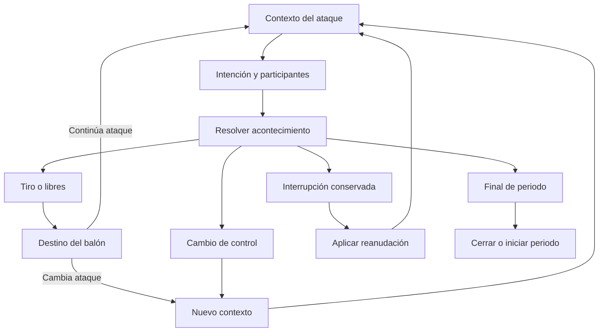

<!-- beM:nav-inicio -->
> [Índice del motor](../README.md) · [Tema: simulacion](README.md) · Capítulo 11 — Flujo de partido, posesiones y contexto pequeño
> Anterior: [c10-banda-fondo-y-situaciones-especiales](../tacticas/c10-banda-fondo-y-situaciones-especiales.md) · Siguiente: [c12-p01-seleccion-oportunidades-y-desenlaces](c12-p01-seleccion-oportunidades-y-desenlaces.md)
<!-- beM:nav-fin -->

## 11. Flujo de partido, posesiones y contexto pequeño

### 11.1. Contrato de sencillez y contexto pequeño

*Procedencia: MD05, §3.*

#### 11.1.1. Qué guarda el contexto

*Origen: MD05 §3.1.*

El estado general ya contiene reloj, periodo, marcador, faltas, derecho/control, quintetos, órdenes y estados. El contexto de la acción añade solamente relaciones necesarias para resolver la siguiente decisión.

| Información activa | Representación funcional suficiente | Momento de utilización |
|---|---|---|
| Balón y función | Jugador con balón, director cuando sea pertinente y sector funcional conocido. | Avance, recepción, elección o finalización. |
| Responsabilidad defensiva | Defensor principal y cambio de asignación si se ha producido. | Oposición y respuesta siguiente. |
| Intervención adicional | Ayudante o segundo defensor realmente comprometido y la responsabilidad que deja. | Pase de salida, recuperación, disputa o recepción. |
| Opción concreta | Receptor accesible, camino interior, defensor retrasado o desajuste identificable. | Aprovechar o recuperar esa relación. |
| Continuidad | Origen del ataque, última interacción pertinente, posible asistencia y reanudación pendiente. | Estadística y continuación. |
| Funciones de otros jugadores | Abrir, fijar, cortar, apoyar, cerrar o balancear, cuando afectan a la situación. | Elegibilidad y tareas relevantes. |

No se guarda un árbol de todas las opciones imaginables ni una lista nueva de estados psicológicos por relación. El contexto activo no replica la plantilla, el libro completo, el registro histórico ni la memoria defensiva.

#### 11.1.2. Límite funcional de complejidad

*Origen: MD05 §3.2.*

Una interacción ordinaria se describe por balón, oposición principal y las intervenciones adicionales que realmente cambian el problema. Los otros jugadores mantienen sus encargos; no se recalculan individualmente sin motivo.

Para ayudar, cambiar, atrapar o defender una zona puede ser necesario identificar más participantes. Se registran sus tareas pertinentes dentro de la misma resolución. No aparece por ello una simulación paralela de los diez jugadores.

**Condición de aceptación:** debe poder explicarse el contexto activo en una ficha breve. Si para entender por qué un receptor queda abierto se necesita revisar decenas de etiquetas, el diseño se ha desviado. Los acontecimientos complejos pueden dejar un registro más amplio; eso no obliga a mantener toda su historia como estado activo.

El número máximo técnico de entradas se fijará al construir y estará documentado. Su elección no puede utilizarse para introducir un modelo espacial más grande sin una necesidad deportiva concreta.

#### 11.1.3. Sectores y disposición

*Origen: MD05 §3.3.*

Se aceptan los diez sectores de tiro de la cuarta entrega: aro, resto de pintura, tres de media y cinco exteriores. Son categorías funcionales para ubicación de tiro y amenazas pertinentes. No son diez celdas que deban actualizarse siempre ni una malla de movimiento.

La disposición describe funciones de salida: cinco abiertos, cuatro y uno, tres y dos, dos altos, línea alta o línea baja. Cuando una acción cambia una función, se actualiza lo necesario. Un jugador no queda congelado en un sector para toda la posesión.

Si solo se conoce «exterior» o «interior», se conserva esa precisión. No se sortea izquierda, derecha o distancia exacta después para completar un gráfico. La agregación estadística admite una categoría de detalle no registrado.

#### 11.1.4. Continuidad y caducidad

*Origen: MD05 §3.4.*

Una ayuda efectiva deja una responsabilidad comprometida hasta que una recuperación, nueva recepción, reorganización u otro hecho pertinente la modifica. Un defensor retrasado no reaparece por haber cambiado de frase. Tampoco permanece retrasado indefinidamente porque la etiqueta no tenga actualización.

La siguiente resolución pertinente incorpora el tiempo transcurrido y las capacidades de los implicados para determinar si se mantiene, aprovecha o recupera la relación. No se necesita un evento vacío de recuperación cada segundo.

Se conserva aquello que cambia las posibilidades. Una vez resuelta la causa, se retira del contexto activo y permanece, si corresponde, en el registro del partido.

#### 11.1.5. Cuándo se vuelve a calcular

*Origen: MD05 §3.5.*

Se calcula cuando hay algo deportivo que resolver: una elección nueva con consecuencias, pérdida, contacto sancionable, recepción relevante, tiro, rebote, cambio efectivo de responsabilidad, reanudación o cierre.

Un pase rutinario puede formar parte del mismo acontecimiento resumido. Preparación, lectura, elección y ejecución son funciones del cálculo; no son cuatro pasos temporales obligatorios ni cuatro tiradas universales.

Una posesión puede resolverse de forma breve. Otra puede necesitar rebote ofensivo, salida de balón, falta y reanudación. El reloj limita lo posible; no determina cuántas iteraciones tiene que ejecutar el motor.

### 11.2. Resolución por acontecimientos: decisión confirmada

*Procedencia: MD03, §2.*

Dennis confirma que quiere resolver qué sucede en el partido, manteniendo su realismo y profundidad, sin reconstruir cada instante ni los movimientos continuos de los diez jugadores.

**Un ataque que consume 14 segundos puede resolverse en un único paso de cálculo.** Es un ejemplo de granularidad, no una duración fija aprobada. Si termina en fallo y rebote ofensivo, se resuelve la continuación. Si termina en falta, se aplica la reanudación correspondiente. Si se pierde antes de la finalización prevista, se consume el tiempo hasta esa pérdida.

#### 11.2.1. Qué calcula un paso

*Origen: MD03 §2.1.*

Un paso de resolución debe producir:

- El acontecimiento que efectivamente sucedió.
- Los participantes y responsabilidades pertinentes.
- El tiempo de juego transcurrido hasta ese acontecimiento.
- Los efectos deportivos y reglamentarios.
- El contexto necesario para continuar.
- El registro suficiente para relato, diagnóstico y futura estadística.

El reloj salta al siguiente acontecimiento. El coste de cálculo depende de las decisiones y sucesos relevantes, no de cuántos milisegundos duró la acción.

#### 11.2.2. Qué se representa de forma resumida

*Origen: MD03 §2.2.*

Una ayuda puede dejar disponible otra opción sin calcular su trayectoria. Una pantalla puede producir separación o cambio de responsabilidad sin medir cada desplazamiento. Una presión superada puede dejar a la defensa recuperando sin simular todos los pasos del retorno.

Las disposiciones indican ocupación funcional, posibilidades y responsabilidades. Las capacidades determinan si los participantes pueden crear y aprovechar las situaciones. La presentación puede explicar o ilustrar lo sucedido a partir del resultado resuelto.

No se requiere una posición continua por jugador, una velocidad física por fotograma, colisiones, rutas de movimiento, ni comprobaciones deportivas en cada unidad de tiempo.

#### 11.2.3. Funciones lógicas y pasos de simulación

*Origen: MD03 §2.3.*

| Función | Trabajo lógico | ¿Obliga a un paso temporal propio? |
|---|---|---|
| Preparación | Resolver coordinación y disponibilidad inicial | No |
| Lectura | Determinar qué percibe quien debe decidir | No |
| Elección | Seleccionar una opción viable y un participante | No |
| Ejecución | Resolver dificultad, oposición y capacidad | No |
| Continuación | Determinar si mantiene el ataque y con qué contexto | Solo si existe una continuación deportiva que deba resolverse |
| Actualización | Aplicar tiempo, carga, estados y reglas | No; se aplica al acontecimiento resuelto |

Una posesión puede tener varios acontecimientos, pero no debe contener pasos vacíos destinados únicamente a consumir tiempo.

### 11.3. Unidad deportiva, continuidad y contexto

*Procedencia: MD03, §3.*

#### 11.3.1. Posesión y resolución

*Origen: MD03 §3.1.*

La posesión es la unidad deportiva que conecta el ataque y sus continuaciones. Una resolución es el cálculo resumido hasta un acontecimiento. Ambas unidades no son necesariamente idénticas.

Pueden ocurrir un tiro fallado, un rebote ofensivo y una nueva finalización dentro de la misma posesión. También puede haber una interrupción en la que el ataque conserva el balón.

La posesión beM registrada conserva rebote ofensivo y reanudación del mismo ataque; inicio y cierre son explícitos. F, ejecución y tramo tienen universos propios y mantienen sus relaciones con la posesión.

#### 11.3.2. Orígenes distintos del ataque

*Origen: MD03 §3.2.*

| Origen | Contexto que importa |
|---|---|
| Recuperación en juego | Balón vivo, posible ventaja, jugadores en retorno y ubicación funcional de la recuperación |
| Rebote defensivo | Control asegurado, primer pase, jugadores disponibles para correr y balance rival |
| Canasta rival | Reanudación tras canasta y grado de organización de ambos equipos |
| Saque por pérdida o infracción | Lugar funcional, reloj, presión y entrada del balón |
| Inicio de periodo | Administración del periodo y plan inicial |
| Rebote ofensivo | Continuidad, defensores y atacantes implicados, oposición disponible y reloj |
| Interrupción conservando ataque | Causa, reanudación y posibilidad de reorganizarse |

No todas las recuperaciones producen contraataque. No todo saque es una jugada preparada cerca de la canasta atacada. La situación inicial debe ser correcta antes de aplicar preferencias.

#### 11.3.3. Contexto mínimo funcional

*Origen: MD03 §3.3.*

Se necesita información suficiente para que una decisión tenga significado, sin reconstrucción geométrica:

| Contexto | Función |
|---|---|
| Periodo, reloj de partido y reloj de posesión | Elegibilidad temporal y administración |
| Marcador e importancia del encuentro | Objetivos de final y presión |
| Quintetos, disponibilidad y faltas | Participantes reales y decisiones de rotación |
| Órdenes, libro y roles vigentes | Preferencias y responsabilidades |
| Director principal o alternativo | Quién interpreta y organiza la intención |
| Zona funcional del balón y ocupaciones relevantes | Opciones compatibles de pase, recepción y finalización |
| Defensor principal, ayudas y responsabilidades | Oposición real y consecuencias de abandonos o cambios |
| Defensa organizada, desplazada o recuperando | Calidad de oportunidades y posibilidad de correr |
| Ventaja y opciones resultantes | Continuidad coherente tras una respuesta |
| Energía, forma y momento | Rendimiento actual |
| Patrones recientes | Respuesta limitada a la repetición |

Se utilizan los diez sectores funcionales de tiro cuando se conocen, junto con las relaciones y funciones pertinentes de la acción y la distinción de campo necesaria para las reglas. Interior, poste alto, frente, laterales y esquinas describen referencias funcionales, sin coordenadas continuas ni detalle inventado.

#### 11.3.4. Flujo de resolución

*Origen: MD03 §3.4.*

El diagrama resume continuidad. La clasificación reglamentaria y las sanciones pueden precisar la reanudación; no todos los libres ni todas las faltas producen el mismo cambio de ataque.

### 11.4. Tres tablas configurables

*Procedencia: MD03, §4.*

Las tres tablas son grupos de datos y reglas legibles. No obligan a una base de datos relacional ni a un diseño técnico concreto.

| Tabla | Pregunta principal | Entradas principales | Salida |
|---|---|---|---|
| 1. Selección | ¿Qué se intenta y quién participa? | Órdenes, libro, roles, capacidades de lectura, contexto y reloj | Intención, participantes y alternativas pertinentes |
| 2. Oportunidades y desenlaces | ¿Qué opción aparece y qué sucede al aprovecharla? | Capacidades de los ejecutantes, oposición, preparación, dificultad y estados | Acontecimiento y consecuencias inmediatas |
| 3. Tiempo, esfuerzo y estados | ¿Cuánto transcurre y cómo queda el partido? | Acontecimiento, duración, tareas, reglas y estado previo | Relojes, energía, estados, reanudación y contexto siguiente |

Una opción táctica debe tener una conexión reconocible con una o varias tablas. Su nombre no concede una mejora universal de acierto ni de capacidades.

### Nota de implementación MOTOR-18 (Familiaridad en el flujo (MOTOR-18))

Durante el partido solo se consulta la instantánea congelada de conocimiento y se acumula exposición; no se aprende ni se olvida. El ajuste se cobra una vez por operación y no se repite en una calidad heredada ni en la conversión del tiro. Detalle: `docs/tecnico/motor18.md`.

### Nota de implementación MOTOR-18B (Estimación frente a resolución)

Las estimaciones de media distancia/calidad cómoda comparten con la operación resuelta el mismo constructor de contexto de familiaridad. Estimar no cambia la cobertura vigente, la memoria, las órdenes, los participantes, los relojes, el contador de sorteos ni la exposición. Detalle: `docs/tecnico/motor18b.md`.

<!-- beM:pie-inicio -->
> [Índice del tema](README.md) · Anterior: [c10-banda-fondo-y-situaciones-especiales](../tacticas/c10-banda-fondo-y-situaciones-especiales.md) · Siguiente: [c12-p01-seleccion-oportunidades-y-desenlaces](c12-p01-seleccion-oportunidades-y-desenlaces.md)
